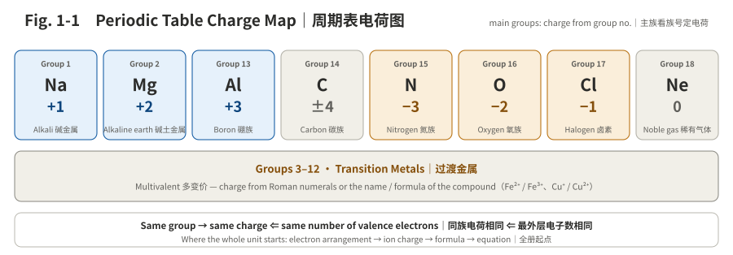
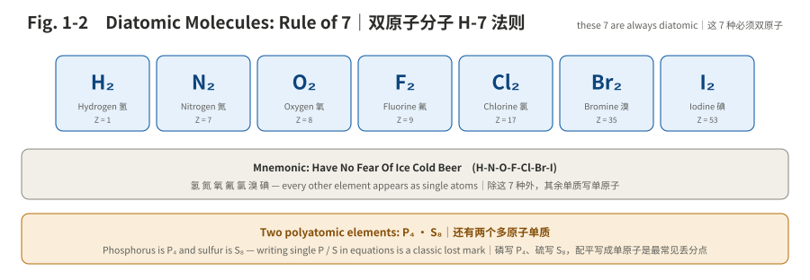
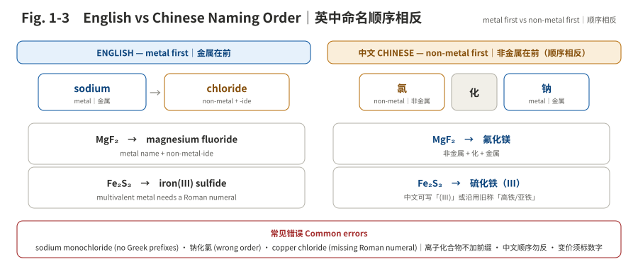
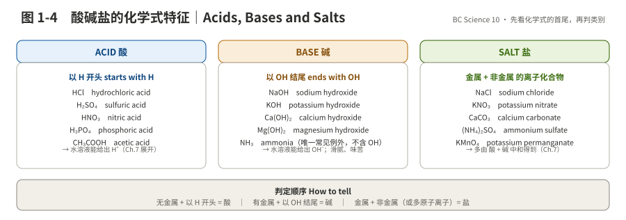

# Ch.1 — From Science 9 to Science 10: Atoms, Ions and Formulas
## 第 1 章　从 Science 9 到 Science 10：原子、离子与化学式

> 🗂️ **大纲对应**：承接 Science 9「element properties as organized in the periodic table / the arrangement of electrons determines the compounds formed by elements」
> ⏱️ **课时 Periods**：2　|　**前置**：Science 9 化学（元素、玻尔图、命名基础）　|　**后继**：Ch.2
> 📄 **素材对齐**：`SCI 10 REV WORKSHEET 0` p1–p2（Periodic Table Tips / Diatomic Molecules / Naming / Formulas / Acids, Bases & Salts）
> 🗂️ **文件生成时间**：2026-09-24 15:04

## 1. 大纲对应｜Content Alignment

| 项目 | 内容 |
|---|---|
| 定位 | **预备 / 工具章**（Part 0）：BC Science 10 是综合科学课，化学单元默认你已会用 Science 9 的"原子语言" |
| 直接服务的 Content | C1「rearrangement of atoms in chemical reactions」与 C2「acid-base chemistry」的**最低门槛**——写不对化学式，就写不出方程式 |
| Science 9 衔接条目 | element properties as organized in the periodic table；the arrangement of electrons determines the compounds formed by elements（Big Idea：The electron arrangement of atoms impacts their chemical nature.） |
| Curricular Competencies | [Processing and analyzing] Seek and analyze patterns；[Communicating] Communicate scientific information using language and representations |
| 是否超纲 | 否。仅"摩尔 / 浓度计算"等定量内容超纲，本册一律标 `【🔭 Extension → Chemistry 11】` |
| 素材对齐 | 学校复习卷 `WS0` 前两页的五个板块：周期表电荷 → 双原子分子 → 命名 → 化学式 → 酸碱盐，本章节序与其一一对应 |

## 2. 学习目标｜Learning Objectives

**EN — By the end of this chapter, you should be able to:**
1. Recall the charge and location of protons, neutrons and electrons, and explain why atoms are neutral.
2. Determine the ion charge of main-group elements from periodic table position, and identify multivalent transition metals.
3. Write the formulas and names of ionic compounds, including multivalent metals (Roman numerals) and polyatomic ions.
4. Write the formulas and names of covalent compounds using Greek prefixes (mono-, di-, tri-…).
5. Classify a substance as acid, base or salt from its formula, and list the 7 diatomic elements.

**中 — 本章结束后，你应当能够：**
1. 说出质子、中子、电子的电荷与位置，解释原子为什么呈电中性。
2. 由周期表的族位置写出主族元素的离子电荷，并识别多变价过渡金属。
3. 书写离子化合物的化学式与名称（含多变价金属的罗马数字、多原子离子）。
4. 用希腊数字前缀书写共价（分子）化合物的化学式与名称。
5. 由化学式判断物质属于酸、碱还是盐，背出 7 种双原子分子。

## 3. 概念解析｜Concept Explanations

### 3.1 原子与亚原子粒子（复习）｜Atoms & Subatomic Particles

| Particle 粒子 | Charge 电荷 | Location 位置 | 中文一句话 |
|---|---|---|---|
| Proton 质子 | +1 | 原子核内 | 决定元素种类 |
| Neutron 中子 | 0 | 原子核内 | 决定同位素 |
| Electron 电子 | −1 | 核外电子层 | 决定化学性质 |

- **原子显电中性**：质子数 = 电子数，正负抵消。
- Science 9 的核心结论——**原子的电子排布决定化学性质**——在本章直接兑现为两条实用规则：
  ① 最外层电子数 → 主族离子的电荷；② 电子得 / 失 → 离子化合物的形成。

### 3.2 周期表电荷图｜Periodic Table Charge Map（本册最常用工具）

由族位置直接读出离子电荷（详见 **图 1-1**）：

| 族 Group | 典型元素 | 离子电荷 | 记忆 |
|---|---|---|---|
| Group 1（Alkali Metals 碱金属） | Li, Na, K | +1 | 丢 1 个电子 |
| Group 2（Alkaline Earth Metals 碱土金属） | Mg, Ca | +2 | 丢 2 个电子 |
| **Groups 3–12（Transition Metals 过渡金属）** | Fe, Cu, Zn… | **multivalent 多变价** | 看罗马数字或名称 / 化学式反推 |
| Group 13 | B, Al | +3 | 丢 3 个电子 |
| Group 14 | C, Si | 通常不形成离子 | ±4 极少见，共价为主 |
| Group 15 | N, P | −3 | 得 3 个电子 |
| Group 16 | O, S | −2 | 得 2 个电子 |
| Group 17（Halogens 卤素） | F, Cl, Br, I | −1 | 得 1 个电子 |
| Group 18（Noble Gases 稀有气体） | He, Ne, Ar | 0（不形成离子） | 最外层已满，"懒得动" |

> 📏 **同族电荷为什么相同？** 同族元素的最外层电子数相同 → 得 / 失电子的倾向相同 → 生成的离子电荷相同。这正是 Science 9「电子排布决定化学性质」的落地。
> 【🔭 Extension → Chemistry 11】过渡金属"为什么"多变价需要 d 电子层面的解释，Science 10 不作要求——只需会用"罗马数字 / 名称反推"这条工具规则。

### 3.3 双原子分子｜Diatomic Molecules（H-7 法则 / Rule of 7）

有 7 种元素的单质在自然界以**双原子分子**形式存在（详见 **图 1-2**）：

**H₂ · N₂ · O₂ · F₂ · Cl₂ · Br₂ · I₂**

- **英文口诀**：Have No Fear Of Ice Cold Beer（H-N-O-F-Cl-Br-I）。
- **中文口诀**：氢 氮 氧 氟 氯 溴 碘。
- 两个"编外"成员：**P₄（磷 phosphorus）** 与 **S₈（硫 sulfur）**——它们不是双原子，但同样是"不能写成单原子"的多原子单质。
- ⛔ **写方程式时的铁律**：氧气是 O₂ 不是 O；配平出错常常就是忘了它们。

### 3.4 离子化合物｜Ionic Compounds：命名与化学式

**定义**：metal 金属 + non-metal 非金属（或 + polyatomic ion 多原子离子）通过**静电吸引**结合，本质是**阳离子 cation 与阴离子 anion** 的结合。

**命名（Naming）三步**：
1. 先写**金属**（阳离子）的元素名；
2. 再写**非金属**（阴离子）的名字，词尾改成 **-ide**（chlorine → chloride）；
3. 金属若有**多个电荷**（多为过渡金属），必须用**罗马数字**标明是哪一个：FeCl₂ = iron(II) chloride，FeCl₃ = iron(III) chloride。

> 📌 **多原子离子当"一个原子"对待**：Na₂SO₄ = sodium sulfate（硫酸钠），不要拆成 sodium sulfur oxygen。

**化学式（Formula）两步——drop and swap（交叉法 / criss-cross）**：
1. 写出两种离子的符号与电荷：Al³⁺　O²⁻；
2. 把电荷数字**交叉**放到对方脚下（数字 1 不写）：Al₂O₃；
3. 验算：正电荷总数 2×(+3) = +6，负电荷总数 3×(−2) = −6，**代数和为零**；
4. 若能约简要约至**最简比**：Ca²⁺ 与 CO₃²⁻ 是 2+ 与 2−，交叉得 Ca₂(CO₃)₂ → **CaCO₃**。

> ⛔ 化学式里写的是**元素比例**，不是"每个分子有几个电荷"——电荷只用于推导，最终化学式中不出现电荷符号。

### 3.5 共价（分子）化合物｜Covalent / Molecular Compounds

**定义**：non-metal 非金属 + non-metal 非金属，通过**共用电子对**结合。

**命名规则**：用**希腊数字前缀**（Greek prefixes）表示每种非金属的个数，第二个元素词尾改 **-ide**：

| 个数 | 1 | 2 | 3 | 4 | 5 | 6 | 7 | 8 |
|---|---|---|---|---|---|---|---|---|
| 前缀 Prefix | mono- | di- | tri- | tetra- | penta- | hexa- | hepta- | octa- |

- **第一个元素永不用 mono-**：CO = **carbon monoxide**（不是 monocarbon monoxide）；CO₂ = carbon dioxide。
- 例：SO₂ = sulfur dioxide；Si₃N₄ = trisilicon tetranitride；N₂O₅ = dinitrogen pentoxide（注意 a/o 双写省略规则：penta- + oxide → **pentoxide**）。
- **中文读法正好相反**：从后往前读"几 + 某化 + 几 + 某"——N₂O₅ = **五氧化二氮**；CO = 一氧化碳。

### 3.6 多原子离子｜Polyatomic Ions

带电荷的**原子团**：几个原子绑在一起、整体带电，反应时**不拆开**。

| 离子 | 英文名 | 中文名 | 电荷 |
|---|---|---|---|
| NH₄⁺ | ammonium | 铵根 | +1 |
| OH⁻ | hydroxide | 氢氧根 | −1 |
| NO₃⁻ | nitrate | 硝酸根 | −1 |
| SO₄²⁻ | sulfate | 硫酸根 | −2 |
| CO₃²⁻ | carbonate | 碳酸根 | −2 |
| PO₄³⁻ | phosphate | 磷酸根 | −3 |
| HCO₃⁻ | hydrogen carbonate | 碳酸氢根 | −1 |
| CH₃COO⁻ | acetate | 醋酸根 | −1 |
| C₂O₄²⁻ | oxalate | 草酸根 | −2 |
| MnO₄⁻ | permanganate | 高锰酸根 | −1 |
| CrO₄²⁻ | chromate | 铬酸根 | −2 |

- 使用方法：**当成一个"超级原子"**，套用 3.4 的命名与交叉法。
  - 例：(NH₄)₂SO₄ = ammonium sulfate（硫酸铵）；需要 2 个铵根时给 NH₄ 加**括号**。
- ⚠️ NH₄⁺（铵根）是**唯一常见的、不含金属的阳离子**——含它的化合物照样是离子化合物。

### 3.7 酸、碱、盐的化学式特征｜Acids, Bases and Salts

先看化学式的**首尾**，就能完成 90% 的分类（详见 **图 1-4**）：

| 类别 | 化学式特征 | 英文示例 | 中文 | 判据细节 |
|---|---|---|---|---|
| **Acid 酸** | **以 H 开头** | HCl, H₂SO₄, HNO₃, H₃PO₄ | 盐酸、硫酸、硝酸、磷酸 | 有机酸 CH₃COOH 也常写作 HC₂H₃O₂（仍以 H 开头） |
| **Base 碱** | **以 OH 结尾** | NaOH, KOH, Ca(OH)₂, Mg(OH)₂ | 氢氧化钠、氢氧化钾、氢氧化钙、氢氧化镁 | 唯一常见例外：NH₃（ammonia 氨）也是碱，但不含 OH |
| **Salt 盐** | 金属 + 非金属的**离子化合物** | NaCl, KNO₃, CaCO₃ | 氯化钠、硝酸钾、碳酸钙 | 多由酸 + 碱中和得到（Ch.7） |

- 完整的酸碱性质（pH、指示剂、中和反应）在 **Ch.7** 展开；本章只需"看化学式认类别"。

### 3.8 英中命名顺序相反 + 拼写变体｜Naming Order & Spelling

**英中命名顺序完全相反**（详见 **图 1-3**），必须两栏对照记：

| | 规则 | 例（NaCl） | 例（MgF₂） |
|---|---|---|---|
| **英文 English** | metal 金属 + non-metal-ide | sodium chloride | magnesium fluoride |
| **中文 Chinese** | **非金属 + 化 + 金属** | **氯化钠** | **氟化镁** |

- **-ide 对应中文的"化"**，位置在中间。
- **多变价的中文叫法**：FeCl₂ = iron(II) chloride = **氯化亚铁**（低价用"亚"）；FeCl₃ = iron(III) chloride = **氯化铁**（或写"氯化铁(Ⅲ)"）。
- **拼写变体（本册约定）**：
  - 铝：本册统一写 **aluminium**（学校材料可能写 aluminum）；
  - 硫系：本册正文以 **sulf-**（sulfide、sulfate、sulfuric）为准，学校材料里的 **sulphide / sulphate** 是同一种物质的旧拼法——两者都认得，书写只用 sulf-。

## 4. 表格比对｜Comparison Tables

### 表 1-1　Ionic vs Covalent Compound 离子化合物与共价化合物

| 比较项 | Ionic ionic compound 离子化合物 | Covalent / molecular compound 共价（分子）化合物 |
|---|---|---|
| 组成 | metal + non-metal（或 + 多原子离子） | non-metal + non-metal |
| 结合方式 | 阴、阳离子静电吸引 | 共用电子对 |
| 离子电荷 | 一定有（由周期表位置 / 罗马数字给出） | 不涉及离子 |
| 命名工具 | 金属名 + non-metal-**ide**；罗马数字；无前缀 | **希腊前缀** mono-/di-/tri-…；-ide 结尾 |
| 化学式工具 | drop and swap 交叉法，电荷代数和为零 | 前缀直接读出原子个数 |
| 例子 | NaCl、Fe₂S₃、(NH₄)₂SO₄ | CO₂、H₂O、N₂O₅ |
| 中文名结构 | 非金属 + 化 + 金属（氯化钠） | 几 + 某 + 化 + 几 + 某（五氧化二氮） |

### 表 1-2　罗马数字 vs 希腊前缀（最易混的两个"数字"）

| 比较项 | Roman numerals 罗马数字 | Greek prefixes 希腊前缀 |
|---|---|---|
| 用在哪类化合物 | **离子化合物**（金属多变价时） | **共价化合物** |
| 写在哪个词 | 金属名后的括号里：iron(III) | 元素名前面：dinitrogen |
| 表示什么 | **金属离子的电荷**（+2、+3…） | **原子的个数**（1 个、2 个…） |
| 离子化合物能用吗 | ✅ 专用 | ❌ 禁用（NaCl ≠ sodium monochloride） |
| 共价化合物能用吗 | ❌ 禁用 | ✅ 专用（但第一个元素不用 mono-） |
| 例子 | CuCl₂ = copper(II) chloride 氯化铜 | N₂O₅ = dinitrogen pentoxide 五氧化二氮 |

### 表 1-3　英中命名顺序对照（含错误示范）

| 化学式 | 英文命名 English | 中文命名 Chinese | 常见错误示范 |
|---|---|---|---|
| NaCl | sodium chloride | 氯化钠 | ✗ sodium monochloride；✗ 钠化氯 |
| MgF₂ | magnesium fluoride | 氟化镁 | ✗ magnesium difluoride |
| Al₂S₃ | aluminium sulfide | 硫化铝 | ✗ aluminium trisulfide（离子化合物不用前缀） |
| CuCl₂ | copper(II) chloride | 氯化铜（Ⅱ）/ 氯化铜 | ✗ copper chloride（多变价漏罗马数字，CuCl 与 CuCl₂ 分不清） |
| FeO | iron(II) oxide | 氧化亚铁 | ✗ iron oxide（不够具体） |
| SO₂ | sulfur dioxide | 二氧化硫 | ✗ sulfur(IV) oxide（共价化合物不用罗马数字） |
| Si₃N₄ | trisilicon tetranitride | 四氮化三硅 | ✗ trisilicon tetranitrogen（忘了 -ide） |
| N₂O₅ | dinitrogen pentoxide | 五氧化二氮 | ✗ dinitrogen pentaoxide（a/o 相遇省 a） |

### 表 1-4　常见多原子离子速查（按电荷分组）

| 电荷 | 离子（英文名 / 中文名） |
|---|---|
| +1 | NH₄⁺ ammonium 铵根（唯一无金属的阳离子） |
| −1 | OH⁻ hydroxide 氢氧根 · NO₃⁻ nitrate 硝酸根 · HCO₃⁻ hydrogen carbonate 碳酸氢根 · CH₃COO⁻ acetate 醋酸根 · MnO₄⁻ permanganate 高锰酸根 · ClO₃⁻ chlorate 氯酸根 |
| −2 | SO₄²⁻ sulfate 硫酸根 · CO₃²⁻ carbonate 碳酸根 · C₂O₄²⁻ oxalate 草酸根 · CrO₄²⁻ chromate 铬酸根 |
| −3 | PO₄³⁻ phosphate 磷酸根 |

> 📌 记忆钩子：**-ate 结尾的多为 −2 / −3 电荷的含氧酸根**；**-ide 结尾的单原子阴离子**电荷 = 8 − 最外层电子数（如 Cl −1、O −2）。

### 表 1-5　酸碱盐化学式特征

| 类别 | 特征 | 反例 / 例外 | 本章要求 |
|---|---|---|---|
| Acid 酸 | 以 **H** 开头 | CH₃COOH（写作 CH₃COOH 时首字母是 C，但本质仍是酸；可写作 HC₂H₃O₂） | 看式认酸 |
| Base 碱 | 以 **OH** 结尾 | NH₃ ammonia（氨）也是碱，不含 OH | 看式认碱 |
| Salt 盐 | 金属 + 非金属的**离子化合物** | NH₄Cl（无金属，但含 NH₄⁺，仍是离子化合物 / 盐） | 看式认盐 |

### 表 1-6　拼写变体对照｜Spelling Variants

| 本册用 | 学校材料可能出现 | 说明 |
|---|---|---|
| aluminium | aluminum | 美式少一个 i；BC 教材与 IUPAC 用 aluminium |
| sulfide / sulfate / sulfuric | sulphide / sulphate / sulphuric | ph- 是旧拼法，指同一种物质 |
| sulfur | sulphur | 同上 |

## 5. 图例说明｜Diagrams & Worked Examples

### 图 1-1　周期表电荷图｜Periodic Table Charge Map

**看图要点**：主族看**族号**直接读电荷（1→+1、2→+2、13→+3、15→−3、16→−2、17→−1、18→0）；Group 14 通常不成离子；中间一整条 Groups 3–12 都是**多变价**，电荷必须靠罗马数字或名称 / 化学式反推。

### 图 1-2　双原子分子：H-7 法则｜Diatomic Molecules (Rule of 7)

**看图要点**：H₂ N₂ O₂ F₂ Cl₂ Br₂ I₂ 七兄弟 + P₄ / S₈ 两个编外成员。写方程式时，这 9 种元素的单质**绝不能写成单原子**。

### 图 1-3　英中命名顺序相反｜English vs Chinese Naming Order

**看图要点**：同一个 NaCl，英文从金属读起（sodium → chloride），中文从非金属读起（氯 → 化 → 钠）；-ide 就是中文的"化"。

### 图 1-4　酸碱盐的化学式特征｜Acids, Bases and Salts

**看图要点**：酸看**开头**（H…）、碱看**结尾**（…OH）、盐看**组成**（金属 + 非金属的离子化合物）。

### 例题 1-1　由名称写化学式｜Name → Formula

| 名称 Name | 推理步骤 | 化学式 Formula |
|---|---|---|
| magnesium phosphide 磷化镁 | Mg²⁺ 与 P³⁻ 交叉 → Mg₃P₂，验算 (+2)×3 = +6，(−3)×2 = −6 ✓ | **Mg₃P₂** |
| iron(III) sulfide 硫化铁(Ⅲ) | Fe³⁺ 与 S²⁻ 交叉 → Fe₂S₃，验算 +6 / −6 ✓ | **Fe₂S₃** |
| calcium carbonate 碳酸钙 | Ca²⁺ 与 CO₃²⁻ 交叉得 Ca₂(CO₃)₂ → 约简 2:2 → CaCO₃ | **CaCO₃** |
| aluminium oxide 氧化铝 | Al³⁺ 与 O²⁻ 交叉 → Al₂O₃ | **Al₂O₃** |
| phosphorus trioxide（原卷写法） | 严格按前缀规则应读作 **diphosphorus trioxide**：P₂O₃ | **P₂O₃** |
| dinitrogen pentoxide（原卷作 "pentacarbide"，疑为笔误） | di- = 2 个 N，pent- = 5 个 O → N₂O₅ | **N₂O₅** |

> 📌 **原卷勘误｜Errata**（学校复习卷的手写笔误，以正确化学为准）：
> ① `KPO₄` 应为 **K₃PO₄**（potassium phosphate 磷酸钾）——K⁺ 是 +1，PO₄³⁻ 是 −3；
> ② "dinitrogen pentacarbide" 按化学常识疑为 **dinitrogen pentoxide（N₂O₅）** 之误；
> ③ "Iron 111 chloride" 应为 **iron(III) chloride**（罗马数字 III，不是 111）；
> ④ "trisilican tetranitride" 应为 **trisilicon tetranitride**（Si₃N₄ 四氮化三硅）。

### 例题 1-2　由化学式写名称｜Formula → Name

| 化学式 | 判类 | 推理步骤 | 名称 |
|---|---|---|---|
| MgF₂ | ionic | Mg 只有一个电荷 → 不用罗马数字；F → fluoride | magnesium fluoride｜氟化镁 |
| CuCl₂ | ionic | Cu 多变价 → 由 2 个 Cl⁻ 反推 Cu 是 +2 → (II) | copper(II) chloride｜氯化铜 |
| K₃PO₄ | ionic | PO₄³⁻ 当一个整体 → potassium phosphate | potassium phosphate｜磷酸钾 |
| SO₂ | covalent | 无金属 → 用前缀；第一个元素 1 个 → 不加 mono- | sulfur dioxide｜二氧化硫 |
| Si₃N₄ | covalent | tri- = 3 个 Si，tetra- = 4 个 N，-ide 结尾 | trisilicon tetranitride｜四氮化三硅 |
| NH₄Cl | ionic | NH₄⁺ 当"金属"用：ammonium + chloride | ammonium chloride｜氯化铵 |

### 例题 1-3　酸碱盐分类｜Acid, Base or Salt?

| 化学式 | 判定 | 依据 |
|---|---|---|
| HCl | acid 酸 | 以 H 开头 |
| NaOH | base 碱 | 以 OH 结尾 |
| CaCO₃ | salt 盐 | 金属 + 非金属的离子化合物 |
| H₂SO₄ | acid 酸 | 以 H 开头 |
| Mg(OH)₂ | base 碱 | 金属 + OH |
| KNO₃ | salt 盐 | 金属 K + 硝酸根 NO₃⁻ |
| HC₂H₃O₂（即 CH₃COOH） | acid 酸 | 以 H 开头（醋酸） |
| NH₄Cl | salt 盐 | 含 NH₄⁺ 的离子化合物（无金属但仍是盐） |

## 6. 核心词汇｜Key Vocabulary

| English | 中文 | 备注 |
|---|---|---|
| ion | 离子 | 带电的原子 / 原子团 |
| cation | 阳离子 | 电荷为正，metal 失电子形成 |
| anion | 阴离子 | 电荷为负，non-metal 得电子形成 |
| ion charge | 离子电荷 | 由周期表族位置读出 |
| multivalent | 多变价的 | 过渡金属常见（Fe²⁺/Fe³⁺） |
| roman numeral | 罗马数字 | 标明多变价金属的电荷：iron(III) |
| polyatomic ion | 多原子离子 | 整体带电的原子团，反应中不拆开 |
| diatomic molecule | 双原子分子 | H-7 法则的 7 种单质 |
| ionic compound | 离子化合物 | metal + non-metal |
| covalent / molecular compound | 共价（分子）化合物 | non-metal + non-metal |
| prefix | 前缀 | mono-/di-/tri-… 表示原子个数 |
| criss-cross method | 交叉法 | 又叫 drop and swap，写离子化合物化学式 |
| acid | 酸 | 化学式通常以 H 开头 |
| base | 碱 | 化学式通常以 OH 结尾 |
| salt | 盐 | 金属 + 非金属的离子化合物 |
| -ide | —（词尾"化"） | chloride → 氯化物 |
| -ate | —（词尾，含氧酸根） | sulfate 硫酸根 |
| neutral | 电中性的 | 原子中质子数 = 电子数 |

## 7. 实验与活动｜Lab / Activity

### 活动 1-1　离子电荷速查赛｜Ion Charge Sprint
- **类型**：限时个人挑战（Timed drill）
- **材料**：一张空周期表 + 计时器；30 张族号 / 元素卡片
- **步骤**：
  1. 教师给出元素（覆盖 Group 1 / 2 / 13–18 + Fe、Cu、Zn、Ag、Pb 等常见过渡金属）；
  2. 学生 10 秒内在周期表对应位置写出离子符号（如 Ca²⁺）；
  3. 交换互批，统计正确率，全班讨论"哪些族最容易写错"。
- **训练能力**：[Processing and analyzing] Seek and analyze patterns in data；[Communicating]
- **安全**：无

### 活动 1-2　化学式配对卡｜Formula Matching Cards
- **类型**：小组卡牌活动（Pair work）
- **材料**：阳离子牌（Na⁺、Mg²⁺、Al³⁺、Fe²⁺、Fe³⁺、Cu²⁺、Ag⁺、NH₄⁺、Ca²⁺）× 阴离子牌（Cl⁻、O²⁻、S²⁻、OH⁻、NO₃⁻、SO₄²⁻、CO₃²⁻、PO₄³⁻、C₂O₄²⁻、CH₃COO⁻、CrO₄²⁻、ClO₃⁻）
- **步骤**：
  1. 两人一组，各抽一张，用交叉法拼出化学式并命名（英文 + 中文）；
  2. 对方验算电荷代数和是否为零、比例是否最简；
  3. 每轮加分：化学式 +1、英文命名 +1、中文命名 +1、主动指出对方易错点 +1。
- **训练能力**：[Communicating]；[Processing and analyzing]
- **安全**：无

### 活动 1-3　酸碱盐三分类｜Acid–Base–Salt Sorting
- **类型**：分类挑战（Sorting + reasoning）
- **材料**：20 张化学式卡（含 HCl、CH₃COOH、NaOH、NH₃、Mg(OH)₂、CaCO₃、KNO₃、NH₄Cl、H₂SO₄、NaCl……），每张卡背面印一条"生活线索"（闻起来像醋 / 摸起来滑腻 / 是大理石主要成分……）
- **步骤**：
  1. 三栏分类（acid / base / salt），**每张卡必须写一句判定依据**；
  2. 重点讨论两张"陷阱卡"：NH₃（碱但无 OH）与 NH₄Cl（盐但无金属）；
  3. 把结果与 `WS0` p2 的 "Acids, Bases & Salts" 板块对照自查。
- **训练能力**：[Processing and analyzing] Use knowledge of scientific concepts to draw conclusions；[Evaluating]（对自己的分类给出证据）
- **安全**：无（纯卡片活动；若配合真实样品，禁止品尝任何物质）

## 8. 常见易错点｜Common Misconceptions

| # | 错误认识 Misconception | 正确理解 Correction |
|---|---|---|
| 1 | "过渡金属只有一个电荷" | 多数过渡金属是 **multivalent**：Cu⁺ / Cu²⁺、Fe²⁺ / Fe³⁺ 必须靠**罗马数字**区分。 |
| 2 | "离子化合物也用希腊前缀" | 离子化合物**不用**前缀：NaCl 是 sodium chloride，**不是** sodium monochloride。 |
| 3 | "共价化合物第一个元素也加 mono-" | 第一个元素**永不用 mono-**：CO = **carbon monoxide**，不是 monocarbon monoxide。 |
| 4 | "氧气是 O，氢气是 H" | 这 7 种单质是双原子分子：H₂ N₂ O₂ F₂ Cl₂ Br₂ I₂（外加 P₄、S₈）。配平最常见的翻车点。 |
| 5 | "中文命名就照英文顺序翻" | 顺序相反：英文 metal 在前，中文**非金属在前**。NaCl = **氯化钠**，写成"钠化氯"就错了。 |
| 6 | "NH₄⁺ 只是一个基团，不带电" | NH₄⁺ **整体带 +1**，(NH₄)₂SO₄ 里要写**括号**；含铵根的化合物是离子化合物。 |
| 7 | "碱一定含 OH，盐一定含金属" | NH₃ 是碱但不含 OH；NH₄Cl 是盐但不含金属——判据要看本质（给出 OH⁻ / 是否离子化合物）。 |
| 8 | "KPO₄ 这样写没问题" | K⁺(+1) 与 PO₄³⁻(−3) 交叉得 **K₃PO₄**；化学式里正负电荷代数和必须为零。 |
| 9 | "roman numeral 写成 111 没关系" | iron(III) 用的是罗马数字 **III = 3**；写成 "Iron 111 chloride" 会被当成笔误扣分。 |
| 10 | "化学式里的比例不用约简" | 交叉后要约至**最简整数比**：Ca₂(CO₃)₂ → **CaCO₃**。 |

## 9. 答题评估｜Assessment

### A 组：基础题｜Foundational（每题 2 分，共 20 分）

**A1.** 填表：写出三种亚原子粒子的电荷与位置。

| Particle | Charge | Location |
|---|---|---|
| proton | | |
| neutron | | |
| electron | | |

**A2.** 由周期表位置写出离子符号：Na、Mg、Al、N、O、Cl、Ne。
**A3.** 写出化学式：sodium chloride、calcium oxide、aluminium sulfide。
**A4.** 写出名称（英文 + 中文）：MgF₂、CuCl₂、K₃PO₄。
**A5.** 写出 7 种双原子分子的化学式，并默写两个"编外"多原子单质。
**A6.** 判断 ionic 还是 covalent：SO₂、CaCl₂、NH₄Cl、N₂O₃。
**A7.** 把下列物质分为 acid / base / salt：HCl、NaOH、CaCO₃、H₂SO₄、Mg(OH)₂、KNO₃。
**A8.** 写出化学式：iron(II) oxide 与 iron(III) oxide，并写出各自的中文名。
**A9.** 写出化学式：sulfur dioxide、dinitrogen pentoxide、carbon monoxide。
**A10.** 判断："NaCl 可以命名为 sodium monochloride。"（对 / 错，说明理由）

### B 组：应用题｜Applied（每题 5 分，共 20 分）

**B1.** 用 drop and swap 完整写出以下三个化学式，要求写出两种离子的电荷、交叉过程和电荷验算：aluminium oxide、iron(III) sulfide、calcium nitrate。

**B2.** 同学甲把 CuCl₂ 命名为 "copper chloride"，同学乙命名为 "copper(II) chloride"。谁对？为什么必须区分？再写出 CuCl 的名称（英文 + 中文）。

**B3.** 用"最外层电子数"解释：为什么 Group 1 的所有元素都形成 +1 离子，而 Group 17 都形成 −1 离子？这个规律让你能"预测"哪个族的哪种电荷？

**B4.** 把下列化合物按 ionic / covalent 分类，并说明你的判据：MgO、CO₂、Na₂SO₄、PCl₃、NH₄NO₃、AlF₃。

### C 组：挑战题｜Challenge（每题 10 分，共 20 分）

**C1.** 某同学把 Fe₂O₃ 命名为 "iron oxide"，并写了中文名"铁化氧"。请指出**三处**问题（含命名与中文语序），给出正确答案（英文 + 中文），并解释为什么"iron oxide"在 CuCl₂ 上会引发更严重的歧义。

**C2.** 综合命名与分类：写出下列物质的英文名称、中文名称，并说明各自属于 acid / base / salt 中的哪一类、化学式里有没有多原子离子：
(a) KMnO₄　(b) AlPO₄　(c) (NH₄)₂SO₄　(d) N₂O₅　(e) H₂C₂O₄（草酸）

---

### 参考答案｜Answer Key

**A 组**
- A1. proton: +1，原子核内；neutron: 0，原子核内；electron: −1，核外电子层。
- A2. Na⁺、Mg²⁺、Al³⁺、N³⁻、O²⁻、Cl⁻、Ne 不形成离子（Group 18）。
- A3. NaCl；CaO；Al₂S₃（Al³⁺ 与 S²⁻ 交叉）。
- A4. MgF₂ = magnesium fluoride 氟化镁；CuCl₂ = copper(II) chloride 氯化铜；K₃PO₄ = potassium phosphate 磷酸钾。
- A5. H₂ N₂ O₂ F₂ Cl₂ Br₂ I₂；编外：P₄（磷）、S₈（硫）。
- A6. SO₂ covalent；CaCl₂ ionic；NH₄Cl ionic（含 NH₄⁺）；N₂O₃ covalent。
- A7. acid：HCl、H₂SO₄；base：NaOH、Mg(OH)₂；salt：CaCO₃、KNO₃。
- A8. FeO = iron(II) oxide 氧化亚铁；Fe₂O₃ = iron(III) oxide 氧化铁（Ⅲ）。
- A9. SO₂；N₂O₅；CO。
- A10. **错**。离子化合物不加希腊前缀；且 Na⁺ 只有 +1 一种电荷，无需 mono-。正确名称：sodium chloride 氯化钠。

**B 组（要点）**
- B1. ① Al³⁺ + O²⁻ → Al₂O₃，验算 2×(+3)+3×(−2)=0 ✓；② Fe³⁺ + S²⁻ → Fe₂S₃，验算 +6/−6 ✓；③ Ca²⁺ + NO₃⁻ → 交叉得 Ca(NO₃)₂（硝酸根是 −1，数字 1 不写；NO₃ 整体加括号），验算 +2 + 2×(−1) = 0 ✓。
- B2. **乙对**。铜是多变价金属（Cu⁺ / Cu²⁺），不写罗马数字就无法唯一确定化学式——"copper chloride" 既可能指 CuCl 也可能指 CuCl₂。CuCl = copper(I) chloride 氯化亚铜（低价用"亚"）。
- B3. Group 1 最外层 1 个电子，丢 1 个达到稳定结构 → 一律 +1；Group 17 最外层 7 个，得 1 个补满 → 一律 −1。同族最外层电子数相同 → 得失电子倾向相同 → 电荷相同。由此可**预测**：Group 2 → +2，Group 16 → −2，Group 13 → +3，Group 15 → −3，Group 18 不形成离子。
- B4. ionic：MgO（金属+非金属）、Na₂SO₄（金属+多原子离子）、NH₄NO₃（含 NH₄⁺ 的离子化合物）、AlF₃（金属+非金属）；covalent：CO₂（双非金属）、PCl₃（双非金属）。判据：**有没有金属（或 NH₄⁺）**。

**C 组（评分要点）**
- C1. 三处问题：① 多变价金属漏罗马数字——正确为 **iron(III) oxide**（由 O²⁻ 反推 Fe 为 +3）；② 离子化合物的中文语序错了——是"**非金属 + 化 + 金属**"，应为**氧化铁（Ⅲ）**（或沿用旧称"氧化铁"），"铁化氧"顺序颠倒；③ "iron oxide" 的歧义：Fe₂O₃ 与 FeO（iron(II) oxide 氧化亚铁）都叫"氧化铁"就没法区分——多变价金属**必须**用罗马数字锁定电荷。评分：每处问题 2 分 + 正确答案 2 分 + 歧义解释 2 分。
- C2. (a) KMnO₄ = potassium permanganate 高锰酸钾，salt，含 MnO₄⁻；(b) AlPO₄ = aluminium phosphate 磷酸铝，salt，含 PO₄³⁻；Al³⁺ 与 PO₄³⁻ 电荷 3+ / 3− 相消，比例 1:1；(c) (NH₄)₂SO₄ = ammonium sulfate 硫酸铵，salt，含 NH₄⁺ 与 SO₄²⁻ 两种多原子离子；(d) N₂O₅ = dinitrogen pentoxide 五氧化二氮，**既不是酸也不是碱也不是盐**（共价化合物），无多原子离子；(e) H₂C₂O₄ = oxalic acid 草酸，**acid**（以 H 开头），含 C₂O₄²⁻（草酸根）。评分：每小题 2 分（名称 1 + 分类与依据 1）。

### 评分量规｜Rubric

| 维度 | 优秀 (A) | 达标 (B) | 待改进 (C) |
|---|---|---|---|
| 术语准确性 | 中英术语全部正确，化学式下标规范 | 主要术语正确，偶有大小写 / 拼写错误 | 术语混淆（如 -ide / -ate） |
| 化学式与命名 | 交叉法完整、电荷验算、比例最简 | 化学式正确但跳过验算 | 电荷写错或比例未约简 |
| 判据使用 | 分类给出明确判据（首尾 / 组成） | 能分类但依据不完整 | 凭感觉分类 |
| 表达 | 中英双语得当、逻辑清晰 | 表达清楚 | 中英文语序混乱 |
| 规范意识 | 主动使用罗马数字、括号、最简比 | 提示后能改正 | 忽视规范 |

> 👩‍🏫 **教师提示**：A 组用于形成性检测（课堂 10 分钟）；B 组用于单元小测；C 组用于差异化挑战。本章可与 `SCI 10 REV WORKSHEET 0`（英中对照版见 `G10/pdf/`）配套使用。
> 🌐 **双语政策**：术语部分允许中英双语作答；**化学式与英文命名必须使用英文**。

## 10. 回扣核心概念｜Connection to the Big Idea

> 🎯 **Big Idea**：*Energy change is required as atoms rearrange in chemical processes.*
> **原子在化学过程中重排时，必然伴随能量变化。**

本章一句方程式都没写，但它给了你两把钥匙：

1. **离子的电荷来自最外层电子**——原子为什么这样"重排"成化合物，是电子排布决定的（Science 9 → 本章）。
2. **化学式与命名是描述"重排结果"的语言**——下一章起，原子重排将写成方程式；方程式里每一种物质，都要靠本章的化学式写对才能成立。

**思考题（下章预热）**：把 Na 和 Cl₂ 放在一起会剧烈反应并**放出光和热**。原子确实重排了（NaCl 生成），能量从哪里来？——这正是本册 Big Idea 的第一现场，答案在 Ch.6 展开。

---

*本章对应框架文件 `00_讲义章节框架_Course_Framework.md` Ch.1（Part 0）。下一章：Ch.2 化学反应与化学方程式。*
