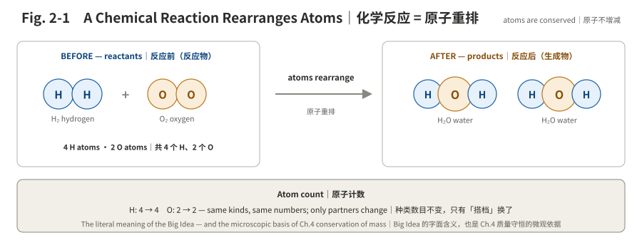
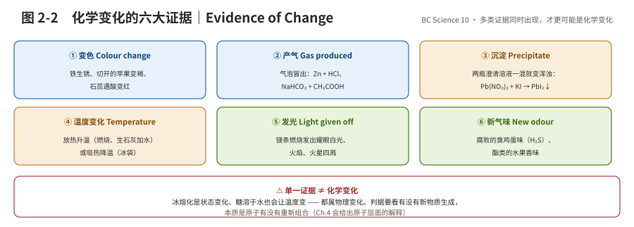
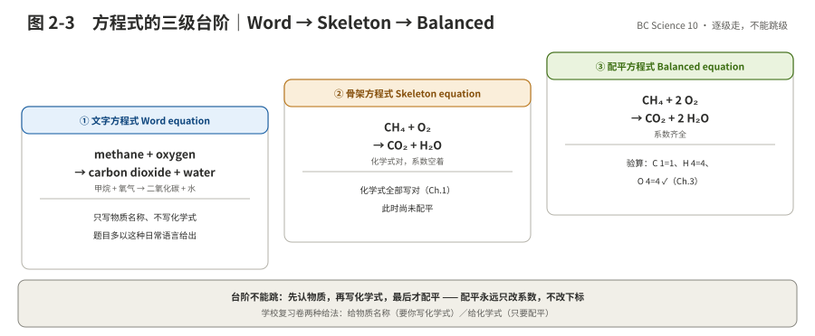
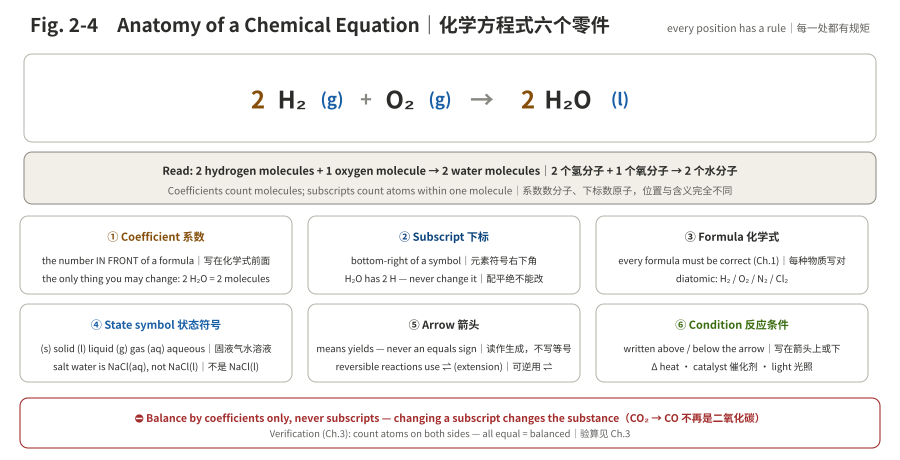
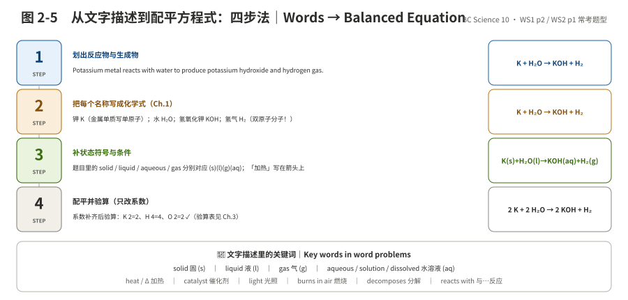

# Ch.2 — Chemical Reactions and Chemical Equations
## 第 2 章　化学反应与化学方程式

> 🗂️ **大纲对应**：Content C1「rearrangement of atoms in chemical reactions」（核心）
> ⏱️ **课时 Periods**：2–3　|　**前置**：Ch.1（化学式与命名必须过关）　|　**后继**：Ch.3 配平
> 📄 **素材对齐**：`SCI 10 REV WORKSHEET 1` p2（写完整配平方程式）· `WORKSHEET 2` p1（文字方程式 → 化学式 → 配平）
> 🗂️ **文件生成时间**：2026-09-24 17:20

## 1. 大纲对应｜Content Alignment

| 项目 | 内容 |
|---|---|
| 定位 | **Part I 起步章**：把 Ch.1 的"物质语言"升级成"变化语言"——会写化学式之后，下一步是会写方程式 |
| 直接服务的 Content | C1「rearrangement of atoms in chemical reactions」——本章给出"重排"的直观图像与表达工具，Ch.3 给配平技术，Ch.4 给守恒定律 |
| Curricular Competencies | [Questioning and predicting] 根据证据预测变化；[Communicating] 用化学方程式这一科学表征交流；[Processing and analyzing] 数原子、验证守恒 |
| 是否超纲 | 否。"原子重排"就是官方 Content 原文；本章不做任何计算 |
| 素材对齐 | 学校复习卷的题型"Write the complete balanced chemical reactions for the following"与"Write the formulas and balance the word equations"，就是本章第 3.8 节的四步法 |

## 2. 学习目标｜Learning Objectives

**EN — By the end of this chapter, you should be able to:**
1. Explain a chemical reaction as a rearrangement of atoms, and list the evidence of chemical change.
2. Convert a word equation into a skeleton equation by writing correct chemical formulas.
3. Complete a balanced equation with coefficients (leaving subscripts untouched).
4. Use state symbols (s), (l), (g), (aq) and reaction conditions (Δ, catalyst, light, spark) correctly.
5. "Read" an equation: reactants, products, states, conditions, mole-to-coefficient ratio (qualitatively).

**中 — 本章结束后，你应当能够：**
1. 把化学反应解释为"原子的重排"，并说出化学变化的各种证据。
2. 把文字方程式转成骨架方程式（化学式全部写对）。
3. 补系数完成配平方程式（绝不动下标）。
4. 正确使用状态符号 (s)(l)(g)(aq) 与反应条件（Δ、催化剂、光照、火花）。
5. "读懂"一个方程式：反应物、生成物、状态、条件、系数比（定性）。

## 3. 概念解析｜Concept Explanations

### 3.1 什么是化学反应｜What Is a Chemical Reaction

**定义**：chemical reaction 化学反应 = **原子重新组合**的过程——旧键断裂（bonds break）、新键形成（new bonds form），原子**种类与数目都不变**，只是"换了搭档"。

**判断一个变化是不是化学反应，本质只有一条**：有没有生成**新物质**（new substance）。

| 比较项 | Physical change 物理变化 | Chemical change 化学变化 |
|---|---|---|
| 本质 | 分子/原子**没有重组**，只是状态、形状、位置变了 | **原子重新组合**，生成新物质 |
| 例子 | 冰熔化、水蒸发、糖溶于水、玻璃打碎、铁丝弯折 | 铁生锈、木材燃烧、食物腐败、镁条燃烧 |
| 可逆性 | 通常容易逆转（再冻上就行） | 通常难以"简单地"逆转（锈不会自己变回铁） |
| 质量关系 | 质量不变 | 质量也不变（Ch.4 详述）——只是变成别的物质 |

> 📏 **与 Big Idea 的关系**：原子重排（atoms rearrange）就是官方 Content 的原文措辞。
> 重排前后原子一个不多一个不少——所以化学方程式两端必须"数得对上"，这就是 Ch.3 的配平。

**看图**：**图 2-1** 用最简单的 2 H₂ + O₂ → 2 H₂O 把"重排"画了出来——反应前是 4 个 H、2 个 O；反应后还是 4 个 H、2 个 O。

### 3.2 化学变化的证据｜Evidence of Chemical Change

实验室里不能拿"原子重排"直接观察，所以用**现象证据**判断（详见 **图 2-2**）：

| # | 证据 Evidence | 常见例子 |
|---|---|---|
| ① | 变色 colour change | 铁生锈、苹果切开变褐、石蕊遇酸变红 |
| ② | 产气 gas produced | Zn + HCl 冒气泡；小苏打 + 醋 |
| ③ | 沉淀 precipitate | Pb(NO₃)₂ + KI → 黄色浑浊 PbI₂ |
| ④ | 温度变化 temperature change | 放热（燃烧、生石灰 + 水）／吸热（冰袋） |
| ⑤ | 发光 light | 镁条燃烧发出耀眼白光 |
| ⑥ | 新气味 new odour | 食物腐败（臭鸡蛋味 H₂S）、酯类果香 |

> ⚠️ **单一证据不等于化学变化**：冰熔化是状态变化（变色 + 形状变化），糖溶于水也会让温度变化——都是物理变化。
> 要**综合**多类证据，并落到"有没有新物质生成"这一本质判据上。Ch.8 会把它升级为"观察 vs 推断"的实验记录规范。

### 3.3 方程式的三级台阶｜Word → Skeleton → Balanced

写方程式不是一步到位，而是**三级台阶**（详见 **图 2-3**），每级加一层信息：

| 台阶 | 英文 | 形式 | CH₄ 示例 | 关键要求 |
|---|---|---|---|---|
| ① | word equation 文字方程式 | 物质**名称** + 箭头 | methane + oxygen → carbon dioxide + water | 只需认出"谁跟谁反应、生成谁" |
| ② | skeleton equation 骨架方程式 | **化学式** + 箭头 | CH₄ + O₂ → CO₂ + H₂O | 化学式全部写对（Ch.1）；系数先空着 |
| ③ | balanced equation 配平方程式 | 化学式 + **系数** | CH₄ + 2 O₂ → CO₂ + 2 H₂O | 两侧每种元素的原子数相等（Ch.3 的技术） |

- **任何一级写错，后面全错**——尤其是 ②：化学式错了，配平得再整齐也是废方程式。
- ⛔ **配平只改系数，绝不动下标**——改下标 = 改物质本身。
- 台阶 ② 到 ③ 的完整技术（四步法、原子团、分数系数过渡）在 **Ch.3** 展开；本章先练 ① → ② 与"补系数并验算"。

### 3.4 化学式复习 + 状态符号｜Formulas & State Symbols

化学式写法全部沿用 Ch.1（交叉法、多原子离子、希腊前缀）。本章新增一层信息——**state symbol 状态符号**，写在化学式**后面的括号**里：

| 符号 | 英文 | 中文 | 判断方法 |
|---|---|---|---|
| **(s)** | solid | 固 | 金属单质、大多数盐类固体、MgO、CaCO₃ |
| **(l)** | liquid | 液 | 纯液体：H₂O(l)（水作为纯液体）、Hg(l)（汞是常温液态金属） |
| **(g)** | gas | 气 | O₂、H₂、CO₂、水蒸气；名字里带 "gas" 的一律 (g) |
| **(aq)** | aqueous 水溶液 | 溶于水 | acid（盐酸、硫酸）、可溶性碱（NaOH）、盐溶液（CuSO₄ 溶液） |

> 📌 **易混点**：
> - H₂O 作**反应物/生成物**若明确是液体就写 (l)；若是**水蒸气**（高温燃烧产物）写 (g)。两者都对，看题目语境。
> - **食盐水**是 NaCl **(aq)**——溶质 NaCl 溶在水里，不是 NaCl(l)。
> - 题目没给状态信息时，可以不写状态符号（学校复习卷多数只要求写化学式与配平）；但**给了就必须写对**。

### 3.5 反应条件写在箭头上｜Reaction Conditions

反应条件写在**箭头的上方或下方**（不是写在方程式里）：

| 符号 / 英文 | 中文 | 常见场景 |
|---|---|---|
| **Δ** (heat) | 加热 | KClO₃ 分解、CaCO₃ 分解 |
| **catalyst** | 催化剂 | H₂O₂ 分解加 MnO₂（Ch.6 再讲它的作用） |
| **light** | 光照 | 光合作用、卤化银感光 |
| **spark / electric spark** | 火花 / 电火花 | H₂ + O₂ 点燃爆炸 |

> ⛔ **位置铁律**：条件写在箭头上，**不写在生成物后面**。"CH₄ + 2 O₂ → CO₂ + 2 H₂O（点燃）"是错位写法，正确为 CH₄ + 2 O₂ →(点燃) CO₂ + 2 H₂O。

### 3.6 系数与下标｜Coefficient vs Subscript（最容易混的两个数字）

详见 **图 2-4**。同一个方程式里，数字写在**不同位置**，含义完全不同：

| 比较项 | Coefficient 系数 | Subscript 下标 |
|---|---|---|
| 位置 | 化学式**前面**（H₂O 前的 2） | 元素符号**右下角**（H₂O 里的 2） |
| 含义 | **几个**分子/单位 | **一个**分子里有几个该原子 |
| 谁能改 | 配平时**只能改它** | **绝不能改**（改了就是另一种物质） |
| 例子 | 2 H₂O = 2 个水分子 | H₂O₂ = 过氧化氢（不是水！） |

> 📏 **为什么绝不能动下标**：把 H₂O 改成 H₂O₂，方程式确实"平"了，但它描述的已经不是水的分解/合成，而是另一种物质——**方程式先要真实，其次才要平衡**。
> 【🔭 Extension → Chemistry 11】"真实"的进一步保证是化学方程式还要电荷守恒、且符合真实反应机理，Science 10 只要求原子守恒与化学式正确。

### 3.7 怎么读一个方程式｜Reading an Equation：六问

拿到任何一个方程式，按**六问**把它读完整（以 2 KClO₃(s) →(Δ) 2 KCl(s) + 3 O₂(g) 为例）：

| # | 问题 | 本例答案 |
|---|---|---|
| 1 | 谁反应？ | potassium chlorate 氯酸钾（KClO₃，固体） |
| 2 | 生成谁？ | potassium chloride 氯化钾（KCl，固体）+ oxygen gas 氧气（O₂，气体） |
| 3 | 状态？ | KClO₃ (s)、KCl (s)、O₂ (g) |
| 4 | 条件？ | Δ 加热（写在箭头上） |
| 5 | 系数比？ | 2 : 2 : 3 —— 每 2 "份" KClO₃ 分解生成 2 "份" KCl 与 3 "份" O₂（定性读法） |
| 6 | 能量？ | 需要**持续加热**才能进行……但"需要加热" ≠ "吸热反应"（Ch.6 会解开这个结） |

> 📌 系数比的**定量计算**（按摩尔换算质量）属 Chemistry 11；Science 10 只要求"看系数说比例"。

### 3.8 由文字描述写方程式｜From Words to Equations（学校复习卷核心题型）

这是 `WS1 p2` 与 `WS2 p1` 的主题型，也是考试里最稳的拿分点——**四步法**（详见 **图 2-5**）：

1. **划出反应物与生成物**：句子里"reacts with / and"前面的是反应物，"to produce / yields / forms"后面的是生成物；
2. **把每个名称写成化学式**：全部用 Ch.1 的工具（交叉法、多原子离子、希腊前缀）；**金属单质写单原子**（K、Mg、Al），**双原子分子别忘**（H₂、O₂、N₂、F₂、Cl₂）；
3. **补状态符号与条件**：题目给了状态才写；"heated / Δ"写在箭头上；
4. **配平并验算**：只改系数（Ch.3 的四步法），最后列原子计数表验算。

**英文描述里的关键动词与短语**（读题就靠它们）：

| 英文 | 中文 | 化学含义 |
|---|---|---|
| reacts with / and | 与…反应 / 和 | 连接反应物 |
| to produce / yields / forms / gives | 生成 | 箭头 → |
| decomposes (to) | 分解 | 一种物质 → 多种（Ch.5） |
| burns in air / combusts | 在空气中燃烧 | 燃料 + O₂（Ch.5） |
| solid / liquid / gas / aqueous | 固 / 液 / 气 / 水溶液 | (s) / (l) / (g) / (aq) |
| heated / in the presence of a catalyst | 加热 / 在催化剂存在下 | Δ / catalyst 写在箭头上 |

## 4. 表格比对｜Comparison Tables

### 表 2-1　物理变化 vs 化学变化｜Physical vs Chemical Change

（见 3.1 的表格）

### 表 2-2　化学变化证据与误判提醒｜Evidence & False Positives

| 证据 | 也可能出现在物理变化里 | 如何更稳地判断 |
|---|---|---|
| 变色 | 颜料混合、灯光颜色 | 看是否生成新物质的**特征色**（如 Rust 棕色、PbI₂ 亮黄） |
| 温度变化 | 溶解（NH₄NO₃ 吸热、CaCl₂ 放热） | 配合其他证据；或看能否"复原" |
| 产气 | 沸腾（水 → 水蒸气） | 沸腾是**同一种物质**变气体；化学产气是**新物质** |
| 沉淀 | 浑浊的泥水 | 沉淀是**新生成的**不溶固体，静置后不会"搅一搅就消失" |

### 表 2-3　三级台阶对照（以 CH₄ 为例）｜Three-Step Ladder

（见 3.3 的表格）

### 表 2-4　状态符号对照｜State Symbols

| 符号 | 英文 | 中文 | 本册高频例子 |
|---|---|---|---|
| (s) | solid | 固 | Mg(s)、Na(s)、CaCO₃(s)、MgO(s)、KClO₃(s) |
| (l) | liquid | 液 | H₂O(l)、Hg(l)、Br₂(l)（溴是常温液态非金属） |
| (g) | gas | 气 | O₂(g)、H₂(g)、CO₂(g)、Cl₂(g)、水蒸气 H₂O(g) |
| (aq) | aqueous | 水溶液 | HCl(aq)、NaOH(aq)、CuSO₄(aq)、KOH(aq) |

### 表 2-5　系数 vs 下标｜Coefficient vs Subscript

（见 3.6 的表格）

### 表 2-6　描述关键词 → 化学表达对照｜Word-Problem Keywords

（见 3.8 的表格，重点背 reacts with / to produce / decomposes / burns 四组）

## 5. 图例说明｜Diagrams & Worked Examples

### 图 2-1　化学反应 = 原子重排｜Atoms Rearrange

**看图要点**：反应前 4 个 H + 2 个 O，反应后还是 4 个 H + 2 个 O；变的是**组合方式**（H-H、O-O 变成 H-O-H）。原子守恒是"重排"的必然结果，也是配平（Ch.3）与质量守恒（Ch.4）的共同源头。

### 图 2-2　化学变化的六大证据｜Evidence of Change

**看图要点**：六类证据要**综合**判断，单一证据可能"误报"（糖溶于水也变温度、水沸腾也产"气"）。

### 图 2-3　方程式的三级台阶｜Word → Skeleton → Balanced

**看图要点**：每一级加一层信息；② 的化学式写对是全章生死线；③ 才涉及配平。

### 图 2-4　化学方程式的六个零件｜Anatomy of a Chemical Equation

**看图要点**：系数（橙色）与下标（蓝色）位置不同、含义不同、可改性不同；状态符号跟在化学式后面；条件写在箭头上。

### 图 2-5　从文字描述到配平方程式：四步法｜Words → Balanced Equation

**看图要点**：以 `WS1 p2` 原题（potassium + water）为例完整走一遍四步；第一步先把句子"拆"成反应物/生成物，后面三步都是技术活。

### 例题 2-1　文字方程式 → 骨架 → 配平｜Word → Skeleton → Balanced

| 文字方程式（WS2 p1 原题） | 骨架方程式 | 配平方程式 | 验算 |
|---|---|---|---|
| Sodium + oxygen gas → sodium oxide | Na + O₂ → Na₂O | **4 Na(s) + O₂(g) → 2 Na₂O(s)** | Na 4=4、O 2=2 ✓ |
| Rubidium + nitrogen gas → rubidium nitride | Rb + N₂ → Rb₃N | **6 Rb(s) + N₂(g) → 2 Rb₃N(s)** | Rb 6=6、N 2=2 ✓ |
| Potassium chlorate → potassium chloride + oxygen gas | KClO₃ → KCl + O₂ | **2 KClO₃(s) →(Δ) 2 KCl(s) + 3 O₂(g)** | K 2=2、Cl 2=2、O 6=6 ✓ |

> 📌 **为什么是 6 Rb？** N₂ 一次带来 2 个 N，而 Rb₃N 每个要 3 个 Rb——最小公倍数 6。Ch.3 会把这类推理系统化。

### 例题 2-2　由描述写完整方程式｜From Description to Equation

| 英文描述（学校原题） | 完整配平方程式（含状态） |
|---|---|
| Potassium hydroxide and hydrogen are produced when potassium metal reacts with water. | **2 K(s) + 2 H₂O(l) → 2 KOH(aq) + H₂(g)** |
| The reaction between magnesium metal and copper(II) sulfate. | **Mg(s) + CuSO₄(aq) → MgSO₄(aq) + Cu(s)** |
| Decomposition of mercury(II) oxide to its elements. | **2 HgO(s) →(Δ) 2 Hg(l) + O₂(g)** |
| Fluorine gas + magnesium chloride → magnesium fluoride + chlorine gas. | **F₂(g) + MgCl₂(aq) → MgF₂(s) + Cl₂(g)** |
| Copper + silver acetate → copper(II) acetate + silver. | **Cu(s) + 2 AgCH₃COO(aq) → Cu(CH₃COO)₂(aq) + 2 Ag(s)** |

> 📌 **第 2 题细节**：copper(II) sulfate 的化学式靠交叉法（Cu²⁺ + SO₄²⁻ → CuSO₄）；MgSO₄ 同理。这里 Mg 置换出 Cu，能否发生要看活动性顺序——**Ch.5** 的工具。

### 例题 2-3　读方程式六问｜Six Questions

方程式：**2 KClO₃(s) →(Δ) 2 KCl(s) + 3 O₂(g)**

| 问 | 答 |
|---|---|
| 反应物？生成物？ | 氯酸钾 → 氯化钾 + 氧气 |
| 状态？ | 都是固体 + 氧气气体：(s)、(s)、(g) |
| 条件？ | Δ（加热），写在箭头上 |
| 系数比？ | 2 : 2 : 3（定性读"每 2 份生成 2 份和 3 份"） |
| 能量？ | 要持续加热才能进行；"需要加热"是否等于"吸热"，Ch.6 见分晓 |

### 例题 2-4　找错与改正｜Spot the Error

| 错误方程式 | 错在哪 | 改正 |
|---|---|---|
| H₂ + O₂ → H₂O | 未配平（H 2≠2、O 2≠1） | **2 H₂ + O₂ → 2 H₂O** |
| 2 H₂ + O₂ → 2 H₂O₂ | **改了下标**——H₂O₂ 是过氧化氢，不是水 | **2 H₂ + O₂ → 2 H₂O** |
| Mg + O →(Δ) MgO | 氧写成单原子 O（漏了双原子） | **2 Mg + O₂ →(Δ) 2 MgO** |
| CH₄ + 2 O₂ → CO₂ + 2 H₂O（点燃） | 条件写在生成物后面 | **CH₄ + 2 O₂ →(点燃) CO₂ + 2 H₂O** |
| Na + Cl₂ → NaCl(l) | 未配平 + 状态错（常温食盐是固体） | **2 Na(s) + Cl₂(g) → 2 NaCl(s)** |

> 📌 **原卷要点与勘误｜Errata**（学校复习卷，以正确化学为准）：
> ① `WS2 p1` 命名题给出 "SO₄"，原答案写 sulfur tetraoxide——**中性 SO₄ 分子并不存在**；硫酸根必须写作 **SO₄²⁻（sulfate 硫酸根，−2 价）**。写化学式别漏电荷。
> ② `WS1 p2` 反应 "Ca + HCl → H₂ + CaCl₂" 把 H₂ 写在生成物首位；规范写法是 **Ca(s) + 2 HCl(aq) → CaCl₂(aq) + H₂(g)**（盐在前、气体在后）。两种顺序都算对，但写规范更稳。
> ③ `WS1 p2` 反应 7（CH₃COOH + Ti(OH)₃）原答案归为 neutralization 中和——正确；它**同时也是** double replacement 双置换，分类可以不唯一（Ch.5 展开）。

## 6. 核心词汇｜Key Vocabulary

| English | 中文 | 备注 |
|---|---|---|
| chemical reaction | 化学反应 | 原子重新组合，生成新物质 |
| chemical change | 化学变化 | 与 chemical reaction 同义 |
| physical change | 物理变化 | 无新物质生成 |
| reactant | 反应物 | 箭头**左边** |
| product | 生成物 | 箭头**右边** |
| word equation | 文字方程式 | 台阶 ①：只写名称 |
| skeleton equation | 骨架方程式 | 台阶 ②：写化学式，未配平 |
| balanced equation | 配平方程式 | 台阶 ③：系数齐全，原子守恒 |
| coefficient | 系数 | 化学式前面的数字；配平只改它 |
| subscript | 下标 | 元素符号右下角的数字；绝不能改 |
| state symbol | 状态符号 | (s)(l)(g)(aq) |
| aqueous | 水溶液的 | 写作 (aq) |
| precipitate | 沉淀 | 反应新生成的不溶固体 |
| catalyst | 催化剂 | 写在箭头上；加快反应【Ch.6 展开】 |
| evidence of chemical change | 化学变化的证据 | 变色/产气/沉淀/温度/发光/气味 |
| bond breaking / bond forming | 断键 / 成键 | 微观图像（Ch.6 接能量） |
| rearrangement of atoms | 原子重排 | 官方 Content C1 原文 |

## 7. 实验与活动｜Lab / Activity

### 活动 2-1　原子搬家｜Atom Shuffle（磁贴演示）
- **类型**：全班演示 + 学生动手（Hands-on modelling）
- **材料**：两种颜色的磁贴（白 = H，橙 = O）各 4 枚 / 2 枚；黑板
- **步骤**：
  1. 在黑板左侧摆出 2 H₂ + O₂（4 白 + 2 橙），画出"分子"分组；
  2. 请一位学生"重排"成右侧的 2 H₂O；
  3. 全班数两侧原子数，填原子计数表；
  4. 追问：**如果只把一个 O 拿走会怎样？**（引出原子守恒与 Ch.3 的配平需求）
- **训练能力**：[Communicating] Communicate scientific representations；[Processing and analyzing]
- **安全**：无

### 活动 2-2　方程式翻译工作坊｜Equation Translation Workshop
- **类型**：小组接力（Group relay）
- **材料**：10 张英文文字描述卡（取自 `WS1 p2` / `WS2 p1` 原题 + 2 张扩展），每张背面印提示（状态符号线索）
- **步骤**：
  1. 每组领 1 张卡，按四步法（图 2-5）在白板上完成：划成分 → 写化学式 → 补状态 → 配平；
  2. 组间互查：只允许指出"哪一步错了"，不许直接给答案；
  3. 全班汇总一张"错误类型统计表"（未配平 / 改下标 / 漏双原子 / 状态错）。
- **训练能力**：[Communicating]；[Evaluating]（评估同伴的方程式并给出证据）
- **安全**：无

### 活动 2-3　化学变化观察站｜Chemical Change Observation Stations
- **类型**：3 站轮转实验（Station lab）
- **材料**（每站）：
  - 站 A：NaHCO₃(s) + CH₃COOH(aq)（小苏打 + 白醋）
  - 站 B：Pb(NO₃)₂(aq) + KI(aq)（硝酸铅 + 碘化钾，**微量**）
  - 站 C：镁条 + 坩埚钳 + 酒精灯
- **步骤**：
  1. 每站只许**观察并记录证据**（定性），判用图 2-2 的六类证据；
  2. 回到座位后把每站写成骨架方程式（不要求配平）；
  3. 讨论：哪站的证据"最容易误判"？为什么？
- **训练能力**：[Planning and conducting]；[Processing and analyzing] Qualitative observations
- **安全**：⚠️ 护目镜必戴；镁条燃烧**不可直视**（强光伤眼）；铅盐有毒，接触后立即洗手；废液倒入指定回收桶，不得倒入水槽

## 8. 常见易错点｜Common Misconceptions

| # | 错误认识 Misconception | 正确理解 Correction |
|---|---|---|
| 1 | "配平时把 H₂O 改成 H₂O₂ 就平了" | 下标决定物质本身——H₂O₂ 是过氧化氢。**配平只改系数**。 |
| 2 | "氧气写成 O、氢气写成 H" | 双原子分子必须写成 O₂、H₂（Ch.1 的 H-7 法则）。 |
| 3 | "食盐水是 NaCl(l)" | 盐**溶于水**是 NaCl(aq)；(l) 只给纯液体。 |
| 4 | "点燃写在生成物后面" | 条件写在**箭头上/下**：CH₄ + 2 O₂ →(点燃) CO₂ + 2 H₂O。 |
| 5 | "糖溶于水是化学变化，因为温度变了" | 单一证据会误报；溶解无新物质生成，是物理变化。 |
| 6 | "水沸腾冒泡 = 产气证据" | 沸腾是**同一种物质**变气体（物理）；化学产气是**新物质**。 |
| 7 | "方程式写成等号 =" | 化学方程式用**箭头 →**，读作"生成"；等号是数学符号。 |
| 8 | "骨架方程式就是错的方程式" | 骨架方程式是**合法的中间步骤**——化学式对、只是未配平。 |
| 9 | "系数比就是质量比" | 系数比是**分子/单位个数比**；按质量换算属 Chemistry 11。 |
| 10 | "状态符号想写就写、位置随意" | 状态符号紧跟**每个化学式**后面的括号；题目给了状态就必须写对。 |

## 9. 答题评估｜Assessment

### A 组：基础题｜Foundational（每题 2 分，共 20 分）

**A1.** 判断物理变化还是化学变化，并各写一条证据：① 冰熔化　② 铁生锈　③ 糖溶于水　④ 木材燃烧。

**A2.** 写出化学变化的**六类证据**（中英并列）。

**A3.** 把文字方程式转成骨架方程式：a) methane + oxygen → carbon dioxide + water；b) calcium + chlorine gas → calcium chloride。

**A4.** 补系数配平：a) \_\_ Na + \_\_ O₂ → \_\_ Na₂O；b) \_\_ KClO₃ → \_\_ KCl + \_\_ O₂。

**A5.** 状态符号填空：2 K(\_\_) + 2 H₂O(\_\_) → 2 KOH(\_\_) + H₂(\_\_)。

**A6.** 判断对错并说明理由："配平时如果原子数对不上，可以把 H₂O 改写成 H₂O₂。"

**A7.** 反应条件写在方程式的什么位置？写出 4 种常见条件（符号 + 英文 + 中文）。

**A8.** 读方程式 2 Mg(s) + O₂(g) → 2 MgO(s)：反应物？生成物？各自状态？系数比？

**A9.** 判断 F₂ + MgCl₂ → MgF₂ + Cl₂ 是否已配平；若没有，配平。

**A10.** 把 "Iron(III) chlorate → iron(III) chlorite + oxygen gas" 写成骨架方程式（不要求配平）。

### B 组：应用题｜Applied（每题 5 分，共 20 分）

**B1.** 由英文描述写**完整配平方程式（含状态符号）**：
a) Potassium metal reacts with water to produce potassium hydroxide and hydrogen gas.
b) The reaction between magnesium metal and copper(II) sulfate.

**B2.** 把下列 `WS2 p1` 原题写成化学式并配平：
a) Rubidium + nitrogen gas → rubidium nitride
b) Aluminium chloride + potassium → potassium chloride + aluminium
c) Potassium chlorate → potassium chloride + oxygen gas

**B3.** 同学把 "Al + H₃PO₄ → AlPO₄ + H₂" 直接当最终答案交上去。指出**两处**问题，写出完整配平过程（含原子计数验算表）。

**B4.** 用"原子重排 + 原子计数"解释：为什么配平**只能改系数**、绝不能改下标？以 H₂O 与 H₂O₂ 为例说明。

### C 组：挑战题｜Challenge（每题 10 分，共 20 分）

**C1.** 把下面两题各完成一次"三级台阶"：写出骨架方程式 → 配平方程式 → 加状态符号，并用**原子计数表**验算（表格：元素 / 左 / 右 / 是否相等）。
a) Fluorine gas + magnesium chloride → magnesium fluoride + chlorine gas
b) Iron(III) chlorate → iron(III) chlorite + oxygen gas

**C2.** 找错与改正：下列 5 个方程式各藏**一处**错误（未配平 / 改了下标 / 漏双原子 / 条件位置错 / 状态符号错），指出错误类型并改正：
① H₂ + O₂ → H₂O
② 2 H₂ + O₂ → 2 H₂O₂
③ Mg + O →(Δ) MgO
④ CH₄ + 2 O₂ → CO₂ + 2 H₂O（点燃）
⑤ Al + CuSO₄ → Al₂(SO₄)₃ + Cu

---

### 参考答案｜Answer Key

**A 组**
- A1. ① 物理变化（状态变化，无新物质）；② 化学变化（棕色铁锈生成）；③ 物理变化（糖分子分散，无新物质）；④ 化学变化（发光放热、生成灰烬与气体）。
- A2. 变色 colour change、产气 gas produced、沉淀 precipitate、温度变化 temperature change、发光 light、新气味 new odour。
- A3. a) CH₄ + O₂ → CO₂ + H₂O；b) Ca + Cl₂ → CaCl₂。
- A4. a) 4 Na + O₂ → 2 Na₂O；b) 2 KClO₃ → 2 KCl + 3 O₂。
- A5. 2 K(s) + 2 H₂O(l) → 2 KOH(aq) + H₂(g)。
- A6. **错**。H₂O₂ 是过氧化氢，不是水——改下标就是改物质；应改系数。
- A7. 箭头的**上 / 下**；Δ（heat 加热）、catalyst（催化剂）、light（光照）、spark（电火花）。
- A8. 反应物 Mg(s) 与 O₂(g)；生成物 MgO(s)；系数比 2 : 1 : 2。
- A9. 已配平（F 2=2、Mg 1=1、Cl 2=2）✓。
- A10. Fe(ClO₃)₃ → Fe(ClO₂)₃ + O₂（-ate 氯酸根 → -ite 亚氯酸根，Ch.1 词尾规律）。

**B 组（要点）**
- B1. a) 2 K(s) + 2 H₂O(l) → 2 KOH(aq) + H₂(g)（K 2=2、H 4=4、O 2=2）；b) Mg(s) + CuSO₄(aq) → MgSO₄(aq) + Cu(s)（已天然平衡）。
- B2. a) 6 Rb(s) + N₂(g) → 2 Rb₃N(s)；b) AlCl₃(s) + 3 K(s) → 3 KCl(s) + Al(s)；c) 2 KClO₃(s) →(Δ) 2 KCl(s) + 3 O₂(g)。
- B3. 两处问题：① 未配平（H 3≠2、O 4≠4、Al 1=1 但 H/O 不守恒）；② 漏状态符号。完整：**2 Al(s) + 2 H₃PO₄(aq) → 2 AlPO₄(s) + 3 H₂(g)**；验算 Al 2=2、P 2=2、O 8=8、H 6=6 ✓。
- B4. 下标描述的是"**一个分子里有几个原子**"，是物质的**身份**；系数描述的是"**几个**分子"，是物质的**数量**。改下标 = 把水改成过氧化氢，方程式描述的反应本身变了；改系数只是增减"参与反应的分子个数"，原子重排的**种类**不变。原子计数守恒靠"数分子个数"实现，所以工具是系数。

**C 组（评分要点）**
- C1. a) 骨架 F₂ + MgCl₂ → MgF₂ + Cl₂；配平后 **F₂(g) + MgCl₂(aq) → MgF₂(s) + Cl₂(g)**；计数表 F 2=2、Mg 1=1、Cl 2=2 ✓（本题天然平衡，考察"验算后确认已平"的规范）。
  b) 骨架 Fe(ClO₃)₃ → Fe(ClO₂)₃ + O₂；配平 **2 Fe(ClO₃)₃(s) → 2 Fe(ClO₂)₃(s) + 3 O₂(g)**；计数表 Fe 2=2、Cl 6=6、O 18 = 12+6 ✓。要点：**原子团 ClO₃ / ClO₂ 整体对待**（Ch.3 会正式讲）；Fe 不变价，只有 O 以 O₂ 释放。评分：骨架 2 分 + 配平 3 分 + 状态 2 分 + 验算表 3 分。
- C2. ① 未配平 → **2 H₂ + O₂ → 2 H₂O**；② 改了下标（H₂O₂ 不是水）→ **2 H₂ + O₂ → 2 H₂O**；③ 漏双原子（O → O₂）→ **2 Mg + O₂ →(Δ) 2 MgO**；④ 条件位置错 → **CH₄ + 2 O₂ →(点燃) CO₂ + 2 H₂O**；⑤ 未配平（含多原子原子团 SO₄ 整体配）→ **2 Al + 3 CuSO₄ → Al₂(SO₄)₃ + 3 Cu**。评分：每题 2 分（类型 1 + 改正 1）。

### 评分量规｜Rubric

| 维度 | 优秀 (A) | 达标 (B) | 待改进 (C) |
|---|---|---|---|
| 化学式正确性 | 骨架方程式化学式全对（含多原子离子、双原子） | 偶有下标笔误 | 化学式写错（物质身份错） |
| 配平与验算 | 系数最简整数比 + 列计数表验算 | 配平对但跳过验算 | 未配平或改下标 |
| 状态与条件 | (s)(l)(g)(aq) 与箭头条件全部规范 | 大部分规范 | 状态/条件错位 |
| 证据与概念 | 能综合多类证据判断变化类型 | 能列举证据但单一判断 | 把物理变化当化学变化 |
| 表达 | 中英术语准确、方程式书写规范 | 表达清楚 | 符号/语序混乱 |

> 👩‍🏫 **教师提示**：A 组课堂 10 分钟形成性检测；B 组对接 `WS1 p2` / `WS2 p1` 原题（对照版见 `G10/pdf/`）；C 组为 Ch.3 配平技术做铺垫。
> 🌐 **双语政策**：术语部分允许中英双语作答；**化学式与英文命名必须使用英文**。

## 10. 回扣核心概念｜Connection to the Big Idea

> 🎯 **Big Idea**：*Energy change is required as atoms rearrange in chemical processes.*
> **原子在化学过程中重排时，必然伴随能量变化。**

本章把"重排"从一句话变成了可以**书写、阅读、验算**的对象：

1. **重排的图像**：旧键断、新键成，原子一个不多一个不少（图 2-1）——所以方程式两端必须配平（Ch.3），所以质量守恒（Ch.4）。
2. **重排的语言**：三级台阶 + 六个零件（图 2-3 / 2-4）——以后全册的所有反应，都要用这套语言写出来。
3. **重排的证据与能量**：化学变化往往伴随温度变化、发光——这些"能量信号"正是 Big Idea 后半句的落点，Ch.6 专门展开。

**思考题（下章预热）**：2 H₂ + O₂ → 2 H₂O 为什么**必须**是 2 : 1 : 2，而不是别的比例？把它变成一套"保证能配平"的流程，就是下一章的全部内容。

---

*本章对应框架文件 `00_讲义章节框架_Course_Framework.md` Ch.2（Part I）。下一章：Ch.3 化学方程式的配平。*
