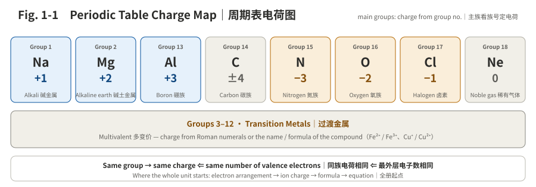
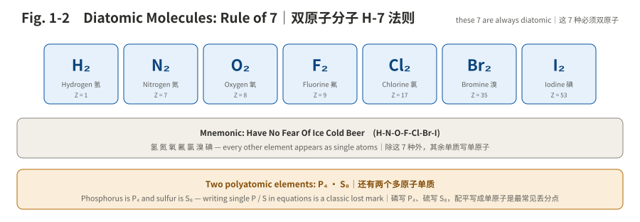
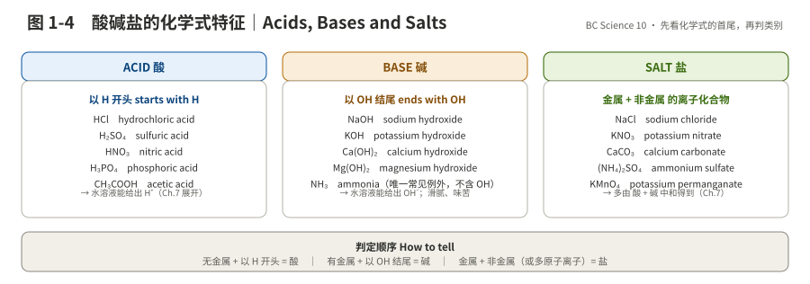
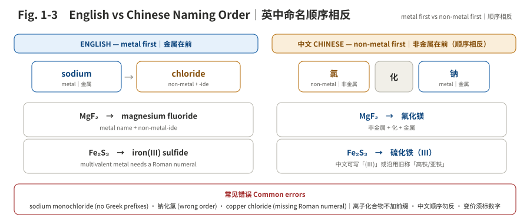

# Ch.1 — From Science 9 to Science 10: Atoms, Ions and Formulas
## Chapter 1 · From Science 9 to Science 10: Atoms, Ions and Formulas｜第 1 章　从 Science 9 到 Science 10：原子、离子与化学式

> 🗂️ **Content Alignment｜大纲对应**：Science 9 review → BC Science 10 Content C1（rearrangement of atoms）与 C2（acid-base chemistry）的入场门槛。
> ⏱️ **Periods｜课时**：2
> 🔗 **Source alignment｜素材对齐**：`SCI 10 REV WORKSHEET 0` p.1–2（Periodic Table Tips · Diatomic Molecules · Naming · Formulas · Acids, Bases & Salts）

---

## 1. Content Alignment｜大纲对应

| Official item（官方条目） | Where it shows up in this unit｜在本单元的位置 | Status｜定位 |
|---|---|---|
| Science 9: *elements are organized in the periodic table* | Ion charges from group position（§3.2） | Review 复习 |
| Science 9: *arrangement of electrons determines compounds* | Why same group → same charge（§3.2） | Review 复习 |
| Science 10 C1: *rearrangement of atoms in chemical reactions* | You cannot write reactions without correct formulas（Ch.2 起） | Gateway 门槛 |
| Science 10 C2: *acid-base chemistry* | Acid / base / salt recognition from formulas（§3.6, Ch.7） | Gateway 门槛 |
| Chemistry 11: mole, stoichiometry, molarity, organic chemistry | — | ⛔ Out of scope 超纲 |

**中文**：本章不教新化学——它把 Science 9 的原子结构、周期表与命名规则压缩成 Science 10 全程要用的四件工具：**电荷图、H-7 法则、交叉法、酸碱盐特征**。

---

## 2. Learning Objectives｜学习目标

By the end of this chapter, you should be able to:

1. Recall the subatomic structure of the atom and explain why atoms are neutral.
2. Read the ion charge of a main-group element directly from its group number.
3. Write the formulas and names of ionic compounds, including multivalent metals and polyatomic ions.
4. Write the formulas and names of covalent compounds using Greek prefixes.
5. Classify a substance as an acid, a base, or a salt from its formula alone.

**中文**：学完本章，你应当能够——① 回顾原子结构与"原子为何中性"；② 由族号直接读出主族元素离子电荷；③ 书写离子化合物的化学式与名称（含变价金属、多原子离子）；④ 用希腊前缀书写共价化合物；⑤ 仅凭化学式判断酸 / 碱 / 盐。

---

## 3. Concept Explanations｜概念解析

### 3.1 A Quick Refresher: Atoms and Ions｜原子与离子速览

An **atom（原子）** has a nucleus of **protons（质子，+1 charge）** and **neutrons（中子，0 charge）**, surrounded by **electrons（电子，−1 charge）**. In a neutral atom the number of protons equals the number of electrons.

An **ion（离子）** is an atom that has **lost or gained electrons**, so it carries a net charge:

- **Cation（阳离子）** — lost electrons → positive charge. Metals form cations.
- **Anion（阴离子）** — gained electrons → negative charge. Non-metals form anions.

**中文**：**离子**是失去或得到电子的原子——失电子带正电（阳离子，多为金属），得电子带负电（阴离子，多为非金属）。质子数永远不变，变的只是核外电子。

> 💡 **Tip｜口诀**：lose → positive（"丢了心，变阳"）。Metal atoms *lose*; non-metal atoms *gain*.

### 3.2 Ion Charges from the Periodic Table｜由周期表位置读离子电荷

The periodic table is a **charge lookup table** — no memorising individual ions needed. Read the charge straight off the group:

> 📏 **Rule｜规则**：Group 1 → +1 · Group 2 → +2 · Group 13 → +3 · Group 15 → −3 · Group 16 → −2 · Group 17 → −1 · Group 18 → does not form ions.
> **中文**：主族元素电荷 = 族号个位数规律——1/2/13 族失电子为正，15/16/17 族得电子为负，稀有气体不成离子。

**Groups 3–12（transition metals 过渡金属）** are mostly **multivalent（多变价的）**: one element, several possible charges (Fe²⁺/Fe³⁺, Cu⁺/Cu²⁺). Their charge is not on the table — you read it from the **Roman numeral** in the name, or work backwards from the formula.

**Why does the same group share the same charge?** Elements in one group have the same number of **valence electrons（最外层电子）**, so they lose or gain the same number of electrons to reach a full outer shell. This is Science 9's "electron arrangement decides chemistry" doing real work.

**中文**：同族电荷相同，因为最外层电子数相同 → 得失电子的倾向相同。这条链贯穿全册：**电子排布 → 离子电荷 → 化学式 → 方程式**。

### 3.3 Diatomic Molecules — the Rule of 7｜双原子分子：H-7 法则

Seven elements never exist as single atoms at room temperature. Their elements are always **diatomic molecules（双原子分子）**:

> 📏 **Rule｜规则**：H₂ · N₂ · O₂ · F₂ · Cl₂ · Br₂ · I₂ — "Have No Fear Of Ice Cold Beer."
> **中文**：氢氮氧氟氯溴碘这 7 种的单质必须写成双原子；其余元素的单质写单原子。磷写 P₄、硫写 S₈，是两个额外的多原子单质。

⚠️ **Misconception｜易错**：Writing `H + O₂ → H₂O` is wrong before you even start balancing — hydrogen in a reaction is **H₂**, not H. Each lost mark here is free to avoid.

### 3.4 Ionic Compounds: Names and Formulas｜离子化合物：命名与化学式

An **ionic compound（离子化合物）** = a metal + a non-metal (or a polyatomic ion). The compound is neutral: **total positive charge = total negative charge**.

**Naming（命名）** — three moves:

1. Name the metal first（先写金属名）.
2. Name the non-metal second, ending changed to **-ide**（第二个写非金属并改词尾 -ide；中文用「化」）.
3. If the metal is multivalent, insert the charge as a **Roman numeral（罗马数字）**: FeCl₂ is **iron(II) chloride**, FeCl₃ is iron(III) chloride.

**Formulas（化学式）** — the **criss-cross / drop-and-swap method（交叉法）**: swap the two charges as subscripts, then reduce to the simplest whole-number ratio.

> 📏 **Rule｜规则**：Al³⁺ + O²⁻ → Al₂O₃. Cross the numbers, check the total: 2 × (+3) = 6 and 3 × (−2) = −6 → neutral. ✓
> **中文**：把两个电荷数值互相放到对方脚下标（3 给 O，2 给 Al），再验算正负电荷总数相等、比例约至最简。

**Polyatomic ions（多原子离子）** are charged groups of atoms that travel **as one unit** — treat the whole group like a single "super-atom" and put it in brackets when you need more than one: Ca(OH)₂, (NH₄)₂SO₄.

> 💡 **Tip｜口诀**： ammonium NH₄⁺（铵根，唯一的常见正多原子离子）; hydroxide OH⁻、nitrate NO₃⁻、sulfate SO₄²⁻、carbonate CO₃²⁻、phosphate PO₄³⁻ —— 全表见附录 B。

### 3.5 Covalent Compounds: Greek Prefixes｜共价化合物：希腊前缀

A **covalent / molecular compound（共价化合物 / 分子化合物）** = non-metal + non-metal. Both atoms want electrons, so no ions form — instead the **formula tells you the name directly** using **Greek prefixes（希腊前缀）**:

| Number｜数 | Prefix｜前缀 | Number｜数 | Prefix｜前缀 |
|---|---|---|---|---|
| 1 | mono- | 6 | hexa- |
| 2 | di- | 7 | hepta- |
| 3 | tri- | 8 | octa- |
| 4 | tetra- | 9 | nona- |
| 5 | penta- | 10 | deca- |

> 📏 **Rule｜规则**：Prefix the **second** element always, drop the **mono-** on the **first** element, and end the second name with **-ide**.
> **中文**：第二个元素必加前缀并改 -ide；第一个元素**永不用 mono-**——CO 是 **carbon monoxide**，不是 monocarbon monoxide。

⚠️ **Misconception｜易错**：Never use Greek prefixes on ionic compounds. NaCl is **sodium chloride**, never "sodium monochloride". Prefixes belong to covalent naming only.

### 3.6 Acids, Bases and Salts at a Glance｜酸碱盐一眼判

Science 10 does not need a full theory of acids yet — you only need to **read the formula**:

> 📏 **Rule｜规则**：**Acid 酸** — formula starts with H (HCl, H₂SO₄, CH₃COOH). **Base 碱** — formula ends with OH (NaOH, Ca(OH)₂). **Salt 盐** — ionic compound of a metal + non-metal/polyatomic ion, neither of the above (NaCl, KNO₃, CaCO₃).
> **中文**：看首尾——H 开头是酸，OH 结尾是碱，其余金属+非金属的离子化合物是盐。

Two flags worth planting now (Ch.7 expands both):

- **NH₃（ammonia 氨）** is a base even though it has no OH — the one common exception.
- **CH₃COOH（acetic acid 乙酸）** starts with C but is an acid — the H at the *end* of the formula is the acidic one.

### 3.7 The English–Chinese Naming Order Trap｜英中命名顺序相反

This one costs Chinese-speaking students easy marks. **English and Chinese ionic naming run in opposite orders:**

> 📏 **Rule｜规则**：English = metal first + non-metal-ide（sodium chloride）; Chinese = 非金属 + 化 + 金属（**氯化钠**）.
> **中文**：英文金属在前、非金属改 -ide；中文恰好倒过来——非金属在前加「化」。翻译时先找金属的位置，别按字面直译。

**Wrong｜错误示范**：writing 中文命名 as "钠化氯"（order copied from English）or answering English as "chlorine sodide". Both orders are fixed conventions, not free translation.

### 3.8 Spelling Variants: aluminium, sulf-/sulph-｜拼写变体

School worksheets, BC resources and IUPAC do not always agree on spelling. This handout standardises:

- **aluminium**（not aluminum）— the IUPAC/international spelling.
- **sulf-** in body text: **sulfide, sulfate, sulfuric acid** — you may meet **sulphide / sulphate** on older sheets. Same chemistry, different spelling.

**中文**：铝统一写 aluminium；硫系正文统一 sulf-，遇到 -ph- 拼写（sulphate 等）在首次出现处会括注——认得即可，不必纠结。

---

## 4. Comparison Tables｜表格比对

### Table 1-1　Ionic vs Covalent Compounds｜离子化合物与共价化合物

| Feature｜特征 | Ionic｜离子化合物 | Covalent｜共价化合物 |
|---|---|---|---|
| Built from｜组成 | metal + non-metal 金属+非金属 | non-metal + non-metal 非金属+非金属 |
| Parts｜构成单元 | ions 离子 | molecules 分子 |
| Charge rule｜电性 | total = 0（criss-cross 交叉法） | no charges involved 无电荷 |
| Naming key｜命名要点 | -ide / Roman numeral / polyatomic | Greek prefixes 希腊前缀 |
| Example｜例 | Al₂O₃ aluminium oxide | CO₂ carbon dioxide |

### Table 1-2　Main-Group Ion Charges｜主族离子电荷

| Group｜族 | Example｜例 | Charge｜电荷 | Direction｜得失 |
|---|---|---|---|---|
| 1 | Na | +1 | loses 1 失 1 |
| 2 | Mg | +2 | loses 2 失 2 |
| 13 | Al | +3 | loses 3 失 3 |
| 14 | C | usually no ion 通常不成离子 | — |
| 15 | N | −3 | gains 3 得 3 |
| 16 | O | −2 | gains 2 得 2 |
| 17 | Cl | −1 | gains 1 得 1 |
| 18 | Ne | none 无 | full shell 已满 |

### Table 1-3　Common Polyatomic Ions｜常见多原子离子

| Formula｜化学式 | Name｜名称 | Charge｜电荷 |
|---|---|---|---|
| NH₄⁺ | ammonium 铵根 | +1 |
| OH⁻ | hydroxide 氢氧根 | −1 |
| NO₃⁻ | nitrate 硝酸根 | −1 |
| HCO₃⁻ | hydrogen carbonate 碳酸氢根 | −1 |
| CH₃COO⁻ | acetate 乙酸根 | −1 |
| ClO₃⁻ | chlorate 氯酸根 | −1 |
| MnO₄⁻ | permanganate 高锰酸根 | −1 |
| SO₄²⁻ | sulfate 硫酸根 | −2 |
| CO₃²⁻ | carbonate 碳酸根 | −2 |
| CrO₄²⁻ | chromate 铬酸根 | −2 |
| C₂O₄²⁻ | oxalate 草酸根 | −2 |
| PO₄³⁻ | phosphate 磷酸根 | −3 |

Full table with more ions: **Appendix B**. 中文对照速查见附录 B。

### Table 1-4　Acid / Base / Salt Recognition｜酸碱盐识别

| Look at the formula｜看化学式 | Class｜类别 | Examples｜例 |
|---|---|---|---|
| starts with H（H 开头） | acid 酸 | HCl, H₂SO₄, HNO₃, CH₃COOH |
| ends with OH（OH 结尾） | base 碱 | NaOH, Ca(OH)₂, Mg(OH)₂ |
| other metal + non-metal ionic（其余金属离子化合物） | salt 盐 | NaCl, KNO₃, CaCO₃, (NH₄)₂SO₄ |
| NH₃（无 OH 的例外） | base 碱 | ammonia 氨 |
| no metal, starts with C, H, O only | treat case-by case 逐个判断 | CH₃COOH acid / C₆H₁₂O₆ neither |

### Table 1-5　English vs Chinese Naming｜英中命名对照

| Compound｜化合物 | English（metal first） | 中文（非金属在前） |
|---|---|---|
| NaCl | sodium chloride | 氯化钠 |
| MgF₂ | magnesium fluoride | 氟化镁 |
| Fe₂S₃ | iron(III) sulfide | 硫化铁（Ⅲ） |
| CuO | copper(II) oxide | 氧化铜（Ⅱ） |
| K₃PO₄ | potassium phosphate | 磷酸钾 |

---

## 5. Diagrams & Worked Examples｜图例说明

Figures 1-1 to 1-4 appear in §3. Here we turn the rules into worked moves.

### Example 1-1　Formula → Name with a Multivalent Metal｜化学式 → 含变价金属的命名

**Name Fe₂(SO₄)₃.**

1. Fe is multivalent — work backwards from the anion: SO₄²⁻ carries −2, and there are 3 of them: total −6.
2. The 2 Fe must carry +6, so each Fe is +3.
3. Answer: **iron(III) sulfate**. 中文：**硫酸铁（Ⅲ）**。

> 💡 **Tip｜口诀**：先算阴离子总电荷，再让阳离子"买单"——总正 = 总负。

### Example 1-2　Name → Formula with a Polyatomic Ion｜名称 → 含多原子离子的化学式

**Write the formula of calcium phosphate（磷酸钙）.**

1. Ca²⁺ and PO₄³⁻.
2. Criss-cross: 3 goes to O's group, 2 goes to Ca → Ca₃(PO₄)₂. Brackets are compulsory because you need two phosphates.
3. Check: 3 × (+2) = +6 and 2 × (−3) = −6. ✓ Neutral.

**中文**：交叉后得多原子离子两个以上必须加括号；最后验算电荷总数相等。

### Example 1-3　Sorting Acid / Base / Salt｜酸碱盐三分

**Classify: HNO₃, KOH, Na₂CO₃, NH₃, CH₃COOH.**

| Substance | Reasoning｜推理 | Answer｜答案 |
|---|---|---|
| HNO₃ | starts with H | acid 酸 |
| KOH | ends with OH | base 碱 |
| Na₂CO₃ | ionic, metal + polyatomic, no H head / OH tail | salt 盐 |
| NH₃ | known exception — no OH but still a base | base 碱 |
| CH₃COOH | acidic H at the end of the formula | acid 酸 |

**中文**：三分口诀——H 头是酸、OH 尾是碱、其余金属离子化合物是盐；NH₃ 与 CH₃COOH 是两个必须记住的"伪装者"。

---

## 6. Key Vocabulary｜核心词汇

| English｜英文 | 中文 | Note｜备注 |
|---|---|---|---|
| ion | 离子 | charged atom or atom group |
| cation | 阳离子 | positive, metals 金属 |
| anion | 阴离子 | negative, non-metals 非金属 |
| ion charge | 离子电荷 | read from group number |
| multivalent | 多变价的 | Fe²⁺/Fe³⁺ — use Roman numerals |
| Roman numeral | 罗马数字 | shows the metal's charge |
| polyatomic ion | 多原子离子 | travels as one unit 单元整体 |
| diatomic molecule | 双原子分子 | H₂ N₂ O₂ F₂ Cl₂ Br₂ I₂ |
| ionic compound | 离子化合物 | metal + non-metal |
| covalent / molecular compound | 共价（分子）化合物 | non-metal + non-metal |
| prefix | 前缀 | mono-, di-, tri- … |
| criss-cross method | 交叉法 | drop and swap charges |
| acid | 酸 | formula starts with H |
| base | 碱 | formula ends with OH |
| salt | 盐 | ionic, from neutralization |
| valence electron | 最外层电子 | decides the charge |

---

## 7. Lab / Activity｜实验与活动

### Activity 1-1　Ion Charge Sprint｜离子电荷速查赛

Given the element symbol and group, write its ion charge within 10 seconds. 20 items, two rounds. Cover groups 1, 2, 13, 15, 16, 17 plus common multivalent metals (Fe, Cu, Pb, Sn). `[Processing and analyzing data and information]`

**中文**：10 秒写出电荷，两轮 20 题——主族直接读，变价金属标罗马数字。

### Activity 1-2　Formula Matching Cards｜化学式配对卡

Cation cards × anion cards (including SO₄²⁻, NO₃⁻, CO₃²⁻, OH⁻, PO₄³⁻, C₂O₄²⁻, CH₃COO⁻, CrO₄²⁻, ClO₃⁻). Draw two cards, write the formula by criss-cross, then the name. Partner checks with the charge-count rule. `[Communicating]`

**中文**：抽牌拼化学式——交叉法写式、报英文名，同伴用"电荷总数相等"验算。

### Activity 1-3　Acid / Base / Salt Sorting｜酸碱盐三分类

20 formulas with indirect clues (taste descriptions, pH values, "feels slippery"). Sort into acid / base / salt and **state the cue you used** — the formula feature, not the flavour. `[Processing and analyzing data and information]`

**中文**：分类并说出**判据**（化学式特征），不许凭味道猜——判据才是考点。

---

## 8. Common Misconceptions｜常见易错点

1. ❌ "Transition metals have only one charge." → ✅ Most are multivalent: Cu⁺/Cu²⁺, Fe²⁺/Fe³⁺ — the name must carry the Roman numeral.
   **中文**：过渡金属大多多变价，命名必须写罗马数字。
2. ❌ "Use Greek prefixes for ionic compounds." → ✅ NaCl is sodium chloride — prefixes are covalent-only.
   **中文**：离子化合物不加希腊前缀。
3. ❌ "CO is monocarbon monoxide." → ✅ Drop mono- on the first element: **carbon monoxide**.
   **中文**：共价命名第一个元素永不用 mono-。
4. ❌ "Hydrogen is H in equations." → ✅ Elemental hydrogen is **H₂** (plus N₂, O₂, F₂, Cl₂, Br₂, I₂).
   **中文**：这 7 种单质必须写双原子。
5. ❌ 中文命名照英文顺序写成"钠化氯"。→ ✅ 中文是**非金属 + 化 + 金属**：氯化钠。
   **中文**：英中命名顺序相反，翻译先找金属位置。
6. ❌ "NH₄⁺ is a metal cation like Na⁺." → ✅ Ammonium is a *polyatomic* cation — it still balances charge as +1, and needs brackets when multiplied: (NH₄)₂SO₄.
   **中文**：铵根是原子团阳离子，整体当一个 +1 用。
7. ❌ "Ag₂HPO₄ is silver phosphate." → ✅ Don't miss the H — it is **silver hydrogen phosphate**（磷酸氢银）.
   **中文**："酸式盐"里多出的 H 不能漏看。
8. ❌ "Oxygen's ion charge is −1 because O₂ has two atoms." → ✅ Charge belongs to the **ion**: O²⁻. The subscript 2 counts atoms, not charge.
   **中文**：下标数原子、电荷属离子，两回事。
9. ❌ "FeOH is iron(II) hydroxide." → ✅ OH⁻ is −1, so Fe²⁺ needs two: **Fe(OH)₂** — brackets matter.
   **中文**：多个氢氧根必须加括号。
10. ❌ "Aluminium and aluminum are different elements." → ✅ Same element, two spellings; this handout uses **aluminium**.
    **中文**：拼写变体不是两种物质，全册统一 aluminium。

---

## 9. Assessment｜答题评估

**Part A — Knowledge｜基础（10 × 2 = 20 分）**

**A1.** Write the ion charge of: Mg, Cl, K, O.
- **中文**：写出 Mg、Cl、K、O 的离子电荷。

**A2.** Name each ionic compound: NaF, K₂S, BaCl₂.
- **中文**：命名 NaF、K₂S、BaCl₂。

**A3.** Write formulas: potassium oxide, aluminium sulfide, strontium bromide.
- **中文**：写化学式：氧化钾、硫化铝、溴化锶。

**A4.** Name: FeCl₃, Cu₂O, PbS.
- **中文**：命名（含变价金属）FeCl₃、Cu₂O、PbS。

**A5.** Write formulas: iron(II) oxide, tin(IV) fluoride, copper(I) chloride.
- **中文**：由罗马数字写化学式。

**A6.** Write formulas with polyatomic ions: calcium carbonate, ammonium nitrate, sodium sulfate.
- **中文**：含多原子离子的化学式：碳酸钙、硝酸铵、硫酸钠。

**A7.** Name: Ca(OH)₂, (NH₄)₂SO₄, Al₂(CO₃)₃.
- **中文**：命名 Ca(OH)₂、(NH₄)₂SO₄、Al₂(CO₃)₃。

**A8.** Name each covalent compound: CO₂, N₂O₅, PCl₃, CCl₄.
- **中文**：用前缀命名 CO₂、N₂O₅、PCl₃、CCl₄。

**A9.** Write formulas: dinitrogen tetroxide, sulfur trioxide, dihydrogen monoxide.
- **中文**：由前缀写化学式。

**A10.** Classify each as acid, base, or salt: H₃PO₄, Mg(OH)₂, K₂CO₃, HCl, NH₄Cl.
- **中文**：把五种物质分为酸 / 碱 / 盐。

**Part B — Application｜应用（4 × 5 = 20 分）**

**B1.** A compound contains one X²⁺ ion and two Y⁻ ions. Write its formula and explain, in terms of charge, why the ratio cannot be simplified further.
- **中文**：一个 X²⁺ 与两个 Y⁻ 组成的化合物，写化学式并用电荷解释为何 1 : 2 不能再约。

**B2.** Explain why Na₂O must be named *sodium oxide* and not *sodium monoxide*, while NO₂ *must* be named *nitrogen dioxide*. Your answer should mention compound type.
- **中文**：解释为什么 Na₂O 不叫 sodium monoxide 而 NO₂ 必须叫 nitrogen dioxide——答案要落到化合物类型。

**B3.** A student writes the name of Fe(NO₃)₂ as "iron(III) nitrate". Identify the error, give the correct name, and show the charge check that proves it.
- **中文**：指出"iron(III) nitrate"错在哪，给出正确名并用电荷验算证明。

**B4.** Sort these eight formulas into acids, bases and salts, and name the single formula feature you used each time: H₂SO₄, LiOH, KBr, CH₃COOH, Ca(OH)₂, NH₄NO₃, HI, Na₂S.
- **中文**：把 8 个化学式分成酸碱盐三类，并注明每一次使用的化学式特征。

**Part C — Challenge｜挑战（2 × 10 = 20 分）**

**C1.** Silver ions are Ag⁺, phosphate is PO₄³⁻, and hydrogen phosphate is HPO₄²⁻. Write the formulas of silver phosphate and silver hydrogen phosphate, then explain why brackets appear in one but not the other.
- **中文**：写磷酸银与磷酸氢银的化学式，并解释为什么一个要加括号另一个不用。

**C2.** Build a one-page "charge map + naming flowchart" that a classmate could use to name any Science 10 compound in under 30 seconds. Your flowchart must branch on: metal or non-metal first, multivalent or not, polyatomic or not.
- **中文**：做一页"电荷图 + 命名流程图"，让同学 30 秒内命名任意 Science 10 化合物；流程图必须含三个分支：先判金属/非金属、是否变价、是否多原子离子。

### Answers｜参考答案

**Part A**

- **A1.** Mg²⁺, Cl⁻, K⁺, O²⁻.
  **中文**：镁 +2、氯 −1、钾 +1、氧 −2。
- **A2.** sodium fluoride, potassium sulfide, barium chloride.
  **中文**：氟化钠、硫化钾、氯化钡。
- **A3.** K₂O, Al₂S₃, SrBr₂.
  **中文**：交叉法：K⁺/O²⁻ → K₂O；Al³⁺/S²⁻ → Al₂S₃；Sr²⁺/Br⁻ → SrBr₂。
- **A4.** iron(III) chloride, copper(I) oxide, lead(II) sulfide.
  **中文**：先由化学式反推金属电荷，再写罗马数字：氯化铁（Ⅲ）、氧化铜（Ⅰ）、硫化铅（Ⅱ）。
- **A5.** FeO, SnF₄, CuCl.
  **中文**：罗马数字就是金属电荷：Fe²⁺/O²⁻ → FeO；Sn⁴⁺/F⁻ → SnF₄；Cu⁺/Cl⁻ → CuCl。
- **A6.** CaCO₃, NH₄NO₃, Na₂SO₄.
  **中文**：Ca²⁺/CO₃²⁻ → CaCO₃；NH₄⁺/NO₃⁻ 1:1；Na⁺/SO₄²⁻ → Na₂SO₄。
- **A7.** calcium hydroxide, ammonium sulfate, aluminium carbonate.
  **中文**：氢氧化钙、硫酸铵、碳酸铝（Al³⁺ 与 CO₃²⁻ 交叉后加括号）。
- **A8.** carbon dioxide, dinitrogen pentoxide, phosphorus trichloride, carbon tetrachloride.
  **中文**：第二个元素必加前缀；第一个元素不加 mono-。
- **A9.** N₂O₄, SO₃, H₂O.
  **中文**：注意 tetra- 在元音前省 a（tetroxide）。
- **A10.** H₃PO₄ acid 酸 · Mg(OH)₂ base 碱 · K₂CO₃ salt 盐 · HCl acid 酸 · NH₄Cl salt 盐.
  **中文**：NH₄Cl 无 OH 也非 H 头——铵盐归盐。

**Part B**

- **B1.** XY₂. Charges: +2 + 2(−1) = 0. The ratio is fixed by charge balance, not by simplifying 2:2 or 4:4 — any other ratio leaves net charge.
  **中文**：XY₂；电荷 +2 − 2 = 0，比例由电荷决定，不是数学约分。
- **B2.** Na₂O is ionic → no prefixes, and the ratio is already implied by charges: *sodium oxide*. NO₂ is covalent → prefixes are compulsory: *nitrogen dioxide*.
  **中文**：离子命名不带前缀（比例由电荷定），共价命名必须带前缀（比例写在名字里）。
- **B3.** Nitrate is −1 × 2 = −2 total, so the two Fe share +2 → each Fe is +1: **iron(I) nitrate**. The student forgot the subscript 2 halves the per-atom charge.
  **中文**：两个 NO₃⁻ 共 −2 → 每个 Fe 只 +1 → iron(I) nitrate；错误在于漏了"除以 subscript 2"。
- **B4.** Acids 酸: H₂SO₄, CH₃COOH, HI（H first）；bases 碱: LiOH, Ca(OH)₂（OH last）；salts 盐: KBr, NH₄NO₃, Na₂S（ionic, neither feature）.
  **中文**：判据只有两条——H 头 / OH 尾，其余金属离子化合物都是盐。

**Part C**

- **C1.** Ag₃PO₄ and Ag₂HPO₄. With PO₄³⁻ you need three Ag⁺ → subscript 3 on Ag only, no brackets. With HPO₄²⁻ you need two → the *group* is multiplied, so brackets are required: (HPO₄)₂. Brackets appear exactly when a polyatomic group carries a subscript.
  **中文**：括号只在"多原子离子需要乘个数"时出现。
- **C2.** Model answer branches: metal + non-metal → ionic path (check multivalent → Roman numeral; polyatomic → Appendix B charges; criss-cross); non-metal + non-metal → prefix path. Award marks for correct branch order and a worked example on each branch.
  **中文**：评分看三分支顺序正确、每支配一个例子。

### Rubric｜评分量规

| Level｜水平 | Standard｜标准 |
|---|---|---|
| Exemplary 满分档 | All formulas correct; charge checks shown; names follow both English and Chinese conventions correctly | 全对且展示验算，中英命名两套规范都对 |
| Proficient 良好档 | Formulas correct; minor naming slips (missing Roman numeral once) | 化学式全对，命名偶有小错 |
| Developing 合格档 | Main-group charges solid; multivalent/polyatomic inconsistent | 主族电荷稳，变价与多原子还不稳 |
| Beginning 待提高档 | Charges guessed; prefixes mixed into ionic naming | 电荷靠猜、前缀乱用——回炉 §3.2 与 §3.5 |

---

## 10. Connection to the Big Idea｜回扣核心概念

> 🎯 **Big Idea**: *Energy change is required as atoms rearrange in chemical processes.*

Before atoms can rearrange (the Big Idea), chemistry needs three mechanical skills: knowing what each atom's charge will be, writing correct formulas, and naming what you made. **中文**：原子要重排，先得会三件机械活——读电荷、写化学式、给命名。Ch.2 will finally let these charged pieces meet and react; Ch.7 will reopen the acid/base drawer you just learned to recognise.

**中文**：下一章开始"让原子换搭档"——本章的每一条规则都会在方程式里被用到，写错化学式 = 反应还没开始就输一半。
