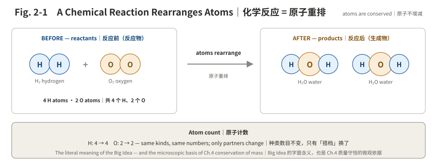
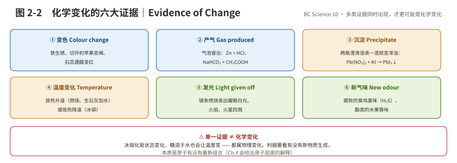
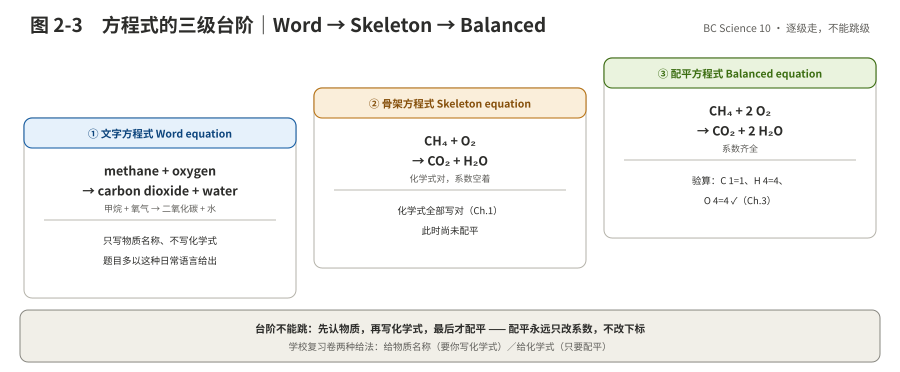
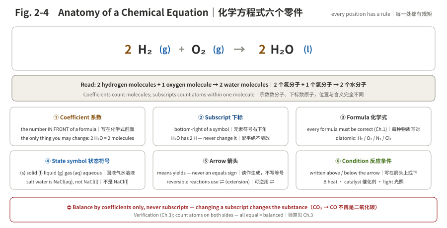
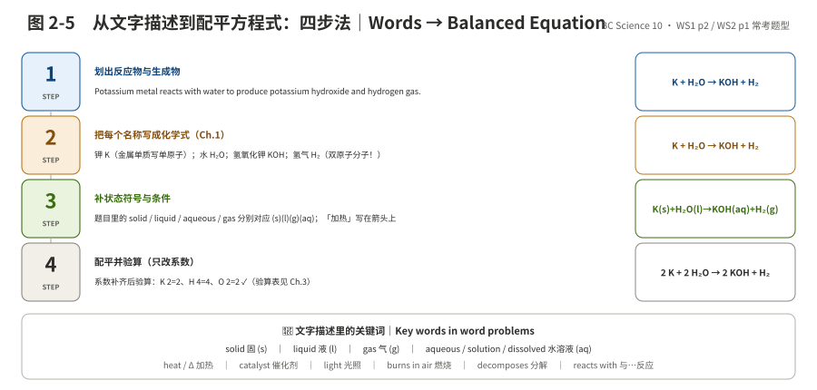

# Ch.2 — Chemical Reactions and Chemical Equations
## Chapter 2 · Chemical Reactions and Chemical Equations｜第 2 章　化学反应与化学方程式

> 🗂️ **Content Alignment｜大纲对应**：BC Science 10 Content C1 *rearrangement of atoms in chemical reactions*（核心）；C3 *law of conservation of mass* 的入场门槛。
> ⏱️ **Periods｜课时**：2–3
> 🔗 **Source alignment｜素材对齐**：`SCI 10 REV WORKSHEET 1` p.2 / `SCI 10 REV WORKSHEET 2` p.1（word description → formulas → balanced equation）

---

## 1. Content Alignment｜大纲对应

| Official item（官方条目） | Where it shows up in this unit｜在本单元的位置 | Status｜定位 |
|---|---|---|
| Science 9: *physical vs chemical change* | Evidence of chemical change（§3.2） | Review 复习 |
| Science 10 C1: *rearrangement of atoms in chemical reactions* | The whole chapter; atomic model in Fig. 2-1（§3.1） | Core 核心 |
| Science 10 C1: *representing reactions symbolically* | Word → skeleton → balanced（§3.3, §5） | Core 核心 |
| Science 10 C3: *law of conservation of mass* | Atom-count check behind every balanced equation（§3.5, Ch.4） | Gateway 门槛 |
| Ch.3: systematic balancing of hard cases | This chapter balances only straightforward skeletons | Next 后续 |
| Chemistry 11: mole ratios, limiting reagent, net ionic equations | — | ⛔ Out of scope 超纲 |

**中文**：本章是 Part I 的第一章，任务只有一件——把"物质变成了新物质"这件事，从一句英文描述，逐步压缩成一个**配平且状态齐全**的化学方程式。Ch.1 解决"每个化学式写对"，本章解决"把化学式排成等式"，Ch.3 再解决"难配的怎么配"。

---

## 2. Learning Objectives｜学习目标

By the end of this chapter, you should be able to:

1. Explain a chemical reaction as a rearrangement of atoms, and state what is conserved and what is not.
2. Recognise the six common pieces of evidence for a chemical change, and explain why one piece of evidence is not proof.
3. Convert a word equation into a skeleton equation using correct formulas from Ch.1.
4. Balance a skeleton equation by changing coefficients only, and verify the result by counting atoms.
5. Add state symbols and reaction conditions correctly, including the common trap of salt water.
6. Read any equation aloud and answer the six questions a chemist asks of it.

**中文**：学完本章，你应当能够——① 用"原子重排"解释化学反应，说清什么守恒、什么不守恒；② 认六大证据并解释"单一证据不算证明"；③ 由文字方程式写出骨架方程式；④ 只改系数完成配平并用原子计数验算；⑤ 正确标注状态符号与反应条件（尤其是食盐水这个坑）；⑥ 按"六问"完整读出一条方程式。

---

## 3. Concept Explanations｜概念解析

### 3.1 A Chemical Reaction Is a Rearrangement of Atoms｜化学反应 = 原子重排

A **chemical reaction（化学反应）** is a process in which the atoms of the starting substances are pulled apart and joined into new combinations. The old **bonds（化学键）** break; new bonds form.

**Definition｜定义**：In a chemical reaction the **reactants（反应物）** — the substances you start with, written on the left — are converted into the **products（生成物）** — the substances formed, written on the right. Atoms are rearranged; **no atom is created and no atom is destroyed**.
**中文**：化学反应中，左边的**反应物**转化为右边的**生成物**。旧键断裂、新键形成，原子只是换了搭档——原子的种类和数目都没有增减。

Count Fig. 2-1 yourself: left 2 H₂ + 1 O₂ = **4 H, 2 O**; right 2 H₂O = **4 H, 2 O**. Same kinds, same numbers, different partners. This single picture is the microscopic reason the mass cannot change (Ch.4) and the reason an equation can be balanced at all (Ch.3).

**中文**：所谓"化学反应"，微观上就是**拆开再重组**；方程式左右两边原子数必须相等，不是规定，而是这件事的必然结果。

> 💡 **Tip｜口诀**：反应像换舞伴——人数不变，配对变了。数原子时先数"人"，再看"谁和谁牵了手"。

### 3.2 Evidence of Chemical Change｜化学变化的证据

You cannot see atoms rearrange, so you look for the **evidence（证据）** a new substance leaves behind.

1. **Colour change（变色）** — iron rusts, a cut apple browns, an indicator turns red in acid.
2. **Gas produced（产气）** — bubbles of H₂ when zinc is added to hydrochloric acid.
3. **Precipitate（沉淀）** — two clear solutions mix and a solid appears: Pb(NO₃)₂ + KI → PbI₂, a yellow solid.
4. **Temperature change（温度变化）** — heat released (burning, CaO + H₂O) or absorbed (cold pack).
5. **Light given off（发光）** — burning magnesium gives a dazzling white light.
6. **New odour（新气味）** — the rotten-egg smell of H₂S, or the fruity smell of an ester.

> 📏 **Rule｜规则**：A single observation is only a **clue**. The real test for a chemical change is whether a **new substance（新物质）** with new properties has formed.
> **中文**：六大证据只是线索，真正的判据只有一条——**有没有新物质生成**。判据错，后面全错。

⚠️ **Misconception｜易错**：Boiling water makes bubbles, and dissolving sugar makes the water taste sweet — neither is a chemical change. Bubbles from boiling are water vapour (same substance), and dissolved sugar can be recovered by evaporation. **Physical change（物理变化）** rearranges molecules, not atoms.

### 3.3 The Three-Step Ladder: Word → Skeleton → Balanced｜方程式的三级台阶

Every equation question in Science 10 walks up the same three steps.

- **Word equation（文字方程式）** — names only, no formulas: *methane + oxygen → carbon dioxide + water*. This is how the question is given to you.
- **Skeleton equation（骨架方程式）** — every name replaced by a **correct formula**, coefficients not yet in place: CH₄ + O₂ → CO₂ + H₂O. It is usually **not balanced**, and that is expected.
- **Balanced equation（配平方程式）** — coefficients added so that every element counts the same on both sides: CH₄ + 2 O₂ → CO₂ + 2 H₂O.

**中文**：三级台阶不能跳。第一级只认名称，第二级把名称全部换成正确化学式（错了就全错），第三级才动系数。学校卷子两种给法都有——给名称的考你写化学式，给化学式的只考配平。

> 📏 **Rule｜规则**：Skeleton → balanced changes **coefficients only**; subscripts are frozen once the formula is written.
> **中文**：配平只准改系数（化学式前面的数字），绝不准改下标——改下标等于换了一种物质。

### 3.4 State Symbols and Reaction Conditions｜状态符号与反应条件

A formula tells you *what*; the **state symbol（状态符号）** after it tells you *in what form that substance exists in this reaction*.

> 📏 **Rule｜规则**：(s) solid 固 · (l) liquid 液 · (g) gas 气 · (aq) aqueous, dissolved in water 水溶液。
> **中文**：四个状态符号写在化学式右侧、同一行；(aq) 专指"溶于水"，溶液、海水、酸液一律 (aq)。

The classic trap is table salt in water. **Salt water is NaCl(aq), never NaCl(l)** — (l) means the pure substance melted, as in molten iron Fe(l). Likewise water is H₂O(l) in a beaker but H₂O(g) as steam leaving a reaction.

**Conditions（反应条件）** go **above or below the arrow**, never inside the equation:

- **Δ / heat（加热）** — the mixture must be heated.
- **catalyst（催化剂）** — speeds up the reaction without being used up; written above the arrow, e.g. MnO₂ over the arrow for H₂O₂ decomposition.
- **light（光照）** — e.g. photosynthesis, or the light-induced decomposition of AgBr in photographic film.
- **spark（火花）** — ignition for a combustible gas mixture.

**中文**：条件写在箭头上（或下），不写进左右两边；催化剂写在箭头上方，它不出现在反应物或生成物里，因为反应前后它没被消耗。

> 【🔭 Extension → Chemistry 11】A **reversible reaction（可逆反应）** uses the double arrow ⇌ instead of →. Science 10 一律用单向箭头 →，遇到 ⇌ 只需认得。

### 3.5 Coefficients vs Subscripts — the Only Legal Move｜系数与下标

A chemical equation has six parts: **① coefficient（系数）**, **② subscript（下标）**, **③ formula（化学式）**, **④ state symbol（状态符号）**, **⑤ arrow（箭头）**, **⑥ condition（条件）**. Only ① is yours to change when balancing.

**Definition｜定义**：A **coefficient** is the number written in front of a formula; it multiplies **every atom** in that formula. A **subscript** is the small number inside a formula; it is part of the substance's identity.
**中文**：系数管"几个这样的粒子"，下标管"一个粒子里有几个这种原子"。系数是配平工具，下标是化学式的一部分，动了下标就是换了物质。

Counting drill — read the coefficient across the whole formula, brackets included:

| Expression｜表达式 | Meaning｜含义 |
|---|---|
| 2 H₂O | 2 molecules → 4 H, 2 O |
| 3 Ca(NO₃)₂ | 3 formula units → 3 Ca, 6 N, 18 O |
| 4 Fe₂O₃ | 4 formula units → 8 Fe, 12 O |

> 💡 **Tip｜口诀**：系数是"分发员"，括号外下标是"整包翻倍"——3 Ca(NO₃)₂ 里那个 3 让 NO₃ 整包乘 3，所以 O 是 3 × 3 × 2 = 18。

⚠️ **Misconception｜易错**：Never "balance" by turning H₂O into H₂O₂ or FeO into Fe₂O₃. H₂O is water; H₂O₂ is hydrogen peroxide — a different substance with different properties. Changing a subscript changes **what you made**, which is never allowed.

### 3.6 Reading an Equation: Six Questions｜读方程式六问

Any equation can be read aloud by answering six questions in order.

1. **Who reacts?** — the formulas left of the arrow.
2. **What is produced?** — the formulas right of the arrow.
3. **In what state?** — read the brackets.
4. **Under what conditions?** — read above and below the arrow.
5. **In what ratio?** — read the coefficients (particles, not grams).
6. **Is energy released or absorbed?** — qualitative only in Science 10.

Apply them to 2 H₂(g) + O₂(g) → 2 H₂O(l):

> Two molecules of hydrogen gas react with one molecule of oxygen gas to produce two molecules of liquid water, releasing energy.

**中文**：读法固定为"几个什么 + 几个什么 → 几个什么"，系数读作"分子个数"而不是质量；状态与条件一个都不能漏读，因为题目常靠它们设陷阱。

### 3.7 From an English Sentence to a Balanced Equation｜由文字描述到配平

School worksheets give you a sentence; you must return an equation. Four steps, always in this order.

1. **Underline reactants and products.** Signal words: *reacts with, is added to, burns in* introduce reactants; *produces, forms, yields, gives, decomposes into* introduce products.
2. **Turn every name into a formula** using Ch.1 — and remember H-7: H₂ · N₂ · O₂ · F₂ · Cl₂ · Br₂ · I₂.
3. **Add state symbols and conditions** — (s)(l)(g)(aq), and Δ / catalyst / light above the arrow.
4. **Balance and verify** — coefficients only, then count every element on both sides.

**中文**：第 2 步是全章最容易丢分的地方——名称会写、化学式写错，后面配得再漂亮也是零分。第 4 步的验算不是可选项：不数原子就等于没做完。

⚠️ **Misconception｜易错**：In "iron reacts with oxygen to form rust", oxygen is a **reactant**, not a condition. Air is never written as a condition above the arrow; O₂(g) belongs on the left.

---

## 4. Comparison Tables｜表格比对

### Table 2-1　Physical vs Chemical Change｜物理变化与化学变化

| Feature｜特征 | Physical change｜物理变化 | Chemical change｜化学变化 |
|---|---|---|
| New substance｜新物质 | none 无 | formed 有 |
| Atoms｜原子 | unchanged, arrangement unchanged 不变 | rearranged 重排 |
| Bonds｜化学键 | broken between molecules only 分子间 | broken and re-formed 断裂并重组 |
| Reversible by｜复原方式 | simple physical means 蒸发、过滤 | chemical reaction only 只能再反应 |
| Example｜例 | ice melting, sugar dissolving 冰融化、糖溶解 | Mg burning, PbI₂ forming 镁燃烧、生成碘化铅 |

### Table 2-2　The Three Levels of an Equation｜方程式的三级台阶

| Level｜层级 | What you write｜写什么 | Fixed by｜由什么决定 | Example｜例 |
|---|---|---|---|
| Word equation 文字方程式 | names only 只写名称 | the question 题目本身 | methane + oxygen → carbon dioxide + water |
| Skeleton equation 骨架方程式 | correct formulas, no balancing 化学式对、未配平 | Ch.1 rules 化学式规则 | CH₄ + O₂ → CO₂ + H₂O |
| Balanced equation 配平方程式 | formulas + coefficients 加系数 | conservation of atoms 原子守恒 | CH₄ + 2 O₂ → CO₂ + 2 H₂O |

### Table 2-3　State Symbols and Conditions｜状态符号与反应条件

| Symbol｜符号 | Meaning｜含义 | Typical example｜典型例 | Trap｜易错 |
|---|---|---|---|
| (s) | solid 固体 | 2 Mg(s) + O₂(g) → 2 MgO(s) | not "solution" 不是溶液 |
| (l) | pure liquid 纯液体 | H₂O(l), Fe(l) molten iron 铁水 | salt water is not (l) |
| (g) | gas 气体 | CO₂(g), H₂(g) | gas leaving a liquid is still (g) |
| (aq) | dissolved in water 水溶液 | NaCl(aq), HCl(aq) | the default for acids and solutions |
| Δ above arrow | heat 加热 | CaCO₃ —Δ→ CaO + CO₂ | must not be written on either side |
| catalyst above arrow | speeds up, not used up 催化剂 | 2 H₂O₂ —MnO₂→ 2 H₂O + O₂ | not a reactant, not a product |

### Table 2-4　Coefficient vs Subscript｜系数与下标

| Question｜问题 | Coefficient｜系数 | Subscript｜下标 |
|---|---|---|
| Where｜位置 | in front of the formula 化学式前 | inside the formula 化学式内 |
| Means｜含义 | how many particles 几个粒子 | atoms within one particle 一个粒子内几个原子 |
| May I change it?｜可否改 | yes, this is balancing 配平就改它 | never 绝不能改 |
| Effect of changing｜改动后果 | same substance, different amount 同一物质不同数量 | a different substance 变成另一种物质 |
| Example｜例 | 2 H₂O → 4 H, 2 O | H₂O₂ ≠ 2 H₂O |

---

## 5. Diagrams & Worked Examples｜图例说明

Figures 2-1 to 2-5 appear in §3. Here the four-step routine is exercised on real question wording, including one deliberately broken set.

### Example 2-1　Word Equation → Balanced Equation｜文字方程式 → 配平

**"Sodium metal reacts with chlorine gas to produce solid sodium chloride."**

1. Reactants: sodium, chlorine. Product: sodium chloride.
2. Formulas: Na (a metal, single atoms) · Cl₂ (H-7: chlorine is diatomic) · NaCl.
3. Skeleton: Na(s) + Cl₂(g) → NaCl(s).
4. Balance: Cl needs 2 on the right, so 2 NaCl; that gives 2 Na on the right, so 2 Na on the left.
5. Verify: Na 2 = 2, Cl 2 = 2. ✓

**Answer｜答案**：2 Na(s) + Cl₂(g) → 2 NaCl(s)

**中文**：氯气写成 Cl₂ 是第一步的关键；配平顺序是"先配 Cl，再回头配 Na"——因为 Cl 只出现在一个反应物和一个生成物里。

### Example 2-2　Precipitate Reaction with States｜含沉淀的反应（状态齐全）

**"Aqueous lead(II) nitrate reacts with aqueous potassium iodide to produce solid lead(II) iodide and aqueous potassium nitrate."**

1. Reactants: lead(II) nitrate, potassium iodide. Products: lead(II) iodide, potassium nitrate.
2. Formulas: Pb(NO₃)₂ · KI · PbI₂ · KNO₃ — all four must be built with the criss-cross rule from Ch.1.
3. States: Pb(NO₃)₂(aq) + KI(aq) → PbI₂(s) + KNO₃(aq). The (s) on PbI₂ *is* the precipitate.
4. Balance: I 2 on the right → 2 KI; then K 2 → 2 KNO₃; then N and O come out 2 and 6 on both sides.
5. Verify: Pb 1 = 1, N 2 = 2, O 6 = 6, K 2 = 2, I 2 = 2. ✓

**Answer｜答案**：Pb(NO₃)₂(aq) + 2 KI(aq) → PbI₂(s) + 2 KNO₃(aq)

**中文**：多原子离子 NO₃⁻ 全程当一个整体搬，不要拆成 N 和 O 去数；括号里的 O 有 3 个，系数 2 一来就是 6 个。

### Example 2-3　Decomposition with a Catalyst｜带催化剂的分解反应

**"Hydrogen peroxide solution decomposes into water and oxygen gas when manganese(IV) oxide is added."**

1. Reactants: hydrogen peroxide, H₂O₂. Products: water H₂O, oxygen O₂.
2. "Manganese(IV) oxide is added" is a **catalyst**, not a reactant — it goes above the arrow.
3. Skeleton with states: H₂O₂(aq) —MnO₂→ H₂O(l) + O₂(g).
4. Balance: O is 2 on the left and 3 on the right, so double H₂O₂: 2 H₂O₂ → 2 H₂O + O₂.
5. Verify: H 4 = 4, O 4 = 2 + 2. ✓

**Answer｜答案**：2 H₂O₂(aq) —MnO₂→ 2 H₂O(l) + O₂(g)

**中文**：催化剂不写进反应物，否则你会在配平里永远多出一份 MnO₂ 要处理；O₂ 是双原子，右侧的氧要数成 2 而不是 1。

### Example 2-4　Find the Error｜找错题（三条里有一条是对的）

A classmate hands in three "balanced" equations. Decide which are wrong, name the error, and give the correct line.

| Student's line｜学生所写 | Verdict｜判定 |
|---|---|
| (a) Mg + O₂ → MgO₂ | wrong 错 |
| (b) N₂ + H₂ → 2 NH₃ | wrong 错 |
| (c) 2 H₂ + O₂ → 2 H₂O | correct 对 |

- **(a)** The subscript was invented to make the count work — MgO₂ is not magnesium oxide. Correct: 2 Mg(s) + O₂(g) → 2 MgO(s). Check: Mg 2 = 2, O 2 = 2. ✓
- **(b)** H is 2 on the left and 6 on the right — the line was never finished. Correct: N₂(g) + 3 H₂(g) → 2 NH₃(g). Check: N 2 = 2, H 6 = 6. ✓
- **(c)** Nothing to fix: H 4 = 4, O 2 = 2, and the coefficients are already the smallest whole numbers. ✓

**中文**：(a) 改下标 = 换物质，这是本章红线；(b) 是"只配了一半"，系数 3 必须补上；(c) 故意放一条正确的——考试里不是每一条都错，先数原子再下结论。

---

## 6. Key Vocabulary｜核心词汇

| English｜英文 | 中文 | Note｜备注 |
|---|---|---|
| chemical reaction | 化学反应 | atoms rearranged, not created 原子重排 |
| reactant | 反应物 | left of the arrow 箭头左侧 |
| product | 生成物 | right of the arrow 箭头右侧 |
| word equation | 文字方程式 | names only 只写名称 |
| skeleton equation | 骨架方程式 | formulas correct, not balanced 未配平 |
| balanced equation | 配平方程式 | coefficients in place 系数齐全 |
| coefficient | 系数 | in front, may change 可改 |
| subscript | 下标 | inside the formula, never change 不可改 |
| state symbol | 状态符号 | (s)(l)(g)(aq) |
| aqueous | 水溶液 | dissolved in water 溶于水 |
| precipitate | 沉淀 | insoluble solid formed 不溶固体 |
| catalyst | 催化剂 | above the arrow, not used up 写在箭头上 |
| conservation of atoms | 原子守恒 | same kinds, same numbers 种类数目不变 |
| physical change | 物理变化 | no new substance 无新物质 |
| evidence of chemical change | 化学变化的证据 | colour, gas, precipitate, heat, light, odour |
| verify | 验算 | count every element both sides 左右逐元素计数 |

---

## 7. Lab / Activity｜实验与活动

### Activity 2-1　Atom Moving Day｜原子搬家（磁贴模型）

Two colours of magnets stand for atoms: red = H, blue = O. Build 2 H₂ + O₂ on the bench, count the pieces, then physically pull them apart and rebuild 2 H₂O. Photograph or sketch "before" and "after" and label the count. `[Formulating models]`

**中文**：动手拆、动手拼，然后在图上标原子数——图要能让人一眼看出"4 个 H、2 个 O 前后一样"。

### Activity 2-2　Equation Translation Workshop｜方程式翻译工作坊

Ten English sentences, one per card. For each: underline reactants and products, write formulas, add states and conditions, balance, verify. Sentences deliberately include diatomic traps (hydrogen gas, oxygen gas, nitrogen gas) and one precipitate. `[Communicating]`

**中文**：10 句 → 10 条方程式；评分只看三件事：化学式对不对、配平没有、状态与条件漏没漏。

### Activity 2-3　Chemical Change Observation Stations｜化学变化观察站

Three stations, five minutes each: (1) NaHCO₃ + CH₃COOH, (2) Pb(NO₃)₂ + KI, (3) burning Mg ribbon (teacher demonstration, goggles and tongs). Record the evidence you actually saw, then write the balanced equation with states for each. `[Planning and conducting]`

**中文**：先记录"看到了什么证据"，再写方程式——顺序不能反，证据是判断依据，方程式是结论。

---

## 8. Common Misconceptions｜常见易错点

1. ❌ "To balance, I change a subscript." → ✅ Change **coefficients only**; a subscript change makes a different substance.
   **中文**：改下标 = 换物质，配平只能改系数。
2. ❌ "H + O → H₂O, I will balance later." → ✅ Elemental hydrogen and oxygen are **H₂ and O₂** (H-7 rule).
   **中文**：H₂、O₂ 是双原子，起点写错后面全错。
3. ❌ "Salt water is NaCl(l)." → ✅ It is **NaCl(aq)**; (l) means the pure substance is melted.
   **中文**：(aq) 才是"溶于水"，(l) 是纯物质熔化。
4. ❌ "Bubbles mean a chemical reaction." → ✅ Boiling water bubbles too; the test is a **new substance**.
   **中文**：气泡只是线索，沸腾也在冒泡。
5. ❌ "Melting and dissolving are chemical changes." → ✅ Both are **physical** — the substance is recoverable unchanged.
   **中文**：冰融化、糖溶解都是物理变化。
6. ❌ "The arrow works like an equals sign." → ✅ Read it as **yields / produces**; the two sides are not interchangeable.
   **中文**：箭头读作"生成"，左右不能对调。
7. ❌ "A coefficient of 2 in 2 H₂O doubles only the hydrogen." → ✅ It multiplies **every atom** in the formula: 4 H and 2 O.
   **中文**：系数乘整个化学式，包括括号里的原子团。
8. ❌ "(s) stands for solution." → ✅ (s) is **solid**; solution is (aq).
   **中文**：s = solid 固体，别和 solution 混。
9. ❌ "Correct formulas means the equation is already balanced." → ✅ A skeleton equation is usually unbalanced; balancing is a separate, checked step.
   **中文**：化学式对 ≠ 配平，必须单独数一遍。
10. ❌ "Fractional or unreduced coefficients are acceptable in the final answer." → ✅ Final coefficients must be the **smallest whole numbers**; fractions are only a working step.
    **中文**：最终系数必须是最简整数比，分数只在过程中临时用。

---

## 9. Assessment｜答题评估

**Part A — Knowledge｜基础（10 × 2 = 20 分）**

**A1.** Define *reactant* and *product*, then label both in: methane + oxygen → carbon dioxide + water.
- **中文**：定义反应物与生成物，并在这个文字方程式中分别指出。

**A2.** Chemical or physical change? (a) ice melting (b) iron rusting (c) sugar dissolving in water (d) milk turning sour.
- **中文**：判断物理变化还是化学变化：(a) 冰融化 (b) 铁生锈 (c) 糖溶于水 (d) 牛奶变酸。

**A3.** Name four different pieces of evidence of chemical change, and say which one Fig. 2-2 uses for Pb(NO₃)₂ + KI.
- **中文**：写出四种化学变化的证据，并说明图 2-2 用哪一条描述 Pb(NO₃)₂ + KI。

**A4.** Give the correct state symbol for each: (a) NaCl in seawater (b) molten iron in a foundry (c) CO₂ leaving a flask (d) a copper wire.
- **中文**：给出正确状态符号：(a) 海水中的 NaCl (b) 炼钢炉中的铁水 (c) 从瓶中逸出的 CO₂ (d) 铜导线。

**A5.** Write skeleton equations (formulas only, no balancing): (a) magnesium + oxygen → magnesium oxide (b) sodium + water → sodium hydroxide + hydrogen.
- **中文**：只写骨架方程式（不配平）：(a) 镁 + 氧气 → 氧化镁 (b) 钠 + 水 → 氢氧化钠 + 氢气。

**A6.** Balance: ______ Fe + ______ O₂ → ______ Fe₂O₃
- **中文**：配平：______ Fe + ______ O₂ → ______ Fe₂O₃

**A7.** Balance: ______ Al + ______ HCl → ______ AlCl₃ + ______ H₂
- **中文**：配平：______ Al + ______ HCl → ______ AlCl₃ + ______ H₂

**A8.** Balance: ______ C₃H₈ + ______ O₂ → ______ CO₂ + ______ H₂O
- **中文**：配平丙烷燃烧：______ C₃H₈ + ______ O₂ → ______ CO₂ + ______ H₂O

**A9.** Count the atoms of each element in 3 Ca(NO₃)₂.
- **中文**：数出 3 Ca(NO₃)₂ 中各元素的原子总数。

**A10.** Read 2 H₂(g) + O₂(g) → 2 H₂O(l) using the six questions of §3.6.
- **中文**：用 §3.6 的六问读这条方程式。

**Part B — Application｜应用（4 × 5 = 20 分）**

**B1.** "Aqueous sodium carbonate reacts with aqueous calcium chloride to produce solid calcium carbonate and aqueous sodium chloride." Write the complete balanced equation with state symbols.
- **中文**：把这句话写成配平且带状态符号的完整方程式。

**B2.** "Zinc metal reacts with aqueous hydrochloric acid to produce aqueous zinc chloride and hydrogen gas." Write the complete balanced equation with state symbols.
- **中文**：把这句话写成配平且带状态符号的完整方程式。

**B3.** Explain, using H₂O and H₂O₂, why subscripts may never be changed during balancing, while coefficients may.
- **中文**：用 H₂O 与 H₂O₂ 解释：为什么配平不能改下标，却可以改系数。

**B4.** Baking soda is added to vinegar: bubbles form and the mixture cools slightly. Write the word equation, then the balanced equation with states, and name two pieces of evidence.
- **中文**：小苏打加入白醋，产生气泡并略微降温。写文字方程式、配平方程式（含状态），并指出两条证据。

**Part C — Challenge｜挑战（2 × 10 = 20 分）**

**C1.** "Carbon dioxide and water, in the presence of light, produce glucose (C₆H₁₂O₆) and oxygen gas." Work the full ladder — word equation, skeleton, states and condition, balanced equation — then verify with an atom-count table.
- **中文**：按三级台阶完整处理这句话：文字方程式 → 骨架方程式 → 补状态与条件 → 配平；最后用原子计数表验算。

**C2.** Balance the combustion of ethanol: C₂H₅OH(l) + O₂(g) → CO₂(g) + H₂O(g). Show the atom-count table, explain why the coefficient of ethanol is 1, and explain what would go wrong if you "fixed" the oxygen count by writing H₂O₂.
- **中文**：配平乙醇燃烧；给出原子计数表；解释为什么乙醇系数取 1；并说明若用 H₂O₂ 去"凑"氧会错在哪里。

### Answers｜参考答案

**Part A**

- **A1.** Reactants are the starting substances (left of the arrow); products are the substances formed (right). Reactants: methane, oxygen. Products: carbon dioxide, water.
  **中文**：反应物在左（甲烷、氧气），生成物在右（二氧化碳、水）。

- **A2.** (a) physical (b) chemical (c) physical (d) chemical.
  **中文**：冰融化、糖溶解无新物质 → 物理；铁生锈、牛奶变酸有新物质 → 化学。

- **A3.** Any four of: colour change, gas produced, precipitate, temperature change, light given off, new odour. For Pb(NO₃)₂ + KI the evidence is a **precipitate** — yellow PbI₂.
  **中文**：六大证据任选四条；该反应用的是"沉淀"这一条，黄色固体是 PbI₂。

- **A4.** (a) NaCl(aq) (b) Fe(l) (c) CO₂(g) (d) Cu(s).
  **中文**：溶于水用 (aq)，铁水是纯物质熔化用 (l)，逸出气体 (g)，金属丝 (s)。

- **A5.** (a) Mg + O₂ → MgO (b) Na + H₂O → NaOH + H₂. Neither is balanced yet — that is the point of a skeleton.
  **中文**：骨架方程式只要求化学式正确；两条都还未配平，属正常。

- **A6.** 4 Fe + 3 O₂ → 2 Fe₂O₃. Check: Fe 4 = 4, O 6 = 6. ✓
  **中文**：先让右侧 O 成偶数（2 Fe₂O₃ 得 6 个 O），再补 Fe 为 4。

- **A7.** 2 Al + 6 HCl → 2 AlCl₃ + 3 H₂. Check: Al 2 = 2, H 6 = 6, Cl 6 = 6. ✓
  **中文**：先配 Cl（右侧 3 个 → 6 HCl），再让 H 成对，最后 Al 取 2。

- **A8.** C₃H₈ + 5 O₂ → 3 CO₂ + 4 H₂O. Check: C 3 = 3, H 8 = 8, O 10 = 6 + 4. ✓
  **中文**：先 C 后 H 最后 O：C 定 3，H 定 4，右侧共 10 个 O → 左侧 5 O₂。

- **A9.** 3 Ca, 6 N, 18 O.
  **中文**：系数 3 乘整个化学式；括号内 O 为 3 个，故 3 × 3 × 2 = 18。

- **A10.** Two molecules of hydrogen gas react with one molecule of oxygen gas, producing two molecules of liquid water; no condition is shown; the ratio is 2 : 1 : 2; energy is released.
  **中文**：氢气和氧气（均为气体）生成液态水，无条件标注，粒子比 2 : 1 : 2，反应放热。

**Part B**

- **B1.** Na₂CO₃(aq) + CaCl₂(aq) → CaCO₃(s) + 2 NaCl(aq). Check: Na 2 = 2, C 1 = 1, O 3 = 3, Ca 1 = 1, Cl 2 = 2. ✓
  **中文**：CaCO₃ 不溶，标 (s)——它就是"沉淀"；其余三种留在水中标 (aq)。

- **B2.** Zn(s) + 2 HCl(aq) → ZnCl₂(aq) + H₂(g). Check: Zn 1 = 1, H 2 = 2, Cl 2 = 2. ✓
  **中文**：氢气必须写 H₂；系数 2 加在 HCl 上，Cl 才够 ZnCl₂ 用。

- **B3.** A subscript is part of the substance's identity: H₂O is water, H₂O₂ is hydrogen peroxide — different formulas, different properties. Changing a subscript therefore changes *what* reacted or formed. A coefficient only changes *how many* particles, leaving every substance unchanged, so it is the only legal balancing tool.
  **中文**：下标决定"是什么"，系数只决定"有多少"；配平必须保持物质不变，所以只能动系数。

- **B4.** Word equation: sodium hydrogen carbonate + acetic acid → sodium acetate + water + carbon dioxide. Balanced: NaHCO₃(aq) + CH₃COOH(aq) → CH₃COONa(aq) + H₂O(l) + CO₂(g). Check: Na 1 = 1, C 3 = 3, H 5 = 5, O 5 = 5. ✓ Evidence: gas produced (bubbles) and temperature change (cools).
  **中文**：这条方程式系数全为 1，配平后仍要数一遍；证据是产气与温度下降。

**Part C**

- **C1.** Word equation: carbon dioxide + water → glucose + oxygen. Skeleton: CO₂ + H₂O → C₆H₁₂O₆ + O₂. With states and condition: CO₂(g) + H₂O(l) —light→ C₆H₁₂O₆(aq) + O₂(g). Balanced: 6 CO₂(g) + 6 H₂O(l) —light→ C₆H₁₂O₆(aq) + 6 O₂(g). Atom table: C 6 = 6; H 12 = 12; O 18 = 6 + 12 = 18. ✓
  **中文**：葡萄糖有 6 个 C，所以 CO₂ 取 6；H 有 12 个，所以 H₂O 取 6；最后用 O 收尾，18 = 6 + 12 恰好相等。

- **C2.** Balanced: C₂H₅OH(l) + 3 O₂(g) → 2 CO₂(g) + 3 H₂O(g). Atom table: C 2 = 2; H 6 = 6; O 1 + 6 = 7 and 4 + 3 = 7. ✓ Ethanol's coefficient is 1 because it is the only source of carbon and hydrogen and it already contains oxygen — fixing it at 1 lets C set CO₂ to 2 and H set H₂O to 3, leaving O to be closed by O₂ alone. Writing H₂O₂ would change the product into a different substance, so the equation would no longer describe combustion at all.
  **中文**：乙醇是唯一的 C、H 来源，先定 1 最省事；O 最后用 O₂ 收尾。把 H₂O 改成 H₂O₂ 等于换了生成物，方程式就不再描述这个反应。

### Rubric｜评分量规

| Level｜水平 | Standard（English）｜英文标准 | 中文标准 |
|---|---|---|
| Exemplary 满分档 | Every formula correct; coefficients in smallest whole numbers; states and conditions complete; atom count shown for each element | 化学式全对、系数最简、状态条件齐全，且逐元素列出验算 |
| Proficient 良好档 | Equations balanced correctly; one state symbol or one condition missing; verification implied but not shown | 配平正确，漏一个状态或条件，验算未写出 |
| Developing 合格档 | Formulas mostly right; balancing reached but not verified, or ratio not reduced | 化学式大体正确，配平未验算或未约至最简 |
| Beginning 待提高档 | Balancing attempted by changing subscripts, or diatomic elements written as single atoms | 靠改下标"配平"，或双原子写成单原子——回炉 §3.3 与 §3.5 |

---

## 10. Connection to the Big Idea｜回扣核心概念

> 🎯 **Big Idea**: *Energy change is required as atoms rearrange in chemical processes.*

The Big Idea says energy is required **as atoms rearrange** — and this chapter is precisely about that clause. Fig. 2-1 shows the rearrangement; the balanced equation is its accounting record; the temperature change in Fig. 2-2 is the energy signature that comes with breaking old bonds and making new ones. **中文**：Big Idea 的主语是"原子重排"，本章讲的正是这件事本身——方程式记录重排，能量变化是重排的伴随现象。

An equation without correct formulas is fiction, and an equation without coefficients is unfinished. **中文**：化学式错 = 描述错，系数缺 = 账没平；两样都过，方程式才算成立。

⏭️ **Preview｜预告**：Ch.3 turns these short skeletons into a repeatable four-step balancing routine for combustion, polyatomic groups and long fuels; Ch.4 then weighs the whole idea on a balance and explains why mass never changes.
