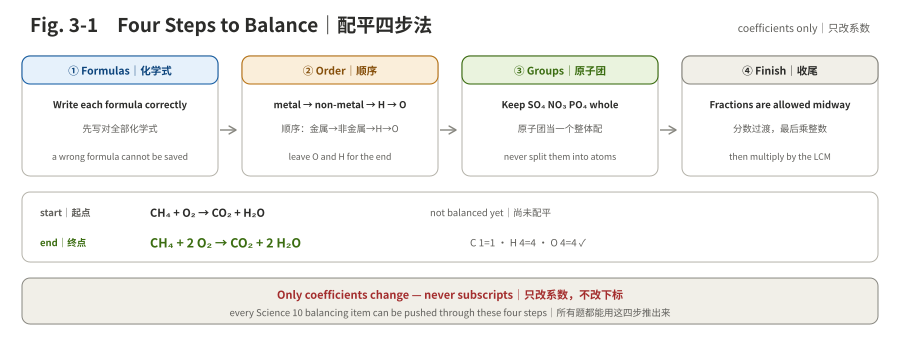
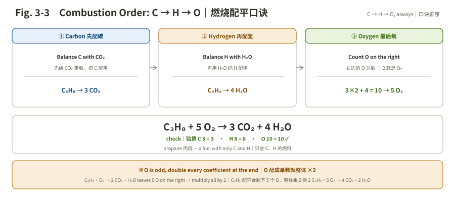
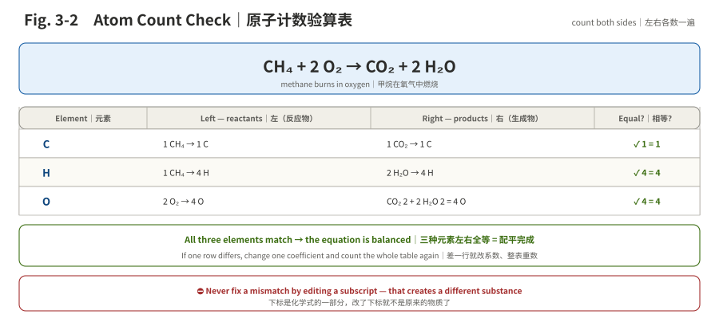
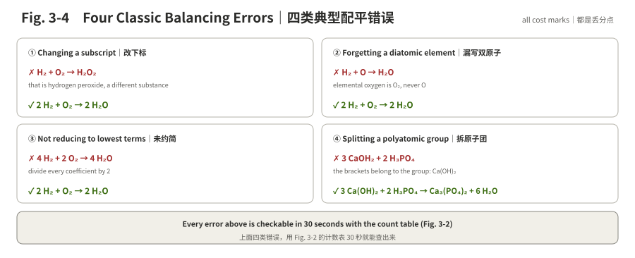

# Ch.3 — Balancing Chemical Equations
## Chapter 3 · Balancing Chemical Equations｜第 3 章　化学方程式的配平

> 🗂️ **Content Alignment｜大纲对应**：BC Science 10 Content C1（chemical reactions：rearrangement of atoms）的核心技能章——把 Ch.2 的骨架方程式补上系数，变成可验算的配平方程式。
> ⏱️ **Periods｜课时**：3
> 🔗 **Source alignment｜素材对齐**：`WS1` p2 / `WS2` p2 / `WS3` p2（大量配平题，含「复杂配平」挑战题）

---

## 1. Content Alignment｜大纲对应

| Official item（官方条目） | Where it shows up in this unit｜在本单元的位置 | Status｜定位 |
|---|---|---|
| Science 10 C1: *rearrangement of atoms in chemical reactions* | Balancing = the symbolic form of atom conservation（§3.1, §3.8） | Core 核心 |
| Science 9: *compounds have fixed formulas* | Step ① of the four-step method（§3.2） | Review 复习 |
| Ch.2: word → skeleton → balanced equation | This chapter finishes the third step | Continuation 延续 |
| Ch.4: *law of conservation of mass* | Why balancing must work — mass is the macroscopic echo of atom counts | Preview 预告 |
| Chemistry 11: moles, stoichiometry, molarity | — | ⛔ Out of scope 超纲 |

**中文**：本章只教一件事——**给方程式补系数**。依据只有一条（质量守恒），流程只有一套（四步法），验收只有一张表（原子计数表）。学校三张卷子上的所有配平题，包括「复杂配平」，都用同一套流程推出来。

---

## 2. Learning Objectives｜学习目标

By the end of this chapter, you should be able to:

1. State the law of conservation of mass as the **only** justification for balancing an equation.
2. Balance equations with the four-step method, choosing an element order that minimises rework.
3. Balance polyatomic groups（SO₄, NO₃, PO₄, OH, CO₃ …）as whole units instead of atom by atom.
4. Use a fractional coefficient as a bridge, then multiply through to clear it.
5. Apply the combustion order **C → H → O** and verify any equation with an atom-count table.

**中文**：学完本章，你应当能够——① 用质量守恒解释"为什么要配平"；② 用四步法系统配平并会选择元素顺序；③ 把原子团当整体配；④ 会用分数系数过渡再乘整；⑤ 燃烧反应按 C→H→O 收尾，并会列表验算。

---

## 3. Concept Explanations｜概念解析

### 3.1 The Only Justification: Conservation of Mass｜唯一依据：质量守恒

A skeleton equation（Ch.2）tells you *what* reacts and *what* forms, but not *how much*. Balancing adds **coefficients（系数）** — the numbers in front of each formula — until both sides hold exactly the same atoms.

> 📏 **Rule｜规则**：**Law of conservation of mass（质量守恒定律）** — atoms are neither created nor destroyed in a chemical reaction. Therefore every element must appear the **same number of times** on both sides of a balanced equation.
> **中文**：化学反应里原子不会凭空出现或消失，所以**每种元素**在箭头左右两边的原子个数必须相等。这是配平的唯一依据——不是"看着顺眼"，不是"两边系数加起来一样多"。

Balancing changes **coefficients only**. The formulas themselves are frozen in Ch.1: changing a subscript does not "rebalance" an equation — it replaces the substance with a different one.

**中文**：配平只许改系数，化学式一个字都不能动。改下标 = 把原来的物质换成了另一种物质（H₂O 改成 H₂O₂ 就不再是水），这类"配平"在考试里是零分。

### 3.2 The Four-Step Method｜四步法

Use the same four steps on every equation, from `Na + Cl₂` to the big combustion items on `WS2`. Every Science 10 balancing problem can be pushed through this flow.

> 📏 **Rule｜规则**：① write every formula correctly → ② pick an element order → ③ keep polyatomic groups whole → ④ finish O and H, using a fraction midway if needed.
> **中文**：① 先把所有化学式写对（这一步错，后面全错）→ ② 选配平顺序 → ③ 原子团整体配 → ④ 最后配 O 与 H，必要时分数系数过渡。

> ⚠️ **Misconception｜易错**：Step ① is where most marks die. Writing `H + O₂ → H₂O` or `Na + Cl → NaCl` — wrong *before* balancing even starts — cannot be rescued by any coefficient.

### 3.3 Choosing the Element Order｜选元素顺序

The order in step ② is not decoration — it decides how much rework you do. The guiding question: **which elements appear in only one substance on the left and one on the right?** Start with those; leave the "everywhere" elements for last.

> 📏 **Rule｜规则**：Default order — **metal → non-metal → H → O**. Oxygen goes last almost always, because it appears in the most substances.
> **中文**：默认顺序：金属 → 非金属 → 氢 → 氧。哪个元素只出现在"一个反应物 + 一个生成物"里就先配它；O 几乎无处不在，永远留到最后收尾。

| Order｜顺序 | Element｜元素 | Why it goes here｜为什么 |
|---|---|---|
| 1st | metals 金属（Na, Mg, Al, Fe …） | usually sits in one substance per side — one decision, done |
| 2nd | other non-metals 非金属（Cl, S, P …） | same reason; still "rare" on both sides |
| 3rd | H 氢 | wanders into water, acids, hydroxides |
| last | O 氧 | appears almost everywhere; easy to top up with O₂, H₂O, CO₂ |

### 3.4 Polyatomic Groups Travel as One Unit｜原子团整体配

A **polyatomic group（多原子原子团）** such as SO₄, NO₃, PO₄, OH, CO₃, C₂O₄ or CH₃COO appears unchanged on both sides of many equations. Treat the whole group like a single "super-atom" and count *groups*, not atoms.

> 📏 **Rule｜规则**：If the same group appears on both sides, balance the group as one unit and never split it into individual atoms.
> **中文**：同一个原子团（如 SO₄）两边原样出现时，把它当一个整体数"几个团"，绝不拆成 S 和 4 个 O 去配——拆了既慢又容易把化学式写坏。

> 💡 **Tip｜口诀**：见到 `(OH)₂`、`(NO₃)₂`、`(PO₄)₂` 就在心里喊"两个氢氧根、两个硝酸根"——数的是括号右下角的个数，不是括号里的字母。

### 3.5 Fractional Coefficients: a Bridge, Not a Destination｜分数系数：过渡用，不交付

Some equations refuse to balance in whole numbers on the first pass. The professional move: allow a **fractional coefficient（分数系数）** temporarily, then multiply *every* coefficient by the denominator to clear it.

**Balance C₂H₆ + O₂ → CO₂ + H₂O.**

1. C: 2 → put 2 CO₂. H: 6 → put 3 H₂O.
2. O on the right: 2×2 + 3×1 = 7 — an odd number, awkward for O₂.
3. Bridge: write **C₂H₆ + 7/2 O₂ → 2 CO₂ + 3 H₂O**. Atoms balance.
4. Clear the fraction: multiply everything by 2 → **2 C₂H₆ + 7 O₂ → 4 CO₂ + 6 H₂O**.

> ⚠️ **Misconception｜易错**：The final answer must have whole-number coefficients, but the *process* may use fractions. Refusing the fraction step and "guessing 5 O₂ instead" wastes minutes — take the 7/2, then double.

**中文**：分数系数是脚手架：先用 7/2 把原子配平，再整体 ×2 拆掉脚手架。交付的答案永远是整数。

### 3.6 Combustion: Balance C → H → O｜燃烧配平：C → H → O

Combustion of a hydrocarbon（烃）always has the shape *fuel + O₂ → CO₂ + H₂O*, where O appears in three substances. The fixed order below removes almost all rework.

> 📏 **Rule｜规则**：**C first（配碳，定 CO₂）→ H second（配氢，定 H₂O）→ O last（数右边 O 总数，除以 2 得 O₂）**.
> **中文**：口诀"先碳后氢最后氧"：C 定 CO₂ 的系数，H 定 H₂O 的系数，最后把右边的 O 总数除以 2 写给 O₂。配 O 时**不许回头改**已经定好的 C 和 H。

Worked in Fig. 3-3 with propane: C₃H₈ + 5 O₂ → 3 CO₂ + 4 H₂O (C 3=3, H 8=8, O 10=10 ✓).

### 3.7 The Odd-O Trick｜奇偶技巧

In combustion the right-side oxygen total is often **odd**, and O₂ can only deliver even numbers. Do not wrestle with it — double the whole equation.

**Balance C₂H₂ + O₂ → CO₂ + H₂O.**

1. C first → 2 CO₂. H second → 1 H₂O (only 2 H in the fuel).
2. O last: right side holds 2×2 + 1 = 5 O — **odd**, and O₂ delivers even numbers only.
3. Bridge: 5/2 O₂ balances it — or multiply *all* coefficients by 2: **2 C₂H₂ + 5 O₂ → 4 CO₂ + 2 H₂O**.

> 💡 **Tip｜口诀**：右边 O 是单数 → 全式 ×2。这一步放在最后做，前面的 C、H 一概不动。

**中文**：奇数氧：先按 C→H→O 配完，如果 O₂ 需要半个（如 5/2），就整个方程式乘 2 变成整数。C₂H₂ 的例子：×2 后得 2 C₂H₂ + 5 O₂ → 4 CO₂ + 2 H₂O。

### 3.8 The Verification Table｜验算表

A balanced equation is a claim; the atom-count table is the proof. Build it for **every** equation you balance — on homework and on tests. It takes about 30 seconds and catches every error type in this chapter.

**中文**：验算三步——① 每种元素一行；② 左右各数一遍（系数 × 下标）；③ 全部相等才算配平。离子方程式还要多验一行：两边**总电荷**也要相等（Science 10 里了解即可，Chemistry 11 展开）。

> 🔍 **Self-check｜自检**：数原子时永远用"系数 × 下标"。2 O₂ 是 **4 个 O 原子**，不是 2 个；Ca(OH)₂ 里有 **2 个 O、2 个 H**，括号后的下标管住整个原子团。

---

## 4. Comparison Tables｜表格比对

### Table 3-1　Coefficient vs Subscript｜系数与下标

| Feature｜特征 | Coefficient 系数 | Subscript 下标 |
|---|---|---|
| Position｜位置 | in front of a formula（2 H₂O） | bottom-right of a symbol（H₂O） |
| Counts｜数的是什么 | molecules / formula units 分子个数 | atoms inside one molecule 分子内原子数 |
| May you change it?｜能否改 | ✅ this is exactly what balancing does | ⛔ never — it defines the substance |
| Example｜例 | 2 H₂O = two water molecules | H₂O₂ = hydrogen peroxide, not water |

### Table 3-2　Same Atoms, Different Jobs｜配平前后原子与分子的变化

| Quantity｜量 | Changes in a reaction?｜反应中变吗 | Evidence｜依据 |
|---|---|---|---|
| kinds of atoms 原子种类 | no 不变 | both sides show the same elements |
| numbers of atoms 原子数目 | no 不变 | the count table, all rows equal |
| number of molecules 分子个数 | **yes 变** | CH₄ + 2 O₂ → CO₂ + 2 H₂O: 3 molecules → 3 molecules is a coincidence, not a rule |

### Table 3-3　The Four Classic Errors and Their Fixes｜四类错误与纠正

| Error｜错误 | What it looks like｜样子 | Fix｜纠正 |
|---|---|---|---|
| changing a subscript 改下标 | H₂ + O₂ → H₂O₂ | balance with coefficients only: 2 H₂ + O₂ → 2 H₂O |
| forgetting a diatomic element 漏双原子 | H₂ + O → H₂O | element oxygen is O₂ (H-7 rule, Ch.1) |
| not reducing 未约简 | 4 H₂ + 2 O₂ → 4 H₂O | divide every coefficient by 2 → 2 H₂ + O₂ → 2 H₂O |
| splitting a polyatomic group 拆原子团 | 3 CaOH₂ + 2 H₃PO₄ | the group keeps its brackets: 3 Ca(OH)₂ |

See Fig. 3-4 in §8 for the visual gallery.

---

## 5. Diagrams & Worked Examples｜图例说明

### Example 3-1　Metal + Oxygen with the Odd-Even Crunch｜金属 + 氧气：奇偶挤压

**Balance Al + O₂ → Al₂O₃.**

1. Al appears once per side → balance it first: left 1 Al, right 2 Al. Least common multiple of 1 and 2 is 2 → put 2 Al? But O will fight back. Better: take O first here, because O₂ (even) vs Al₂O₃ (odd 3) is the real conflict: LCM of 2 and 3 is 6 → 3 O₂ and 2 Al₂O₃.
2. Now Al: 2 Al₂O₃ holds 4 Al → 4 Al on the left.
3. **4 Al + 3 O₂ → 2 Al₂O₃**. Check: Al 4=4, O 6=6 ✓.

**中文**：O₂ 是偶数供应方，Al₂O₃ 里却是 3 个 O——取最小公倍数 6，两边一次到位；再回头把 Al 补成 4。凡是"偶数 O₂ 对奇数氧化物"，都这么压。

> 💡 **Tip｜口诀**：偶对奇 → 找最小公倍数。O₂ ↔ Al₂O₃/Fe₂O₃ 这类组合先配 O，再回头补金属。

### Example 3-2　Polyatomic Groups Whole｜原子团整体配

**Balance Ca(OH)₂ + H₃PO₄ → Ca₃(PO₄)₂ + H₂O.**

1. Formulas are correct and frozen（step ①）. Groups: OH on the left, PO₄ on the right — each stays whole.
2. Ca: 1 vs 3 → 3 Ca(OH)₂. PO₄: 1 vs 2 → 2 H₃PO₄. (Groups counted as units!)
3. Now H: left 3×2 + 2×3 = 12; right so far 0 (PO₄ carries no H) → H₂O must hold 12 H → 6 H₂O.
4. **3 Ca(OH)₂ + 2 H₃PO₄ → Ca₃(PO₄)₂ + 6 H₂O**. Check: Ca 3=3 ✓ · PO₄ 2=2 ✓ · H 12=12 ✓ · O 3×2+2×4 = 14 and 8+6 = 14 ✓.

**中文**：把 OH、PO₄ 当整体数，两步就定下 3 和 2；剩下的 H 顺手给 6 H₂O。若把 OH 拆成 O 和 H 分头去配，会越配越乱。

### Example 3-3　Combustion in the C → H → O Order｜燃烧反应按口诀走

**Balance C₃H₈ + O₂ → CO₂ + H₂O.**

1. C first: 3 C → 3 CO₂. H second: 8 H → 4 H₂O.
2. O last: right side holds 3×2 + 4×1 = 10 O → 5 O₂.
3. **C₃H₈ + 5 O₂ → 3 CO₂ + 4 H₂O**. Check: C 3=3, H 8=8, O 10=10 ✓.

**中文**： propane（丙烷）：口诀三步走完，一次配平，零返工。

### Example 3-4　Fraction Bridge on a Big Combustion｜分数过渡 + 大数配平

**Balance C₂₅H₅₂ + O₂ → CO₂ + H₂O**（the WS1 "complex" item）.

1. C: 25 → 25 CO₂. H: 52 → 26 H₂O.
2. O on the right: 25×2 + 26 = 76 → 38 O₂. Even! No fraction needed.
3. **C₂₅H₅₂ + 38 O₂ → 25 CO₂ + 26 H₂O**. Check: C 25=25 ✓ · H 52=52 ✓ · O 76 = 50 + 26 = 76 ✓.

**中文**：大数不可怕——C、H 先定，O 最后除以 2。52 个 H 一眼看出 26 H₂O；右边 76 个 O 正好偶数，38 O₂ 一步到位。若遇奇数，再全式 ×2（§3.7）。

---

## 6. Key Vocabulary｜核心词汇

| English｜英文 | 中文 | Note｜备注 |
|---|---|---|---|
| balance | 配平 | make atom counts equal on both sides |
| law of conservation of mass | 质量守恒定律 | the only justification for balancing |
| coefficient | 系数 | the number you ARE allowed to change |
| subscript | 下标 | never change it — defines the substance |
| fractional coefficient | 分数系数 | midway bridge, cleared by ×denominator |
| lowest terms | 最简整数比 | final coefficients must be reduced |
| polyatomic group | 多原子原子团 | SO₄, NO₃, PO₄, OH, CO₃ … balance as one unit |
| combustion | 燃烧 | fuel + O₂ → CO₂ + H₂O |
| hydrocarbon | 烃（碳氢化合物） | fuel with C and H only |
| reactant | 反应物 | left of the arrow |
| product | 生成物 | right of the arrow |
| verify | 验算 | the atom-count table, every time |

---

## 7. Lab / Activity｜实验与活动

### Activity 3-1　Balancing Relay｜配平接力赛

Teams of four; each member owns one step of the four-step method（写化学式 → 先配金属 → 整体配原子团 → 收尾验算）. The paper moves hand to hand; the final team verifies with a count table before submitting. `[Planning and conducting]`

**中文**：四人接力各管一步，最后用验算表把关——谁的环节错了全队看得见，强化"流程"而非"猜答案"。

### Activity 3-2　Find the Error｜「找出错在哪」

Eight "balanced" equations, each hiding exactly one error type from Table 3-3（改下标 / 漏双原子 / 未约简 / 拆原子团）. Name the error type, then write the correct version. `[Processing and analyzing data and information]`

**中文**：给 8 个"已配平"方程式找错并纠正——先报错误类型，再给正确式。认错比写对更快建立判据。

### Activity 3-3　Big-Number Magnet Build｜大数配平磁贴

Using coloured atom magnets, physically build **C₂₅H₅₂ + 38 O₂ → 25 CO₂ + 26 H₂O** on the desk: 25 carbon magnets, 52 hydrogen magnets, 76 oxygen magnets — then rearrange them into products without adding or removing a single magnet. `[Planning and conducting]`

**中文**：用磁贴搭出 WS1 原题的大数配平——25 个 C、52 个 H、76 个 O 一个不多一个不少地换边重排，直观感受"原子守恒"就是配平本身。

---

## 8. Common Misconceptions｜常见易错点

1. ❌ "To fix a mismatch, adjust a subscript." → ✅ Subscripts define the substance; only coefficients are negotiable.
   **中文**：改下标 = 换物质，永远只改系数。
2. ❌ "Oxygen in an equation can be written O." → ✅ Elemental oxygen is **O₂** — the H-7 diatomic rule follows you into every equation.
   **中文**：单质氧写 O₂，7 种双原子单质一个都不能漏。
3. ❌ "4 H₂ + 2 O₂ → 4 H₂O is fine, it balances." → ✅ It balances but is not in **lowest terms**（最简整数比）— divide all coefficients by 2.
   **中文**：配平后系数必须约到最简整数比。
4. ❌ "In combustion, keep adjusting C and H while fixing O." → ✅ Fix C, fix H, then solve O in one move — never reopen earlier steps.
   **中文**：口诀最后一步配 O 时，前面定好的 C、H 不许回头改。
5. ❌ "Balance SO₄ by giving S and O separately." → ✅ The group travels as one unit; count groups, keep brackets.
   **中文**：原子团整体配，拆开必写坏化学式。
6. ❌ "Fractions are illegal, so I cannot use 7/2 O₂." → ✅ Fractions are a legitimate midway step; the *final* answer must be whole numbers.
   **中文**：分数系数是合法的过渡，交付前乘整即可。
7. ❌ "2 O₂ means 2 oxygen atoms." → ✅ Coefficient × subscript: 2 O₂ = **4** O atoms.
   **中文**：数原子永远是系数 × 下标。
8. ❌ "A balanced equation has the same number of molecules on both sides." → ✅ Conservation applies to **atoms**, not molecules — molecule counts usually change.
   **中文**：守恒的是原子，不是分子个数。
9. ❌ "If it balances, any coefficient ratio works." → ✅ Ratios are fixed by chemistry: 2 H₂ + O₂ and 4 H₂ + 2 O₂ describe the same reaction only after reducing.
   **中文**：同一反应只有一组最简系数比。
10. ❌ "Balanced means both sides have equal total charge, done." → ✅ For ion equations you must check *both* atom counts **and** total charge; Science 10 mainly checks atoms, Chemistry 11 adds charge formally.
    **中文**：原子数与电荷都要验（本章以原子计数为主，电荷守恒先建立意识）。

---

## 9. Assessment｜答题评估

**Part A — Knowledge｜基础（10 × 2 = 20 分）**

**A1.** Balance: Mg + O₂ → MgO
- **中文**：配平 Mg + O₂ → MgO。

**A2.** Balance: Na + Cl₂ → NaCl
- **中文**：配平 Na + Cl₂ → NaCl。

**A3.** Balance: N₂ + H₂ → NH₃
- **中文**：配平 N₂ + H₂ → NH₃。

**A4.** Balance: K + H₂O → KOH + H₂
- **中文**：配平 K + H₂O → KOH + H₂。

**A5.** Balance: Zn + HCl → ZnCl₂ + H₂
- **中文**：配平 Zn + HCl → ZnCl₂ + H₂。

**A6.** Balance: Fe + O₂ → Fe₂O₃
- **中文**：配平 Fe + O₂ → Fe₂O₃（偶对奇，先配 O）。

**A7.** Balance: CH₄ + O₂ → CO₂ + H₂O
- **中文**：配平甲烷燃烧（C→H→O）。

**A8.** Balance: Al + HCl → AlCl₃ + H₂
- **中文**：配平 Al + HCl → AlCl₃ + H₂。

**A9.** Balance: CaCO₃ → CaO + CO₂
- **中文**：配平 CaCO₃ → CaO + CO₂（先数一数再动笔）。

**A10.** Balance: Mg + H₃PO₄ → Mg₃(PO₄)₂ + H₂
- **中文**：配平 Mg + H₃PO₄ → Mg₃(PO₄)₂ + H₂（PO₄ 整体配）。

**Part B — Application｜应用（4 × 5 = 20 分）**

**B1.** Balance C₂H₅OH + O₂ → CO₂ + H₂O, and state in one sentence which order you used and why.
- **中文**：配平乙醇燃烧，并用一句话说明你用的元素顺序及理由。

**B2.** Balance Al₂(SO₄)₃ + Ca(OH)₂ → Al(OH)₃ + CaSO₄, and explain why counting SO₄ and OH as whole units shortens the work.
- **中文**：配平并解释：为什么把 SO₄、OH 当整体数能少走弯路。

**B3.** Balance C₂H₂ + O₂ → CO₂ + H₂O. Your O total will come out odd — show the doubling step explicitly.
- **中文**：配平 C₂H₂ 燃烧；O 会出现奇数，写出整体 ×2 的那一步。

**B4.** Balance KClO₃ → KCl + O₂, and explain why K and Cl must be settled before O.
- **中文**：配平 KClO₃ 分解，并解释为什么 K、Cl 要先于 O 定下来。

**Part C — Challenge｜挑战（2 × 10 = 20 分）**

**C1.** Balance C₂₅H₅₂ + O₂ → CO₂ + H₂O（the WS1 big-number item）. Then explain, referring to the count table, why the method does not get harder as the numbers grow.
- **中文**：配平 C₂₅H₅₂ 燃烧（WS1 原题），并用计数表解释：为什么数变大了方法却不变。

**C2.** Balance NH₃ + O₂ → NO + H₂O. Both H and O land on awkward numbers — describe a strategy (order choice, LCM, or fraction bridge) that reaches the answer without trial-and-error guessing.
- **中文**：配平 NH₃ + O₂ → NO + H₂O，并描述一套避免瞎猜的策略（顺序、最小公倍数或分数过渡）。

### Answers｜参考答案

**Part A**

- **A1.** 2 Mg + O₂ → 2 MgO.
  **中文**：Mg 2=2，O 2=2。

- **A2.** 2 Na + Cl₂ → 2 NaCl.
  **中文**：Na 2=2，Cl 2=2。

- **A3.** N₂ + 3 H₂ → 2 NH₃.
  **中文**：N 2=2，H 6=6。

- **A4.** 2 K + 2 H₂O → 2 KOH + H₂.
  **中文**：K 2=2，H 4=4，O 2=2。

- **A5.** Zn + 2 HCl → ZnCl₂ + H₂.
  **中文**：Zn 1=1，H 2=2，Cl 2=2。

- **A6.** 4 Fe + 3 O₂ → 2 Fe₂O₃.
  **中文**：O 取最小公倍数 6：3 O₂ 对 2 Fe₂O₃，再补 4 Fe。

- **A7.** CH₄ + 2 O₂ → CO₂ + 2 H₂O.
  **中文**：C 1=1，H 4=4，O 4=4。

- **A8.** 2 Al + 6 HCl → 2 AlCl₃ + 3 H₂.
  **中文**：Al 2=2，Cl 6=6，H 6=6。

- **A9.** Already balanced — all coefficients are 1: CaCO₃ → CaO + CO₂.
  **中文**：本来就配平（Ca 1=1，C 1=1，O 3=3），先验算再动笔，别乱加系数。

- **A10.** 3 Mg + 2 H₃PO₄ → Mg₃(PO₄)₂ + 3 H₂.
  **中文**：PO₄ 整体定 2；Mg 3=3，H 6=6，P 2=2，O 8=8。

**Part B**

- **B1.** C₂H₅OH + 3 O₂ → 2 CO₂ + 3 H₂O. Order used: C → H → O — C and H each sit in one product, O appears everywhere so it closes the equation.
  **中文**：C 2=2，H 6=6，O 7=4+3=7 ✓；顺序 C→H→O，O 最后收尾。

- **B2.** Al₂(SO₄)₃ + 3 Ca(OH)₂ → 2 Al(OH)₃ + 3 CaSO₄. Counting 3 SO₄ and 3 OH as units fixes three subscripts in two decisions; atom-by-atom would need separate S, O and H passes.
  **中文**：Al 2=2，SO₄ 3=3，Ca 3=3，OH 6=6，H 6=6 ✓；整体配把"三个下标"压成"两次决定"。

- **B3.** First pass: C₂H₂ + 5/2 O₂ → 2 CO₂ + H₂O (right-side O = 5, odd). Multiply all by 2: **2 C₂H₂ + 5 O₂ → 4 CO₂ + 2 H₂O**.
  **中文**：C 4=4，H 4=4，O 10=8+2=10 ✓；奇数 O 用 5/2 过渡再整体 ×2。

- **B4.** 2 KClO₃ → 2 KCl + 3 O₂. K and Cl appear in only one substance per side, so setting them first pins the KClO₃:KCl ratio; O is then the only leftover.
  **中文**：K 2=2，Cl 2=2，O 6=6 ✓；K、Cl 各只出现在一处，先定它们，O 自然收尾。

**Part C**

- **C1.** C₂₅H₅₂ + 38 O₂ → 25 CO₂ + 26 H₂O. Count table: C 25=25 ✓, H 52=52 ✓, O 76 = 50 + 26 = 76 ✓. The method is size-blind: C fixes CO₂, H fixes H₂O, O is a single division — the numbers grow, the steps do not.
  **中文**：数变大只是算术变长，流程一步都没多：C 定 25 CO₂、H 定 26 H₂O、O 总数 76 ÷ 2 = 38。

- **C2.** 4 NH₃ + 5 O₂ → 4 NO + 6 H₂O. Strategy: H appears in exactly one substance per side (NH₃ vs H₂O), so take H first — LCM of 3 and 2 is 6 → 2 NH₃ and 3 H₂O. N follows immediately → 2 NO. Then O: right side = 2 + 3 = 5, odd → multiply all by 2. Done, no guessing.
  **中文**：N 4=4，H 12=12，O 10=4+6=10 ✓；先用最小公倍数 6 定 2 NH₃ 与 3 H₂O，N 跟着定 2 NO，O 总数 5 是奇数 → 全式 ×2，全程无猜测。

### Rubric｜评分量规

| Level｜水平 | Standard｜标准 |
|---|---|---|
| Exemplary 满分档 | All equations balanced in lowest terms; count tables shown; element order stated and justified | 全对且约至最简，附计数表验算，能说出并解释元素顺序 |
| Proficient 良好档 | All balanced; verification tables or order explanations missing once or twice | 全配平，验算或顺序说明偶有缺席 |
| Developing 合格档 | Simple equations solid; polyatomic-group and odd-O items shaky | 简单题稳，原子团与奇数氧还不稳 |
| Beginning 待提高档 | Fixes mismatches by changing subscripts or guessing coefficients | 改下标或瞎猜系数——回炉 §3.1 与 §3.2 |

---

## 10. Connection to the Big Idea｜回扣核心概念

> 🎯 **Big Idea**: *Energy change is required as atoms rearrange in chemical processes.*

Balancing is the bookkeeping of the Big Idea: if atoms truly rearrange — nothing created, nothing destroyed — then the equation *must* balance, and the count table is how we prove the rearrangement is honest. **中文**：配平就是"原子重排"的账本——账两边每种原子数目相等，说明重排没有凭空造原子；而 Ch.4 将看到，这份账在宏观上就是质量守恒。The energy half of the Big Idea waits in Ch.6: every rearrangement in this chapter's equations releases or absorbs energy, which is why burning propane warms your kitchen.

**中文**：Ch.5 会把这些配平好的方程式按"合成、分解、置换、燃烧"分类——配平是入场券，分类是下一关。

---
