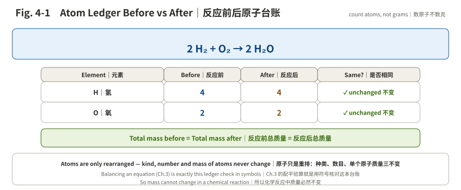
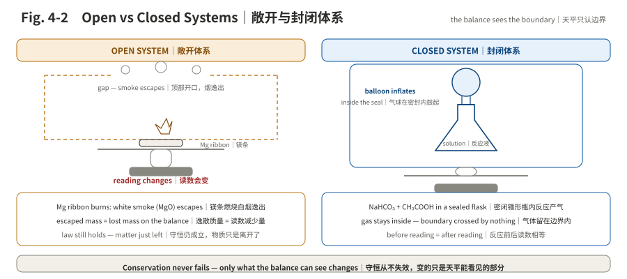
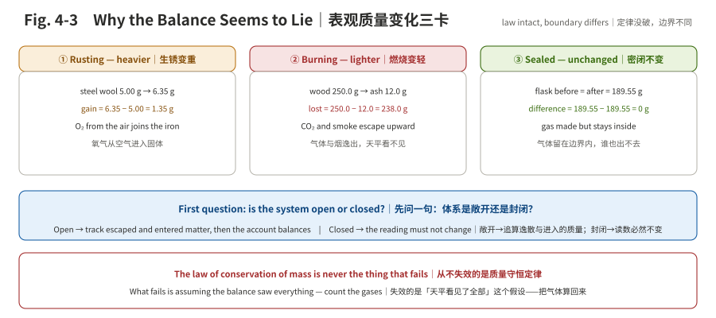

# Ch.4 — The Law of Conservation of Mass
## Chapter 4 · The Law of Conservation of Mass｜第 4 章　质量守恒定律

> 🗂️ **Content Alignment｜大纲对应**：BC Science 10 Content C3（核心）。
> ⏱️ **Periods｜课时**：1–2
> 🔗 **Source alignment｜素材对齐**：课本经典实验（密闭称重）+ 数据推理题；本章不依赖任何 worksheet，是 Ch.3 配平的"物理依据"、Ch.5 反应类型的先修铺垫。

---

## 1. Content Alignment｜大纲对应

| Official item（官方条目） | Where it shows up in this unit｜在本单元的位置 | Status｜定位 |
|---|---|---|---|
| Science 9: *atoms are rearranged in chemical reactions* | Microscopic explanation of the law（§3.2） | Review 复习 |
| Science 10 C3: *conservation of mass in chemical reactions* | Law statement + atom ledger（§3.1–3.2） | Core 核心 |
| Science 10 C3: *open vs closed systems* | Apparent mass changes（§3.4–3.5） | Core 核心 |
| Ch.3 balancing equations | Balancing is the law written in symbols（§3.3） | Gateway 衔接 |
| Chemistry 11: mole, stoichiometry, molar mass | — | ⛔ Out of scope 超纲 |

**中文**：本章回答一个问题——**化学反应前后质量到底变不变？**答案：不变。变的只是原子的"搭档"；质量看起来变了，只是天平没把逸散/加入的物质算进去。

---

## 2. Learning Objectives｜学习目标

By the end of this chapter, you should be able to:

1. State the law of conservation of mass in one sentence.
2. Explain the law at the atomic level (atoms rearrange, never appear or vanish).
3. Show why balancing an equation is the law written in symbols.
4. Distinguish an open system from a closed system and predict what the balance will read in each.
5. Explain the three "apparent mass changes": rusting (heavier), burning (lighter), sealed reaction (unchanged).
6. Find the mass of an escaped gas by subtraction only.

**中文**：学完本章，你应当能够——① 一句话陈述质量守恒定律；② 用原子观点解释它；③ 说明配平就是守恒定律的符号表达；④ 区分开放/封闭体系并预测天平读数；⑤ 解释"生锈变重、燃烧变轻、密闭不变"三个表观现象；⑥ 只用加减法算出逸出气体的质量。

---

## 3. Concept Explanations｜概念解析

### 3.1 The Law, Stated Once, Exactly｜定律的标准表述

**Definition｜定义**：The **law of conservation of mass（质量守恒定律）** — in any chemical reaction, the total mass of the substances is **the same before and after** the reaction. Matter is neither created nor destroyed.
**中文**：任何化学反应中，参与反应的各物质总质量在反应前后相等——物质不会凭空产生，也不会凭空消失。

> 📏 **Rule｜规则**：mass of all reactants = mass of all products（对所有参与反应的物质而言）。
> **中文**：所有反应物的总质量 = 所有生成物的总质量。注意"所有"两个字——漏掉一种气体，账就平不了。

Two wording traps:

- The law says **mass** is conserved — **not volume**（守恒的是质量，不是体积）. 100 mL + 50 mL of two solutions often gives less than 150 mL of mixture.
- The law says **nothing changes** only for the *whole set* of reactants and products — a single product can absolutely be lighter than a single reactant.

### 3.2 Why It Must Be True: The Atom Ledger｜原子层面解释

Conservation of mass is not an experimental accident — it is forced by what atoms do:

- **Kind** of atoms: unchanged（原子种类不变）
- **Number** of atoms: unchanged（原子数目不变）
- **Mass** of each atom: unchanged（每个原子的质量不变）

So a chemical reaction can only **rearrange** the atoms into new partnerships. Nothing enters, nothing leaves.



**中文**：化学反应只是给原子"换搭档"。种类、数目、单个原子质量三者都不变，所以总质量必然不变——这就是 Fig. 4-1 那本"原子台账"永远收支平衡的原因。

> 💡 **Tip｜口诀**：化学反应三不变——**种类不变、数目不变、质量不变**；变的只有一样：原子的结合方式。

### 3.3 The Law and Balancing: Same Idea, Two Languages｜守恒与配平

A **balanced equation（配平方程式）** is the law of conservation of mass written in symbols. When you balance an equation, you are not "playing with numbers" — you are making sure the same atoms appear on both sides:

```
2 H₂ + O₂  →  2 H₂O          (balanced)
H: 4 = 4 ✓    O: 2 = 2 ✓
```

**中文**：配平就是在核对原子台账——两边每种原子数目相等，质量自然守恒。Ch.3 的验算表（数原子）就是本章定律的符号化操作。

> 📏 **Rule｜规则**：If an equation is balanced, mass is conserved by construction; if your mass data do not add up, suspect a gas you forgot to count.
> **中文**：方程配平了，质量账自动是平的；反过来，质量数据对不上，多半是有一种气体没被计入。

### 3.4 Open vs Closed Systems｜开放体系与封闭体系

**Definition｜定义**：A **closed system（封闭体系）** is one where no matter can enter or leave. An **open system（开放体系）** allows matter to cross the boundary — gases can escape, or be drawn in from the air.
**中文**：封闭体系没有物质进出；开放体系允许物质越过边界——气体可以跑出去，空气里的成分也可以进来。



> 📏 **Rule｜规则**：The balance only "sees" what is inside the boundary. Open system → the reading can change; closed system → the reading cannot change.
> **中文**：天平只称得到边界内的东西。开放体系读数会变（物质跑了/进来了），封闭体系读数必然不变——守恒定律本身永远不会错。

This one distinction explains almost every "mass changed!" surprise in Chapter 4:

- **Magnesium ribbon burns in an open dish（镁条在敞开坩埚燃烧）**: white smoke (MgO) escapes → the solid left behind **looks lighter**. But if you could catch every bit of smoke and the O₂ that joined, the account balances.
- **Magnesium in a sealed vessel（密闭容器内燃烧镁条）**: nothing escapes → reading **unchanged**. (In fact the solid gains the mass of the O₂ that joined it — see §3.5.)

**中文**：镁条燃烧"变轻"是白烟跑了；密闭称重不变，是因为谁也跑不掉。同一反应，不同的体系边界，天平给出不同的故事。

### 3.5 The Three Apparent Mass Changes｜三个"表观质量变化"

**Definition｜定义**：An **apparent mass change（表观质量变化）** is a change in what the balance reads, caused by matter entering or leaving an open system — not by any failure of the conservation law.
**中文**："表观质量变化"是开放体系有物质进出造成的读数变化，不是守恒定律失效。



1. **Rusting — heavier（生锈变重）**: steel wool left in moist air gains mass. Oxygen from the **air** slowly joins the iron → the solid itself becomes heavier. Nothing broke the law; matter *entered*.
2. **Burning — lighter（燃烧变轻）**: a burning candle or wood loses mass. The products are **gases** (CO₂, H₂O vapour, smoke) that escape → the balance sees only the ash. Matter *left*.
3. **Sealed reaction — unchanged（密闭反应不变）**: e.g. NaHCO₃ + CH₃COOH in a stoppered flask with a balloon. Gas is made, the balloon inflates — but nothing crosses the boundary → reading identical before and after.

**中文**：生锈变重——空气里的氧气"进来了"；燃烧变轻——生成物气体"跑了"；密闭不变——谁也进不来也出不去。三条合起来一句话：**看天平之前，先看边界**。

> ⚠️ **Misconception｜易错**："锈比铁重，所以质量不守恒。" 错——多出来的质量是**空气中的氧气**，把它算进去，账是平的（§5 Example 4-2 现场算一遍）。

### 3.6 Finding a Gas Mass by Subtraction｜由质量差推断气体质量

The most useful exam move in this chapter: **when a gas escapes from an open system, its mass equals the mass loss** — pure addition and subtraction, no Chemistry 11 tools needed.

mass of escaped gas = total mass of reactants − mass of everything you can still weigh

**中文**：逸出气体的质量 = 反应物总质量 − 留下能称到的所有物质的质量。只做加减，一步到位。

> ✏️ **Example｜例题**：A sealed flask with contents totalling 156.32 g is weighed, then the gas is released: the flask now reads 155.90 g. Mass of gas released = 156.32 g − 155.90 g = **0.42 g**.

**中文**：156.32 − 155.90 = 0.42 g，放出的气体就是差值——加减即可，不需要摩尔。

> 【🔭 Extension → Chemistry 11】 In Chemistry 11 you will convert these masses into **moles（摩尔）** and predict *how much* product a given amount of reactant gives (stoichiometry). In Science 10 you only need addition and subtraction of masses — never memorise molar masses for this chapter.

### 3.7 Designing a Fair Conservation Test｜设计一个公平的守恒验证

When asked to *prove* the law experimentally, the mark scheme wants four things:

1. **Closed system（封闭体系）** — sealed flask, stopper or balloon; name the seal.
2. **Mass before and after（反应前后各称一次）** — same balance, record both readings.
3. **Criterion（判据）** — the two readings are equal (within balance uncertainty).
4. **Error sources（误差来源）** — balloon inflation adds buoyancy effect, flask not sealed, splashing, balance drift.

**中文**：设计题四件套——封闭、前后称量、判据（两次读数相等）、误差来源。少一条就少一分。

---

## 4. Comparison Tables｜表格比对

### Table 4-1　Open vs Closed System｜开放体系与封闭体系

| Feature｜特征 | Open system｜开放体系 | Closed system｜封闭体系 |
|---|---|---|---|
| Matter crosses boundary? 物质可进出？ | yes 可以 | no 不可以 |
| Balance reading 天平读数 | may change 会变 | must not change 必不变 |
| Conservation law 守恒定律 | still true 仍成立 | still true 仍成立 |
| Mass account 质量账 | must track escaped / entered matter 需追算逸散与加入 | reactants total = products total 前后直接相等 |
| Example｜例 | Mg burning in open dish 镁条敞口燃烧 | NaHCO₃ + CH₃COOH in stoppered flask 密闭锥形瓶 |

### Table 4-2　Three Apparent Mass Changes｜三个表观质量变化

| Observation｜现象 | What the balance sees 天平看到了什么 | Missing / added matter 被漏算的物质 | Law fails? 守恒失效？ |
|---|---|---|---|
| steel wool rusts, heavier 生锈变重 | solid iron + oxygen 已并入的氧 | O₂ drawn in from air 空气中的 O₂（进入） | no 不失效 |
| wood burns, lighter 燃烧变轻 | ash + unburnt bits 灰烬 | CO₂, H₂O vapour, smoke 逸出的气体与烟（离开） | no 不失效 |
| sealed flask, unchanged 密闭不变 | everything inside 边界内全部物质 | nothing 无 | no 不失效 |

---

## 5. Diagrams & Worked Examples｜图例说明

### Example 4-1　Escaped Gas from an Open Reaction｜开放反应逸出的气体

**12.6 g of solid X reacts with 20.4 g of solution Y in an open beaker. The remaining solid and liquid together weigh 30.7 g. What mass of gas escaped?**

1. Total reactants: 12.6 g + 20.4 g = 33.0 g.
2. What you can still weigh: 30.7 g.
3. Escaped gas = 33.0 g − 30.7 g = **2.3 g**.

**中文**：反应物共 33.0 g，剩下 30.7 g，跑掉的气体 = 33.0 − 30.7 = 2.3 g。守恒定律没失效——气体只是离开了天平的"视线"。

### Example 4-2　The Rusting Account｜生锈的质量账

**5.00 g of steel wool rusts completely in moist air and ends up 6.35 g. Where did the extra mass come from?**

1. Mass gained = 6.35 g − 5.00 g = **1.35 g**.
2. That 1.35 g is **oxygen from the air** that chemically joined the iron — it entered the system, so the solid is heavier.
3. If you had weighed the *whole system* (steel wool + the oxygen that joined), before and after would be equal.

**中文**：6.35 − 5.00 = 1.35 g，增重 = 空气中进入的氧。若把"参加反应的那部分空气"也算进去，前后质量仍然相等——变重的是固体，不是守恒定律。

### Example 4-3　Sealed Flask, Two Readings｜密闭称重两读数

**A stoppered flask containing NaHCO₃ and CH₃COOH solution weighs 189.55 g before the reaction. After fizzing stops, it still reads 189.55 g. Explain.**

1. CO₂ gas was produced — but the stopper keeps it inside.
2. Nothing crossed the boundary → closed system → the reading **cannot** change.
3. If the stopper is removed and the gas escapes: 189.55 g − 189.13 g = **0.42 g** would walk away, and the reading would drop.

**中文**：密闭 → 读数不变；打开塞子放出气体 → 189.55 − 189.13 = 0.42 g 跑掉，读数下降。同一个反应，答案取决于边界开不开。

---

## 6. Key Vocabulary｜核心词汇

| English｜英文 | 中文 | Note｜备注 |
|---|---|---|---|
| law of conservation of mass | 质量守恒定律 | total mass constant in chemical change |
| closed system | 封闭体系 | no matter in or out |
| open system | 敞开体系 | matter can cross the boundary |
| reactant | 反应物 | starting substance |
| product | 生成物 | new substance formed |
| atom count | 原子计数 | the ledger you check when balancing |
| apparent mass change | 表观质量变化 | reading changed, law intact |
| escaped gas | 逸出的气体 | mass = reactants − what remains |
| balance | 天平 | only weighs what is inside the boundary |
| boundary | 体系边界 | open or closed — decide it first |

---

## 7. Lab / Activity｜实验与活动

### Lab 4-1　Weigh a Reaction in a Sealed Flask｜密闭体系称重

**[Planning and conducting]**
In a stoppered Erlenmeyer flask fitted with a small balloon, mix NaHCO₃ (in the flask) with CH₃COOH (in a vial standing inside). Weigh the whole apparatus before mixing, tip the vial to start the reaction, weigh again after fizzing stops. Then release the gas from the balloon and weigh a third time.

- Record: mass before / mass after (sealed) / mass after venting（放气后）.
- Criterion: first two readings equal; third reading lower by the vented gas mass.
- Error sources: balloon buoyancy, loose stopper, liquid splash.

**中文**：密闭锥形瓶 + 气球装 NaHCO₃ 与 CH₃COOH，反应前后称重应相等；打开气球放气后再称，减少的质量就是逸出的 CO₂。判据与误差来源写进结论。

### Lab 4-2　Steel Wool over 48 Hours｜钢丝绒生锈 48 小时

**[Processing and analyzing data and information]**
Weigh a pad of steel wool, moisten it, leave it exposed on a watch glass for 48 hours, then weigh again. Predict first, then explain the sign and size of the change using §3.5. Control variables: same pad, same balance, no rubbing off of rust.

**中文**：先预测再实测——增重来自空气中的氧与水汽参与的反应；记录前后读数并用质量差解释。变量控制：同一坨钢丝绒、同一台天平、不蹭掉锈。

### Activity 4-3　Gas-Mass Data Sprint｜气体质量推断速算

**[Processing and analyzing data and information]**
Six data pairs, one minute each: given total reactant mass and the mass of weighable products in an open system, state the escaped gas mass by subtraction. All numbers chosen to subtract cleanly.

**中文**：六组数据限时速算——反应物总质量减去留下能称的部分，答案就是气体质量。只许加减，秒答。

---

## 8. Common Misconceptions｜常见易错点

1. ❌ "Ash is lighter than the wood, so mass is not conserved." → ✅ The escaped gases (CO₂, H₂O vapour, smoke) carry the missing mass; the balance just stopped seeing them.
   **中文**：灰烬变轻是因为气体跑了——漏称，不是不守恒。
2. ❌ "Rust is heavier than iron, so mass was created." → ✅ The extra mass is oxygen drawn in from the air — matter *entered* the system.
   **中文**：生锈变重的质量来自空气中的氧，是"进来"，不是"凭空多出"。
3. ❌ "Conservation of mass means conservation of volume." → ✅ Mass is conserved; volume can shrink or grow (100 mL + 50 mL may mix to less than 150 mL).
   **中文**：守恒的是质量不是体积，混合后体积常会"缩水"。
4. ❌ "The disappeared matter is destroyed — it is really gone." → ✅ Atoms only change partners; every atom still exists, often as an invisible gas.
   **中文**："消失"的物质只是变成了看不见的气体，原子一个都没少。
5. ❌ "Take the balance reading and conclude directly, ignoring the system type." → ✅ Decide open vs closed **first**; only in a closed system can the reading test conservation directly.
   **中文**：先判体系开放还是封闭，再解读天平读数——开放体系的读数不能直接下结论。
6. ❌ "In a sealed flask making gas, mass increases because the balloon inflates." → ✅ The gas was already inside the boundary; inflation changes the shape, not the mass.
   **中文**：气球鼓起来只是形状变化，物质没越过边界，质量不变。
7. ❌ "An unbalanced equation is fine if the mass data still add up." → ✅ A balanced equation and conserved masses are the same requirement — fix the coefficients.
   **中文**：没配平的方程式违反原子台账，质量数据迟早对不上。
8. ❌ "When a gas escapes, the law fails by that amount." → ✅ The law covers *all* reactants and *all* products — including the gas you did not weigh.
   **中文**：守恒定律算的是"全部"，漏称的气体也在账上。
9. ❌ "Burning magnesium gained nothing because air is free and weightless." → ✅ Air is not weightless — the O₂ that joins has mass; catch it in a closed vessel and you can weigh the gain.
   **中文**：空气中的氧气有质量，密闭容器里就能称出"增重"。
10. ❌ "Sealed experiment deviations of a few tenths of a gram disprove the law." → ✅ Small deviations come from buoyancy, loose seals or balance drift — list them as error sources instead.
    **中文**：零点几克的偏差是浮力/密封/天平漂移等误差来源，不是定律的问题。

---

## 9. Assessment｜答题评估

**Part A — Knowledge｜基础（10 × 2 = 20 分）**

**A1.** 28.0 g of nitrogen gas reacts completely with 6.0 g of hydrogen gas to form ammonia. What mass of ammonia forms?
- **中文**：28.0 g 氮气与 6.0 g 氢气完全反应生成氨，求氨的质量。

**A2.** 46.0 g of sodium reacts with 16.0 g of oxygen gas; only sodium oxide forms. What mass of sodium oxide?
- **中文**：46.0 g 钠与 16.0 g 氧气恰好完全反应生成氧化钠，求氧化钠质量。

**A3.** A sealed flask is weighed before a reaction (145.60 g) and after the fizzing stops. State the expected after-reading and why.
- **中文**：密闭锥形瓶反应前读数 145.60 g，写出反应后读数并说明理由。

**A4.** Classify each as open or closed: (a) candle burning on a dish; (b) fizzing tablet in a stoppered bottle; (c) steel wool rusting on a windowsill.
- **中文**：判断体系类型：(a) 烛火在盘中燃烧；(b) 密闭瓶中的泡腾片；(c) 窗台上的钢丝绒生锈。

**A5.** In a sealed vessel, 2.40 g of magnesium burns with 1.60 g of oxygen gas and nothing is left over. What mass of magnesium oxide forms?
- **中文**：密闭容器中 2.40 g 镁与 1.60 g 氧气恰好完全反应，求生成氧化镁的质量。

**A6.** State the law of conservation of mass and name the three atomic quantities that never change.
- **中文**：陈述质量守恒定律，并说出原子层面"三不变"。

**A7.** Steel wool with mass 8.55 g rusts completely and then weighs 10.00 g. What mass of oxygen joined the iron?
- **中文**：8.55 g 钢丝绒完全生锈后质量为 10.00 g，求参加反应的氧气质量。

**A8.** 250.0 g of wood burns in an open fireplace and leaves 12.0 g of ash. What mass escaped as gas and smoke?
- **中文**：250.0 g 木柴敞开燃烧后剩 12.0 g 灰烬，求逸散的气体与烟的质量。

**A9.** True or false, with one reason: "An unbalanced equation violates the law of conservation of mass."
- **中文**：判断正误并给一条理由："没配平的方程式违反质量守恒定律。"

**A10.** A sealed flask with contents reads 189.55 g; after venting the gas it reads 189.13 g. What mass of gas was released?
- **中文**：密闭瓶连内容物 189.55 g，放气后 189.13 g，求放出的气体质量。

**Part B — Application｜应用（4 × 5 = 20 分）**

**B1.** 12.6 g of solid X and 20.4 g of solution Y react in an open beaker; afterwards 30.7 g of solid and liquid remain. Calculate the mass of gas that escaped, and explain why the conservation law still holds.
- **中文**：敞口烧杯中 12.6 g 固体 X 与 20.4 g 溶液 Y 反应，剩余固液共 30.7 g。算出逸出气体质量，并说明守恒定律为何仍成立。

**B2.** 5.6 g of iron reacts completely with 2.4 g of oxygen to form one oxide. Give the mass of the oxide and identify which reactant's atoms ended up in it.
- **中文**：5.6 g 铁与 2.4 g 氧气恰好完全生成一种氧化物，写出氧化物质量，并说明两种原子的去向。

**B3.** A sealed apparatus and contents weigh 250.00 g. A slow leak lets gas escape during the reaction; afterwards the reading is 245.35 g. How much gas leaked, and would the leak change the *total* mass of all reactants and products? Explain.
- **中文**：密闭装置连内容物 250.00 g，反应中漏气，结束后读数 245.35 g。求漏出气体质量，并回答：漏气会不会改变"所有反应物与生成物"的总质量？说明理由。

**B4.** A student burns magnesium ribbon in an open crucible and concludes: "The product weighs less than the magnesium, so conservation of mass is false." Identify the two flaws in this conclusion and state what additional measurement would fix it.
- **中文**：学生在敞口坩埚中燃烧镁条后断言"产物变轻，守恒定律不成立"。指出该结论的两处漏洞，并说明补上哪个测量就能修复。

**Part C — Challenge｜挑战（2 × 10 = 20 分）**

**C1.** In a sealed container, 8.25 g of solid X react with 11.75 g of solution Y. The empty container alone weighs 95.50 g. (a) Give the total mass of products. (b) Give the balance reading of the sealed container after the reaction. (c) A gas of unknown mass is then vented and the reading drops to 113.50 g — what mass of gas left, and what remains in the container?
- **中文**：密闭容器中 8.25 g 固体 X 与 11.75 g 溶液 Y 反应，空容器自重 95.50 g。(a) 生成物总质量；(b) 反应后密闭容器的读数；(c) 放气后读数降为 113.50 g，求跑掉的气体质量与容器内剩余物质质量。

**C2.** Design a sealed-system experiment to demonstrate conservation of mass for a gas-producing reaction. Your plan must name: the reactants, the seal, the two balance readings, the criterion for "conserved", and at least two error sources with how you would reduce them.
- **中文**：设计一个密闭体系实验证明产气反应的质量守恒，必须写清：反应物、密封方式、反应前后两次称量、"守恒"的判据、至少两个误差来源及减小办法。

### Answers｜参考答案

**Part A**

- **A1.** 28.0 g + 6.0 g = 34.0 g of ammonia.
  **中文**：28.0 + 6.0 = 34.0 g；所有反应物的质量全部进入生成物。
- **A2.** 46.0 g + 16.0 g = 62.0 g of sodium oxide.
  **中文**：46.0 + 16.0 = 62.0 g，恰好完全反应，无剩余。
- **A3.** 145.60 g — closed system, no matter crosses the boundary, so the reading cannot change.
  **中文**：仍为 145.60 g；封闭体系无物质进出，读数必然不变。
- **A4.** (a) open — gases escape to the room；(b) closed — stopper seals the bottle；(c) open — air (oxygen, moisture) keeps entering.
  **中文**：(a) 敞开（气体逸出）；(b) 封闭（瓶塞密封）；(c) 敞开（空气持续进入）。
- **A5.** 2.40 g + 1.60 g = 4.00 g of magnesium oxide.
  **中文**：2.40 + 1.60 = 4.00 g；密闭且无剩余，全部质量进入产物。
- **A6.** Total mass of substances is the same before and after a chemical reaction. Unchanged: kind of atoms, number of atoms, mass of each atom.
  **中文**：反应前后物质总质量相等；不变的三样——原子种类、原子数目、每个原子的质量。
- **A7.** 10.00 g − 8.55 g = 1.45 g of oxygen joined the iron.
  **中文**：10.00 − 8.55 = 1.45 g，增重即参加反应的氧气。
- **A8.** 250.0 g − 12.0 g = 238.0 g escaped as gas and smoke.
  **中文**：250.0 − 12.0 = 238.0 g，以气体和烟的形式逸散。
- **A9.** True — an unbalanced equation shows unequal atom counts on the two sides, which would force unequal masses.
  **中文**：对——不配平意味着两边原子数不等，质量必然不等，违反守恒。
- **A10.** 189.55 g − 189.13 g = 0.42 g of gas released.
  **中文**：189.55 − 189.13 = 0.42 g。

**Part B**

- **B1.** Reactants total: 12.6 + 20.4 = 33.0 g; escaped gas = 33.0 − 30.7 = 2.3 g. The law still holds because it counts *all* products — the gas is a product, merely outside the balance's view.
  **中文**：12.6 + 20.4 = 33.0 g，33.0 − 30.7 = 2.3 g；守恒定律把气体也算在生成物内，故仍成立。
- **B2.** 5.6 g + 2.4 g = 8.0 g of oxide. Both the iron atoms and the oxygen atoms end up in the single oxide — nothing else is formed.
  **中文**：5.6 + 2.4 = 8.0 g；铁原子与氧原子全部进入这一种氧化物。
- **B3.** 250.00 − 245.35 = 4.65 g leaked. The *total* mass of all reactants and products does not change — the leaked gas is still a product; only the balance's reading dropped because the gas left the boundary.
  **中文**：漏出 4.65 g；所有反应物与生成物的总质量不变——漏出的气体也是生成物，只是离开了天平的边界。
- **B4.** Flaw 1: the O₂ that joined the Mg is a reactant and was not weighed. Flaw 2: the MgO smoke escaped and was not weighed. Fix: burn a measured Mg sample in a sealed vessel and weigh before and after — reading unchanged proves conservation.
  **中文**：漏洞一：参加反应的 O₂ 没被称量；漏洞二：逸散的 MgO 烟没被称量。补测：在密闭容器中燃烧并前后称重，读数不变即证明守恒。

**Part C**

- **C1.** (a) 8.25 + 11.75 = 20.00 g of products. (b) 95.50 + 20.00 = 115.50 g — sealed, so unchanged. (c) 115.50 − 113.50 = 2.00 g of gas vented; what remains in the container = 113.50 − 95.50 = 18.00 g.
  **中文**：(a) 8.25 + 11.75 = 20.00 g；(b) 95.50 + 20.00 = 115.50 g，密闭不变；(c) 115.50 − 113.50 = 2.00 g 气体跑掉，容器内剩 113.50 − 95.50 = 18.00 g。
- **C2.** Model answer: NaHCO₃ + CH₃COOH in a stoppered flask (balloon seal), weigh before mixing and after fizzing stops on the same balance; criterion = the two readings are equal; error sources — balloon buoyancy (use a rigid sealed bottle instead), loose stopper (clamp or two-hole bung), liquid splash (use a vial inside). Award marks for all six named components.
  **中文**：参考设计——锥形瓶 + 气球密封，同一台天平反应前后各称一次，判据为两读数相等；误差来源与对策：气球浮力（改刚性密封瓶）、瓶塞不严（夹紧/双孔塞）、液体溅出（内嵌小瓶）。评分看六个要素是否齐全。

### Rubric｜评分量规

| Level｜水平 | Standard｜标准 |
|---|---|---|
| Exemplary 满分档 | All subtractions correct; every open-system answer explicitly names the escaped or entered matter; experiment design covers all six components | 加减全对；开放体系答案都点名逸散/进入的物质；实验设计六要素齐全 |
| Proficient 良好档 | Calculations correct; system type identified but explanation of "why the law still holds" incomplete | 计算正确，体系判断正确，但"守恒为何仍成立"解释不完整 |
| Developing 合格档 | Closed-system answers solid; open-system answers forget the gas term | 封闭体系全稳，开放体系常漏算气体 |
| Beginning 待提高档 | Concludes "law fails" from balance readings alone; volume confused with mass | 只看读数就断言定律失效、质量体积混淆——回炉 §3.4 与 §3.5 |

---

## 10. Connection to the Big Idea｜回扣核心概念

> 🎯 **Big Idea**: *Energy change is required as atoms rearrange in chemical processes.*

Conservation of mass is the bookkeeping side of that rearrangement: the atoms change partners (rearrange) but never change count, so the total mass cannot move. What *does* move is energy — breaking old partnerships and forming new ones always costs or releases energy, which is exactly where Ch.6 picks up. **中文**：质量守恒是"原子重排"的记账规则——搭档换了、数目没换，所以总质量不动；会动的是能量——断旧键、成新键都要付账，这正是 Ch.6 的主题。

**中文**：下一章 Ch.5 给原子重排的六种"换搭档模式"（六类反应）；本章的原子台账会在每一条配平方程式里反复出现——质量账不平 = 方程式没配平。

