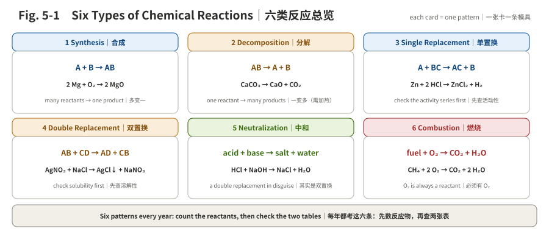
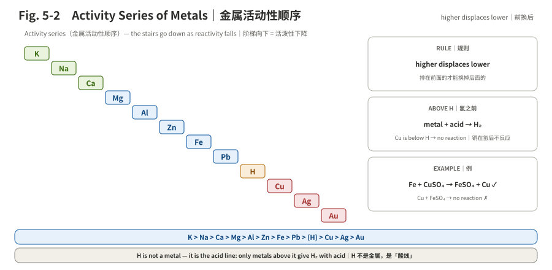
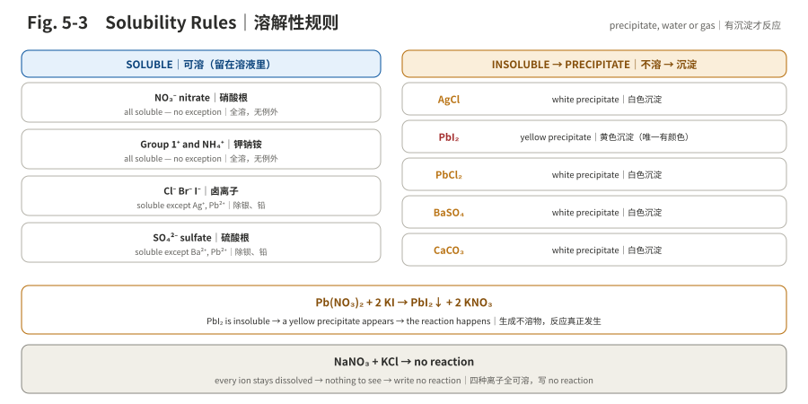
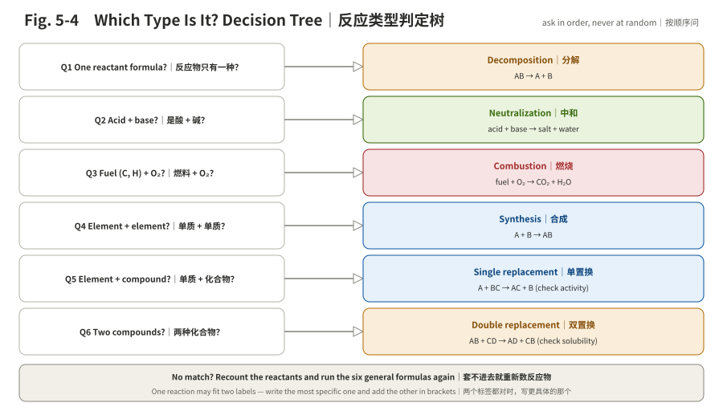

# Ch.5 — Types of Chemical Reactions
## Chapter 5 · Types of Chemical Reactions｜第 5 章　化学反应的类型

> 🗂️ **Content Alignment｜大纲对应**：BC Science 10 Content C1（核心）；对接 B1（原子重排）与 B2（能量变化）。
> ⏱️ **Periods｜课时**：3–4
> 🔗 **Source alignment｜素材对齐**：`SCI 10 REV WORKSHEET 0` p.2（six-type table · general formulas）· `WS1` p.2 / `WS2` p.2 / `WS3` p.2（classification and product prediction）

---

## 1. Content Alignment｜大纲对应

| Official item（官方条目） | Where it shows up in this unit｜在本单元的位置 | Status｜定位 |
|---|---|---|
| Science 9: *chemical change produces new substances* | Evidence of reaction（Ch.2） | Review 复习 |
| Science 10 C1: *rearrangement of atoms in chemical reactions* | Six rearrangement patterns（§3.1–3.8） | Core 核心 |
| Science 10 C1: *conservation of mass* | Every predicted equation must balance（Ch.3–Ch.4） | Gateway 衔接 |
| Science 10 C2: *acid-base chemistry* | Neutralization as a double replacement（§3.5, Ch.7） | Gateway 门槛 |
| Curricular Competency: *Seek and analyze patterns* | Activity series and solubility rules（§3.3–3.4） | Competency 能力 |
| Chemistry 11: net ionic equations, redox half-reactions | — | ⛔ Out of scope 超纲 |

**中文**：本章把 Ch.2 的"原子重排"拆成六种**可辨认的模式**。学会两件事——看见方程式能归类，看见反应物能预测生成物；后者的两把钥匙是**金属活动性顺序**与**溶解性规则**。

---

## 2. Learning Objectives｜学习目标

By the end of this chapter, you should be able to:

1. Name the six reaction types taught in Science 10 and write each general formula.
2. Classify a given equation, or a word description, into the correct type.
3. Predict the products of a synthesis, decomposition, single replacement, double replacement, neutralization or combustion reaction.
4. Use the activity series to decide whether a single replacement will happen.
5. Use solubility rules to decide whether a double replacement produces a precipitate.
6. Balance every equation you predict, and explain why one reaction can carry two labels.

**中文**：学完本章，你应当能够——① 说出六类反应与各自一般式；② 给方程式或文字描述归类；③ 预测六类反应的产物；④ 用活动性顺序判断单置换能否发生；⑤ 用溶解性规则判断双置换有无沉淀；⑥ 把预测出的方程式配平，并解释为什么一个反应可以有两个名字。

---

## 3. Concept Explanations｜概念解析

### 3.1 The Six Types at a Glance｜六类反应一眼看全

**Definition｜定义**：A **reaction type（反应类型）** is a *pattern* of atom rearrangement, written as a **general formula（一般式）** in which each letter stands for a whole compound or element — never for a single atom.
**中文**：反应类型是"原子重排的模式"。一般式里的 A、B、C、D 代表**整种物质**（可以是单质也可以是化合物），不是单个原子——这是读懂所有一般式的前提。



> 📏 **Rule｜规则**：Synthesis `A + B → AB` · Decomposition `AB → A + B` · Single replacement `A + BC → AC + B` · Double replacement `AB + CD → AD + CB` · Neutralization `acid + base → salt + water` · Combustion `fuel + O₂ → CO₂ + H₂O`.
> **中文**：六条一般式就是六把"模具"——把反应物和生成物往模具里套，套得进去就是那一类。

The six types are not six unrelated facts. They are **two mirror pairs plus two special cases**:

- **Synthesis ↔ Decomposition** — exact opposites: many → one, one → many.
- **Single ↔ Double replacement** — one partner changes, or both partners change.
- **Neutralization** — a double replacement whose partners are an acid and a base.
- **Combustion** — a reaction that *must* consume O₂ and produces oxides.

**中文**：六类其实是"两对镜像 + 两个特例"。记住这个骨架，比背六条孤立规则牢固得多。

### 3.2 Synthesis and Decomposition: The Mirror Pair｜合成与分解：一对镜像

**Definition｜定义**：A **synthesis reaction（合成反应，又称 combination reaction 化合反应）** joins two or more substances into a **single product**: `A + B → AB`.
**中文**：合成反应是"多变一"——两种或多种物质结合成**一种**生成物。

Two balanced examples, one ionic and one molecular:

```
2 Mg(s) + O₂(g) → 2 MgO(s)          2 Na + Cl₂ → 2 NaCl
```

**Definition｜定义**：A **decomposition reaction（分解反应）** breaks **one** reactant into two or more products: `AB → A + B`.
**中文**：分解反应是"一变多"——一种反应物拆成两种或多种生成物，通常需要加热、通电或光照提供能量。

```
2 H₂O(l) --electricity--> 2 H₂(g) + O₂(g)        CaCO₃(s) --heat--> CaO(s) + CO₂(g)
```

> 💡 **Tip｜口诀**：数**箭头左边有几种物质**——左边 1 种右边多种 = 分解；左边多种右边 1 种 = 合成。这一步比看化学式快得多。

Decomposition is the one type that almost always **needs energy put in** (heat, electricity, light). That energy cost is why Ch.6 treats decomposition as the classic endothermic example. **中文**：分解反应要"先付能量"，合成反应常"放出能量"——这一对镜像在 Ch.6 的能量图上是上下对称的。

⚠️ **Misconception｜易错**：`AB → A + B`（分解）与 `A + BC → AC + B`（单置换）长得像，但**反应物个数**完全不同：分解只有一种反应物，单置换有两种。判类先数左边。

### 3.3 Single Replacement and the Activity Series｜单置换与金属活动性顺序

**Definition｜定义**：A **single replacement reaction（单置换反应）** has **one element take the place of another element inside a compound**: `A + BC → AC + B`.
**中文**：单置换是"一个单质挤走化合物里的某个元素"——金属换金属、金属换氢，非金属也能换非金属。

Not every single replacement actually happens. The rule that decides is the **activity series（金属活动性顺序）**:



> 📏 **Rule｜规则**：K > Na > Ca > Mg > Al > Zn > Fe > Pb > **H** > Cu > Ag > Au. A metal can displace another metal from its compound **only if it stands higher in the series**.
> **中文**：排在前面的金属才能把排在后面的金属从化合物里"换出来"；排在 H 后面的金属连酸里的氢都换不出来。

Read the series as a **queue of strength**: the further left, the more violently the metal gives up electrons, so the more eager it is to take another metal's place.

- `Zn + 2 HCl → ZnCl₂ + H₂` — Zn is above H, so it displaces hydrogen from the acid. ✓
- `Fe + CuSO₄ → FeSO₄ + Cu` — Fe is above Cu, so copper is pushed out of solution. ✓
- `Cu + 2 AgNO₃ → Cu(NO₃)₂ + 2 Ag` — Cu is above Ag, so silver plates out. ✓
- `Cu + 2 HCl → no reaction` — Cu sits **below** H; nothing happens, no matter how long you wait. ✗

**中文**：最后一条是本章最高频的丢分点——铜在氢后面，铜加盐酸**不反应**。写方程式之前先问一句："这个金属排在我想要换掉的那个元素前面吗？"

> 🔭 **Extension｜超纲**：the same idea works for non-metals — **F > Cl > Br > I**. `Cl₂ + 2 KBr → 2 KCl + Br₂` happens, but `I₂ + 2 KCl` does not. 中文：非金属也有活动性顺序，卤素 F > Cl > Br > I，只作了解。

⚠️ **Misconception｜易错**：iron entering a compound in a single replacement is **iron(II)**, not iron(III): `Fe + CuSO₄ → FeSO₄ + Cu`, never Fe₂(SO₄)₃. 中文：单置换里铁显 +2，别顺手写成硫酸铁。

### 3.4 Double Replacement and Solubility Rules｜双置换与溶解性规则

**Definition｜定义**：In a **double replacement reaction（双置换反应）**, two ionic compounds **exchange partners** — the positive ion of one takes the place of the positive ion of the other: `AB + CD → AD + CB`.
**中文**：双置换是"互换配偶"——两种化合物的阳离子互换位置，A 跟 D、C 跟 B 重新组合。

The pattern alone does not tell you whether anything visible happens. That is decided by **solubility（溶解性）**:



> 📏 **Rule｜规则**：A double replacement "really happens" only when at least one product is a **precipitate（沉淀）**, **water（水）**, or a **gas（气体）**. If both products stay dissolved, write **no reaction**.
> **中文**：复分解能否"明显发生"，只看生成物里有没有沉淀、水或气体。两个产物都可溶 → 写 no reaction，不要硬写一条方程式。

**Solubility rules you must know（必须记住的溶解性规则）**：

1. **All nitrates (NO₃⁻) are soluble**, and so are all **Group 1** and **ammonium (NH₄⁺)** salts — no exceptions.
2. **Chlorides, bromides, iodides are soluble** — except with **Ag⁺** and **Pb²⁺**（AgCl、PbCl₂、PbI₂）.
3. **Sulfates are soluble** — except **BaSO₄** and **PbSO₄**.
4. **Carbonates, hydroxides and sulfides are insoluble** — except with Group 1 and NH₄⁺.

**中文**：口诀"硝酸、钾钠铵全溶；氯化物除银铅；硫酸盐除钡铅；碳酸、氢氧、硫化物大多不溶，除钾钠铵"。

Four balanced examples — three that happen, one that does not:

```
Pb(NO₃)₂(aq) + 2 KI(aq) → PbI₂(s)↓ + 2 KNO₃(aq)      yellow precipitate 黄色沉淀
AgNO₃(aq) + NaCl(aq) → AgCl(s)↓ + NaNO₃(aq)           white precipitate 白色沉淀
BaCl₂(aq) + Na₂SO₄(aq) → BaSO₄(s)↓ + 2 NaCl(aq)       white precipitate 白色沉淀
NaNO₃(aq) + KCl(aq) → no reaction                      all four ions stay dissolved 全部可溶
```

> 💡 **Tip｜口诀**：写双置换只做两步——① 阳离子换位写出两个产物；② 逐个查溶解性，有一个不溶才算反应。第二步才是得分点。

### 3.5 Neutralization: A Double Replacement in Disguise｜中和：伪装的双置换

**Definition｜定义**：A **neutralization reaction（中和反应）** is the reaction of an **acid** with a **base** to give a **salt and water**: `acid + base → salt + water`.
**中文**：中和反应 = 酸 + 碱 → 盐 + 水，本质是酸里的 H⁺ 与碱里的 OH⁻ 结合成水。

```
HCl(aq) + NaOH(aq) → NaCl(aq) + H₂O(l)
2 HCl(aq) + Ca(OH)₂(aq) → CaCl₂(aq) + 2 H₂O(l)
H₂SO₄(aq) + 2 KOH(aq) → K₂SO₄(aq) + 2 H₂O(l)
```

Look at the first one with double-replacement eyes: HCl is `H–Cl`, NaOH is `Na–OH`; swap partners and you get `Na–Cl` and `H–OH`. **Neutralization is a double replacement whose "partners" happen to be H⁺ and OH⁻.**

> 📏 **Rule｜规则**：Every neutralization is a double replacement, but not every double replacement is a neutralization — the acid + base pair is what makes it a neutralization.
> **中文**：中和一定是双置换，双置换不一定是中和；判据只有一条——反应物是不是"酸 + 碱"。

⚠️ **Misconception｜易错**：`CaCO₃ + 2 HCl → CaCl₂ + H₂O + CO₂` is **not** a neutralization — CaCO₃ is a salt (a carbonate), not a base. 中文：碳酸钙与酸反应属于"酸 + 碳酸盐"，产物有气体，别误标成中和（Ch.7 细讲）。

### 3.6 Combustion: Burn It, Count the C, H and N｜燃烧：数清 C、H、N

**Definition｜定义**：A **combustion reaction（燃烧反应）** is the rapid reaction of a **fuel** with **oxygen** from the air, releasing energy as heat and light.
**中文**：燃烧是可燃物与**空气中的氧气**迅速反应、放出热和光；氧气是反应物，绝不能漏写。

> 📏 **Rule｜规则**：A fuel containing **C and H** burns completely to **CO₂ + H₂O**. If the fuel also contains **O**, the products are the same — only the O₂ coefficient changes. If the fuel contains **N**, add **N₂** as a third product.
> **中文**：只含 C、H 的燃料 → CO₂ + H₂O；含 O 的燃料产物不变，只是 O₂ 系数要重算；含 N 的燃料还要写出 N₂。

```
CH₄ + 2 O₂ → CO₂ + 2 H₂O                    methane 甲烷
C₃H₈ + 5 O₂ → 3 CO₂ + 4 H₂O                 propane 丙烷
2 C₄H₁₀ + 13 O₂ → 8 CO₂ + 10 H₂O            butane 丁烷
C₂H₅OH + 3 O₂ → 2 CO₂ + 3 H₂O               ethanol 乙醇（含 O 的燃料）
4 NH₃ + 3 O₂ → 2 N₂ + 6 H₂O                 ammonia 氨（含 N）
4 CH₃NH₂ + 9 O₂ → 4 CO₂ + 10 H₂O + 2 N₂     methylamine 甲胺（含 C、H、N）
```

Single elements burn too: `C + O₂ → CO₂`, `2 H₂ + O₂ → 2 H₂O`, `S + O₂ → SO₂`. These are combustion **and** synthesis at the same time — a preview of §3.8.

> ⚠️ **Misconception｜易错**：When oxygen is limited, combustion is **incomplete** and produces **CO**（toxic 有毒）and **soot（碳黑）** instead of CO₂. 中文：缺氧燃烧生成一氧化碳和碳黑——炭火在不通风的房间里最危险，Science 10 只做定性描述。

### 3.7 Which Type Is It? The Decision Tree｜判定树

You do not classify by staring at the equation. You classify by asking **four questions in a fixed order**:



> 📏 **Rule｜规则**：① Count the reactant formulas → ② acid + base? → ③ fuel + O₂? → ④ check the survivors against the general formulas.
> **中文**：先数反应物种类，再看是不是酸+碱，再看有没有"燃料+O₂"，最后才用一般式核对。顺序不能乱——先判特例，再判大类。

1. **One reactant?** → decomposition（`AB → A + B`）. One formula on the left cannot be anything else.
2. **Two reactants, acid + base?** → neutralization（which is also a double replacement）.
3. **Two reactants, a C/H-containing fuel + O₂?** → combustion.
4. **Two reactants, element + element?** → synthesis.
5. **Element + compound?** → single replacement — then **check the activity series** before you write anything.
6. **Compound + compound?** → double replacement — then **check solubility**; if nothing precipitates, write no reaction.

**中文**：六个问题走完必落到一类。第 5、6 步的"再检查"才是真正的得分点——分类对了但方程式写错（Cu + HCl 照写、NaNO₃ + KCl 硬造沉淀）一样不得分。

### 3.8 When Two Labels Fit｜分类不唯一

Some reactions genuinely belong to two types. This is not a flaw in the system — it is a **hierarchy**:

| Reaction｜反应 | Label 1｜标签一 | Label 2｜标签二 | Why both work｜理由 |
|---|---|---|---|---|
| `HCl + NaOH → NaCl + H₂O` | neutralization 中和 | double replacement 双置换 | H⁺ and OH⁻ swap partners |
| `C + O₂ → CO₂` | combustion 燃烧 | synthesis 合成 | burns in O₂, but also two → one |
| `2 H₂ + O₂ → 2 H₂O` | combustion 燃烧 | synthesis 合成 | same double identity |
| `2 Mg + O₂ → 2 MgO` | synthesis 合成 | combustion (oxidation) 燃烧（氧化） | a metal burning in air |

> 📏 **Rule｜规则**：Give the **most specific** label the question asks about, and add the second one in brackets with a reason. "Neutralization (also a double replacement, because the ions swap partners)" earns full marks; a bare "double replacement" may not.
> **中文**：答题时写"最具体"的那个名，再用括号补第二个名与理由。中和 ⊂ 双置换、单质燃烧 ⊂ 合成——说清从属关系，不扣分反而加分。

⚠️ **Misconception｜易错**：don't invent a seventh type. Science 10 has exactly six; anything else is one of the six wearing a different coat. 中文：只能有六类，别自创"氧化反应""置换反应"这类第七类——它们都能归进本章六类里。

---

## 4. Comparison Tables｜表格比对

### Table 5-1　The Six Types: Formula, Signature, Example｜六类反应一览

| Type｜类型 | General formula｜一般式 | Signature｜识别特征 | Example｜例 |
|---|---|---|---|---|
| Synthesis 合成 | A + B → AB | many reactants → one product 多变一 | 2 Mg + O₂ → 2 MgO |
| Decomposition 分解 | AB → A + B | one reactant → many products 一变多 | CaCO₃ → CaO + CO₂ |
| Single replacement 单置换 | A + BC → AC + B | element + compound → new element + compound 一单质换一元素 | Zn + 2 HCl → ZnCl₂ + H₂ |
| Double replacement 双置换 | AB + CD → AD + CB | two compounds swap ions 两化合物换离子 | AgNO₃ + NaCl → AgCl↓ + NaNO₃ |
| Neutralization 中和 | acid + base → salt + water | reactants are an acid and a base 酸+碱 | HCl + NaOH → NaCl + H₂O |
| Combustion 燃烧 | fuel + O₂ → CO₂ + H₂O | O₂ is a reactant; oxides are products 必有 O₂ | CH₄ + 2 O₂ → CO₂ + 2 H₂O |

### Table 5-2　Activity Series in Three Tiers｜活动性顺序三段

| Tier｜组别 | Metals｜金属 | With cold water｜与水 | With dilute acid｜与稀酸 |
|---|---|---|---|---|
| Very active 极活泼 | K, Na, Ca | yes → H₂ + hydroxide 反应放氢 | yes, violent 剧烈 |
| Moderately active 中等活泼 | Mg, Al, Zn, Fe, Pb | Mg very slow; others no 镁极慢，余不反应 | yes → H₂ 反应放氢 |
| Below hydrogen 氢之后 | Cu, Ag, Au | no 不反应 | **no reaction** 不反应 |

> 💡 **Tip｜口诀**：**K Na Ca Mg Al Zn Fe Pb (H) Cu Ag Au** — "Please Stop Calling Me A Careless Zebra, I Fear Little Hedgehogs Can't Always Hide." 中文：氢不是金属，只是"能不能换出氢气"的分界线，所以用括号写。

### Table 5-3　Solubility Rules｜溶解性规则

| Ion in the compound｜化合物所含离子 | Solubility｜溶解性 | Exceptions｜例外（不溶） |
|---|---|---|---|
| NO₃⁻ nitrate 硝酸根 | soluble 全溶 | none 无 |
| Group 1⁺ / NH₄⁺ 钾钠铵 | soluble 全溶 | none 无 |
| Cl⁻ Br⁻ I⁻ 卤离子 | soluble 可溶 | Ag⁺, Pb²⁺ → AgCl, PbCl₂, PbI₂ |
| SO₄²⁻ sulfate 硫酸根 | soluble 可溶 | Ba²⁺, Pb²⁺ → BaSO₄, PbSO₄ |
| CO₃²⁻ carbonate 碳酸根 | insoluble 多不溶 | Group 1, NH₄⁺ 可溶 |
| OH⁻ hydroxide 氢氧根 | insoluble 多不溶 | Group 1, NH₄⁺ 可溶（Ca(OH)₂ 微溶） |
| S²⁻ sulfide 硫离子 | insoluble 多不溶 | Group 1, Group 2, NH₄⁺ 可溶 |

### Table 5-4　The Five Precipitates to Recognise｜五个必认沉淀

| Precipitate｜沉淀 | Colour｜颜色 | Formed from｜由何生成 |
|---|---|---|
| AgCl | white 白色 | Ag⁺ + Cl⁻ |
| PbI₂ | yellow 黄色 | Pb²⁺ + I⁻ |
| PbCl₂ | white 白色 | Pb²⁺ + Cl⁻ (needs concentrated Cl⁻) |
| BaSO₄ | white 白色 | Ba²⁺ + SO₄²⁻ |
| CaCO₃ | white 白色 | Ca²⁺ + CO₃²⁻ |

---

## 5. Diagrams & Worked Examples｜图例说明

Figures 5-1 to 5-4 appear in §3. Here the rules become moves you can copy.

### Example 5-1　Classify by Counting Reactants｜先数反应物再归类

**Classify: (a) 2 K + 2 H₂O → 2 KOH + H₂ (b) 2 H₂O₂ → 2 H₂O + O₂ (c) N₂ + 3 H₂ → 2 NH₃.**

| Equation｜方程式 | Reactants｜反应物 | Decision｜判定 |
|---|---|---|---|
| (a) 2 K + 2 H₂O → 2 KOH + H₂ | element + compound 单质+化合物 | single replacement 单置换（K is above H ✓） |
| (b) 2 H₂O₂ → 2 H₂O + O₂ | one compound 一种化合物 | decomposition 分解 |
| (c) N₂ + 3 H₂ → 2 NH₃ | element + element 单质+单质 | synthesis 合成 |

**中文**：三个都只看"左边几种、分别是什么"——单质 + 化合物是单置换，但还要过活动性（K 在 H 前 ✓）；只有一种反应物必是分解；两种单质必是合成。

### Example 5-2　Single Replacement: Predict, Check, Balance｜单置换三步

**Will aluminium displace copper from copper(II) chloride? Write the balanced equation.**

1. **Pattern**: `Al + CuCl₂ → AlCl₃ + Cu`.
2. **Activity check**: Al stands above Cu in the series → the reaction happens. ✓
3. **Balance**: Al 1 → 2, Cu 3 → 3, Cl 6 → 6 → `2 Al + 3 CuCl₂ → 2 AlCl₃ + 3 Cu`.

| Atom｜原子 | Left｜左边 | Right｜右边 | Balanced?｜平否 |
|---|---|---|---|---|
| Al | 2 | 2 | ✓ |
| Cu | 3 | 3 | ✓ |
| Cl | 6 | 6 | ✓ |

**中文**：先写骨架（铝显 +3、铜显 +2 决定 AlCl₃ 与 CuCl₂），再查活动性（Al 在 Cu 前，能反应），最后配平。反过来 `Cu + AlCl₃` 不反应——铜挤不动铝。

### Example 5-3　Double Replacement: Predict, Check Solubility, Balance｜双置换三步

**Lead(II) nitrate solution is mixed with potassium iodide solution. What happens?**

1. **Swap partners**: `Pb(NO₃)₂ + KI → PbI₂ + KNO₃`.
2. **Solubility check**: KNO₃ is soluble (Group 1 + nitrate); **PbI₂ is insoluble** → a yellow precipitate forms. ✓ The reaction happens.
3. **Balance**: K 1 → 2, I 1 → 2 → `Pb(NO₃)₂ + 2 KI → PbI₂↓ + 2 KNO₃`.

| Atom｜原子 | Left｜左边 | Right｜右边 | Balanced?｜平否 |
|---|---|---|---|---|
| Pb | 1 | 1 | ✓ |
| N | 2 | 2 | ✓ |
| O | 6 | 6 | ✓ |
| K | 2 | 2 | ✓ |
| I | 2 | 2 | ✓ |

**中文**：交换配偶 → 查溶解性（碘化铅黄色不溶）→ 配平（碘化钾前加 2）。三步缺一不可：漏查溶解性，可能写出一个根本不发生的反应。

### Example 5-4　Combustion: C first, H second, O last｜燃烧配平顺序

**Balance the complete combustion of butane, C₄H₁₀.**

1. **Carbon**: 4 C on the left → 4 CO₂.
2. **Hydrogen**: 10 H → 5 H₂O.
3. **Oxygen count on the right**: 4 × 2 + 5 × 1 = 13 O atoms → 13/2 O₂. Fractions are allowed as a working step only.
4. **Double everything** to clear the fraction: `2 C₄H₁₀ + 13 O₂ → 8 CO₂ + 10 H₂O`.

| Atom｜原子 | Left｜左边 | Right｜右边 | Balanced?｜平否 |
|---|---|---|---|---|
| C | 8 | 8 | ✓ |
| H | 20 | 20 | ✓ |
| O | 26 | 16 + 10 = 26 | ✓ |

**中文**：燃烧配平永远按 C → H → O 的顺序，最后一步把分数系数整体乘 2。先配 O 会把 C、H 全打乱，这是最常见的返工原因。

### Example 5-5　Neutralization with a Group 2 Base｜含二价碱的中和

**Write the balanced equation for phosphoric acid reacting completely with calcium hydroxide.**

1. **Formulas**: H₃PO₄ and Ca(OH)₂ → salt Ca₃(PO₄)₂ + water.
2. **Balance the ions**: 3 Ca²⁺ need 2 PO₄³⁻ → Ca₃(PO₄)₂; that uses 2 H₃PO₄ and 3 Ca(OH)₂.
3. **Water count**: H = 2 × 3 + 3 × 2 = 12 → 6 H₂O.

`2 H₃PO₄ + 3 Ca(OH)₂ → Ca₃(PO₄)₂ + 6 H₂O`

| Atom｜原子 | Left｜左边 | Right｜右边 | Balanced?｜平否 |
|---|---|---|---|---|
| Ca | 3 | 3 | ✓ |
| P | 2 | 2 | ✓ |
| O | 8 + 6 = 14 | 8 + 6 = 14 | ✓ |
| H | 6 + 6 = 12 | 12 | ✓ |

**中文**：中和配平用"先定盐、再补水"的顺序——盐的化学式由电荷交叉决定，水分子数由氢原子总数除以 2 得到。

### Example 5-6　A Fuel That Contains Nitrogen｜含氮燃料的燃烧

**Methylamine, CH₃NH₂, burns completely in oxygen. Predict the products and balance.**

1. **Products**: the fuel has C, H and N → `CO₂ + H₂O + N₂`. No nitrogen oxide forms in a clean flame.
2. **N₂ needs two fuel molecules**: 2 CH₃NH₂ → 1 N₂, giving C₂H₁₀N₂ on the left.
3. **C and H**: 2 CO₂ and 5 H₂O.
4. **O count**: 2 × 2 + 5 = 9 O atoms → 9/2 O₂ → multiply by 2: `4 CH₃NH₂ + 9 O₂ → 4 CO₂ + 10 H₂O + 2 N₂`.

| Atom｜原子 | Left｜左边 | Right｜右边 | Balanced?｜平否 |
|---|---|---|---|---|
| C | 4 | 4 | ✓ |
| H | 20 | 20 | ✓ |
| N | 4 | 4 | ✓ |
| O | 18 | 8 + 10 = 18 | ✓ |

**中文**：含 N 燃料先补 N₂（氮气是双原子，所以要凑偶数），再按 C → H → O 配平。学校卷 WS2 的"含氮燃料"题就是这个套路。

---

## 6. Key Vocabulary｜核心词汇

| English｜英文 | 中文 | Note｜备注 |
|---|---|---|---|
| reaction type | 反应类型 | one of six patterns |
| general formula | 一般式 | letters = whole substances 代表整种物质 |
| synthesis / combination | 合成 / 化合 | A + B → AB |
| decomposition | 分解 | AB → A + B，常需加热/通电 |
| single replacement | 单置换 | A + BC → AC + B |
| double replacement | 双置换 | AB + CD → AD + CB |
| neutralization | 中和 | acid + base → salt + water |
| combustion | 燃烧 | fuel + O₂ → CO₂ + H₂O |
| activity series | 金属活动性顺序 | K > Na > Ca > Mg > Al > Zn > Fe > Pb > H > Cu > Ag > Au |
| solubility | 溶解性 | decides whether a precipitate forms |
| precipitate | 沉淀 | insoluble solid, marked ↓ |
| hydrocarbon | 烃 / 碳氢化合物 | contains only C and H |
| fuel | 燃料 | the substance that burns |
| complete combustion | 完全燃烧 | products CO₂ + H₂O（+ N₂） |
| incomplete combustion | 不完全燃烧 | gives CO and soot 一氧化碳与碳黑 |

---

## 7. Lab / Activity｜实验与活动

### Activity 5-1　Six Reaction Evidence Stations｜六类反应证据站

**[Planning and conducting]**
Set up six stations: (1) Mg ribbon in a flame, (2) CaCO₃ heated in a test tube, (3) a copper wire in AgNO₃ solution, (4) Pb(NO₃)₂ + KI solutions, (5) HCl + NaOH with phenolphthalein, (6) a candle or Bunsen flame. At each station record the evidence, classify the reaction, and write the balanced equation.

**中文**：六个站点各写三样东西——**现象证据**（发光/沉淀/褪色/气泡）、**类型**、**配平方程式**。第 (5) 站要说明"它同时是双置换"。

### Activity 5-2　Predict-then-Test｜先预测再验证

**[Evaluating]**
Before touching any chemical, predict "will it react?" for ten pairs using only the activity series and solubility rules: Cu + HCl, Zn + Pb(NO₃)₂, Fe + CuSO₄, Ag + HCl, NaNO₃ + KCl, CaCl₂ + Na₂CO₃, and four more of your own. Then test the safe ones and calculate your prediction accuracy.

**中文**：先只用两张表（活动性、溶解性）做十组预测，再动手验证，最后算准确率并分析每一处预测错误的原因——错的往往是"忘了查表"。

### Activity 5-3　Card Sort with Distractors｜含干扰项的分类赛

**[Processing and analyzing data and information]**
Thirty equation cards, sorted into the six types in 90 seconds. The deck deliberately contains distractors: neutralization equations that also fit double replacement, "no reaction" cards (Cu + HCl, NaNO₃ + KCl), and one decomposition that looks like a single replacement.

**中文**：卡片里埋三类陷阱——中和（同时算双置换）、不反应卡、形似单置换的分解。分类时必须在卡背面写一句判据。

---

## 8. Common Misconceptions｜常见易错点

1. ❌ "Neutralization is a seventh type, unrelated to double replacement." → ✅ Every neutralization **is** a double replacement; the acid + base pair is what earns it the special name.
   **中文**：中和是双置换的特例，不是第七类——答题时两个名都可以写。
2. ❌ "A burning fuel gives one oxide." → ✅ Complete combustion of a C/H fuel gives **two** products: CO₂ **and** H₂O.
   **中文**：燃烧产物必须写全 CO₂ 与 H₂O，只写一种氧化物是最高频错误。
3. ❌ "Cu + HCl → CuCl₂ + H₂." → ✅ Copper sits **below** H, so there is **no reaction**. Writing an equation here loses the mark twice.
   **中文**：铜在氢后，铜加盐酸不反应；写出来就是双重丢分。
4. ❌ "If I can write two products by swapping ions, the reaction happens." → ✅ Only a precipitate, water or gas makes it happen; otherwise write **no reaction**.
   **中文**：能写出产物 ≠ 反应发生，必须有一个不溶/水/气。
5. ❌ "AB → A + B and A + BC → AC + B are the same pattern." → ✅ Count the reactants: one = decomposition, two = single replacement.
   **中文**：左边一种反应物才是分解；先数反应物个数即可分开。
6. ❌ "The O₂ in combustion comes from the fuel." → ✅ Oxygen comes from the **air**; the fuel only supplies C, H (and sometimes O, N).
   **中文**：助燃的氧气来自空气，燃料里不一定有氧；漏写 O₂ 是最常见的"化学式对、方程式错"。
7. ❌ "PbI₂ dissolves because most iodides are soluble." → ✅ Ag⁺ and Pb²⁺ are the **exceptions** — PbI₂ is the yellow precipitate.
   **中文**：卤化物的例外只有银和铅；PbI₂ 黄色不溶，是本章的标志性现象。
8. ❌ "AgCl is soluble because chlorides are soluble." → ✅ AgCl is the classic white precipitate — the rule has exceptions, and they are the exam.
   **中文**：溶解性规则的"例外名单"才是考点，规则本身只是背景。
9. ❌ "CaCO₃ decomposes on its own at room temperature." → ✅ Decomposition needs energy input — heat, electricity or light (Ch.6).
   **中文**：分解要吸能，常温下碳酸钙很稳定，必须加热。
10. ❌ "In a single replacement, any metal can displace any metal." → ✅ Only a metal **above** the one in the compound can; Cu cannot displace Zn from ZnSO₄.
    **中文**：只有排在前面的金属才能置换后面的；顺序反了就写 no reaction。

---

## 9. Assessment｜答题评估

**Part A — Knowledge｜基础（10 × 2 = 20 分）**

**A1.** Classify: (a) 2 Na + Cl₂ → 2 NaCl (b) CaCO₃ → CaO + CO₂.
- **中文**：分类：(a) 2 Na + Cl₂ → 2 NaCl；(b) CaCO₃ → CaO + CO₂。

**A2.** Classify: (a) Fe + CuSO₄ → FeSO₄ + Cu (b) Pb(NO₃)₂ + 2 KI → PbI₂ + 2 KNO₃.
- **中文**：分类：(a) Fe + CuSO₄ → FeSO₄ + Cu；(b) Pb(NO₃)₂ + 2 KI → PbI₂ + 2 KNO₃。

**A3.** Classify: (a) HCl + NaOH → NaCl + H₂O (b) C₃H₈ + 5 O₂ → 3 CO₂ + 4 H₂O.
- **中文**：分类：(a) HCl + NaOH → NaCl + H₂O；(b) C₃H₈ + 5 O₂ → 3 CO₂ + 4 H₂O。

**A4.** Classify: (a) 2 H₂O → 2 H₂ + O₂ (b) Cu + 2 AgNO₃ → Cu(NO₃)₂ + 2 Ag.
- **中文**：分类：(a) 2 H₂O → 2 H₂ + O₂；(b) Cu + 2 AgNO₃ → Cu(NO₃)₂ + 2 Ag。

**A5.** Classify: (a) CaO + H₂O → Ca(OH)₂ (b) BaCl₂ + Na₂SO₄ → BaSO₄ + 2 NaCl.
- **中文**：分类：(a) CaO + H₂O → Ca(OH)₂；(b) BaCl₂ + Na₂SO₄ → BaSO₄ + 2 NaCl。

**A6.** Write the general formulas for synthesis, decomposition, single replacement and double replacement.
- **中文**：写出合成、分解、单置换、双置换的一般式。

**A7.** Copy the activity series from K to Au and state what the position of H means.
- **中文**：默写 K 到 Au 的活动性顺序，并说明 H 的位置代表什么。

**A8.** Name the five common precipitates with their formulas and colours.
- **中文**：写出五个常见沉淀的化学式与颜色。

**A9.** Give the complete-combustion products of (a) C₃H₈ (b) CH₃NH₂.
- **中文**：写出 (a) C₃H₈ (b) CH₃NH₂ 完全燃烧的产物。

**A10.** True or false, with a reason: "Every double replacement in water actually happens."
- **中文**：判断正误并说明理由："水溶液中的双置换都会真正发生。"

**Part B — Application｜应用（4 × 5 = 20 分）**

**B1.** Aluminium burns in oxygen. Predict the product, write the balanced equation, and classify the reaction.
- **中文**：铝在氧气中燃烧——预测产物、配平、归类。

**B2.** Iron is placed in copper(II) chloride solution. Decide whether a reaction occurs, give a reason, and write the balanced equation.
- **中文**：把铁放入氯化铜溶液——判断是否反应、说明依据、写配平方程式。

**B3.** Sodium carbonate solution is mixed with calcium chloride solution. Predict the products, use solubility rules to justify what you see, and balance.
- **中文**：碳酸钠溶液与氯化钙溶液混合——预测产物、用溶解性规则说明现象、配平。

**B4.** Butane, C₄H₁₀, burns completely. Write the balanced equation and show the atom-count check for O.
- **中文**：丁烷 C₄H₁₀ 完全燃烧——写配平方程式，并用原子计数核对 O。

**Part C — Challenge｜挑战（2 × 10 = 20 分）**

**C1.** Predict whether each pair reacts. For those that do, write the balanced equation; for those that do not, give the reason.
(a) Cu + dilute H₂SO₄ (b) Zn + Pb(NO₃)₂ (c) NaNO₃ + KCl (d) CaCl₂ + Na₂CO₃
- **中文**：判断下列各组是否反应；反应的写配平方程式，不反应的说明理由。
(a) Cu + 稀 H₂SO₄ (b) Zn + Pb(NO₃)₂ (c) NaNO₃ + KCl (d) CaCl₂ + Na₂CO₃

**C2.** One reaction can carry two labels. For each, give both labels and state which one you would write on a test, with a reason:
(a) C + O₂ → CO₂ (b) HCl + NaOH → NaCl + H₂O (c) 2 H₂ + O₂ → 2 H₂O
- **中文**：同一反应可能有两个标签。给出各自的两个类型名，并说明考试时写哪一个、为什么：
(a) C + O₂ → CO₂ (b) HCl + NaOH → NaCl + H₂O (c) 2 H₂ + O₂ → 2 H₂O

### Answers｜参考答案

**Part A**

- **A1.** (a) synthesis 合成；(b) decomposition 分解.
  **中文**：(a) 两种单质变一种 → 合成；(b) 一种反应物变两种 → 分解。

- **A2.** (a) single replacement 单置换（Fe above Cu ✓）；(b) double replacement 双置换（PbI₂ 沉淀）.
  **中文**：(a) 铁置换铜，铁在铜前所以能发生；(b) 交换配偶生成黄色碘化铅沉淀。

- **A3.** (a) neutralization 中和（also a double replacement）；(b) combustion 燃烧.
  **中文**：(a) 酸 + 碱 → 盐 + 水，同时属于双置换；(b) 燃料 + O₂ → CO₂ + H₂O。

- **A4.** (a) decomposition 分解；(b) single replacement 单置换（Cu above Ag ✓）.
  **中文**：(a) 通电分解水；(b) 铜置换银，铜在银前。

- **A5.** (a) synthesis 合成（also 化合）；(b) double replacement 双置换（BaSO₄ 沉淀）.
  **中文**：(a) 生石灰加水化合；(b) 生成硫酸钡白色沉淀。

- **A6.** Synthesis: A + B → AB. Decomposition: AB → A + B. Single replacement: A + BC → AC + B. Double replacement: AB + CD → AD + CB.
  **中文**：四条一般式必须一字不差，字母代表整种物质。

- **A7.** K > Na > Ca > Mg > Al > Zn > Fe > Pb > H > Cu > Ag > Au. H marks the acid boundary: metals above it displace hydrogen from acids; metals below it do not.
  **中文**：H 是"能否从酸里置换出氢气"的分界线——H 之前的金属与稀酸反应放 H₂，H 之后的（Cu、Ag、Au）不反应。

- **A8.** AgCl white；PbI₂ yellow；PbCl₂ white；BaSO₄ white；CaCO₃ white.
  **中文**：氯化银、碘化铅（黄色，唯一有颜色的）、氯化铅、硫酸钡、碳酸钙——其余四种都是白色。

- **A9.** (a) CO₂ + H₂O；(b) CO₂ + H₂O + N₂.
  **中文**：含 N 燃料必须多写一个 N₂，且氮气是双原子。

- **A10.** False — only when a precipitate, water or gas forms. NaNO₃ + KCl gives no reaction.
  **中文**：错——必须生成沉淀、水或气体之一；硝酸钠与氯化钾混合四种离子都可溶，不反应。

**Part B**

- **B1.** `4 Al + 3 O₂ → 2 Al₂O₃`；synthesis（also combustion/oxidation）.
  **中文**：Al 显 +3、O 显 −2 → Al₂O₃；配平 4/3/2，Al 4=4、O 6=6。属于合成，也常被叫作铝的燃烧/氧化。

- **B2.** Yes — Fe is above Cu, so it displaces copper: `Fe + CuCl₂ → FeCl₂ + Cu`.
  **中文**：铁在铜前 → 能置换；铁显 +2 所以写 FeCl₂（不是 FeCl₃）；计数 Fe 1=1、Cu 1=1、Cl 2=2。

- **B3.** `Na₂CO₃ + CaCl₂ → CaCO₃↓ + 2 NaCl`. CaCO₃ is insoluble (carbonate, and Ca is not Group 1 or NH₄⁺) → white precipitate.
  **中文**：交换配偶后碳酸钙不溶 → 白色沉淀；钠盐与氯化物都可溶，留在溶液里；配平后 Na 2=2、Cl 2=2。

- **B4.** `2 C₄H₁₀ + 13 O₂ → 8 CO₂ + 10 H₂O`. O: left 26；right 8 × 2 + 10 × 1 = 26 ✓.
  **中文**：先 C（8 CO₂）再 H（10 H₂O），右岸氧 26 个 → 13 O₂；整体无分数系数。

**Part C**

- **C1.** (a) no reaction — Cu is below H in the activity series. (b) `Zn + Pb(NO₃)₂ → Zn(NO₃)₂ + Pb` — Zn is above Pb. (c) no reaction — all possible products (NaNO₃, KCl) are soluble. (d) `CaCl₂ + Na₂CO₃ → CaCO₃↓ + 2 NaCl` — CaCO₃ is insoluble.
  **中文**：(a) 铜在氢后，不反应；(b) 锌在铅前，能置换，产物硝酸锌 + 铅；(c) 四种离子全可溶，无沉淀无水无气；(d) 碳酸钙白色沉淀，配平后 Na 2=2、Cl 2=2。

- **C2.** (a) combustion + synthesis；write **combustion**（题目若问"燃烧"或给予了 O₂）——but add "also a synthesis" if asked for all labels. (b) neutralization + double replacement；write **neutralization**（更具体，指向酸 + 碱）. (c) combustion + synthesis；write **combustion** if a flame/O₂ is emphasised, **synthesis** if the question is about "two substances → one".
  **中文**：判据是"最具体优先"——中和比双置换具体、燃烧比合成具体；若题目要求"所有适用标签"，两个都写并各给一句理由。

### Rubric｜评分量规

| Level｜水平 | Standard｜标准 |
|---|---|---|
| Exemplary 满分档 | All six types identified; every predicted equation balanced with the activity or solubility check shown; "no reaction" cases handled explicitly | 六类全对；预测的方程式全配平且写出活动性/溶解性依据；不反应的情形明确写 no reaction |
| Proficient 良好档 | Classification correct; one or two equations unbalanced or missing a state symbol; checks implied but not written | 分类正确，个别方程式未配平或缺状态符号，依据未写全 |
| Developing 合格档 | Main types solid; single/double replacement confused when both labels fit; occasional "invented" reaction | 六类大体稳；中和/双置换、合成/燃烧混淆；偶有硬造的反应 |
| Beginning 待提高档 | No activity or solubility check; Cu + HCl written as a reaction; combustion missing a product | 不查活动性与溶解性、铜加盐酸照写、燃烧漏产物——回炉 §3.3–3.6 |

---

## 10. Connection to the Big Idea｜回扣核心概念

> 🎯 **Big Idea**: *Energy change is required as atoms rearrange in chemical processes.*

The six types are six different ways for atoms to **rearrange** — and every rearrangement has an energy price or payoff. Synthesis and combustion usually release energy (burning propane heats a room); decomposition almost always needs energy put in (heating CaCO₃, electrolysing water). **中文**：六类反应就是原子重排的六种走法；每种走法都伴随能量收支——合成与燃烧多放能，分解必吸能，这正是 Ch.6 要算的账。

**中文**：本章给你的是"看得懂反应"的眼力：先数反应物、再查两张表（活动性、溶解性），最后配平。下一章 Ch.6 把同一批反应放回能量坐标轴上——同一场重排，一边是原子的新搭档，另一边是能量的进出。
