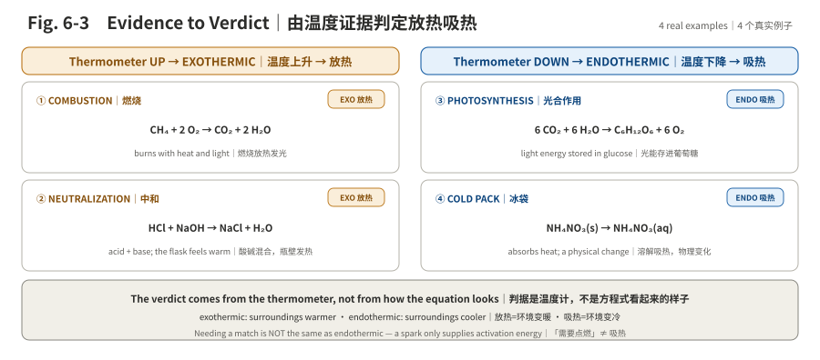
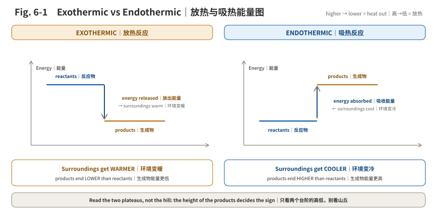
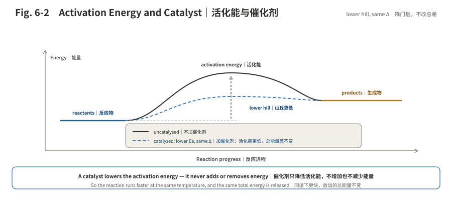

# Ch.6 — Energy Change in Chemical Reactions
## Chapter 6 · Energy Change in Chemical Reactions｜第 6 章　化学反应中的能量变化

> 🗂️ **Content Alignment｜大纲对应**：BC Science 10 Content C4（核心）；对接 B2（能量守恒）。
> ⏱️ **Periods｜课时**：2–3
> 🔗 **Source alignment｜素材对齐**：课本经典演示（温度计判定）+ 温度曲线实验 + 催化剂对照实验；本章是 Ch.5 反应类型的"能量视角"，也是 Ch.10 核能（能量守恒）的接口。

---

## 1. Content Alignment｜大纲对应

| Official item（官方条目） | Where it shows up in this unit｜在本单元的位置 | Status｜定位 |
|---|---|---|
| Science 9: *atoms rearrange in chemical reactions* | Why bonds must break first（§3.6） | Review 复习 |
| Science 10 C4: *energy change during chemical reactions* | Exothermic vs endothermic + diagrams（§3.1–3.4） | Core 核心 |
| Energy unit: *law of conservation of energy* | Where the released energy goes（§3.7） | Bridge 对接 B2 |
| Energy unit: *transformation affects living things and the environment* | Hand warmers, cold packs, fuel choice（§3.8） | Application 应用 |
| Chemistry 11: bond energies, quantitative ΔH | — | ⛔ Out of scope 超纲 |

**中文**：本章回答一个问题——**化学反应为什么有的放热、有的吸热？**答案藏在两件事里：物质"库存"的化学能（能量图的高低）与反应的"起步门槛"（活化能）。判定永远靠证据（温度计），不靠感觉。

---

## 2. Learning Objectives｜学习目标

By the end of this chapter, you should be able to:

1. Classify a reaction as exothermic or endothermic using experimental evidence (temperature change).
2. Read and draw an energy level diagram: reactant plateau, product plateau, and the overall energy change.
3. Explain activation energy as the minimum energy needed to start a reaction.
4. State what a catalyst changes (activation energy, rate) and what it does not change (overall energy change).
5. Explain energy change at the particle level: breaking bonds absorbs energy, forming bonds releases energy.
6. Connect "energy is conserved" to real technologies: hand warmers, cold packs, self-heating meals, fuel choice.

**中文**：学完本章，你应当能够——① 用温度证据判定放热/吸热；② 读懂并画出能量变化图（两个台阶 + 总能量差）；③ 解释活化能是"起步门槛"；④ 说出催化剂改变了什么、没改变什么；⑤ 用断键/成键解释能量变化的来源；⑥ 把能量守恒对接到暖宝宝、冰袋、自热饭盒与燃料选择。

---

## 3. Concept Explanations｜概念解析

### 3.1 Two Directions of Energy Change｜能量变化的两个方向

Every chemical reaction involves energy. There is no "no energy change" option — the only question is **which direction** the energy flows.

**Definition｜定义**：An **exothermic reaction（放热反应）** releases energy to the **surroundings（环境）**, so the surroundings get warmer. An **endothermic reaction（吸热反应）** absorbs energy from the surroundings, so the surroundings get cooler.
**中文**：放热反应把能量交给环境，环境变暖；吸热反应从环境取走能量，环境变冷。判定只有一条判据——**环境（温度计）变暖还是变冷**。

The energy released or absorbed is mostly **thermal energy（热能）** — the heat you feel with your hand or read on a thermometer — but it can also appear as light (burning magnesium) or be pushed in as electricity (electrolysis).

> 📏 **Rule｜规则**：Judge by the surroundings, never by the equation's appearance. Thermometer up → exothermic; thermometer down → endothermic.
> **中文**：用温度计判定，不用"看起来像燃烧"来猜——升温是放热，降温是吸热，方程式本身不提供答案。

Where does the released energy come from? From the **stored chemical potential energy（化学势能）** of the reactants — the energy "frozen" inside their chemical bonds. That storage picture is exactly what an energy level diagram shows (§3.3).

### 3.2 The Thermometer Is the Judge: Four Classroom Cases｜四支温度计做裁判

Mix these four pairs and watch the thermometer — each one is a classic Science 10 demo:

| Case｜实验 | Equation｜方程式 | Thermometer｜温度计 | Verdict｜判定 |
|---|---|---|---|---|
| acid + base 中和 | HCl + NaOH → NaCl + H₂O | rises 升 5–8 °C | exothermic 放热 |
| quicklime + water 生石灰加水 | CaO + H₂O → Ca(OH)₂ | hisses, may boil 发热可至沸腾 | exothermic 放热 |
| ammonium nitrate + water 硝酸铵溶于水 | NH₄NO₃(s) → NH₄NO₃(aq) | falls 明显降温 | endothermic 吸热 |
| baking soda + vinegar 小苏打 + 醋 | NaHCO₃ + CH₃COOH → CH₃COONa + H₂O + CO₂ | falls 变冷 | endothermic 吸热 |

> ⚠️ **Misconception｜易错**：The cold pack works by **dissolving** NH₄NO₃ — a *physical* change, yet the temperature still drops. So "energy changed" is **not** proof that a chemical reaction happened.
> **中文**：冰袋是溶解吸热，属于物理变化——所以"有能量变化"不能反过来证明"发生了化学反应"；但化学反应一定伴随能量变化。

**中文**：四个经典现场两升两降——中和与生石灰放热，硝酸铵溶解与小苏打加醋吸热。考场上的判定动作永远是：找温度证据 → 下结论。

### 3.3 Energy Level Diagrams｜能量变化图

An **energy level diagram（能量变化图）** turns the thermometer result into a picture. It shows how much energy is **stored** in the reactants and in the products.

**Definition｜定义**：A **reactant plateau（反应物台阶）** is the horizontal line showing the total stored energy of the reactants; a **product plateau（生成物台阶）** shows the same for the products. The vertical gap between them is the overall energy change.
**中文**：左边台阶 = 反应物储存的总能量，右边台阶 = 生成物储存的总能量；两个台阶的高度差 = 总能量变化（放热往下掉、吸热往上抬）。

> 📏 **Rule｜规则**：Products **lower** than reactants → energy was released (exothermic). Products **higher** than reactants → energy was absorbed (endothermic).
> **中文**：生成物台阶更低 = 放热（能量交给了环境）；生成物台阶更高 = 吸热（能量从环境存进了生成物）。

How to read one — three moves:

1. Find the two plateaus（找两个台阶）.
2. Compare their heights（比高低）→ that decides the sign: higher → lower is exothermic, lower → higher is endothermic.
3. The size of the gap tells you **how much** energy moved（差距大小 = 能量变化的多少）.

> 💡 **Tip｜口诀**：只看台阶高低，别看山丘——图上的"山"（§3.4 的活化能）不改变起点和终点的高度，自然也不改变放热还是吸热。

### 3.4 Activation Energy: The Hill You Must Climb｜活化能：起步的门槛

Here is a puzzle: natural gas and oxygen are like a ball on a high shelf — lots of stored energy waiting to fall — yet the mixture sits quietly forever until you light it. Why doesn't it start on its own?

**Definition｜定义**：**Activation energy（活化能）** is the **minimum energy needed to start** a chemical reaction — the "hill" between the reactant plateau and the top of the energy barrier.
**中文**：活化能是引发反应所需的最低能量——好比"起步的门槛"。反应必须先爬上这座山（先打断旧的化学键），之后才能往低处跑（成键放能）。

Why a hill? To rearrange atoms, you must first **stretch and break some old bonds**, and breaking bonds always **costs** energy (§3.6). Only collisions that carry at least this much energy succeed; the rest just bounce off.

Everyday consequences:

- A **spark, flame or friction（火花/明火/摩擦）** supplies the activation energy — that is all a match is for.
- Once an exothermic reaction starts, the energy it releases keeps feeding new molecules over the hill — that is why a fire **spreads**（火会蔓延）.
- Storage safety: a flammable vapour + air mixture is a room full of balls on shelves, waiting only for the spark. This is why fuel stations ban open flames.

> ⚠️ **Misconception｜易错**："需要点燃 = 吸热反应。" 错——点燃只是提供活化能，不是提供反应的总能量。燃烧放出的热量远大于一根火柴的能量，温度计会持续上升：燃烧是典型的**放热**反应。
> **中文**：判方向看生成物台阶（或温度计），判"要不要点火"看活化能——两件事互不冲突。像 Fe + S 这类反应也要加热引发，但同样是放热反应。

### 3.5 Catalysts: Lower the Hill, Not the Levels｜催化剂：降门槛，不动台阶

**Definition｜定义**：A **catalyst（催化剂）** speeds up a reaction by providing an **alternative pathway with lower activation energy**, and it is **not consumed** by the reaction.
**中文**：催化剂通过一条"活化能更低的新路径"让反应变快，本身不被消耗（反应结束还能回收，如 H₂O₂ 分解中的 MnO₂）。

What a catalyst changes and what it does not — this table is a guaranteed exam target:

| Quantity｜量 | Changed by a catalyst?｜催化剂改吗 |
|---|---|
| activation energy 活化能 | lower 降低 |
| reaction rate 反应速率 | faster 加快 |
| reactant / product plateau levels 台阶高度 | unchanged 不变 |
| overall energy change 总能量差 | unchanged 不变 |
| total heat released 放出的总热量 | unchanged 不变 |

> 📏 **Rule｜规则**：A catalyst changes the **route**, not the **destination** — same reactants, same products, same overall energy change.
> **中文**：催化剂只改路，不改账——反应物、生成物、总能量差全部不变，变的只是"门槛"高低和到达终点的快慢。

Biology runs on catalysts: nearly every reaction in your body is guided by **enzymes（酶）** — biological catalysts that lower activation energies enough for life's chemistry to happen at 37 °C.

### 3.6 Why? Break Bonds In, Form Bonds Out｜微观解释：断键吸能，成键放能

A **chemical bond（化学键）** is the attraction holding atoms together in a substance. Rearranging atoms (the Big Idea) means breaking some bonds and forming others — and the two moves have opposite energy bills:

**Definition｜定义**：**Bond breaking（断键）** absorbs energy; **bond forming（成键）** releases energy.
**中文**：断开旧键要**吸收**能量（这就是活化能的来源）；形成新键会**放出**能量。两者的差值决定反应放热还是吸热。

> 📏 **Rule｜规则**：energy to break old bonds compared with energy released by forming new bonds decides the direction: forming releases **more** → exothermic; breaking costs **more** → endothermic.
> **中文**：成键放出的多 → 放热（燃烧、中和）；断键花掉的更多 → 吸热（热分解、电解）。生成物台阶更低，本质是"新键更牢、存能更少"。

So every energy level diagram is really a **bond account**: the reactant plateau is the energy stored in the old bonds, the product plateau is the energy stored in the new ones, and the gap is the difference between the two bills.

> 【🔭 Extension → Chemistry 11】Chemistry 11 turns this account into numbers: using a **bond energy（键能）** table you will compute ΔH = (energy to break bonds) − (energy released forming bonds). In Science 10 you only need the **qualitative** rule — which bill is bigger decides the direction — never a calculation.

### 3.7 Energy Is Conserved (Big Idea B2)｜能量守恒

Nothing in this chapter creates or destroys energy. In an exothermic reaction, the energy "released" was **already stored** in the reactants' bonds; the reaction converts it into the random thermal motion of the surroundings. In an endothermic reaction, the opposite: thermal energy from the surroundings is **converted and stored** as chemical potential energy in the products.

> 📏 **Rule｜规则**：Energy is conserved — it is only **transferred** (from system to surroundings, or the reverse) and **transformed** (chemical → thermal, thermal → chemical, chemical → light…).
> **中文**：能量不会消失也不会凭空产生，只是转移（体系↔环境）与转化（化学能↔热能/光能/电能）。放热反应"放出的能量"来自反应物库存，吸热反应"吸走的能量"存进了生成物库存。

This is Big Idea B2 in the energy unit: *Energy is conserved, and its transformation can affect living things and the environment.* A hand warmer transfers stored chemical energy to your hands; photosynthesis transforms light energy into stored chemical energy that feeds almost every food chain on Earth; the CO₂ released by burning fuels transforms the planet's energy balance (Ch.9 returns to this).

**中文**：一句话对接 B2——能量在转移与转化中守恒，而这些转化实实在在地影响生物与环境：暖宝宝暖手、光合作用养活食物链、燃料燃烧改变地球的能量收支。

### 3.8 Putting It to Work｜现实应用

| Technology｜技术 | Chemistry｜化学 | Energy move｜能量去向 |
|---|---|---|---|
| hand warmer 暖宝宝 | iron powder oxidizes: 4 Fe + 3 O₂ → 2 Fe₂O₃ | exothermic, slow and steady | stored chemical energy → warmth 热给手 |
| self-heating meal 自热饭盒 | CaO + H₂O → Ca(OH)₂ | strongly exothermic | heats the food in minutes 快速加热食物 |
| instant cold pack 冰袋 | NH₄NO₃(s) → NH₄NO₃(aq) (dissolving) | endothermic | absorbs heat from the sprain 从患处吸热消肿 |
| fuel choice 燃料选择 | e.g. CH₄ + 2 O₂ → CO₂ + 2 H₂O | exothermic; compare energy per gram, cleanliness of products, safety | chemical → thermal (+ light) |

Two engineering lessons hiding in this table:

- **Exothermic must be managed（放热要控）**: industry cools exothermic reactors with cooling jackets and adds reactants slowly — uncontrolled exothermic reactions overheat, pressure-build and can explode (the same reason self-heating meal packs must vent steam).
- **Endothermic must be fed（吸热要供能）**: a lime kiln burning CaCO₃ → CaO + CO₂ must burn fuel continuously just to keep the decomposition going.

**中文**：放热反应要"管"（散热、控速、排气），吸热反应要"喂"（持续供能）——选燃料看三件事：每克放能多少、产物干不干净（CO₂ 与污染物）、储存运输安不安全。

### 3.9 A 30-Second Decision Routine｜30 秒判定流程

| Check｜检查 | If…｜如果 | Verdict｜结论 |
|---|---|---|---|
| ① thermometer 温度证据 | surroundings warmer 环境变暖 | exothermic 放热 |
| ② energy diagram 能量图 | product plateau lower 生成物台阶更低 | exothermic 放热 |
| ③ reaction class 反应类别 | combustion / neutralization / most oxidation 燃烧·中和·多数氧化 | exothermic 放热 |
| ①–③ mirrored 反向情形 | cooler / higher plateau / decomposition, electrolysis, photosynthesis 分解·电解·光合 | endothermic 吸热 |

**中文**：考场三连问——有温度证据看温度，有图看台阶，都没有就套类别（燃烧/中和→放热；热分解/电解/光合→吸热）。三条证据互相印证，结论才稳。

---

## 4. Comparison Tables｜表格比对

### Table 6-1　Exothermic vs Endothermic｜放热反应与吸热反应

| Feature｜特征 | Exothermic｜放热 | Endothermic｜吸热 |
|---|---|---|---|
| Energy flow 能量流向 | system → surroundings 体系→环境 | surroundings → system 环境→体系 |
| Thermometer 温度计 | rises 上升 | falls 下降 |
| Product plateau 生成物台阶 | lower 更低 | higher 更高 |
| Bonds 键账 | forming releases more 成键放出更多 | breaking costs more 断键花掉更多 |
| Feel 直感 | warm/hot 手感变暖 | cool/cold 手感变冷 |
| Example｜例 | CH₄ + 2 O₂ → CO₂ + 2 H₂O 燃烧 | CaCO₃ → CaO + CO₂（加热）热分解 |

### Table 6-2　Bond Breaking vs Bond Forming｜断键与成键

| Move｜动作 | Energy bill｜能量账 | When it happens｜发生时机 |
|---|---|---|---|
| breaking bonds 断键 | absorbs 吸能 | first — it IS the activation energy 第一步，即活化能来源 |
| forming bonds 成键 | releases 放能 | as new substances come together 新物质形成时 |
| net difference 差值 | decides exo / endo 决定方向 | the gap between the plateaus 台阶差 |

### Table 6-3　Reading an Energy Diagram: Five Questions｜能量变化图五问

| Question｜问 | Answer from…｜从哪读 |
|---|---|---|
| Where are the reactants? 反应物在哪 | left plateau 左台阶 |
| Where are the products? 生成物在哪 | right plateau 右台阶 |
| Exo or endo? 放热还是吸热 | which plateau is higher 哪个台阶高 |
| How much energy moved? 能量变化多少 | gap between the plateaus 台间差距 |
| What is the activation energy? 活化能多少 | reactant plateau up to the **peak** 台阶到峰顶（不是到对面台阶） |

### Table 6-4　Eight Reactions Classified｜八个常见反应归类

| Reaction｜反应 | Class｜类别 | Why｜理由 |
|---|---|---|---|
| CH₄ + 2 O₂ → CO₂ + 2 H₂O | exothermic 放热 | combustion 燃烧 |
| CaCO₃ → CaO + CO₂ (heated) | endothermic 吸热 | thermal decomposition 持续加热才能进行 |
| CaO + H₂O → Ca(OH)₂ | exothermic 放热 | self-heating pack 自热饭盒 |
| 6 CO₂ + 6 H₂O → C₆H₁₂O₆ + 6 O₂ | endothermic 吸热 | photosynthesis, powered by light 光能驱动 |
| HCl + NaOH → NaCl + H₂O | exothermic 放热 | neutralization 中和 |
| 2 H₂O → 2 H₂ + O₂ (electrolysis) | endothermic 吸热 | electricity pushes it uphill 电能抬台阶 |
| 2 Mg + O₂ → 2 MgO | exothermic 放热 | burning metal, blinding light 镁条燃烧 |
| 2 NaHCO₃ → Na₂CO₃ + H₂O + CO₂ (heated) | endothermic 吸热 | baking powder decomposes 烘焙分解 |

---

## 5. Diagrams & Worked Examples｜图例说明

### Example 6-1　Reading an Energy Diagram｜读能量变化图

**A diagram shows the reactant plateau at 250 kJ, the product plateau at 120 kJ, and the top of the hill at 310 kJ. Describe the reaction.**

1. Products (120) sit **lower** than reactants (250) → energy was released → **exothermic**.
2. Overall energy change: 250 − 120 = **130 kJ released** for the amount shown.
3. Activation energy: 310 − 250 = **60 kJ** — the hill from the reactant plateau to the peak.
4. Bonus check: the reverse reaction (products → reactants) would need 310 − 120 = 190 kJ — uphill and much harder.

**中文**：120 < 250 → 放热；总能量差 = 250 − 120 = 130 kJ；活化能 = 310 − 250 = 60 kJ（量到峰顶，不是量到对面台阶）；逆反应要爬 190 kJ，难得多。

> 💡 **Tip｜口诀**：能量差 = 两台阶之差；活化能 = 台阶到峰顶。两把尺子量的是不同的东西，混用必错。

### Example 6-2　A Spark Is Not a Fuel｜火星不是燃料

**A student argues: "Lighting a propane stove needs a spark, so burning propane must be endothermic." Evaluate.**

1. The spark's job is to supply **activation energy** — helping some molecules over the hill so the first bonds can break.
2. Once started, C₃H₈ + 5 O₂ → 3 CO₂ + 4 H₂O releases far more energy than the spark delivered, and feeds the rest of the mixture over the hill.
3. Evidence check: hold your hand near the stove — the thermometer (or your skin) says the surroundings get **warmer**.
4. Verdict: the claim confuses "energy to start" with "energy change overall". Combustion is **exothermic**.

**中文**：火柴只负责"起步"（活化能），反应一旦开始放出的能量远超火柴，且温度证据（变暖）直接判放热——"需要点燃"与"放热"完全不矛盾。

### Example 6-3　Catalyst Trial Data｜催化剂对照实验数据

**25.0 mL of H₂O₂ solution is decomposed twice, starting at 22.0 °C. Trial A: no catalyst, fizzing stops after 96 s. Trial B: a pinch of MnO₂, fizzing stops after 8 s. Both flasks end at 26.5 °C. What did the MnO₂ change?**

1. Rate: 96 s → 8 s — twelve times faster. The catalyst lowered the activation energy.
2. Final temperature: identical (26.5 °C) — the same total energy was released. ΔT = +4.5 °C in both.
3. The plateaus never moved: same reactants, same products, same overall energy change.
4. Verdict: MnO₂ changed the **route and the rate** — nothing about the energy account.

**中文**：催化剂让 96 s 变 8 s（速率↑），但终温相同 26.5 °C（放热总量不变）——只改路，不改账。2 H₂O₂ → 2 H₂O + O₂（MnO₂ 作催化剂）。

---

## 6. Key Vocabulary｜核心词汇

| English｜英文 | 中文 | Note｜备注 |
|---|---|---|---|
| exothermic | 放热的 | releases energy; surroundings warmer |
| endothermic | 吸热的 | absorbs energy; surroundings cooler |
| thermal energy | 热能 | what the thermometer reads |
| surroundings | 环境 | everything outside the reaction system |
| energy level diagram | 能量变化图 | two plateaus + the gap |
| reactant plateau | 反应物台阶 | stored energy of reactants |
| product plateau | 生成物台阶 | stored energy of products |
| activation energy | 活化能 | minimum energy to start the reaction |
| catalyst | 催化剂 | lowers Ea, not consumed |
| enzyme | 酶 | biological catalyst |
| chemical bond | 化学键 | attraction holding atoms together |
| bond breaking | 断键 | absorbs energy |
| bond forming | 成键 | releases energy |
| law of conservation of energy | 能量守恒定律 | Big Idea B2 |
| temperature change | 温度变化 | the judging evidence |

---

## 7. Lab / Activity｜实验与活动

### Lab 6-1　Temperature Curves of Four Reactions｜四个反应的温度曲线

**[Planning and conducting]**
Record temperature every 10 s with a data logger (or thermometer) for: NaOH(aq) + HCl(aq); CaO + H₂O (small piece!); NH₄NO₃ + H₂O; NaHCO₃ + CH₃COOH. Plot temperature vs time for each, mark the maximum rise or fall, classify each reaction, then sketch its energy level diagram with labelled plateaus.

- Safety: CaO is corrosive — use one small piece, goggles, no touching; NH₄NO₃ cold pack gets very cold — do not hold the flask.
- Criterion: classification must cite the ΔT value, not a feeling.

**中文**：四个反应各录一条温度-时间曲线，标出最大升/降，用 ΔT 数值分类，并画出对应能量图（标台阶）。生石灰具腐蚀性，一小块、戴护目镜；数据表与曲线贴进实验报告。

### Lab 6-2　Catalysts Only Make You Faster｜催化剂只是让你更快

**[Processing and analyzing data and information]**
Decompose equal volumes of H₂O₂ solution with and without a pinch of MnO₂, starting at the same temperature. Record time to stop fizzing and final temperature for both trials. Answer with data: what did the catalyst change, and what stayed identical? Calculate both rates as "1/time" and compare.

**中文**：同温同量 H₂O₂ ± MnO₂ 对照——记录"冒泡停止时间"与"终温"。结论必须落在数据上：速率变快（时间变短），终温不变（放热总量不变）。2 H₂O₂ → 2 H₂O + O₂。

### Activity 6-3　Warm Pack vs Cold Pack Debate｜暖宝宝 vs 冰袋辩论

**[Evaluating] [Applying and innovating]**
In pairs, argue which technology is safer and more useful: an iron-oxidation hand warmer (4 Fe + 3 O₂ → 2 Fe₂O₃) or an NH₄NO₃ instant cold pack. Each side must use: the reaction, the direction of energy flow, at least two safety criteria, and one situation where the other side's product wins.

**中文**：用反应原理、能量方向、两条安全判据支撑立场，并承认对方在什么场景更优——评分看"证据 + 判据"，不看嗓门。

---

## 8. Common Misconceptions｜常见易错点

1. ❌ "It needs a flame, so burning is endothermic." → ✅ The flame only supplies **activation energy**; once burning, the reaction releases far more energy than it cost to start.
   **中文**："需要点燃 ≠ 吸热"——点火是给活化能，燃烧本身放热且放出的远多于投入的。
2. ❌ "Endothermic reactions need no energy." → ✅ They need energy continuously — that is exactly why CaCO₃ decomposition stops the moment you remove the flame.
   **中文**："吸热 ≠ 不需要能量"——吸热反应要持续供能，撤火就停。
3. ❌ "A catalyst releases extra heat." → ✅ A catalyst lowers activation energy and speeds the reaction; the total heat released stays the same.
   **中文**："催化剂不增加放热量"——只改速率，不改总能量差（Lab 6-2 的终温就是证据）。
4. ❌ "The catalyst is used up like a reactant." → ✅ A catalyst is not consumed — you can recover the MnO₂ after the reaction.
   **中文**：催化剂不被消耗，反应后可回收。
5. ❌ "The gap between the two plateaus is the activation energy." → ✅ The gap is the **overall energy change**; activation energy is measured from the reactant plateau up to the **peak**.
   **中文**：两把尺子——台阶差 = 总能量变化，台阶到峰顶 = 活化能。
6. ❌ "Temperature changed, so a chemical reaction must have happened." → ✅ Dissolving NH₄NO₃ is a physical change and still cools the water; energy change is not proof of chemical change.
   **中文**：能量变化不能反证化学反应——溶解也是物理变化，但照样吸热降温。
7. ❌ "The higher the plateau sits on the page, the more energy is released." → ✅ Only the **difference** between plateaus matters; shifting the whole diagram up or down changes nothing.
   **中文**：能量图可以整体上下平移——只有两台阶的"差"才有意义。
8. ❌ "Exothermic reactions always make the temperature shoot up." → ✅ The rise depends on amounts, concentration, insulation and rate; a slow hand warmer warms gently for hours.
   **中文**：升温幅度取决于用量、保温与速率——暖宝宝就是缓慢放热的例子。
9. ❌ "Released energy is destroyed / absorbed energy is created." → ✅ Energy is conserved (B2): released energy was stored in reactant bonds; absorbed energy is now stored in the products.
   **中文**：能量只是转移与转化——放出的来自库存，吸走的存进新库存。
10. ❌ "Electrolysis and photosynthesis are 'cold reactions', so energy is not involved." → ✅ Both are endothermic **powered by an energy input**: electricity for electrolysis, light for photosynthesis — the products store that energy.
    **中文**：电解与光合都是"有能量输入的吸热过程"——电能/光能被存进了生成物。

---

## 9. Assessment｜答题评估

**Part A — Knowledge｜基础（10 × 2 = 20 分）**

**A1.** Classify each reaction as exothermic or endothermic: (a) C₃H₈ + 5 O₂ → 3 CO₂ + 4 H₂O; (b) 2 KClO₃ → 2 KCl + 3 O₂ (heated); (c) Zn + 2 HCl → ZnCl₂ + H₂; (d) 2 HgO → 2 Hg + O₂ (heated); (e) Fe + S → FeS (heated to start); (f) C(s) + H₂O(g) → CO + H₂; (g) 2 Al + Fe₂O₃ → Al₂O₃ + 2 Fe; (h) NH₄NO₃(s) → NH₄NO₃(aq); (i) C₆H₁₂O₆ + 6 O₂ → 6 CO₂ + 6 H₂O; (j) CuCO₃ → CuO + CO₂ (heated).
- **中文**：判定下列反应放热还是吸热：(a) 丙烷燃烧；(b) 加热氯酸钾分解；(c) 锌与盐酸；(d) 加热氧化汞分解；(e) 加热引发铁与硫磺化合；(f) 红热的碳与水蒸气反应；(g) 铝热反应；(h) 硝酸铵溶解；(i) 葡萄糖呼吸氧化；(j) 加热碳酸铜分解。

**A2.** A thermometer in a reaction mixture rises from 21.0 °C to 34.5 °C. Which type of reaction is this, and in which direction did energy flow?
- **中文**：温度由 21.0 °C 升到 34.5 °C，判断反应类型与能量流向。

**A3.** On an energy level diagram, what do the two horizontal lines (plateaus) represent?
- **中文**：能量变化图中的两条水平台阶各代表什么？

**A4.** Products sit lower than reactants on an energy diagram. Is the reaction exothermic or endothermic? Give the reason in one sentence.
- **中文**：生成物台阶比反应物低，判断类型并一句话给理由。

**A5.** Define activation energy in one sentence and name one everyday thing that supplies it.
- **中文**：一句话定义活化能，并举一个提供活化能的日常例子。

**A6.** What does a catalyst change, and what does it never change? (Name two of each.)
- **中文**：催化剂改变了什么（至少两条）、从不改变什么（至少两条）？

**A7.** Which bill is bigger in an exothermic reaction: energy to break bonds, or energy released forming bonds?
- **中文**：放热反应中，"断键花的能量"与"成键放出的能量"哪个更大？

**A8.** Where was the energy "released" by burning methane stored before the reaction?
- **中文**：甲烷燃烧"放出的"能量，反应前存在哪里？

**A9.** A cold pack cools a sprained ankle. Is the pack's key process a chemical reaction? Explain your answer in one sentence.
- **中文**：冰袋消肿的关键过程是化学反应吗？一句话说明理由。

**A10.** Name two safety measures for working with CaO + H₂O in Lab 6-1, and say which hazard each one addresses.
- **中文**：写出 Lab 6-1 中做 CaO + H₂O 实验的两条安全措施及各自针对的危害。

**Part B — Application｜应用（4 × 5 = 20 分）**

**B1.** An energy diagram shows the reactant plateau at 250 kJ, the product plateau at 120 kJ, and the peak of the hill at 310 kJ. (a) Exothermic or endothermic? (b) Calculate the overall energy change. (c) Calculate the activation energy. (d) How much energy would the reverse reaction need to get over the same hill?
- **中文**：能量图上反应物台阶 250 kJ、生成物台阶 120 kJ、山顶 310 kJ。(a) 判断类型；(b) 求总能量变化；(c) 求活化能；(d) 逆反应爬同一座山需要多少能量？

**B2.** A student writes: "Natural gas needs a match to burn, so combustion must be endothermic." Identify the error, explain using activation energy, and state the thermometer evidence that settles the question.
- **中文**：指出"天然气要点火才烧，所以燃烧是吸热"这句论断错在哪，用活化能解释，并写出能一锤定音的温度证据。

**B3.** Two 25.0 mL samples of H₂O₂ at 22.0 °C decompose: without catalyst the fizzing lasts 96 s and the final temperature is 26.5 °C; with MnO₂ it lasts 8 s and the final temperature is again 26.5 °C. Explain what the catalyst changed and what it did not, referring to the energy level diagram.
- **中文**：两份 25.0 mL 同温 H₂O₂ 对照——不加催化剂 96 s 结束、终温 26.5 °C；加 MnO₂ 8 s 结束、终温仍 26.5 °C。结合能量图解释催化剂改了什么、没改什么。

**B4.** A self-heating meal uses the reaction CaO + H₂O → Ca(OH)₂ inside a sealed outer pack. Explain: (a) why the food heats up; (b) why the pack must have a vent or steam outlet; (c) why running the same reaction on an industrial scale in a sealed steel drum would be dangerous.
- **中文**：自热饭盒利用 CaO + H₂O → Ca(OH)₂。解释：(a) 食物为什么被加热；(b) 外袋为什么必须留蒸汽出口；(c) 同一反应若在工业密封钢罐里大规模进行为何危险。

**Part C — Challenge｜挑战（2 × 10 = 20 分）**

**C1.** Design an instant cold pack. Choose the key process from this chapter, sketch (or describe) its energy level diagram, state how you would measure that it works, give two performance or safety criteria, and name one limitation.
- **中文**：设计一款 instant cold pack（冰袋）：从本章选定关键过程，画出（或描述）对应能量图，说明如何用测量证明它有效，给出两条性能/安全判据，并指出一个局限。

**C2.** "Burning a candle releases energy." Trace the energy of a burning candle from the bonds of the wax and oxygen, through the flame, to the warm room, and use the law of conservation of energy (Big Idea B2) to explain why "release" does not mean "create". Finish with one example of how this transformation affects living things or the environment.
- **中文**：以燃烧的蜡烛为例，把能量从蜡与氧气的化学键 → 火焰 → 变暖的房间完整追踪一遍，用能量守恒定律（Big Idea B2）解释"放出"为什么不等于"凭空产生"，最后举一个该转化影响生物或环境的例子。

### Answers｜参考答案

**Part A**

- **A1.** (a) exothermic (combustion); (b) endothermic (thermal decomposition, needs steady heat); (c) exothermic (metal + acid); (d) endothermic (thermal decomposition); (e) exothermic — heating only supplies activation energy, the combination itself releases heat; (f) endothermic (steam must keep supplying energy); (g) exothermic (thermite — huge release); (h) endothermic (dissolving); (i) exothermic (respiration — the body's slow combustion); (j) endothermic (thermal decomposition).
  **中文**：(a) 放热（燃烧）；(b) 吸热（热分解，需持续加热）；(c) 放热（金属+酸）；(d) 吸热（热分解）；(e) 放热——加热只供活化能，化合本身放热；(f) 吸热（水蒸气需持续供能）；(g) 放热（铝热反应，放能巨大）；(h) 吸热（溶解）；(i) 放热（呼吸作用=体内缓慢燃烧）；(j) 吸热（热分解）。
- **A2.** Exothermic; energy flowed from the reaction system to the surroundings (ΔT = +13.5 °C).
  **中文**：放热反应；能量由反应体系流向环境（升温 13.5 °C）。
- **A3.** The reactant plateau shows the total stored chemical energy of the reactants; the product plateau shows the same for the products.
  **中文**：左台阶 = 反应物储存的总化学能；右台阶 = 生成物储存的总化学能。
- **A4.** Exothermic — products hold less stored energy than reactants, so the difference was released to the surroundings.
  **中文**：放热——生成物储存的能量更低，差额交给了环境。
- **A5.** Activation energy is the minimum energy needed to start a reaction; a spark/match/flame (or friction) supplies it.
  **中文**：活化能是引发反应所需的最低能量；火花、火柴、明火或摩擦都能提供。
- **A6.** Changes: activation energy (lower), reaction rate (faster). Never changes: reactant/product plateau levels, overall energy change, total heat released, and the products formed.
  **中文**：改变：活化能（降低）、速率（加快）；从不改变：台阶高度、总能量差、放热总量、生成物种类。
- **A7.** Energy released by forming bonds is bigger — the surplus is what makes the reaction exothermic.
  **中文**：成键放出的更大，多出的部分就是"放热"的来源。
- **A8.** In the chemical bonds (stored chemical potential energy) of methane and oxygen.
  **中文**：储存在甲烷和氧气的化学键里（化学势能库存）。
- **A9.** No — the key process is NH₄NO₃ dissolving in water, a physical change that absorbs heat.
  **中文**：不是——关键是硝酸铵溶解，属于吸热的物理变化。
- **A10.** Any two: goggles (CaO is corrosive to eyes); use only a small piece (limits heat and splatter); tongs/no touching (caustic burn); add water slowly (violent boil and spitting).
  **中文**：任答两条：护目镜（防腐蚀伤眼）；只用一小块（控制放热与飞溅）；镊子夹取、不触碰（防灼伤）；缓慢加水（防暴沸喷溅）。

**Part B**

- **B1.** (a) Products lower → exothermic. (b) 250 − 120 = 130 kJ released. (c) 310 − 250 = 60 kJ. (d) 310 − 120 = 190 kJ.
  **中文**：(a) 生成物更低 → 放热；(b) 放出 130 kJ；(c) 活化能 60 kJ；(d) 逆反应需 190 kJ。
- **B2.** The match supplies only the activation energy — the "hill" — not the reaction's overall energy. Once burning starts, the bond account releases far more energy than the match delivered, so the product plateau sits lower: exothermic. Evidence: the thermometer keeps rising (surroundings warmer), which only an exothermic process does.
  **中文**：火柴只提供活化能（那座山），不提供反应的总能量；烧起来后成键放出的能量远超火柴，生成物台阶更低 → 放热。证据：温度计持续上升——只有放热过程才这样。
- **B3.** Changed: activation energy (MnO₂ offers a lower-hill pathway) and rate (96 s → 8 s, twelve times faster). Not changed: both flasks reached the same final temperature (26.5 °C), so the same total energy was released — reactant and product plateaus and the overall energy change are identical. The catalyst changed the route, not the energy account.
  **中文**：改变了：活化能（MnO₂ 提供更低山丘的路径）与速率（96 s → 8 s，快 12 倍）。没改变：终温相同 26.5 °C，放热总量相同——台阶高度与总能量差都不变。只改路，不改账。
- **B4.** (a) CaO + H₂O is strongly exothermic; the released energy transfers to the food. (b) Steam builds as the water is heated and consumed — without a vent the pack would bulge or burst. (c) An industrial sealed drum has no way to shed the enormous heat of a large CaO mass: temperature and steam pressure climb, and the drum can rupture or explode (thermal runaway).
  **中文**：(a) 生石灰遇水强放热，热量传给食物；(b) 水被加热消耗产生蒸汽，不留出口会鼓包爆裂；(c) 大规模密封钢罐无法散热，温度与蒸汽压力持续攀升，可能破裂爆炸（热失控）。

**Part C**

- **C1.** Model answer: key process = NH₄NO₃ dissolving in water (endothermic, physical change); energy diagram has the product plateau higher (dissolved ions store more energy); measurement = sealed pouch of water struck to release the solute, thermometer shows a drop of about 10–20 °C within a minute; criteria = reaches working temperature quickly and stays leak-free/flexible (skin-safe, no sharp edges); limitation = one-time use, and the pack eventually warms back to room temperature as heat flows back in.
  **中文**：参考答案——关键过程为硝酸铵溶解（吸热、物理变化）；能量图生成物台阶更高；测量：击破内袋让溶质溶出，1 分钟内降温约 10–20 °C；判据：快速达到工作温度、不渗漏且袋体柔软安全；局限：一次性使用，且热量回流后逐渐回温。
- **C2.** Model answer: the wax's C–H and C–C bonds plus O₂ store chemical potential energy; burning breaks those bonds (absorbing activation energy from the match) and forms stronger bonds in CO₂ and H₂O, releasing the difference as thermal energy and light; the flame transfers this energy to the air, and convection spreads it as a warmer room. Nothing was created — the released energy was stored in the reactants' bonds and merely transformed and transferred (conservation of energy, B2). Impact example: the same chemistry at planetary scale — combustion CO₂ changes how Earth's surface energy escapes to space, warming the climate that living things depend on.
  **中文**：参考答案——蜡的 C–H/C–C 键与 O₂ 储存化学势能；燃烧断键（火柴提供活化能）并成键为 CO₂ 与 H₂O，差额以热和光放出；火焰把能量传给空气，对流让房间变暖。没有凭空产生——放出的能量本来就储存在反应物的键里，只是被转化与转移（能量守恒，B2）。影响举例：同样的化学在全球尺度上，燃烧产生的 CO₂ 改变地表能量向太空散逸的方式，使生物赖以生存的气候变暖。

### Rubric｜评分量规

| Level｜水平 | Standard｜标准 |
|---|---|---|
| Exemplary 满分档 | Every classification cites evidence (ΔT, plateau heights or reaction class); diagrams label plateaus, gap and peak correctly; catalyst answers separate rate from energy account | 判定全附证据（ΔT、台阶高低或反应类别）；能量图标全台阶、能量差与峰顶；催化剂答案分清"速率"与"能量账" |
| Proficient 良好档 | Classifications correct; diagrams mostly labelled; occasionally cites the reaction class without evidence | 判定全对，图标基本齐全，偶有"只套类别不给证据" |
| Developing 合格档 | Knows exo/endo definitions; confuses activation energy with the overall energy change | 会定义放热/吸热，但活化能与总能量差常混 |
| Beginning 待提高档 | Judges by appearance ("needs a flame = endothermic"); catalyst believed to add heat | 靠感觉判定（要点火=吸热）、认为催化剂加放热量——回炉 §3.4 与 §3.5 |

---

## 10. Connection to the Big Idea｜回扣核心概念

> 🎯 **Big Idea**: *Energy change is required as atoms rearrange in chemical processes.*

Ch.5 showed the rearrangement patterns; this chapter shows the **bill** that every rearrangement pays. Breaking the old partnerships costs energy (activation energy — the hill), forming the new ones pays it back with interest or at a loss — and the balance of that account is exactly the gap between the two plateaus. And the account never leaks: whatever one side spends, the other side receives, because energy is conserved.

**中文**：Ch.5 讲原子重排的"模式"，本章讲每次重排都要付的"账单"——断旧键要花能量（活化能那座山），成新键会收回能量，收支差额就是两台阶之间的高度差；而且这本账一分都不会漏——一方的支出就是另一方的收入，因为能量守恒。

> 🎯 **Link to Big Idea B2**: *Energy is conserved, and its transformation can affect living things and the environment.*
> **中文**：能量在转移与转化中守恒，而这些转化真实地影响生物与环境——暖宝宝把化学能变成暖意，光合作用把光能存进食物链，燃料燃烧的 CO₂ 改变地球的能量收支（Ch.9、Ch.10 续谈）。

**中文**：下一章 Ch.7 进入酸碱化学——中和反应会再次登场，不过那时我们关心的不只是它放热，还有它生成的盐与水。
