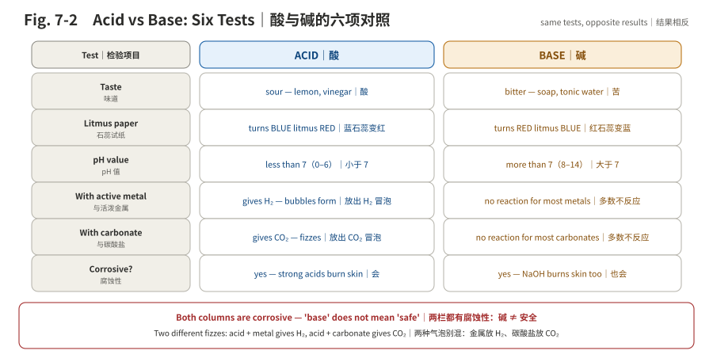
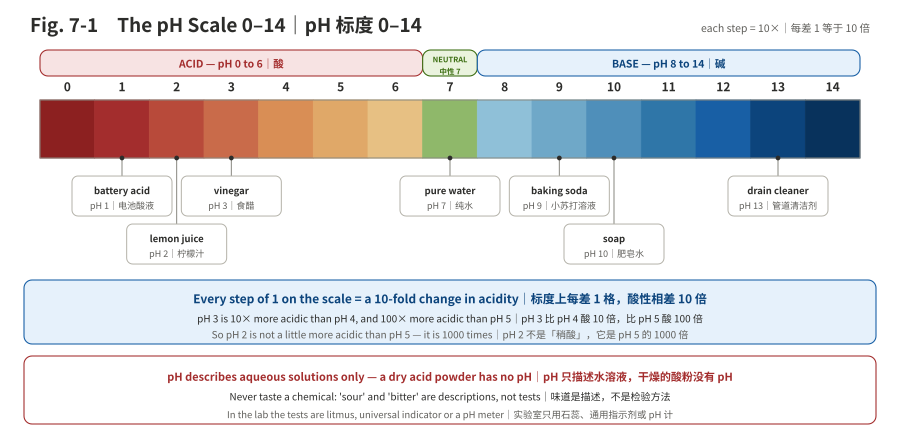
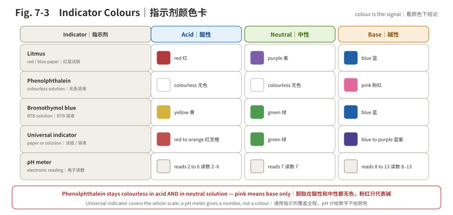
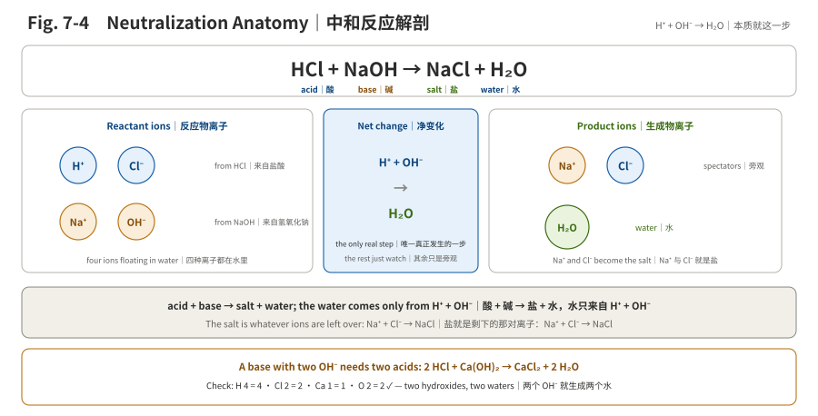

# Ch.7 — Acids, Bases, Salts and pH
## Chapter 7 · Acids, Bases, Salts and pH｜第 7 章　酸、碱、盐与 pH

> 🗂️ **Content Alignment｜大纲对应**：BC Science 10 Content C2（acid-base chemistry，核心）。
> ⏱️ **Periods｜课时**：4
> 🔗 **Source alignment｜素材对齐**：`WS0` p2（Acids, Bases & Salts）/ `WS1` p2（分类为酸 / 碱 / 盐）/ `WS3` p1（中和反应预测）。Ch.1 §3.6 学过"看化学式首尾分酸碱盐"，本章把它展开成完整的性质、pH、命名与中和反应。

---

## 1. Content Alignment｜大纲对应

| Official item（官方条目） | Where it shows up in this unit｜在本单元的位置 | Status｜定位 |
|---|---|---|
| Science 9: *familiar acids and bases in daily life* | Household examples and safety（§3.7–3.8） | Review 复习 |
| Science 10 C2: *acid-base chemistry* | Properties, pH, naming, neutralization（§3.1–3.6） | Core 核心 |
| Science 10 C1: *rearrangement of atoms* | Neutralization is atoms changing partners（§3.5） | Gateway 衔接 |
| Ch.1: acid / base / salt recognition from formulas | Formula-reading is the entry skill（§3.1, §3.4） | Gateway 衔接 |
| Ch.3: balancing equations | Every neutralization equation must be balanced（§3.5） | Gateway 衔接 |
| Chemistry 11: molarity, titration calculations, pH = −log[H⁺] | — | ⛔ Out of scope 超纲 |

**中文**：本章是 Ch.1"酸碱盐识别"的完全体——从"看化学式分类"升级到四件事：**说性质、读 pH、会命名、写中和**。全部只做定性判断与配平，不做任何浓度或 pH 计算。

---

## 2. Learning Objectives｜学习目标

By the end of this chapter, you should be able to:

1. Describe the properties of acids and bases (taste is described, never tested).
2. Classify a substance as an acid, a base, or a salt from its name, formula, pH, or described properties.
3. Read the pH scale: locate 0–14, identify acidic / neutral / basic, and use "each step = 10×".
4. Predict the colour an indicator (litmus, phenolphthalein, BTB, universal indicator) will show in a solution of a given pH.
5. Name common acids (binary and oxyacids) and bases (metal + hydroxide).
6. Write and balance neutralization reactions: acid + base → salt + water.

**中文**：学完本章，你应当能够——① 描述酸碱的性质（味道只能"描述"，绝不能"尝试"）；② 由名称、化学式、pH 或性质描述判断酸 / 碱 / 盐；③ 读懂 pH 标度并使用"每差 1 格 = 10 倍"；④ 预测四种指示剂在给定 pH 溶液中的颜色；⑤ 命名常见的酸（二元酸与含氧酸）与碱（金属 + 氢氧根）；⑥ 书写并配平中和反应。

---

## 3. Concept Explanations｜概念解析

### 3.1 The Acid–Base–Salt Family｜酸、碱、盐三大家族

**Definition｜定义**：An **acid（酸）** is a substance that, in aqueous solution, produces **H⁺ ions（氢离子）**. A **base（碱）** is a substance that produces **OH⁻ ions（氢氧根离子）** in aqueous solution (or reacts with H⁺). A **salt（盐）** is an ionic compound formed when an acid and a base neutralize each other.
**中文**：酸在水溶液中给出 H⁺；碱在水溶液中给出 OH⁻（或能与 H⁺ 结合）；盐是酸碱互相中和后生成的离子化合物。

The three families can be told apart by their properties — the same six tests with opposite results:



> 📏 **Rule｜规则**：**Acid 酸** — sour taste 描述为酸味 · turns blue litmus red 使蓝色石蕊变红 · reacts with active metals to give H₂ 与活泼金属放出氢气 · reacts with carbonates to give CO₂ 与碳酸盐放出二氧化碳 · pH less than 7. **Base 碱** — bitter taste 苦味 · slippery feel 滑腻 · turns red litmus blue 使红色石蕊变蓝 · pH greater than 7 · corrosive 有腐蚀性. **Salt 盐** — the product of neutralization 中和产物 · most are neutral in solution 溶液多为中性.
> **中文**：判酸看"蓝石蕊变红 + 两种气泡（金属放 H₂、碳酸盐放 CO₂）"；判碱看"红石蕊变蓝 + 滑腻苦味"；盐是中和的产物，大多数中性。

Two formula habits from Ch.1 still do the heavy lifting:

- **Acid** — formula **starts with H**（H 开头）: HCl, H₂SO₄, HNO₃, CH₃COOH.
- **Base** — formula **ends with OH**（OH 结尾）: NaOH, Ca(OH)₂, Mg(OH)₂ — plus the standing exception **NH₃（ammonia 氨）**, a base with no OH.
- **Salt** — everything else that is ionic（其余金属离子化合物）: NaCl, KNO₃, CaCO₃, NH₄Cl.

Both acid and base solutions contain freely moving ions, so they **conduct electricity（导电）** — they are **electrolytes（电解质）**. Dry acid powder and pure water do not conduct well: no (or very few) ions.

> 💡 **Tip｜口诀**：水溶液里比性质，不比固体——判断酸碱的对象是**溶液**；"蓝变红是酸、红变蓝是碱"一句背死，考场上不犹豫。

### 3.2 Reading the pH Scale｜读懂 pH 标度

The **pH scale（pH 标度）** is a number line from 0 to 14 that measures how acidic or basic an **aqueous solution** is:



> 📏 **Rule｜规则**：pH **less than 7** → acidic 酸性 · pH **exactly 7** → neutral 中性（pure water 纯水）· pH **greater than 7** → basic 碱性. The scale runs 0–14, and **each step of 1 means a 10-fold change**（每差 1 格，酸性 / 碱性相差 10 倍）.
> **中文**：小于 7 是酸、等于 7 是中性、大于 7 是碱；pH 每差 1，酸度差 10 倍——pH 3 比 pH 4 酸 10 倍，比 pH 5 酸 100 倍。

The 10× rule is the whole point of the scale: pH 2 is not "a little more acidic" than pH 5 — it is 10 × 10 × 10 = **1000 times** more acidic. Exam questions love this: they give you two pH values and ask "how many times more acidic", and the answer is always a power of ten, found by **subtracting** the two pH numbers.

> ⚠️ **Misconception｜易错**：pH 13 不是 pH 11 的"两倍酸"——pH 数轴上的距离**不按倍数算**，只按"每格 10 倍"算：13 与 11 差 2 格，氢离子浓度差 10² = 100 倍。

> 【🔭 Extension → Chemistry 11】 The exact definition is `pH = −log[H⁺]` — a logarithm calculation. In Science 10 you only need the qualitative consequence ("each step = 10×"); you will learn the calculation itself in Chemistry 11. **中文**：pH 的精确定义是对数运算，本章只记结论"每格 10 倍"，不做任何计算练习。

### 3.3 Indicators: Colours as Signals｜指示剂：颜色即信号

An **indicator（指示剂）** is a substance that shows one colour in acidic solution and a different colour in basic solution — colour is the signal, so you never need to taste anything.



> 📏 **Rule｜规则**：**Litmus 石蕊** — red in acid, purple in neutral, blue in base. **Phenolphthalein 酚酞** — colourless in acid and neutral, **pink in base only**. **Bromothymol blue（BTB 溴百里酚蓝）** — yellow in acid, green in neutral, blue in base. **Universal indicator（通用指示剂）** — a different colour for every pH from red (0) through green (7) to purple (14). A **pH meter（pH 计）** gives a number, not a colour.
> **中文**：石蕊"酸红中紫碱蓝"；酚酞"酸中性无色、碱中粉红"；BTB"黄绿蓝"；通用指示剂全程变色；pH 计直接给数字。

The single most-tested indicator fact: **phenolphthalein is colourless in acid AND in neutral solution**. Pink means base — and nothing else. A solution that stays colourless with phenolphthalein could be acidic *or* neutral, so you need a second test (litmus or universal indicator) to tell those two apart.

> ⚠️ **Misconception｜易错**："酚酞遇酸变红"——错。酚酞在酸性和中性溶液里**都是无色**，只有碱性才变粉红。无色 ≠ 酸性，无色只说明"不是碱"。

### 3.4 Naming Acids and Bases｜酸与碱的命名

**Naming bases（碱的命名）** is easy — it is exactly Ch.1 ionic naming: **metal name + hydroxide**（金属名 + hydroxide）. NaOH is **sodium hydroxide**, Ca(OH)₂ is **calcium hydroxide**, Al(OH)₃ is **aluminium hydroxide**. 中文直接叫"氢氧化钠、氢氧化钙"，两边顺序一致，不设陷阱。

**Naming acids（酸的命名）** has two patterns, decided by **whether oxygen is in the formula**:

> 📏 **Rule｜规则**：**Binary acid 二元酸**（H + one non-metal, no oxygen 无氧）→ **hydro- + stem + -ic acid**: HCl hydro**chlor**ic acid, HF hydrofluoric acid, HBr hydrobromic acid, HI hydroiodic acid. **Oxyacid 含氧酸**（H + non-metal + oxygen 含氧）→ **stem + -ic acid**（对应 -ate 根）or **stem + -ous acid**（对应 -ite 根）: sulfate SO₄²⁻ → H₂SO₄ **sulfuric acid**; nitrate NO₃⁻ → HNO₃ **nitric acid**; phosphate PO₄³⁻ → H₃PO₄ **phosphoric acid**; carbonate CO₃²⁻ → H₂CO₃ **carbonic acid**; acetate CH₃COO⁻ → CH₃COOH **acetic acid**.
> **中文**：无氧 → hydro-…-ic acid（盐酸 hydrochloric acid）；含氧 → 根名 -ate 改 -ic acid、-ite 改 -ous acid（sulfate → sulfuric，nitrate → nitric）。一句话：**有 -ate 就有 -ic，有 -ite 就有 -ous**。

| Formula｜化学式 | Name（English） | 中文 | Pattern｜模式 |
|---|---|---|---|
| HCl | hydrochloric acid | 盐酸（氢氯酸） | binary, hydro-…-ic 无氧 |
| HF | hydrofluoric acid | 氢氟酸 | binary, hydro-…-ic 无氧 |
| H₂SO₄ | sulfuric acid | 硫酸 | oxyacid, sulfate → -ic |
| HNO₃ | nitric acid | 硝酸 | oxyacid, nitrate → -ic |
| H₃PO₄ | phosphoric acid | 磷酸 | oxyacid, phosphate → -ic |
| H₂CO₃ | carbonic acid | 碳酸 | oxyacid, carbonate → -ic |
| CH₃COOH | acetic acid | 乙酸（醋酸） | oxyacid, acetate → -ic |
| H₂SO₃ | sulfurous acid | 亚硫酸 | oxyacid, sulfite → -ous |
| HNO₂ | nitrous acid | 亚硝酸 | oxyacid, nitrite → -ous |

> 💡 **Tip｜口诀**：CH₃COOH 是唯一的"伪装者"——化学式以 C 开头，但它是酸：酸性的那个 H 藏在化学式**末尾**（-COOH 羧基）。看到 -COOH 就按 acetic acid 处理。

### 3.5 Neutralization: Acid + Base → Salt + Water｜中和反应

**Definition｜定义**：A **neutralization reaction（中和反应）** is the reaction between an acid and a base to form a **salt（盐）** and **water（水）**:
**中文**：酸与碱反应生成盐和水的反应叫中和反应。

> 📏 **Rule｜规则**：**acid + base → salt + water**（酸 + 碱 → 盐 + 水）. At the ion level the whole reaction is **H⁺ + OH⁻ → H₂O**（氢离子与氢氧根结合成水）— everything else just watches.
> **中文**：中和的本质只有一步——H⁺ 与 OH⁻ 结合成水；剩下的阴、阳离子凑成盐。产物里**永远没有氢气**，写 "salt + hydrogen" 直接零分。



Worked pair（两个标准例子，均已配平）:

```
HCl + NaOH  →  NaCl  +  H₂O          (hydrochloric acid + sodium hydroxide)
2 HCl + Ca(OH)₂  →  CaCl₂  +  2 H₂O  (a base with two OH⁻ needs two HCl)
```

The second example shows the one balancing move that is new in this chapter: count the **OH⁻ groups**. Ca(OH)₂ carries **two** hydroxides, so it needs **two** H⁺ → two HCl on the left and **two** H₂O on the right. Same logic for every C1-style question in §9.

The word "neutralization" makes a promise it only half keeps:

> 📏 **Rule｜规则**：The mixture is **neutral only when the acid and the base exactly cancel each other**（只有酸碱恰好完全反应，混合液才是中性）. Extra acid → the final solution stays acidic; extra base → it stays basic.
> **中文**："中和"不等于"一定中性"——过量的一方决定最终酸碱性；恰好完全反应（恰好中和）时才 pH = 7。

And because old ion partnerships break while a new O–H bond forms, neutralization **releases heat** — the temperature of the mixture rises. That observation belongs to the Big Idea and links straight to Ch.6.

### 3.6 Salts: What Is Left Over｜盐：剩下的那一对

A salt is named exactly as in Ch.1 — **cation first, anion with -ide / -ate**（阳离子在前，阴离子按 -ide / -ate 收尾）. Every neutralization hands you a salt for free:

- HCl + NaOH → **NaCl**, sodium chloride（氯化钠）
- H₂SO₄ + 2 KOH → **K₂SO₄**, potassium sulfate（硫酸钾）
- HNO₃ + NaOH → **NaNO₃**, sodium nitrate（硝酸钠）

Most salt solutions are **neutral**（中性，pH ≈ 7）. A few are not: 【🔭 Extension → Chemistry 11】 some salts react slightly with water ("hydrolysis 水解") — NaHCO₃ solution is mildly basic, NH₄Cl solution mildly acidic. In Science 10, treat salts as neutral unless a question tells you otherwise. **中文**：盐类多数中性；少数水解呈酸碱性属于 Chemistry 11 内容，本章一句带过、不出练习。

Salts are not laboratory-only objects: NaCl（食盐 table salt）, NaHCO₃（小苏打 baking soda）, CaCO₃（石灰石 limestone / 补钙剂 calcium supplement）and MgSO₄（泻盐 Epsom salt）are all salts you can buy.

### 3.7 Acids and Bases in Real Life｜生活里的酸与碱

| Where｜场景 | Chemistry｜化学 | What happens｜作用 |
|---|---|---|---|
| Antacid tablets 抗酸药 | Mg(OH)₂, CaCO₃, NaHCO₃ are mild bases 温和的碱 | neutralize excess stomach HCl 中和过多胃酸 | relieves heartburn 缓解烧心 |
| Acid rain 酸雨 | SO₂ / NOₓ from burning dissolve into H₂SO₄ / HNO₃ 溶于雨水成酸 | rain with pH near 4–5 | corrodes buildings, harms lakes 腐蚀建筑、酸化湖泽 |
| Soap 肥皂 | made from a base + fat 碱 + 油脂反应制得 | slightly basic, slippery 滑腻感来自碱性 | the "slippery" feel is the base warning 碱性的触感提示 |
| Drain cleaner 管道清洁剂 | concentrated NaOH 浓氢氧化钠 | dissolves grease and hair 分解油污毛发 | extremely corrosive 强腐蚀 |
| Vinegar / lemon 食醋、柠檬 | CH₃COOH / citric acid 乙酸、柠檬酸 | mild acids, pH 2–3 | safe to eat, still acid 食用安全但仍是酸 |

> ⚠️ **Misconception｜易错**："碱都危险、酸都能吃"——两头都错。强酸强碱**都**腐蚀皮肤（NaOH 管道清洁剂与 HCl 洁厕灵同样危险）；而食醋是酸却安全。危险程度取决于**强弱与浓度**，不是"酸或碱"这个标签。

### 3.8 Dilution Safety: Acid into Water, Never Water into Acid｜稀释安全：酸入水

**Definition｜定义**：To **dilute（稀释）** a concentrated acid, you slowly add the **acid into water** while stirring — never pour water into the acid.
**中文**：稀释浓酸时，必须把**酸慢慢加入水中**并不断搅拌；绝不能把水倒进酸里。

> 📏 **Rule｜规则**：**Acid into water（酸入水）** — diluting releases a lot of heat; a large volume of water can absorb and spread it. Water dropped into concentrated acid boils instantly at the surface and **spatters acid out of the container**（局部剧烈放热沸腾，把酸溅出）.
> **中文**：浓酸稀释大量放热——"酸入水"时大体积的水把热分散吸收；"水入酸"则局部沸腾、酸液飞溅伤人。口诀：**酸入水，且慢加、勤搅拌**；与 Ch.8 的"护目镜必戴"配合使用。

### 3.9 Strong vs Concentrated — Not the Same Word｜"强"与"浓"是两回事

【🔭 Extension → Chemistry 11】 In Chemistry 11 you will define **strong（强）** as "ionizes completely in water"（在水中完全电离）and **concentrated（浓）** as "a large amount of solute per volume"（单位体积里溶质多）. They are independent ideas: dilute HCl is still a **strong** acid; concentrated CH₃COOH (vinegar) is still a **weak** acid. In Science 10, just keep the two words apart — "strong" does not mean "concentrated". **中文**：强弱看电离程度、浓稀看水量，两个词各说各的事；本章只需分清用词，不深究机理。

---

## 4. Comparison Tables｜表格比对

### Table 7-1　Acid vs Base vs Salt: Full Summary｜酸、碱、盐总对照

| Feature｜特征 | Acid｜酸 | Base｜碱 | Salt｜盐 |
|---|---|---|---|---|
| Formula cue 化学式特征 | starts with H H 开头 | ends with OH OH 结尾 | other ionic compounds 其余离子化合物 |
| Taste（described, never tested）味道 | sour 酸味 | bitter 苦味 | salty 咸味（多数） |
| Feel 触感 | — | slippery 滑腻 | — |
| Litmus 石蕊 | blue → red 蓝变红 | red → blue 红变蓝 | no change 不变色 |
| pH | 0–6 | 8–14 | about 7（多数） |
| With active metal 与活泼金属 | gives H₂ 放 H₂ | no reaction（多数） | no reaction（多数） |
| With carbonate 与碳酸盐 | gives CO₂ 放 CO₂ | no reaction（多数） | no reaction（多数） |
| Corrosive? 腐蚀性 | strong acids yes 强酸有 | strong bases yes 强碱有 | usually no 一般无 |
| Conducts in solution 溶液导电 | yes（ions 离子） | yes（ions 离子） | yes（ions 离子） |
| Example｜例 | HCl, CH₃COOH | NaOH, NH₃ | NaCl, CaCO₃ |

### Table 7-2　Indicators at a Glance｜指示剂速查

| Indicator｜指示剂 | In acid｜酸性 | Neutral｜中性 | In base｜碱性 |
|---|---|---|---|---|
| Litmus 石蕊 | red 红 | purple 紫 | blue 蓝 |
| Phenolphthalein 酚酞 | colourless 无色 | colourless 无色 | pink 粉红 |
| Bromothymol blue（BTB）溴百里酚蓝 | yellow 黄 | green 绿 | blue 蓝 |
| Universal indicator 通用指示剂 | red to orange 红至橙 | green 绿 | blue to purple 蓝紫 |
| pH meter pH 计 | reads below 7 读数小于 7 | reads 7 读数 7 | reads above 7 读数大于 7 |

### Table 7-3　Common Acids and Bases with Uses｜常见酸碱及其用途

| Formula｜化学式 | Name｜名称 | Type｜类别 | Everyday role｜日常角色 |
|---|---|---|---|---|
| HCl | hydrochloric acid 盐酸 | acid 酸 | toilet cleaner 洁厕灵; stomach acid 胃酸 |
| H₂SO₄ | sulfuric acid 硫酸 | acid 酸 | car batteries 车用蓄电池; acid rain 的成分 |
| CH₃COOH | acetic acid 乙酸 | acid 酸 | vinegar 食醋 |
| H₂CO₃ | carbonic acid 碳酸 | acid 酸 | fizzy drinks 碳酸饮料 |
| NaOH | sodium hydroxide 氢氧化钠 | base 碱 | drain cleaner 管道清洁剂; soap making 制皂 |
| Ca(OH)₂ | calcium hydroxide 氢氧化钙 | base 碱 | limewater 石灰水; mortar 砂浆 |
| Mg(OH)₂ | magnesium hydroxide 氢氧化镁 | base 碱 | antacid 抗酸药（镁乳） |
| NH₃ | ammonia 氨 | base 碱 | cleaning products 清洁剂; fertilizer 原料 |

### Table 7-4　Neutralization at a Glance｜中和反应速查（均已配平）

| Acid｜酸 | Base｜碱 | Salt formed｜生成的盐 | Balanced equation｜配平方程式 |
|---|---|---|---|---|
| HCl | NaOH | NaCl sodium chloride 氯化钠 | HCl + NaOH → NaCl + H₂O |
| HCl | KOH | KCl potassium chloride 氯化钾 | HCl + KOH → KCl + H₂O |
| 2 HCl | Ca(OH)₂ | CaCl₂ calcium chloride 氯化钙 | 2 HCl + Ca(OH)₂ → CaCl₂ + 2 H₂O |
| H₂SO₄ | 2 NaOH | Na₂SO₄ sodium sulfate 硫酸钠 | H₂SO₄ + 2 NaOH → Na₂SO₄ + 2 H₂O |
| 2 HNO₃ | Ca(OH)₂ | Ca(NO₃)₂ calcium nitrate 硝酸钙 | 2 HNO₃ + Ca(OH)₂ → Ca(NO₃)₂ + 2 H₂O |
| H₃PO₄ | 3 NaOH | Na₃PO₄ sodium phosphate 磷酸钠 | H₃PO₄ + 3 NaOH → Na₃PO₄ + 3 H₂O |
| CH₃COOH | NaOH | CH₃COONa sodium acetate 乙酸钠 | CH₃COOH + NaOH → CH₃COONa + H₂O |

---

## 5. Diagrams & Worked Examples｜图例说明

### Example 7-1　Classify from Formula and Clue｜化学式 + 线索双判据

**Classify: H₂CO₃, Mg(OH)₂, NH₄NO₃, CH₃COOH, Na₂CO₃. One is described as "slippery and bitter" — which?**

| Substance | Reasoning｜推理 | Answer｜答案 |
|---|---|---|
| H₂CO₃ | starts with H（含氧酸，carbonic acid） | acid 酸 |
| Mg(OH)₂ | ends with OH | base 碱 |
| NH₄NO₃ | ionic, no H head, no OH tail | salt 盐 |
| CH₃COOH | acidic H at the end of the formula | acid 酸 |
| Na₂CO₃ | ionic, metal + carbonate; also "slippery, bitter" fits a base-like wash — but the formula is the judge | salt 盐 |

**中文**：分类永远以**化学式特征**为判据，味道、触感只是旁证——Na₂CO₃ 溶液摸起来滑、尝起来苦，但它没有 OH 结尾，所以是盐（用于洗涤的"纯碱"）。NH₄NO₃ 是铵盐，归盐不归酸。

### Example 7-2　Write and Balance a Neutralization｜写并配平一个中和反应

**Complete and balance: H₂SO₄ + NaOH → ______**

1. Products: salt + water. The salt pairs Na⁺ with SO₄²⁻ → **Na₂SO₄**（sodium sulfate）.
2. Skeleton: H₂SO₄ + NaOH → Na₂SO₄ + H₂O.
3. Balance: sulfate needs 2 Na⁺ → 2 NaOH; that supplies 2 OH⁻ → **2 H₂O**.
4. Check: H 2+2 = 4 → 4 ✓ · S 1 = 1 ✓ · O 4+2 = 6 → 4+2 = 6 ✓ · Na 2 = 2 ✓.

Answer: **H₂SO₄ + 2 NaOH → Na₂SO₄ + 2 H₂O**.

**中文**：三步走——先按电荷写盐的化学式（Na⁺ 配 SO₄²⁻ → Na₂SO₄），再配平（硫酸根要 2 个钠 → 2 NaOH → 2 个水），最后数原子验算。含氧酸与多 OH⁻ 的碱配平时，"几个 OH⁻ 就出几个水"永远成立。

### Example 7-3　Predict Indicator Colours｜预测指示剂颜色

**Solution P has pH 3; solution Q has pH 7; solution R has pH 11. Predict the colour of (a) blue litmus, (b) phenolphthalein, (c) universal indicator in each.**

| Solution | Blue litmus 蓝石蕊 | Phenolphthalein 酚酞 | Universal indicator 通用指示剂 |
|---|---|---|---|
| P (pH 3) | turns red 变红 | colourless 无色 | red-orange 红橙 |
| Q (pH 7) | stays blue 不变（紫调 purple） | colourless 无色 | green 绿 |
| R (pH 11) | stays blue 不变 | pink 粉红 | blue-purple 蓝紫 |

**中文**：读题先定区——pH 3 酸性、7 中性、11 碱性，再按 Table 7-2 查颜色。最易丢分的是两处：酚酞在 P 和 Q 里**都是无色**；蓝石蕊在中性里**不变蓝也不变红**（紫色），答"变红"就错了。

### Example 7-4　pH Comparisons with the 10× Rule｜用 10 倍规则比 pH

**Solution A has pH 2, solution B has pH 6. (a) Which is more acidic? (b) By how many times? (c) Which is closer to neutral?**

1. (a) Smaller pH = more acidic → **A**.
2. (b) Difference: 6 − 2 = 4 steps → 10⁴ = **10 000 times** more acidic.
3. (c) Distance from 7: A is 5 steps away, B is 1 step away → **B** is closer to neutral.

**中文**：三问三动作——先比大小定酸碱，再用"格数"算 10 的幂（10⁴ = 10 000 倍），最后看离 7 的格数判"接近中性"。注意 (c) 问的是距离不是酸度：A 酸得多，却离中性最远。

---

## 6. Key Vocabulary｜核心词汇

| English｜英文 | 中文 | Note｜备注 |
|---|---|---|---|
| acid | 酸 | gives H⁺ in water; pH under 7 |
| base | 碱 | gives OH⁻ in water; pH over 7 |
| alkali | 碱（可溶碱） | a base that dissolves in water 可溶于水的碱 |
| salt | 盐 | ionic product of neutralization |
| pH scale | pH 标度 | 0–14; 7 = neutral |
| indicator | 指示剂 | colour signals acid or base |
| litmus | 石蕊 | acid → red, base → blue |
| phenolphthalein | 酚酞 | colourless in acid, pink in base |
| bromothymol blue (BTB) | 溴百里酚蓝 | yellow / green / blue |
| universal indicator | 通用指示剂 | whole-range colours 0–14 |
| pH meter | pH 计 | reads a number, not a colour |
| neutralization | 中和反应 | acid + base → salt + water |
| spectator ion | 旁观离子 | Na⁺, Cl⁻ — unchanged in neutralization |
| corrosive | 腐蚀性的 | strong acids and strong bases both |
| electrolyte | 电解质 | solution conducts via ions |
| antacid | 抗酸药 | mild base neutralizing stomach acid |
| dilute | 稀释 | acid into water, slowly 酸入水 |

---

## 7. Lab / Activity｜实验与活动

### Activity 7-1　pH Patrol｜pH 巡测

**[Planning and conducting]**
Test 12 household liquids (vinegar, lemon juice, milk, pure water, baking-soda solution, soap solution, hand sanitizer, diluted drain cleaner *by the teacher only*, and others) with universal indicator or pH paper. Rank them on a pH number line from 0 to 14, then predict the litmus and phenolphthalein colour for each **before** checking.

**中文**：12 种家用液体用 pH 试纸 / 通用指示剂巡测，把结果排到 0–14 数轴上；**先预测**石蕊与酚酞颜色再验证——预测错了的地方就是你的易错点。浓碱类液体只由教师操作演示。

### Activity 7-2　Indicator Trio｜指示剂三兄弟

**[Processing and analyzing data and information]**
Three labelled solutions (dilute HCl, pure water, dilute NaOH). Add litmus, phenolphthalein and BTB to a fresh sample of each. Build the full 3 × 3 colour table and mark with a star the cell that is most often answered wrong (phenolphthalein in acid = colourless).

**中文**：三种溶液 × 三种指示剂，做满 3 × 3 颜色表；给自己标星"最容易答错的一格"——酚酞遇酸无色。结论必须落到"哪种指示剂能区分酸与中性"（酚酞不能，石蕊和 BTB 能）。

### Lab 7-3　Qualitative Neutralization｜中和滴定（定性版）

**[Planning and conducting]**
Add a few drops of phenolphthalein to dilute NaOH (pink). From a dropper, add dilute HCl one drop at a time, swirling, until the pink **just disappears**. Record the drop count, then write the balanced equation for the reaction that happened.

**中文**：碱中滴酚酞呈粉红，逐滴加盐酸至**刚好褪色**，记录滴数并写出配平方程式（HCl + NaOH → NaCl + H₂O）。"刚好褪色"= 恰好完全中和，此刻溶液接近中性——⛔ 本章不做浓度计算，滴定度的计算属于 Chemistry 11。

### Activity 7-4　Antacid effectiveness (qualitative)｜抗酸药有效性（定性）

**[Evaluating]**
Simulate stomach acid with dilute HCl, add universal indicator, then add crushed antacid tablet (Mg(OH)₂ or CaCO₃). Watch the colour climb back toward green. Compare two tablets and decide which neutralizes more acid, citing colour observations only — no volumes, no moles.

**中文**：稀盐酸模拟胃酸 + 通用指示剂，投入两种研碎的抗酸药，观察颜色向绿色回升并比较效果——只凭颜色下结论，不涉及任何定量计算。这也是"碱不一定危险、生活中的碱可以吃进胃里"的最好反例。

---

## 8. Common Misconceptions｜常见易错点

1. ❌ "Bases are safe; only acids are dangerous." → ✅ Strong bases are just as corrosive as strong acids — NaOH drain cleaner burns skin and eyes. The word to trust is **corrosive**, not "acid or base".
   **中文**：强碱和强酸一样腐蚀皮肤（NaOH 管道清洁剂会灼伤），"碱 ≠ 安全"。
2. ❌ "Phenolphthalein turns red/pink in acid." → ✅ Phenolphthalein is **colourless in acid and in neutral solution**; pink appears only in base.
   **中文**：酚酞在酸性和中性都无色，粉红只代表碱——全章最高频丢分点。
3. ❌ "After neutralization the solution is always neutral (pH 7)." → ✅ Only if acid and base **exactly** cancel; whichever is in excess decides the final pH.
   **中文**：只有恰好完全反应才中性，过量的一方决定最终酸碱性。
4. ❌ "Acid + base → salt + hydrogen." → ✅ Neutralization gives **salt + water**; hydrogen gas comes from **acid + metal**, a different reaction.
   **中文**：中和产物是盐 + 水；金属 + 酸才放氢气，两条反应别写串。
5. ❌ "A strong acid is a concentrated acid." → ✅ Strong describes **how completely it ionizes**; concentrated describes **how much solute per volume** — dilute HCl is still strong. 【🔭 Ext.】
   **中文**：强弱看电离程度、浓稀看水量，两个词互不相干。
6. ❌ "When diluting concentrated acid, add water into the acid to cool it down." → ✅ **Acid into water**, slowly, with stirring — water into acid boils and spatters.
   **中文**：稀释浓酸必须**酸入水**、慢加勤搅拌；水入酸会局部沸腾飞溅。
7. ❌ "pH applies to any substance, including dry powder." → ✅ pH describes **aqueous solutions only**; a dry acid crystal has no pH until it dissolves.
   **中文**：pH 只描述水溶液，干燥固体没有 pH。
8. ❌ "pH 13 is twice as acidic as pH 11." → ✅ The scale is not linear — 2 steps = 10² = 100 times.
   **中文**：pH 不按倍数读，每差 1 格差 10 倍。
9. ❌ "It says sour on the label, so tasting it is a valid acid test." → ✅ Taste and touch are **descriptions** chemists made from history — in the lab you never taste or touch; use indicators.
   **中文**："酸味、苦味"只是性质描述，实验室绝不允许尝、摸，检验一律用指示剂。
10. ❌ "All salt solutions are neutral, and NaCl proves it." → ✅ Most salts are neutral, but a few hydrolyze to mildly acidic or basic solutions 【🔭 Ext.】; also some salts do not dissolve at all (CaCO₃).
    **中文**：盐多数中性，少数水解呈酸碱性（超纲一句带过）；还有的盐根本不溶（CaCO₃）。
11. ❌ "Blue litmus paper proves a solution is a base because it is already blue." → ✅ You must watch for a **colour change**: dip **red** litmus and see it turn blue for a base; blue paper staying blue proves nothing.
    **中文**：检验看"变色"——验碱用**红**石蕊变蓝；本来是蓝的纸不变色，什么都证明不了。

---

## 9. Assessment｜答题评估

**Part A — Knowledge｜基础（10 × 2 = 20 分）**

**A1.** Classify each as an acid, a base, or a salt: HNO₃, KOH, Na₂CO₃, CH₃COOH, CaCO₃, NH₄Cl.
- **中文**：把 HNO₃、KOH、Na₂CO₃、CH₃COOH、CaCO₃、NH₄Cl 分为酸 / 碱 / 盐。

**A2.** Name the gas produced when (a) an acid reacts with an active metal such as zinc; (b) an acid reacts with a carbonate such as calcium carbonate. Give one observation for each.
- **中文**：写出 (a) 酸 + 活泼金属、(b) 酸 + 碳酸盐 各放出的气体，并各给一条观察证据。

**A3.** Three solutions have pH 2, pH 7, and pH 11. Classify each as acidic, neutral or basic, and state the colour of **blue litmus** in each.
- **中文**：pH 为 2、7、11 的三种溶液，判断酸碱性并写出**蓝石蕊**在其中各显什么颜色。

**A4.** Predict the phenolphthalein colour in: (a) vinegar, pH 3; (b) pure water, pH 7; (c) soap solution, pH 10.
- **中文**：预测酚酞在 (a) 醋 pH 3、(b) 纯水 pH 7、(c) 肥皂水 pH 10 中的颜色。

**A5.** Name each acid: HCl, H₂SO₄, HNO₃, H₃PO₄, CH₃COOH.
- **中文**：命名五种酸 HCl、H₂SO₄、HNO₃、H₃PO₄、CH₃COOH。

**A6.** Write the formula of: sodium hydroxide, calcium hydroxide, magnesium hydroxide, aluminium hydroxide.
- **中文**：写出四种碱的化学式：氢氧化钠、氢氧化钙、氢氧化镁、氢氧化铝。

**A7.** Complete and balance: HCl + KOH → ______
- **中文**：补全并配平 HCl + KOH 的中和反应。

**A8.** Complete and balance: H₂SO₄ + NaOH → ______
- **中文**：补全并配平 H₂SO₄ + NaOH 的中和反应。

**A9.** Complete and balance: HNO₃ + Ca(OH)₂ → ______
- **中文**：补全并配平 HNO₃ + Ca(OH)₂ 的中和反应。

**A10.** Solution X has pH 3 and solution Y has pH 5. How many times more acidic is X than Y? State the rule you used.
- **中文**：X 的 pH 为 3、Y 为 5，X 的酸性是 Y 的多少倍？写出所用规则。

**Part B — Application｜应用（4 × 5 = 20 分）**

**B1.** Sort these eight formulas into acids, bases and salts, and name the single formula feature you used each time: H₂CO₃, NaOH, KCl, CH₃COOH, Ba(OH)₂, NH₄NO₃, HF, Mg₃(PO₄)₂.
- **中文**：把 8 个化学式分成酸 / 碱 / 盐三类，并注明每一次使用的化学式特征。

**B2.** Milk has pH 6 and drain cleaner has pH 13. (a) Which is more acidic? (b) How many times more acidic is it than the other? (c) Explain why the answer is not "7 times".
- **中文**：牛奶 pH 6、管道清洁剂 pH 13。(a) 谁更酸？(b) 酸多少倍？(c) 解释为什么答案不是"7 倍"。

**B3.** Two colourless solutions X and Y: phenolphthalein turns pink in Y but stays colourless in X. When X is added to Y drop by drop, the pink just disappears. (a) Identify X and Y as acid or base. (b) If X is HCl and Y is NaOH, write the balanced equation and name the salt formed. (c) Why does the mixture become (approximately) neutral at that moment?
- **中文**：无色溶液 X、Y——酚酞在 Y 中变粉、在 X 中无色；把 X 逐滴加进 Y 至粉色刚好褪去。(a) 判断 X、Y 各是酸还是碱；(b) 若 X 为 HCl、Y 为 NaOH，写配平方程式并命名生成的盐；(c) 说明此刻为何恰好接近中性。

**B4.** A classmate wipes a spill of concentrated NaOH solution and says: "At least it is not an acid, so my skin is fine — and strong NaOH is safe because it is diluted." Find the two chemistry errors in this sentence and state the correct first step after skin contact.
- **中文**：同学处理浓 NaOH 溅液时说"反正不是酸，皮肤没事；而且强碱稀释了就安全"。指出句中两处化学错误，并写出皮肤接触后的正确第一步。

**Part C — Challenge｜挑战（2 × 10 = 20 分）**

**C1.** Complete and balance each neutralization, then name the salt formed:
(a) H₃PO₄ + NaOH → ______ (b) CH₃COOH + NaOH → ______ (c) H₂SO₄ + Ca(OH)₂ → ______ (d) HCl + Mg(OH)₂ → ______ (e) HCl + Al(OH)₃ → ______
- **中文**：补全并配平 5 个中和反应，再命名生成的盐：(a) H₃PO₄ + NaOH；(b) CH₃COOH + NaOH；(c) H₂SO₄ + Ca(OH)₂；(d) HCl + Mg(OH)₂；(e) HCl + Al(OH)₃。

**C2.** You are given three unlabelled colourless solutions — one dilute acid, one salt solution (neutral), one dilute base. Using only blue litmus paper, red litmus paper, and phenolphthalein, write a decision plan that identifies all three in two steps or fewer. Your plan must state the expected observation at every branch and explain why phenolphthalein alone is not enough.
- **中文**：三瓶无标签无色溶液——稀酸、中性盐溶液、稀碱。只许用蓝石蕊、红石蕊和酚酞，设计"两步以内"的鉴别方案：写出每个分支的预期现象，并解释为什么只用酚酞不够。

### Answers｜参考答案

**Part A**

- **A1.** HNO₃ acid 酸 · KOH base 碱 · Na₂CO₃ salt 盐 · CH₃COOH acid 酸 · CaCO₃ salt 盐 · NH₄Cl salt 盐.
  **中文**：H 头是酸（含 CH₃COOH 的"尾 H"特例）；OH 尾是碱；Na₂CO₃、CaCO₃、NH₄Cl 都没有这两个特征，是盐（NH₄Cl 是铵盐）。
- **A2.** (a) hydrogen gas H₂ — bubbles form on the metal；（b) carbon dioxide CO₂ — fizzing / effervescence.
  **中文**：(a) 氢气 H₂，金属表面冒泡；(b) 二氧化碳 CO₂，剧烈冒泡。两种气泡必须分开记：金属放 H₂、碳酸盐放 CO₂。
- **A3.** pH 2 acidic（blue litmus turns red 变红）；pH 7 neutral（stays blue / purple 不变，呈紫调）；pH 11 basic（stays blue 不变）.
  **中文**：酸变红、碱不变、中性不变（紫色）——蓝石蕊只在酸中变色。
- **A4.** (a) colourless 无色；(b) colourless 无色；(c) pink 粉红.
  **中文**：酚酞只在碱中变粉——(a)(b) 都无色，别给 (a) 写"变红"。
- **A5.** hydrochloric acid, sulfuric acid, nitric acid, phosphoric acid, acetic acid.
  **中文**：盐酸、硫酸、硝酸、磷酸、乙酸（醋酸）。
- **A6.** NaOH, Ca(OH)₂, Mg(OH)₂, Al(OH)₃.
  **中文**：多个氢氧根必须加括号：Ca(OH)₂、Mg(OH)₂、Al(OH)₃。
- **A7.** HCl + KOH → KCl + H₂O.
  **中文**：1 : 1 : 1 : 1，天然配平；盐是氯化钾 potassium chloride。
- **A8.** H₂SO₄ + 2 NaOH → Na₂SO₄ + 2 H₂O.
  **中文**：硫酸根要 2 个 Na⁺ → 2 NaOH → 2 H₂O；验算 H 4 = 4、O 6 = 6。
- **A9.** 2 HNO₃ + Ca(OH)₂ → Ca(NO₃)₂ + 2 H₂O.
  **中文**：两个 OH⁻ 吃 2 个 H⁺ → 系数 2 出现在 HNO₃ 和 H₂O 上；盐是硝酸钙 calcium nitrate（括号必加）。
- **A10.** 5 − 3 = 2 steps → 10² = 100 times more acidic. Rule: each step of 1 on the pH scale is a 10-fold change.
  **中文**：差 2 格 = 10² = 100 倍；规则是"每差 1 格差 10 倍"，只做减法不背倍数。

**Part B**

- **B1.** Acids 酸: H₂CO₃, CH₃COOH, HF（H first）；bases 碱: NaOH, Ba(OH)₂（ends with OH）；salts 盐: KCl, NH₄NO₃, Mg₃(PO₄)₂（ionic, neither feature）.
  **中文**：判据仍是两条——H 头 / OH 尾，其余金属（含铵）离子化合物都是盐；CH₃COOH 靠末尾的酸性 H 判酸。
- **B2.** (a) Milk is more acidic（pH 6 under 7; drain cleaner is strongly basic）. (b) 13 − 6 = 7 steps → 10⁷ = 10 000 000 times. (c) pH is not linear: each step is a factor of 10, so 7 steps compound to 10⁷, not 7.
  **中文**：(a) 牛奶更酸（清洁剂是强碱）；(b) 差 7 格 = 10⁷ = 一千万倍；(c) pH 每格 10 倍、逐格相乘，绝不按格数直读倍数。
- **B3.** (a) Y is the base（pink with phenolphthalein）; X is the acid（colourless）. (b) HCl + NaOH → NaCl + H₂O; salt = sodium chloride（氯化钠）. (c) The pink just disappearing marks the moment H⁺ and OH⁻ have exactly cancelled — no excess acid or base, so the mixture is approximately neutral.
  **中文**：(a) 变粉的 Y 是碱，无色的 X 是酸；(b) HCl + NaOH → NaCl + H₂O，盐为氯化钠；(c) 粉色刚好褪去 = H⁺ 与 OH⁻ 恰好耗尽，无过量者，故接近中性。
- **B4.** Error 1: bases are corrosive too — strong NaOH burns skin exactly like a strong acid. Error 2: "strong" describes complete ionization, not amount; dilution changes concentration, not strength — even dilute NaOH is still a strong, corrosive base. First step: rinse the skin with plenty of running water（大量流动清水冲洗）, then report to the teacher.
  **中文**：错误一"碱不腐蚀"——强碱与强酸同样灼伤；错误二"强 = 浓"——稀释改浓度不改强弱，稀的强碱依然腐蚀。接触皮肤后第一步：大量清水冲洗并报告老师。

**Part C**

- **C1.** (a) H₃PO₄ + 3 NaOH → Na₃PO₄ + 3 H₂O（sodium phosphate 磷酸钠）; (b) CH₃COOH + NaOH → CH₃COONa + H₂O（sodium acetate 乙酸钠）; (c) H₂SO₄ + Ca(OH)₂ → CaSO₄ + 2 H₂O（calcium sulfate 硫酸钙）; (d) 2 HCl + Mg(OH)₂ → MgCl₂ + 2 H₂O（magnesium chloride 氯化镁）; (e) 3 HCl + Al(OH)₃ → AlCl₃ + 3 H₂O（aluminium chloride 氯化铝）.
  **中文**：统一套路——数碱里的 OH⁻ 个数（1、2、3 个），就用几分子酸、出几分子水；盐的电荷配平后再验算每种原子两边相等。(b) 里乙酸钠写作 CH₃COONa，不用加括号。
- **C2.** Step 1: dip **red** litmus into each — the one turning **blue** is the base; the other two stay red. Step 2: for the two remaining, dip **blue** litmus — the one turning **red** is the acid; the unchanged one is the neutral salt solution. Phenolphthalein alone is not enough because it is colourless in **both** acid and neutral — it can confirm the base but cannot separate acid from neutral.
  **中文**：第一步红石蕊定碱（变蓝者）；第二步蓝石蕊分酸与盐（变红者是酸、不变者是中性盐溶液）。只用酚酞不够——它在酸性和中性都无色，只能确认碱，无法区分酸与中性。

### Rubric｜评分量规

| Level｜水平 | Standard｜标准 |
|---|---|---|
| Exemplary 满分档 | All classifications correct with the formula feature named; all 8+ neutralization equations complete and balanced with atom checks; pH comparisons use the 10× rule correctly; indicator predictions colour-exact | 分类全对且报出判据；8 个以上中和反应补全配平并验算；10 倍规则用对；指示剂颜色全中 |
| Proficient 良好档 | Classifications correct; one balancing slip or one indicator colour off; 10× rule applied with a minor arithmetic slip | 分类全对，配平或颜色偶有一处小错，10 倍规则会用但计算有误 |
| Developing 合格档 | Formula-based classification solid; phenolphthalein and "neutral after mixing" errors appear; equations identified but not consistently balanced | 公式判据稳，但酚酞、"中和即中性"两个坑仍在；会写方程式但配平不稳 |
| Beginning 待提高档 | Classifies by taste or guess; writes salt + hydrogen for neutralization; reads pH linearly | 靠味道或猜测分类、中和产物写成盐 + 氢气、pH 按倍数直读——回炉 §3.1、§3.2、§3.5 |

---

## 10. Connection to the Big Idea｜回扣核心概念

> 🎯 **Big Idea**: *Energy change is required as atoms rearrange in chemical processes.*

Neutralization is the Big Idea in a beaker you can hold: the partners change (H⁺ and OH⁻ leave their ions and rearrange into H₂O, while Na⁺ and Cl⁻ pair into a salt), and the rearrangement **releases energy** — the mixture measurably warms up. Classifying acids, bases and salts, reading pH and naming the products are the identification skills; the rearrangement and its energy bill are the chemistry. **中文**：中和反应是拿在手里的 Big Idea——原子换了搭档（H⁺ + OH⁻ → H₂O，剩下的离子结成盐），重排释放能量，混合液温度升高；分类、读 pH、命名只是识别工作，"重排 + 能量变化"才是化学本身。

**中文**：Ch.5 将把"换搭档"系统化为六类反应——本章的中和反应就是其中"复分解"的招牌例子；而中和放热这一点，会在 Ch.6 的能量图中再次出现。

