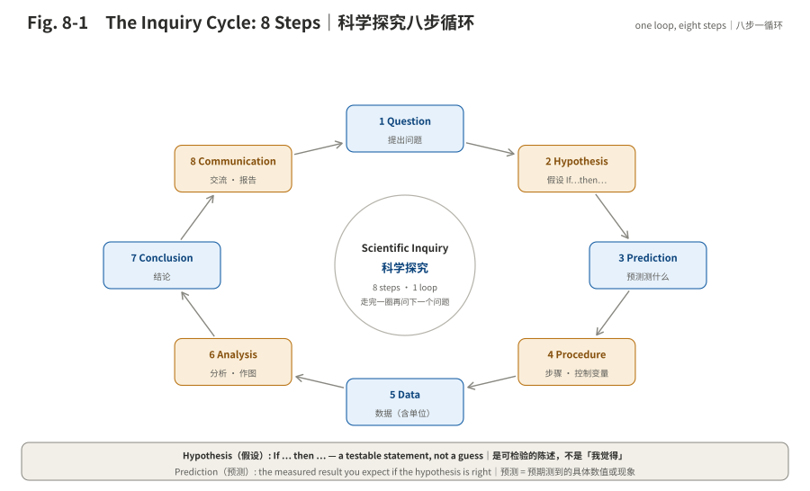
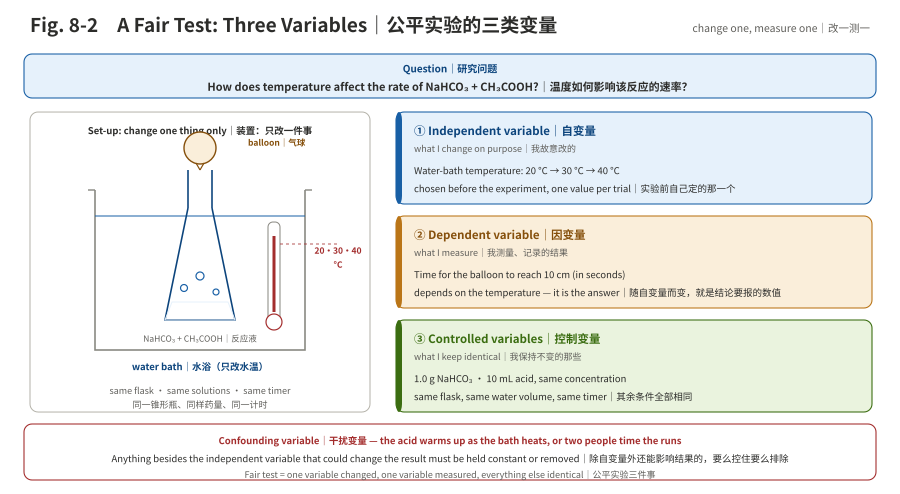
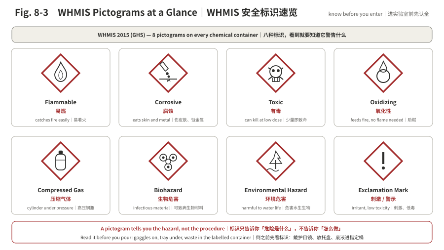

# Ch.8 — Lab Skills, Safety and Scientific Inquiry
## Chapter 8 · Lab Skills, Safety and Scientific Inquiry｜第 8 章　实验技能、安全与科学探究

> 🗂️ **Content Alignment｜大纲对应**：BC Science 10 Curricular Competencies（Planning and conducting / Processing and analyzing / Evaluating）——本章不教新化学知识，教的是"怎么科学地做化学"，贯穿全册每一个实验。
> ⏱️ **Periods｜课时**：2（+ 分散在各章实验中反复使用）
> 🔗 **Source alignment｜素材对齐**：学校对实验报告与观察记录的格式要求（与 G11「LAB SAFETY」「MAKE OBSERVATION」同类）；**pre-lab 未完成不得进实验室**是本课程硬规矩。

---

## 1. Content Alignment｜大纲对应

| Official item（官方条目） | Where it shows up in this unit｜在本单元的位置 | Status｜定位 |
|---|---|---|---|
| [Planning and conducting] 计划与实施 | Fair test, variables, WHMIS, safety rules（§3.2, §3.4, §3.5） | Core 核心 |
| [Processing and analyzing data and information] 处理与分析 | Observation records, data tables, graphing（§3.3, §3.6） | Core 核心 |
| [Evaluating] 评估 | Sources of error, accuracy vs precision, improvements（§3.7） | Core 核心 |
| [Questioning and predicting] 提问与预测 | Inquiry cycle, hypothesis If…then…（§3.1） | Core 核心 |
| [Communicating] 交流 | Lab report format, conclusions from evidence（§3.6, §7） | Core 核心 |

**中文**：本章对应的是官方大纲里的"能力条目"而不是知识条目——**本章贯穿全册所有实验**：Ch.4 密闭称重、Ch.6 温度变化、Ch.7 酸碱指示剂，每个实验都要用到变量设计、安全规范、观察记录和误差评估这四套技能。

---

## 2. Learning Objectives｜学习目标

By the end of this chapter, you should be able to:

1. Walk through the full inquiry cycle: Question → Hypothesis → Prediction → Procedure → Data → Analysis → Conclusion → Communication.
2. Identify the independent, dependent and controlled variables in any experiment, and spot confounding variables.
3. Record observations only (qualitative and quantitative) and keep them separate from inferences.
4. Recognise all 8 WHMIS pictograms and state what hazard each one warns about.
5. Follow the core lab safety rules: goggles, acid into water, wafting, tube-mouth direction, waste sorting.
6. Draw a proper data table (with units) and a proper graph (title, labelled axes, even scale, best-fit line), and use interpolation / extrapolation.
7. Distinguish random from systematic error, and accuracy from precision, then suggest improvements.

**中文**：学完本章，你应当能够——① 走完科学探究八步循环；② 在任何实验里找出三类变量并揪出干扰变量；③ 只记录观察（定性+定量）而不混入推断；④ 认全 8 种 WHMIS 标识；⑤ 遵守核心安全规则；⑥ 规范地列表作图并内插/外推；⑦ 区分误差类型与准确度/精密度并提出改进。

---

## 3. Concept Explanations｜概念解析

### 3.1 The Inquiry Cycle｜科学探究八步循环

**Definition｜定义**：The **inquiry cycle（科学探究循环）** is the standard route every experiment follows — the same eight steps from Ch.4's sealed flask to Ch.7's indicator tests.

1. **Question（提出问题）** — specific and testable: "How does temperature affect the rate of NaHCO₃ + CH₃COOH?"
2. **Hypothesis（假设）** — a testable statement written **If … then …**: "If the water bath is warmer, then the balloon will inflate faster." A hypothesis is not a guess（不是"我觉得"）— it must be testable by data.
3. **Prediction（预测）** — the concrete measured result you expect if the hypothesis holds: "at 40 °C the balloon reaches 10 cm in under 20 s."
4. **Procedure（步骤）** — numbered steps, naming materials, safety, and the variables held constant.
5. **Data（数据）** — recorded in a table with units; no conclusions written here.
6. **Analysis（分析）** — graphs, calculations, patterns.
7. **Conclusion（结论）** — must answer the question **using the data**, and compare with the hypothesis.
8. **Communication（交流）** — the lab report, shared and reviewed.

> 📏 **Rule｜规则**：A conclusion is supported by data, never by hope — if the data do not match the hypothesis, the hypothesis is revised, not the data.
> **中文**：结论由数据支撑，不由愿望支撑——数据与假设不符时，改的是假设，不是数据。删掉"不顺眼"的数据点是编造，比做错实验严重得多。

### 3.2 Variables and the Fair Test｜变量与公平实验

**Definition｜定义**：A **fair test（公平实验）** changes **one** variable, measures **one** variable, and holds everything else **identical**.
**中文**：公平实验三件事——只改一个（自变量）、只测一个（因变量）、其余全部保持相同（控制变量）。

- **Independent variable（自变量）** — what *you* deliberately change; you decide its values before the experiment. 例：water-bath temperature 20 → 30 → 40 °C.
- **Dependent variable（因变量）** — what *you* measure; it changes *because of* the independent variable. 例：time for the balloon to reach 10 cm.
- **Controlled variables（控制变量）** — everything kept identical: same mass of NaHCO₃ (1.0 g), same volume and concentration of acid, same flask, same timer.
- **Confounding variable（干扰变量）** — anything *besides* the independent variable that could also change the result (the acid warms up as the bath heats; a different person times each trial). It must be controlled or removed, or the conclusion is not trustworthy.

> ⚠️ **Misconception｜易错**：Writing "controlled variables: everything stays the same" earns zero — you must **name the specific quantities** and their values.
> **中文**：控制变量不能只写"全部保持不变"，要写出具体是哪几项、各是多少——说不出具体项 = 等于没控制。

### 3.3 Observation vs Inference｜观察与推断

**Definition｜定义**：An **observation（观察）** is information collected directly through the senses or instruments — only what you actually see, hear, smell or measure. An **inference（推断）** is an interpretation or conclusion drawn *from* observations.
**中文**：观察 = 只写"看到的、听到的、闻到的、量到的"；推断 = 由观察猜出来的解释。记录时两者必须分开，观察栏里不许混进推断。

Two more distinctions live in the observation column:

- **Qualitative（定性）** — descriptions without numbers: "colourless gas bubbles form; the liquid turns cloudy."
- **Quantitative（定量）** — measurements with numbers and units: "temperature rises from 21.0 °C to 26.5 °C in 60 s."

| What you wrote｜你写的 | Type｜类型 | Why｜原因 |
|---|---|---|---|
| "colourless bubbles form at the zinc surface" 锌片表面有无色气泡 | observation 观察 | seen directly 直接看到 |
| "the gas is CO₂ because something fizzed" 气体是 CO₂ | inference 推断 | "fizzing" does not identify the gas — needs a test（石灰水变浊才算证据） |
| "volume of gas = 34 mL in 30 s" 30 s 收集 34 mL 气体 | quantitative observation 定量观察 | measured with a number and unit |
| "the reaction released energy" 反应放热 | inference 推断 | heat release is inferred from the thermometer rise（温度上升才是观察） |

> 📏 **Rule｜规则**：Write what you see; write what it means in a separate sentence or column. 观察记录只写现象，解释另起一行。
> **中文**：学校观察记录表通常设「Observations」与「Interpretation」两栏——把"有气泡产生"写进观察栏、"产生了 CO₂"写进推断栏，才能拿满分。

### 3.4 WHMIS Safety Pictograms｜WHMIS 安全标识 8 种

**Definition｜定义**：**WHMIS（Workplace Hazardous Materials Information System，工作场所危险品信息系统）** is Canada's national hazard-label system; since 2015 its pictograms follow the international **GHS（全球统一制度）** standard. Every chemical container in the lab carries one or more of these 8 red-diamond pictograms.

| Pictogram｜标识 | Warns about｜警告内容 | Typical example｜典型例子 |
|---|---|---|---|
| Flammable 易燃 | catches fire easily 容易着火 | ethanol, acetone 乙醇、丙酮 |
| Corrosive 腐蚀 | eats skin and metal 伤皮肤、蚀金属 | H₂SO₄, NaOH 浓硫酸、氢氧化钠 |
| Toxic 有毒 | can kill at low dose 少量即致命 | carbon monoxide, methanol 一氧化碳、甲醇 |
| Oxidizing 氧化性 | feeds fire even without a flame 助燃 | H₂O₂, KMnO₄ 过氧化氢、高锰酸钾 |
| Compressed Gas 压缩气体 | cylinder under pressure 高压钢瓶 | CO₂ cylinder 二氧化碳钢瓶 |
| Biohazard 生物危害 | infectious material 可致病生物材料 | bacterial cultures 细菌培养物 |
| Environmental Hazard 环境危害 | harmful to water life 危害水生生物 | some detergents, mercury salts 某些洗涤剂、汞盐 |
| Exclamation Mark 感叹号 | irritant, lower toxicity 刺激、低毒 | dilute acids, some salts 稀酸、部分盐类 |

> 💡 **Tip｜口诀**：8 个标识分三组记——**火**（flammable / oxidizing）、**伤人**（corrosive / toxic / exclamation）、**别的伤害**（compressed gas / biohazard / environmental）。
> **中文**：看标识就知道"危险是什么"，但标识不告诉你"怎么做"——怎么做由安全规则（§3.5）和老师的规定决定。

### 3.5 Core Lab Safety Rules｜化学实验安全要点

> 📏 **Rule｜规则**：These seven rules appear in every lab in this course. Print them in your head before you print the report.
> **中文**：以下七条是全册实验通用的硬规矩，进实验室前先过一遍。

1. **Goggles on, always（护目镜必戴）** — from the first drop to the last clean-up; prescription glasses are not goggles. 普通眼镜不算护目镜。
2. **Acid into water（酸入水）** — when diluting concentrated acid, add acid slowly *into* water, never water into acid; the heat released can splash concentrated acid back out. 水入浓酸会剧烈放热溅酸，方向绝对不能反。
3. **Never taste chemicals（绝不尝药品）** — even "just a grain"; tasting is never an observation method in this course.
4. **Waft, do not sniff（扇闻）** — hand over the container, fan the air toward your nose; a direct deep sniff of NH₃ will take your breath away.
5. **Point the tube mouth away from people（试管口不对人）** — especially while heating; a bumping liquid shoots out along the tube's axis. 加热时试管口斜向上、朝无人方向。
6. **Sort your waste（废液分类）** — every beaker goes into the labelled waste container; heavy-metal solutions and organics never go down the sink. 废液进指定回收桶，含重金属废液绝不能倒水槽。
7. **Pre-lab first（先交 pre-lab）** — in this course you do not enter the lab until your pre-lab (question, hypothesis, variables, procedure, safety notes) is complete. Pre-lab 未完成不得进实验室。

Also: long hair tied back, no eating or drinking, know the eyewash station, fire extinguisher and emergency exit routes before you start（长头发扎起、不吃不喝、先认清洗眼器/灭火器/应急路线——Activity 8-2 会实地走一遍）.

### 3.6 Recording Data and Drawing Graphs｜数据与图像规范

**Data tables（数据表格）** — three requirements: a **title** that says what is being tested, **column headings with units**（表头带单位）, and raw readings recorded **immediately, in ink, without erasing**（当场用笔记录、不许擦改——写错了划一条线重写）.

**Graphs（图像）** — a mark-worthy graph has four elements:

1. **Title（标题）** — "dependent variable vs independent variable", e.g. "Gas volume vs temperature".
2. **Labelled axes with units（坐标轴标签含单位）** — independent on the x-axis, dependent on the y-axis.
3. **Even scale（均匀刻度）** — each grid square counts the same amount; the axes need not start at zero.
4. **Best-fit line（最佳拟合线）** — a smooth line or curve that passes *through the trend* of the points, not connect-the-dots.

**Definition｜定义**：**Interpolation（内插）** is reading a value *between* measured points on the best-fit line; **extrapolation（外推）** is extending the line *beyond* the measured range to predict a value.
**中文**：内插 = 在测过的范围内沿拟合线读数，比较可靠；外推 = 超出测量范围延伸预测，越远越不可靠。外推必须注明"预测值"。

### 3.7 Error, Accuracy and Precision｜误差、准确度与精密度

**Definition｜定义**：**Random error（随机误差）** scatters unpredictably in both directions (reaction time, reading a scale between marks). **Systematic error（系统误差）** pushes every result the *same* direction (a balance that reads 0.20 g high, a thermometer reading 2 °C low, heat loss in every trial).
**中文**：随机误差忽大忽小、多次重复取平均可以减小；系统误差朝同一个方向偏、取平均没有用，只能改进装置或校准仪器。

Two words that are not synonyms:

- **Accuracy（准确度）** — how close a measurement is to the *true value*（离真值近）.
- **Precision（精密度）** — how *repeatable* the measurements are — close to each other, whatever the true value（彼此接近，未必接近真值）.

| Pattern｜情形 | Accuracy｜准确度 | Precision｜精密度 | Likely cause｜原因 |
|---|---|---|---|---|
| all readings near the true value | high 高 | high 高 | good technique 做得好 |
| readings cluster tightly but off the true value | low 低 | high 高 | systematic error 系统误差（如天平未调零） |
| readings scattered widely | low 低 | low 低 | random error, few trials 随机误差、次数太少 |

> 💡 **Tip｜口诀**：随机靠**重复**（repeat and average），系统靠**改进**（fix the method or instrument）——评估题里写"多测几次"只能修随机误差，修不了天平没调零。

---

## 4. Comparison Tables｜表格比对

### Table 8-1　Observation vs Inference｜观察与推断

| Feature｜特征 | Observation｜观察 | Inference｜推断 |
|---|---|---|---|
| Source 来源 | senses or instruments 直接感知/测量 | interpretation of observations 对观察的解释 |
| Contains numbers? 含数字？ | qualitative or quantitative 定性或定量 | usually an explanation 通常是解释 |
| Can it be wrong? 会错吗？ | recording can be careless, but the fact stands 记录可能马虎 | yes — a new observation can overturn it 会被新观察推翻 |
| Example 例 | "white smoke forms" 出现白烟 | "MgO formed" 生成了 MgO |
| Where recorded 记在哪 | Observations column 观察栏 | Interpretation / Discussion 推断栏 |

### Table 8-2　Random vs Systematic Error｜随机误差与系统误差

| Feature｜特征 | Random error｜随机误差 | Systematic error｜系统误差 |
|---|---|---|---|
| Direction 方向 | both ways, unpredictable 忽大忽小 | always the same way 朝同一方向 |
| Averaging 取平均 | reduces it 可以减小 | no effect 无效 |
| Fix method 修法 | repeat trials 多次重复 | recalibrate / redesign 校准或改装置 |
| Example 例 | timing reaction by hand 手动计时偏早偏晚 | balance reads 0.20 g high 天平偏高 0.20 g |

### Table 8-3　Accuracy vs Precision｜准确度与精密度

| Question｜问题 | Accuracy｜准确度 | Precision｜精密度 |
|---|---|---|---|
| Asks about 问什么 | closeness to the true value 离真值多近 | closeness of repeats to each other 重复值彼此多近 |
| Improved by 提高手段 | removing systematic error 消除系统误差 | more trials, finer instruments 增加次数、用更精密的仪器 |
| Analogy 类比 | dart hits the bullseye 飞镖中靶心 | darts cluster tightly 飞镖扎成一团 |

---

## 5. Diagrams & Worked Examples｜图例说明

### Example 8-1　Hunting Variables in a Scenario｜情景题找变量

**A student places identical flasks of 10 mL vinegar in water baths at 20 °C, 30 °C and 40 °C, adds 1.0 g of NaHCO₃ to each, and records how long the balloon on top takes to inflate to 10 cm.**

| Variable｜变量 | Answer｜答案 |
|---|---|---|
| Independent 自变量 | water-bath temperature 水浴温度 | you chose the three values 你自己定的 |
| Dependent 因变量 | time for the balloon to reach 10 cm 气球鼓到 10 cm 的时间 | what you measured 你测的 |
| Controlled 控制变量 | 1.0 g NaHCO₃ · 10 mL vinegar · identical flasks · same timer | name each one with its value 逐项写出 |
| Confounding 干扰变量 | vinegar already warm when poured; different student timing each bath | control or remove 控住或排除 |

**中文**：情景题三步——找"我改的"（自变量）、找"我测的"（因变量）、把其余条件逐项点名（控制变量）；干扰变量是藏在背景里的第四者，写改进建议时提它最加分。

### Example 8-2　Fixing an Observation Record｜修一份观察记录

**A student writes: "CO₂ was produced because the mixture fizzed a lot." Identify the errors and rewrite the record.**

1. "CO₂ was produced" is an **inference** — fizzing shows gas forms, not which gas. 混入了推断。
2. "a lot" is vague — not qualitative enough, not quantitative. "很多"既不具体也无数字。
3. Correct record: **Observation** — "many colourless bubbles form within 10 s; limewater turns cloudy when the gas is bubbled through it." **Inference** — "the gas is likely CO₂ (limewater test)." With numbers if possible: "about 30 bubbles per second".

**中文**：先拆观察与推断，再把模糊词换成具体现象和数字——"气泡大量产生（约每秒 30 个），气体使澄清石灰水变浊"，推断栏写"很可能是 CO₂（石灰水检验）"。

### Example 8-3　Reading a Graph Properly｜规范读图

**In the NaHCO₃ + CH₃COOH experiment the balloon reaches 10 cm in 55 s at 20 °C and 18 s at 40 °C.**

1. From the best-fit line you read **31 s at 30 °C** — that is **interpolation（内插）**, between two measured points, reasonably trustworthy.
2. Extending the line to predict **6 s at 80 °C** is **extrapolation（外推）** — far outside the measured range; the real value could differ and the prediction must be labelled as such.
3. One trial at 30 °C gave 52 s — far off the line. Treat it as a suspected random error: repeat that trial rather than deleting the point quietly.

**中文**：内插在测量范围内、可信度较高；外推越远越不可靠、必须标注"预测"；离群点应该**重做**而不是悄悄删掉——只报"成功"的数据是学术不端，评估环节会直接扣分。

---

## 6. Key Vocabulary｜核心词汇

| English｜英文 | 中文 | Note｜备注 |
|---|---|---|---|
| fair test | 公平实验 | change one, measure one, hold the rest |
| independent variable | 自变量 | what I change 我改的 |
| dependent variable | 因变量 | what I measure 我测的 |
| controlled variable | 控制变量 | kept identical, must be named 逐项点名 |
| confounding variable | 干扰变量 | hidden extra cause 背景干扰 |
| hypothesis | 假设 | If … then …, testable 可检验 |
| prediction | 预测 | expected measured result 预期测到的结果 |
| observation | 观察 | senses only, no interpretation 只写看到/量到 |
| inference | 推断 | interpretation of observations 解释 |
| qualitative | 定性的 | description without numbers |
| quantitative | 定量的 | number and unit included |
| WHMIS | 工作场所危险品信息系统 | 8 pictograms, GHS since 2015 |
| interpolation | 内插 | read between measured points |
| extrapolation | 外推 | extend beyond measured range |
| best-fit line | 最佳拟合线 | through the trend, not dot-to-dot |
| random error | 随机误差 | reduce by repeating 重复取平均 |
| systematic error | 系统误差 | same-direction bias; fix the method |
| accuracy | 准确度 | close to true value 接近真值 |
| precision | 精密度 | repeats close to each other 彼此接近 |

---

## 7. Lab / Activity｜实验与活动

### Activity 8-1　Mini Inquiry: Temperature and Reaction Rate｜微型探究：温度与反应速率

**[Planning and conducting] · [Processing and analyzing] · [Evaluating]**
Question: How does temperature affect the rate of the NaHCO₃ + CH₃COOH reaction? Working in pairs, plan a fair test with water baths at 20 °C, 30 °C and 40 °C, then run it and write a **complete report** in the school format: question, hypothesis (If…then…), variables (all three types named), materials, numbered procedure, safety notes, observation table with units, graph, analysis, conclusion, error sources and improvements. Finally, self-assess against the rubric in §9.

**中文**：完整微型探究——两人一组设计公平实验（20/30/40 °C 水浴），测气球鼓到 10 cm 的时间；按学校报告格式写全八步探究，并对照 §9 量规自评。安全点：热水小心、酸性废液进指定桶。

### Activity 8-2　WHMIS Match and Emergency Walk｜标识配对与应急演练

**[Communicating]**
Match 12 sample labels to the 8 pictograms, then walk the emergency routes as a class: eyewash station, fire extinguisher, first-aid kit, waste containers and the two nearest exits.

**中文**：12 个真实标签对 8 种标识，再全班实地走一遍应急路线——洗眼器、灭火器、急救箱、废液桶、两个最近出口。路线在脑中，标认在手上。

### Activity 8-3　Data Quality Review｜数据质量评审

**[Evaluating]**
Your teacher gives you two sets of results from "the same experiment": set A has 3 trials at each temperature with one outlier; set B has 1 trial per temperature with suspiciously perfect round numbers. Decide which is more credible and justify it using §3.6–3.7 vocabulary.

**中文**：两份"同一实验"的数据谁更可信？用本章词汇作答：A 有重复次数（随机误差可平均）但有一个离群值（应说明如何处理），B 只有单次且数据"太漂亮"（可疑）。说得清理由才算会评估。

---

## 8. Common Misconceptions｜常见易错点

1. ❌ "The conclusion says the hypothesis was right." → ✅ A conclusion must cite the data: "the balloon inflated faster at higher temperature (55 s → 18 s), so …" 结论要引数据，不能只说"假设正确"。
   **中文**：把结论写成"猜的"而非"数据支持的"是最常见扣分点。
2. ❌ "Controlled variables: everything stays the same." → ✅ Name each one with its value: 1.0 g NaHCO₃, 10 mL acid, same flask, same timer. 控制变量要逐项点名。
   **中文**：说不出具体是哪几个 = 没有控制。
3. ❌ Writing "it produced CO₂" in the observation column. → ✅ Observations: bubbles form; limewater turns cloudy. Inference: gas is likely CO₂. 观察栏混入推断。
   **中文**：观察只写现象，检验结果（石灰水变浊）是观察，"是 CO₂"是推断。
4. ❌ "Accuracy and precision mean the same thing." → ✅ Accuracy = close to the true value; precision = repeats close to each other. A tight cluster of wrong answers is precise but not accurate.
   **中文**：准确度看真值，精密度看重复；两者可以独立存在。
5. ❌ "Repeat trials fix all error." → ✅ Averaging reduces *random* error only; systematic error needs recalibration or a redesigned method.
   **中文**：多测几次修不了"天平没调零"这种同向偏差。
6. ❌ Deleting the data point that spoils the trend. → ✅ Report all data, mark the outlier, and repeat the trial to check it.
   **中文**：只报"成功"数据是编造，比实验做错严重得多。
7. ❌ "The exclamation mark pictogram means the chemical is deadly." → ✅ Exclamation mark = irritant / lower toxicity; the skull means toxic. 感叹号≠剧毒。
   **中文**：剧毒认骷髅，刺激性才用感叹号。
8. ❌ "Wearing prescription glasses counts as eye protection." → ✅ Only goggles seal around the eyes; glasses are not goggles.
   **中文**：普通眼镜不是护目镜，间隙照样进液滴。
9. ❌ "Water into acid cools it down faster, so it is safer." → ✅ Always acid into water — water into concentrated acid boils and spatters.
   **中文**：稀释浓硫酸必须酸入水，方向反了会爆沸溅酸。
10. ❌ "A graph just needs the points joined dot-to-dot." → ✅ Four elements: title, labelled axes with units, even scale, best-fit line through the trend.
    **中文**：作图四要素缺一不可，连线不是"描点连线"而是拟合趋势。

---

## 9. Assessment｜答题评估

**Part A — Knowledge｜基础（10 × 2 = 20 分）**

**A1.** List the eight steps of the inquiry cycle in order.
- **中文**：按顺序写出科学探究八步。

**A2.** Rewrite as a proper hypothesis: "I think the reaction will be faster when it is warmer."
- **中文**：把这句改写成规范的 If…then… 假设。

**A3.** In one experiment, the water-bath temperature is set at 20, 30 and 40 °C, and the time for a balloon to inflate to 10 cm is measured. Name the independent and dependent variables.
- **中文**：指出该实验的自变量与因变量。

**A4.** Classify as observation or inference: (a) "the liquid turns cloudy"; (b) "a precipitate of PbI₂ formed"; (c) "24.5 mL of gas collected in 30 s".
- **中文**：判断观察还是推断：(a) 液体变浑浊；(b) 生成了 PbI₂ 沉淀；(c) 30 s 收集到 24.5 mL 气体。

**A5.** Give one qualitative and one quantitative observation for the word "bubbles appear".
- **中文**：针对"出现气泡"各写一条定性观察和一条定量观察。

**A6.** Name the WHMIS pictogram you would expect on: (a) concentrated H₂SO₄; (b) a CO₂ cylinder; (c) dilute vinegar.
- **中文**：写出三种物质应带的 WHMIS 标识名。

**A7.** State the correct direction for diluting concentrated acid, and why.
- **中文**：写出稀释浓酸的正确方向及原因。

**A8.** A thermometer consistently reads 2 °C lower than the true temperature. Is this random or systematic error? What should be done?
- **中文**：温度计恒定偏低 2 °C，属于哪类误差？如何处理？

**A9.** A balance gives readings of 12.31 g, 12.33 g and 12.32 g for the same object whose true mass is 12.95 g. Comment on the accuracy and precision.
- **中文**：三次读数 12.31/12.33/12.32 g，真实值 12.95 g——评价准确度与精密度。

**A10.** Give the four required elements of a proper graph.
- **中文**：写出规范作图的四要素。

**Part B — Application｜应用（4 × 5 = 20 分）**

**B1.** Scenario: a student tests "Does stirring speed up dissolving?" by stirring one beaker of sugar water and letting another stand — but the stirred beaker holds 50 mL of hot water and the standing one 50 mL of cold water. Identify the independent variable, the confounding variables, and rewrite the plan as a fair test.
- **中文**：情景题——"搅拌是否加快溶解"的实验里两个烧杯一热一冷。指出自变量、干扰变量，并把方案改写成公平实验。

**B2.** A student's observation record reads: "The powder dissolved quickly, so the solution is saturated at higher temperature." Identify the two problems and rewrite the record with one qualitative and one quantitative observation.
- **中文**：指出这份记录的两个问题，并用一条定性观察和一条定量观察重写。

**B3.** In the temperature-rate experiment, trials at 20/30/40 °C give 55 s / 31 s / 18 s. (a) Which reading method is used if you report 24 s for 35 °C? (b) A classmate predicts 5 s at 90 °C. Name the method and judge how much you should trust each value.
- **中文**：(a) 报 35 °C 为 24 s 用的是什么方法？(b) 同学预测 90 °C 为 5 s——说出方法名并评价可信度。

**B4.** A student reports only the trials that matched the hypothesis and quietly discards the rest. Explain, in terms of data quality and error, why this is unacceptable, and state what should be done with an outlying trial.
- **中文**：学生只报告符合假设的数据、悄悄丢弃其余。从数据质量与误差角度说明为何不可接受，并说明离群数据的正确处理方式。

**Part C — Challenge｜挑战（2 × 10 = 20 分）**

**C1.** Full design task: plan a fair-test experiment to answer "How does the concentration of vinegar affect the time for a balloon to inflate to 10 cm?" Your design must name: the question, the hypothesis (If…then…), all three variable types (each controlled variable with its value), the materials, a numbered procedure with two safety rules, the data-table headings with units, and at least two sources of error with an improvement for each.
- **中文**：完整微型实验设计题——"醋的浓度如何影响气球鼓到 10 cm 的时间"。设计必须包含：问题、If…then… 假设、三类变量（控制变量逐项写数值）、器材、带两条安全规则的编号步骤、带单位的数据表表头、至少两个误差来源及对应改进。

**C2.** Evaluate this conclusion: "The balloon inflated faster at 40 °C than at 20 °C. Also, one trial at 30 °C gave an impossible number, so we deleted it. Temperature makes this reaction faster, and the same would happen at 100 °C." Identify three flaws in the reasoning and fix each one.
- **中文**：评估这段结论——找出三处理由漏洞并逐一修正（提示：结论要不要引数据、离群值怎么处理、外推能不能这样写）。

### Answers｜参考答案

**Part A**

- **A1.** Question → Hypothesis → Prediction → Procedure → Data → Analysis → Conclusion → Communication.
  **中文**：提出问题 → 假设 → 预测 → 步骤 → 数据 → 分析 → 结论 → 交流。
- **A2.** "If the temperature of the water bath is higher, then the NaHCO₃ + CH₃COOH reaction will be faster (balloon inflates in less time)."
  **中文**：假设必须写成可检验的"如果…那么…"——"如果水浴温度更高，那么反应更快（气球鼓起用时更短）"。
- **A3.** Independent: water-bath temperature; dependent: time for the balloon to reach 10 cm.
  **中文**：自变量——水浴温度；因变量——气球鼓到 10 cm 所需时间。
- **A4.** (a) observation；(b) inference（an interpretation of the cloudiness）；(c) quantitative observation.
  **中文**：(a) 观察；(b) 推断（对浑浊的解释）；(c) 定量观察。
- **A5.** Qualitative: "many colourless bubbles form on the powder." Quantitative: "about 30 bubbles per second" or "20 mL of gas in 60 s".
  **中文**：定性——粉末表面迅速产生大量无色气泡；定量——每秒约 30 个气泡 / 60 s 收集 20 mL 气体。
- **A6.** (a) corrosive 腐蚀；(b) compressed gas 压缩气体；(c) none of the 8 / exclamation mark at most（vinegar is a mild irritant）.
  **中文**：(a) 腐蚀；(b) 压缩气体；(c) 8 种里没有对口标识，最多算刺激性（感叹号）——日常醋不属于受管制的危险品。
- **A7.** Acid into water, slowly — the large heat released is absorbed by the bulk of the water; water into acid boils at the contact point and spatters acid.
  **中文**：酸入水、缓慢加——放出的热被大量的水吸收；水入酸时接触点局部过热爆沸溅酸。
- **A8.** Systematic — every reading is biased the same direction; recalibrate or correct the thermometer (or note the constant offset).
  **中文**：系统误差——恒定同向偏低；应校准温度计或记录恒定差值进行修正，重复取平均无效。
- **A9.** High precision (repeats within 0.02 g) but low accuracy (about 0.63 g above the true value) — a systematic error such as an unzeroed balance.
  **中文**：精密度高（三次相差不超过 0.02 g），准确度低（系统性偏高约 0.63 g）——疑似天平未调零。
- **A10.** Title; labelled axes with units; even scale; best-fit line.
  **中文**：标题、坐标轴标签含单位、均匀刻度、最佳拟合线。

**Part B**

- **B1.** Independent: stirring (stirred vs not stirred). Confounding: water temperature (hot vs cold) — it also changes dissolving rate. Fair test: two beakers both with 50 mL of water at the same temperature, same mass of sugar; one stirred, one not.
  **中文**：自变量——搅拌与否；干扰变量——水温（一热一冷）。公平实验：两杯同温同体积的水、等量糖，只差"搅不搅"。
- **B2.** Problems: "quickly" is vague (not a proper qualitative description), and "so the solution is saturated at higher temperature" is an inference mixed into observations. Rewrite — qualitative: "the powder disappeared within about 10 s with stirring"; quantitative: "dissolution took 10 s at 40 °C vs 45 s at 20 °C"（inference goes in its own column）.
  **中文**：问题一——"很快"含糊；问题二——"温度高时饱和"是推断混入观察。重写：定性——"搅拌下粉末约 10 s 内消失"；定量——"40 °C 时 10 s 溶完，20 °C 时 45 s"，推断另起一行。
- **B3.** (a) Interpolation — reading between measured points on the best-fit line, reasonably trustworthy. (b) Extrapolation — 90 °C is far beyond the measured range; the 5 s prediction is an estimate only and must be labelled as a prediction.
  **中文**：(a) 内插——在测量范围内沿拟合线读数，较可信；(b) 外推——90 °C 远超测量范围，5 s 只能算预测值，须注明。
- **B4.** Selecting data biases the conclusion exactly like a systematic error of unknown size; all trials belong in the table. An outlier is marked and the trial is repeated to check it — kept with a note if reproducible, explained if not. Deleting it silently is data falsification.
  **中文**：挑选数据等于引入未知大小的"系统偏差"；全部数据都要进表格，离群值标注并重做验证——可复现则保留说明，不可复现则写明原因；悄悄删掉属于数据造假。

**Part C**

- **C1.** Model answer (key checkpoints): Question and If…then… hypothesis stated; independent = vinegar concentration (e.g. 5%, 10%, 20%); dependent = time to 10 cm; controlled variables named with values — 1.0 g NaHCO₃, 25 mL vinegar, same flask and balloon, same timer; procedure numbered with goggles and acid-waste rules; table headings "Concentration (%) | Time (s)"; errors — timing by hand (random, repeat 3 trials and average) and gas leaking past the balloon seal (systematic, check the seal each trial).
  **中文**：评分看六个要件——问题与假设齐全；自变量为醋的浓度（5%/10%/20% 三档）；因变量为鼓到 10 cm 的时间；控制变量逐项带数值（1.0 g NaHCO₃、25 mL 醋、同一锥形瓶与气球、同一计时）；步骤编号且含护目镜与酸性废液两条安全规则；表头带单位；误差——手动计时（随机，重复 3 次取平均）、气球密封漏气（系统，每次检查密封）。
- **C2.** Flaw 1: the conclusion omits the data — fix: "faster at 40 °C than 20 °C (18 s vs 55 s)". Flaw 2: deleting the 30 °C outlier — fix: mark it, repeat the trial, keep and note it if reproducible. Flaw 3: extrapolating to 100 °C as if certain — fix: state it as a prediction beyond the measured range, or measure near 100 °C under safe conditions instead.
  **中文**：漏洞一——结论没引数据（补"18 s vs 55 s"）；漏洞二——删离群值（应标注、重做、说明保留与否）；漏洞三——把 100 °C 当必然（只能作为外推预测，或在安全条件下实测）。

### Rubric｜评分量规

| Level｜水平 | Standard｜标准 |
|---|---|---|
| Exemplary 满分档 | Variables all named with values; observations fully separated from inferences; conclusion cites data; errors classified correctly with fixes | 变量逐项带值；观察推断完全分开；结论引数据；误差分类正确且给出对策 |
| Proficient 良好档 | Variable types correct; minor slips (one controlled variable unnamed, one inference left in the observation column) | 变量类型判断正确，偶有漏项或混栏 |
| Developing 合格档 | Knows the inquiry cycle; confounding variables and error types unreliable | 八步循环会背，干扰变量与误差类型还不稳 |
| Beginning 待提高档 | Conclusions from opinion; accuracy and precision confused — 回炉 §3.1 与 §3.7 | 结论靠感觉、准确度精密度混用——回炉 §3.1 与 §3.7 |

### C1 Design-Task Marking Guide｜C1 设计题评分细则

| Component｜要件 | Marks｜分 |
|---|---|---|
| Question + If…then… hypothesis 问题与假设 | 2 |
| Three variable types, controlled ones with values 三类变量（控制变量带值） | 3 |
| Numbered procedure with 2 safety rules 步骤含 2 条安全规则 | 2 |
| Table headings with units 表头带单位 | 1 |
| 2 error sources with improvements 误差与改进各 2 条 | 2 |

---

## 10. Connection to the Big Idea｜回扣核心概念

> 🎯 **Big Idea**: *Energy change is required as atoms rearrange in chemical processes.*

Atoms rearranging and energy changing are *claims* — and claims need reliable measurements. This chapter supplies the machinery that makes those measurements trustworthy: a fair test isolates the one variable whose change reveals the rearrangement, WHMIS and safety rules keep the experimenter safe while the reaction runs, and clean data plus honest error analysis turn "something happened" into "the temperature rose 5.5 °C, so this rearrangement releases energy". **中文**：原子重排与能量变化是需要被"测出来"的论断——公平实验负责把干扰变量挡在门外，安全规范负责让人平安地做完实验，规范的数据与诚实的误差分析负责把"好像变了"变成"升高了 5.5 °C，所以这个重排放出能量"。好的实验设计，正是为了可靠地测出化学过程中的物质与能量变化。

**中文**：从 Ch.9 起，你将用本章的探究工具去评价真实世界的化学过程（收益与风险），而全册每个实验报告的评分，用的都是本章 §9 的量规——这套技能从这一章开始一直用到 G11。
