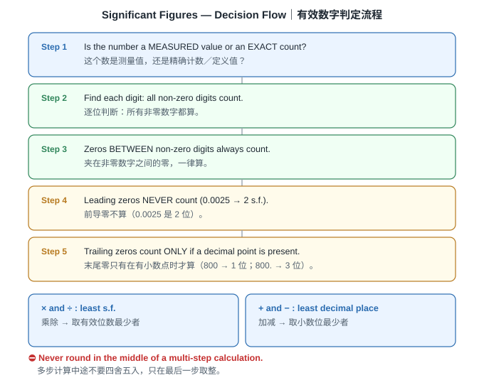
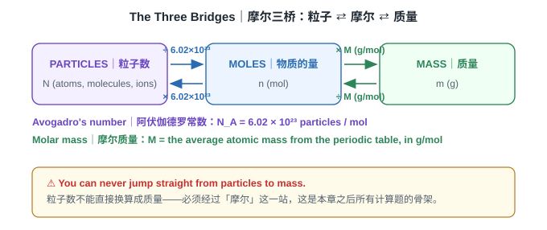
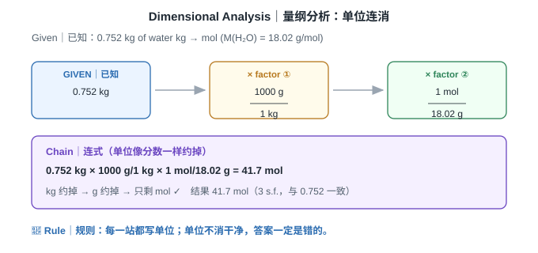
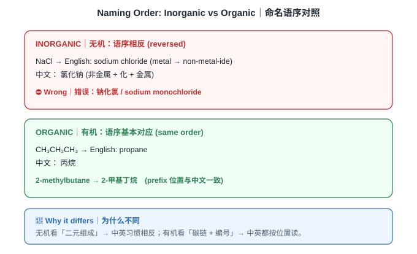

# Ch.1 — From Science 10 to Chemistry 11: Review and Quantitative Tools
## Chapter 1 · From Science 10 to Chemistry 11｜第 1 章　从 Science 10 到 Chemistry 11：复习与量化工具

> 🗂️ **Content Alignment｜大纲对应**：C8 "dimensional analysis" (introduced here, completed in Ch.8) · Planning and conducting — "apply the concepts of accuracy and precision … significant figures, uncertainty, scientific notation"｜C8「量纲分析」（本章引入，Ch.8 完成）· 计划与实施——「运用准确度与精密度概念……有效数字、不确定度、科学记数法」
> ⏱️ **Periods｜课时**：4　|　**Prerequisite｜前置**：Science 9/10 chemistry 化学部分　|　**Followed by｜后继**：Ch.2
> 🗂️ **Generated｜文件生成时间**：2026-09-29

## 1. Content Alignment｜大纲对应

| Item｜项目 | Content｜内容 |
|---|---|
| Position in the course｜课程定位 | **Bridging chapter｜衔接章**：Chemistry 11 is a full, independent course that assumes your Science 10 chemistry skills are already automatic. This chapter rebuilds them and adds the measurement discipline the rest of the book depends on.｜衔接章：Chemistry 11 是整门独立课程，默认你的 Science 10 化学技能已经"自动化"。本章把它们重装一遍，并补上全册都依赖的测量规范。 |
| Content served｜服务的 Content | **C8 dimensional analysis** (introduced)｜**C8 量纲分析**（引入）；prerequisite for C7 the mole, C10 stoichiometric calculations, C14 solution stoichiometry｜为 C7 摩尔、C10 化学计量计算、C14 溶液化学计量打地基 |
| Prerequisite content reviewed｜复习的先修内容 | Science 9/10: elements & the periodic table · ion charge from group position · diatomic molecules · ionic & covalent naming · formulas · the six reaction types · balancing · conservation of mass｜Science 9/10：元素与周期表 · 由族位置定离子电荷 · 双原子分子 · 离子与共价命名 · 化学式 · 六类反应 · 配平 · 质量守恒 |
| Curricular Competencies | [Planning and conducting] Apply accuracy and precision: **significant figures, uncertainty, scientific notation** ｜ [Processing and analyzing] Perform calculations and describe relationships between variables ｜ [Communicating] Use appropriate scientific conventions and representations｜[计划与实施] 运用准确度与精密度：**有效数字、不确定度、科学记数法** ｜ [处理与分析] 进行计算、描述变量关系 ｜ [交流] 使用恰当的科学规范与表示法 |
| Beyond scope?｜是否超纲 | **No.** Every Science 10 item reviewed here stays qualitative; all mole-level calculations are deferred to Ch.8. Chemistry 12 content is not touched.｜**不超纲。** 本章复习的 Science 10 内容全部停留在定性层面；一切摩尔层级的计算推到 Ch.8。不涉及 Chemistry 12 内容。 |

**中文**：本章有两个任务，缺一不可。第一，把 Science 10 的化学技能复习到"不假思索"的程度——因为 Chemistry 11 从第一单元开始就直接用它们。第二，装上 Chemistry 11 才真正要求的一套**测量规范**：有效数字、不确定度、科学记数法与量纲分析。这套规范是官方 Curricular Competency 里明文列入"计划与实施"的能力项，全册每一道计算题、每一份实验报告都会用到。

> ⛔ **Scope note｜范围提示**：This course does not include a lab-safety chapter; safety rules are delivered in class and enforced in the lab. This chapter covers only content review and measurement tools.
> **中文**：本课程不设实验安全章节；安全规则以课堂宣讲与实验课现场要求为准。本章只处理"知识复习 + 测量工具"。

## 2. Learning Objectives｜学习目标

**EN — By the end of this chapter, you should be able to:**

1. Read an element's ion charge directly from its group position, and identify multivalent transition metals.
   - **中文**：由元素所在的族位置直接读出离子电荷，并识别多变价过渡金属。
2. Write and name ionic and covalent compounds, including multivalent metals, polyatomic ions and Greek prefixes.
   - **中文**：书写并命名离子化合物与共价化合物，涵盖多变价金属、多原子离子与希腊数字前缀。
3. Write and balance chemical equations, classify them into the six reaction types, and apply the conservation of mass.
   - **中文**：书写并配平化学方程式，归入六类反应，并运用质量守恒。
4. Count significant figures correctly and express any measured quantity in scientific notation.
   - **中文**：正确数出有效数字，并把任何测量量写成科学记数法形式。
5. Solve unit-conversion problems by dimensional analysis, keeping units and significant figures under control throughout.
   - **中文**：用量纲分析求解单位换算问题，全程控制单位与有效数字。

**中文**：目标 1–3 是 Science 10 的"复习线"，目标是让你在 Ch.2 有机命名、Ch.9 反应、Ch.10 计量中不再回头补基础。目标 4–5 是 Chemistry 11 的"新增线"，也是本章真正的新知识——它们会在 Ch.8 摩尔计算中第一次接受全面检验。

## 3. Concept Explanations｜概念解析

### 3.1 Significant Figures｜有效数字

**Definition｜定义**：A **significant figure (s.f.)** is a digit in a measured value that carries real information about how precisely that value was measured.

**中文**：**有效数字**是测量值中真正携带"精度信息"的数字位。它回答的不是"这个数有多准"，而是"这个数精确到哪一位是有意义的"。

The number of significant figures is set by the instrument you used, not by how many digits you feel like writing. A balance that reads to 0.01 g cannot give you a mass with five significant figures, no matter how long you stare at it.

**中文**：有效数字的位数由**你使用的仪器**决定，而不是由你想写多少位决定。只能读到 0.01 g 的天平，不可能给出五位有效数字的质量——盯着看再久也不会变多。

**The five counting rules｜五条计数规则**（see **Fig. 1-1**）:

| # | Rule｜规则 | Example｜例子 | s.f. |
|---|---|---|---|
| 1 | All non-zero digits count. 所有非零数字都算。 | 4. **7 2** | 3 |
| 2 | Zeros **between** non-zero digits count. 夹在非零数字之间的零算。 | 5. **0** 8 | 3 |
| 3 | **Leading** zeros never count. 前导零不算。 | 0.002**5** | 1 |
| 4 | **Trailing** zeros count only if a decimal point is present. 末尾零只在有小数点时算。 | 800 vs **800.** | 1 vs 3 |
| 5 | In scientific notation, all digits in the coefficient count. 科学记数法中，系数里的数字全算。 | **6.02** × 10²³ | 3 |

> 📏 **Rule｜规则**：Exact counts and defined conversions have **infinite** significant figures and never limit your answer. For example, "3 test tubes" and "1000 mL = 1 L" are exact.
> **中文**：精确计数与定义式换算有**无穷多**有效数字，永远不限制答案位数。例如"3 支试管"、"1000 mL = 1 L" 都是精确值。

**Arithmetic rules｜运算规则**：

- **Multiplication and division｜乘除**：the answer keeps the **fewest** significant figures among the inputs.
  - **中文**：结果的有效位数取**最少**的那个输入值的位数。
- **Addition and subtraction｜加减**：the answer keeps the **fewest decimal places** among the inputs.
  - **中文**：结果保留到**小数位最少**的那个输入值所在的位。
- **Multi-step calculations｜多步计算**：carry extra digits through the middle steps, and round **only once**, at the end.
  - **中文**：中途多留位数，**只在最后一步**四舍五入一次。中途反复取整是错误答案的第一大来源。

> ✏️ **Example 1-1｜例题 1-1**：A sample has a mass of 12.34 g and a volume of 5.2 mL. Find its density.
> **中文**：某样品质量 12.34 g、体积 5.2 mL，求密度。
> **Solution**：density = 12.34 g ÷ 5.2 mL = 2.37307… → **2.4 g/mL** (2 s.f., limited by 5.2).
> **解**：12.34 ÷ 5.2 = 2.37307… → **2.4 g/mL**（受 5.2 限制，取 2 位有效数字）。

> ⚠️ **Misconception｜易错**：More digits ≠ more accurate. Writing 2.37307 g/mL does not make the measurement better; it only claims a precision the 5.2 mL volume never had.｜多写位数 ≠ 更准确。写成 2.37307 g/mL 不会让测量变好，只是**虚报**了 5.2 mL 那个体积根本不具备的精度。

### 3.2 Scientific Notation｜科学记数法

**Definition｜定义**：**Scientific notation** writes a value as a coefficient between 1 and 10 multiplied by a power of ten: **a × 10ⁿ**, where 1 ≤ a < 10.

**中文**：**科学记数法**把数值写成"1 到 10 之间的系数 × 10 的整数次幂"，即 **a × 10ⁿ**，其中 1 ≤ a < 10。

Scientific notation solves two problems at once: it handles very large and very small numbers compactly, and it removes the ambiguity about trailing zeros.

**中文**：科学记数法一次解决两个问题：既能简洁地表达极大／极小的数，又能消除"末尾零算不算"的歧义。

| Value｜数值 | Scientific notation｜科学记数法 | s.f. | Note｜说明 |
|---|---|---|---|
| 0.000 000 000 000 008 31 | 8.31 × 10⁻¹⁵ m | 3 | proton radius scale｜质子半径量级 |
| 6 022 000 000 000 000 000 000 00 | 6.02 × 10²³ | 3 | Avogadro's number｜阿伏伽德罗常数（Ch.8） |
| 800 000 | 8 × 10⁵ | 1 | ambiguous trailing zeros resolved｜末尾零歧义被解除 |
| 800 000（assume 3 s.f.） | 8.00 × 10⁵ | 3 | same value, different precision｜同一个数，不同精度 |

> 💡 **Tip｜口诀**：*Big number → positive power; small number → negative power. Count the hops of the decimal point.*
> **中文**：大数用正指数、小数用负指数；指数就是小数点要"跳"过多少位。

### 3.3 Dimensional Analysis｜量纲分析

**Definition｜定义**：**Dimensional analysis** (the factor-label method) is a problem-solving technique in which every quantity is written with its unit, and units are multiplied and cancelled exactly like fractions until only the wanted unit remains.

**中文**：**量纲分析**（因子-标签法）是一种解题技术：每个量都**带上单位**书写，单位像分数一样参与乘除与约分，一直约到只剩你要求的那个单位为止。

The core move is the **conversion factor** — a fraction that equals 1 because its numerator and denominator are the same quantity expressed in different units.

**中文**：核心操作是**转换因子**——一个等于 1 的分数，因为它的分子与分母是"同一个量的两种单位表达"。

```
        1000 g           1 mol
       --------   ,     ---------       ← both fractions equal 1｜两个分数都等于 1
          1 kg          18.02 g
```

Because the factor equals 1, multiplying by it changes the **unit** without changing the **value**. That is the entire trick.

**中文**：因为因子等于 1，乘上它只改变**单位**、不改变**数值**——这就是全部诀窍。

Here is a complete chain (**Fig. 1-3**), converting 0.752 kg of water to moles:

**中文**：下面是一条完整链条（**图 1-3**），把 0.752 kg 水换算成摩尔：

```
0.752 kg  ×  1000 g/1 kg  ×  1 mol/18.02 g  =  41.7 mol
              ↑ kg cancels    ↑ g cancels      ← only mol remains｜只剩 mol
```

> 📏 **Rule｜规则**：If the units do not cancel cleanly down to the unit you asked for, your set-up is wrong — **do not fix it by adjusting the number. Fix the fraction.**
> **中文**：单位没能干净地约到目标单位，说明式子搭错了——**不要靠改数字补救，要改分数**。

**Why this matters｜为什么重要**：Dimensional analysis is Content item **C8**, and it is the skeleton of every quantitative problem in the rest of the course — moles (Ch.8), stoichiometry (Ch.10), solution chemistry (Ch.13). Learn it as a *procedure*, not as a set of memorised formulas.

**中文**：量纲分析是官方 Content **C8**，也是全课程所有定量题的骨架——摩尔（Ch.8）、化学计量（Ch.10）、溶液化学（Ch.13）全都建立在它上面。请把它当**操作流程**来学，而不是当一堆公式来背。

> ⚠️ **Misconception｜易错**：Students often memorise "divide by molar mass to get moles" and then apply it to a unit-conversion problem where it is meaningless. If you always write the unit, the units will tell you whether to multiply or divide.｜很多同学背"除以摩尔质量得摩尔数"，然后拿去套一个根本不适用它的单位换算题。只要你永远写单位，单位自己会告诉你该乘还是该除。

### 3.4 Accuracy, Precision and Uncertainty｜准确度、精密度与不确定度

These three words are not interchangeable, and the BC curriculum asks you to apply them explicitly.

**中文**：这三个词不能混用，BC 大綱明确要求你能分辨并运用它们。

| Term｜术语 | English definition｜英文定义 | 中文 |
|---|---|---|
| **Accuracy** | How close a measurement is to the **true value**.｜测量值接近**真值**的程度。 | 准确度：离真值有多近 |
| **Precision** | How close repeated measurements are **to each other**.｜多次测量彼此**接近**的程度。 | 精密度：重复测量之间有多聚拢 |
| **Uncertainty** | The **range** within which the true value is believed to lie, given the instrument's limits.｜在仪器精度限制下，真值**可能落入的区间**。 | 不确定度：真值可能落在的区间范围 |

> 🔍 **Self-check｜自检**：A digital balance reads 25.03 g, 25.03 g, 25.02 g — precise (tight cluster) but possibly inaccurate (if the balance is uncalibrated). A thermometer reads 24.8, 26.1, 23.5 °C around a true 24.8 °C — accurate on average but imprecise.
> **中文**：电子天平读 25.03、25.03、25.02 g——**精密**（聚得紧），但若未校准就可能**不准**。温度计围绕真值 24.8 °C 读出 24.8、26.1、23.5——平均**准确**，但**不精密**。

**Reading uncertainty from an instrument｜从仪器读不确定度**：write the measurement to one estimated digit past the smallest marked division, and record ± half of the smallest division as a simple uncertainty.

**中文**：读数写到"最小刻度之下再估读一位"，并可用"最小刻度的一半"作为简化的不确定度记录方式。例如最小刻度 0.1 mL 的量筒，读数 25.05 mL，可记为 25.05 ± 0.05 mL。

> 🔭 **Extension｜超纲**【Extension → Chemistry 12】：Propagation of uncertainty through calculations (percentage and absolute error combination) is treated formally in later courses. Here you only need to **record** uncertainty and **describe** its likely sources qualitatively.
> **中文**：【超纲延伸 → Chemistry 12】不确定度在计算中的传播（百分比误差与绝对误差的合成）后续课程正式处理。本阶段只需**记录**不确定度并**定性描述**其可能来源。

### 3.5 Review: Ion Charge from Periodic Table Position｜复习：由周期表位置定离子电荷

Main-group elements form ions with **predictable** charges, because charge is decided by how many electrons must be gained or lost to reach a full outer shell.

**中文**：主族元素形成的离子电荷是**可预测**的，因为电荷由"要达到满壳层需要得或失几个电子"决定。

| Group｜族 | Typical elements｜典型元素 | Ion charge｜离子电荷 | 中文说明 |
|---|---|---|---|
| 1 | Li, Na, K | +1 | 碱金属，失 1 个电子 |
| 2 | Mg, Ca, Ba | +2 | 碱土金属，失 2 个电子 |
| **3–12** | Fe, Cu, Zn, Pb… | **multivalent｜多变价** | 过渡金属，需罗马数字锁定 |
| 13 | Al | +3 | 失 3 个电子 |
| 14 | C, Si | usually no ion｜通常不成离子 | 以共价为主 |
| 15 | N, P | −3 | 得 3 个电子 |
| 16 | O, S | −2 | 得 2 个电子 |
| 17 | F, Cl, Br, I | −1 | 卤素，得 1 个电子 |
| 18 | He, Ne, Ar | 0 | 稀有气体，满壳层 |

> 💡 **Tip｜口诀**：*Charge = group number for metals on the left, and group number − 8 for non-metals on the right.*
> **中文**：左侧金属的电荷 = 族号；右侧非金属的电荷 = 族号 − 8。这条口诀能覆盖第 1、2、13–17 全部主族。

### 3.6 Review: Naming and Formulas｜复习：命名与化学式

**Ionic compounds｜离子化合物** = metal + non-metal (or polyatomic ion). Name the metal first, then the non-metal with an **-ide** ending; use a **Roman numeral** if the metal is multivalent.

**中文**：**离子化合物** = 金属 + 非金属（或多原子离子）。命名时先写金属名，再把非金属词尾改成 **-ide**；金属多变价时必须加**罗马数字**。

**Covalent compounds｜共价化合物** = non-metal + non-metal. Use Greek prefixes, and change the second element to **-ide**.

**中文**：**共价化合物** = 非金属 + 非金属。用希腊数字前缀，第二个元素词尾改 **-ide**。

| Prefix｜前缀 | mono- | di- | tri- | tetra- | penta- | hexa- | hepta- | octa- | nona- | deca- |
|---|---|---|---|---|---|---|---|---|---|---|
| 个数 | 1 | 2 | 3 | 4 | 5 | 6 | 7 | 8 | 9 | 10 |

> 📏 **Rule｜规则**：Never use **mono-** on the first element (CO = carbon monoxide, **not** monocarbon monoxide). Never use Greek prefixes on ionic compounds (NaCl = sodium chloride, **not** sodium monochloride).
> **中文**：第一个元素永不加 **mono-**（CO = carbon monoxide，不是 monocarbon monoxide）；离子化合物永不用希腊前缀（NaCl = sodium chloride，不是 sodium monochloride）。

**The naming-order trap｜语序陷阱**（see **Fig. 1-4**）：English and Chinese order **inorganic** names in **opposite** directions — English reads metal first, Chinese reads non-metal first. This is *not* true of organic names, which you will meet in Ch.2.

**中文**：**无机**命名的中英语序**相反**——英文从金属读起，中文从非金属读起。但这条规则**不适用于有机命名**（Ch.2 起），有机命名中英语序基本对应。

| Formula｜化学式 | English｜英文 | Chinese｜中文 | Common error｜常见错误 |
|---|---|---|---|---|
| NaCl | sodium chloride | 氯化钠 | ✗ sodium monochloride / 钠化氯 |
| Al₂S₃ | aluminium sulfide | 硫化铝 | ✗ aluminium trisulfide（离子化合物不用前缀） |
| CuCl₂ | copper(II) chloride | 氯化铜 | ✗ copper chloride（多变价漏罗马数字） |
| N₂O₅ | dinitrogen pentoxide | 五氧化二氮 | ✗ dinitrogen pentaoxide（a + o 省 a） |

> 🔗 **Cross-ref｜参见**：Full polyatomic-ion table and criss-cross method → Appendix B and C.
> **中文**：完整多原子离子表与交叉法 → 附录 B、C。

### 3.7 Review: Reactions, Balancing and Conservations｜复习：反应、配平与守恒

**The six reaction types｜六类反应**（you will upgrade these quantitatively in Ch.9）：

**中文**：六类反应（Ch.9 会做定量升级）：

| # | Type｜类型 | General form｜一般式 | 中文要点 |
|---|---|---|---|
| 1 | synthesis｜合成 | A + B → AB | 多合一 |
| 2 | decomposition｜分解 | AB → A + B | 一拆多（常需加热） |
| 3 | single replacement｜单置换 | A + BC → AC + B | 查活动性顺序 |
| 4 | double replacement｜双置换 | AB + CD → AD + CB | 常生成沉淀／水／气 |
| 5 | neutralization｜中和 | acid + base → salt + water | 双置换的特例 |
| 6 | combustion｜燃烧 | fuel + O₂ → CO₂ + H₂O | 含 C/H（含 O）燃料 |

**Balancing｜配平**：coefficients only — **never touch subscripts**. Work in the order metal → non-metal → hydrogen → oxygen, treating polyatomic groups as single units.

**中文**：配平**只改系数，绝不动下标**。按"金属 → 非金属 → 氢 → 氧"的顺序入手，把多原子原子团整体当一个单位处理。

**Two conservations｜两条守恒**：the **conservation of mass** says atoms are neither created nor destroyed, only rearranged — this is exactly why equations must balance, and it is one half of Big Idea **B4**. The **conservation of energy** is the other half, and it arrives in Ch.11.

**中文**：**质量守恒**说的是原子既不被创造也不被消灭，只是重新组合——这正是方程式必须配平的原因，也是 Big Idea **B4** 的一半。另一半是**能量守恒**，Ch.11 正式展开。

> ⚠️ **Misconception｜易错**：Never balance by changing a subscript. Changing H₂O to H₂O₂ makes the equation "balance" while describing a completely different substance.
> **中文**：绝不能靠改下标来"配平"。把 H₂O 改成 H₂O₂ 会让方程式看起来平衡了，但它描述的是完全不同的物质。

## 4. Comparison Tables｜表格比对

### Table 1-1　Ionic vs Covalent Compounds｜离子化合物与共价化合物

| Item｜比较项 | Ionic compound｜离子化合物 | Covalent (molecular) compound｜共价（分子）化合物 |
|---|---|---|---|
| Made of｜组成 | metal + non-metal (or polyatomic ion)｜金属 + 非金属（或多原子离子） | non-metal + non-metal｜非金属 + 非金属 |
| Bonding｜结合方式 | electrostatic attraction between ions｜阴阳离子静电吸引 | shared electron pairs｜共用电子对 |
| Naming tool｜命名工具 | metal name + non-metal-**ide**; Roman numerals｜金属名 + 非金属 **-ide**；罗马数字 | **Greek prefixes** + -ide｜**希腊前缀** + -ide |
| Formula tool｜化学式工具 | criss-cross; charges must sum to zero｜交叉法；电荷代数和为零 | prefix gives atom counts directly｜前缀直接读出原子个数 |
| Examples｜例子 | NaCl, Fe₂S₃, (NH₄)₂SO₄ | CO₂, N₂O₅, H₂O |
| Chinese word order｜中文语序 | 非金属 + 化 + 金属（氯化钠） | 几 + 某 + 化 + 几 + 某（五氧化二氮） |

### Table 1-2　Significant Figures: Multiplication vs Addition｜有效数字：乘除与加减

| Operation｜运算 | Rule｜规则 | Example｜例子 | Answer｜结果 |
|---|---|---|---|---|
| × or ÷｜乘除 | keep the **fewest s.f.**｜取有效位数最少者 | 2.5 × 3.42 = 8.55 | **8.6** (2 s.f.) |
| + or −｜加减 | keep the **fewest decimal places**｜取小数位最少者 | 12.11 + 1.2 = 13.31 | **13.3** (1 d.p.) |
| multi-step｜多步 | round **once, at the end**｜只在最后取整 | (2.5 × 3.42) ÷ 0.10 | **86** (2 s.f.) |

> 📏 **Rule｜规则**：The two rules are different and cannot be mixed. "1.2 + 12.11" is a decimal-place question, not a significant-figure question.
> **中文**：两条规则不同，不可混用。"1.2 + 12.11" 是**小数位**问题，不是有效位数问题。

### Table 1-3　Accuracy vs Precision vs Uncertainty｜准确度 vs 精密度 vs 不确定度

| Term｜术语 | Answers the question｜回答的问题 | Affected by｜受影响于 | 中文 |
|---|---|---|---|
| Accuracy｜准确度 | Is it close to the true value?｜离真值近吗？ | calibration, systematic error｜校准、系统误差 | 准不准 |
| Precision｜精密度 | Do repeats agree with each other?｜重复测量一致吗？ | instrument resolution, random error｜仪器分辨力、随机误差 | 稳不稳 |
| Uncertainty｜不确定度 | What range can the true value lie in?｜真值可能在什么范围？ | smallest scale division, reading method｜最小刻度、读数方法 | 区间多宽 |

### Table 1-4　Common SI Prefixes and Conversions｜常用 SI 前缀与换算

| Prefix｜前缀 | Symbol｜符号 | Factor｜倍数 | Example｜例子 |
|---|---|---|---|
| kilo-｜千 | k | 10³ | 1 kg = 1000 g |
| centi-｜厘 | c | 10⁻² | 1 m = 100 cm |
| milli-｜毫 | m | 10⁻³ | 1 L = 1000 mL |
| micro-｜微 | µ | 10⁻⁶ | 1 g = 10⁶ µg |
| nano-｜纳 | n | 10⁻⁹ | 1 m = 10⁹ nm |

## 5. Diagrams & Worked Examples｜图例说明

### Fig. 1-1　Significant Figures — Decision Flow｜有效数字判定流程



**Reading the figure｜看图要点**：先判断是"测量值"还是"精确值"，再逐位套五条规则；运算阶段乘除与加减走完全不同的两条路。

### Fig. 1-2　The Three Bridges｜摩尔三桥



**Reading the figure｜看图要点**：粒子数、摩尔、质量三者两两之间有桥，但**粒子数到质量没有直通桥**——必须经过摩尔这一站。Ch.8 会把这张图正式展开。

### Fig. 1-3　Dimensional Analysis Chain｜量纲分析连式



**Reading the figure｜看图要点**：每个转换因子都等于 1；写单位不是形式主义，单位约不干净就说明式子搭错了。

### Fig. 1-4　Naming Order: Inorganic vs Organic｜命名语序对照



**Reading the figure｜看图要点**：无机命名中英语序**相反**，有机命名中英语序**基本对应**——这是本课程极易混淆的一处，Ch.2 会正式使用。

### Example 1-2　Significant Figures in a Multi-step Calculation｜多步计算中的有效数字

**Problem｜题目**：A metal block has a mass of 15.62 g and dimensions 2.5 cm × 1.20 cm × 1.20 cm. Find its density.

**中文**：某金属块质量 15.62 g，尺寸 2.5 cm × 1.20 cm × 1.20 cm，求密度。

| Step｜步骤 | Work｜演算 | s.f. control｜位数控制 |
|---|---|---|---|
| 1. Volume｜体积 | 2.5 × 1.20 × 1.20 = 3.6 cm³ | 3.6 (limited by 2.5 → 2 s.f.)｜受 2.5 限制 |
| 2. Density｜密度 | 15.62 ÷ 3.6 = 4.3388… g/cm³ | unrounded in working｜中途不取整 |
| 3. Final answer｜最终答案 | **4.3 g/cm³** | limited by the 2 s.f. volume｜受体积 2 位限制 |

> 📌 **Note｜说明**：Step 2 was deliberately **not** rounded to 4.3 before dividing; rounding early would have produced a slightly different final digit. Round once, at the end.
> **中文**：第 2 步刻意**不**提前取整；提前取整会让最后一位出现偏差。只在最后一步取整。

### Example 1-3　Dimensional Analysis with Two Factors｜双因子量纲分析

**Problem｜题目**：Convert 45.0 mL/min to L/h. Give the answer to the correct number of significant figures.

**中文**：把 45.0 mL/min 换算成 L/h，并给出正确有效位数。

```
45.0 mL     60 min     1 L
--------- × -------- × ---------  =  2.70 L/h   (3 s.f.)
  1 min       1 h      1000 mL
```

**中文**：mL 约掉、min 约掉 → 只剩 L/h；45.0 是 3 位有效数字，60 与 1000 都是精确值，故答案为 3 位。

> 💡 **Tip｜口诀**：*Write the unit on every number, and let the units build the equation for you.*
> **中文**：给每个数字带上单位，让单位帮你把式子搭出来。

## 6. Key Vocabulary｜核心词汇

| English | 中文 | Note｜备注 |
|---|---|---|
| significant figure (s.f.) | 有效数字 | set by instrument precision｜由仪器精度决定 |
| scientific notation | 科学记数法 | a × 10ⁿ, 1 ≤ a < 10 |
| dimensional analysis | 量纲分析 | factor-label method｜因子-标签法 |
| conversion factor | 转换因子 | a fraction equal to 1｜等于 1 的分数 |
| accuracy | 准确度 | closeness to true value｜离真值近 |
| precision | 精密度 | agreement among repeats｜重复一致 |
| uncertainty | 不确定度 | range containing the true value｜真值所在区间 |
| exact value | 精确值 | infinite s.f.｜无穷多有效数字 |
| ion charge | 离子电荷 | read from group position｜由族位置读出 |
| multivalent | 多变价的 | transition metals｜过渡金属 |
| polyatomic ion | 多原子离子 | treated as one unit｜整体处理 |
| criss-cross method | 交叉法 | charges swapped｜电荷交叉 |
| coefficient | 系数 | the only thing you may change when balancing｜配平时唯一可改的 |
| subscript | 下标 | never change when balancing｜配平时绝不可改 |
| conservation of mass | 质量守恒 | Big Idea B4 (matter half)｜B4 的物质一半 |
| reactant / product | 反应物 / 生成物 | left / right of the arrow｜箭头左 / 右 |

## 7. Lab / Activity｜实验与活动

### Activity 1-1　Ion Charge Sprint｜离子电荷速查赛

- **Type｜类型**：Timed individual drill｜限时个人挑战
- **Materials｜材料**：blank periodic table, 30 element cards, timer｜空白周期表、30 张元素卡、计时器
- **Steps｜步骤**：
  1. Cards cover Groups 1, 2, 13–18 plus common transition metals (Fe, Cu, Zn, Ag, Pb, Sn).
     - **中文**：卡片覆盖第 1、2、13–18 族，以及常见过渡金属（Fe、Cu、Zn、Ag、Pb、Sn）。
  2. Write the ion symbol within 10 seconds (e.g. Ca → Ca²⁺).
     - **中文**：10 秒内写出离子符号（如 Ca → Ca²⁺）。
  3. Swap and mark, then discuss which groups caused the most errors.
     - **中文**：交换互批，讨论哪些族最容易出错。
- **Competency｜能力**：[Processing and analyzing] Seek and analyze patterns｜[处理与分析] 寻找并分析规律
- **Safety｜安全**：None (card activity)｜无（纯卡片活动）

### Activity 1-2　Significant-Figure Sorting Race｜有效数字分类赛

- **Type｜类型**：Team sorting challenge｜小组分类挑战
- **Materials｜材料**：20 value cards (mixed measured values, exact counts, scientific-notation forms)｜20 张数值卡（混合测量值、精确计数、科学记数法形式）
- **Steps｜步骤**：
  1. Sort each card under 1, 2, 3, 4+ significant figures.
     - **中文**：把每张卡归入 1 位、2 位、3 位、4 位以上有效数字四栏。
  2. For every card, state **why** in one phrase (which rule applied).
     - **中文**：每张卡都要用一句话说明依据（用了哪条规则）。
  3. Two "trap cards" must be argued: `800` versus `800.` and `0.00250`.
     - **中文**：两张"陷阱卡"必须辩论：`800` 与 `800.`，以及 `0.00250`。
- **Competency｜能力**：[Communicating] use conventions correctly｜[交流] 正确使用科学规范
- **Safety｜安全**：None｜无

### Activity 1-3　Unit-Chain Relay｜量纲接力赛

- **Type｜类型**：Relay (4 students per team)｜接力（每组 4 人）
- **Materials｜材料**：8 conversion problems on cards｜8 道换算题卡
- **Steps｜步骤**：
  1. Each student writes exactly **one** conversion factor in the chain and passes it on.
     - **中文**：每人只在链条上写**一个**转换因子，然后传给下一位。
  2. The chain may not be corrected backwards; if units fail to cancel, the team restarts.
     - **中文**：链条不许回头修改；若单位约不干净，全组重来。
  3. Final answers must carry correct units and significant figures.
     - **中文**：最终答案必须有正确单位与有效数字。
- **Competency｜能力**：[Planning and conducting] use appropriate units｜[计划与实施] 使用恰当单位；[Communicating]
- **Safety｜安全**：None｜无

> ⏭️ **Preview｜预告**：Ch.2 begins Unit 1 — Organic Chemistry — where you will name your first hydrocarbon and discover that organic naming does **not** reverse the way inorganic naming does.
> **中文**：Ch.2 进入第一单元"有机化学"，你会命名第一个烃，并发现有机命名的语序**不像**无机那样反转。

## 8. Common Misconceptions｜常见易错点

| # | Misconception｜错误认识 | Correction｜正确理解 |
|---|---|---|
| 1 | "More digits means more accurate."｜写更多位数就更准。 | Significant figures are set by the **instrument**, not by how many digits you write. Writing 2.37307 g/mL from a 5.2 mL measurement is a **false precision claim**.｜有效位数由**仪器**决定，不由你写多少位决定；用 5.2 mL 的数据写 2.37307 g/mL 是**虚报精度**。 |
| 2 | "Trailing zeros always count."｜末尾零都算。 | Trailing zeros count **only** when a decimal point is written: 800 = 1 s.f., 800. = 3 s.f.｜末尾零**只在有小数点时**才算：800 是 1 位，800. 是 3 位。 |
| 3 | "Multiplication and addition use the same rounding rule."｜乘除与加减用同一条规则。 | Multiplication/division use **fewest s.f.**; addition/subtraction use **fewest decimal places**.｜乘除看**有效位数最少**，加减看**小数位最少**。 |
| 4 | "Round at every step to keep things tidy."｜每一步都取整。 | Round **once, at the end**. Early rounding is the single most common source of wrong final digits.｜只在**最后一步**取整。中途取整是末位出错的头号原因。 |
| 5 | "Units are decoration; only numbers matter."｜单位只是装饰。 | In dimensional analysis the units **are** the method — they generate the equation and verify it.｜在量纲分析里单位**就是方法本身**——它既搭出式子，也验证式子。 |
| 6 | "1000 mL = 1 L has 4 significant figures."｜1000 mL = 1 L 有 4 位有效数字。 | Defined conversions are **exact** and have infinite s.f.; they never limit the answer.｜定义式换算是**精确值**，有无限多有效数字，永不限制答案位数。 |
| 7 | "Accuracy and precision mean the same thing."｜准确度与精密度是一回事。 | **Accuracy** = closeness to true value; **precision** = agreement among repeats. A badly calibrated balance is precise but inaccurate.｜**准确度**是离真值近，**精密度**是重复测量一致；未校准的天平可以很精密但很不准。 |
| 8 | "All transition metals have one fixed charge."｜过渡金属电荷固定。 | Most are **multivalent** (Fe²⁺/Fe³⁺, Cu⁺/Cu²⁺) and require Roman numerals.｜多数是**多变价**（Fe²⁺/Fe³⁺、Cu⁺/Cu²⁺），必须用罗马数字区分。 |
| 9 | "Ionic compounds use Greek prefixes."｜离子化合物用希腊前缀。 | NaCl is **sodium chloride**, never "sodium monochloride."｜NaCl 是 **sodium chloride**，绝不能叫 sodium monochloride。 |
| 10 | "Organic names reverse order like inorganic ones."｜有机命名也像无机那样语序反转。 | Inorganic reverses (sodium chloride = 氯化钠); organic does **not** (propane = 丙烷, 2-methylbutane = 2-甲基丁烷).｜无机反转（sodium chloride = 氯化钠），有机**不反转**（propane = 丙烷，2-methylbutane = 2-甲基丁烷）。 |
| 11 | "Balancing means adjusting subscripts."｜配平就是调下标。 | Only **coefficients** may change. Changing a subscript describes a different substance.｜只能改**系数**；改下标等于换了一种物质。 |
| 12 | "Science 10 review is a waste of time."｜复习 Science 10 是浪费时间。 | Every later chapter assumes these are automatic — Chemistry 11 spends its time on organic chemistry, the quantum model, moles and solutions, not on re-teaching naming.｜后面每一章都默认这些已经自动化；Chemistry 11 的时间要花在有机、量子模型、摩尔与溶液上，不会回头重教命名。 |

## 9. Assessment｜答题评估

### Part A: Foundational｜基础题（10 × 2 = 20 points）

**A1.** How many significant figures in each: (a) 0.00420 (b) 1500 (c) 1500. (d) 2.05 × 10⁻³ (e) 10.0

- **中文**：下列各数各有几位有效数字：(a) 0.00420　(b) 1500　(c) 1500.　(d) 2.05 × 10⁻³　(e) 10.0

**A2.** Write in scientific notation, keeping the given significant figures: (a) 0.000 003 86 (3 s.f.) (b) 470 000 (2 s.f.)

- **中文**：写成科学记数法，保留题给的有效位数：(a) 0.000 003 86（3 位）(b) 470 000（2 位）

**A3.** Evaluate with correct significant figures: (a) 4.56 × 1.4 (b) 12.5 + 0.36 (c) 8.00 ÷ 2.0

- **中文**：按正确的有效数字规则计算：(a) 4.56 × 1.4　(b) 12.5 + 0.36　(c) 8.00 ÷ 2.0

**A4.** Give the ion charge: K, Ca, Al, S, Br, Ne.

- **中文**：写出离子电荷：K、Ca、Al、S、Br、Ne。

**A5.** Write formulas: sodium oxide, iron(III) sulfide, calcium nitrate, dinitrogen tetroxide.

- **中文**：写出化学式：氧化钠、硫化铁(Ⅲ)、硝酸钙、四氧化二氮。

**A6.** Write English **and** Chinese names: MgCl₂, CuO, SO₃, (NH₄)₂CO₃.

- **中文**：写出英文名**和**中文名：MgCl₂、CuO、SO₃、(NH₄)₂CO₃。

**A7.** Classify as synthesis, decomposition, single replacement, double replacement, neutralization or combustion: (a) 2 Na + Cl₂ → 2 NaCl (b) CaCO₃ → CaO + CO₂ (c) Zn + 2 HCl → ZnCl₂ + H₂

- **中文**：把下列反应归入合成、分解、单置换、双置换、中和或燃烧：(a) 2 Na + Cl₂ → 2 NaCl　(b) CaCO₃ → CaO + CO₂　(c) Zn + 2 HCl → ZnCl₂ + H₂

**A8.** Balance: (a) __ Al + __ O₂ → __ Al₂O₃ (b) __ C₃H₈ + __ O₂ → __ CO₂ + __ H₂O

- **中文**：配平：(a) __ Al + __ O₂ → __ Al₂O₃　(b) __ C₃H₈ + __ O₂ → __ CO₂ + __ H₂O

**A9.** State the difference between accuracy and precision, each with a one-sentence example.

- **中文**：说出准确度（accuracy）与精密度（precision）的区别，各配一个一句话的例子。

**A10.** True or false, with a reason: "Trailing zeros in 700 never count as significant figures."

- **中文**：判断对错并说明理由："700 末尾的零永远不算有效数字。"

### Part B: Applied｜应用题（4 × 5 = 20 points）

**B1.** A graduated cylinder with divisions every 0.1 mL reads 42.35 mL. (a) Record the value with a reasonable uncertainty. (b) Explain why a balance reading 42.3456 g would be inconsistent with this cylinder.

- **中文**：一只最小刻度为 0.1 mL 的量筒读数为 42.35 mL。(a) 记录该读数并给出合理的不确定度。(b) 解释为什么天平读出 42.3456 g 与这只量筒不一致。

**B2.** Convert by dimensional analysis, showing every unit: (a) 3.50 km → cm (b) 0.550 g/min → kg/h (c) 2.75 × 10⁴ mg → kg

- **中文**：用量纲分析换算，写出每一步的单位：(a) 3.50 km → cm　(b) 0.550 g/min → kg/h　(c) 2.75 × 10⁴ mg → kg

**B3.** A student measures the mass of a 5.00 g standard three times: 4.98 g, 4.99 g, 4.97 g. Another student measures it three times: 5.21 g, 4.83 g, 5.06 g. Which data set is more precise, and which is more accurate? Justify using both terms correctly.

- **中文**：甲同学对一个 5.00 g 的标准砝码测了三次：4.98、4.99、4.97 g；乙同学测了三次：5.21、4.83、5.06 g。哪组数据更**精密**？哪组更**准确**？请正确使用这两个术语说明理由。

**B4.** The reaction of propane with oxygen is written below. (a) Classify the reaction type. (b) Balance it. (c) Explain, using the conservation of mass, why the coefficients must have those values.

`C₃H₈ + O₂ → CO₂ + H₂O`

- **中文**：丙烷与氧气的反应如上式。(a) 判断反应类型。(b) 配平。(c) 用质量守恒解释为什么系数必须取这些值。

### Part C: Challenge｜挑战题（2 × 10 = 20 points）

**C1.** A student reports the density of an unknown metal as 7.8 g/cm³, having measured a mass of 15.62 g on a balance reading to 0.01 g, and a volume of 2.0 cm³ in a cylinder with 1 cm³ divisions. (a) Identify **two** problems with this reported value. (b) Recompute correctly. (c) Explain how the result would change if the volume were instead read as 2.00 cm³ from a finer cylinder.

- **中文**：某同学用天平（精度 0.01 g）测得未知金属质量 15.62 g，用最小刻度 1 cm³ 的量筒测得体积 2.0 cm³，报告密度为 7.8 g/cm³。(a) 指出这个报告值的**两个**问题。(b) 正确重算。(c) 若改用更精细的量筒把体积读成 2.00 cm³，结果会有什么变化？

**C2.** Design a short procedure that would let you decide, using **only** mass and volume measurements and dimensional analysis, whether an unknown coin is pure copper (density 8.96 g/cm³) or pure zinc (density 7.14 g/cm³). State the measurements you would take, the calculation chain, the significant figures you would expect, and one source of uncertainty that could make the conclusion unreliable.

- **中文**：设计一个简短方案：**只**用质量与体积测量加量纲分析，判断一枚未知硬币是纯铜（密度 8.96 g/cm³）还是纯锌（7.14 g/cm³）。写明要测的量、计算链条、预期的有效位数，以及一个可能让结论不可靠的不确定度来源。

---

### Answer Key｜参考答案

**Part A**

- **A1.** (a) 3 (b) 2 (ambiguous by convention; treat 1500 as 2 s.f. unless a bar or decimal is shown) (c) 4 (d) 3 (e) 3

  - **中文**：(a) 3 位 (b) 2 位（惯例：1500 末尾零有歧义，按 2 位处理，除非明确标注或写作 1500.）(c) 4 位 (d) 3 位 (e) 3 位

- **A2.** (a) 3.86 × 10⁻⁶ (b) 4.7 × 10⁵

  - **中文**：(a) 3.86 × 10⁻⁶ (b) 4.7 × 10⁵

- **A3.** (a) 6.4 (2 s.f.) (b) 12.9 (1 d.p.) (c) 4.0 (2 s.f.)

  - **中文**：(a) 6.4（2 位）(b) 12.9（1 位小数）(c) 4.0（2 位）

- **A4.** K⁺, Ca²⁺, Al³⁺, S²⁻, Br⁻, Ne forms no ion.

  - **中文**：K⁺、Ca²⁺、Al³⁺、S²⁻、Br⁻；Ne 不形成离子。

- **A5.** Na₂O; Fe₂S₃; Ca(NO₃)₂; N₂O₄.

  - **中文**：Na₂O；Fe₂S₃；Ca(NO₃)₂；N₂O₄。

- **A6.** MgCl₂ = magnesium chloride 氯化镁; CuO = copper(II) oxide 氧化铜; SO₃ = sulfur trioxide 三氧化硫; (NH₄)₂CO₃ = ammonium carbonate 碳酸铵.

  - **中文**：MgCl₂ = magnesium chloride 氯化镁；CuO = copper(II) oxide 氧化铜；SO₃ = sulfur trioxide 三氧化硫；(NH₄)₂CO₃ = ammonium carbonate 碳酸铵。

- **A7.** (a) synthesis (b) decomposition (c) single replacement.

  - **中文**：(a) 合成 (b) 分解 (c) 单置换。

- **A8.** (a) 4 Al + 3 O₂ → 2 Al₂O₃ (b) C₃H₈ + 5 O₂ → 3 CO₂ + 4 H₂O.

  - **中文**：(a) 4 Al + 3 O₂ → 2 Al₂O₃ (b) C₃H₈ + 5 O₂ → 3 CO₂ + 4 H₂O。

- **A9.** **Accuracy** = closeness to the true value; **precision** = closeness of repeated measurements to each other. Example: three readings of 4.98, 4.98, 4.99 g against a true 5.00 g are precise and fairly accurate; readings of 5.30, 5.31, 5.29 g are precise but inaccurate.

  - **中文**：**准确度** = 接近真值的程度；**精密度** = 重复测量彼此接近的程度。例：对真值 5.00 g 读出 4.98、4.98、4.99 g——既精密又基本准确；读出 5.30、5.31、5.29 g——精密但不准确。

- **A10.** **False**, as stated. It is true only if no decimal point is written: 700 has ambiguous trailing zeros (usually 1 s.f. by convention), but **700.** has 3 s.f. Writing 7.00 × 10² removes all ambiguity.

  - **中文**：按原说法是**错**的。只有不写小数点时才成立：700 的末尾零有歧义（惯例按 1 位处理），而 **700.** 是 3 位；写成 7.00 × 10² 则完全无歧义。

**Part B**

- **B1.** (a) 42.35 ± 0.05 mL (smallest division 0.1 mL → uncertainty about half of it). (b) A balance reporting 42.3456 g claims six significant figures — two more than the cylinder can justify; recording more digits than the limiting instrument supports is meaningless, and the two measurements should be reported to a **consistent** precision set by the least precise instrument.

  - **中文**：(a) 42.35 ± 0.05 mL（最小刻度 0.1 mL → 不确定度约为其一半）。(b) 天平报出 42.3456 g 等于声称了六位有效数字——比量筒能支撑的多了两位；超出"精度最差的仪器"所能支撑的位数毫无意义，两个测量应按**一致**的精度（由最不精密的仪器决定）报告。

- **B2.** (a) 3.50 km × 10³ m/1 km × 100 cm/1 m = 3.50 × 10⁵ cm. (b) 0.550 g/min × 60 min/1 h × 1 kg/1000 g = 0.0330 kg/h. (c) 2.75 × 10⁴ mg × 1 g/1000 mg × 1 kg/1000 g = 2.75 × 10⁻² kg.

  - **中文**：(a) 3.50 × 10⁵ cm。(b) 0.0330 kg/h。(c) 2.75 × 10⁻² kg。（km→m→cm、mL→L 逐级约掉单位；60 min = 1 h 与 1000 前缀换算均为精确值，不限制位数。）

- **B3.** Student 1's data (4.98, 4.99, 4.97) are both **more precise** (spread only 0.02 g) and **more accurate** (all close to 5.00 g). Student 2's data (5.21, 4.83, 5.06) are **imprecise** (spread 0.38 g) and, though their mean is near 5.03 g, the individual values are far from the true value.

  - **中文**：甲的数据（4.98、4.99、4.97）**更精密**（极差仅 0.02 g）也**更准确**（都接近 5.00 g）。乙的数据（5.21、4.83、5.06）**不精密**（极差 0.38 g）；尽管平均值约 5.03 g 接近真值，但单个读数都偏离真值。

- **B4.** (a) combustion. (b) C₃H₈ + 5 O₂ → 3 CO₂ + 4 H₂O. (c) By the conservation of mass, atoms are only rearranged: 3 C on the left must give 3 CO₂ (3 C); 8 H must give 4 H₂O (8 H); those products need 3 × 2 + 4 × 1 = 10 O atoms, i.e. 5 O₂ molecules.

  - **中文**：(a) 燃烧反应。(b) C₃H₈ + 5 O₂ → 3 CO₂ + 4 H₂O。(c) 由质量守恒，原子只是重排：左边的 3 个 C 必须生成 3 CO₂（3 个 C）；8 个 H 必须生成 4 H₂O（8 个 H）；这些产物共需 3×2 + 4×1 = 10 个 O 原子，即 5 个 O₂。

**Part C (marking points｜评分要点)**

- **C1.** (a) Two problems: ① **the volume measurement dominates the error** — a cylinder with 1 cm³ divisions gives a reading uncertainty of about ±0.5 cm³ on a 2.0 cm³ volume, i.e. roughly **±25 %**. Used to identify a metal (7.14 vs 8.96 g/cm³ differ by only ~20 %), a ±25 % volume error makes the two densities **overlap**, so the identification is unreliable. ② **the reported precision is inconsistent with the data** — 15.62 ÷ 2.0 can only support **2 s.f.**, so 7.8 is the correct number of digits, but the student should have stated the uncertainty rather than presenting a bare value with no error bound. (b) 15.62 g ÷ 2.0 cm³ = 7.81 → **7.8 g/cm³** (2 s.f.). (c) With a finer cylinder reading 2.00 cm³ (3 s.f.), the uncertainty drops to roughly ±0.005/2.00 ≈ ±0.25 %, and 15.62 ÷ 2.00 = 7.81 → **7.81 g/cm³** (3 s.f.); the central value is unchanged but the measurement now genuinely supports three significant figures and can separate zinc from copper. *(6 + 2 + 2 marks)*

  - **中文**：(a) 两个问题：① **体积测量主导误差**——最小刻度 1 cm³ 的量筒在 2.0 cm³ 上读数不确定度约 ±0.5 cm³，即约 **±25 %**；而两种金属密度（7.14 与 8.96 g/cm³）只差约 20 %，±25 % 的体积误差会让两个密度区间**重叠**，判别不可靠。② **报告的精度与数据不符**——15.62 ÷ 2.0 只能支撑 **2 位**有效数字，7.8 位数没错，但应写明不确定度，而不是给出一个不带误差界的裸值。(b) 15.62 ÷ 2.0 = 7.81 → **7.8 g/cm³**（2 位）。(c) 改用精细量筒读 2.00 cm³（3 位）后，不确定度降到约 ±0.005/2.00 ≈ ±0.25 %，15.62 ÷ 2.00 = 7.81 → **7.81 g/cm³**（3 位）；中心值不变，但测量真正支撑三位有效数字，能把锌和铜分开。*(6 + 2 + 2 分)*

- **C2.** Weigh the coin on a balance (to 0.01 g) → mass m. Immerse it in a graduated cylinder of water and read the volume change → volume V (choose a cylinder fine enough to give at least 2–3 s.f. for V). Compute density by d = m/V, using the chain m (g) ÷ V (cm³) = d (g/cm³). Compare with 7.14 and 8.96 g/cm³. Expected significant figures: limited by the **volume** measurement, typically 2–3 s.f. Reported value must be rounded to that. Sources of uncertainty: trapped air bubbles on the coin (raises V → lowers density), water clinging to the coin, parallax when reading the meniscus, and the coin not being pure (alloys). Conclusion is unreliable if the two densities differ by less than the measurement uncertainty. *(Procedure 3 + chain 2 + s.f. 2 + uncertainty 3 marks)*

  - **中文**：用天平（0.01 g）称硬币 → 质量 m；放入量筒水中读体积变化 → 体积 V（选一只足够精细、能让 V 至少有 2–3 位有效数字的量筒）。按链条 m (g) ÷ V (cm³) = d (g/cm³) 算密度，与 7.14 和 8.96 g/cm³ 对比。预期有效位数：受**体积**测量限制，通常 2–3 位，报告值必须舍入到该位数。不确定度来源：硬币表面附着气泡（使 V 偏大 → 密度偏小）、硬币带水、读凹液面的视差、硬币本身不纯（合金）。若两种密度之差小于测量不确定度，结论即不可靠。*(方案 3 + 链条 2 + 有效数字 2 + 不确定度 3 分)*

### Rubric｜评分量规

| Dimension｜维度 | Excellent (A)｜优秀 | Proficient (B)｜达标 | Developing (C)｜待改进 |
|---|---|---|---|
| Significant figures｜有效数字 | Correct rule applied and justified in every case; rounds only once｜每条规则用对且说出依据，只在最后取整 | Mostly correct, occasional arithmetic slip｜基本正确，偶有运算失误 | Applies ×/÷ rule to +/− problems｜把乘除规则套到加减上 |
| Dimensional analysis｜量纲分析 | Units written throughout; chains build and verify the answer｜全程带单位，链条自建自验 | Correct set-up, some units omitted｜式子对，单位有遗漏 | Skips units; guesses multiply vs divide｜不写单位，凭感觉乘除 |
| Science-10 skills｜基础技能 | Naming, formulas and balancing all automatic and correct｜命名、化学式、配平全部正确 | Minor naming or coefficient slips｜命名或系数小错 | Ionic/covalent rules confused｜离子与共价规则混淆 |
| Accuracy & precision｜准确度与精密度 | Uses both terms precisely, with evidence｜两词用得准确且带证据 | Distinguishes them but vaguely｜能区分但说不清 | Treats them as synonyms｜当成同义词 |
| Communication｜表达 | Bilingual terminology used correctly; conventions followed｜双语术语正确，规范到位 | Understandable with minor lapses｜清楚，小瑕疵 | Mixed/incorrect terminology｜术语混用 |

> 👩‍🏫 **Teacher's note｜教师提示**：Part A is formative (10-minute in-class check). Part B suits a unit quiz. Part C is for differentiation. Significant figures are checked **separately** in every later chapter's marking, so a firm grip here saves marks all year.
> **中文**：A 组用于形成性检测（课堂 10 分钟）；B 组适合单元小测；C 组用于差异化挑战。有效数字在后续每一章的批改中都**单独计分**，这里抓牢能省下一整年的失分。
> 🌐 **Bilingual policy｜双语政策**：Terminology may be answered bilingually. **Formulas, IUPAC names and units must be written in English.**
> **中文**：术语可双语作答；**化学式、IUPAC 命名与单位必须用英文书写**。

## 10. Connection to the Big Idea｜回扣核心概念

> 🎯 **Big Idea B3｜核心概念 B3**：*The mole is a quantity used to make atoms and molecules measurable.*
> **中文**：摩尔是使原子与分子可被量度的量。
> **中文**：本章没有出现一次摩尔计算，但它做完了摩尔计算必须要有的全部准备。

Three threads from this chapter run directly into B3:

**中文**：本章有三条线索直接通向 B3：

1. **A measurement without units or significant figures is not a measurement.** The mole exists precisely because chemists needed a *measurable* way to count atoms — and a measured quantity is only as good as its stated precision.
   - **中文**：**没有单位与有效数字的测量不算测量。** 摩尔之所以存在，正是因为化学家需要一种**可量度**的方式去"数"原子——而一个测量量，其价值取决于它声明了多高的精度。
2. **C8 dimensional analysis is the mole's delivery system.** Every mole problem uses exactly the chain you practised in Activity 1-3: given unit → molar mass → moles → wanted unit.
   - **中文**：**C8 量纲分析是摩尔的传送带。** 每一道摩尔题用的都是活动 1-3 里练过的链条：已知单位 → 摩尔质量 → 摩尔数 → 目标单位。
3. **Conservation (B4) and measurability (B3) are two sides of the same coin.** Mass conservation says atoms are neither created nor destroyed; the mole is what makes those atoms countable, and therefore weighable.
   - **中文**：**守恒（B4）与可量度（B3）是同一枚硬币的两面。** 质量守恒说原子既不生成也不消灭；摩尔则让这些原子变得可计数、从而可称量。

> ⏭️ **Preview｜预告**：Unit 1 begins with **Ch.2 — Hydrocarbons**, where carbon's four bonds let it build chains, branches and rings. You will find that organic naming keeps English and Chinese in the **same** order — a deliberate contrast to the inorganic rule you just reviewed.
> **中文**：第一单元从 **Ch.2 烃**开始，碳的四个键让它能搭出链、支链与环。你会发现有机命名的中英语序是**一致的**——刻意与你刚复习的无机规则形成对照。

---

*This chapter corresponds to Ch.1 (Part 0) of `00_讲义章节框架_Course_Framework.md`. Next: Ch.2 Hydrocarbons — Structure, Naming and Isomers.*
*本章对应框架文件 Ch.1（Part 0）。下一章：Ch.2 烃——结构、命名与同分异构体。*
