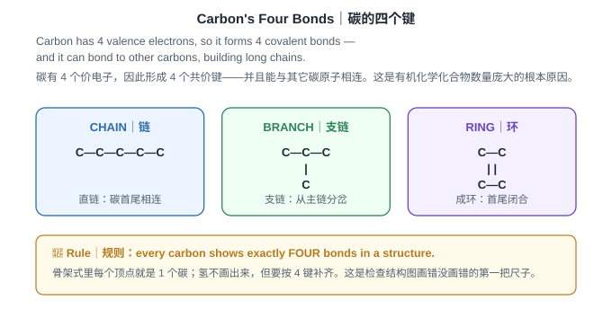
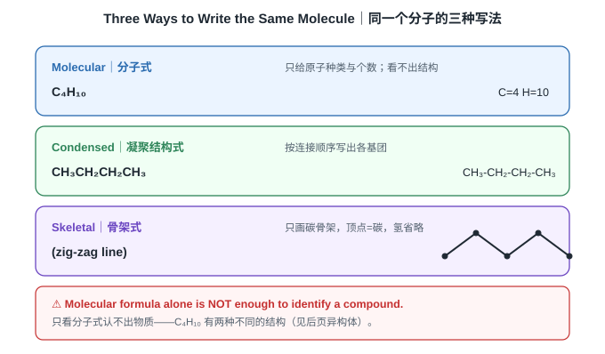
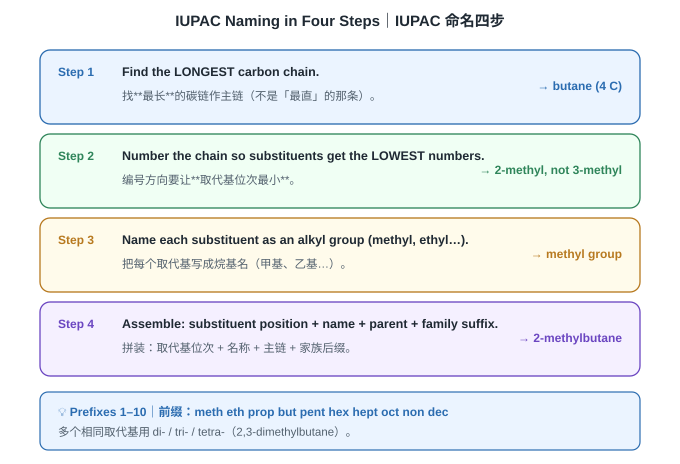
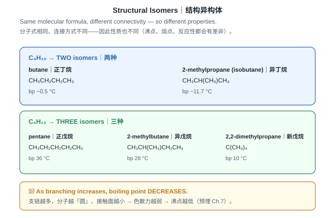

# Ch.2 — Hydrocarbons: Structure, Naming and Isomers
## Chapter 2 · Hydrocarbons: Structure, Naming and Isomers｜第 2 章　烃：结构、命名与同分异构体

> 🗂️ **Content Alignment｜大纲对应**：C5 "organic compounds" (hydrocarbons — the first half)｜C5「有机化合物」（烃——前半）；Big Idea **B2**｜核心概念 **B2**
> ⏱️ **Periods｜课时**：7　|　**Prerequisite｜前置**：Ch.1（化学式书写基础）｜**Followed by｜后继**：Ch.3（官能团）
> 🗂️ **Generated｜文件生成时间**：2026-09-30

## 1. Content Alignment｜大纲对应

| Item｜项目 | Content｜内容 |
|---|---|
| Content served｜服务的 Content | **C5 organic compounds** — specifically the hydrocarbon families (alkanes, alkenes, alkynes, cycloalkanes)｜**C5 有机化合物**——具体指烃类各家族（烷烃、烯烃、炔烃、环烷烃） |
| Position in the course｜课程定位 | **Unit 1 opens here.** Your school outlines Organic Chemistry as the first unit of Chemistry 11, so this chapter starts the course's chemistry content proper.｜**第一单元从这里开始。** 你们学校的课程大纲把有机化学列为 Chemistry 11 的第一单元，因此本章是全课程化学正文的起点。 |
| Competencies | [Communicating] Use **IUPAC conventions** and structural representations correctly ｜ [Processing and analyzing] Seek and analyze patterns in molecular structure ｜ [Applying and innovating] Connect structure to real fuel and material properties｜[交流] 正确使用 **IUPAC 命名规范**与结构表示法 ｜ [处理与分析] 从分子结构中寻找并分析规律 ｜ [应用与创新] 把结构与真实燃料、材料的性质联系起来 |
| Beyond scope?｜是否超纲 | **No** — but note the hard line: chemical **reactions** of organic compounds (addition, substitution, elimination, esterification) belong to **Chemistry 12** and are labelled `【Extension → Chemistry 12】`. This chapter is naming, drawing and properties only.｜**不超纲**——但注意硬红线：有机物的**化学反应**（加成、取代、消除、酯化）属 **Chemistry 12**，一律标 `【Extension → Chemistry 12】`。本章只做命名、画结构与性质。 |

**中文**：本章是你在 Chemistry 11 里第一次正式"说有机化学的语言"。它不涉及任何有机反应——只解决三件事：**碳为什么能搭出这么多分子**、**这些分子叫什么名字**、**同一个分子式为什么能对应好几种不同的物质**。

> 📏 **Course-level rule｜课程级规则**：Organic naming follows **IUPAC** (International Union of Pure and Applied Chemistry) rules. Your school's tests will mark against IUPAC, not against common names — but you should still recognise the common names (isobutane, neopentane) when you meet them.
> **中文**：有机命名遵循 **IUPAC**（国际纯粹与应用化学联合会）规则。学校考试按 IUPAC 给分，不按俗名给分——但俗名（isobutane 异丁烷、neopentane 新戊烷）你仍要认得。

## 2. Learning Objectives｜学习目标

**EN — By the end of this chapter, you should be able to:**

1. Explain why carbon forms the backbone of so many compounds, and distinguish organic from inorganic carbon compounds.
2. Name and draw alkanes, alkenes and alkynes using IUPAC rules, including branched structures.
3. Write the same molecule in molecular, condensed and skeletal form, and convert between them.
4. Name and draw cycloalkanes, including ones with substituents.
5. Identify and draw all structural isomers of a given molecular formula, and explain why isomer count rises with carbon number.

**中文 — 本章结束后，你应当能够：**

1. 解释碳为何能构成如此多化合物的骨架，并区分有机碳化合物与无机碳化合物。
2. 用 IUPAC 规则命名并画出烷烃、烯烃、炔烃（含支链结构）。
3. 把同一个分子写成分子式、凝聚结构式、骨架式三种形式，并在三者间转换。
4. 命名并画出环烷烃（含带取代基的环烷烃）。
5. 找出并画出给定分子式的全部结构异构体，并解释为什么异构体数目随碳数增加。

## 3. Concept Explanations｜概念解析

### 3.1 What Makes Carbon Special｜碳为什么特殊

**Definition｜定义**：**Organic chemistry** is the chemistry of **carbon-containing compounds** — with a short list of exceptions.

**中文**：**有机化学**是研究**含碳化合物**的化学——但有少数例外。

The exceptions are worth memorising, because exams love them: **carbon dioxide (CO₂)**, **carbon monoxide (CO)**, **carbonates (CO₃²⁻)**, **hydrogen carbonates (HCO₃⁻)**, **cyanides (CN⁻)** and **elemental carbon** (graphite, diamond) are all considered **inorganic**, even though they contain carbon.

**中文**：这些例外值得背下来，因为考试很爱考：**二氧化碳（CO₂）**、**一氧化碳（CO）**、**碳酸盐（CO₃²⁻）**、**碳酸氢盐（HCO₃⁻）**、**氰化物（CN⁻）**以及**单质碳**（石墨、金刚石），虽然都含碳，却算**无机物**。

So why does carbon dominate? Carbon sits in Group 14 with **4 valence electrons**, which gives it three unusual abilities (**Fig. 2-1**):

**中文**：那为什么碳能占据主导地位？碳位于第 14 族，有 **4 个价电子**，这让它具备三种不寻常的能力（**图 2-1**）：

- It forms **four covalent bonds**, so it can connect in four directions at once.
  - **中文**：它能形成**四个共价键**，可以同时朝四个方向连接。
- It bonds readily **to other carbon atoms**, in chains of essentially unlimited length.
  - **中文**：它能轻松地**与其它碳原子成键**，形成长度几乎不受限制的碳链。
- Those chains can **branch** or **close into rings**.
  - **中文**：这些链还可以**分岔成支链**，或**闭合成环**。

A rough sense of scale: there are well over **10 million** known carbon compounds, against roughly 100 000 known compounds of all other elements combined. That ratio is not a coincidence — it follows directly from those three abilities.

**中文**：粗略感受一下规模：已知含碳化合物超过 **1000 万种**，而所有其它元素的化合物加起来才约 10 万种。这个比例不是巧合——它是上面三种能力的直接结果。

> ⚠️ **Misconception｜易错**："Organic" does not mean "natural" or "healthy." Urea, made in a lab, is organic; CO₂, produced by every living breath, is inorganic by this definition. In chemistry, *organic* is a **structural** label, not a moral one.
> **中文**："有机"不等于"天然"或"健康"。实验室合成的尿素是有机物；每次呼吸产生的 CO₂ 按此定义反而是无机的。化学里的 *organic* 是一个**结构标签**，不是道德评价。

### 3.2 The Three Hydrocarbon Families｜烃的三大族

**Definition｜定义**：A **hydrocarbon** is a compound containing **only carbon and hydrogen**.

**中文**：**烃**是**只含碳和氢**的化合物。

Everything in this chapter is a hydrocarbon. There are three main families, distinguished by the type of carbon-to-carbon bond (**Fig. 2-2**):

**中文**：本章所有物质都是烃。三大族的主要区别在于碳碳键的类型（**图 2-2**）：

| Family｜家族 | General formula｜通式 | Suffix｜后缀 | Bond type｜键型 | Saturation｜饱和性 |
|---|---|---|---|---|---|
| **alkane｜烷烃** | CₙH₂ₙ₊₂ | **-ane** | all single bonds C–C｜全为单键 | **saturated 饱和** |
| **alkene｜烯烃** | CₙH₂ₙ | **-ene** | contains C=C｜含一个 C=C | **unsaturated 不饱和** |
| **alkyne｜炔烃** | CₙH₂ₙ₋₂ | **-yne** | contains C≡C｜含一个 C≡C | **unsaturated 不饱和** |

The general formulas only hold for **straight-chain, one-double-bond** hydrocarbons. The moment you add a ring or a second double bond, the numbers shift — which is exactly why you must determine structure, not just count hydrogens.

**中文**：这些通式只对**直链、单个双键**的烃成立。一旦加入环或第二个双键，氢数就变了——这正是为什么你必须判断结构，而不能只数氢原子。

**Saturated vs unsaturated｜饱和与不饱和**：a **saturated** hydrocarbon has the **maximum possible number of hydrogens** for its carbon count (every carbon holds as many H as its four bonds allow). An **unsaturated** one has fewer, because some bonds are "used up" by C=C or C≡C.

**中文**：**饱和**烃的氢原子数已达该碳数的**理论最大值**（每个碳按四键规则尽量多接氢）。**不饱和**烃的氢较少，因为一部分键被 C=C 或 C≡C"占用"了。

> 💡 **Tip｜口诀**：*-ane means all single; -ene means one double; -yne means one triple. The ending tells you the bond.*
> **中文**：-ane 全单键、-ene 一个双键、-yne 一个三键。**词尾就是键型的名片。**

### 3.3 The Parent Chain Prefixes｜主链名称前缀（1–10）

Every hydrocarbon name is built from a **prefix for the number of carbons** plus a **suffix for the family**.

**中文**：每个烃名都由"**碳数前缀** + **家族后缀**"构成。

| Carbons｜碳数 | 1 | 2 | 3 | 4 | 5 | 6 | 7 | 8 | 9 | 10 |
|---|---|---|---|---|---|---|---|---|---|---|
| Prefix｜前缀 | **meth**- | **eth**- | **prop**- | **but**- | **pent**- | **hex**- | **hept**- | **oct**- | **non**- | **dec**- |
| Alkane｜烷烃 | methane 甲烷 | ethane 乙烷 | propane 丙烷 | butane 丁烷 | pentane 戊烷 | hexane 己烷 | heptane 庚烷 | octane 辛烷 | nonane 壬烷 | decane 癸烷 |

> 📏 **Rule｜规则**：Learn the first ten prefixes as a **chant**, not as a table. You will use them in every single organic question for the rest of the course.
> **中文**：把前十个前缀当口诀背，不要当表格背。后面整门课每一道有机题都会用到它们。

**Common names you should still recognise｜仍需认得的俗名**：methane = natural gas 天然气 · propane = BBQ/LPG fuel 液化石油气 · butane = lighter fuel 打火机燃料 · octane = gasoline benchmark 汽油标号基准。

**中文**：methane 天然气 · propane 液化石油气 · butane 打火机燃料 · octane 汽油标号基准。这些俗名在生活与新闻里高频出现，考试题目也常用它们做背景。

### 3.4 IUPAC Naming in Four Steps｜IUPAC 命名四步

All the naming in this course — and in Chemistry 12 — runs on the same four steps (**Fig. 2-3**).

**中文**：本课程（以及 Chemistry 12）的全部有机命名都跑同一套四步流程（**图 2-3**）。

| Step｜步骤 | English｜英文 | 中文 | Worked trace｜演算（例：某 C₅ 支链烷烃） |
|---|---|---|---|
| 1 | Find the **longest** carbon chain. | 找**最长**的碳链作主链。 | 最长链 4 个 C → parent = **butane** |
| 2 | Number so substituents get the **lowest** locants. | 编号使取代基位次**最小**。 | 从右端编号 → 取代基在 2 位（不是 3 位） |
| 3 | Name each substituent as an **alkyl group**. | 把每个取代基命名为**烷基**。 | —CH₃ → **methyl** |
| 4 | Assemble: locants + substituents + parent + suffix. | 拼装：位次 + 取代基 + 主链 + 后缀。 | → **2-methylbutane** |

**Alkyl groups｜烷基** (a carbon chain missing one hydrogen, acting as a branch):

**中文**：**烷基**（少一个氢的碳链，作为支链）：

| Alkyl｜烷基 | Formula｜化学式 | 中文 | Example in a name｜命名示例 |
|---|---|---|---|
| methyl | –CH₃ | 甲基 | 2-methylbutane 2-甲基丁烷 |
| ethyl | –CH₂CH₃ | 乙基 | 3-ethylhexane 3-乙基己烷 |
| propyl | –CH₂CH₂CH₃ | 丙基 | 4-propylheptane 4-丙基庚烷 |

**Multiple identical substituents｜多个相同取代基** use **di- / tri- / tetra-** (and an "a" is dropped when the parent begins with a vowel: **di**+**ethyl** → **diethyl**, but **di**+**methyl** → **dimethyl**).

**中文**：多个**相同**取代基用 **di- / tri- / tetra-**（前缀以元音开头时省 a：**di**+**ethyl** → **diethyl**，但 **di**+**methyl** → **dimethyl**）。

- Example｜例：**2,3-dimethylbutane**｜2,3-二甲基丁烷
- Locants are separated by **commas**; numbers are separated from words by a **hyphen**: **2,3-dimethylbutane**, **3-ethyl-2-methylpentane**.
  - **中文**：位次之间用**逗号**隔开；数字与文字之间用**连字符**连接。

> ⚠️ **Misconception｜易错**：Step 1 says **longest** chain, not the chain drawn most horizontally. Textbooks deliberately draw structures so that the longest chain zig-zags out of view. Redraw the molecule on scratch paper before you count.
> **中文**：第 1 步是找**最长**链，不是找画得最平的那条。教材常故意把最长链画成折线，让你一眼看不出来。数之前先在草稿纸上重画一遍。

### 3.5 Three Ways to Write the Same Molecule｜同一分子的三种写法

(**Fig. 2-4**)

**中文**（**图 2-4**）：

| Form｜形式 | Example (butane)｜例（丁烷） | Shows｜显示什么 | Hides｜隐藏什么 |
|---|---|---|---|---|
| **molecular formula｜分子式** | C₄H₁₀ | atom counts only｜只给原子个数 | all structure｜全部结构信息 |
| **condensed formula｜凝聚结构式** | CH₃CH₂CH₂CH₃ | connectivity order｜连接顺序 | three-dimensional shape｜立体形状 |
| **skeletal formula｜骨架式** | zig-zag line, 4 vertices | carbon skeleton only｜只显示碳骨架 | all C–H bonds｜所有 C–H 键 |

**Reading a skeletal formula｜怎么读骨架式**：

1. Every **vertex (corner) and every line end is a carbon**. No "C" is written.
   - **中文**：每个**顶点（拐角）与每条线的端点都是碳原子**，不写 "C"。
2. Hydrogens are **not drawn at all** — you supply them by the four-bond rule.
   - **中文**：氢**完全不画**——你按"碳必接四键"的规则补上去。
3. A double bond is drawn as **two parallel lines**.
   - **中文**：双键画成**两条平行线**。

> 📏 **Rule｜规则**：The molecular formula **cannot** identify a compound on its own. C₄H₁₀ could be butane or 2-methylpropane — two different substances with different boiling points. Structural formulas are the only complete description.
> **中文**：**分子式本身无法确定一种物质**。C₄H₁₀ 可能是正丁烷，也可能是异丁烷——两种不同物质，沸点不同。只有结构式才是完整描述。

### 3.6 Cycloalkanes｜环烷烃

**Definition｜定义**：A **cycloalkane** is a saturated hydrocarbon in which the carbon chain closes into a **ring**.

**中文**：**环烷烃**是碳链首尾闭合成**环**的饱和烃。

| Feature｜特征 | Detail｜说明 |
|---|---|
| General formula｜通式 | **CₙH₂ₙ** — the same as an alkene!｜**CₙH₂ₙ**——与烯烃相同！ |
| Naming｜命名 | Add the prefix **cyclo-** to the alkane name｜在烷烃名前加 **cyclo-** |
| Examples｜例子 | cyclopropane 环丙烷 · cyclobutane 环丁烷 · cyclohexane 环己烷 |
| With substituents｜带取代基 | methylcyclohexane 甲基环己烷 · 1,2-dimethylcyclobutane 1,2-二甲基环丁烷 |

> ⚠️ **Misconception｜易错**：The general formula **CₙH₂ₙ does NOT prove a compound is an alkene.** Cyclohexane and hexene share that formula. To decide the family you must look at the **structure**: a ring (all single bonds) is a cycloalkane; a chain with C=C is an alkene.
> **中文**：通式 **CₙH₂ₙ 不能证明某物质是烯烃**。环己烷与己烯的通式完全相同。判断家族必须看**结构**：成环且全单键的是环烷烃；链状且含 C=C 的才是烯烃。

**Numbering a substituted ring｜带取代基的环如何编号**：start at the substituent that gives the **lowest set of locants**, and go around in the direction that keeps the remaining numbers small.

**中文**：从能让**位次组合最小**的那个取代基开始，并朝使其余编号较小的方向绕环编号。

### 3.7 Structural Isomers｜结构异构体

**Definition｜定义**：**Structural isomers** are compounds with the **same molecular formula** but **different connectivity** of atoms.

**中文**：**结构异构体**是**分子式相同**但原子**连接方式不同**的化合物。

Isomer counts grow fast with carbon number (**Fig. 2-5**):

**中文**：异构体数目随碳数增长得很快（**图 2-5**）：

| Formula｜分子式 | Isomers｜异构体数 | Names｜名称 |
|---|---|---|---|
| CH₄ | 1 | methane｜甲烷 |
| C₂H₆ | 1 | ethane｜乙烷 |
| C₃H₈ | 1 | propane｜丙烷 |
| **C₄H₁₀** | **2** | butane 正丁烷 · 2-methylpropane 异丁烷 |
| **C₅H₁₂** | **3** | pentane 正戊烷 · 2-methylbutane 异戊烷 · 2,2-dimethylpropane 新戊烷 |
| C₆H₁₄ | 5 | — |
| C₁₀H₂₂ | 75 | — |

**Why isomers have different properties｜为什么异构体性质不同**：isomers are **different substances**. Butane boils at −0.5 °C; 2-methylpropane boils at −11.7 °C. More branching makes the molecule more compact, so molecules touch each other over a smaller area, so the **intermolecular forces are weaker** and the boiling point drops.

**中文**：异构体是**不同的物质**。正丁烷沸点 −0.5 °C，异丁烷 −11.7 °C。支链越多，分子越紧凑，分子间接触面积越小，**分子间作用力越弱**，沸点就越低。

> 🔭 **Extension｜超纲**【Extension → Chemistry 12】：Other isomer types — **geometric (cis/trans)**, **positional** and **functional group** isomers — appear in Chemistry 12. This chapter deals only with **structural (chain/branching)** isomers.
> **中文**：【超纲延伸 → Chemistry 12】其它异构类型——**几何异构（顺反）**、**位置异构**与**官能团异构**——在 Chemistry 12 处理。本章只讲**结构（链/支链）异构**。

### 3.8 Naming Across Languages｜中英命名对照（本章体例重点）

This is the one place where organic naming **differs** from the inorganic rule you reviewed in Ch.1.

**中文**：这是有机命名与你 Ch.1 复习过的无机规则**不同**的关键处。

| | Inorganic｜无机 | Organic｜有机 |
|---|---|---|
| English order｜英文语序 | metal → non-metal-**ide**｜金属 → 非金属-**ide** | prefix + substituent + parent + suffix｜前缀 + 取代基 + 主链 + 后缀 |
| Chinese order｜中文语序 | **non-metal + 化 + metal**｜**非金属 + 化 + 金属** | 数字 + 取代基 + 主链 + 后缀 |
| Order relation｜语序关系 | **REVERSED｜相反** | **SAME｜基本一致** |
| Example｜例 | sodium chloride = **氯化钠** | 2-methylbutane = **2-甲基丁烷** |

**Chinese naming conventions for organic compounds｜有机物的中文命名习惯**：

- Suffix **-ane** → **烷**；**-ene** → **烯**；**-yne** → **炔**；**cyclo-** → **环**.
  - **中文**：后缀 -ane 译为**烷**、-ene 译为**烯**、-yne 译为**炔**；cyclo- 译为**环**。
- Substituent positions keep their numbers: **2-methylbutane = 2-甲基丁烷**.
  - **中文**：取代基位次保留数字：2-methylbutane = **2-甲基丁烷**。
- **methane / ethane / propane / butane** are usually written with the **天干** naming in Chinese: 甲烷 / 乙烷 / 丙烷 / 丁烷 (from 甲乙丙丁戊己庚辛壬癸).
  - **中文**：1–10 个碳的中文名多用**天干**（甲、乙、丙、丁、戊、己、庚、辛、壬、癸）。

> 💡 **Tip｜口诀**：*English and Chinese organic names read in the SAME direction — position, branch, backbone, family. If you can say it in one language, you can translate it word-for-word.*
> **中文**：中英有机名**同向**阅读——位次、支链、主链、家族。能用一种语言说清，就能逐词翻译。

## 4. Comparison Tables｜表格比对

### Table 2-1　The Three Hydrocarbon Families｜烃的三大族

| Item｜比较项 | Alkane｜烷烃 | Alkene｜烯烃 | Alkyne｜炔烃 |
|---|---|---|---|
| General formula｜通式 | CₙH₂ₙ₊₂ | CₙH₂ₙ | CₙH₂ₙ₋₂ |
| Suffix｜后缀 | -ane | -ene | -yne |
| Characteristic bond｜特征键 | C–C (single) | C=C (double) | C≡C (triple) |
| Saturated?｜是否饱和 | **yes｜是** | no | no |
| Example (C₂)｜C₂ 例 | ethane 乙烷 C₂H₆ | ethene 乙烯 C₂H₄ | ethyne 乙炔 C₂H₂ |
| Example (C₃)｜C₃ 例 | propane 丙烷 C₃H₈ | propene 丙烯 C₃H₆ | propyne 丙炔 C₃H₄ |

### Table 2-2　Four Families, Four Formulas｜四种家族的"环外一分子"

| Family｜家族 | Formula｜分子式 | Parent name｜母体名 | Substituent form｜取代基形式 |
|---|---|---|---|---|
| straight-chain alkane｜直链烷烃 | CₙH₂ₙ₊₂ | ...ane | alkyl (–CH₃ methyl) |
| cycloalkane｜环烷烃 | CₙH₂ₙ | cyclo...ane | alkyl |
| alkene｜烯烃 | CₙH₂ₙ | ...ene | alkenyl |
| alkyne｜炔烃 | CₙH₂ₙ₋₂ | ...yne | alkynyl |

> 📏 **Rule｜规则**：A cycloalkane and an alkene share the **same general formula**. A cycloalkane and an alkyne do **not** (CₙH₂ₙ vs CₙH₂ₙ₋₂). Read the structure, not the formula.
> **中文**：环烷烃与烯烃**通式相同**；环烷烃与炔烃**不同**（CₙH₂ₙ vs CₙH₂ₙ₋₂）。判断靠结构，不靠通式。

### Table 2-3　Structure Notation Comparison｜结构表示法对照

| Notation｜表示法 | Butane｜丁烷 | Information level｜信息量 | Use when｜何时用 |
|---|---|---|---|---|
| molecular｜分子式 | C₄H₁₀ | lowest｜最低 | counting atoms, balancing｜数原子、配平 |
| condensed｜凝聚结构式 | CH₃CH₂CH₂CH₃ | medium｜中等 | showing connectivity quickly｜快速表示连接 |
| skeletal｜骨架式 | zig-zag, 4 vertices | highest (with implicit H)｜最高（隐含氢） | complex molecules, exam answers｜复杂分子、考试作答 |
| full structural｜完整结构式 | every C and H drawn | highest, most verbose｜最高但最啰嗦 | learning, checking bonds｜初学、验键 |

### Table 2-4　Naming Order: Inorganic vs Organic｜命名语序：无机 vs 有机

| | Inorganic｜无机 | Organic｜有机 |
|---|---|---|
| English | metal + non-metal-**ide**｜sodium chloride | prefix + substituent + parent + suffix｜2-methylbutane |
| Chinese | **non-metal + 化 + metal**｜**氯化钠** | 数字 + 取代基 + 主链 + 后缀｜**2-甲基丁烷** |
| Relation｜关系 | **reversed｜相反** | **same｜一致** |
| Trap｜陷阱 | translating word-for-word gives "钠化氯" | translating word-for-word works fine｜逐词翻译可行 |

## 5. Diagrams & Worked Examples｜图例说明

### Fig. 2-1　Carbon's Four Bonds｜碳的四个键



**Reading the figure｜看图要点**：碳的四个键让它能搭出链、支链与环三种骨架。这是有机化合物种类爆炸式增长的根本原因。

### Fig. 2-2　Three Ways to Write the Same Molecule｜同一分子的三种写法



**Reading the figure｜看图要点**：分子式 → 凝聚式 → 骨架式，信息量递增、书写量递减。骨架式里顶点就是碳，氢全靠四键规则补。

### Fig. 2-3　IUPAC Naming in Four Steps｜IUPAC 命名四步



**Reading the figure｜看图要点**：找最长链 → 编号最小 → 命名取代基 → 拼装。四步顺序不能颠倒，第 2 步错了整题就错。

### Fig. 2-4　Structural Isomers of C₄H₁₀ and C₅H₁₂｜C₄H₁₀ 与 C₅H₁₂ 的结构异构体



**Reading the figure｜看图要点**：C₄H₁₀ 有 2 种、C₅H₁₂ 有 3 种。注意沸点随支链增多而下降——这是"结构决定性质"的第一个硬证据。

### Example 2-1　Name from Structure｜由结构写名称

**Problem｜题目**：Name the following structure.

```
CH₃ — CH — CH₂ — CH₃
       |
       CH₃
```

**中文**：为上面的结构命名。

| Step｜步骤 | Work｜演算 |
|---|---|
| 1. Longest chain｜最长链 | 4 carbons → parent = **butane**｜4 个碳 → 母体 butane |
| 2. Numbering｜编号 | from the end nearer the branch → branch at C2｜从靠近支链的一端编号 → 支链在 2 位 |
| 3. Substituent｜取代基 | –CH₃ → **methyl**｜–CH₃ → **methyl** |
| 4. Assemble｜拼装 | **2-methylbutane**｜2-甲基丁烷 |

> 💡 **Tip｜口诀**：If numbering from the left gave 3-methylbutane, you numbered the wrong way. Lowest locant wins.
> **中文**：若从左往右编号会得到 3-methylbutane，说明方向错了。**位次最小者胜**。

### Example 2-2　Structure from Name｜由名称写结构

**Problem｜题目**：Draw the condensed formula for **3-ethyl-2-methylpentane**.

**中文**：写出 **3-ethyl-2-methylpentane** 的凝聚结构式。

| Step｜步骤 | Work｜演算 |
|---|---|
| 1. Parent｜主链 | pentane → 5-carbon chain｜pentane → 5 碳主链 |
| 2. Number｜编号 | C1 … C5｜C1 … C5 |
| 3. Place branches｜放支链 | methyl at C2; ethyl at C3｜2 位甲基、3 位乙基 |
| 4. Write it out｜写出 | **CH₃CH(CH₃)CH(CH₂CH₃)CH₂CH₃** |

**中文**：主链 5 个碳；2 位挂甲基、3 位挂乙基，得到 CH₃CH(CH₃)CH(CH₂CH₃)CH₂CH₃。

> 🔍 **Self-check｜自检**：Count carbons in your answer — 5 (parent) + 1 (methyl) + 2 (ethyl) = **8 carbons** total, so the formula should be C₈H₁₈. Verify your hydrogens satisfy the four-bond rule at every carbon.
> **中文**：数一数碳原子——主链 5 + 甲基 1 + 乙基 2 = **共 8 个碳**，因此分子式应为 C₈H₁₈。再验算每个碳是否都接了 4 个键。

### Example 2-3　Determining Isomer Count｜判断异构体数目

**Problem｜题目**：How many structural isomers does C₅H₁₂ have? Draw them all.

**中文**：C₅H₁₂ 有多少种结构异构体？全部画出来。

| # | Structure｜结构 | Name｜名称 | bp｜沸点 |
|---|---|---|---|---|
| 1 | CH₃CH₂CH₂CH₂CH₃ | pentane｜正戊烷 | 36 °C |
| 2 | CH₃CH(CH₃)CH₂CH₃ | 2-methylbutane｜异戊烷 | 28 °C |
| 3 | C(CH₃)₄ | 2,2-dimethylpropane｜新戊烷 | 10 °C |

**Systematic method｜系统方法**：sketch the longest chain first, then shorten the main chain by one carbon and hang that carbon off each distinct position, then shorten again. Stop when the remaining chain is too short to branch.

**中文**：先画最长链；然后把主链缩短一个碳，把这个碳挂到每一个**不同位置**上；再缩短，直到主链短到无法再分支为止。用这个方法能保证不重不漏。

## 6. Key Vocabulary｜核心词汇

| English | 中文 | Note｜备注 |
|---|---|---|
| organic chemistry | 有机化学 | chemistry of carbon compounds (with exceptions)｜含碳化合物的化学（有例外） |
| hydrocarbon | 烃 | contains only C and H｜只含碳和氢 |
| alkane | 烷烃 | CₙH₂ₙ₊₂, -ane, saturated｜饱和 |
| alkene | 烯烃 | CₙH₂ₙ, -ene, contains C=C |
| alkyne | 炔烃 | CₙH₂ₙ₋₂, -yne, contains C≡C |
| saturated | 饱和的 | maximum hydrogens｜氢已达最大值 |
| unsaturated | 不饱和的 | contains C=C or C≡C |
| parent chain | 主链 | the longest carbon chain｜最长的碳链 |
| substituent | 取代基 | a branch off the parent chain｜主链上的分支 |
| alkyl group | 烷基 | –CH₃ methyl, –CH₂CH₃ ethyl |
| locant | 位次编号 | the number telling where a branch sits｜标明支链位置 |
| cycloalkane | 环烷烃 | CₙH₂ₙ, ring structure｜成环 |
| structural isomer | 结构异构体 | same formula, different connectivity｜同分异构 |
| molecular formula | 分子式 | atom counts only｜只给原子个数 |
| condensed formula | 凝聚结构式 | shows connectivity order｜显示连接顺序 |
| skeletal formula | 骨架式 | carbons at vertices, H omitted｜顶点为碳，氢省略 |
| IUPAC | 国际纯粹与应用化学联合会 | the naming authority｜命名权威机构 |
| boiling point trend | 沸点趋势 | more branching → lower bp｜支链多则沸点低 |

## 7. Lab / Activity｜实验与活动

### Activity 2-1　Molecular Model Building｜分子模型搭建

- **Type｜类型**：Hands-on pair work｜动手双人活动
- **Materials｜材料**：molecular model kits (black = C, white = H, links for single/double bonds)｜分子模型套件（黑球 = 碳、白球 = 氢、单双键连杆）
- **Steps｜步骤**：
  1. Build all isomers of C₄H₁₀ and C₅H₁₂. Prove that no two of your models are the same shape.
     - **中文**：搭出 C₄H₁₀ 与 C₅H₁₂ 的全部异构体，并证明你搭出的模型两两形状不同。
  2. For each model, write its condensed formula and IUPAC name on a card.
     - **中文**：为每个模型写一张卡片，注明凝聚结构式与 IUPAC 名称。
  3. Try to build a "wrong" model with a carbon having three or five bonds. Explain why it is impossible.
     - **中文**：尝试搭一个"错误"模型，让某个碳只接三个键或接五个键，并说明为什么不可能。
- **Competency｜能力**：[Communicating] use structural representations｜[交流] 使用结构表示法；[Processing and analyzing] seek patterns
- **Safety｜安全**：None (models only)｜无（只使用模型）

### Activity 2-2　Name–Structure Two-Track Relay｜命名-结构双轨道接力

- **Type｜类型**：Team relay, two parallel tracks｜双轨接力
- **Materials｜材料**：20 cards — 10 with names, 10 with skeletal structures｜20 张卡片——10 张名称、10 张骨架结构
- **Steps｜步骤**：
  1. Team A draws structures from names; Team B names the given structures.
     - **中文**：A 组由名称画结构；B 组为给定结构命名。
  2. Swap papers and mark against the four-step procedure.
     - **中文**：交换互批，按四步流程逐步核对。
  3. Every error must be traced to **which step** failed (longest chain? numbering? suffix?).
     - **中文**：每个错误都要定位到**哪一步**出错（最长链？编号？后缀？）。
- **Competency｜能力**：[Communicating] IUPAC conventions｜[交流] IUPAC 规范
- **Safety｜安全**：None｜无

### Activity 2-3　Saturated vs Unsaturated Demonstration｜饱和与不饱和对照演示

- **Type｜类型**：Teacher demonstration with student observation｜教师演示 + 学生观察
- **Materials｜材料**：mineral oil (a mixture of alkanes) and vegetable oil (contains C=C), bromine water or iodine solution, test tubes｜矿物油（烷烃混合物）、植物油（含 C=C）、溴水或碘液、试管
- **Steps｜步骤**：
  1. Add the halogen solution to each oil and observe any colour change over 5 minutes.
     - **中文**：分别向两种油中加入卤素溶液，观察 5 分钟内的颜色变化。
  2. Record observations qualitatively; note which sample decolourises.
     - **中文**：定性记录观察结果，注意哪一个样品发生褪色。
  3. Explain the difference using the **saturation** concept.
     - **中文**：用**饱和性**概念解释差异。
- **Competency｜能力**：[Questioning and predicting]｜[Processing and analyzing]
- **Safety｜安全**：Teacher demonstration only. Halogen solutions are toxic and staining — gloves and goggles required; dispose into the labelled halogen waste container, never down the sink.
  - **中文**：仅由教师演示。卤素溶液有毒且易染色——必须戴手套与护目镜；废液倒入标注的卤素废液容器，严禁倒入水槽。
- **Note｜说明**：The detailed reaction mechanism belongs to **Chemistry 12**.

### Activity 2-4　Boiling-Point Investigation｜沸点探究（数据推理）

- **Type｜类型**：Data analysis｜数据分析
- **Materials｜材料**：a data table of boiling points for straight-chain and branched alkanes｜直链与支链烷烃的沸点数据表
- **Steps｜步骤**：
  1. Graph boiling point against carbon number for the straight-chain alkanes.
     - **中文**：以碳数为横轴、沸点为纵轴，画直链烷烃的沸点图。
  2. On the same axes, plot the branched isomers of the same carbon number.
     - **中文**：在同一坐标系上标出相同碳数的支链异构体。
  3. Write one sentence stating the trend you find, using the phrase "as branching increases…".
     - **中文**：用"支链越多……"的句式写一句话，陈述你发现的规律。
- **Competency｜能力**：[Processing and analyzing] construct and interpret graphs｜[处理与分析] 作图并解读
- **Safety｜安全**：None (data work)｜无（数据分析）

## 8. Common Misconceptions｜常见易错点

| # | Misconception｜错误认识 | Correction｜正确理解 |
|---|---|---|
| 1 | "Find the chain drawn most straight as the parent chain."｜把画得最平直的那条当主链。 | The parent is the **longest** chain, regardless of how it is drawn. Redraw before counting.｜主链是**最长**的链，与画法无关。数之前先重画。 |
| 2 | "Number from the left because that is how we read."｜习惯从左往右编号。 | Number so substituents get the **lowest locants**. Direction is a decision, not a default.｜编号要让取代基位次**最小**；方向是选择，不是默认。 |
| 3 | "Pentene is the full name."｜"pentene" 就是完整名称。 | For C₅ and above, the double-bond position **must** be stated: **pent-2-ene** (or 2-pentene).｜C₅ 起必须标出双键位置：**pent-2-ene**（2-戊烯）。 |
| 4 | "Isomers are just different drawings of one substance."｜异构体只是同一种物质的不同画法。 | Isomers are **different substances** with different boiling points and properties.｜异构体是**不同物质**，沸点与性质都不同。 |
| 5 | "CₙH₂ₙ means it is an alkene."｜通式 CₙH₂ₙ 就说明是烯烃。 | Cycloalkanes share that formula. You must inspect the **structure**.｜环烷烃通式相同，必须看**结构**才能判断。 |
| 6 | "Every vertex in a skeletal formula is a hydrogen."｜骨架式每个顶点都是氢。 | Every vertex is a **carbon**. Hydrogens are omitted entirely and must be supplied by the four-bond rule.｜每个顶点是**碳**。氢全部省略，需按四键规则补。 |
| 7 | "Skeletal formulas don't need to show double bonds clearly."｜骨架式里双键随便画。 | A double bond **must** be drawn as two parallel lines — this is the only structural clue in the drawing.｜双键**必须**画成两条平行线——这是图中唯一的官能团线索。 |
| 8 | "Adding a prefix like di- to ethyl gives diethyl with no change."｜di- 与 ethyl 直接相连即可。 | When the parent or substituent begins with a vowel, the final "a" of a prefix is often dropped: di + ethyl → **diethyl**.｜前缀与元音开头的基团相接时常省 a：di + ethyl → **diethyl**。 |
| 9 | "More branching means a higher boiling point because there is more stuff."｜支链多则沸点高。 | More branching → more compact molecule → less contact area → weaker dispersion forces → **lower** boiling point.｜支链多 → 分子紧凑 → 接触面小 → 色散力弱 → 沸点**更低**。 |
| 10 | "CO₂ is organic because it contains carbon."｜CO₂ 含碳所以是有机物。 | CO₂, CO, carbonates, hydrogen carbonates, cyanides and elemental carbon are the standard **inorganic** exceptions.｜CO₂、CO、碳酸盐、碳酸氢盐、氰化物与单质碳是标准的**无机**例外。 |
| 11 | "Chinese and English organic names are in opposite order, like inorganic ones."｜有机中英名语序也和无机一样相反。 | Inorganic reverses (sodium chloride = 氯化钠); organic keeps the **same** order (2-methylbutane = 2-甲基丁烷).｜无机相反（sodium chloride = 氯化钠）；有机**同向**（2-methylbutane = 2-甲基丁烷）。 |
| 12 | "meth-, eth-, prop- are arbitrary and just have to be memorised."｜甲、乙、丙前缀只能死记。 | They correspond exactly to the Chinese heavenly stems 甲乙丙丁…, and both systems count the same way. Use the pairing to remember both.｜它们与中文天干甲、乙、丙、丁……一一对应，两套系统数法相同——用配对帮助记忆。 |

## 9. Assessment｜答题评估

### Part A: Foundational｜基础题（10 × 2 = 20 points）

**A1.** Give the general formula for each family: (a) alkane (b) alkene (c) alkyne (d) cycloalkane.

- **中文**：写出各家族的通式：(a) 烷烃 (b) 烯烃 (c) 炔烃 (d) 环烷烃。

**A2.** Name the first five straight-chain alkanes in English and Chinese.

- **中文**：写出前五个直链烷烃的英文名与中文名。

**A3.** Write the molecular formula for: (a) hexane (b) hexene (c) hexyne (d) cyclohexane.

- **中文**：写出分子式：(a) hexane 己烷 (b) hexene 己烯 (c) hexyne 己炔 (d) cyclohexane 环己烷。

**A4.** Classify each as alkane, alkene, alkyne or cycloalkane: (a) C₇H₁₆ (b) C₅H₁₀ with one C=C (c) C₆H₁₀ with one C≡C (d) C₄H₈ forming a ring.

- **中文**：判断下列各属哪一族：(a) C₇H₁₆ (b) 含一个 C=C 的 C₅H₁₀ (c) 含一个 C≡C 的 C₆H₁₀ (d) 成环的 C₄H₈。

**A5.** Name: (a) CH₃CH₂CH₂CH₃ (b) CH₃CH=CHCH₃ (c) CH₃C≡CH.

- **中文**：命名：(a) CH₃CH₂CH₂CH₃ (b) CH₃CH=CHCH₃ (c) CH₃C≡CH。

**A6.** Draw the condensed formula for: (a) 2-methylpropane (b) 2,2-dimethylbutane.

- **中文**：写出凝聚结构式：(a) 2-methylpropane 2-甲基丙烷 (b) 2,2-dimethylbutane 2,2-二甲基丁烷。

**A7.** Give the IUPAC name and Chinese name for each alkyl group: (a) –CH₃ (b) –CH₂CH₃ (c) –CH₂CH₂CH₃.

- **中文**：写出各烷基的 IUPAC 名与中文名：(a) –CH₃ (b) –CH₂CH₃ (c) –CH₂CH₂CH₃。

**A8.** State whether each is saturated or unsaturated: (a) ethane (b) ethene (c) propyne (d) cyclohexane.

- **中文**：判断饱和或不饱和：(a) ethane 乙烷 (b) ethene 乙烯 (c) propyne 丙炔 (d) cyclohexane 环己烷。

**A9.** Write the molecular, condensed and skeletal-form description for propane. For the skeletal form, state how many vertices the drawing has.

- **中文**：写出 propane（丙烷）的分子式、凝聚结构式，并描述其骨架式——骨架式应画几个顶点？

**A10.** True or false, with a reason: "Two compounds with the same molecular formula must be the same substance."

- **中文**：判断对错并说明理由："分子式相同的两种化合物必定是同一种物质。"

### Part B: Applied｜应用题（4 × 5 = 20 points）

**B1.** Name each structure using the four-step procedure. Show your work for at least step 1 and step 2.

```
(a)  CH₃ — CH — CH₂ — CH₂ — CH₃          (b)  CH₃ — CH — CH — CH₃
          |                                      |      |
         CH₃                                    CH₃    CH₃
```

- **中文**：用四步流程为下列结构命名，至少写出第 1 步与第 2 步的过程。

**B2.** Draw all structural isomers of C₆H₁₄ that have a **five-carbon parent chain**. Name each one.

- **中文**：画出 C₆H₁₄ 中**主链为 5 个碳**的全部结构异构体，并逐一命名。

**B3.** Three compounds are all C₅H₁₂: pentane (bp 36 °C), 2-methylbutane (bp 28 °C), 2,2-dimethylpropane (bp 10 °C). (a) Arrange them in order of increasing branching. (b) Explain the boiling-point trend using the idea of molecular contact area.

- **中文**：三种物质都是 C₅H₁₂：正戊烷（沸点 36 °C）、2-甲基丁烷（28 °C）、2,2-二甲基丙烷（10 °C）。(a) 按支链由少到多排序。(b) 用分子接触面积解释沸点趋势。

**B4.** A student names a compound "3-methylbutane." (a) Explain why this name is incorrect. (b) Give the correct name. (c) Explain what mistake in the four-step procedure produced this error.

- **中文**：某同学把一种化合物命名为 "3-methylbutane"。(a) 说明这个名称为什么错。(b) 给出正确名称。(c) 指出是四步流程中哪一步出错导致了这个结果。

### Part C: Challenge｜挑战题（2 × 10 = 20 points）

**C1.** A hydrocarbon has the molecular formula C₆H₁₂. (a) List **three** different structures that fit this formula, naming each and identifying its family (alkene or cycloalkane). (b) Explain why the molecular formula alone cannot tell you which family it belongs to. (c) State one experimental observation that would help distinguish an alkene from a cycloalkane.

- **中文**：某烃分子式为 C₆H₁₂。(a) 列出**三种**符合该分子式的不同结构，逐一命名并指出其家族（烯烃或环烷烃）。(b) 解释为什么单靠分子式无法判断它属于哪个家族。(c) 说出一个能帮助区分烯烃与环烷烃的实验观察。

**C2.** Design a systematic procedure that would let you find **all** structural isomers of C₆H₁₄ without missing any or double-counting. Then apply it and state the total number (the accepted answer is 5). Explain the stopping rule that tells you when the search is complete.

- **中文**：设计一套系统方法，使你能够找出 C₆H₁₄ 的**全部**结构异构体，既不漏也不重。然后实际使用该方法，并给出总数（标准答案为 5 种）。说明"什么时候可以停"的终止判据。

---

### Answer Key｜参考答案

**Part A**

- **A1.** (a) CₙH₂ₙ₊₂ (b) CₙH₂ₙ (c) CₙH₂ₙ₋₂ (d) CₙH₂ₙ

  - **中文**：(a) CₙH₂ₙ₊₂ (b) CₙH₂ₙ (c) CₙH₂ₙ₋₂ (d) CₙH₂ₙ。（注意环烷烃与烯烃通式相同。）

- **A2.** methane 甲烷 · ethane 乙烷 · propane 丙烷 · butane 丁烷 · pentane 戊烷

  - **中文**：甲烷、乙烷、丙烷、丁烷、戊烷（对应天干甲、乙、丙、丁、戊）。

- **A3.** (a) C₆H₁₄ (b) C₆H₁₂ (c) C₆H₁₀ (d) C₆H₁₂

  - **中文**：(a) C₆H₁₄ (b) C₆H₁₂ (c) C₆H₁₀ (d) C₆H₁₂。注意 (b) 与 (d) 数值相同但结构不同。

- **A4.** (a) alkane (b) alkene (c) alkyne (d) cycloalkane

  - **中文**：(a) 烷烃 (b) 烯烃 (c) 炔烃 (d) 环烷烃。

- **A5.** (a) butane 丁烷 (b) but-2-ene 2-丁烯 (c) propyne 丙炔

  - **中文**：(a) 丁烷 (b) 2-丁烯（双键位次必须标出）(c) 丙炔。

- **A6.** (a) CH(CH₃)₃ → written out: CH₃CH(CH₃)CH₃ (b) CH₃C(CH₃)₂CH₂CH₃

  - **中文**：(a) 丙烷主链上 2 位挂两个甲基，可写作 CH₃CH(CH₃)CH₃ (b) CH₃C(CH₃)₂CH₂CH₃。

- **A7.** (a) methyl 甲基 (b) ethyl 乙基 (c) propyl 丙基

  - **中文**：(a) 甲基 (b) 乙基 (c) 丙基。

- **A8.** (a) saturated (b) unsaturated (c) unsaturated (d) saturated

  - **中文**：(a) 饱和 (b) 不饱和 (c) 不饱和 (d) 饱和（注意环烷烃是饱和烃，只是成环）。

- **A9.** molecular: C₃H₈; condensed: CH₃CH₂CH₃; skeletal: a **zig-zag line with three vertices**.

  - **中文**：分子式 C₃H₈；凝聚式 CH₃CH₂CH₃；骨架式为一条折线、**共 3 个顶点**（每个顶点一个碳）。

- **A10.** **False**. The molecular formula C₄H₁₀ corresponds to both butane and 2-methylpropane — two different substances with different boiling points.

  - **中文**：**错**。分子式 C₄H₁₀ 同时对应正丁烷与异丁烷——两种不同物质，沸点不同。分子式不能确定物质身份。

**Part B**

- **B1.** (a) Longest chain = 5 C → parent pentane; number from the end nearer the branch → methyl at C2 → **2-methylpentane**｜2-甲基戊烷. (b) Longest chain = 4 C → parent butane; methyls at C2 and C3 (numbering to give the lowest set 2,3 rather than 3,4) → **2,3-dimethylbutane**｜2,3-二甲基丁烷.

  - **中文**：(a) 最长链 5 个碳 → 母体 pentane；从靠近支链的一端编号 → 甲基在 2 位 → **2-methylpentane**（2-甲基戊烷）。(b) 最长链 4 个碳 → 母体 butane；两个甲基在 2、3 位（取 2,3 而非 3,4 以保证位次组合最小）→ **2,3-dimethylbutane**（2,3-二甲基丁烷）。

- **B2.** With a five-carbon parent and one extra carbon as a methyl branch, the methyl can sit at C2 or C3 (positions 1 and 5 would extend the chain; position 4 duplicates 2 by symmetry): **2-methylpentane｜2-甲基戊烷** and **3-methylpentane｜3-甲基戊烷**. That is **2 isomers**.

  - **中文**：主链 5 个碳、多余 1 个碳作甲基支链；甲基只能挂在 2 位或 3 位（挂在 1、5 位会延长主链，挂在 4 位与 2 位因对称重复）：**2-methylpentane** 与 **3-methylpentane**，共 **2 种**。

- **B3.** (a) Increasing branching: pentane < 2-methylbutane < 2,2-dimethylpropane. (b) Straight pentane is an extended chain, so neighbouring molecules lie alongside each other with a large contact area, giving stronger London dispersion forces and a higher boiling point. Branching makes the molecule more spherical: less surface in contact with neighbours → weaker dispersion forces → lower boiling point. Hence 36 °C > 28 °C > 10 °C.

  - **中文**：(a) 支链由少到多：正戊烷 < 2-甲基丁烷 < 2,2-二甲基丙烷。(b) 正戊烷是伸展的直链，相邻分子能大面积贴合，色散力强，沸点高；支链使分子趋于球状，接触面积减小 → 色散力减弱 → 沸点降低。所以 36 °C > 28 °C > 10 °C。

- **B4.** (a) The name locates the methyl at C3, but numbering from the other end places it at C2 — a name must use the **lowest** possible locant, so "3-methylbutane" describes the wrong numbering. (b) **2-methylbutane**｜2-甲基丁烷. (c) **Step 2** (numbering) failed: the student counted from the wrong end. Note also that a 3-methylbutane would actually be pentane if you re-selected the longest chain — so this error can hide a Step 1 mistake too.

  - **中文**：(a) 该名称把甲基标在 3 位，但从另一端编号应落在 2 位——名称必须取**最小**位次，所以 3-methylbutane 是编号错误。(b) 正确名称为 **2-methylbutane**（2-甲基丁烷）。(c) 错在**第 2 步（编号）**：从错误的一端开始数。另外要注意，"3-甲基丁烷"若重新选最长链其实会变成戊烷——所以这个错误有时掩盖着第 1 步的失误。

**Part C (marking points｜评分要点)**

- **C1.** (a) Any three of: hex-1-ene CH₂=CHCH₂CH₂CH₂CH₃ (alkene)｜1-己烯；hex-2-ene CH₃CH=CHCH₂CH₂CH₃ (alkene)｜2-己烯；cyclohexane (cycloalkane)｜环己烷；methylcyclopentane (cycloalkane)｜甲基环戊烷；1,2-dimethylcyclobutane (cycloalkane)｜1,2-二甲基环丁烷. (b) CₙH₂ₙ is satisfied by **both** an open chain with one C=C and a saturated ring; the formula constrains hydrogen count but says nothing about connectivity. (c) An alkene **decolourises bromine water** (or iodine solution) by addition; a cycloalkane, being saturated, does **not** — this is the qualitative test demonstrated in Activity 2-3. *(6 + 2 + 2 marks)*

  - **中文**：(a) 三种即可，如 1-己烯（烯烃）、2-己烯（烯烃）、环己烷（环烷烃）、甲基环戊烷（环烷烃）、1,2-二甲基环丁烷（环烷烃）。(b) CₙH₂ₙ 既能被"开链 + 一个 C=C"满足，也能被"饱和的环"满足；通式只约束氢原子数，不提供任何连接信息。(c) 烯烃能使**溴水（或碘液）褪色**（加成），饱和的环烷烃**不能**——这就是活动 2-3 演示的定性检验。*(6 + 2 + 2 分)*

- **C2.** Procedure: (i) Longest possible chain of 6 C → **hexane** (1 isomer). (ii) Shorten the main chain to 5 C, place the remaining 1 C as a methyl at every distinct position, testing each for duplicates by symmetry → **2-methylpentane**, **3-methylpentane** (2 isomers). (iii) Shorten to 4 C and distribute the remaining 2 C as either two methyls or one ethyl. **2-ethylbutane is rejected** — re-select the longest chain and it is 3-methylpentane, which is already counted; so the only new structures are **2,2-dimethylbutane** and **2,3-dimethylbutane** (2 isomers). (iv) Shorten to 3 C — impossible to place 3 extra carbons without extending the chain. **Total: 1 + 2 + 2 = 5.** Stopping rule: **stop shortening the parent chain when the remaining carbon count forces the chain to extend again** — i.e. when the chosen parent can no longer be the longest chain in the drawing. *(Procedure 5 + application 3 + stopping rule 2 marks)*

  - **中文**：方法：(i) 最长 6 碳链 → **hexane**（1 种）。(ii) 主链缩到 5 碳，剩余 1 碳作甲基挂到各**不同**位置，用对称性排查重复 → **2-methylpentane**、**3-methylpentane**（2 种）。(iii) 主链缩到 4 碳，剩余 2 碳以"两个甲基"或"一个乙基"分配。**2-ethylbutane 应排除**——重新选最长链后它就是已计过的 3-methylpentane；因此新结构只有 **2,2-dimethylbutane** 与 **2,3-dimethylbutane**（2 种）。(iv) 主链缩到 3 碳——剩余 3 个碳无法安置而不延长主链。**总数 1 + 2 + 2 = 5 种**（hexane、2-methylpentane、3-methylpentane、2,2-dimethylbutane、2,3-dimethylbutane）。终止判据：**当剩余碳数迫使主链重新变长时停止缩短**——即所选主链已不可能是图中最长的链。*(方法 5 + 应用 3 + 终止判据 2 分)*

### Rubric｜评分量规

| Dimension｜维度 | Excellent (A)｜优秀 | Proficient (B)｜达标 | Developing (C)｜待改进 |
|---|---|---|---|---|
| Parent chain selection｜主链选择 | Always the longest chain, even when drawn awkwardly; redraws first｜总能找出最长链，画法复杂时也会先重画 | Usually correct on simple structures｜简单结构基本正确 | Picks the most horizontal chain｜挑画得最平的那条 |
| Numbering｜编号 | Lowest locant set every time, justified｜每次位次组合最小且能说明理由 | Correct on unbranched cases｜无支链时正确 | Numbers from left by habit｜习惯性从左编号 |
| IUPAC assembly｜IUPAC 拼装 | Commas, hyphens and multipliers (di-/tri-) all correct｜逗号、连字符、倍数前缀全部正确 | Minor punctuation slips｜标点小错 | Substituent and parent order confused｜取代基与主链顺序混乱 |
| Structural representations｜结构表示法 | Converts fluently among molecular, condensed and skeletal forms｜三种表示法互转流畅 | Handles two of the three forms｜能处理其中两种 | Confuses vertices with hydrogens in skeletal form｜骨架式里把顶点当氢 |
| Isomer reasoning｜异构体推理 | Systematic method; no duplicates or omissions; explains the stopping rule｜方法系统、不重不漏、能说终止判据 | Finds most isomers but may double-count｜大部分找到但偶有重复 | Lists drawings rather than structures｜只会罗列画法，不成体系 |
| Bilingual naming｜双语命名 | English and Chinese names both accurate, order correctly kept parallel｜中英名称均准确且语序对应 | One language correct, other has slips｜一种语言正确，另一种有瑕疵 | Assumes reversed order like inorganic names｜误以为像无机那样语序相反 |

> 👩‍🏫 **Teacher's note｜教师提示**：Part A checks the vocabulary layer (prefixes, suffixes, formulas). Part B is the core skill — naming and drawing fluently. Part C separates students who can *use* the rules from those who genuinely *own* them; C2 in particular rewards a systematic search over lucky guesses.
> **中文**：A 组考查词汇层（前缀、后缀、通式）；B 组是核心技能——熟练命名与画结构；C 组区分"会用规则"与"真正掌握规则"的学生，C2 尤其奖励系统化搜索而非碰运气。
> 🌐 **Bilingual policy｜双语政策**：Names may be given in English with the Chinese name in parentheses where asked. **Structural formulas and IUPAC names must be written in English** — the Chinese name alone is not sufficient for full marks.
> **中文**：要求双语时，可写英文名并括注中文名。**结构式与 IUPAC 名称必须用英文书写**——只写中文名不给满分。

## 10. Connection to the Big Idea｜回扣核心概念

> 🎯 **Big Idea B2｜核心概念 B2**：*Organic chemistry and its applications have significant implications for human health, society, and the environment.*
> **中文**：有机化学及其应用对人类健康、社会与环境有重大影响。

This chapter looks like pure vocabulary — but it is the vocabulary that makes the whole of Unit 1 possible.

**中文**：本章看起来只是"背词汇"，但它正是让整个第一单元得以展开的那套词汇。

1. **You cannot evaluate what you cannot name.** B2 asks you to assess the implications of organic chemistry for health, society and the environment. That assessment begins here: the fuel in a car, the plastic in a bottle and the drug in a tablet all get discussed by their **structural names**, not by vague descriptions.
   - **中文**：**叫不出名字的东西无法评估。** B2 要求你评价有机化学对健康、社会与环境的影响，而这份评价从这里开始：汽车里的燃料、瓶子里的塑料、药片里的药物，都是靠**结构名称**被讨论的，而不是靠含糊的描述。

2. **Structure explains property — and property explains impact.** Butane boils at −0.5 °C, so it stays liquid under mild pressure and works in a lighter; 2,2-dimethylpropane boils at 10 °C, so it behaves differently. Branching changes boiling point; boiling point decides how a substance is stored, transported and whether it escapes into air. This chain — *structure → property → application → consequence* — is exactly the reasoning B2 demands in Ch.4.
   - **中文**：**结构决定性质，性质决定影响。** 正丁烷沸点 −0.5 °C，稍加压即可液化，适合做打火机燃料；2,2-二甲基丙烷沸点 10 °C，表现就不同。支链改变沸点；沸点决定物质如何储存、运输、以及是否会逸散到空气中。这条链条——*结构 → 性质 → 应用 → 后果*——正是 Ch.4 里 B2 要求的推理方式。

3. **The size of the family is the size of the problem.** Over 10 million known carbon compounds means over 10 million opportunities for a molecule to help or harm. Isomer counts — 2 for C₄H₁₀, 3 for C₅H₁₂, 75 for C₁₀H₂₂ — show how quickly that space explodes.
   - **中文**：**家族的规模就是问题的规模。** 已知含碳化合物超过 1000 万种，意味着超过 1000 万次"有益或有害"的机会。异构体数目——C₄H₁₀ 为 2、C₅H₁₂ 为 3、C₁₀H₂₂ 多达 75——正说明了这个空间膨胀得多快。

> ⏭️ **Preview｜预告**：Ch.3 adds **functional groups** — the parts of an organic molecule that actually do the reacting. Hydrocarbons are the skeleton; functional groups are what give molecules their personality. You will meet the –OH of alcohols, the –COOH of acids and the –COO– of the esters that flavour fruit.
> **中文**：Ch.3 将加入**官能团**——有机分子中真正参与反应的那部分。烃是骨架；官能团才赋予分子"个性"。你会见到醇的 –OH、酸的 –COOH，以及给水果带来香味的酯 –COO–。

---

*This chapter corresponds to Ch.2 (Part I) of `00_讲义章节框架_Course_Framework.md`. Previous: Ch.1 — From Science 10 to Chemistry 11. Next: Ch.3 — Functional Groups: The Organic Vocabulary.*
*本章对应框架文件 Ch.2（Part I）。上一章：Ch.1 从 Science 10 到 Chemistry 11。下一章：Ch.3 官能团——有机化学的"词汇"。*
