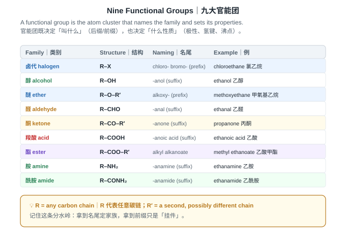
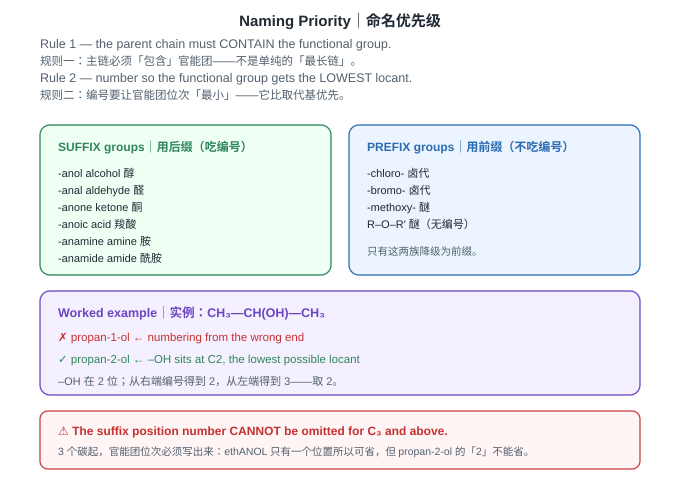
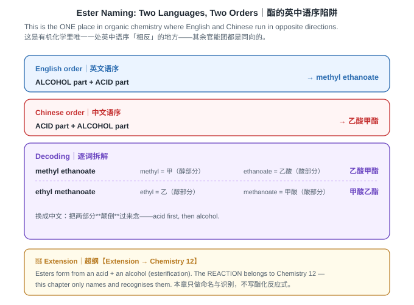
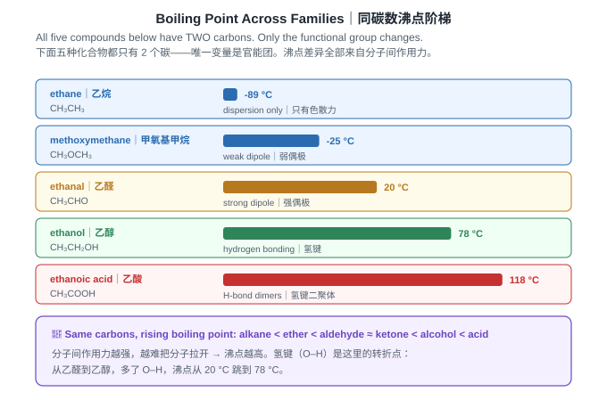

# Ch.3 — Functional Groups: The Organic Vocabulary
## Chapter 3 · Functional Groups: The Organic Vocabulary｜第 3 章　官能团：有机化学的"词汇"

> 🗂️ **Content Alignment｜大纲对应**：C5 "organic compounds" (functional groups) · C4 接口 (bonds/forces → hydrogen bonding)｜C5「有机化合物」（官能团部分）· C4 接口（化学键/分子间作用力 → 氢键）；Big Idea **B2**｜核心概念 **B2**
> ⏱️ **Periods｜课时**：8　|　**Prerequisite｜前置**：Ch.2（烃的命名与结构）｜**Followed by｜后继**：Ch.4（有机应用）、Ch.7（分子间作用力完整版）
> 🗂️ **Generated｜文件生成时间**：2026-10-02

## 1. Content Alignment｜大纲对应

| Item｜项目 | Content｜内容 |
|---|---|---|
| Content served｜服务的 Content | **C5 organic compounds** — the functional-group half: alcohols, ethers, aldehydes, ketones, carboxylic acids, esters, amines, amides, halogenated compounds｜**C5 有机化合物**——官能团部分：醇、醚、醛、酮、羧酸、酯、胺、酰胺、卤代烃 |
| Interface｜接口 | **C4 bonds/forces** — functional groups control physical properties through **hydrogen bonding** and polarity (full treatment in Ch.7)｜**C4 化学键/作用力**——官能团通过**氢键**与极性决定物理性质（Ch.7 完整展开） |
| Competencies | [Communicating] Use IUPAC conventions for all nine families｜[Processing and analyzing] Relate structure to properties｜[Applying and innovating] Connect functional groups to flavours, drugs and materials｜[交流] 用 IUPAC 规范处理九大官能团｜[处理与分析] 把结构与性质关联｜[应用与创新] 把官能团与香料、药物、材料联系起来 |
| Beyond scope?｜是否超纲 | **No** — but organic **reactions** (esterification, oxidation, substitution) are Chemistry 12 and are labelled `【Extension → Chemistry 12】`. This chapter is naming, drawing and properties only.｜**不超纲**——但有机**反应**（酯化、氧化、取代）属 Chemistry 12，标 `【Extension → Chemistry 12】`。本章只做命名、结构与性质。 |

**中文**：Ch.2 给了你有机化学的"骨架词汇"（烷、烯、炔、环）；本章补上"官能团词汇"。学完后你应当能看任何常见有机分子的结构式，说出它**叫什么**、**属于哪一族**、以及**大概是什么性格**（水溶吗？沸点高低？）。这两章合起来就是学校第一单元的全部命名与识别内容。

> 📏 **Course-level rule｜课程级规则**：Every functional group has **two jobs**: it appears in the **name** (as a suffix or a prefix), and it appears in the **properties** (as a site of polarity or hydrogen bonding). If you can connect these two jobs for each family, the chapter is learned.
> **中文**：每个官能团都有**两个作用**：一个在**命名**里（当后缀或前缀），一个在**性质**里（当极性或氢键位点）。九个家族每个都能把这两条接起来，本章就学完了。

## 2. Learning Objectives｜学习目标

**EN — By the end of this chapter, you should be able to:**

1. Recognise and draw the nine major functional groups from a condensed or skeletal formula.
2. Name compounds containing any of the nine groups using IUPAC rules, including the ester double-name.
3. Choose the correct parent chain and numbering when a functional group is present.
4. Rank compounds by boiling point or water solubility using hydrogen bonding and polarity arguments.
5. Explain why C₂H₆O can be two very different substances (ethanol vs methoxymethane).

**中文 — 本章结束后，你应当能够：**

1. 从凝聚结构式或骨架式中识别并画出九大官能团。
2. 用 IUPAC 规则命名含任一官能团的化合物（含酯的双词名）。
3. 在有官能团时正确选主链、正确编号。
4. 用氢键与极性论证，把化合物按沸点或水溶性排序。
5. 解释 C₂H₆O 为什么能对应两种完全不同的物质（乙醇 vs 甲氧基甲烷）。

## 3. Concept Explanations｜概念解析

### 3.1 What a Functional Group Is｜官能团是什么

**Definition｜定义**：A **functional group** is a specific atom or cluster of atoms within a molecule that determines the molecule's characteristic reactions and, to a large extent, its physical properties.

**中文**：**官能团**是分子中一个特定的原子或原子团，它决定分子的特征反应，并在很大程度上决定物理性质。

Think back to Ch.2: the three hydrocarbon families were distinguished by one bond each — C–C, C=C, C≡C. A C=C **is** a functional group, just the simplest one. This chapter widens the idea: instead of only C and H, we now allow **O, N and halogens** into the structure, and each new arrangement of them is a new family with a new name.

**中文**：回想 Ch.2：三大烃族各由一种键区分——C–C、C=C、C≡C。C=C 本身就是一个官能团，只是最简单的那个。本章把这个概念铺开：结构里不再只有 C 和 H，我们引入 **O、N 与卤素**；它们每一种新的组合方式，都对应一个新家族、一个新名字。

The same carbon count can produce wildly different substances once functional groups enter. **C₂H₆O** is the classic case (**Example 3-1**): with an –OH it is ethanol, a liquid you can drink (in dilution) that mixes with water in any ratio; with an –O– between two carbons it is methoxymethane, a gas used as a refrigerant and propellant. Same formula, same atoms, different connectivity — this is isomerism again, but now across families.

**中文**：一旦官能团登场，同样的碳数就能造出截然不同的物质。**C₂H₆O** 是经典例子（**例 3-1**）：带 –OH 时它是乙醇——可（稀释后）饮用、与水任意比互溶的液体；两个碳之间夹一个 –O– 时它是甲氧基甲烷——用作制冷剂与推进剂的气体。同分子式、同原子、不同连接——又是异构现象，只不过这次跨了家族。

### 3.2 The Nine Families at a Glance｜九大官能团总览

All nine families are summarised in **Fig. 3-1**. Two structural notes before the details:

**中文**：九大官能团汇总见**图 3-1**。看细节之前先说两个结构要点：

- **R** stands for "the rest of the carbon chain" — any alkyl group. **R′** is a second, possibly different chain. So R–O–R′ covers both CH₃OCH₃ and CH₃OCH₂CH₃.
  - **中文**：**R** 代表"碳链的其余部分"——任意烷基。**R′** 是第二条链，可以与 R 相同也可以不同。所以 R–O–R′ 同时涵盖 CH₃OCH₃ 与 CH₃OCH₂CH₃。
- **Carbonyl C=O** is not itself a family: it appears inside aldehydes, ketones, carboxylic acids, esters and amides. What decides the family is **what is attached to the carbonyl carbon**.
  - **中文**：**羰基 C=O** 本身不是一个家族：它出现在醛、酮、羧酸、酯、酰胺内部。决定家族的是**羰基碳上还接了什么**。

> ⚠️ **Misconception｜易错**：A carbonyl group alone does not make a molecule "a ketone". Ketones have **two** carbon neighbours on the carbonyl carbon; aldehydes have **one carbon + one H**; carboxylic acids have **one carbon + one –OH**. Count the neighbours.
> **中文**：只有羰基不等于酮。酮的羰基碳上接**两个**碳邻位；醛接**一个碳 + 一个 H**；羧酸接**一个碳 + 一个 –OH**。数邻位。

### 3.3 Alcohols｜醇

**Definition｜定义**：An **alcohol** contains a **hydroxyl group (–OH)** bonded to a saturated carbon. IUPAC name: parent + **-ol** with the locant written inside the name (**propan-2-ol**).

**中文**：**醇**是**羟基（–OH）**连在饱和碳上的化合物。IUPAC 名：母体 + **-ol**，位次写进词中（**propan-2-ol**）。

The –OH group is the single most important functional group for physical properties at this level: it is **polar**, and its O–H bond can form **hydrogen bonds** with neighbouring molecules — including water. Small alcohols (methanol, ethanol, propan-1-ol) are **completely miscible** with water; as the carbon chain grows, the hydrocarbon part wins and solubility falls (butan-1-ol is only partly miscible).

**中文**：–OH 是本阶段物理性质上最重要的官能团：它**有极性**，其 O–H 键能与相邻分子（包括水）形成**氢键**。小分子醇（甲醇、乙醇、1-丙醇）与水**完全互溶**；碳链一长，烃基部分占上风，溶解度下降（1-丁醇只部分互溶）。

Naming drill｜命名演练：

| Structure｜结构 | IUPAC name｜IUPAC 名 | Chinese｜中文 |
|---|---|---|---|
| CH₃OH | methanol | 甲醇 |
| CH₃CH₂OH | ethanol | 乙醇 |
| CH₃CH(OH)CH₃ | propan-2-ol | 2-丙醇（异丙醇） |
| CH₃CH₂CH₂OH | propan-1-ol | 1-丙醇 |
| CH₃CH₂CH₂CH₂OH | butan-1-ol | 1-丁醇 |

> 💡 **Tip｜口诀**：Locant placement follows the 2013 IUPAC style — the number goes **inside** the name, right before the suffix: **propan-2-ol**, not *2-propanol*. Both appear in older books; use the infix style in this course.
> **中文**：位次写法按 2013 年 IUPAC 风格——数字放在名称**内部**、紧贴后缀：**propan-2-ol**，不写 *2-propanol*。旧书两种都有；本课程统一用内嵌式。

### 3.4 Aldehydes and Ketones｜醛与酮

**Definition｜定义**：Both contain a **carbonyl (C=O)**. In an **aldehyde** the carbonyl carbon sits at the **end** of the chain and carries an H (**R–CHO**); in a **ketone** it sits **inside** the chain with two carbon neighbours (**R–CO–R′**).

**中文**：两者都含**羰基（C=O）**。**醛**的羰基碳位于链**端**、带一个 H（**R–CHO**）；**酮**的羰基在链**中**、接两个碳邻位（**R–CO–R′**）。

Naming: aldehydes take **-al** (the carbonyl carbon is C1 by definition, so no locant is needed); ketones take **-one** with a locant from C₄ upward (**propan-2-one** needs no number because 2 is the only possible position).

**中文**：命名：醛用 **-al**（羰基碳按定义就是 C1，所以不用标位次）；酮用 **-one**，从四个碳起要标位次（**propan-2-one** 不用标，因为 2 是唯一可能的位置）。

| Structure｜结构 | IUPAC name｜IUPAC 名 | Chinese｜中文 |
|---|---|---|---|
| CH₃CHO | ethanal | 乙醛 |
| CH₃CH₂CHO | propanal | 丙醛 |
| CH₃COCH₃ | propan-2-one | 丙酮 |
| CH₃COCH₂CH₃ | butan-2-one | 2-丁酮 |

> 📏 **Rule｜规则**：A carbonyl at the end = aldehyde. A carbonyl in the middle = ketone. Never write a "terminal ketone" — by definition it would be an aldehyde.
> **中文**：羰基在端位 = 醛；在中间 = 酮。不存在"端位酮"——按定义那就是醛。

### 3.5 Carboxylic Acids and Esters｜羧酸与酯

**Definition｜定义**：A **carboxylic acid** has a carbonyl **and** a hydroxyl on the same carbon (**R–COOH**, the **carboxyl group**). An **ester** has a carbonyl and an oxygen bonded to a second carbon (**R–COO–R′**).

**中文**：**羧酸**在同一个碳上同时有羰基和羟基（**R–COOH**，即**羧基**）。**酯**是羰基加一个连到第二个碳上的氧（**R–COO–R′**）。

Carboxylic acids name with **-anoic acid**: CH₃COOH is **ethanoic acid**（乙酸，俗名 acetic acid）. The carboxyl carbon is C1.

**中文**：羧酸用 **-anoic acid** 命名：CH₃COOH 是 **ethanoic acid**（乙酸，俗名醋酸）。羧基碳是 C1。

Esters use the **double name** `alkyl alkanoate` — and this is where English and Chinese split (**§3.9**, **Fig. 3-3**).

**中文**：酯用**双词名** `alkyl alkanoate`——英中语序正是在这里分道扬镳（**§3.9**、**图 3-3**）。

| Structure｜结构 | IUPAC name｜IUPAC 名 | Chinese｜中文 |
|---|---|---|---|
| HCOOH | methanoic acid | 甲酸 |
| CH₃COOH | ethanoic acid | 乙酸 |
| HCOOCH₃ | methyl methanoate | 甲酸甲酯 |
| CH₃COOCH₂CH₃ | ethyl ethanoate | 乙酸乙酯 |

> 💡 **Tip｜口诀**：-COOH smells like vinegar (ethanoic acid); -COO–R′ smells like fruit (esters). Pineapple = ethyl butanoate; pear = (E,Z)-deca-2,4-dienoate esters. Your nose is a functional-group detector.
> **中文**：-COOH 是醋味（乙酸）；-COO–R′ 是果味（酯）。菠萝味 = 丁酸乙酯；梨味 = 癸-2,4-二烯酸酯类。你的鼻子就是官能团检测器。

### 3.6 Amines and Amides｜胺与酰胺

**Definition｜定义**：An **amine** has a nitrogen with carbon neighbour(s) and lone-pair chemistry (**R–NH₂**, primary; secondary/tertiary exist but are beyond this course's naming scope). An **amide** has a nitrogen attached **directly to a carbonyl carbon** (**R–CONH₂**).

**中文**：**胺**是氮上接碳邻位、带孤对电子的化合物（**R–NH₂**，伯胺；仲胺/叔胺超出本课程命名范围）。**酰胺**的氮**直接连在羰基碳上**（**R–CONH₂**）。

Amines name with **-amine** (ethanamine 乙胺); amides with **-amide** (ethanamide 乙酰胺). The amide N–H can donate a hydrogen bond and the C=O can accept one, so amides have very high boiling points for their size — this is why **proteins** (polymers of amide links, the "peptide bond") hold their shapes.

**中文**：胺用 **-amine** 命名（ethanamine 乙胺）；酰胺用 **-amide**（ethanamide 乙酰胺）。酰胺的 N–H 能给出氢键、C=O 能接受氢键，所以同尺寸下酰胺沸点极高——这正是**蛋白质**（酰胺键即"肽键"连成的聚合物）能维持形状的原因。

> ⚠️ **Misconception｜易错**：amine ≠ amide. The amide nitrogen is **locked to a carbonyl** and behaves completely differently — it is not basic the way an amine is. Check whether the N touches a C=O.
> **中文**：胺 ≠ 酰胺。酰胺的氮被**锁在羰基上**，行为完全不同——它不像胺那样显碱性。判断标准就是氮是否紧贴 C=O。

### 3.7 Halogenated Compounds and Ethers｜卤代烃与醚

**Halogenated compounds｜卤代烃**：one or more H replaced by **F/Cl/Br/I**. They use **prefixes** (fluoro-, chloro-, bromo-, iodo-) and take the lowest possible positions, listed alphabetically when mixed: **2-bromo-1-chloropropane**.

**中文**：**卤代烃**：一个或多个 H 被 **F/Cl/Br/I** 取代。用**前缀**命名（fluoro-、chloro-、bromo-、iodo-），取最小位次；混合卤素时按字母序列出：**2-bromo-1-chloropropane**。

**Ethers｜醚**：an oxygen bridging two carbon chains (**R–O–R′**). Name the shorter chain + oxygen as an **alkoxy-** prefix on the longer parent: CH₃OCH₂CH₃ is **methoxyethane**（甲氧基乙烷）.

**中文**：**醚**：一个氧桥接两条碳链（**R–O–R′**）。把短链 + 氧当作**alkoxy-** 前缀挂在长链母体上：CH₃OCH₂CH₃ 是 **methoxyethane**（甲氧基乙烷）。

Ethers have no O–H, so **they cannot hydrogen-bond with themselves** — their boiling points sit close to alkanes of the same mass, far below the matching alcohol (§3.10).

**中文**：醚没有 O–H，**自己分子之间不能形成氢键**——沸点接近同质量的烷烃，远低于对应的醇（§3.10）。

### 3.8 Naming Priority: Suffix vs Prefix｜命名优先级：后缀 vs 前缀

When several features coexist in one molecule, the naming system has a priority order (**Fig. 3-2**):

**中文**：一个分子里同时出现多个结构特征时，命名体系有优先级（**图 3-2**）：

1. The **parent chain must contain the suffix functional group** (the acid carbon, the alcohol carbon, …) — not merely the longest chain.
   - **中文**：**主链必须包含后缀官能团**（羧酸碳、醇碳……）——不只是"最长链"。
2. Numbering gives the **suffix group the lowest locant first**; substituents and prefixes take whatever numbers remain.
   - **中文**：编号时**后缀官能团先取最小位次**；取代基与前缀只能拿剩下的编号。
3. **Suffix groups** (alcohol, aldehyde, ketone, acid, amine, amide) appear **after** the parent name. **Prefix groups** (halogen, ether as alkoxy) appear **before** it in alphabetical order.
   - **中文**：**后缀官能团**（醇、醛、酮、酸、胺、酰胺）放在母体名**之后**；**前缀官能团**（卤素、醚的 alkoxy）按字母序放在母体名**之前**。

Worked trace｜演算：CH₃CH(OH)CH₂Br

| Step｜步骤 | Work｜演算 |
|---|---|
| 1. Parent with suffix group｜含官能团的主链 | 3 carbons → propane｜3 个碳 → propane |
| 2. Number for –OH｜为 –OH 编号 | –OH at C2 either way → check the Br｜两个方向 –OH 都在 2 位 → 再看 Br |
| 3. Locate the prefix｜定前缀 | Br at C3 (numbering from the CH₃ end)｜从 CH₃ 端编号，Br 在 3 位 |
| 4. Assemble｜拼装 | **3-bromopropan-2-ol**｜3-溴-2-丙醇 |

**中文**：主链 3 个碳；编号让 –OH 保持最小位次（2 位），此时 Br 落在 3 位；前缀 bromo 按规则放前面，得 **3-bromopropan-2-ol**（3-溴-2-丙醇）。

### 3.9 The Ester Double Name｜酯的双词名（英中语序相反）

Esters are the **one family** where English and Chinese naming run in **opposite directions** (**Fig. 3-3**):

**中文**：酯是**唯一**一个英中命名语序**相反**的家族（**图 3-3**）：

- **English**: `alkyl (from the alcohol) + alkanoate (from the acid)` → **methyl ethanoate**.
  - **中文**：**英文**：`醇部分 alkyl + 酸部分 alkanoate` → **methyl ethanoate**。
- **Chinese**: `酸部分 + 醇部分 + 酯` → **乙酸甲酯** (acid first, then alcohol, then 酯).
  - **中文**：**中文**：`酸部分 + 醇部分 + 酯` → **乙酸甲酯**（先酸后醇再酯）。

Decode it yourself｜自己拆一遍：

| English name｜英文名 | Alcohol part｜醇部分 | Acid part｜酸部分 | Chinese｜中文名 |
|---|---|---|---|---|
| methyl ethanoate | methyl 甲醇 | ethanoate 乙酸 | 乙酸甲酯 |
| ethyl methanoate | ethyl 乙醇 | methanoate 甲酸 | 甲酸乙酯 |
| ethyl butanoate | ethyl 乙醇 | butanoate 丁酸 | 丁酸乙酯 |

The `-oate` ending is the acid in disguise: **methanoate** = from **methanoic acid**, **ethanoate** = from **ethanoic acid**. The first word tells you which alcohol contributed.

**中文**：`-oate` 词尾就是"变装后的酸"：**methanoate** 来自 **methanoic acid**（甲酸），**ethanoate** 来自 **ethanoic acid**（乙酸）。第一个单词告诉你醇那半来自哪里。

> ⚠️ **Misconception｜易错**：methyl ethanoate and ethyl methanoate are **different compounds** with different smells and boiling points. Reversing the two words is not a style choice — it changes the substance.
> **中文**：methyl ethanoate 与 ethyl methanoate 是**不同化合物**，气味与沸点都不同。两个词写反不是措辞问题——是换了一种物质。

### 3.10 Properties: Hydrogen Bonding and the Boiling-Point Ladder｜性质：氢键与沸点阶梯

With the same carbon count, boiling point rises with the strength of the **intermolecular forces** — a preview of Ch.7 (**Fig. 3-4**):

**中文**：碳数相同的情况下，沸点随**分子间作用力**增强而升高——这是 Ch.7 的预告（**图 3-4**）：

> **alkane < ether < aldehyde ≈ ketone < alcohol < carboxylic acid**
> **烷烃 < 醚 < 醛 ≈ 酮 < 醇 < 羧酸**

The reasons, family by family｜逐族解释：

- **Alkanes** have only **London dispersion forces** — the weakest IMF.
  - **中文**：**烷烃**只有**色散力**——最弱的分子间作用力。
- **Ethers** have a polar C–O–C but **no O–H**, so no self-hydrogen-bonding; only dipole-dipole.
  - **中文**：**醚**有极性 C–O–C 但**没有 O–H**，自己分子间不成氢键；只有偶极-偶极作用。
- **Aldehydes and ketones** have a strong C=O dipole — stronger dipole-dipole than ethers.
  - **中文**：**醛与酮**有强 C=O 偶极——偶极作用比醚强。
- **Alcohols** have O–H, so molecules hydrogen-bond **to each other** — a big jump.
  - **中文**：**醇**有 O–H，分子之间能形成氢键——沸点跳一档。
- **Carboxylic acids** hydrogen-bond in **pairs (dimers)**, effectively doubling the molecular size in the liquid — highest of the series.
  - **中文**：**羧酸**以**二聚体**形式成对氢键，液态下相当于分子体积翻倍——系列中最高。

The same logic runs solubility. Water accepts and donates hydrogen bonds, so any group able to hydrogen-bond (–OH, –NH₂, C=O) pulls the molecule toward water; a long hydrocarbon tail pulls the other way. Molecules with a **polar/hydrogen-bonding head and a non-polar tail** sit between the two worlds — the idea behind soaps, membranes and emulsifiers (Ch.4, Ch.12).

**中文**：同一套逻辑也管溶解度。水既能给出也能接受氢键，所以任何能形成氢键的基团（–OH、–NH₂、C=O）都把分子"拉向水"；长长的烃基尾巴则往反方向拉。**极性/氢键头 + 非极性尾**的分子骑在两个世界的边界上——这正是肥皂、生物膜与乳化剂背后的思想（Ch.4、Ch.12）。

> 📏 **Rule｜规则**：Intermolecular forces do not break covalent bonds. Boiling ethanol breaks hydrogen bonds **between** molecules; every O–H bond **inside** each molecule survives.
> **中文**：分子间作用力不断共价键。煮沸乙醇断开的是分子**之间**的氢键；每个分子**内部**的 O–H 键完好无损。

> 🔭 **Extension｜超纲**【Extension → Chemistry 12】：How each functional group **reacts** — oxidation of alcohols, addition to carbonyls, esterification, amide formation — belongs to Chemistry 12. This chapter deals only with naming, drawing and physical properties.
> **中文**：【超纲延伸 → Chemistry 12】各官能团**如何反应**——醇的氧化、羰基加成、酯化、酰胺化——属 Chemistry 12。本章只做命名、画结构与物理性质。

## 4. Comparison Tables｜表格比对

### Table 3-1　The Nine Families｜九大官能团总表

| Family｜家族 | General structure｜通式 | Suffix / prefix｜后缀/前缀 | H-bond donor?｜给氢键? | H-bond acceptor?｜受氢键? |
|---|---|---|---|---|---|
| halogenated｜卤代烃 | R–X | chloro- etc. (prefix) | no｜无 | no｜无 |
| alcohol｜醇 | R–OH | -anol (suffix) | **yes｜有** | **yes｜有** |
| ether｜醚 | R–O–R′ | alkoxy- (prefix) | no｜无 | **yes｜有** |
| aldehyde｜醛 | R–CHO | -anal (suffix) | no｜无 | **yes｜有** |
| ketone｜酮 | R–CO–R′ | -anone (suffix) | no｜无 | **yes｜有** |
| carboxylic acid｜羧酸 | R–COOH | -anoic acid (suffix) | **yes｜有** | **yes｜有** |
| ester｜酯 | R–COO–R′ | alkyl alkanoate | no｜无 | **yes｜有** |
| amine｜胺 | R–NH₂ | -anamine (suffix) | **yes｜有** | **yes｜有** |
| amide｜酰胺 | R–CONH₂ | -anamide (suffix) | **yes｜有** | **yes｜有** |

### Table 3-2　Suffix vs Prefix Groups｜后缀族 vs 前缀族

| | Suffix group｜后缀官能团 | Prefix group｜前缀官能团 |
|---|---|---|
| Families｜家族 | alcohol 醇 · aldehyde 醛 · ketone 酮 · acid 羧酸 · amine 胺 · amide 酰胺 | halogen 卤代 · ether 醚 |
| Position in name｜在名字中的位置 | after the parent｜母体之后 | before the parent, alphabetical｜母体之前，按字母序 |
| Gets the lowest locant?｜吃最小位次? | **yes｜是** | after suffix groups｜让给后缀族 |
| Example｜例 | propan-2-ol 2-丙醇 | 3-bromopropan-2-ol 3-溴-2-丙醇 |

### Table 3-3　Same Formula, Different Family｜同分异构、不同家族：C₂H₆O

| | ethanol｜乙醇 | methoxymethane｜甲氧基甲烷 |
|---|---|---|
| Formula｜分子式 | C₂H₆O | C₂H₆O |
| Group｜官能团 | –OH (alcohol 醇) | –O– (ether 醚) |
| Boiling point｜沸点 | **78 °C** | **−25 °C** |
| Water miscibility｜与水互溶 | completely｜完全互溶 | partly｜部分互溶 |
| Hydrogen-bond to itself?｜自身成氢键? | yes｜能 | no｜不能 |

### Table 3-4　Boiling-Point Ladder (all C₂)｜沸点阶梯（全部 2 个碳）

| Compound｜化合物 | Group｜官能团 | bp｜沸点 | Dominant IMF｜主导作用力 |
|---|---|---|---|---|
| ethane 乙烷 | — | −89 °C | dispersion 色散力 |
| methoxymethane 甲氧基甲烷 | ether 醚 | −25 °C | weak dipole 弱偶极 |
| ethanal 乙醛 | aldehyde 醛 | 20 °C | strong dipole 强偶极 |
| ethanol 乙醇 | alcohol 醇 | 78 °C | hydrogen bonding 氢键 |
| ethanoic acid 乙酸 | acid 羧酸 | 118 °C | H-bond dimers 氢键二聚 |

## 5. Diagrams & Worked Examples｜图例说明

### Fig. 3-1　Nine Functional Groups｜九大官能团



**Reading the figure｜看图要点**：九行一张表——家族、通式、命名后缀/前缀、例名。先看"Structure"列找官能团，再看"Naming"列定词尾。

### Fig. 3-2　Naming Priority｜命名优先级



**Reading the figure｜看图要点**：左栏六个后缀族"吃"最小位次，右栏两个前缀族靠后。实例 CH₃CH(OH)CH₃ 从两个方向编号结果不同，取 –OH 最小的那个。

### Fig. 3-3　Ester Bilingual Naming｜酯的英中语序



**Reading the figure｜看图要点**：英文先醇后酸、中文先酸后醇。methyl ethanoate = 乙酸甲酯，两个词一颠倒是另一种物质。

### Fig. 3-4　Boiling-Point Ladder｜沸点阶梯



**Reading the figure｜看图要点**：全部 2 个碳、五种官能团、五个沸点。条形长度正比于温度；阶梯的每一步都对应一种新的分子间作用力。

### Example 3-1　Name from Structure｜由结构写名称

**Problem｜题目**：Name the following structure.

```
CH₃ — O — CH₂ — CH₃
```

**中文**：为上面的结构命名。

| Step｜步骤 | Work｜演算 |
|---|---|---|
| 1. Identify the group｜认官能团 | O between two carbons → **ether**｜两碳之间夹 O → **醚** |
| 2. Split the chains｜分两条链 | CH₃– (1 C) and –CH₂CH₃ (2 C)｜CH₃–（1 碳）与 –CH₂CH₃（2 碳） |
| 3. Alkoxy prefix｜前缀 | shorter chain + O = **methoxy-**｜短链 + O = **methoxy-** |
| 4. Parent｜母体 | longer chain = **ethane**｜长链 = **ethane** |
| 5. Assemble｜拼装 | **methoxyethane**｜甲氧基乙烷 |

> 💡 **Tip｜口诀**：For ethers, the LONGER chain is the parent and the SHORTER chain rides on it as the alkoxy prefix.
> **中文**：命名醚时，**长链是母体**，短链以 alkoxy 前缀的形式挂上去。

### Example 3-2　Structure from Name｜由名称写结构

**Problem｜题目**：Draw the condensed formula for **propyl ethanoate**.

**中文**：写出 **propyl ethanoate（乙酸丙酯）** 的凝聚结构式。

| Step｜步骤 | Work｜演算 |
|---|---|---|
| 1. Split the name｜拆名 | propyl (alcohol side) + ethanoate (acid side)｜propyl（醇侧）+ ethanoate（酸侧） |
| 2. Acid part｜酸部分 | ethanoate = CH₃COO–｜ethanoate = CH₃COO– |
| 3. Alcohol part｜醇部分 | propyl = –CH₂CH₂CH₃｜propyl = –CH₂CH₂CH₃ |
| 4. Join｜拼接 | **CH₃COOCH₂CH₂CH₃** | 

**中文**：propyl ethanoate 拆成"乙酸部分 + 丙醇部分"，接起来是 CH₃COOCH₂CH₂CH₃（乙酸丙酯）。

> 🔍 **Self-check｜自检**：Count the carbons — 2 (acid) + 3 (alcohol) = **5 carbons**, and the formula is C₅H₁₀O₂. Every carbon must still satisfy the four-bond rule.
> **中文**：数一数碳——酸侧 2 + 醇侧 3 = **共 5 个碳**，分子式 C₅H₁₀O₂。每个碳仍须满足四键规则。

### Example 3-3　Predicting Boiling Points｜预测沸点

**Problem｜题目**：Arrange in order of increasing boiling point, and justify each step: propan-1-ol, propanal, propane.

**中文**：把 propan-1-ol（1-丙醇）、propanal（丙醛）、propane（丙烷）按沸点从低到高排序，并逐步说理。

| Rank｜排序 | Compound｜化合物 | Reason｜理由 |
|---|---|---|---|---|
| 1 (lowest)｜最低 | propane | dispersion only｜只有色散力 |
| 2 | propanal | strong C=O dipole｜强 C=O 偶极 |
| 3 (highest)｜最高 | propan-1-ol | O–H hydrogen bonding｜O–H 氢键 |

**中文**：三个都是 3 个碳，变量只在官能团。丙烷只有色散力，最低；丙醛多出强极性的 C=O，居中；1-丙醇还有 O–H 能成氢键，最高。**排序：propane < propanal < propan-1-ol。**

## 6. Key Vocabulary｜核心词汇

| English | 中文 | Note｜备注 |
|---|---|---|
| functional group | 官能团 | names the family, sets the properties｜定族、定性 |
| hydroxyl group | 羟基 | –OH in alcohols｜醇中的 –OH |
| carboxyl group | 羧基 | –COOH｜羧酸特征 |
| carbonyl group | 羰基 | C=O；出现在醛酮酸酯酰胺中 |
| amino group | 氨基 | –NH₂｜胺的特征 |
| alcohol | 醇 | R–OH, suffix -anol |
| ether | 醚 | R–O–R′, prefix alkoxy- |
| aldehyde | 醛 | R–CHO, suffix -anal |
| ketone | 酮 | R–CO–R′, suffix -anone |
| carboxylic acid | 羧酸 | R–COOH, suffix -anoic acid |
| ester | 酯 | R–COO–R′, alkyl alkanoate |
| amine | 胺 | R–NH₂, suffix -anamine |
| amide | 酰胺 | R–CONH₂, suffix -anamide |
| hydrogen bonding | 氢键 | strongest IMF in this course｜本课程最强的分子间作用力 |
| hydrophilic | 亲水的 | water-attracting｜吸水端 |
| hydrophobic | 疏水的 | water-repelling｜斥水端 |
| miscible | 互溶的 | mixes in any ratio｜任意比例互溶 |
| dimer | 二聚体 | two molecules bound as one unit｜两个分子抱成一个单元 |

## 7. Lab / Activity｜实验与活动

### Activity 3-1　Smell the Esters｜闻香识酯

- **Type｜类型**：Teacher-managed scent stations｜教师管理的气味站
- **Materials｜材料**：scent cards or sealed vials of safe esters (ethyl ethanoate, ethyl butanoate, propyl ethanoate), reference fruit list｜安全酯类的气味卡或密封小瓶（乙酸乙酯、丁酸乙酯、乙酸丙酯）、水果对照表
- **Steps｜步骤**：
  1. Smell each sample (wafting technique, never inhale directly) and guess the fruit.
     - **中文**：用手扇闻每种样品（禁止直接凑近吸气），猜对应的水果。
  2. Write each ester's structure and split the double name into acid + alcohol parts.
     - **中文**：写出每种酯的结构式，把双词名拆成"酸部分 + 醇部分"。
  3. Rank the samples by how "fruity vs solvent-like" they smell and connect to chain length.
     - **中文**：按"果味 vs 溶剂味"排序，并联系碳链长度解释。
- **Competency｜能力**：[Applying and innovating] connect structure to everyday products｜[应用与创新] 把结构与日用品联系起来
- **Safety｜安全**：Waft only; esters are flammable; keep away from flames｜只扇闻；酯类易燃；远离明火

### Activity 3-2　Functional Group Triage｜官能团分诊台

- **Type｜类型**：Timed team sorting｜限时小组分类
- **Materials｜材料**：30 structure cards, 9 labelled "window" trays｜30 张结构式卡片、9 个标好官能团的"窗口"托盘
- **Steps｜步骤**：
  1. Sort all 30 cards into the correct functional-group window in 10 minutes.
     - **中文**：10 分钟内把 30 张卡片分进正确的官能团窗口。
  2. For every error, write one sentence explaining which structural feature was misread.
     - **中文**：对每个错误写一句话，说明看错了哪个结构特征。
  3. Run a second round with new cards and compare error counts.
     - **中文**：换一批卡再跑一轮，比较错误数。
- **Competency｜能力**：[Processing and analyzing] classify by structure｜[处理与分析] 按结构分类
- **Safety｜安全**：None｜无

### Activity 3-3　Solubility Quick Test｜溶解性快测

- **Type｜类型**：Micro-scale demonstration｜微scale演示
- **Materials｜材料**：ethanol, vegetable oil, table salt, water, small test tubes｜乙醇、食用油、食盐、水、小试管
- **Steps｜步骤**：
  1. Add a few drops / grains of each sample to water and observe.
     - **中文**：把每种样品少量加入水中，观察现象。
  2. Record dissolves / partly / not, and identify the functional group in each sample.
     - **中文**：记录"溶 / 部分溶 / 不溶"，并指出每种样品里的官能团。
  3. Explain each result using "hydrophilic head, hydrophobic tail".
     - **中文**：用"亲水头、疏水尾"解释每个结果。
- **Competency｜能力**：[Questioning and predicting]｜[Processing and analyzing]
- **Safety｜安全**：Do not taste any sample｜任何样品不得入口

### Activity 3-4　Boiling-Point Data Hunt｜沸点数据猎取

- **Type｜类型**：Data analysis｜数据分析
- **Materials｜材料**：a boiling-point table for C₁–C₄ members of five families｜五个家族 C₁–C₄ 成员的沸点数据表
- **Steps｜步骤**：
  1. Plot boiling point against carbon number for each family on one graph.
     - **中文**：在同一张图上，画出五个家族"沸点 vs 碳数"的曲线。
  2. Explain the vertical gaps between the family curves using intermolecular forces.
     - **中文**：用分子间作用力解释各家族曲线之间的纵向间隙。
  3. Predict the boiling point of butanal from the trend, then check the data book.
     - **中文**：按趋势预测 butanal（丁醛）的沸点，再查数据册验证。
- **Competency｜能力**：[Processing and analyzing] construct and interpret graphs｜[处理与分析] 作图并解读
- **Safety｜安全**：None (data work)｜无（数据分析）

## 8. Common Misconceptions｜常见易错点

| # | Misconception｜错误认识 | Correction｜正确理解 |
|---|---|---|
| 1 | "Aldehyde and ketone are the same thing."｜醛酮是一回事。 | Aldehyde C=O sits at the chain end with an H; ketone C=O sits inside with two carbon neighbours.｜醛的 C=O 在链端带 H；酮的 C=O 在链中接两个碳。 |
| 2 | "The ester double name can be written either way."｜酯的双词名顺序随意。 | English is alcohol-then-acid; Chinese is acid-then-alcohol. Reversing the words names a different ester.｜英文先醇后酸，中文先酸后醇。两个词写反就是另一种酯。 |
| 3 | "Propan-2-ol and propan-1-ol are the same compound."｜propan-2-ol 与 propan-1-ol 相同。 | They are positional isomers with different boiling points and melting points.｜它们是位置异构体，沸点熔点都不同。 |
| 4 | "An –OH group makes a molecule a base like NaOH."｜有 –OH 就是像 NaOH 那样的碱。 | The alcohol O–H does not release OH⁻ in water; alcohols are not Arrhenius bases.｜醇的 O–H 在水里不放出 OH⁻；醇不是 Arrhenius 碱。 |
| 5 | "Hydrogen bonds are strong covalent bonds inside the molecule."｜氢键是分子内强共价键。 | Hydrogen bonds are **intermolecular** attractions, far weaker than O–H covalent bonds.｜氢键是**分子间**吸引，远弱于 O–H 共价键。 |
| 6 | "All organic compounds are insoluble in water."｜有机物都不溶于水。 | Short-chain molecules with –OH, –NH₂ or C=O dissolve well (ethanol, sugar, acetone).｜短链且带 –OH、–NH₂、C=O 的分子很溶于水（乙醇、糖、丙酮）。 |
| 7 | "Ethers boil almost as high as alcohols because both contain oxygen."｜醚和醇都含氧，沸点应该差不多。 | Ethers have no O–H, so they cannot hydrogen-bond with themselves; their bp is close to alkanes.｜醚没有 O–H，自身不能成氢键；沸点接近烷烃。 |
| 8 | "The parent chain is always the longest one, even if it misses the functional group."｜主链永远选最长，哪怕不含官能团。 | The parent must **contain the suffix functional group**, even if a longer chain exists elsewhere.｜主链必须**包含后缀官能团**，哪怕别处有更长的链。 |
| 9 | "Amide and amine are just different spellings."｜amide 与 amine 只是拼写不同。 | The amide N is attached to a carbonyl (R–CONH₂) and is not basic; the amine N is not.｜酰胺的氮贴着羰基（R–CONH₂）、不显碱性；胺不是。 |
| 10 | "Boiling breaks the O–H bonds inside ethanol."｜沸腾会断开乙醇分子内的 O–H。 | Boiling overcomes intermolecular attractions only; covalent bonds inside each molecule stay intact.｜沸腾只克服分子间吸引；每个分子内部的共价键完好。 |
| 11 | "Carbonyl always means ketone."｜有羰基就是酮。 | Carbonyl appears in aldehydes, ketones, acids, esters and amides — decide by what else is attached to that carbon.｜羰基出现在醛、酮、酸、酯、酰胺中——看那个碳上还接了什么。 |
| 12 | "Functional groups only matter for reactions."｜官能团只在反应里重要。 | They also set boiling point, melting point, solubility and smell — the physical identity of the substance.｜官能团还决定沸点、熔点、溶解度与气味——物质的"物理身份证"。 |

## 9. Assessment｜答题评估

### Part A: Foundational｜基础题（10 × 2 = 20 points）

**A1.** For each family, write the general structure and the IUPAC suffix or prefix: (a) alcohol (b) aldehyde (c) ketone (d) carboxylic acid.

- **中文**：写出下列家族的通式与 IUPAC 后缀或前缀：(a) 醇 (b) 醛 (c) 酮 (d) 羧酸。

**A2.** Name: (a) CH₃CH₂CH₂OH (b) CH₃CH₂COCH₃ (c) CH₃CH₂CHO.

- **中文**：命名：(a) CH₃CH₂CH₂OH (b) CH₃CH₂COCH₃ (c) CH₃CH₂CHO。

**A3.** Draw the condensed formula for: (a) butan-2-one (b) ethanoic acid (c) methyl methanoate.

- **中文**：写出凝聚结构式：(a) butan-2-one 2-丁酮 (b) ethanoic acid 乙酸 (c) methyl methanoate 甲酸甲酯。

**A4.** Classify each structure into its family: (a) CH₃OCH₃ (b) CH₃CONH₂ (c) CH₃CH₂NH₂ (d) CH₃CH₂CH₂Cl.

- **中文**：把下列结构归入对应家族：(a) CH₃OCH₃ (b) CH₃CONH₂ (c) CH₃CH₂NH₂ (d) CH₃CH₂CH₂Cl。

**A5.** Give the IUPAC name with correct locant placement: (a) CH₃CH(OH)CH₂CH₃ (b) CH₃CH₂CH₂OH.

- **中文**：写出 IUPAC 名（位次写法要规范）：(a) CH₃CH(OH)CH₂CH₃ (b) CH₃CH₂CH₂OH。

**A6.** Which of the nine families can donate a hydrogen bond? List all.

- **中文**：九大官能团中哪些能**给出**氢键？全部列出。

**A7.** Name the ester: (a) CH₃COOCH₃ (b) HCOOCH₂CH₃ (c) CH₃CH₂COOCH₂CH₃.

- **中文**：给下列酯命名：(a) CH₃COOCH₃ (b) HCOOCH₂CH₃ (c) CH₃CH₂COOCH₂CH₃。

**A8.** State whether each is soluble, partly soluble or insoluble in water, with a one-phrase reason: (a) ethanol (b) hexane (c) butan-1-ol.

- **中文**：判断下列物质在水中是"溶 / 部分溶 / 不溶"，并各用一句话说理：(a) 乙醇 (b) 己烷 (c) 1-丁醇。

**A9.** Arrange in order of increasing boiling point and justify: CH₃CH₂CH₃, CH₃CH₂OH, CH₃OCH₂CH₃.

- **中文**：按沸点从低到高排序并说理：CH₃CH₂CH₃、CH₃CH₂OH、CH₃OCH₂CH₃。

**A10.** True or false, with a reason: "An amide and an amine with the same carbon count have similar boiling points."

- **中文**：判断对错并说明理由："碳数相同的酰胺与胺沸点相近。"

### Part B: Applied｜应用题（4 × 5 = 20 points）

**B1.** Name each structure using the full procedure (parent, numbering, prefix/suffix order). Show your work.

```
(a)  CH₃ — CH(OH) — CH₂ — CH₂ — Br      (b)  CH₃ — CO — CH₂ — CH₃
```

- **中文**：用完整流程命名下列结构（主链、编号、前缀/后缀次序都要写过程）。

**B2.** Three isomers share the formula C₃H₈O. (a) Draw all three condensed structures and name each. (b) Identify each family. (c) Predict which has the highest boiling point and justify using intermolecular forces.

- **中文**：三个异构体共享分子式 C₃H₈O。(a) 画出全部三种凝聚结构式并命名。(b) 指出各自的家族。(c) 预测哪个沸点最高，并用分子间作用力说理。

**B3.** A perfume contains three esters: methyl butanoate, ethyl ethanoate and propyl ethanoate. (a) For each, name the acid and the alcohol it "comes from". (b) The perfume maker wants a longer-lasting scent — explain, using boiling point, whether longer acid chains help or hurt.

- **中文**：某香水含三种酯：methyl butanoate、ethyl ethanoate、propyl ethanoate。(a) 分别写出每个酯对应的酸与醇。(b) 调香师想要留香更久——用沸点解释，加长酸链是帮助还是妨碍。

**B4.** A student names CH₃CH₂COOH "propan-1-oic acid". (a) Explain why this name is non-standard. (b) Give the correct IUPAC name. (c) Explain why no locant is needed for this family.

- **中文**：某同学把 CH₃CH₂COOH 命名为 "propan-1-oic acid"。(a) 说明这个名称为何不规范。(b) 给出正确的 IUPAC 名。(c) 解释为什么该家族不需要位次。

### Part C: Challenge｜挑战题（2 × 10 = 20 points）

**C1.** Four colourless liquids have the same carbon count (C₃): propan-1-ol, propanal, methoxyethane and propanoic acid. (a) Arrange them in order of increasing boiling point and justify each step with intermolecular forces. (b) Design a simple physical test (no chemical reagents) that could tell propan-1-ol from propanoic acid, and explain the expected observation. (c) State one limitation of your test.

- **中文**：四种无色液体碳数相同（3 个碳）：propan-1-ol（1-丙醇）、propanal（丙醛）、methoxyethane（甲氧基乙烷）、propanoic acid（丙酸）。(a) 按沸点从低到高排序，逐步用分子间作用力说理。(b) 设计一个简单**物理**检验（不用化学试剂）区分 1-丙醇与丙酸，并说明预期现象。(c) 指出你这个检验的一个局限。

**C2.** A molecule's skeleton is CH₃—CH(OH)—CH₂—CH₂—CHO. (a) Name it, justifying the parent-chain choice and numbering. (b) Draw the structure in condensed form. (c) Another student proposes the parent chain should instead pass through the –OH carbon and ignore the aldehyde. Explain why that naming fails the IUPAC priority rules. (d) Predict which functional group dominates this molecule's boiling point, and why.

- **中文**：某分子骨架是 CH₃—CH(OH)—CH₂—CH₂—CHO。(a) 命名，说明主链选择与编号理由。(b) 写出凝聚结构式。(c) 另一位同学主张主链应经过 –OH 碳、忽略醛基——解释为什么这种命名违反 IUPAC 优先级规则。(d) 预测哪个官能团主导该分子的沸点，并说明理由。

---

### Answer Key｜参考答案

**Part A**

- **A1.** (a) alcohol: R–OH, suffix **-anol** (b) aldehyde: R–CHO, suffix **-anal** (c) ketone: R–CO–R′, suffix **-anone** (d) acid: R–COOH, suffix **-anoic acid**

  - **中文**：(a) 醇：R–OH，后缀 **-anol** (b) 醛：R–CHO，后缀 **-anal** (c) 酮：R–CO–R′，后缀 **-anone** (d) 羧酸：R–COOH，后缀 **-anoic acid**。

- **A2.** (a) propan-1-ol 1-丙醇 (b) butan-2-one 2-丁酮 (c) propanal 丙醛

  - **中文**：(a) propan-1-ol（1-丙醇）(b) butan-2-one（2-丁酮）(c) propanal（丙醛）。

- **A3.** (a) CH₃COCH₂CH₃ (b) CH₃COOH (c) HCOOCH₃

  - **中文**：(a) CH₃COCH₂CH₃ (b) CH₃COOH (c) HCOOCH₃。

- **A4.** (a) ether 醚 (b) amide 酰胺 (c) amine 胺 (d) halogenated compound 卤代烃

  - **中文**：(a) 醚 (b) 酰胺 (c) 胺 (d) 卤代烃。

- **A5.** (a) butan-2-ol 2-丁醇 (b) propan-1-ol 1-丙醇

  - **中文**：(a) butan-2-ol（2-丁醇）(b) propan-1-ol（1-丙醇）。注意位次内嵌在词中。

- **A6.** Alcohol 醇 · carboxylic acid 羧酸 · amine 胺 · amide 酰胺 — the four families containing an O–H or N–H bond.

  - **中文**：醇、羧酸、胺、酰胺——含 O–H 或 N–H 键的四个家族。

- **A7.** (a) methyl ethanoate 乙酸甲酯 (b) ethyl methanoate 甲酸乙酯 (c) ethyl propanoate 丙酸乙酯

  - **中文**：(a) methyl ethanoate（乙酸甲酯）(b) ethyl methanoate（甲酸乙酯）(c) ethyl propanoate（丙酸乙酯）。中文都按"酸部分 + 醇部分 + 酯"读。

- **A8.** (a) soluble — the –OH hydrogen-bonds with water｜溶：–OH 与水成氢键 (b) insoluble — non-polar hydrocarbon only｜不溶：只有非极性烃基 (c) partly soluble — –OH helps but the 4-carbon tail resists｜部分溶：–OH 帮忙，但 4 碳的尾巴拖后腿

  - **中文**：(a) 溶——–OH 与水成氢键 (b) 不溶——只有非极性烃基 (c) 部分溶——–OH 有帮助，但四个碳的尾巴抵抗溶解。

- **A9.** CH₃CH₂CH₃ < CH₃OCH₂CH₃ < CH₃CH₂OH. Propane has dispersion only; the ether adds a weak dipole but no O–H; the alcohol hydrogen-bonds.

  - **中文**：丙烷 < 甲氧基乙烷 < 乙醇。丙烷只有色散力；醚多了弱偶极但没有 O–H；醇能成氢键，最高。

- **A10.** **False**. The amide has both an N–H donor and a C=O acceptor on the same unit, giving much stronger intermolecular hydrogen bonding than the amine — its boiling point is far higher at the same carbon count.

  - **中文**：**错**。酰胺在同一单元上同时有 N–H 给体和 C=O 受体，分子间氢键远强于胺——同碳数下沸点高得多。

**Part B**

- **B1.** (a) Parent = 4 C containing the –OH → butane family; number from the OH end to give –OH the lowest locant (C2); Br lands on C4 → **4-bromobutan-2-ol**｜4-溴-2-丁醇. (b) Ketone inside a 4-carbon chain → **butan-2-one**｜2-丁酮.

  - **中文**：(a) 主链 4 个碳且含 –OH；从 –OH 端编号使其位次最小（2 位），Br 落在 4 位 → **4-bromobutan-2-ol**（4-溴-2-丁醇）。(b) 4 碳链内的酮 → **butan-2-one**（2-丁酮）。

- **B2.** (a) CH₃CH₂CH₂OH = **propan-1-ol**｜1-丙醇; CH₃CH(OH)CH₃ = **propan-2-ol**｜2-丙醇; CH₃OCH₂CH₃ = **methoxyethane**｜甲氧基乙烷. (b) propan-1-ol and propan-2-ol are **alcohols 醇** (positional isomers); methoxyethane is an **ether 醚**. (c) **Propan-1-ol and propan-2-ol** both boil higher than the ether because their O–H lets molecules hydrogen-bond to each other, while the ether has no O–H and only a weak dipole; between the two alcohols, propan-1-ol is slightly higher because its –OH is more exposed.

  - **中文**：(a) CH₃CH₂CH₂OH = **propan-1-ol**（1-丙醇）；CH₃CH(OH)CH₃ = **propan-2-ol**（2-丙醇）；CH₃OCH₂CH₃ = **methoxyethane**（甲氧基乙烷）。(b) propan-1-ol 与 propan-2-ol 都是**醇**（位置异构体）；methoxyethane 是**醚**。(c) **两种醇**沸点都高于醚，因为 O–H 使分子间能形成氢键，醚没有 O–H、只有弱偶极；两种醇之间 propan-1-ol 略高，因为它的 –OH 暴露得更充分。

- **B3.** (a) methyl butanoate ← **butanoic acid** + **methanol**; ethyl ethanoate ← **ethanoic acid** + **ethanol**; propyl ethanoate ← **ethanoic acid** + **propan-1-ol**. (b) Longer chains raise boiling point (more dispersion), so the ester evaporates more slowly and the scent lasts longer — within limits, longer acid chains **help** longevity.

  - **中文**：(a) methyl butanoate ← **丁酸** + **甲醇**；ethyl ethanoate ← **乙酸** + **乙醇**；propyl ethanoate ← **乙酸** + **1-丙醇**。(b) 链变长沸点升高（色散力增强），酯挥发更慢、留香更久——在一定范围内，加长酸链**有利于**留香。

- **B4.** (a) The locant "1" is redundant and the name merges two words incorrectly — carboxylic acid names do not carry a locant. (b) **propanoic acid**｜丙酸. (c) The –COOH carbon is by definition the end carbon (C1); there is no alternative position, so no locant is ever needed.

  - **中文**：(a) 位次"1"多余，且名称把两个词错误合并——羧酸的名称不带位次。(b) **propanoic acid**（丙酸）。(c) –COOH 碳按定义就是端位碳（C1）；没有第二种可能的位置，所以永远不用写位次。

**Part C (marking points｜评分要点)**

- **C1.** (a) methoxyethane (weak dipole) < propanal (strong C=O dipole) < propan-1-ol (O–H hydrogen bonding) < propanoic acid (O–H + C=O hydrogen-bond dimers). Each step adds a stronger IMF. (b) A valid physical test: place equal drops of each on a watch glass at room temperature and time evaporation — propanoic acid evaporates far more slowly (bp ≈ 141 °C vs 97 °C for propan-1-ol); alternatively warm both gently in separate water baths and record which boils first. (c) Any reasonable limitation: the test is qualitative and cannot identify the other two liquids; impurities affect evaporation rate; warming may not reach the boiling point of either. *(4 + 4 + 2 marks)*

  - **中文**：(a) 甲氧基乙烷（弱偶极）< 丙醛（强 C=O 偶极）< 1-丙醇（O–H 氢键）< 丙酸（O–H + C=O 形成氢键二聚体）。每一步都引入更强的分子间作用力。(b) 合理的物理检验：在表面皿上滴等量各样品、室温计时蒸发——丙酸挥发慢得多（沸点约 141 °C，1-丙醇约 97 °C）；或分别在水浴中缓缓加热，记录哪个先沸腾。(c) 任何合理局限均可：该检验是定性的、无法识别另外两种液体；杂质会影响挥发速率；水浴温度可能达不到两者的沸点。*(4 + 4 + 2 分)*

- **C2.** (a) The aldehyde is the highest-priority suffix group, so the parent chain must include the CHO carbon (C1) and the numbering starts there: **4-hydroxypentanal**｜4-羟基戊醛. (b) HOCH(CH₃)CH₂CH₂CHO — written from the aldehyde end: **OHC–CH₂–CH₂–CH(OH)–CH₃**. (c) Choosing the chain "through the –OH carbon and ignoring the aldehyde" breaks two rules at once: it excludes the suffix group from the parent chain, and it would misnumber so the aldehyde carbon is not C1 — aldehydes take priority over alcohols in IUPAC. (d) The **aldehyde** dominates: although the –OH gives a hydrogen-bond donor, the C=O plus the overall shape put the molecule in the aldehyde family, and the aldehyde carbon anchors the numbering; the boiling point is set mainly by the hydrogen-bonding –OH but the *identity* of the compound is aldehyde. *(3 + 2 + 3 + 2 marks)*

  - **中文**：(a) 醛是优先级最高的后缀官能团，主链必须包含 CHO 碳（C1）、编号从它开始：**4-hydroxypentanal**（4-羟基戊醛）。(b) 从醛端写：**OHC–CH₂–CH₂–CH(OH)–CH₃**。(c) "主链经过 –OH 碳、忽略醛基"同时违反两条规则：它把后缀官能团排除在主链之外，而且编号会让醛碳不再是 C1——IUPAC 里醛优先于醇。(d) 该分子的**家族身份**由醛决定：虽然 –OH 提供氢键给体、对沸点贡献最大，但 C=O 与编号锚点都来自醛基——化合物的"身份"是醛。*(3 + 2 + 3 + 2 分)*

### Rubric｜评分量规

| Dimension｜维度 | Excellent (A)｜优秀 | Proficient (B)｜达标 | Developing (C)｜待改进 |
|---|---|---|---|---|
| Functional-group ID｜官能团识别 | Correct on all nine families, including carbonyl neighbours｜九族全对，能数羰基邻位 | Correct on common families｜常见族正确 | Confuses aldehyde/ketone or amide/amine｜醛酮或胺酰胺混淆 |
| IUPAC assembly｜IUPAC 拼装 | Correct parent, numbering and locant placement｜主链、编号、位次写法全对 | Minor locant slips｜位次小错 | Parent misses the functional group｜主链漏掉官能团 |
| Ester bilingual naming｜酯的双语命名 | Both languages correct with correct order｜两种语言语序都对 | One language correct｜一种语言正确 | Reverses the order in one or both｜一种或两种语序写反 |
| IMF reasoning｜分子间作用力说理 | Names the specific IMF for each comparison｜每次比较都指明具体作用力 | Generic "stronger forces"｜只说"力更强" | No link to structure｜与结构无关 |
| Property prediction｜性质预测 | Predicts and justifies with structure｜预测并说理 | Predicts without justification｜只给预测不说理 | Predicts by memorised list｜靠背清单 |

> 👩‍🏫 **Teacher's note｜教师提示**：Part A is the vocabulary layer — recognition and names. Part B forces the two-way conversion (structure ↔ name) and the first IMF argument. Part C separates students who memorised the ladder from those who can *apply* it to an unseen molecule.
> **中文**：A 组是词汇层——识别与命名；B 组强制双向转换（结构 ↔ 名称）并第一次使用分子间作用力说理；C 组区分"背下阶梯"与"能把阶梯用到陌生分子上"的学生。
> 🌐 **Bilingual policy｜双语政策**：Names may be given in English with the Chinese name in parentheses where asked. **Structural formulas and IUPAC names must be written in English** — the Chinese name alone is not sufficient for full marks.
> **中文**：要求双语时，可写英文名并括注中文名。**结构式与 IUPAC 名称必须用英文书写**——只写中文名不给满分。

## 10. Connection to the Big Idea｜回扣核心概念

> 🎯 **Big Idea B2｜核心概念 B2**：*Organic chemistry and its applications have significant implications for human health, society, and the environment.*
> **中文**：有机化学及其应用对人类健康、社会与环境有重大影响。

Functional groups are where B2 stops being abstract and starts being personal.

**中文**：到了官能团这一章，B2 不再抽象，开始与你切身相关。

1. **The same atoms, a different feel.** Ethanol and methoxymethane share every atom but differ by one connectivity decision — and one is a beverage component while the other is an industrial propellant. Multiply this by the nine families and you see how chemistry writes "personality" into matter.
   - **中文**：**同样的原子，不同的性格。** 乙醇与甲氧基甲烷共享所有原子，只差一个连接决定——一个是饮料成分，一个是工业推进剂。把这点乘以九个家族，你就明白化学是怎么把"个性"写进物质里的。

2. **Smell, taste and solubility are functional-group facts.** Esters smell like fruit; acids smell sharp; alcohols mix with water. Every flavouring, solvent and drug in Ch.4 works because a specific functional group does a specific job.
   - **中文**：**气味、味道与溶解度都是官能团的事实。** 酯有果香、酸有刺激味、醇与水互溶。Ch.4 里的每一种香料、溶剂与药物能起作用，都是因为某个官能团干了某个具体的活。

3. **Physical properties decide environmental fate.** Whether a compound evaporates into the air, dissolves into a river, or clings to soil depends on its functional groups — the same logic the perfume maker used in B3 scales up to pollutants and pesticides.
   - **中文**：**物理性质决定环境去向。** 一个化合物是挥发到空气、溶进河流、还是吸附在土壤里，取决于它的官能团——B3 里调香师的逻辑放大到污染物与杀虫剂上，就是同一套道理。

> ⏭️ **Preview｜预告**：Ch.4 takes the vocabulary out of the lab: fuels, plastics, medicines, foods, BC's own industries and the design principles of green chemistry.
> **中文**：Ch.4 把这套词汇带出实验室：燃料、塑料、药物、食品、BC 本地产业，以及绿色化学的设计原则。

---

*This chapter corresponds to Ch.3 (Part I) of `00_讲义章节框架_Course_Framework.md`. Previous: Ch.2 — Hydrocarbons. Next: Ch.4 — Applications of Organic Chemistry.*
*本章对应框架文件 Ch.3（Part I）。上一章：Ch.2 烃。下一章：Ch.4 有机化学的应用。*
