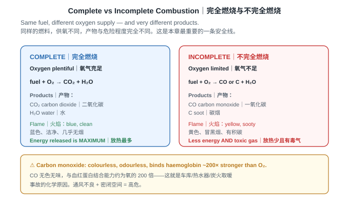
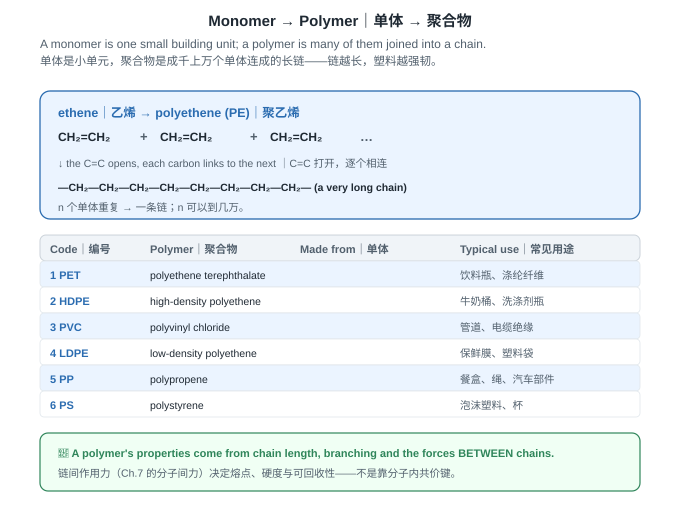
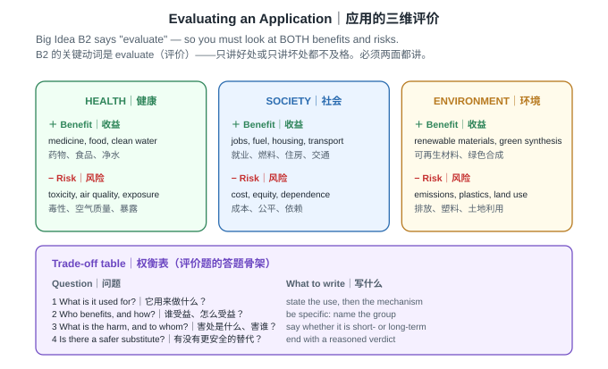
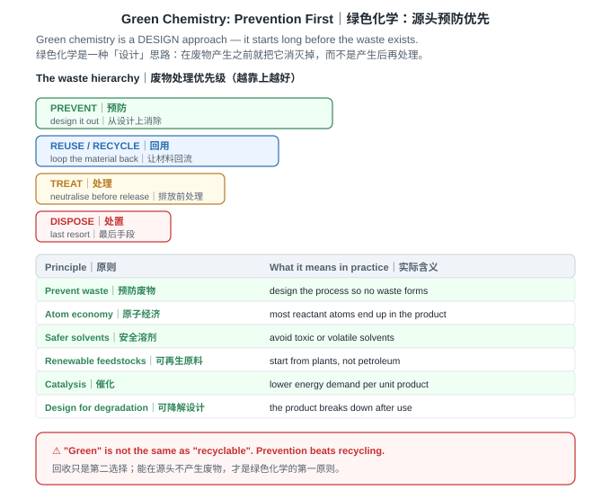

# Ch.4 — Applications of Organic Chemistry: Health, Society and the Environment
## Chapter 4 · Applications of Organic Chemistry｜第 4 章　有机化学的应用：健康、社会与环境

> 🗂️ **Content Alignment｜大纲对应**：C6 "applications of organic chemistry" · C11 local and other chemical processes · C12 green chemistry｜C6「有机化学的应用」· C11「本地与其他化学过程」· C12「绿色化学」；Big Idea **B2**（evaluate 两面）｜Big Idea **B2**（evaluating both sides）
> ⏱️ **Periods｜课时**：4　|　**Prerequisite｜前置**：Ch.3（官能团识别）｜**Followed by｜后继**：Part II 原子理论（Ch.5 起）
> 🗂️ **Generated｜文件生成时间**：2026-10-02

## 1. Content Alignment｜大纲对应

| Item｜项目 | Content｜内容 |
|---|---|
| Content served｜服务的 Content | **C6 applications of organic chemistry** — fuels, plastics, pharmaceuticals, food, personal care｜**C6 有机化学的应用**——燃料、塑料、制药、食品、个人护理 |
| Also serves｜同时服务 | **C11 local and other chemical processes** (BC industries) · **C12 green chemistry**｜**C11 本地与其他化学过程**（BC 产业）· **C12 绿色化学** |
| Competencies | [Evaluating] Weigh benefits against risks using evidence｜[Applying and innovating] Propose improvements using green chemistry｜[Communicating] Argue a position in three dimensions｜[评价] 用证据权衡收益与风险｜[应用与创新] 用绿色化学原则提出改进｜[交流] 从三个维度论证立场 |
| Beyond scope?｜是否超纲 | **No** — but combustion **mechanisms**, polymerisation **reactions** and drug **synthesis routes** belong to Chemistry 12 and are labelled `【Extension → Chemistry 12】`. Combustion **equations** themselves (Ch.2/Ch.9 level) are in scope.｜**不超纲**——但燃烧**机理**、聚合**反应**与药物**合成路线**属 Chemistry 12，标 `【Extension → Chemistry 12】`。燃烧**方程式**本身（Ch.2/Ch.9 难度）在范围内。 |

**中文**：本章是 Part I 的收束。前三章给了你"看懂结构"的眼睛；这一章用那双眼睛看**世界**——你加的油、穿的塑料、吃的药、闻到的香味，以及 BC 本地的造纸厂、冶炼厂和天然气田。官方大纲对这一章的关键动词是 **evaluate（评价）**：不是"知道有什么用"，而是**两面都要讲**——收益讲清楚，风险也讲清楚，最后给出你自己的权衡结论。

> 📏 **Course-level rule｜课程级规则**：Every application in this chapter gets a **three-dimension check** — health 健康 / society 社会 / environment 环境. A claim that mentions only one dimension is incomplete at this level.
> **中文**：本章每个应用都要过**三维检查**——健康 / 社会 / 环境。只提一个维度的说法，在这个层级上是不完整的。

## 2. Learning Objectives｜学习目标

**EN — By the end of this chapter, you should be able to:**

1. Write complete and incomplete combustion equations for common hydrocarbon fuels.
2. Explain why incomplete combustion is dangerous, using carbon monoxide chemistry.
3. Describe how monomers form polymers, and link common plastics to their recycling codes.
4. Evaluate one organic-chemistry application in three dimensions (health, society, environment).
5. Name the core principles of green chemistry and propose one improvement for a real BC process.

**中文 — 本章结束后，你应当能够：**

1. 写出常见烃类燃料的完全燃烧与不完全燃烧方程式。
2. 用一氧化碳的化学解释不完全燃烧为什么危险。
3. 描述单体如何形成聚合物，把常见塑料与回收标识对应起来。
4. 从健康、社会、环境三个维度评价一个有机化学应用。
5. 说出绿色化学的核心原则，并为一个真实的 BC 产业过程提出一条改进建议。

## 3. Concept Explanations｜概念解析

### 3.1 Fuels and the Two Combustion Pathways｜燃料与两条燃烧路径

**Definition｜定义**：**Complete combustion** of a hydrocarbon occurs with plentiful oxygen and produces **carbon dioxide and water only**. **Incomplete combustion** occurs when oxygen is limited and produces **carbon monoxide (CO) and/or soot (C)** in addition to water.

**中文**：**完全燃烧**指氧气充足时烃的燃烧，产物**只有二氧化碳和水**。**不完全燃烧**发生在氧气受限时，除水之外还会生成**一氧化碳（CO）和/或碳烟（C）**。

For any hydrocarbon CₓHᵧ the two routes are｜对任意烃 CₓHᵧ：

```
Complete:      CₓHᵧ + (x + y/4) O₂  →  x CO₂  +  (y/2) H₂O
Incomplete:    CₓHᵧ + (x/2 + y/4) O₂  →  x CO  +  (y/2) H₂O
```

Worked example｜演算（propane 丙烷 C₃H₈）：

- Complete｜完全：C₃H₈ + 5 O₂ → 3 CO₂ + 4 H₂O
- Incomplete (to CO)｜不完全（生成 CO）：C₃H₈ + 3.5 O₂ → 3 CO + 4 H₂O

Both equations balance; the difference is the **oxygen supply**, not the fuel. The incomplete route also releases **less energy** — the carbon still holds usable energy in CO, which is why a smoky flame is a wasteful flame.

**中文**：两条方程式都能配平；差别在**供氧**，不在燃料。不完全燃烧还**放热更少**——碳的能量还困在 CO 里没放完，所以冒烟的火焰也是浪费的火焰。

> ⚠️ **Misconception｜易错**：Incomplete combustion is not "burning halfway". It is a **different reaction with different products**, driven by oxygen shortage — and CO, its main product, is colourless, odourless and deadly.
> **中文**：不完全燃烧不是"烧了一半"。它是**另一种反应、产物不同**，起因是缺氧——其主产物 CO 无色、无味、致命。

### 3.2 Why Carbon Monoxide Kills｜一氧化碳为什么致命

Haemoglobin (the molecule that carries O₂ in your blood) binds CO roughly **200 times more strongly** than it binds O₂. A small amount of CO in the air occupies haemoglobin sites that oxygen can no longer reach — the blood still looks full, but the body is starved.

**中文**：血红蛋白（血液中运氧的分子）与 CO 的结合能力约为与 O₂ 结合的 **200 倍**。空气中少量 CO 就会占据血红蛋白上的氧位——血看起来还是满的，身体却在缺氧。

This is the chemistry behind three common hazards｜这就是三类常见事故背后的化学：

- A car idling in a closed garage｜车库内怠速的汽车
- A faulty gas water heater or furnace｜故障燃气热水器或炉子
- Charcoal BBQ used indoors or in a tent｜室内或帐篷里烧炭

The prevention rule follows directly from the chemistry: **ventilation supplies the O₂ that keeps combustion on the complete pathway.** Carbon monoxide detectors alarm before symptoms appear, because you cannot smell the problem.

**中文**：预防规则直接来自化学：**通风提供充足的 O₂，让燃烧停留在完全路径上。** 一氧化碳报警器能在症状出现前报警——因为你闻不出问题。

### 3.3 Plastics: Monomers into Polymers｜塑料：单体变聚合物

**Definition｜定义**：A **monomer** is a small molecule with (at least) one C=C; a **polymer** is a giant chain molecule made by joining many monomers end to end.

**中文**：**单体**是带（至少）一个 C=C 的小分子；**聚合物**是把大量单体首尾相连形成的巨型链状分子。

The C=C double bond is the "hand" each monomer offers: when it opens, each carbon bonds to the next unit, and the chain grows (**Fig. 4-2**). Ethene → polyethene is the simplest case; chloroethene → PVC and tetrafluoroethene → PTFE (Teflon) follow the same logic with different atoms hanging off the chain.

**中文**：C=C 双键就是每个单体伸出的"手"：双键打开，每个碳与下一个单元相连，链就长起来（**图 4-2**）。乙烯 → 聚乙烯是最简单的例子；氯乙烯 → PVC、四氟乙烯 → 特氟龙同理，只是链上挂的原子不同。

The recycling code on a bottle (1–7) identifies the polymer family. Knowing the code tells you the material's melting behaviour and therefore how it can be reprocessed — the chemistry behind your blue bin (**Table 4-2**).

**中文**：瓶子上的回收标识（1–7）标明聚合物家族。认出标识就知道这种材料的熔融行为、能怎么回收——这是你那只蓝色回收桶背后的化学（**表 4-2**）。

> ⚠️ **Misconception｜易错**："Biodegradable" and "compostable" are not the same as "throw it in the bushes". Most so-called degradable plastics need the sustained heat and moisture of an **industrial composter** to break down; in a cold stream or landfill they persist for years.
> **中文**："可降解"、"可堆肥"不等于"随手扔进树丛"。多数所谓可降解塑料需要**工业堆肥**的持续高温高湿才能分解；扔进溪流或填埋场照样存在多年。

### 3.4 Pharmaceuticals and Food｜制药与食品

**Aspirin（阿司匹林）** is the classic example because one small molecule carries **two functional groups** from Ch.3: a **carboxylic acid (–COOH)** and an **ester (–COO–)**. The acid group lets it dissolve (as a salt) in the intestine; the ester part is the "smart link" that survives the stomach and hydrolyses later — that chemistry belongs to Chemistry 12, but you can already **see** both groups in the structure.

**中文**：**阿司匹林**是经典例子：一个小分子同时带 Ch.3 的**两个官能团**——**羧酸（–COOH）**与**酯（–COO–）**。酸基让它（成盐后）能在肠道溶解；酯的部分是"聪明的一环"，在胃里扛住、到肠道再水解——那部分化学属 Chemistry 12，但你已经能**看见**结构里的两个官能团了。

**Flavours and fragrances｜香料与风味** are largely **esters** (Ch.3, Activity 3-1). **Emulsifiers（乳化剂）** such as lecithin carry a **hydrophilic head and a hydrophobic tail** in one molecule — the reason oil and vinegar can be persuaded to stay mixed in mayonnaise.

**中文**：**风味与香料**主要就是**酯**（Ch.3、活动 3-1）。**乳化剂**（如卵磷脂）一个分子上同时带**亲水头与疏水尾**——这就是蛋黄酱里油和醋能被"劝"着稳定混合的原因。

> 💡 **Tip｜口诀**：When you meet any consumer product, ask two questions: **which functional groups are present**, and **what does each group do** — dissolve it, scent it, stick it, or preserve it?
> **中文**：遇到任何日用品先问两句：**里面有哪些官能团**？**每个官能团干什么活**——让它溶解、让它香、让它粘、还是让它保质？

### 3.5 Local Chemical Processes in BC｜BC 本地的化学过程

The official Content C11 asks you to connect chemistry to **local** processes. BC's economy runs on several organic-chemistry-intensive industries:

**中文**：官方 Content C11 要求你把化学与**本地**过程联系起来。BC 的经济由几个有机化学密集型产业支撑：

| Industry｜产业 | Organic chemistry involved｜涉及的有机化学 | Typical tension｜典型矛盾 |
|---|---|---|
| Pulp & paper｜制浆造纸 | cellulose 纤维素 (a natural polymer), lignin chemistry | employment 就业 vs effluent 废水 |
| Forestry products｜林产品 | wood composites, bio-fuels | carbon storage 碳汇 vs harvest 采伐 |
| Mining & smelting｜矿业冶炼 | organic flotation agents, tailings management | metals 金属 vs water risk 水风险 |
| LNG / natural gas｜液化天然气 | methane 甲烷 (Ch.2 alkane) | energy export 能源出口 vs GHG 温室气体 |
| Fisheries｜渔业加工 | proteins 蛋白质, spoilage chemistry | food supply 食物 vs waste 废弃物 |

Any one of these makes a solid case study: pick **one**, and structure your research as **benefit → risk → green chemistry improvement** (Activity 4-2).

**中文**：以上任何一个都能做成好的案例研究：选**一个**，按"收益 → 风险 → 绿色化学改进"三段式展开（活动 4-2）。

### 3.6 First Peoples Perspectives｜原住民视角

British Columbia's First Peoples have used organic chemistry for millennia — cedar bark weaving and waterproofing, plant dyes, medicinal plants, salmon preservation. Curriculum asks you to recognise this as a **knowledge system with sustainable practices**, not as a museum note: many harvesting practices (selective bark stripping, rotational gathering) are, in modern terms, **renewable-feedstock and design-for-degradation** strategies.

**中文**：BC 的原住民使用有机化学已有数千年——雪松树皮编织与防水、植物染料、药用植物、鲑鱼保存。课程要求你把它当作**一套有可持续实践的知识体系**，而不是博物馆注脚：许多采收做法（选择性剥皮、轮采）用现代话说就是**可再生原料与可降解设计**策略。

> 📏 **Rule｜规则**：When writing about First Peoples knowledge, name the practice and the chemistry accurately, and avoid generic statements. Cite the practice, not the stereotype.
> **中文**：写原住民知识时，准确点名做法与化学，不要泛泛而谈。引的是具体实践，不是刻板印象。

### 3.7 Green Chemistry｜绿色化学

**Definition｜定义**：**Green chemistry** is the design of chemical products and processes that reduce or eliminate the use and generation of hazardous substances.

**中文**：**绿色化学**是在设计层面减少或消除有害物质使用与生成的化学。

The key word is **design** — green chemistry acts **before** waste exists, not after (**Fig. 4-4**). Six principles matter most at this level:

**中文**：关键词是**设计**——绿色化学在废物**产生之前**就出手，而不是之后（**图 4-4**）。这个层级最重要的六条：

- **Prevent waste｜预防废物** — the top priority; do not create what you will have to clean.
  - **中文**：头等优先；不要制造你将来要清理的东西。
- **Atom economy｜原子经济** — design routes where most reactant atoms end up in the final product.
  - **中文**：设计让多数反应物原子进入最终产物的路线。
- **Safer solvents｜安全溶剂** — avoid toxic or volatile carriers.
  - **中文**：避开有毒或易挥发的溶剂。
- **Renewable feedstocks｜可再生原料** — start from plant or waste streams, not only petroleum.
  - **中文**：从植物或废弃物出发，而不是只用石油。
- **Catalysis｜催化** — lower the energy cost per unit of product.
  - **中文**：降低单位产品的能耗。
- **Design for degradation｜可降解设计** — the product should break down after its useful life.
  - **中文**：产品用完应能分解。

**Atom economy** in one line｜原子经济一句话：

> **Atom economy = (mass of desired product ÷ total mass of all products) × 100%**
> **原子经济 = （目标产物质量 ÷ 全部产物总质量）× 100%**

> 🔭 **Extension｜超纲**【Extension → Chemistry 12】：Calculating **percentage yield** and combining it with atom economy belongs to the stoichiometry chapters (Ch.10) and Chemistry 12 refinement. Here, atom economy is used **qualitatively** to compare process designs.
> **中文**：【超纲延伸 → Chemistry 12】**百分产率**的计算及其与原子经济的结合属于化学计量章（Ch.10）与 Chemistry 12。本章原子经济只**定性**用于比较工艺设计。

### 3.8 The Evaluation Frame｜评价框架

Big Idea B2's verb is **evaluate**. A complete evaluation has three moves (**Fig. 4-3**):

**中文**：B2 的关键动词是 **evaluate（评价）**。完整的评价有三步（**图 4-3**）：

1. **State the benefit precisely** — which dimension (health/society/environment), and through what mechanism.
   - **中文**：**准确说出收益**——哪个维度（健康/社会/环境），通过什么机制。
2. **State the risk precisely** — same discipline: which dimension, what mechanism, whom.
   - **中文**：**准确说出风险**——同样纪律：哪个维度、什么机制、波及谁。
3. **Give a reasoned verdict** — under what conditions the benefit outweighs the risk, and what improvement would tip the balance further.
   - **中文**：**给出有理有据的结论**——在什么条件下收益大于风险，以及什么改进能把天平进一步推向好的一面。

A claim like "plastics are bad for the environment" is **not** an evaluation — it has no mechanism, no dimension and no verdict. "Single-use PVC in construction has high durability but low recyclability (code 3), so substituting PET where possible would…" **is** one.

**中文**："塑料对环境不好"这种话**不是**评价——没有机制、没有维度、没有结论。"建筑用一次性 PVC 耐久但难回收（标识 3），所以能换 PET 的地方换成 PET 会……"**才是**。

## 4. Comparison Tables｜表格比对

### Table 4-1　Complete vs Incomplete Combustion｜完全燃烧 vs 不完全燃烧

| | Complete｜完全 | Incomplete｜不完全 |
|---|---|---|
| Oxygen supply｜供氧 | plentiful｜充足 | limited｜不足 |
| Carbon product｜碳产物 | CO₂ | CO 和/或 C (soot 碳烟) |
| Flame｜火焰 | blue, clean｜蓝色洁净 | yellow, sooty｜黄色冒烟 |
| Energy released｜放热 | maximum｜最多 | less｜较少 |
| Health risk｜健康风险 | low (CO₂ is a greenhouse gas)｜低（CO₂ 是温室气体） | **high (CO is toxic)**｜**高（CO 有毒）** |

### Table 4-2　Recycling Codes｜常见塑料回收标识

| Code｜编号 | Polymer｜聚合物 | Monomer｜单体 | Typical use｜常见用途 |
|---|---|---|---|
| 1 PET | polyethene terephthalate｜PET | terephthalic acid + ethane-1,2-diol｜对苯二甲酸 + 乙二醇 | 饮料瓶、涤纶 |
| 2 HDPE | high-density polyethene｜高密度聚乙烯 | ethene 乙烯 | 牛奶桶、洗涤剂瓶 |
| 3 PVC | polyvinyl chloride｜聚氯乙烯 | chloroethene 氯乙烯 | 管道、电缆 |
| 4 LDPE | low-density polyethene｜低密度聚乙烯 | ethene 乙烯 | 保鲜膜、塑料袋 |
| 5 PP | polypropene｜聚丙烯 | propene 丙烯 | 餐盒、汽车件 |
| 6 PS | polystyrene｜聚苯乙烯 | styrene 苯乙烯 | 泡沫、杯 |

### Table 4-3　Three Dimensions of Evaluation｜评价的三个维度

| Dimension｜维度 | What to look for｜看什么 | Example question｜示例问题 |
|---|---|---|
| Health｜健康 | toxicity, exposure route, dose｜毒性、暴露途径、剂量 | Who breathes the CO, and how much?｜谁吸入了 CO、吸入多少？ |
| Society｜社会 | jobs, cost, equity, dependence｜就业、成本、公平、依赖 | Who gains the jobs, who bears the risk?｜谁得到就业、谁承担风险？ |
| Environment｜环境 | emissions, persistence, land use｜排放、持久性、土地利用 | Where does the plastic end up in 20 years?｜20 年后塑料在哪？ |

### Table 4-4　Green Chemistry: Prevention First｜绿色化学：预防优先

| Rank｜优先级 | Strategy｜策略 | Chemistry meaning｜化学含义 |
|---|---|---|
| 1 | prevent 预防 | design out the waste｜从设计上消除废物 |
| 2 | reuse / recycle 回用 | loop the material｜让材料回流 |
| 3 | treat 处理 | neutralise before release｜排放前无害化 |
| 4 | dispose 处置 | last resort｜最后手段 |

## 5. Diagrams & Worked Examples｜图例说明

### Fig. 4-1　Two Combustion Pathways｜两条燃烧路径



**Reading the figure｜看图要点**：同一种燃料，两条路径只差供氧量。右边那条是 CO 中毒事故的化学根源。

### Fig. 4-2　Monomer to Polymer｜单体到聚合物



**Reading the figure｜看图要点**：C=C 打开、逐个相连成链；下方表把常见塑料与其回收标识和用途对应。

### Fig. 4-3　Three-Dimension Evaluation｜三维评价



**Reading the figure｜看图要点**：健康/社会/环境三栏，每栏都分"收益"与"风险"；下方权衡表给出评价题的答题骨架。

### Fig. 4-4　Green Chemistry Priority｜绿色化学优先级



**Reading the figure｜看图要点**：优先级从上到下递减——预防 > 回用 > 处理 > 处置；六条原则表把"设计"落到具体做法。

### Example 4-1　Writing Combustion Equations｜书写燃烧方程式

**Problem｜题目**：Write the complete and the incomplete (to CO) combustion equation for butane, C₄H₁₀.

**中文**：写出丁烷（C₄H₁₀）的完全燃烧与不完全燃烧（生成 CO）方程式。

| Step｜步骤 | Complete｜完全 | Incomplete｜不完全 |
|---|---|---|
| 1. C balance｜配碳 | C₄H₁₀ + …O₂ → **4** CO₂ + … | C₄H₁₀ + …O₂ → **4** CO + … |
| 2. H balance｜配氢 | 10 H → **5** H₂O | 10 H → **5** H₂O |
| 3. O balance｜配氧 | 4×2 + 5 = 13 O → **6.5** O₂ | 4 + 5 = 9 O → **4.5** O₂ |
| 4. Clear halves｜去半 | ×2 → **2 C₄H₁₀ + 13 O₂ → 8 CO₂ + 10 H₂O** | ×2 → **2 C₄H₁₀ + 9 O₂ → 8 CO + 10 H₂O** |

**中文**：先配碳再配氢最后配氧；出现半个系数时全式乘 2。两条方程式的差别只在 O₂ 用量（13 vs 9）与碳的氧化态（+4 vs +2）。

> 🔍 **Self-check｜自检**：Count the oxygen atoms on both sides of each equation — 26 O on the left of the complete equation (13 O₂) and 8×2 + 10 = 26 on the right. Balanced.
> **中文**：数一数每条方程式两边的氧原子——完全式左边 13 O₂ = 26 O，右边 8×2 + 10 = 26 O。配平。

### Example 4-2　Evaluate an Application｜评价一个应用

**Problem｜题目**：Evaluate LNG (liquefied natural gas, mainly methane) as an export industry for BC, in three dimensions, with a verdict.

**中文**：从三个维度评价 BC 的 LNG（液化天然气，主要成分甲烷）出口产业，并给出结论。

| Dimension｜维度 | Benefit｜收益 | Risk｜风险 |
|---|---|---|
| Health｜健康 | cleaner burning than coal｜比煤清洁 | CO risk if vented；fracking water concerns｜泄漏有 CO 风险；压裂水问题 |
| Society｜社会 | jobs, energy revenue｜就业与能源收入 | dependence on one sector；Indigenous land questions｜产业单一依赖；原住民土地议题 |
| Environment｜环境 | less CO₂ per joule than coal｜每焦耳排碳低于煤 | methane leaks are a potent greenhouse risk｜甲烷泄漏是强温室风险 |

**Verdict｜结论（示范）**：LNG is a **transitional** fuel — its per-joule emissions are lower than coal's, but its value collapses if methane escapes unburned. A reasoned BC verdict would condition support on **measured leak rates** and **credible methane capture**, not on marketing claims.

**中文**：LNG 是**过渡性**燃料——每焦耳排碳低于煤，但如果甲烷未燃烧就逸散，价值就大打折扣。站得住脚的 BC 结论应把支持建立在**实测泄漏率**与**可信的甲烷回收**之上，而不是宣传口径。

> 💡 **Tip｜口诀**：A complete evaluation always names the **mechanism** (what chemistry causes the effect) and the **condition** (when the benefit outweighs the risk).
> **中文**：完整评价必须点名**机制**（什么化学导致了影响）与**条件**（何时收益大于风险）。

## 6. Key Vocabulary｜核心词汇

| English | 中文 | Note｜备注 |
|---|---|---|
| complete combustion | 完全燃烧 | O₂ plentiful → CO₂ + H₂O｜O₂ 充足 |
| incomplete combustion | 不完全燃烧 | O₂ limited → CO / C + H₂O｜O₂ 不足 |
| carbon monoxide | 一氧化碳 | colourless, odourless, toxic｜无色无味有毒 |
| haemoglobin | 血红蛋白 | binds CO ~200× stronger than O₂｜与 CO 结合力约为 O₂ 的 200 倍 |
| monomer | 单体 | small unit with C=C｜带 C=C 的小单元 |
| polymer | 聚合物 | long chain of monomers｜单体长链 |
| recycling code | 回收标识 | 1–7 polymer families｜1–7 号塑料家族 |
| pharmaceutical | 药物 | functional groups = function｜官能团即功能 |
| emulsifier | 乳化剂 | hydrophilic head + hydrophobic tail｜亲水头疏水尾 |
| atom economy | 原子经济 | desired product ÷ all products｜目标产物占全部产物比例 |
| renewable feedstock | 可再生原料 | plant or waste based｜植物或废弃物来源 |
| green chemistry | 绿色化学 | design out hazards｜从设计上消除危害 |
| trade-off | 权衡 | benefit vs risk, stated precisely｜准确表述的收益与风险 |
| First Peoples knowledge | 原住民知识 | sustainable practice system｜可持续实践体系 |

## 7. Lab / Activity｜实验与活动

### Activity 4-1　Plastic Detective｜塑料回收码侦探

- **Type｜类型**：Home collection + classroom sorting｜家庭收集 + 课堂分类
- **Materials｜材料**：6 clean plastic items with recycling codes, property reference sheet｜6 件带回收标识的干净塑料制品、性质对照表
- **Steps｜步骤**：
  1. Record each item's code, use and flexibility (rigid / film / foam).
     - **中文**：记录每件物品的编号、用途与柔韧性（硬 / 膜 / 泡沫）。
  2. Match each code to its polymer family and monomer.
     - **中文**：把每个编号对应到聚合物家族与单体。
  3. Draw a "family map" of plastics in your home and mark one substitution you could make.
     - **中文**：画出你家的"塑料地图"，并标出一处可替代的选择。
- **Competency｜能力**：[Applying and innovating]｜[Communicating]
- **Safety｜安全**：Clean containers only; do not cut plastics without scissors and supervision｜只用干净容器；裁剪需剪刀与监督

### Activity 4-2　BC Case Study｜BC 产业案例研究

- **Type｜类型**：Group research + three-column report｜小组研究 + 三栏报告
- **Materials｜材料**：one BC industry (pulp, mining, LNG, fisheries, forestry), credible sources｜选定一个 BC 产业（造纸、矿业、LNG、渔业、林业），可信来源
- **Steps｜步骤**：
  1. Describe the process in one paragraph, naming the organic chemistry involved.
     - **中文**：用一段话描述该过程，点名其中涉及的有机化学。
  2. Fill a three-column table: benefit / risk / green-chemistry improvement, each row tagged with its dimension.
     - **中文**：填三栏表：收益 / 风险 / 绿色化学改进，每行标注维度。
  3. Present a 2-minute verdict with at least one numbered, verifiable fact.
     - **中文**：做 2 分钟结论陈述，至少用一个可核实的数字事实。
- **Competency｜能力**：[Evaluating]｜[Communicating]
- **Safety｜安全**：Cite sources; separate fact from opinion｜注明出处；事实与观点分开

### Activity 4-3　Candle Demonstration｜蜡烛燃烧对比演示

- **Type｜类型**：Teacher demonstration with student observation｜教师演示 + 学生观察
- **Materials｜材料**：2 candles, matches, glass jar, heat-resistant surface｜蜡烛 ×2、火柴、玻璃罩、耐热台面
- **Steps｜步骤**：
  1. Burn candle A in open air; record flame colour and any smoke.
     - **中文**：蜡烛 A 在开放空气燃烧；记录火焰颜色与烟。
  2. Lower jar over candle B so oxygen is partly limited; observe soot on the glass.
     - **中文**：把玻璃罩缓缓罩住蜡烛 B 使供氧受限；观察玻璃上的碳烟。
  3. Write both observations as equations (complete for A, incomplete for B).
     - **中文**：把两个观察各写成一条方程式（A 完全、B 不完全）。
- **Competency｜能力**：[Questioning and predicting]｜[Processing and analyzing]
- **Safety｜安全**：Fire station only; extinguish fully; ventilate the room｜明火实验台；彻底熄灭；保持通风

## 8. Common Misconceptions｜常见易错点

| # | Misconception｜错误认识 | Correction｜正确理解 |
|---|---|---|
| 1 | "Natural chemicals are safe; synthetic ones are harmful."｜天然化学物质安全、合成化学物质有害。 | Safety depends on the substance and the dose, not the source. Natural toxins exist; synthetic medicines save lives.｜安全性取决于物质与剂量，不取决于来源。天然也有毒素，合成药也能救命。 |
| 2 | "Incomplete combustion still makes CO₂ and some smoke."｜不完全燃烧还是生成 CO₂，只是多点烟。 | Incomplete combustion is a different reaction: CO and/or soot replace CO₂ as the carbon product.｜不完全燃烧是另一种反应：碳的产物是 CO 和/或碳烟，不是 CO₂。 |
| 3 | "If you can't smell it, it isn't dangerous."｜闻不到就没事。 | CO is odourless by nature — which is exactly why detectors exist.｜CO 本身无味——这正是要装报警器的原因。 |
| 4 | "Plastic recycling code 1 and code 2 are basically the same plastic."｜1 号和 2 号塑料差不多。 | They differ in chain branching and density, which changes melting point and how they can be reprocessed.｜它们的链支化与密度不同，熔点与再加工方式都不同。 |
| 5 | "Biodegradable plastics break down anywhere."｜可降解塑料在哪都能分解。 | Most need industrial composting conditions (sustained heat and moisture).｜多数需要工业堆肥的持续高温高湿。 |
| 6 | "A polymer's strength comes from strong covalent bonds inside the chain."｜聚合物的强度来自链内强共价键。 | Covalent bonds are the same in every chain; strength and melting come from **intermolecular forces between chains**.｜所有链内共价键都一样强；强度与熔点来自**链间分子间作用力**。 |
| 7 | "Green chemistry means recycling more."｜绿色化学就是多回收。 | Prevention is the first principle; recycling is the second line of defence.｜预防是第一原则；回收是第二道防线。 |
| 8 | "An evaluation only needs to list benefits and risks."｜评价只要列出收益与风险。 | An evaluation names the mechanism for each, and ends with a **reasoned verdict** under stated conditions.｜评价要为每条指明机制，并以**有条件的结论**收尾。 |
| 9 | "Aspirin works because it is organic."｜阿司匹林有效是因为它是"有机的"。 | It works because specific functional groups (–COOH, –COO–) do specific jobs in the body.｜它有效是因为特定官能团（–COOH、–COO–）在体内干了特定的活。 |
| 10 | "Methane is harmless because it is not toxic."｜甲烷无毒所以无害。 | Methane is a potent greenhouse gas when leaked, and an asphyxiant at high concentration — "not toxic" is not "no impact".｜甲烷泄漏是强温室气体，高浓度会致窒息——"无毒"不等于"无影响"。 |
| 11 | "Burning any fuel gives the same CO₂ per litre."｜烧任何燃料每升排的 CO₂ 一样。 | CO₂ per joule depends on the carbon-to-hydrogen ratio — methane emits less per joule than coal.｜每焦耳排碳取决于碳氢比——甲烷每焦耳排碳低于煤。 |
| 12 | "First Peoples knowledge is historical only."｜原住民知识只是历史。 | It is a living system with sustainable practices directly relevant to renewable feedstocks and degradation by design.｜它是活的体系，其可持续实践与"可再生原料、可降解设计"直接相关。 |

## 9. Assessment｜答题评估

### Part A: Foundational｜基础题（10 × 2 = 20 points）

**A1.** Define complete combustion and incomplete combustion, and name the carbon product of each.

- **中文**：定义完全燃烧与不完全燃烧，并分别写出碳的产物。

**A2.** Write the complete combustion equation for propane, C₃H₈.

- **中文**：写出丙烷（C₃H₈）的完全燃烧方程式。

**A3.** Write the incomplete combustion equation (carbon product = CO) for propane, C₃H₈.

- **中文**：写出丙烷（C₃H₈）的不完全燃烧方程式（碳产物为 CO）。

**A4.** Why is carbon monoxide dangerous even at low air concentrations? Answer with one sentence about haemoglobin.

- **中文**：为什么一氧化碳在很低浓度就危险？用一句话、从血红蛋白角度回答。

**A5.** Define monomer and polymer, and name the monomer of polyethene.

- **中文**：定义单体与聚合物，并写出聚乙烯的单体名称。

**A6.** Match each recycling code to its common use: (a) 1 PET (b) 2 HDPE (c) 3 PVC (d) 6 PS.

- **中文**：把回收标识与常见用途配对：(a) 1 号 PET (b) 2 号 HDPE (c) 3 号 PVC (d) 6 号 PS。

**A7.** Name the two functional groups present in aspirin (acetylsalicylic acid).

- **中文**：写出阿司匹林（乙酰水杨酸）中存在的两个官能团。

**A8.** Give the atom-economy idea in one sentence (no calculation needed).

- **中文**：用一句话说清"原子经济"的思想（不需要计算）。

**A9.** List the four levels of the waste hierarchy in order of preference.

- **中文**：按优先顺序列出废物处理层级的四个层级。

**A10.** True or false, with a reason: "If a fuel burns with a yellow, sooty flame, it is releasing the maximum possible energy."

- **中文**：判断对错并说明理由："火焰发黄冒烟说明燃料释放了最大能量。"

### Part B: Applied｜应用题（4 × 5 = 20 points）

**B1.** A garage is 40 m³ and a car engine runs incompletely for 10 minutes. (a) Write the incomplete combustion equation for octane, C₈H₁₈, with CO as the carbon product. (b) Explain, using haemoglobin chemistry, why the driver should not stay inside even though "nothing smells wrong". (c) Name one engineering control that prevents this scenario.

- **中文**：某车库容积 40 m³，一辆车的发动机以不完全燃烧状态运转 10 分钟。(a) 写出辛烷（C₈H₁₈）以 CO 为碳产物的不完全燃烧方程式。(b) 用血红蛋白的化学解释，为什么"闻不到味"不代表安全、司机不应留在车内。(c) 写出一种能防止这类事故的工程手段。

**B2.** Two water bottles: one PET (code 1), one HDPE (code 2). (a) Name the monomer of each. (b) Explain why HDPE's lower branching gives it higher rigidity. (c) A recycler receives a mixed batch — state one property a sorting system could measure to separate them.

- **中文**：两只水瓶：一只是 PET（1 号），一只是 HDPE（2 号）。(a) 写出各自的单体名。(b) 解释 HDPE 支链更少所以刚性更高的原因。(c) 回收厂收到混批——写出一个分选系统可测量的性质来区分它们。

**B3.** A pulp-and-paper mill in BC releases warm, organically rich wastewater. (a) Name the natural polymer that makes up most of the fibre. (b) State one benefit and one environmental risk of the mill for the local community. (c) Propose one green-chemistry improvement and say which principle it applies.

- **中文**：BC 某制浆造纸厂排放温热且富含有机物的废水。(a) 写出构成纤维主要成分的天然聚合物名。(b) 给出该厂对当地社区的一条收益与一条环境风险。(c) 提出一条绿色化学改进，并说明它对应哪条原则。

**B4.** A classmate writes: "Plastics should be banned — they are bad for society." (a) Explain why this is not a complete evaluation. (b) Rewrite it as one sentence that names a mechanism, a dimension and a condition. (c) Add one sentence proposing an improvement instead of a ban.

- **中文**：某同学写道："塑料应该禁——它对社会有害。" (a) 解释为什么这不算完整的评价。(b) 把它改写成一句话，要求点名机制、维度与条件。(c) 再加一句替代禁令的改进建议。

### Part C: Challenge｜挑战题（2 × 10 = 20 points）

**C1.** A BC community must choose between two heating options for a new school: a natural gas boiler (methane, CH₄) or a wood-pellet boiler (cellulose, approximate formula C₆H₁₀O₅). (a) Write the complete combustion equation for each. (b) Using your equations and molar masses, calculate the moles of CO₂ released **per gram of fuel** for each option, and state which fuel emits more CO₂ per gram. (c) Evaluate the choice in three dimensions with a verdict a school board could act on. *(4 + 3 + 3 marks)*

- **中文**：某 BC 社区要为一所新学校选供暖方案：天然气锅炉（甲烷 CH₄）或木质颗粒锅炉（纤维素，近似式 C₆H₁₀O₅）。(a) 分别写出两者的完全燃烧方程式。(b) 用方程式与摩尔质量，算出每种燃料**每克**释放的 CO₂ 摩尔数，并指出哪种燃料每克排碳更多。(c) 从三个维度评价这个选择，并给出一条校董会能落地的结论。*(4 + 3 + 3 分)*

**C2.** A start-up proposes a new BC process: converting forestry waste (sawdust, cellulose) into a biodegradable plastic film. (a) State which two green-chemistry principles this design directly applies, and why. (b) Name one health, one social and one environmental risk that could still arise. (c) Write a three-sentence evaluation that a municipal council could quote, ending with a condition under which you would support the project. *(4 + 3 + 3 marks)*

- **中文**：某初创公司提出一个新的 BC 工艺：把林业废弃物（锯末、纤维素）转化为可降解塑料薄膜。(a) 指出该设计直接应用了哪两条绿色化学原则，并说明理由。(b) 写出仍可能出现的一条健康风险、一条社会风险与一条环境风险。(c) 写三句话评价，供市政会引用，末尾给出你支持该项目的条件。*(4 + 3 + 3 分)*

---

### Answer Key｜参考答案

**Part A**

- **A1.** Complete combustion: oxygen plentiful, carbon product **CO₂**. Incomplete combustion: oxygen limited, carbon product **CO and/or soot (C)**.

  - **中文**：完全燃烧：氧气充足，碳产物 **CO₂**。不完全燃烧：氧气受限，碳产物 **CO 和/或碳烟（C）**。

- **A2.** C₃H₈ + 5 O₂ → 3 CO₂ + 4 H₂O

  - **中文**：C₃H₈ + 5 O₂ → 3 CO₂ + 4 H₂O。

- **A3.** 2 C₃H₈ + 7 O₂ → 6 CO + 8 H₂O　(doubling C₃H₈ + 3.5 O₂ → 3 CO + 4 H₂O)

  - **中文**：2 C₃H₈ + 7 O₂ → 6 CO + 8 H₂O（由 C₃H₈ + 3.5 O₂ → 3 CO + 4 H₂O 全式乘 2）。

- **A4.** CO binds haemoglobin about 200× more strongly than O₂, so a small amount of CO blocks the blood's oxygen-carrying sites even though the air still contains plenty of O₂.

  - **中文**：CO 与血红蛋白的结合力约为 O₂ 的 200 倍——少量 CO 就能占据血液的运氧位点，即使空气中 O₂ 仍然充足。

- **A5.** A monomer is a small C=C-bearing unit; a polymer is a long chain of joined monomers. The monomer of polyethene is **ethene（乙烯）**.

  - **中文**：单体是带 C=C 的小单元；聚合物是单体相连的长链。聚乙烯的单体是**乙烯（ethene）**。

- **A6.** (a) 1 PET — drink bottles｜饮料瓶 (b) 2 HDPE — milk jugs, detergent bottles｜牛奶桶、洗涤剂瓶 (c) 3 PVC — pipes, cable insulation｜管道、电缆绝缘 (d) 6 PS — foam cups｜泡沫杯

  - **中文**：(a) 1 号 PET——饮料瓶 (b) 2 号 HDPE——牛奶桶、洗涤剂瓶 (c) 3 号 PVC——管道、电缆绝缘 (d) 6 号 PS——泡沫杯。

- **A7.** A **carboxylic acid (–COOH)** and an **ester (–COO–)**.

  - **中文**：**羧酸（–COOH）**与**酯（–COO–）**。

- **A8.** Atom economy measures how much of the reactant mass ends up in the desired product rather than in by-products — a high value means little waste by design.

  - **中文**：原子经济衡量反应物质量有多少进入目标产物而不是副产物——数值高意味着设计上废物就少。

- **A9.** Prevent 预防 → reuse / recycle 回用 → treat 处理 → dispose 处置.

  - **中文**：预防 → 回用 → 处理 → 处置（越靠前越优先）。

- **A10.** **False**. A yellow, sooty flame signals oxygen shortage and incomplete combustion, which releases **less** energy — usable energy is still locked in the CO and soot.

  - **中文**：**错**。黄色冒烟的火焰说明缺氧、发生不完全燃烧，**放热更少**——还有能量困在 CO 与碳烟里没释放。

**Part B**

- **B1.** (a) 2 C₈H₁₈ + 17 O₂ → 16 CO + 18 H₂O. (b) CO occupies haemoglobin sites ~200× more strongly than O₂ and is odourless, so "nothing smells wrong" says nothing about blood oxygen capacity — the driver can be deprived of oxygen without noticing. (c) A CO detector, forced ventilation or an exhaust extraction system all work; any one named with a reason earns the mark.

  - **中文**：(a) 2 C₈H₁₈ + 17 O₂ → 16 CO + 18 H₂O。(b) CO 与血红蛋白的结合力约为 O₂ 的 200 倍且无味——"闻不到味"完全不反映血液的携氧能力，司机可能在不知不觉中缺氧。(c) CO 报警器、强制通风或排气收集系统都算；写出任意一个并给理由即可得分。

- **B2.** (a) PET ← polyethene terephthalate（its monomers are terephthalic acid and ethane-1,2-diol — name-level answer "PET monomers" accepted）；HDPE ← **ethene（乙烯）**. (b) Less branching lets chains pack closer, so intermolecular forces between chains act over shorter distances and the material is more rigid. (c) Density is the standard industrial separator (HDPE sinks in a water–alcohol mix where PET floats, or vice versa by solution choice); melting point or hardness are also acceptable.

  - **中文**：(a) PET ← 聚对苯二甲酸乙二醇酯（其单体为对苯二甲酸与乙二醇——答 "PET 的单体" 亦可）；HDPE ← **乙烯**。(b) 支链少让链排列更紧密，链间作用力在更短距离内起效，材料更刚硬。(c) 密度是工业上标准的分选手段（HDPE 与 PET 在水-醇混合液中的浮沉相反，视溶液配比而定）；熔点或硬度也可接受。

- **B3.** (a) **Cellulose（纤维素）**. (b) Benefit: stable employment and an export product; risk: warm, organically loaded effluent can lower dissolved oxygen and harm aquatic life. (c) Example: redesign the process to recover and reuse process water (closed loop) — applies **prevent waste** and **safer solvents**; any specific, plausible improvement with a named principle earns the mark.

  - **中文**：(a) **纤维素**。(b) 收益：稳定就业与出口产品；风险：温热且富含有机物的废水会降低溶解氧、伤害水生生物。(c) 示例：把工艺改成回收并循环使用过程用水（闭环）——对应**预防废物**与**安全溶剂**；写出具体可行的改进并点出原则名即可得分。

- **B4.** (a) It names no mechanism, no specific dimension and no condition — it is a slogan, not an evaluation. (b) Example: "Single-use plastic film (LDPE, code 4) persists in landfills for decades, which harms the environment, so where a reusable or compostable substitute exists it should be preferred." (c) Example: "Replacing film in produce packaging with a certified compostable coating would keep the food-protection benefit while cutting long-lived waste."

  - **中文**：(a) 没有机制、没有具体维度、没有条件——这是口号，不是评价。(b) 示例："一次性塑料薄膜（LDPE，4 号）在填埋场存在数十年，影响环境——所以在有可重复使用或可堆肥替代品的地方应优先替代。"(c) 示例："把生鲜包装的薄膜换成经认证的可堆肥涂层，既保留食品保护功能，又减少长寿命废弃物。"

**Part C (marking points｜评分要点)**

- **C1.** (a) CH₄ + 2 O₂ → CO₂ + 2 H₂O; C₆H₁₀O₅ + 6 O₂ → 6 CO₂ + 5 H₂O. (b) Methane: M = 16.04 g/mol, 1 mol CO₂ per mol fuel → 1 ÷ 16.04 = **0.062 mol CO₂/g**. Cellulose: M = 162.14 g/mol, 6 mol CO₂ per mol fuel → 6 ÷ 162.14 = **0.037 mol CO₂/g**. So **methane emits more CO₂ per gram of fuel** — the comparison assumes complete combustion and dry fuel; moisture or incomplete combustion changes the result. (c) Health: gas needs leak management, pellets produce particulates. Society: gas relies on imported infrastructure, pellets can be sourced locally. Environment: per gram methane emits more CO₂, but pellets emit more particulates; pellets are renewable only if forestry is managed. A valid verdict conditions the choice on measured emissions and sourcing, e.g. "choose gas with leak monitoring **if** leak rates are verified low; choose pellets **if** local supply is certified sustainable and the boiler has particulate control." *(4 + 3 + 3 marks)*

  - **中文**：(a) CH₄ + 2 O₂ → CO₂ + 2 H₂O；C₆H₁₀O₅ + 6 O₂ → 6 CO₂ + 5 H₂O。(b) 甲烷：M = 16.04 g/mol，1 mol 燃料排 1 mol CO₂ → 1 ÷ 16.04 = **每克 0.062 mol CO₂**。纤维素：M = 162.14 g/mol，1 mol 燃料排 6 mol CO₂ → 6 ÷ 162.14 = **每克 0.037 mol CO₂**。所以**每克燃料甲烷排碳更多**——该结论假设燃烧完全、燃料干燥；湿度或不完全燃烧都会改变结果。(c) 健康：燃气需要泄漏管理，颗粒燃料产生颗粒物；社会：燃气依赖进口基础设施，颗粒燃料可本地取材；环境：每克甲烷排碳更多，但颗粒燃料颗粒物更多；林业管理得当颗粒燃料才可再生。站得住的结论要把选择建立在实测排放与来源上，例如"**若**实测泄漏率足够低**则**选带泄漏监测的燃气；**若**本地颗粒燃料有可持续认证且锅炉带颗粒物控制**则**选颗粒燃料"。*(4 + 3 + 3 分)*

- **C2.** (a) **Renewable feedstocks** (the input is forestry waste, not petroleum) and **design for degradation** (the product is a compostable film); both are principles applied at the design stage, before any waste exists. (b) Health: residual solvents or additives in the film. Social: if the plant competes with other uses for forestry waste, costs or jobs may shift. Environmental: if composting infrastructure is missing, the film may still end up in landfill and degrade anaerobically. (c) Example: "Converting sawdust into a compostable film applies renewable feedstocks and design for degradation at the source. The main risks are chemical residues in the film and the absence of local composting capacity. Council should support the pilot **if** an accredited composter exists in the region and the film passes food-contact testing." *(4 + 3 + 3 marks)*

  - **中文**：(a) **可再生原料**（原料是林业废弃物而非石油）与**可降解设计**（产品是可堆肥薄膜）；两者都是在设计阶段——废物出现之前——应用的原则。(b) 健康：薄膜中残留的溶剂或添加剂；社会：若该厂与其他用途争夺林业废弃物，成本或就业会转移；环境：若本地没有堆肥设施，薄膜仍可能进填埋场、在无氧条件下降解。(c) 示例："把锯末转化为可堆肥薄膜，是在源头应用可再生原料与可降解设计。主要风险是薄膜中的化学残留，以及本地堆肥能力缺失。**若**本地区有资质的堆肥设施且薄膜通过食品接触测试，**则**市政会应支持该试点。"(4 + 3 + 3 分)*

### Rubric｜评分量规

| Dimension｜维度 | Excellent (A)｜优秀 | Proficient (B)｜达标 | Developing (C)｜待改进 |
|---|---|---|---|
| Combustion equations｜燃烧方程式 | Balanced, with correct products and clear fraction-clearing｜配平正确、产物正确、去半清晰 | Balanced with minor slips｜配平有小错 | Products wrong or unbalanced｜产物错或不配平 |
| Mechanism explanation｜机制解释 | Names the specific chemistry (e.g. haemoglobin binding)｜点名具体化学（如血红蛋白结合） | Generic statement｜泛泛而谈 | No chemistry link｜与化学无关 |
| Three-dimension coverage｜三维覆盖 | All three dimensions, each with a mechanism｜三维齐全且各有机制 | Two dimensions｜只有两维 | One dimension or none｜一维或没有 |
| Verdict quality｜结论质量 | Conditional, reasoned, actionable｜有条件、有理、可落地 | States a side without conditions｜有立场无条件 | Slogan only｜只有口号 |
| Green-chemistry application｜绿色化学应用 | Correct principle named with a concrete change｜点对原则并给出具体改法 | Principle named without detail｜点原则无细节 | Confuses recycling with prevention｜把回收当预防 |
| Bilingual communication｜双语表达 | Both languages precise; formulas and names in English｜双语准确，化学式与名用英文 | One language imprecise｜一种语言不精确 | Chemistry terms missing or wrong｜化学术语缺失或错误 |

> 👩‍🏫 **Teacher's note｜教师提示**：Part A checks vocabulary and equations. Part B forces the evaluation frame onto concrete, local cases. Part C is where students either argue like analysts or fall back into slogans — mark the verdict hardest.
> **中文**：A 组查词汇与方程式；B 组把评价框架落到具体的本地案例；C 组检验学生是"像分析师一样论证"还是"退回口号"——结论部分要从严评分。
> 🌐 **Bilingual policy｜双语政策**：Names may be given in English with the Chinese name in parentheses where asked. **Structural formulas, chemical equations and IUPAC names must be written in English** — the Chinese alone is not sufficient for full marks.
> **中文**：要求双语时，可写英文名并括注中文名。**结构式、化学方程式与 IUPAC 名称必须用英文书写**——只写中文不给满分。

## 10. Connection to the Big Idea｜回扣核心概念

> 🎯 **Big Idea B2｜核心概念 B2**：*Organic chemistry and its applications have significant implications for human health, society, and the environment.*
> **中文**：有机化学及其应用对人类健康、社会与环境有重大影响。

This chapter **is** B2. The first three chapters gave you the vocabulary; this one makes you use it as a citizen, not just as a student.

**中文**：本章本身就是 B2。前三章给你词汇，这一章让你作为公民去使用它，而不只是作为学生。

1. **Every product is a functional-group decision.** The fuel you burn, the bottle you drink from and the pill you swallow all behave the way they do because of specific groups doing specific jobs — chemistry is not happening "somewhere out there", it is in your hands.
   - **中文**：**每个产品都是官能团的决定。** 你烧的燃料、喝的水瓶、吞下的药片，之所以如此表现，都是因为特定官能团干了特定的事——化学不在"远方"，它就在你手里。

2. **Both sides are real, and so is the verdict.** Complete combustion warms a home and incomplete combustion poisons it; the same molecule can be a medicine and a pollutant depending on dose and place. An adult position names both and states the condition that separates them.
   - **中文**：**两面都真实，结论也真实。** 完全燃烧取暖、不完全燃烧致毒；同一分子既可以是药、也可以是污染物——取决于剂量与场合。成熟的态度是把两面都讲清楚，再说出区分它们的条件。

3. **Green chemistry is agency, not guilt.** Prevention, atom economy, renewable feedstocks and design for degradation are not slogans — they are levers that chemists, engineers and, eventually, you can actually pull.
   - **中文**：**绿色化学是行动力，不是负罪感。** 预防、原子经济、可再生原料与可降解设计不是口号——它们是化学家、工程师，以及将来你也可以实际拉动的杠杆。

> ⏭️ **Preview｜预告**：Part II starts fresh — inside the atom itself. Ch.5 rebuilds the model of the atom from Bohr's orbits to the quantum mechanical picture, and explains why the periodic table is shaped the way it is.
> **中文**：Part II 从头开始——钻进原子内部。Ch.5 把原子模型从玻尔轨道推进到量子力学图景，并解释周期表为什么长成这个形状。

---

*This chapter corresponds to Ch.4 (Part I) of `00_讲义章节框架_Course_Framework.md`. Previous: Ch.3 — Functional Groups. Next: Ch.5 — From Bohr to the Quantum Mechanical Model.*
*本章对应框架文件 Ch.4（Part I）。上一章：Ch.3 官能团。下一章：Ch.5 从玻尔模型到量子力学模型。*
