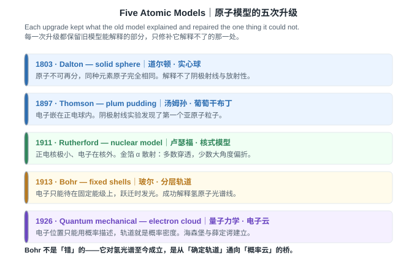
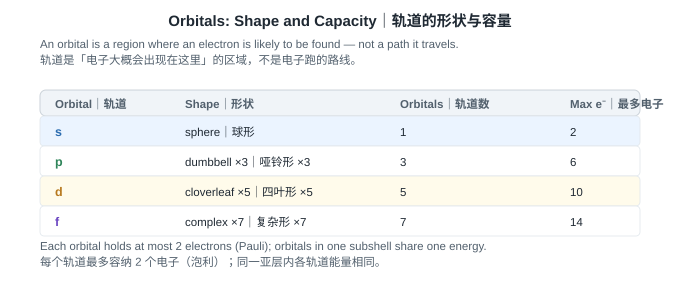
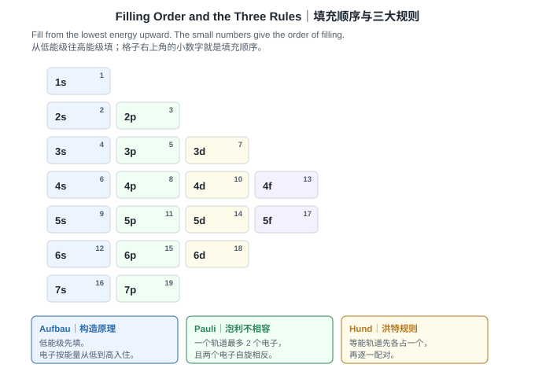
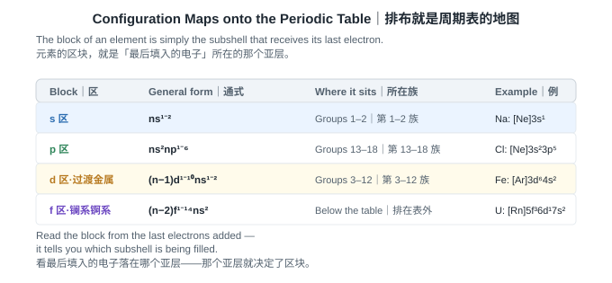

# Ch.5 — From Bohr to the Quantum Mechanical Model
## Chapter 5 · From Bohr to the Quantum Mechanical Model｜第 5 章　从玻尔模型到量子力学模型

> 🗂️ **Content Alignment｜大纲对应**：C1 "quantum mechanical model and electron configuration"｜**C1 量子力学模型与电子排布**；Big Idea **B1**｜核心概念 **B1**
> ⏱️ **Periods｜课时**：6　|　**Prerequisite｜前置**：Science 9（玻尔模型、质子/中子/电子）｜**Followed by｜后继**：Ch.6（周期趋势）、Ch.7（化学键）
> 🗂️ **Generated｜文件生成时间**：2026-10-02

## 1. Content Alignment｜大纲对应

| Item｜项目 | Content｜内容 |
|---|---|---|
| Content served｜服务的 Content | **C1 quantum mechanical model and electron configuration** — orbitals, filling rules, full and core configurations, orbital diagrams, periodic-table blocks｜**C1 量子力学模型与电子排布**——轨道、填充规则、完整排布与核心简写、轨道图、周期表分区 |
| Interface｜接口 | Trends in Ch.6 and bonding in Ch.7 are all explained by **where the electrons are**｜Ch.6 的周期趋势与 Ch.7 的化学键，全都由「电子在哪里」解释 |
| Competencies | [Questioning and predicting] Flame tests｜[Processing and analyzing] Build configurations｜[Communicating] Explain the shape of the table｜[提问与预测] 焰色试验｜[处理与分析] 书写排布｜[交流] 解释周期表为什么长这样 |
| Beyond scope?｜是否超纲 | **No** — but quantum numbers and the mathematics of the Schrödinger equation are Chemistry 12 / university material and are labelled `【Extension → Chemistry 12】`｜**不超纲**——但量子数与薛定谔方程的数学形式属 Chemistry 12/大学内容，标 `【Extension → Chemistry 12】` |

**中文**：Science 9 教过你玻尔模型——电子在固定的"层"上绕核运动。这个模型好用，但它是**简化版**。本章把模型升级到量子力学版本：电子不再有固定路线，而是待在**轨道（orbital）**里；然后学会三件套——**完整电子排布、核心简写、轨道图**。学完你会发现：电子排布不是一堆死记的字母数字，它就是**周期表为什么长这样的答案**。

> 📏 **Course-level rule｜课程级规则**：Every electron sits in the **lowest-energy orbital available**, two per orbital at most, and the **last electrons added** decide which block of the periodic table the element belongs to.
> **中文**：每个电子都住进**当前可用的最低能级**；一个轨道最多住两个；**最后填入的电子**决定这个元素属于周期表的哪个区。

## 2. Learning Objectives｜学习目标

**EN — By the end of this chapter, you should be able to:**

1. Trace the five atomic models and state the evidence that forced each upgrade.
2. Describe an orbital in quantum-mechanical terms and state the capacity of s, p, d and f subshells.
3. Apply the Aufbau principle, the Pauli exclusion principle and Hund's rule to fill orbitals correctly.
4. Write full electron configurations and core notations for all elements Z = 1–36, and draw orbital diagrams.
5. Predict an element's periodic-table block from its configuration, and vice versa.

**中文 — 本章结束后，你应当能够：**

1. 梳理五个原子模型，并说出每次升级是被什么证据逼出来的。
2. 用量子力学的语言描述轨道，并说出 s、p、d、f 亚层的容量。
3. 正确运用构造原理、泡利不相容原理与洪特规则填充轨道。
4. 写出 Z = 1–36 全部元素的完整电子排布与核心简写，并画出轨道图。
5. 由电子排布判断元素属于周期表哪个区，反之亦然。

## 3. Concept Explanations｜概念解析

### 3.1 Five Models, Five Repairs｜五个模型，五次修补

A scientific model is kept until it fails. Each atomic model in **Fig. 5-1** survived exactly until an experiment produced something it could not explain — then the next model repaired that one flaw and kept everything that still worked.

**中文**：科学模型用到"失灵"为止。**图 5-1** 里的每个原子模型，都是撑到某个实验做出它解释不了的结果——然后下一个模型修补这一个漏洞，同时保留旧模型仍然成立的部分。

The two upgrades this course cares about most are the last two. **Bohr's model (1913)** said electrons orbit in fixed energy levels — it explains the hydrogen spectrum beautifully, and it is the model you already know from Science 9. The **quantum mechanical model (1926)** keeps the idea of energy levels but removes the fixed paths: an electron's location becomes a **probability**, described by an **orbital**.

**中文**：与本课程关系最大的是最后两次升级。**玻尔模型（1913）**说电子在固定的能级上绕核运动——它把氢原子光谱解释得很漂亮，也是你在 Science 9 学过的模型。**量子力学模型（1926）**保留了能级概念，但取消了固定路线：电子的位置变成**概率**，用**轨道**来描述。

> ⚠️ **Misconception｜易错**：Bohr's model is not "wrong and useless". For the hydrogen atom it still gives the right energy levels; it is the **bridge** between "fixed orbits" and "probability clouds", not a dead end.
> **中文**：玻尔模型不是"错了就没用"。对氢原子它给出的能级至今正确；它是从"固定轨道"到"概率云"之间的**桥梁**，不是死路。

### 3.2 Orbitals: Where Electrons Probably Are｜轨道：电子大概在哪

An **atomic orbital** is a region of space where an electron is likely to be found — think of it as a probability map (the **electron cloud**), not a racetrack. There are four kinds of orbital, named s, p, d and f, and they come in fixed quantities per subshell: one s, three p, five d, seven f. **Each single orbital holds at most two electrons**, and the two must have opposite spins (Fig. 5-2).

**中文**：**原子轨道**是电子**可能**出现的空间区域——把它想成一张概率地图（**电子云**），而不是赛道。轨道共四种，记作 s、p、d、f，每种亚层的轨道数量固定：s 一条、p 三条、d 五条、f 七条。**每条轨道最多容纳两个电子**，且两电子自旋必须相反（图 5-2）。

Adding up the capacities gives a rule worth memorising: a subshell holds **2, 6, 10 or 14** electrons, and a full shell holds **2n²** (K shell 2, L shell 8, M shell 18…).

**中文**：把容量加起来，得到一个值得记住的规律：一个亚层容纳 **2、6、10 或 14** 个电子；一整层容纳 **2n²** 个（K 层 2、L 层 8、M 层 18……）。

> 💡 **Tip｜口诀**：s = 1 orbital, p = 3, d = 5, f = 7 — the numbers 1, 3, 5, 7 are the **odd numbers in order**, each multiplied by 2 for capacity.
> **中文**：s = 1 条轨道，p = 3，d = 5，f = 7——1、3、5、7 正是连续奇数；容量再各乘 2。

### 3.3 The Three Filling Rules｜三大填充规则

Electrons fill orbitals according to three rules (**Fig. 5-3**):

**中文**：电子按三条规则入住轨道（图 5-3）：

1. **Aufbau principle 构造原理** — fill the **lowest-energy orbital available** first. After 3p, the next electron enters **4s, not 3d**: the 4s orbital is slightly lower in energy than 3d, which is why period 4 inserts the transition metals.
   **中文**——先填**当前能量最低**的轨道。3p 填满后，下一个电子进 **4s 而不是 3d**：4s 轨道能量比 3d 略低，这正是第 4 周期会插入过渡金属的原因。
2. **Pauli exclusion principle 泡利不相容原理** — an orbital holds **at most two electrons, with opposite spins** (one ↑, one ↓).
   **中文**——一条轨道最多两个电子，自旋方向必须相反（一 ↑ 一 ↓）。
3. **Hund's rule 洪特规则** — within a subshell of equal-energy orbitals, electrons **spread out singly first** (with parallel spins) before any orbital gets a second electron.
   **中文**——同一亚层的等能轨道，电子**先逐条单占**（自旋同向），有富余才开始配对。

> 💡 **Tip｜口诀**：Aufbau = "economy"（先住便宜的）；Pauli = "two per room, facing opposite ways"（一房两人、一正一反）；Hund = "spread out before pairing up"（先分开坐，再拼桌）。
> **中文**：三条规则一句话——按楼层从低到高住；一间房最多两人且方向相反；同层多个房间先各住一人。

### 3.4 Writing Configurations: The Three-Piece Set｜写排布：三件套

For any element Z = 1–36 you should be able to produce three things (**Example 5-1**):

**中文**：对任意 Z = 1–36 的元素，你都应能拿出三件东西（**例 5-1**）：

- **Full electron configuration 完整电子排布** — every subshell in filling order with superscript counts: Cl is 1s² 2s² 2p⁶ 3s² 3p⁵.
  **中文**——按填充顺序写全每个亚层与上标计数：Cl 为 1s² 2s² 2p⁶ 3s² 3p⁵。
- **Core notation 核心简写** — replace the inner shells with the noble-gas symbol in brackets: Cl is [Ne] 3s² 3p⁵. The bracketed core must be the **previous noble gas** in the table.
  **中文**——内层用稀有气体符号加方括号代替：Cl 写 [Ne] 3s² 3p⁵。方括号里必须是表中**前一个**稀有气体。
- **Orbital diagram 轨道图** — boxes for orbitals and arrows for electrons, obeying all three rules: the five 3p boxes of Cl read ↑↓ ↑↓ ↑.
  **中文**——方框表示轨道、箭头表示电子，三规则全部生效：Cl 的五个 3p 方框写作 ↑↓ ↑↓ ↑。

The **valence electrons** are those in the highest-n shell (plus, for transition metals, the unfinished (n−1)d electrons). They are the electrons Ch.7's bonding chemistry will use.

**中文**：**价电子**是最外层（n 最大）的电子（对过渡金属还要加上未填满的 (n−1)d 电子）。它们就是 Ch.7 成键化学要用的那批电子。

> ⚠️ **Misconception｜易错**：Writing the core notation with the wrong noble gas — [Ar] for chlorine, say — silently changes the electron count. Count the core first: Ar holds 18 electrons, but chlorine only has 17 in total.
> **中文**：核心简写用错稀有气体——比如给氯写 [Ar]——会悄悄改错电子数。先数内层：Ar 有 18 个电子，而氯总共只有 17 个。

### 3.5 The 4s/3d Trap and Cations｜4s/3d 陷阱与阳离子

Filling order says **4s before 3d**, so iron (Z = 26) fills as 1s² 2s² 2p⁶ 3s² 3p⁶ **4s²** **3d⁶**. In standard written form the subshells are usually regrouped by shell: **[Ar] 3d⁶ 4s²**. Both orders describe the same atom; this course writes core notation with 3d before 4s.

**中文**：填充顺序是 **4s 先于 3d**，所以铁（Z = 26）填充为 1s² 2s² 2p⁶ 3s² 3p⁶ **4s²** **3d⁶**。标准书写通常按层数重新排序，写 **[Ar] 3d⁶ 4s²**。两种写法描述同一个原子；本课程核心简写统一把 3d 写在 4s 前。

When a transition-metal atom becomes a cation, electrons leave the **highest-n shell first** — the 4s electrons go before the 3d electrons. Fe²⁺ is [Ar] 3d⁶ and Fe³⁺ is [Ar] 3d⁵ — the famous "half-filled d subshell".

**中文**：过渡金属原子变成阳离子时，电子先从 **n 最大的层**离开——先失 4s、再失 3d。Fe²⁺ 是 [Ar] 3d⁶，Fe³⁺ 是 [Ar] 3d⁵——正是著名的"半满 d 亚层"。

> ⚠️ **Misconception｜易错**："Fill 4s first, so ionise 4s last." The reverse: because 4s is the outermost occupied shell once 3d starts filling, **4s electrons leave first**.
> **中文**："先填 4s，所以最后失 4s"——正好反了：一旦 3d 开始填充，4s 就成了最外层，**4s 电子先失**。

Two famous exceptions to note but not memorise: chromium (Z = 24) is [Ar] 3d⁵ 4s¹ and copper (Z = 29) is [Ar] 3d¹⁰ 4s¹ — half-filled and filled d subshells gain extra stability. `【Extension → Chemistry 12】` gives the energetics.

**中文**：两个著名例外，知道即可、不要求背：铬（Z = 24）[Ar] 3d⁵ 4s¹、铜（Z = 29）[Ar] 3d¹⁰ 4s¹——半满与全满的 d 亚层有额外稳定性。能量层面的解释见 `【Extension → Chemistry 12】`。

### 3.6 Configuration Is the Map of the Table｜排布就是周期表的地图

The periodic table's shape is a picture of the filling order (**Fig. 5-4**). The **last electron added** tells you the block: an element whose configuration ends in s² or s¹ sits in the **s block** (Groups 1–2, plus He); one ending in p electrons sits in the **p block** (Groups 13–18); one filling d sits in the **d block** (the transition metals, Groups 3–12); the f block is pulled out below the table as the lanthanides and actinides.

**中文**：周期表的形状就是填充顺序的画像（图 5-4）。**最后填入的电子**决定区块：排布终于 s¹/s² 的元素在 **s 区**（第 1–2 族，外加 He）；终于 p 的在 **p 区**（第 13–18 族）；正在填 d 的在 **d 区**（过渡金属，第 3–12 族）；f 区单独抽出来放在表下方，即镧系与锕系。

This also explains the period lengths: period 3 stops at 8 elements because only 3s and 3p are filled before 4s intervenes; the extra 10 elements of period 4 are exactly the ten 3d electrons of the d block.

**中文**：这也解释了周期长短：第 3 周期只到 8 个元素，是因为 3s、3p 填满后 4s 就插队了；第 4 周期多出的 10 个元素，恰好就是 d 区那 10 个 3d 电子。

## 4. Comparison Tables｜对照表

### Table 5-1　Bohr model vs quantum mechanical model｜玻尔模型 vs 量子力学模型

| Feature｜特征 | Bohr (1913)｜玻尔 | Quantum mechanical (1926)｜量子力学 |
|---|---|---|---|
| Electron path｜电子路径 | Fixed circular orbits｜固定圆形轨道 | No fixed path — probability cloud｜无固定路线——概率云 |
| "Orbit" meaning｜「轨道」含义 | A track an electron travels｜电子行驶的赛道 | A region of likely location｜大概率出现的区域 |
| Energy levels｜能级 | Fixed shells｜固定的层 | Subshells made of orbitals｜由轨道组成的亚层 |
| Best at explaining｜最擅长解释 | Hydrogen spectrum｜氢原子光谱 | All atoms, bonding, table shape｜所有原子、成键、周期表形状 |
| Kept from before｜保留了什么 | Energy levels are real｜能级是真实的 | Everything of Bohr's levels｜玻尔能级的全部成果 |

**中文**：玻尔模型把轨道当"赛道"，量子力学把它当"概率地图"；能级概念两者共享，量子版把每一层再细分成亚层与轨道。

### Table 5-2　Subshell capacities｜亚层容量

| Subshell｜亚层 | Orbitals｜轨道数 | Max electrons｜最多电子 | Shape｜形状 |
|---|---|---|---|---|
| s | 1 | 2 | sphere｜球形 |
| p | 3 | 6 | dumbbell｜哑铃形 |
| d | 5 | 10 | cloverleaf｜四叶形 |
| f | 7 | 14 | complex｜复杂形 |

**中文**：一条轨道装两个电子，所以容量 = 轨道数 × 2：s/p/d/f 对应 2/6/10/14。

### Table 5-3　The four blocks｜四个分区

| Block｜区 | Last electron enters｜最后电子填入 | Groups｜族 | Example｜例 |
|---|---|---|---|---|
| s | ns¹⁻² | 1–2 (+He)｜第 1–2 族（含 He） | Na: [Ne]3s¹ |
| p | ns²np¹⁻⁶ | 13–18｜第 13–18 族 | Cl: [Ne]3s²3p⁵ |
| d | (n−1)d¹⁻¹⁰ns¹⁻² | 3–12 (transition metals)｜第 3–12 族（过渡金属） | Fe: [Ar]3d⁶4s² |
| f | (n−2)f¹⁻¹⁴ns² | lanthanides & actinides｜镧系与锕系 | U: [Rn]5f³6d¹7s² |

**中文**：看排布的**结尾**就能定位分区——这正是"排布是周期表的地图"的操作版。

## 5. Diagrams & Worked Examples｜图解与例题

### Fig. 5-1　Five Atomic Models｜原子模型的五次升级

**Reading the figure｜看图要点**：从上往下读年份，每一行只回答两个问题——这个模型解释了什么、补上了谁的什么漏洞。

### Fig. 5-2　Orbitals: Shape and Capacity｜轨道的形状与容量

**Reading the figure｜看图要点**：先看"轨道数"列（1/3/5/7），再看"最多电子"列（2/6/10/14）——后者是前者乘 2。

### Fig. 5-3　Filling Order and the Three Rules｜填充顺序与三大规则

**Reading the figure｜看图要点**：格子右上角的小数字是填充顺序；注意 4s（序号 6）排在 3d（序号 7）之前——这就是过渡金属出现在第 4 周期的原因。

### Fig. 5-4　Configuration Maps onto the Periodic Table｜排布就是周期表的地图

**Reading the figure｜看图要点**：拿任何一个元素的排布结尾对照"通式"列，立刻读出它属于哪个区。

### Example 5-1　Chlorine, Z = 17 — the three-piece set｜氯（Z = 17）三件套

Fill 17 electrons in order: 1s takes 2, 2s takes 2, 2p takes 6 (total 10), 3s takes 2 (12), and the remaining 5 enter 3p.

**中文**：按顺序填 17 个电子：1s 装 2 个，2s 装 2 个，2p 装 6 个（累计 10），3s 装 2 个（累计 12），剩下 5 个进 3p。

- **Full configuration｜完整排布**：1s² 2s² 2p⁶ 3s² 3p⁵
- **Core notation｜核心简写**：the previous noble gas is Ne (10 e⁻), so [Ne] 3s² 3p⁵｜前一个稀有气体是 Ne（10 电子），故写 [Ne] 3s² 3p⁵
- **Orbital diagram｜轨道图**：3p subshell = ↑↓ ↑↓ ↑ — Hund's rule keeps the last electron unpaired｜3p 亚层 = ↑↓ ↑↓ ↑——按洪特规则最后一个电子保持单占

*(Full 2 + core 1 + diagram 2 marks)｜（完整排布 2 分 + 核心简写 1 分 + 轨道图 2 分）*

### Example 5-2　Iron and its cations｜铁与其阳离子

Iron (Z = 26) fills as 1s² 2s² 2p⁶ 3s² 3p⁶ **4s² 3d⁶** — after [Ar], 4s receives 2 electrons before 3d begins. Written in standard order: **Fe: [Ar] 3d⁶ 4s²**.

**中文**：铁（Z = 26）填充为 1s² 2s² 2p⁶ 3s² 3p⁶ **4s² 3d⁶**——[Ar] 之后 4s 先收 2 个电子，3d 才开始。按标准书写顺序：**Fe: [Ar] 3d⁶ 4s²**。

Forming cations, the outermost shell empties first: Fe²⁺ loses the two 4s electrons → **[Ar] 3d⁶**; Fe³⁺ additionally loses one 3d electron → **[Ar] 3d⁵**.

**中文**：形成阳离子时最外层先空：Fe²⁺ 失去两个 4s 电子 → **[Ar] 3d⁶**；Fe³⁺ 再失一个 3d 电子 → **[Ar] 3d⁵**。

*(Configuration 2 + ionisation order 2 + both ions 2 marks)｜（排布 2 分 + 失电子次序 2 分 + 两种离子各 2 分）*

> 🔭 **Extension｜超纲**【Extension → Chemistry 12】：Why are half-filled subshells special? Exchange-energy arguments and the full quantum treatment of multi-electron atoms wait for Chemistry 12; for now, treat Cr and Cu as interesting exceptions you can recognise.
> **中文**：【超纲延伸 → Chemistry 12】半满亚层为何特别？交换能论证与多电子原子的完整量子处理属于 Chemistry 12；现阶段把 Cr 与 Cu 当作"能认出来的有趣例外"即可。

## 6. Key Vocabulary｜核心词汇

| Term｜术语 | Meaning in one line｜一句话释义 |
|---|---|---|
| quantum mechanical model｜量子力学模型 | Atomic model in which electron positions are probabilities｜电子位置以概率描述的原子模型 |
| atomic orbital｜原子轨道 | Region where an electron is likely to be found｜电子大概率出现的区域 |
| electron cloud｜电子云 | Picture of orbital probability density｜轨道概率密度的图像 |
| subshell｜亚层 | s, p, d or f set of orbitals within a shell｜壳层内 s/p/d/f 一组轨道 |
| Aufbau principle｜构造原理 | Fill lowest-energy orbitals first｜先填能量最低的轨道 |
| Pauli exclusion principle｜泡利不相容原理 | Max 2 electrons per orbital, opposite spins｜每轨道最多 2 电子且自旋相反 |
| Hund's rule｜洪特规则 | Spread out singly before pairing｜等能轨道先单占再配对 |
| electron configuration｜电子排布 | Full address of every electron｜每个电子的完整"住址清单" |
| core notation｜核心简写 | Configuration shortened with a noble-gas core｜用稀有气体芯缩短的排布 |
| orbital diagram｜轨道图 | Boxes and arrows showing every electron｜用方框与箭头画出全部电子 |
| valence electrons｜价电子 | Outermost (highest-n) electrons that do chemistry｜最外层（n 最大）参与成键的电子 |

**中文**：这一章的词汇全部互相咬合——先有"轨道"与"概率"，再有"三规则"，然后才有"排布/简写/轨道图"三件套和"分区"。

## 7. Lab / Activity｜实验与活动

**Activity 5-1　The Electron Apartment Tower｜电子入住大厦** `[Formulate models｜建立模型]`

Turn the periodic table into an apartment building: floors are shells, wings are s/p/d/f subshells, rooms are orbitals (two tenants each, facing opposite ways). "Move in" the residents of assigned elements and read the block of each tenant's address.

**中文**：把周期表当作公寓楼：楼层 = 电子层，侧翼 = s/p/d/f 亚层，房间 = 轨道（每间两位住户、方向相反）。给指定元素"办理入住"，再读出每个住址属于哪个区。

**Activity 5-2　Flame Tests｜焰色试验** `[Questioning and predicting｜提问与预测]`

Burn small samples of Li, Na, K, Cu and Sr salts in a flame and record the colours (Li crimson, Na yellow, K lilac through cobalt glass, Cu blue-green, Sr red). Explain qualitatively: heat promotes electrons upward; falling back releases light of specific colours — the Bohr-to-quantum bridge made visible.

**中文**：在火焰上灼烧 Li、Na、K、Cu、Sr 的盐并记录颜色（锂深红、钠黄、钾透过钴玻璃观察淡紫、铜蓝绿、锶红）。定性解释：受热把电子推向高能级；落回时放出特定颜色的光——这正是"玻尔→量子"之桥的可见版。

**Activity 5-3　Configuration Speed Dating｜排布速配赛** `[Processing and analyzing｜处理与分析]`

Draw an element card and, in 60 seconds, produce the three-piece set — full configuration, core notation, orbital diagram. Partner checks with the periodic-table blocks before scoring.

**中文**：抽一张元素卡，60 秒内产出三件套——完整排布、核心简写、轨道图。同伴对照周期表分区后再评分。

## 8. Common Misconceptions｜常见易错点

| # | Misconception｜误区 | Correction｜纠正 |
|---|---|---|
| 1 | Electrons travel in fixed circles｜电子沿固定圆圈跑 | Quantum model: probability cloud, no track｜量子模型是概率云，没有轨迹 |
| 2 | 3d fills before 4s｜3d 比 4s 先填 | Filling order: 4s first (energy), written order differs｜填充时 4s 先；书写顺序另算 |
| 3 | Two same-direction arrows in one orbital｜同一轨道画两个同向箭头 | Pauli: opposite spins only｜泡利：只能一 ↑ 一 ↓ |
| 4 | d subshell drawn with 4 boxes｜d 亚层画成 4 个方框 | d has 5 orbitals; fill singly first (Hund)｜d 有 5 条轨道；先单占（洪特） |
| 5 | "Bohr was wrong, discard it"｜玻尔错了就全丢 | Still correct for hydrogen; a bridge, not a dead end｜对氢原子至今成立；是桥梁不是死路 |
| 6 | Core notation with wrong noble gas｜核心简写用错稀有气体 | The core must be the previous noble gas｜方括号必须是前一个稀有气体 |
| 7 | Orbital = planet path｜轨道 = 行星路线 | Orbital = probability region｜轨道 = 概率区域 |
| 8 | He placed in the p block｜把 He 归进 p 区 | He is 1s² — s block despite its column｜He 是 1s²——虽然站在第 18 族，属 s 区 |
| 9 | Fe³⁺ loses 3d before 4s｜Fe³⁺ 先失 3d | Highest n first: 4s electrons leave first｜先失 n 最大层的：4s 先走 |
| 10 | 2n² applied to subshells｜把 2n² 用到亚层上 | 2n² counts a whole shell, not a subshell｜2n² 数的是整层，不是亚层 |
| 11 | All d-block valence electrons are only ns²｜d 区价电子只算 ns² | Unfilled (n−1)d electrons also act as valence｜未填满的 (n−1)d 也算价电子 |
| 12 | Cr and Cu disprove the rules｜Cr、Cu 推翻规则 | Exceptions with energy reasons, rules still stand｜例外有能量原因，规则本身不倒 |

**中文**：考试里最常见的扣分点是 2、3、4、9——填充次序、Pauli 箭头、Hund 单占、失电子次序，这四条务必练到条件反射。

## 9. Assessment｜答题评估

### Part A: Foundational｜基础题（10 × 2 = 20 points）

**A1.** State one difference between an orbit (Bohr) and an orbital (quantum mechanical model).

- **中文**：说出玻尔的「轨道（orbit）」与量子力学「轨道（orbital）」的一个区别。

**A2.** Write the full electron configuration of magnesium, Z = 12.

- **中文**：写出镁（Z = 12）的完整电子排布。

**A3.** Write the core notation of magnesium.

- **中文**：写出镁的核心简写。

**A4.** Draw the orbital diagram of nitrogen, Z = 7.

- **中文**：画出氮（Z = 7）的轨道图。

**A5.** Name the three filling rules and state each in one line.

- **中文**：写出三条填充规则的名称，各用一句话概括。

**A6.** How many electrons can one orbital hold, and which rule says so?

- **中文**：一条轨道最多容纳几个电子？是哪条规则规定的？

**A7.** Write the core notation of calcium, Z = 20.

- **中文**：写出钙（Z = 20）的核心简写。

**A8.** Why does the 4s subshell fill before 3d? Answer in one sentence about energy.

- **中文**：为什么 4s 比 3d 先填？用一句话、从能量角度回答。

**A9.** Write the core notation of Fe²⁺ and state which electrons it lost first.

- **中文**：写出 Fe²⁺ 的核心简写，并指出它先失去的是哪部分电子。

**A10.** True or false, with a reason: "The Bohr model was proved wrong, so it should not be taught."

- **中文**：判断对错并说明理由："玻尔模型被证明是错的，所以不该再教。"

### Part B: Applied｜应用题（4 × 5 = 20 points）

**B1.** For chlorine, iron and krypton: (a) write the full configuration of each; (b) write the core notation of each; (c) draw the orbital diagram of only the highest-n subshell of each.

- **中文**：对氯、铁、氪三种元素：(a) 写出各自的完整排布；(b) 写出核心简写；(c) 只画各自 n 最大的那个亚层的轨道图。

**B2.** Using the s/p/d/f blocks: (a) state the block of Na, Cl, Fe and U; (b) give the "last electron" subshell in each case; (c) explain why the d block sits between the s and p blocks in periods 4 and up.

- **中文**：用 s/p/d/f 分区：(a) 指出 Na、Cl、Fe、U 各属哪个区；(b) 写出每种情况里「最后填入」的亚层；(c) 解释为什么第 4 周期起 d 区插在 s 区与 p 区之间。

**B3.** Design a flame-test demonstration for a Science 9 class: (a) choose three metal salts and predict each flame colour; (b) explain the colour source in terms of energy levels; (c) state one safety precaution and one limitation of the method.

- **中文**：为 Science 9 学生设计一个焰色试验演示：(a) 选三种金属盐并预测各自火焰颜色；(b) 从能级角度解释颜色来源；(c) 写出一条安全注意事项和该方法的一个局限。

**B4.** A classmate writes the configuration of sodium (Z = 11) as 1s² 2s² 2p⁷ 3s⁰. (a) Identify every error; (b) write the correct full configuration and core notation; (c) explain which filling rule the error violates.

- **中文**：某同学把钠（Z = 11）的排布写成 1s² 2s² 2p⁷ 3s⁰。(a) 指出所有错误；(b) 写出正确的完整排布与核心简写；(c) 说明该错误违反了哪条填充规则。

### Part C: Challenge｜挑战题（2 × 10 = 20 points）

**C1.** Period 3 contains 8 elements but period 4 contains 18. (a) Write the core notations of Ar (Z = 18) and K (Z = 19), and identify which subshell K's last electron enters. (b) Use the filling order to explain the 10-element jump, naming the block responsible. (c) Predict how many elements period 6 will contain and justify your prediction with the f block. *(3 + 4 + 3 marks)*

- **中文**：第 3 周期有 8 个元素，第 4 周期却有 18 个。(a) 写出 Ar（Z = 18）与 K（Z = 19）的核心简写，并指出 K 最后一个电子进入哪个亚层。(b) 用填充顺序解释这多出的 10 个元素，点名负责的分区。(c) 预测第 6 周期会有多少个元素，并用 f 区论证你的预测。*(3 + 4 + 3 分)*

**C2.** Defend or refute: "The electron configuration is just a map of the periodic table." Your answer must (a) state a clear position; (b) use the four blocks with one worked example each; (c) use the period-length argument (8 vs 18) as evidence; (d) end with one testable prediction the map makes about an element not yet discussed. *(2 + 4 + 2 + 2 marks)*

- **中文**：辩护或反驳："电子排布就是周期表的地图。"作答须 (a) 表明立场；(b) 用四个分区、各配一个实际例子；(c) 用周期长度论证（8 对 18）作为证据；(d) 以地图对某还没讲过的元素做出的一条可检验预测收尾。*(2 + 4 + 2 + 2 分)*

### Answer Key｜答案

- **A1.** An orbit is a fixed circular path; an orbital is a probability region with no path.

  - **中文**：orbit 是固定圆形路线；orbital 是概率区域，没有路线。

- **A2.** Mg: 1s² 2s² 2p⁶ 3s².

  - **中文**：Mg：1s² 2s² 2p⁶ 3s²。

- **A3.** Mg: [Ne] 3s².

  - **中文**：Mg：[Ne] 3s²。

- **A4.** N: 1s ↑↓, 2s ↑↓, 2p ↑ ↑ ↑ (three singly-occupied 2p orbitals).

  - **中文**：N：1s ↑↓，2s ↑↓，2p ↑ ↑ ↑（三个 2p 轨道各单占一个电子）。

- **A5.** Aufbau — lowest energy first; Pauli — max two opposite-spin electrons per orbital; Hund — single-occupy equal-energy orbitals before pairing.

  - **中文**：构造原理——低能级先填；泡利——每轨道最多两个反向自旋电子；洪特——等能轨道先单占再配对。

- **A6.** Two; the Pauli exclusion principle.

  - **中文**：两个；泡利不相容原理。

- **A7.** Ca: [Ar] 4s².

  - **中文**：Ca：[Ar] 4s²。

- **A8.** The 4s orbital is slightly lower in energy than 3d, so it fills first.

  - **中文**：4s 轨道能量比 3d 略低，所以先填。

- **A9.** Fe²⁺: [Ar] 3d⁶; the two 4s electrons left first.

  - **中文**：Fe²⁺：[Ar] 3d⁶；先失去的是两个 4s 电子。

- **A10.** False — Bohr's model still gives correct energy levels for hydrogen and remains the bridge to the quantum model.

  - **中文**：错——玻尔模型对氢原子的能级至今正确，且是通向量子模型的桥梁。

- **B1.** (a) Cl 1s² 2s² 2p⁶ 3s² 3p⁵; Fe 1s² 2s² 2p⁶ 3s² 3p⁶ 4s² 3d⁶; Kr 1s² 2s² 2p⁶ 3s² 3p⁶ 4s² 3d¹⁰ 4p⁶. (b) Cl [Ne] 3s² 3p⁵; Fe [Ar] 3d⁶ 4s²; Kr [Ar] 3d¹⁰ 4s² 4p⁶. (c) Cl 3p: ↑↓ ↑↓ ↑; Fe 3d: ↑↓ ↑ ↑ ↑ ↑ (after pairing two); Kr 4p: ↑↓ ↑↓ ↑↓.

  - **中文**：(a) 氯 1s² 2s² 2p⁶ 3s² 3p⁵；铁 1s² 2s² 2p⁶ 3s² 3p⁶ 4s² 3d⁶；氪 1s² 2s² 2p⁶ 3s² 3p⁶ 4s² 3d¹⁰ 4p⁶。(b) 氯 [Ne] 3s² 3p⁵；铁 [Ar] 3d⁶ 4s²；氪 [Ar] 3d¹⁰ 4s² 4p⁶。(c) 氯 3p：↑↓ ↑↓ ↑；铁 3d：↑↓ ↑ ↑ ↑ ↑（一对已配）；氪 4p：↑↓ ↑↓ ↑↓。

- **B2.** (a) Na — s block; Cl — p block; Fe — d block; U — f block. (b) Na 3s¹; Cl 3p⁵; Fe 3d; U 5f. (c) After 4s, electrons enter 3d, so the table must insert ten elements between the s and p blocks — that inserted run is the d block.

  - **中文**：(a) Na——s 区；Cl——p 区；Fe——d 区；U——f 区。(b) Na 3s¹；Cl 3p⁵；Fe 3d；U 5f。(c) 4s 之后电子进入 3d，所以周期表必须在 s 区与 p 区之间插入十个元素——插入的这一段就是 d 区。

- **B3.** (a) e.g. NaCl yellow, CuSO₄ blue-green, SrCl₂ crimson. (b) Heat promotes electrons to higher levels; as they fall back, the released energy appears as visible light of element-specific colours. (c) Safety: tie back hair, no loose sleeves, use small samples; limitation: many metals give similar colours, so it identifies groups rather than single elements.

  - **中文**：(a) 例如 NaCl 黄色、CuSO₄ 蓝绿、SrCl₂ 深红。(b) 受热把电子推上高能级；电子落回时释放的能量表现为该元素特征颜色的可见光。(c) 安全：扎起头发、不穿宽松袖口、样品少量；局限：多种金属颜色相近，只能分辨"族"而难以分辨单一元素。

- **B4.** (a) 2p cannot hold 7 (max 6) — Pauli violated; 3s⁰ written as if 2p overflow existed; (b) Na: 1s² 2s² 2p⁶ 3s¹ = [Ne] 3s¹; (c) Pauli exclusion principle — an orbital cannot exceed two electrons, therefore 2p⁷ is impossible.

  - **中文**：(a) 2p 装不下 7 个（上限 6）——违反泡利；3s⁰ 的写法暗示电子从 2p 溢出；(b) Na：1s² 2s² 2p⁶ 3s¹ = [Ne] 3s¹；(c) 泡利不相容原理——轨道不能超过两个电子，所以 2p⁷ 不可能。

- **C1.** (a) Ar: [Ne] 3s² 3p⁶; K: [Ar] 4s¹ — the last electron enters 4s. (b) After 4s fills, the next ten electrons fill 3d (the d block) before 4p starts, adding exactly 10 elements to period 4: 8 (like period 3) + 10 = 18. (c) Period 6 = 8 + 10 + 14 = 32: after 6s, the 4f subshell (fourteen electrons, the lanthanides) fills before 5d completes.

  - **中文**：(a) Ar：[Ne] 3s² 3p⁶；K：[Ar] 4s¹——最后一个电子进入 4s。(b) 4s 填满后，接下来的十个电子填 3d（d 区），填完才开始 4p，这正好给第 4 周期添了 10 个元素：8（与第 3 周期相同）+ 10 = 18。(c) 第 6 周期 = 8 + 10 + 14 = 32：6s 之后先填 4f（十四个电子，即镧系），再补完 5d。

- **C2.** Position — support: the map claim is essentially correct. (a) The configuration's ending subshell locates the block, the shell count locates the period. (b) Examples: Na [Ne]3s¹ → s block, Group 1; Cl [Ne]3s²3p⁵ → p block, Group 17; Fe [Ar]3d⁶4s² → d block; U [Rn]5f³6d¹7s² → f block. (c) Period lengths 8 and 18 follow from 3s+3p versus 4s+3d+4p capacities — pure configuration arithmetic. (d) Prediction: an element ending in 7s¹ (francium) should sit in Group 1, s block, and behave like the other alkali metals.

  - **中文**：立场——支持："地图"说法基本正确。(a) 排布结尾的亚层定分区，层数定周期。(b) 例子：Na [Ne]3s¹ → s 区第 1 族；Cl [Ne]3s²3p⁵ → p 区第 17 族；Fe [Ar]3d⁶4s² → d 区；U [Rn]5f³6d¹7s² → f 区。(c) 周期长 8 与 18 完全来自 3s+3p 与 4s+3d+4p 的容量——纯排布算术。(d) 预测：排布终于 7s¹ 的元素（钫）应落在第 1 族、s 区，性质与其他碱金属相似。

## 10. Connection to the Big Idea｜回扣核心概念

> 🔗 **Big Idea B1｜核心概念 B1**：*Atoms and molecules are the building blocks of matter.*｜**原子与分子是物质的构件。**

Electron configuration is the instruction sheet for the building blocks: it tells you how many electrons sit at each energy, which subshell received the last one, and therefore which family behaviour — alkali metal, halogen, transition metal — the atom will show. Ch.6 turns this map into measurable trends, and Ch.7 uses the same valence electrons to build bonds.

**中文**：电子排布就是"构件"的使用说明书：它告诉你每个能级上住着多少电子、最后一个住进了哪个亚层，从而决定原子会表现出哪一族的化学行为——碱金属、卤素还是过渡金属。Ch.6 把这张地图变成可测量的趋势；Ch.7 用同一批价电子搭出化学键。
