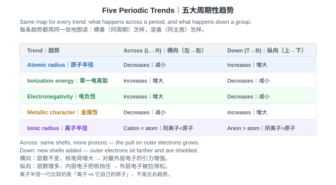
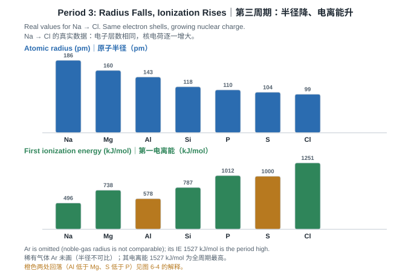
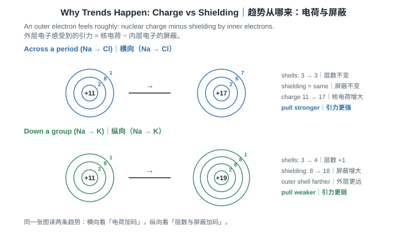
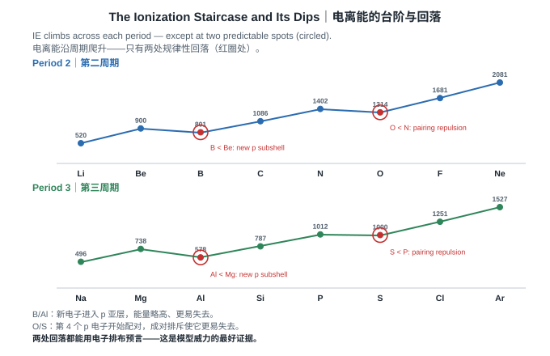

# Ch.6 — The Periodic Table and Periodic Trends
## Chapter 6 · The Periodic Table and Periodic Trends｜第 6 章　周期表与周期性趋势

> 🗂️ **Content Alignment｜大纲对应**：C1 接口（排布 → 分区 → 趋势）；Competency：[Seek and analyze patterns｜寻找与分析规律]；Big Idea **B1**｜核心概念 **B1**
> ⏱️ **Periods｜课时**：5　|　**Prerequisite｜前置**：Ch.5（电子排布与分区）｜**Followed by｜后继**：Ch.7（ΔEN 判键型）
> 🗂️ **Generated｜文件生成时间**：2026-10-02

## 1. Content Alignment｜大纲对应

| Item｜项目 | Content｜内容 |
|---|---|---|
| Content served｜服务的 Content | **C1 interface** — electron arrangement organizes the table and drives every trend｜**C1 接口**——电子排布组织起周期表，并驱动所有趋势 |
| Interface｜接口 | Electronegativity values from this chapter feed the ΔEN bond classification of Ch.7｜本章的电负性数值直接喂给 Ch.7 的 ΔEN 键型判断 |
| Competencies | [Seek and analyze patterns] Trend puzzles｜[Questioning and predicting] Group reactivity demos｜[Applying and innovating] Data-Booklet EN predictions｜[寻找与分析规律] 趋势拼图｜[提问与预测] 族反应性演示｜[应用与创新] 用 Data Booklet 电负性做预测 |
| Beyond scope?｜是否超纲 | **No** — quantitative shielding constants and full successive-IE data analysis are Chemistry 12｜**不超纲**——定量的屏蔽常数与逐级电离能数据分析属 Chemistry 12 |

**中文**：Ch.5 说过"排布是周期表的地图"。本章兑现这张地图的价值：**五条趋势**——原子半径、第一电离能、电负性、金属性、离子半径——方向全部能从排布推出来，不用死记。推它们的统一工具是"层数 + 核电荷 + 屏蔽"三要素。

> 📏 **Course-level rule｜课程级规则**：Read every trend the same way. **Across a period** shells stay constant while charge grows; **down a group** shells multiply while shielding grows. If you can say which of the two changed, you can predict the trend.
> **中文**：所有趋势都用同一套读法。**横向**层数不变、电荷增加；**纵向**层数增多、屏蔽增强。说得出变的是哪一个，就能预测趋势方向。

## 2. Learning Objectives｜学习目标

**EN — By the end of this chapter, you should be able to:**

1. State the direction of the five periodic trends across a period and down a group.
2. Explain each trend using electron shells, effective nuclear charge and shielding.
3. Distinguish ionization energy from electronegativity in your own words.
4. Compare the reactivity of alkali metals, halogens and noble gases using the trends.
5. Explain the two ionization-energy dips using electron configuration.

**中文 — 本章结束后，你应当能够：**

1. 说出五条周期性趋势在横向与纵向的方向。
2. 用电子层数、有效核电荷与屏蔽效应解释每条趋势。
3. 用自己的话区分电离能与电负性。
4. 用趋势比较碱金属、卤素与稀有气体的反应性。
5. 用电子排布解释电离能的两处"台阶异常"。

## 3. Concept Explanations｜概念解析

### 3.1 Reading the Table: Group and Period｜读表：族与周期

Two coordinates locate any element. **Group（族）** — the vertical column — counts outer-shell electrons and therefore predicts chemical behaviour. **Period（周期）** — the horizontal row — counts occupied shells and therefore sets atomic size. Ch.5's blocks (s/p/d/f) sit inside this grid: main-group elements live in the s and p blocks, transition metals in the d block.

**中文**：两个坐标定位任何元素。**族**——纵列——数的是外层电子数，所以预测化学行为；**周期**——横行——数的是已占层数，所以决定原子大小。Ch.5 的分区（s/p/d/f）就嵌在这个网格里：主族元素住在 s 区与 p 区，过渡金属住在 d 区。

### 3.2 The Five Trends at a Glance｜五条趋势总览

**Fig. 6-1** and **Table 6-1** collect the directions. Notice the mirror pattern: radius and metallic character move one way, ionization energy and electronegativity move the other, because they measure opposite appetites — "keep electrons" versus "attract electrons".

**中文**：**图 6-1** 与**表 6-1** 汇总了方向。注意镜像关系：半径与金属性同向，电离能与电负性反向——因为它们量的是相反的欲望：一个量"留住自己的电子"，一个量"吸引别人的电子"。

The ionic-radius row breaks the left-right pattern deliberately: an ion is always compared with **its own parent atom**. Losing electrons shrinks the radius (cation < atom); gaining electrons inflates it (anion > atom).

**中文**：离子半径一行刻意不按左右趋势写：离子永远和**它自己的原子**比。失电子变小（阳离子 < 原子），得电子变大（阴离子 > 原子）。

### 3.3 The Explanation Engine: Charge vs Shielding｜解释引擎：电荷与屏蔽

All five trends come from a tug-of-war between two effects (**Fig. 6-3**):

**中文**：五条趋势全部来自一场"拔河"（图 6-3）：

- **Effective nuclear charge（Zeff）有效核电荷** — the pull the outer electron actually feels, roughly nuclear charge minus shielding. Across a period, electrons enter the **same shell**, so they shield each other weakly and the growing proton count wins: Zeff rises left to right.
  **中文**——外层电子实际感受到的引力，约等于核电荷减去屏蔽。横向时电子进**同一层**，彼此屏蔽很弱，增长的质子数占上风：Zeff 从左到右增大。
- **Shielding（shielding effect）屏蔽效应** — inner-shell electrons sit between the nucleus and the outer electron, weakening the pull. Down a group, every new shell adds a full layer of shielding and pushes the outer shell farther out, so the outermost electron is held more loosely.
  **中文**——内层电子挡在核与外层电子之间，削弱引力。纵向每加一层就多一整层屏蔽，还把最外层推得更远，于是最外层电子被抓得更松。

> 💡 **Tip｜口诀**：Across = "more protons, same shield" → pull up → smaller, harder to ionize, more electronegative. Down = "more shield, farther out" → pull down → bigger, easier to ionize, more metallic.
> **中文**：横向 = "质子变多、屏蔽不变" → 引力增强 → 更小、更难失电子、电负性更强。纵向 = "屏蔽变多、距离更远" → 引力减弱 → 更大、更易失电子、金属性更强。

### 3.4 Ionization Energy vs Electronegativity｜电离能 vs 电负性

These two are the classic mix-up. **First ionization energy（IE₁）第一电离能** is the energy needed to **remove** an electron from a gaseous atom — it measures how tightly the atom holds **its own** electrons. **Electronegativity（EN）电负性** is an atom's ability to **attract** the shared electrons of a bond — it measures how hard the atom pulls on **someone else's** electrons. Both rise across and fall down, for the same Zeff reason, but they are measured in different situations and never interchangeable.

**中文**：这是最经典的混淆。**第一电离能（IE₁）**是从气态原子**拿走**一个电子所需的能量——量的是原子抓**自己的**电子有多紧。**电负性（EN）**是原子**吸引**成键共用电子对的能力——量的是原子拽**别人的**电子有多狠。两者同样横向增大、纵向减小（原因都是 Zeff），但测量情境不同，绝不能互换。

Use the Data Booklet values (Pauling scale): fluorine is the champion at 4.0; francium and cesium sit at the bottom near 0.7. Noble gases mostly show "---" in older tables because they rarely bond, but they **do** have ionization energies — the highest in their periods.

**中文**：查 Data Booklet（Pauling 标度）：氟是冠军 4.0；钫和铯垫底约 0.7。稀有气体在旧表里常标 "---"，因为它们很少成键——但它们**有**电离能，而且是所在周期里最高的。

### 3.5 Reactivity of Key Groups｜重点族的反应性

Trends become visible in reactions (**Table 6-2**):

**中文**：趋势在反应里看得见（表 6-2）：

- **Alkali metals 碱金属**（Group 1）reactivity **increases down** the group: the outer electron is farther out and better shielded, so it is lost more easily — potassium reacts with water more violently than sodium.
  **中文**——反应性**向下增强**：最外层电子更远、屏蔽更多，更容易失去——钾与水的反应比钠剧烈。
- **Halogens 卤素**（Group 17）reactivity **decreases down** the group: the nucleus must attract an incoming electron, and that pull weakens as the outer shell grows — fluorine is the most reactive.
  **中文**——反应性**向下减弱**：核要吸引外来的电子，而层越多引力越弱——氟最活泼。
- **Noble gases 稀有气体**（Group 18）are nearly inert because their valence shell is already full — the configuration, again, explains the behaviour.
  **中文**——几乎惰性，因为价层已满——又是排布解释行为。

### 3.6 The Ionization Staircase and Its Dips｜电离能的台阶与回落

IE rises across a period but not smoothly — two predictable dips appear in **every** period (**Fig. 6-4**). From Be to B, the new electron opens the 2p subshell, which sits slightly higher in energy than 2s, so it is easier to remove. From N to O, the fourth 2p electron must pair up, and the repulsion makes it easier to remove. Period 3 repeats the pattern at Al and S. These dips are the best evidence that configuration — not intuition — controls behaviour.

**中文**：电离能沿周期爬升但不平滑——每个周期都有两处**可预测**的回落（图 6-4）。Be 到 B：新电子开进 2p 亚层，能量比 2s 略高，更容易被拿走。N 到 O：第四个 2p 电子必须配对，成对排斥让它更容易失去。第 3 周期在 Al 与 S 处重演同一模式。这两处回落是"排布控制行为、而非直觉"的最好证据。

> 🔭 **Extension｜超纲**【Extension → Chemistry 12】：Quantitative shielding constants (Slater's rules), full successive-ionization-energy data analysis, and the exchange-energy account of the dips belong to Chemistry 12. Here you only need the direction and the configuration-level reason.
> **中文**：【超纲延伸 → Chemistry 12】定量的屏蔽常数（Slater 规则）、完整的逐级电离能数据分析、以及回落现象的交换能解释属于 Chemistry 12。本章只要求方向与"排布层面"的原因。

## 4. Comparison Tables｜对照表

### Table 6-1　The five trends｜五条趋势

| Trend｜趋势 | Across (L→R)｜横向（左→右） | Down (T→B)｜纵向（上→下） | One-line reason｜一句话原因 |
|---|---|---|---|---|
| Atomic radius｜原子半径 | Decreases｜减小 | Increases｜增大 | 横向电荷拉紧电子；纵向层数推远电子 |
| First ionization energy｜第一电离能 | Increases｜增大 | Decreases｜减小 | 横向抓得紧；纵向抓得松 |
| Electronegativity｜电负性 | Increases｜增大 | Decreases｜减小 | 与 IE 同源：Zeff 升则吸共用电子更狠 |
| Metallic character｜金属性 | Decreases｜减小 | Increases｜增大 | 失电子能力横向变弱、纵向变强 |
| Ionic radius｜离子半径 | Cation < atom｜阳离子 < 原子 | Anion > atom｜阴离子 > 原子 | 失电子变紧缩，得电子变膨胀 |

**中文**：五条趋势不是五次记忆任务——半径、IE、EN、金属性其实是一个故事的四种说法，只有离子半径需要单独一句话。

### Table 6-2　Group reactivity snapshots｜族反应性速览

| Group｜族 | Trend direction｜趋势方向 | Example｜例 | Configuration reason｜排布原因 |
|---|---|---|---|---|
| Alkali metals｜碱金属（1 族） | More reactive down｜向下更活泼 | K + water more violent than Na｜钾与水比钠剧烈 | ns¹ electron farther and better shielded｜ns¹ 电子更远、屏蔽更多 |
| Halogens｜卤素（17 族） | Less reactive down｜向下更不活泼 | F₂ most reactive of all｜F₂ 最活泼 | Attracting an extra e⁻ weakens as shells grow｜层数增多，吸引外来电子变弱 |
| Noble gases｜稀有气体（18 族） | Nearly inert｜几乎惰性 | Ar in light bulbs｜灯泡里的氩 | Full valence shell ns²np⁶｜价层已满 |

**中文**：碱金属"想失"、卤素"想得"、稀有气体"都不要"——三种态度全由最外层排布决定。

### Table 6-3　The two IE dips｜两处电离能回落

| Dip｜回落 | Configuration change｜排布变化 | Why easier to remove｜为何更易失去 |
|---|---|---|---|
| Be → B（Mg → Al） | ns² → ns²np¹（新开 p 亚层） | p sits higher in energy than s｜p 亚层能量比 s 略高 |
| N → O（P → S） | p³ → p⁴（开始配对） | pairing repulsion in the same orbital｜同轨配对产生排斥 |

**中文**：两处回落各有各的原因——一处是"换了亚层"，一处是"开始拼桌"。都能由排布提前算出，不需要背数据。

## 5. Diagrams & Worked Examples｜图解与例题

### Fig. 6-1　Five Periodic Trends｜五大周期性趋势

**Reading the figure｜看图要点**：先把"横向/纵向"两列读成一句话再背——每条趋势都能从"电荷与屏蔽"两要素推出。

### Fig. 6-2　Period 3: Radius Falls, Ionization Rises｜第三周期：半径降、电离能升

**Reading the figure｜看图要点**：上图半径从 186 一路降到 99 pm；下图电离能整体爬升、两处橙色回落（Al、S）是 3.6 节的主角。

### Fig. 6-3　Why Trends Happen: Charge vs Shielding｜趋势从哪来：电荷与屏蔽

**Reading the figure｜看图要点**：横向对比 Na→Cl（层数不变、电荷加码），纵向对比 Na→K（层数与屏蔽加码）——两张小图就是全部解释。

### Fig. 6-4　The Ionization Staircase and Its Dips｜电离能的台阶与回落

**Reading the figure｜看图要点**：红圈处就是 B、O（第 2 周期）与 Al、S（第 3 周期）——用表 6-3 的两个原因对着读。

### Example 6-1　Predicting the bigger atom｜预测更大的原子

**Q**: Which is larger, Na or Cl? Defend with the two-factor model.
**A**: Na. Both atoms occupy three shells, so shielding is essentially the same; chlorine's 17 protons pull the outer shell harder than sodium's 11, so Na's outer electron sits farther out.

**中文**：**问**：Na 和 Cl 谁大？用两要素模型说理。
**答**：Na。两者都是三层，屏蔽基本相同；氯的 17 个质子比钠的 11 个拉得更紧，所以钠的最外层离核更远。

*(Choice 1 + shells 1 + charge argument 2 + conclusion 1 marks)｜（判断 1 分 + 层数 1 分 + 电荷论证 2 分 + 结论 1 分）*

### Example 6-2　IE or EN?｜是电离能还是电负性？

**Q**: A sodium atom loses an electron easily; a chlorine atom pulls shared electrons strongly. Which statement talks about IE and which about EN?
**A**: Losing its own electron easily = **low first ionization energy**. Pulling bond electrons strongly = **high electronegativity**. The same Zeff logic explains both, but they describe different events.

**中文**：**问**：钠原子容易失电子，氯原子强烈吸引共用电子——哪句说 IE、哪句说 EN？
**答**：容易失自己的电子 = **第一电离能低**；强烈吸共用电子 = **电负性高**。同一条 Zeff 逻辑解释两者，但描述的是不同事件。

*(Identification 2 + distinction 2 + shared-reason 1 marks)｜（指认 2 分 + 区分 2 分 + 共同原因 1 分）*

## 6. Key Vocabulary｜核心词汇

| Term｜术语 | Meaning in one line｜一句话释义 |
|---|---|---|
| periodic trend｜周期性趋势 | Property that changes predictably across/down the table｜沿表横向/纵向可预测变化的性质 |
| atomic radius｜原子半径 | Size of the neutral atom｜中性原子的大小 |
| ionic radius｜离子半径 | Size of the ion, compared with its parent atom｜离子的大小（与其母原子比） |
| first ionization energy｜第一电离能 | Energy to remove one electron from a gaseous atom｜从气态原子拿走一个电子所需能量 |
| electronegativity｜电负性 | Pull on shared bond electrons（Pauling scale）｜吸引成键共用电子对的能力（Pauling 标度） |
| shielding effect｜屏蔽效应 | Inner electrons weakening the nuclear pull on outer ones｜内层电子削弱核对外的引力 |
| effective nuclear charge｜有效核电荷 | Nuclear charge minus shielding, felt by the outer electron｜核电荷减屏蔽，外层电子实际感受 |
| alkali metal｜碱金属 | Group 1 metal, one ns¹ valence electron｜第 1 族金属，价层 ns¹ |
| halogen｜卤素 | Group 17 nonmetal, one electron short of full｜第 17 族非金属，差一个电子满壳 |
| noble gas｜稀有气体 | Group 18 element with a full valence shell｜第 18 族元素，价层已满 |

**中文**：本章词汇的共同枢纽是"有效核电荷 + 屏蔽"——掌握这一对，其余全部可以现场推导。

## 7. Lab / Activity｜实验与活动

**Activity 6-1　Trend Puzzle｜趋势拼图** `[Seek and analyze patterns｜寻找与分析规律]`

Given a blank periodic table and 20 element data stickers (radius, IE, EN), place the stickers and draw the trend arrows yourself before checking the standard arrows.

**中文**：发一张空白周期表与 20 个元素数据贴纸（半径、IE、EN），先自己贴出数据、画出趋势箭头，再对照标准答案。

**Activity 6-2　Group 1 Reactivity Demo｜碱金属反应性演示** `[Questioning and predicting｜提问与预测]`

Watch the teacher's video demonstration of Na and K reacting with water. Predict which is more violent before watching; explain the result with shells and shielding; record why alkali metals are stored in oil.

**中文**：观看老师演示 Na 与 K 与水反应的视频。看之前先预测哪个更剧烈；用层数与屏蔽解释结果；记录碱金属为何要保存在煤油里。

**Activity 6-3　Data Booklet in Action｜Data Booklet 实战** `[Applying and innovating｜应用与创新]`

Use the electronegativity table on page 1 of the Data Booklet to predict the bond type of five element pairs (e.g. K–Cl, C–H, Na–Na, H–O, Mg–O). Rank your five ΔEN values and check them against the classification you will meet in Ch.7.

**中文**：用 Data Booklet 第 1 页的电负性表预测五组元素对的键型（如 K–Cl、C–H、Na–Na、H–O、Mg–O）。把五个 ΔEN 排序，并与 Ch.7 将学的判据对照。

## 8. Common Misconceptions｜常见易错点

| # | Misconception｜误区 | Correction｜纠正 |
|---|---|---|---|
| 1 | "Right is bigger"｜越往右越大 | Right is smaller: charge pulls the same shell tighter｜右边更小：电荷把同层拉得更紧 |
| 2 | IE and EN are the same thing｜IE 和 EN 一回事 | IE removes own e⁻; EN attracts shared e⁻｜IE 失自己的电子；EN 吸共用电子 |
| 3 | Noble gases have no IE｜稀有气体没有电离能 | They have the highest IE in each period｜它们有，而且是全周期最高 |
| 4 | "Wants to lose/gain" as the reason｜用"想失/想得"当原因 | Use energy (Zeff, distance, shielding), not desire｜用能量（Zeff、距离、屏蔽），不用拟人 |
| 5 | Anions smaller than their atoms｜阴离子比原子小 | Adding electrons inflates the cloud｜加电子云变大 |
| 6 | Fluorine is most reactive down-group trend｜把氟的活泼当"向下增强" | Halogens get weaker down; F tops the group｜卤素向下减弱；氟居首 |
| 7 | Radius jumps because atoms "grow"｜半径突变因为原子"长大" | Down-group growth = new shells, not inflation｜纵向变大 = 新层，不是膨胀 |
| 8 | Metallic character follows EN｜金属性与电负性同向 | Opposite: metals lose e⁻, EN measures pulling｜相反：金属失电子，EN 量吸引 |
| 9 | Dips mean the trend is unreliable｜回落说明趋势不可靠 | Dips are predicted by configuration itself｜回落正是排布预言的 |
| 10 | Ionic radius follows left-right order｜离子半径按左右比 | Compare each ion with its own atom only｜只和自己的母原子比 |

**中文**：考试高频扣分点是 1、2、5——方向记反、IE/EN 混同、离子大小记反，做题前先把这三条默一遍。

## 9. Assessment｜答题评估

### Part A: Foundational｜基础题（10 × 2 = 20 points）

**A1.** State the direction of atomic radius across a period and down a group.

- **中文**：说出原子半径横向与纵向的变化方向。

**A2.** State the direction of first ionization energy across a period and down a group.

- **中文**：说出第一电离能横向与纵向的变化方向。

**A3.** In one sentence each, define ionization energy and electronegativity.

- **中文**：各用一句话定义电离能与电负性。

**A4.** Using Data Booklet values, state the electronegativity of F, O and Na.

- **中文**：用 Data Booklet 数值写出 F、O、Na 的电负性。

**A5.** Which particle is larger: Mg or Mg²⁺? Why?

- **中文**：Mg 与 Mg²⁺ 哪个大？为什么？

**A6.** Which particle is larger: Cl or Cl⁻? Why?

- **中文**：Cl 与 Cl⁻ 哪个大？为什么？

**A7.** Why are noble gases nearly inert? Answer with the word "configuration".

- **中文**：为什么稀有气体几乎惰性？答案中必须出现「排布/configuration」。

**A8.** K reacts more violently with water than Na. Explain using shielding and distance.

- **中文**：钾与水的反应比钠剧烈。用屏蔽与距离解释。

**A9.** Why is fluorine the most reactive halogen? Answer with effective nuclear charge or distance.

- **中文**：为什么氟是最活泼的卤素？用有效核电荷或距离回答。

**A10.** True or false, with a reason: "The two ionization-energy dips show that the periodic trend is unreliable."

- **中文**：判断对错并说明理由："两处电离能回落说明周期趋势不可靠。"

### Part B: Applied｜应用题（4 × 5 = 20 points）

**B1.** For each pair, predict the larger particle and defend with shells/charge: (a) N or F; (b) Cl or Br; (c) O or O²⁻; (d) K⁺ or Cl⁻ (both have 18 electrons).

- **中文**：预测下列每组中更大的粒子并用层数/电荷说理：(a) N 或 F；(b) Cl 或 Br；(c) O 或 O²⁻；(d) K⁺ 或 Cl⁻（两者都有 18 个电子）。

**B2.** An alien table lists Zeff estimates: Na 2.5, Mg 3.3, Al 4.1, Si 4.3, P 4.8, S 5.5, Cl 6.1. (a) Describe the pattern; (b) use it to explain the radius trend of period 3; (c) state why P and S barely differ in this table while the dips in IE still occur.

- **中文**：某表给出 Zeff 估算：Na 2.5、Mg 3.3、Al 4.1、Si 4.3、P 4.8、S 5.5、Cl 6.1。(a) 描述规律；(b) 用它解释第 3 周期的半径趋势；(c) 说明为什么表中 P 与 S 的 Zeff 差距很小、而电离能回落仍然发生。

**B3.** Design a safety briefing for the Group 1 demo: (a) name two reactivity observations that differ between Na and K; (b) explain both with the trend; (c) state two storage or handling precautions and connect each to the chemistry.

- **中文**：为碱金属演示写安全简报：(a) 写出 Na 与 K 在反应现象上的两点差异；(b) 用趋势解释这两点；(c) 写出两条储存/操作注意事项，并把每条与化学联系起来。

**B4.** A classmate claims: "Electronegativity and ionization energy are the same measurement." (a) Refute with one experiment-style sentence for each quantity; (b) explain why both still rise across a period; (c) give one situation where the two rankings disagree.

- **中文**：某同学断言："电负性与电离能是同一种测量。"(a) 各用一句"实验式"的话反驳；(b) 解释为什么两者仍同向变化；(c) 举一个两者排序不一致的情形。

### Part C: Challenge｜挑战题（2 × 10 = 20 points）

**C1.** Using Fig. 6-2's real data: (a) quote the radius and IE values of Na and Cl; (b) explain how one single mechanism produces both the radius fall and the IE rise; (c) A student argues "smaller atoms always have higher IE — just look at Al (143 pm, 578 kJ/mol) versus Mg (160 pm, 738 kJ/mol)." Evaluate the claim using the dips. *(3 + 4 + 3 marks)*

- **中文**：用图 6-2 的真实数据：(a) 引用 Na 与 Cl 的半径与电离能数值；(b) 解释同一条机制如何同时造成半径下降与电离能上升；(c) 某学生说"原子越小电离能越高——你看 Al（143 pm、578 kJ/mol）比 Mg（160 pm、738 kJ/mol）就反了"。用回落现象评价这个说法。*(3 + 4 + 3 分)*

**C2.** "Every periodic trend is a restatement of one idea." Write an evidence-based argument: (a) state the idea (charge vs shielding); (b) show it reproduces three of the five trends with configuration-level reasoning; (c) show where the idea alone is insufficient and configuration detail is needed (the dips or ionic radius); (d) end with one prediction the idea makes about element 119 (Z = 119, below Fr). *(2 + 4 + 2 + 2 marks)*

- **中文**："每条周期趋势都是同一思想的改写。"写一段有证据的论证：(a) 点明该思想（电荷对屏蔽）；(b) 用排布层面的推理展示它如何复现五条趋势中的三条；(c) 指出该思想在哪里不够用、需要更细的排布（回落或离子半径）；(d) 以该思想对 119 号元素（Z = 119，位于 Fr 之下）的一条预测收尾。*(2 + 4 + 2 + 2 分)*

### Answer Key｜答案

- **A1.** Decreases across, increases down.

  - **中文**：横向减小，纵向增大。

- **A2.** Increases across, decreases down.

  - **中文**：横向增大，纵向减小。

- **A3.** IE: energy to remove an electron from a gaseous atom; EN: ability of a bonded atom to attract the shared electrons.

  - **中文**：电离能——从气态原子拿走一个电子所需的能量；电负性——成键原子吸引共用电子对的能力。

- **A4.** F 4.0; O 3.5; Na 0.9.

  - **中文**：F 4.0；O 3.5；Na 0.9。

- **A5.** Mg — losing the outer electrons leaves fewer shells / less repulsion, so the ion shrinks.

  - **中文**：Mg——失掉外层电子后层数减少、排斥减弱，离子收缩。

- **A6.** Cl⁻ — gaining electrons adds repulsion in the same shell, inflating the cloud.

  - **中文**：Cl⁻——同层加电子排斥增大，电子云膨胀。

- **A7.** Their valence configuration is already full (ns²np⁶), so they neither donate nor attract electrons easily.

  - **中文**：价层排布已满（ns²np⁶），既不易给出也不易吸引电子。

- **A8.** K's outer electron is in a fourth shell, farther out and shielded by 18 inner electrons, so it is lost more easily than Na's.

  - **中文**：钾的最外层电子在第四层，更远、且被 18 个内层电子屏蔽，比钠更容易失去。

- **A9.** Fluorine's outer shell is smallest and least shielded, so its nucleus attracts an incoming electron most strongly.

  - **中文**：氟的最外层最近、屏蔽最少，核对吸引外来电子的能力最强。

- **A10.** False — the dips are themselves predicted by electron configuration, so they confirm rather than undermine the model.

  - **中文**：错——回落本身就是排布预言的，它证实而非动摇模型。

- **B1.** (a) N — same period, N's lower charge holds its shell more loosely; (b) Br — one more shell; (c) O²⁻ — extra electrons inflate the same shell; (d) K⁺ — same 18 electrons, but potassium's 19 protons pull harder than chlorine's 17, so K⁺ is smaller.

  - **中文**：(a) N——同周期，N 的核电荷小、拉得松；(b) Br——多一层；(c) O²⁻——同层多电子膨胀；(d) K⁺——同样 18 个电子，但钾的 19 个质子拉得比氯的 17 个紧，所以 K⁺ 更小。

- **B2.** (a) Zeff climbs steadily left to right; (b) rising Zeff with constant shells pulls each atom tighter, so radius falls from Na to Cl; (c) P→S adds one proton and one electron that partly shields itself, so the Zeff step is small — yet the extra electron must pair in a 3p orbital, and the pairing repulsion still makes S's first electron easier to remove.

  - **中文**：(a) Zeff 从左到右稳步上升；(b) 层数不变而 Zeff 上升，把每个原子拉得更紧，所以半径从 Na 降到 Cl；(c) P→S 增加一个质子，新电子有部分自屏蔽，Zeff 步进很小——但该电子必须在 3p 轨道配对，配对排斥仍使 S 的第一个电子更易失去。

- **B3.** (a) K reacts faster and more violently — flame/lilac light and sparks; Na fizzes steadily. (b) K's outer electron is farther and better shielded, so it is lost more easily — stronger reaction. (c) Store in oil to keep out water and oxygen (they react violently); use tiny pieces behind a shield (energy release grows down the group).

  - **中文**：(a) 钾反应更快更猛——有火焰/淡紫色光与火花；钠平稳冒泡。(b) 钾最外层电子更远、屏蔽更多，更易失去——反应更剧烈。(c) 保存在煤油中隔绝水与氧（遇水剧烈反应）；少量小粒并在挡板后操作（能量释放随族向下增强）。

- **B4.** (a) IE is measured by ionizing isolated gaseous atoms; EN is inferred from bond-energy splitting in compounds. (b) Both rise because Zeff rises — the same pull that keeps own electrons tight also grabs shared electrons hard. (c) Rankings can disagree for transition metals or when an atom is small but already nearly full — e.g. noble gases have top IE yet old tables list no EN, because they rarely bond.

  - **中文**：(a) 电离能通过电离孤立的气态原子测得；电负性从化合物中键能的分裂推算。(b) 两者都升因为 Zeff 上升——把自家电子抓得紧的引力同样会把共用电子抓得狠。(c) 过渡金属排序可能不一致；稀有气体 IE 全周期最高，旧表却不给 EN 值——因为它们几乎不成键。

- **C1.** (a) Na 186 pm / 496 kJ/mol; Cl 99 pm / 1251 kJ/mol. (b) Same three shells, growing charge: each added proton pulls the same shell inward (radius falls) and holds the outer electron tighter (IE rises) — one mechanism, two readings. (c) The claim overgeneralizes: Al is smaller than Mg (charge argument) but has lower IE because its last electron opens the 3p subshell, slightly higher in energy — configuration, not size alone, decides IE.

  - **中文**：(a) Na 186 pm / 496 kJ/mol；Cl 99 pm / 1251 kJ/mol。(b) 三层不变、电荷增加：每加一个质子都把同一层拉得更紧（半径变小）、把外层电子抓得更牢（电离能上升）——一条机制、两种读数。(c) 该说法过度概括：Al 比 Mg 小（电荷论证）但电离能更低，因为它最后一个电子开进能量略高的 3p 亚层——决定 IE 的是排布，不是单纯的尺寸。

- **C2.** (a) The idea: outer electrons feel nuclear charge minus shielding. (b) Radius — across: same shells, charge wins, tighter → smaller; down: more shield, looser → larger. IE — same logic, opposite reading. Metallic character — the ease of losing the loosely-held outer electron grows down. (c) The idea alone cannot time the dips: you must know that 3p sits above 3s in energy, or that pairing causes repulsion — configuration detail is needed. (d) Prediction: element 119 sits below Fr with eight shells — larger, lower IE, more reactive than Fr, an alkali metal.

  - **中文**：(a) 思想：外层电子感受的是核电荷减屏蔽。(b) 半径——横向层数不变电荷占上风 → 更小；纵向屏蔽增多 → 更大。电离能——同一逻辑反着读。金属性——外层电子被抓得越松越易失，纵向增强。(c) 单靠该思想无法预测回落的位置：必须知道 3p 能量高于 3s、或配对产生排斥——需要排布细节。(d) 预测：119 号元素在 Fr 之下、有八层——比 Fr 更大、电离能更低、更活泼，属碱金属。

## 10. Connection to the Big Idea｜回扣核心概念

> 🔗 **Big Idea B1｜核心概念 B1**：*Atoms and molecules are the building blocks of matter.*｜**原子与分子是物质的构件。**

The periodic table is not a memorization chart — it is the electron-configuration map made measurable. Every trend in this chapter traced back to how the building blocks are assembled: how many shells, how many protons pulling, how much shielding in between. Ch.7 now uses the same map for the strongest prediction of all — which blocks will bond, and how.

**中文**：周期表不是背诵表——它是"电子排布地图"的可测量版。本章每条趋势都追溯到构件的组装方式：层数多少、质子拉力多大、中间隔了多少屏蔽。Ch.7 将用同一张地图做最强的预测——哪些区块会成键、怎么键合。
