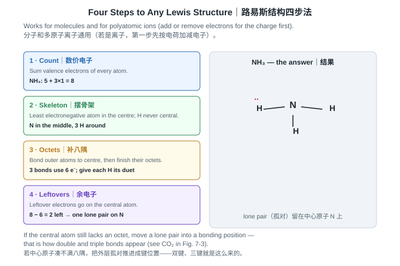
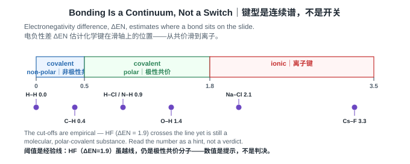
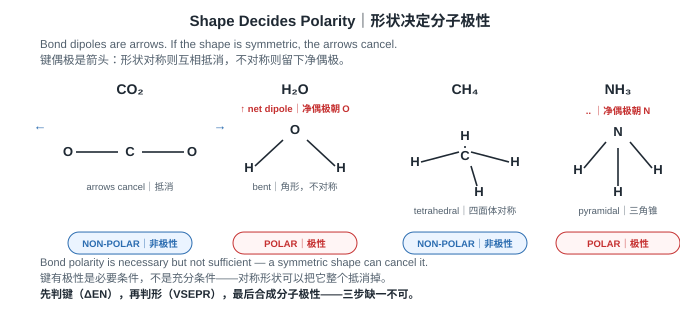
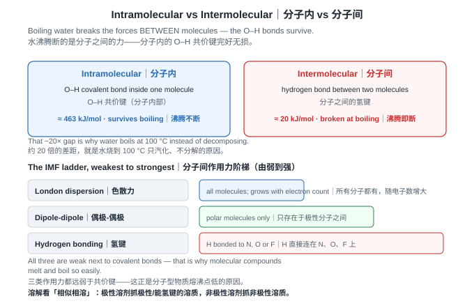

# Ch.7 — Lewis Structures, Electronegativity, Bonding and Intermolecular Forces
## Chapter 7 · Lewis Structures, Electronegativity, Bonding and IMF｜第 7 章　路易斯结构、电负性、化学键与分子间作用力

> 🗂️ **Content Alignment｜大纲对应**：C2 valence electrons and Lewis structures · C3 electronegativity and bond type · C4 intramolecular vs intermolecular forces｜**C2 价电子与路易斯结构 · C3 电负性与键型 · C4 分子内与分子间作用力**；Big Idea **B1**（+B5 接口）｜核心概念 **B1**（+B5 接口）
> ⏱️ **Periods｜课时**：7　|　**Prerequisite｜前置**：Ch.5（排布与价电子）、Ch.6（电负性）｜**Followed by｜后继**：Ch.8–9（摩尔与反应）、Ch.12（溶液化学）
> 🗂️ **Generated｜文件生成时间**：2026-10-02

## 1. Content Alignment｜大纲对应

| Item｜项目 | Content｜内容 |
|---|---|---|
| Content served｜服务的 Content | **C2 Lewis structures** (atoms, ions, molecules, polyatomic ions) · **C3 electronegativity & bond polarity** · **C4 intramolecular bonds vs intermolecular forces**｜**C2 路易斯结构**（原子、离子、分子、多原子离子）· **C3 电负性与键极性** · **C4 分子内键 vs 分子间力** |
| Interface｜接口 | Molecular polarity from this chapter drives **solubility** in Ch.12 (like dissolves like, Big Idea B5)｜本章的分子极性直接决定 Ch.12 的**溶解性**（相似相溶，核心概念 B5） |
| Competencies | [Processing and analyzing] Lewis drills and polarity clinics｜[Questioning and predicting] Surface-tension challenge｜[Communicating] IMF explanations with diagrams｜[处理与分析] 路易斯与极性分诊｜[提问与预测] 表面张力挑战｜[交流] 用图解释分子间作用力 |
| Beyond scope?｜是否超纲 | **No** — but quantitative VSEPR bond angles, hybrid orbitals and resonance are Chemistry 12 and labelled `【Extension → Chemistry 12】`｜**不超纲**——但定量键角、杂化轨道与共振结构属 Chemistry 12，标 `【Extension → Chemistry 12】` |

**中文**：本章把 Ch.5 的价电子与 Ch.6 的电负性合在一起，回答三个层层递进的问题：**电子怎么摆**（路易斯结构）、**键有多偏**（ΔEN 判键型）、**分子之间怎么相互作用**（分子间作用力）。最后一条是本单元最重要的一刀：**分子内的键**与**分子间的力**是两种东西，量级差几十倍——水烧到 100 °C 只断后者、不断前者。

> 📏 **Course-level rule｜课程级规则**：Polarity is judged in three steps — bond first (ΔEN), shape second (VSEPR), molecule last (arrows add or cancel). Skipping a step is where marks die.
> **中文**：极性判断分三步——先判键（ΔEN），再判形（VSEPR），最后判分子（箭头叠加还是抵消）。跳步就是丢分。

## 2. Learning Objectives｜学习目标

**EN — By the end of this chapter, you should be able to:**

1. Draw Lewis structures for atoms, molecules, cations, anions and polyatomic ions.
2. Use ΔEN (Data Booklet) to classify bonds, treating the result as a continuum.
3. Predict molecular shape at the concept level and decide whether bond dipoles cancel.
4. Distinguish intramolecular bonds from London dispersion, dipole-dipole and hydrogen bonding.
5. Use IMF to explain boiling points, surface tension and "like dissolves like".

**中文 — 本章结束后，你应当能够：**

1. 画出原子、分子、阳离子、阴离子与多原子离子的路易斯结构。
2. 用 ΔEN（查 Data Booklet）给化学键分类，并把它当作连续谱读。
3. 在概念层面预测分子形状，并判断键偶极是否抵消。
4. 区分分子内化学键与色散力、偶极-偶极、氢键三类分子间作用力。
5. 用分子间作用力解释沸点、表面张力与"相似相溶"。

## 3. Concept Explanations｜概念解析

### 3.1 Lewis Structures: The Four-Step Method｜路易斯结构：四步法

A **Lewis structure** shows every valence electron as a dot or a bonding pair. The method in **Fig. 7-1** works for anything:

**中文**：**路易斯结构**把每个价电子画成点或成键电子对。**图 7-1** 的方法对一切分子通用：

1. **Count｜数价电子** — add the valence electrons of every atom; for an ion, add one electron per negative charge or remove one per positive charge first.
   **中文**——把所有原子的价电子加起来；若是离子，先按电荷加减：每个负电荷加一个电子，每个正电荷减一个。
2. **Skeleton｜摆骨架** — put the **least electronegative** atom in the centre; hydrogen is never central.
   **中文**——把**电负性最小**的原子放中间；氢永远在边上。
3. **Octets｜补八隅** — bond the outer atoms to the centre, then finish the **outer** atoms' octets (hydrogen needs only 2, the duet).
   **中文**——外层原子先与中心成键，再把**外层**原子的八隅补满（氢只需 2 个，即二隅）。
4. **Leftovers｜余电子** — put all remaining electrons on the central atom as **lone pairs**; if the centre still lacks an octet, move a lone pair into a bonding position to make a **multiple bond**.
   **中文**——剩下的电子全部放在中心原子当**孤对电子**；若中心仍不满八隅，把孤对推进成键位置形成**重键**。

Polyatomic ions wear square brackets with the charge: NH₄⁺ and CO₃²⁻ follow exactly the same four steps, just with the adjusted electron count.

**中文**：多原子离子要加方括号并标电荷：NH₄⁺ 与 CO₃²⁻ 完全走同样的四步，只是电子数先按电荷调整。

> ⚠️ **Misconception｜易错**：Counting the charge twice — adding the electron for CO₃²⁻ **and** drawing three extra lone pairs. Adjust the count once, at step 1, then never again.
> **中文**：电荷算两遍——既在总数里加了 2 个电子，又在图里多画三对孤对。计数只在第 1 步调一次，之后不要再动。

### 3.2 ΔEN: Bonding Is a Continuum｜ΔEN：键型是连续谱

Take the electronegativity values from the Data Booklet's periodic table and subtract: **ΔEN = EN(larger) − EN(smaller)**. The difference locates the bond on a sliding scale (**Fig. 7-2**):

**中文**：从 Data Booklet 的周期表里查电负性再相减：**ΔEN = 大者 − 小者**。差值把化学键定位在一条滑轴上（图 7-2）：

- **ΔEN < 0.5** — covalent **non-polar**｜非极性共价：electrons shared evenly（C–H 0.4, H–H 0.0）
- **0.5 ≤ ΔEN ≤ 1.8** — covalent **polar**｜极性共价：electrons pulled toward one end（H–Cl 0.9, O–H 1.4）
- **ΔEN > 1.8** — **ionic**｜离子键：electrons effectively transferred（Na–Cl 2.1, Mg–O 2.3）

The cut-offs are empirical, not laws. **HF** has ΔEN = 4.0 − 2.1 = 1.9, nominally over the line, yet it is a molecular, polar-covalent substance — a gas that dissolves in water, not a crystal. Read ΔEN as a hint about which way the electrons lean, not a verdict on what the substance is.

**中文**：阈值是经验值，不是定律。**HF** 的 ΔEN = 4.0 − 2.1 = 1.9，名义上越线，但它是分子型的极性共价物质——一种溶于水的气体，不是晶体。把 ΔEN 当作"电子往哪边偏"的提示，而不是"物质是什么"的判决。

### 3.3 Shape Decides Molecular Polarity｜形状决定分子极性

A polar bond is an arrow (dipole) pointing toward the more electronegative atom. Whether the **molecule** is polar depends on how those arrows add up (**Fig. 7-3**): symmetric shapes (linear CO₂, tetrahedral CH₄) let equal arrows cancel; asymmetric shapes (bent H₂O, pyramidal NH₃) leave a net dipole.

**中文**：极性键是一支指向电负性较大原子的箭头（偶极）。**分子**是否有极性，取决于这些箭头怎么叠加（图 7-3）：对称形状（直线形 CO₂、四面体 CH₄）里等长箭头互相抵消；不对称形状（角形 H₂O、三角锥 NH₃）留下净偶极。

The concept-level shapes you need (**Table 7-2**) come from VSEPR — **valence shell electron pair repulsion**: electron pairs push each other as far apart as possible, and lone pairs squeeze a little harder than bonding pairs.

**中文**：概念层面需要的形状（表 7-2）来自 VSEPR——**价层电子对互斥**：电子对彼此推到最远，孤对推得比成键对更用力一点。

> ⚠️ **Misconception｜易错**："All polar bonds make a polar molecule." CO₂ contains two polar C=O bonds yet is non-polar — the linear shape cancels the arrows. Judge bonds first, shape second, molecule last.
> **中文**："有极性键就有极性分子。"CO₂ 有两条极性 C=O 键却是非极性分子——直线形把箭头抵消了。先键、后形、再分子，一步不能跳。

### 3.4 The Big Cut: Intramolecular vs Intermolecular｜最重要的一刀：分子内 vs 分子间

**Intramolecular bonds**（分子内化学键）— ionic, covalent, metallic — hold atoms together **inside** a particle and cost hundreds of kJ/mol to break. **Intermolecular forces（IMF）分子间作用力** act **between** whole molecules and cost only a few to a few tens of kJ/mol (**Fig. 7-4**). Boiling water breaks the hydrogen bonds between molecules; every O–H bond survives. This single distinction explains why molecular compounds have low melting and boiling points while ionic compounds do not.

**中文**：**分子内化学键**——离子键、共价键、金属键——把原子锁在粒子**内部**，断键要数百 kJ/mol；**分子间作用力**作用在**整个分子之间**，只有几到几十 kJ/mol（图 7-4）。水沸腾断的是分子间的氢键，每条 O–H 键都完好。这一个区别就解释了为什么分子型物质熔沸点低，而离子化合物不是。

### 3.5 The Three IMF and "Like Dissolves Like"｜三类分子间作用力与相似相溶

Ranked weakest to strongest (**Fig. 7-4**):

**中文**：按由弱到强排序（图 7-4）：

1. **London dispersion force 色散力** — instant dipoles from moving electron clouds; present in **every** substance and growing with electron count. This is why I₂ is solid while F₂ is gas.
   **中文**——电子云晃动产生的瞬时偶极；**所有物质都有**，电子越多越强。这就是为什么 I₂ 是固体而 F₂ 是气体。
2. **Dipole-dipole force 偶极-偶极力** — permanent dipoles of polar molecules attracting each other.
   **中文**——极性分子的永久偶极互相吸引。
3. **Hydrogen bonding 氢键** — the strongest IMF: a hydrogen bonded to **N, O or F** reaching toward a lone pair on another N/O/F. It doubles water's boiling point relative to what its molar mass predicts, and it is why HF (19.5 °C) boils far above HCl (−85 °C).
   **中文**——最强的分子间作用力：连在 **N、O、F** 上的氢伸向另一分子的 N/O/F 孤对。它把水的沸点抬到同摩尔质量预测值的两倍，也是 HF（19.5 °C）远高于 HCl（−85 °C）的原因。

Solubility follows: **like dissolves like 相似相溶**. Polar solvents (water) dissolve polar molecules and ions; non-polar solvents (hexane) dissolve non-polar molecules. Oil floats on water not because "water rejects oil" but because water's hydrogen bonds prefer each other over the non-polar chain.

**中文**：溶解性由此而来：**相似相溶**。极性溶剂（水）溶极性分子与离子；非极性溶剂（己烷）溶非极性分子。油浮在水上，不是"水排斥油"，而是水的氢键更愿意彼此相守、而不搭理非极性长链。

### 3.6 Metallic Bonding: The Electron Sea｜金属键：电子海

Metals bond by pooling their valence electrons into a shared **electron sea** around positive ion cores. Mobile electrons explain the classic metallic properties: electrical conduction, thermal conduction, and malleability (the layers of ions can slide without shattering a directional bond).

**中文**：金属把价电子汇成一片共享的**电子海**，泡在正离子核心周围。自由移动的电子解释了金属的经典性质：导电、导热、以及延展性（离子层可以滑动而不击碎定向键）。

## 4. Comparison Tables｜对照表

### Table 7-1　ΔEN classification｜ΔEN 分类（经验阈值）

| ΔEN | Bond type｜键型 | Electron behaviour｜电子行为 | Example｜例 |
|---|---|---|---|---|
| < 0.5 | covalent non-polar｜非极性共价 | shared evenly｜均匀共享 | C–H (0.4), H–H (0.0) |
| 0.5–1.8 | covalent polar｜极性共价 | pulled to one end｜偏向一端 | H–Cl (0.9), O–H (1.4) |
| > 1.8 | ionic｜离子键 | effectively transferred｜实际转移 | Na–Cl (2.1), Mg–O (2.3) |

**中文**：数值全部来自 Data Booklet 第 1 页；HF（1.9）是"越线却仍分子型"的著名提醒——连续谱，不是开关。

### Table 7-2　Concept-level shapes and polarity｜概念级形状与极性

| Shape｜形状 | Atoms around centre｜中心周围 | Symmetry｜对称性 | Classic case｜经典例 |
|---|---|---|---|---|
| linear｜直线形 | 2 | fully symmetric｜全对称 | CO₂（polar bonds, non-polar molecule） |
| trigonal planar｜平面三角形 | 3 | symmetric｜对称 | BF₃（B 缺八隅的例外） |
| tetrahedral｜四面体 | 4 | symmetric｜对称 | CH₄（非极性） |
| pyramidal｜三角锥 | 3 + 1 lone pair | asymmetric｜不对称 | NH₃（极性） |
| bent｜角形 | 2 + 1 or 2 lone pairs | asymmetric｜不对称 | H₂O（极性）、SO₂（极性） |

**中文**：判断顺序固定：先 ΔEN 定键极性，再查形状定对称性，最后合成分子极性——表 7-2 就是第二步的工具页。

### Table 7-3　Intramolecular vs intermolecular｜分子内 vs 分子间

| | Intramolecular｜分子内 | Intermolecular｜分子间 |
|---|---|---|
| Acts between｜作用对象 | atoms inside one particle｜一个粒子内部的原子 | whole neighbouring molecules｜相邻的整个分子 |
| Strength｜强度 | hundreds of kJ/mol｜数百 kJ/mol | a few to tens of kJ/mol｜几到几十 kJ/mol |
| Broken by｜破坏方式 | chemical reaction｜化学反应 | melting, boiling, dissolving｜熔化、沸腾、溶解 |
| Types｜类型 | ionic, covalent, metallic｜离子键、共价键、金属键 | dispersion, dipole-dipole, hydrogen bond｜色散力、偶极-偶极、氢键 |

**中文**：这张表是本章的分水岭——"水沸腾断什么"一问就能筛掉一半混淆。

## 5. Diagrams & Worked Examples｜图解与例题

### Fig. 7-1　Four Steps to Any Lewis Structure｜路易斯结构四步法

**Reading the figure｜看图要点**：左边四步走一遍，右边用 NH₃ 落地——8 个价电子 = 3 条键（6 个）+ N 上一对孤对。

### Fig. 7-2　Bonding Is a Continuum, Not a Switch｜键型是连续谱，不是开关

**Reading the figure｜看图要点**：紫点是常见键的实际 ΔEN；注意 HF 落在 1.9 却仍是分子——用"提示而非判决"的口径读这张图。

### Fig. 7-3　Shape Decides Polarity｜形状决定分子极性

**Reading the figure｜看图要点**：CO₂ 与 CH₄ 的箭头全对称抵消；H₂O 与 NH₃ 留下净偶极——两两对照着记。

### Fig. 7-4　Intramolecular vs Intermolecular｜分子内 vs 分子间

**Reading the figure｜看图要点**：上排两个盒子记量级差（463 对 20 kJ/mol），下排阶梯记三类 IMF 的强弱与适用范围。

### Example 7-1　CO₃²⁻ step by step｜碳酸根离子逐步推导

**Q**: Draw the Lewis structure of the carbonate ion, CO₃²⁻.
**A**: (1) Count: 4 + 3×6 + 2 (charge) = 24 valence electrons. (2) Skeleton: C in the centre, three O around. (3) Three C–O bonds use 6 electrons; finish the three O octets with 18 more — all 24 placed. (4) Count the central carbon: it has only 6 electrons, so move one O's lone pair into a C=O double bond. Result: one C=O, two C–O⁻, and brackets with the 2− charge.

**中文**：**问**：画出碳酸根离子 CO₃²⁻ 的路易斯结构。
**答**：(1) 计数：4 + 3×6 + 2（电荷）= 24 个价电子。(2) 骨架：C 居中，三个 O 围绕。(3) 三条 C–O 键用 6 个电子，再用 18 个补满三个 O 的八隅——24 个全部用完。(4) 数中心碳：只有 6 个电子，所以把某个 O 的一对孤对推进成 C=O 双键。结果：一条 C=O、两条 C–O⁻，外加方括号和 2− 电荷。

*(Count 2 + octets 3 + double-bond fix 3 + charge presentation 2 marks)｜（计数 2 分 + 补八隅 3 分 + 双键修正 3 分 + 电荷呈现 2 分）*

> 🔭 **Extension｜超纲**【Extension → Chemistry 12】：The three C–O bonds in carbonate are actually identical in length — explained by **resonance**. At Chemistry 11, drawing the double bond in one position is accepted; resonance structures wait for Chemistry 12.
> **中文**：【超纲延伸 → Chemistry 12】碳酸根的三条 C–O 键实际完全等长——要用**共振**解释。Chemistry 11 阶段双键画在任一位置均可；共振结构留待 Chemistry 12。

### Example 7-2　Why HF boils 105 degrees above HCl｜HF 的沸点为何高出 HCl 一百多度

**Q**: HF boils at 19.5 °C; HCl boils at −85 °C. Explain using intermolecular forces.
**A**: Both are polar molecules, so both have dipole-dipole forces and dispersion. But only HF carries **hydrogen bonding**, because its hydrogen is bonded directly to fluorine, the most electronegative element, and can reach a lone pair on a neighbouring molecule. Hydrogen bonds are the strongest IMF, so extra energy — a full 105 °C worth — is needed to separate HF molecules. Note what is *not* broken: the covalent H–F bonds inside each molecule.

**中文**：**问**：HF 沸点 19.5 °C，HCl 沸点 −85 °C。用分子间作用力解释。
**答**：两者都是极性分子，都同时具有偶极-偶极与色散力。但只有 HF 有**氢键**——它的氢直接连在电负性最高的氟上，能伸向相邻分子的孤对。氢键是最强的分子间作用力，要多付整整 105 °C 对应的能量才能把 HF 分子拉开。注意**没有**被破坏的部分：每个分子内部的 H–F 共价键。

*(Identify IMF 3 + hydrogen-bond condition 3 + "intramolecular survives" 2 + numbers 2 marks)｜（指认作用力 3 分 + 氢键条件 3 分 + "分子内键保留" 2 分 + 数值 2 分）*

## 6. Key Vocabulary｜核心词汇

| Term｜术语 | Meaning in one line｜一句话释义 |
|---|---|---|
| Lewis structure｜路易斯结构 | Drawing of all valence electrons as dots and pairs｜把全部价电子画成点与电子对的图 |
| lone pair｜孤对电子 | A valence pair not used in bonding｜未参与成键的价电子对 |
| octet rule｜八隅规则 | Atoms bond to reach 8 valence electrons（H: 2）｜原子成键以凑满 8 个价电子（氢为 2） |
| polyatomic ion｜多原子离子 | Charged particle of several covalently bonded atoms｜多个原子共价结合成的带电粒子 |
| electronegativity difference｜电负性差 | ΔEN — how unevenly a bond shares electrons｜ΔEN——键里电子共享的不均匀程度 |
| polar covalent bond｜极性共价键 | Covalent bond with uneven sharing｜共享不均匀的共价键 |
| VSEPR｜价层电子对互斥 | Electron pairs push to maximum separation｜电子对彼此推开到最大间距 |
| molecular polarity｜分子极性 | Net dipole of the whole molecule｜整个分子的净偶极 |
| London dispersion force｜色散力 | Instantaneous dipoles; universal, grows with e⁻ count｜瞬时偶极；普遍存在，随电子数增大 |
| dipole-dipole force｜偶极-偶极力 | Attraction between permanent dipoles｜永久偶极之间的吸引 |
| hydrogen bond｜氢键 | Strongest IMF; H bonded to N, O or F｜最强分子间作用力；H 连在 N、O、F 上 |
| like dissolves like｜相似相溶 | Polar dissolves polar; non-polar dissolves non-polar｜极性溶极性；非极性溶非极性 |

**中文**：词汇分两组背：结构组（路易斯、孤对、八隅、多原子离子）与作用力组（三类 IMF、极性、相似相溶）——两组在第 3.4 节的大刀处会合。

## 7. Lab / Activity｜实验与活动

**Activity 7-1　The Floating Paperclip｜水上漂回形针** `[Questioning and predicting｜提问与预测]`

Balance a dry paperclip on water, then add one drop of dish soap and watch it sink. Predict first; explain afterwards using surface tension — the net inward pull of hydrogen bonds at the water surface — and why the soap molecule destroys it.

**中文**：把一枚干燥回形针平放在水面上，再滴一滴洗洁精看它下沉。先预测、后解释：用表面张力——水面氢键的向内净拉力——说明回形针为何能"漂"，以及洗洁精分子为何能拆掉它。

**Activity 7-2　Polarity Clinic｜分子极性分诊** `[Processing and analyzing｜处理与分析]`

Triage 12 molecules (CO₂, H₂O, NH₃, CH₄, CCl₄, HF, BF₃, SO₂, N₂, CHCl₃, C₂H₆, MgO) through the three-step pipeline: bond polarity from ΔEN, shape from VSEPR, molecular polarity from arrow addition. Two separate columns — "polar bonds?" and "polar molecule?" — must be filled independently.

**中文**：给 12 个分子（CO₂、H₂O、NH₃、CH₄、CCl₄、HF、BF₃、SO₂、N₂、CHCl₃、C₂H₆、MgO）做"分诊"：先由 ΔEN 判键极性，再由 VSEPR 判形状，最后叠加箭头判分子极性。「键有极性？」与「分子有极性？」两栏必须分开填。

**Activity 7-3　Solubility Matrix｜溶解性矩阵** `[Seek and analyze patterns｜寻找与分析规律]`

Test NaCl, sucrose, iodine and paraffin wax in water and in hexane. Record the 4 × 2 result table, then induce the "like dissolves like" rule yourself and classify each solute's polarity from its outcome.

**中文**：测试 NaCl、蔗糖、碘、石蜡在水与己烷中的溶解性，记录 4 × 2 结果表，自己归纳出"相似相溶"，并按溶解结果反推各溶质的极性。

## 8. Common Misconceptions｜常见易错点

| # | Misconception｜误区 | Correction｜纠正 |
|---|---|---|---|
| 1 | Hydrogen bonds are inside molecules｜氢键在分子内部 | H-bonds act between molecules (rare intramolecular cases: not at this level)｜氢键在分子之间（分子内情形本阶段不讨论） |
| 2 | Polar bonds always make polar molecules｜极性键必得极性分子 | Symmetric shapes cancel dipoles (CO₂)｜对称形状可抵消（CO₂） |
| 3 | Boiling water breaks O–H bonds｜水沸腾断 O–H 键 | Boiling breaks IMF; covalent bonds survive｜沸腾断的是分子间力，共价键完好 |
| 4 | ΔEN thresholds are laws｜ΔEN 阈值是定律 | Empirical cut-offs; HF (1.9) is still molecular｜经验线；HF（1.9）仍是分子型 |
| 5 | Dispersion only in non-polar molecules｜色散力只在非极性分子 | All molecules have dispersion, polar ones included｜所有分子都有色散力 |
| 6 | Count ion charges twice｜电荷算两遍 | Adjust the electron count once at step 1｜只在第 1 步调一次计数 |
| 7 | Force H and B into octets｜硬给 H、B 凑八隅 | H is complete at 2; B can be stable at 6 (BF₃)｜氢二隅即满；B 六电子可稳（BF₃） |
| 8 | "Water rejects oil"｜"水排斥油" | Water's H-bonds simply prefer each other｜水自身的氢键更愿意彼此相吸 |
| 9 | Bigger molecule always higher b.p.｜分子越大沸点必越高 | Dispersion grows with electrons, but H-bonding can beat size (HF vs HCl)｜色散随电子数增长，但氢键能赢过尺寸 |
| 10 | Lone pairs don't affect shape｜孤对不影响形状 | Lone pairs push harder and bend shapes (H₂O)｜孤对推得更狠，把形状压弯（H₂O） |
| 11 | Ionic bonds are just "very polar"｜离子键只是"很极性" | At ΔEN > 1.8 electrons transfer; treat as a different mechanism｜超过 1.8 电子发生转移，机制不同 |
| 12 | All IMF break in dissolving｜溶解时断一切作用力 | Solute-solute and solvent-solvent IMF re-form as solute-solvent ones｜溶解是 IMF 的"重组"，不是全断 |

**中文**：高频扣分点是 1、2、3——氢键位置、极性两步判断、沸腾断什么。做极性题之前默念"先键、后形、再分子"。

## 9. Assessment｜答题评估

### Part A: Foundational｜基础题（10 × 2 = 20 points）

**A1.** Define a lone pair and give one example of a molecule whose central atom has one.

- **中文**：定义孤对电子，并举一个中心原子带孤对的分子。

**A2.** Draw the Lewis structure of H₂O.

- **中文**：画出 H₂O 的路易斯结构。

**A3.** How many valence electrons must the Lewis structure of CO₃²⁻ contain in total? Show the count.

- **中文**：CO₃²⁻ 的路易斯结构总共要画多少个价电子？列出算式。

**A4.** Using Data Booklet values, calculate ΔEN for Mg–O and classify the bond.

- **中文**：用 Data Booklet 数值算出 Mg–O 的 ΔEN 并判断键型。

**A5.** Using Data Booklet values, calculate ΔEN for O–H and classify the bond.

- **中文**：用 Data Booklet 数值算出 O–H 的 ΔEN 并判断键型。

**A6.** Is CO₂ a polar molecule even though it contains polar bonds? Explain in one sentence.

- **中文**：CO₂ 含极性键，它是极性分子吗？用一句话解释。

**A7.** State the two conditions for a hydrogen bond.

- **中文**：写出形成氢键的两个条件。

**A8.** Give one example each of an intramolecular force and an intermolecular force in a glass of water.

- **中文**：在一杯水里，各举一个分子内作用与分子间作用的例子。

**A9.** NaCl dissolves in water but not in hexane. Explain using "like dissolves like".

- **中文**：NaCl 溶于水却不溶于己烷。用"相似相溶"解释。

**A10.** True or false, with a reason: "When water boils, the O–H covalent bonds break."

- **中文**：判断对错并说明理由："水沸腾时 O–H 共价键断裂。"

### Part B: Applied｜应用题（4 × 5 = 20 points）

**B1.** Run the full three-step polarity judgment for CH₄, NH₃, CO₂ and HF: (a) bond polarity from ΔEN; (b) shape; (c) final molecular polarity with a one-line reason.

- **中文**：对 CH₄、NH₃、CO₂、HF 走完整的三步极性判断：(a) 用 ΔEN 判键极性；(b) 判形状；(c) 给出分子极性结论并附一句话理由。

**B2.** HF boils at 19.5 °C while HCl boils at −85 °C. (a) Identify the IMF present in each liquid; (b) explain the boiling-point gap with the hydrogen-bond condition; (c) state what is *not* broken during boiling.

- **中文**：HF 沸点 19.5 °C，HCl 沸点 −85 °C。(a) 指出两种液体各有哪些分子间作用力；(b) 用氢键条件解释沸点差；(c) 写出沸腾时**没有**被破坏的是什么。

**B3.** You are handed two unlabelled liquids known to be water and hexane. (a) Design one safe test to tell them apart; (b) predict the result for each liquid; (c) justify both predictions with IMF.

- **中文**：拿到两瓶无标签液体，已知是水和己烷。(a) 设计一种安全的区分方法；(b) 预测各自的表现；(c) 用分子间作用力论证两个预测。

**B4.** A classmate draws CO₂ as O=C=O with **no lone pairs on either oxygen**. (a) Explain why the drawing is wrong even though the connectivity is right; (b) redraw it correctly with all 16 valence electrons; (c) state which step of the four-step method the classmate skipped.

- **中文**：某同学把 CO₂ 画成 O=C=O、**两个 O 上没有任何孤对**。(a) 解释为什么连接方式对、画法仍然错；(b) 用全部 16 个价电子重画正确结构；(c) 指出该同学跳过了四步法中的哪一步。

### Part C: Challenge｜挑战题（2 × 10 = 20 points）

**C1.** The carbonate ion CO₃²⁻: (a) show the valence-electron count; (b) draw the Lewis structure through the four steps; (c) ΔEN for C–O is 3.5 − 2.5 = 1.0 — classify the C–O bonds and explain why the ion as a whole is charged despite covalent bonding; (d) state one question about the three bond lengths that Chemistry 11 cannot yet answer. *(2 + 4 + 2 + 2 marks)*

- **中文**：碳酸根离子 CO₃²⁻：(a) 列出价电子计数；(b) 按四步画出路易斯结构；(c) C–O 的 ΔEN = 3.5 − 2.5 = 1.0——判断 C–O 键型，并解释为什么"明明是共价键、整体却带电"；(d) 提出一个关于三条键长、Chemistry 11 阶段还答不了的问题。*(2 + 4 + 2 + 2 分)*

**C2.** "Solubility is decided by intermolecular forces." Build the evidence-based argument: (a) state the like-dissolves-like rule in IMF language; (b) use the Activity 7-3 matrix (NaCl/sucrose/iodine/paraffin × water/hexane) as data, explaining at least three cells; (c) refute the overgeneralization "water dissolves everything" with one counterexample and its mechanism; (d) end with one prediction about dissolving aspirin (Ch.4's dual functional groups) in water. *(2 + 4 + 2 + 2 marks)*

- **中文**："溶解性由分子间作用力决定。"构建有证据的论证：(a) 用作用力语言陈述"相似相溶"；(b) 用活动 7-3 的矩阵（NaCl/蔗糖/碘/石蜡 × 水/己烷）作数据，解释其中至少三格；(c) 用一个反例及其机制反驳"水什么都能溶"的过度概括；(d) 以对"阿司匹林（Ch.4 的双官能团）溶于水"的一条预测收尾。*(2 + 4 + 2 + 2 分)*

### Answer Key｜答案

- **A1.** A lone pair is a valence electron pair not used in bonding; the O in H₂O carries two.｜**中文**：孤对电子是未参与成键的价电子对；H₂O 的氧带有两对。

- **A2.** 8 valence electrons: two O–H bonds plus two lone pairs on O.｜**中文**：8 个价电子：两条 O–H 键，氧上两对孤对。

- **A3.** 4 + 3×6 + 2 = 24 electrons.｜**中文**：4 + 3×6 + 2 = 24 个电子。

- **A4.** ΔEN = 3.5 − 1.2 = 2.3 > 1.8 → ionic.｜**中文**：ΔEN = 3.5 − 1.2 = 2.3 > 1.8 → 离子键。

- **A5.** ΔEN = 3.5 − 2.1 = 1.4 → covalent polar.｜**中文**：ΔEN = 3.5 − 2.1 = 1.4 → 极性共价键。

- **A6.** No — the linear shape makes the two equal bond dipoles point opposite and cancel.｜**中文**：不是——直线形让两条等大的键偶极反向抵消。

- **A7.** H must be bonded directly to N, O or F; the H reaches a lone pair on another N/O/F.｜**中文**：氢必须直接连在 N、O 或 F 上；该氢伸向另一分子 N/O/F 的孤对。

- **A8.** Intramolecular: O–H covalent bonds inside each molecule; intermolecular: hydrogen bonds between neighbouring water molecules.｜**中文**：分子内：每个水分子内部的 O–H 共价键；分子间：相邻水分子之间的氢键。

- **A9.** Water is polar and forms ion-dipole/hydrogen-bond interactions with Na⁺ and Cl⁻; hexane is non-polar and offers nothing to replace the strong ionic lattice attractions.｜**中文**：水是极性的，能与 Na⁺、Cl⁻ 形成离子-偶极/氢键作用；己烷是非极性的，提供不了能取代强离子晶格吸引的作用。

- **A10.** False — boiling overcomes the hydrogen bonds between molecules; every O–H covalent bond survives into the steam.｜**中文**：错——沸腾克服的是分子间氢键；每条 O–H 共价键都完整进入水蒸气。

- **B1.** CH₄ — bonds non-polar (0.4), tetrahedral symmetric → non-polar. NH₃ — bonds polar (0.9), pyramidal with one lone pair → polar. CO₂ — bonds polar (1.0), linear symmetric → non-polar. HF — bond very polar (1.9), asymmetric diatomic → polar.｜**中文**：CH₄——键非极性（0.4），四面体对称 → 非极性。NH₃——键极性（0.9），三角锥带一对孤对 → 极性。CO₂——键极性（1.0），直线对称 → 非极性。HF——键强极性（1.9），双原子不对称 → 极性。

- **B2.** (a) Both: dispersion + dipole-dipole (both polar); HF additionally hydrogen bonding. (b) H is bonded directly to F, so HF molecules hydrogen-bond to each other — the strongest IMF — and need much more energy to separate. (c) The covalent H–F/H–Cl bonds inside the molecules.｜**中文**：(a) 两者都有色散力与偶极-偶极（都极性）；HF 额外有氢键。(b) 氢直接连在氟上，HF 分子间形成氢键——最强的分子间作用力——分开它们要多付大量能量。(c) 分子内部的 H–F / H–Cl 共价键。

- **B3.** (a) Add a small amount of each liquid to separate portions of cooking oil (or use a droplet-on-paper test). (b) Hexane mixes with oil; water forms a separate layer. (c) Hexane's dispersion-only IMF matches oil's non-polar chains; water's hydrogen-bond network prefers itself, so it excludes the non-polar oil.｜**中文**：(a) 各取少量分别加入食用油（或滴在纸面上观察）。(b) 己烷与油互溶；水与油分层。(c) 己烷只有色散力，与非极性油链匹配；水的氢键网络更愿意自守，把非极性油排开。

- **B4.** (a) Oxygen has 6 valence electrons and after double bonding still needs two lone pairs; omitting them breaks the octet and hides the sites hydrogen bonds use. (b) O=C=O with two lone pairs on each O — 16 electrons in total. (c) Step 3 (finish the outer atoms' octets).｜**中文**：(a) 氧有 6 个价电子，成双键后仍差两对孤对；漏画会破坏八隅，也藏起了氢键的结合位点。(b) O=C=O，每个 O 上两对孤对——共 16 个电子。(c) 第 3 步（补满外层原子的八隅）。

- **C1.** (a) 4 + 3×6 + 2 = 24. (b) Skeleton C + 3 O; three bonds (6 e⁻); fill O octets (18 e⁻); carbon short → one lone pair becomes C=O; bracket with 2−. (c) ΔEN = 1.0 → each C–O bond is polar covalent; the charge is the two extra electrons the whole ion accepted — bond polarity and net charge are independent bookkeeping. (d) "Why are all three C–O bonds the same length?" — needs resonance, Chemistry 12.｜**中文**：(a) 4 + 3×6 + 2 = 24。(b) 骨架 C + 3 O；三条键（6 电子）；补满 O 八隅（18 电子）；碳不满 → 一对孤对推进成 C=O；加方括号与 2−。(c) ΔEN = 1.0 → 每条 C–O 键都是极性共价；电荷是整个离子额外收下的 2 个电子——键极性与净电荷是两本独立的账。(d) "三条 C–O 键为何等长？"——需要共振，属 Chemistry 12。

- **C2.** (a) A solute dissolves when solute–solvent attractions can rival the solute–solute and solvent–solvent ones being broken. (b) NaCl/water dissolves (ion-dipole); NaCl/hexane does not (dispersion cannot pay for the lattice); iodine/hexane dissolves (dispersion matches dispersion); sucrose/water dissolves (many –OH sites hydrogen-bond). (c) "Water dissolves everything" fails for paraffin/water — water's H-bond network excludes the non-polar chain. (d) Prediction: aspirin should be partly water-soluble — its –COOH can hydrogen-bond, though the non-polar ring limits solubility.｜**中文**：(a) 当溶质-溶剂的吸引能与被拆的溶质-溶质、溶剂-溶剂吸引相当，溶解才发生。(b) NaCl/水 溶（离子-偶极）；NaCl/己烷 不溶（色散力付不起晶格账）；碘/己烷 溶（色散对色散）；蔗糖/水 溶（大量 –OH 氢键位点）。(c) "水什么都能溶"在石蜡/水处破产——水的氢键网络把非极性长链排开。(d) 预测：阿司匹林应部分溶于水——–COOH 能形成氢键，但非极性苯环限制溶解度。

## 10. Connection to the Big Idea｜回扣核心概念

> 🔗 **Big Idea B1｜核心概念 B1**：*Atoms and molecules are the building blocks of matter.*｜**原子与分子是物质的构件。**

This chapter finished the assembly manual: Ch.5 said **where** the electrons are, Ch.6 said **how hard** they are pulled, and Ch.7 used both to predict **who bonds with whom** and **how strongly particles stick together**. The same "like dissolves like" logic is the seed of Big Idea B5 — solubility determined by the nature of solute and solvent — which Ch.12 will grow into full solution chemistry.

**中文**：本章写完了"构件说明书"的最后一页：Ch.5 说电子**在哪**，Ch.6 说电子**被拉多紧**，Ch.7 用这两样预测**谁和谁成键**、**粒子之间粘多牢**。"相似相溶"这条逻辑正是核心概念 B5（溶解度由溶质溶剂本性决定）的种子——Ch.12 会把它长成完整的溶液化学。
