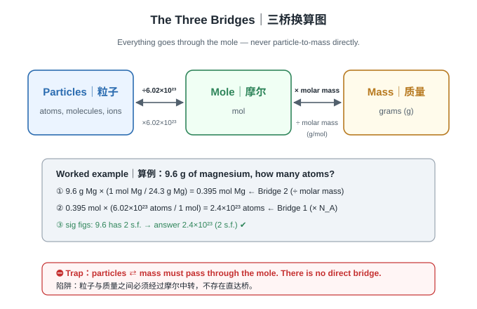
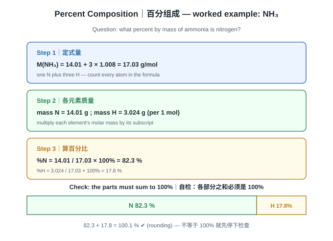
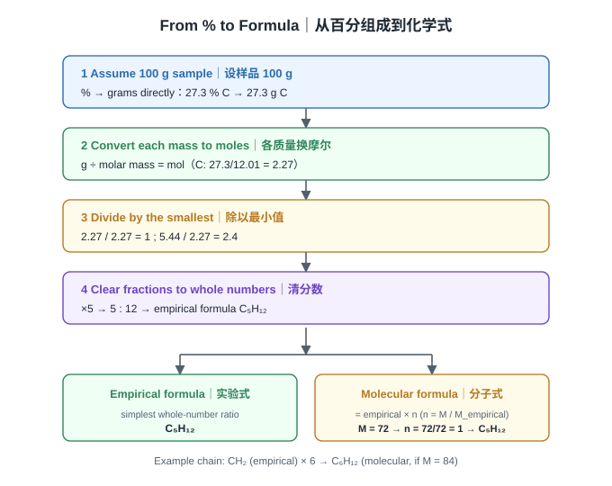
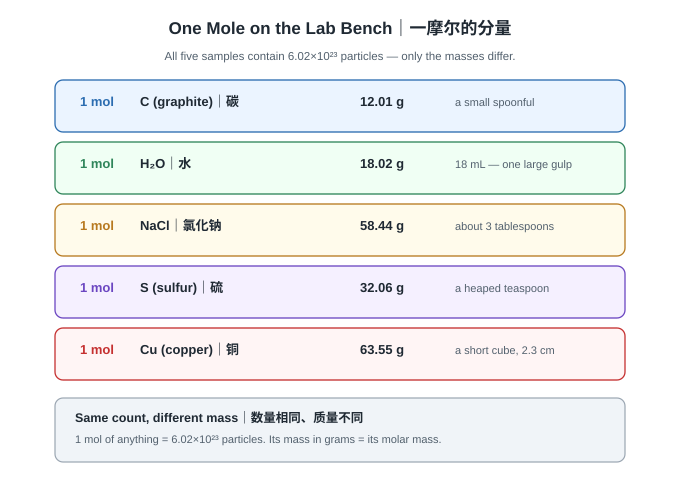

# Ch.8 — The Mole: Making Atoms and Molecules Measurable

## Chapter 8 · The Mole｜第 8 章　摩尔：让原子与分子可被量度

> 🗂️ **Scope note｜范围说明**：This chapter corresponds to official Content **C7 (the mole)** and **C8 (dimensional analysis)**. Gas molar volume (22.4 L/mol at STP) is a traditional Chemistry 11 extra, not an explicit 2018-curriculum item; it appears only as a marked Extension.｜本章对应官方内容标准 C7（摩尔）与 C8（量纲分析）。气体摩尔体积（STP 下 22.4 L/mol）是传统 Chemistry 11 补充内容，并非 2018 大纲明文，仅以超纲标注出现。

## 1. Content Alignment｜大纲对应

| Item｜项目 | Detail｜细节 |
|---|---|
| Big Idea｜核心概念 | **B3** — *The mole is a quantity used to make atoms and molecules measurable.*｜摩尔是使原子与分子可被量度的量。 |
| Content C7｜内容标准 C7 | the mole — definition, conversions, percent composition, empirical formula｜摩尔的定义、换算、百分组成、实验式 |
| Content C8｜内容标准 C8 | dimensional analysis applied to all quantitative work｜量纲分析贯穿全部定量运算 |
| Curricular Competencies｜课程能力 | Processing and analyzing（数据换算）· Planning and conducting（设计测摩尔质量方案）· Communicating（单位与位数规范） |
| Chapters before｜前置章节 | Ch.1 sig figs & conversion factors；Ch.6 atomic masses from the periodic table |
| Chapters after｜后继章节 | Ch.9 mole ratios preview → Ch.10 stoichiometry → Ch.13 solution version |

## 2. Learning Objectives｜学习目标

**By the end of this chapter you can｜学完本章你要能做到：**

1. Define the mole and Avogadro's number, and explain why the mole is defined through carbon-12.｜定义摩尔与阿伏伽德罗常数，并说明为什么摩尔通过碳-12 定义。
2. Convert among particles, moles and mass using the three bridges.｜用"三桥"在粒子数、摩尔、质量之间换算。
3. Calculate the molar mass of any compound from the periodic table, with correct significant figures.｜从周期表算出任意化合物的摩尔质量，保持正确有效数字。
4. Compute percent composition and use it as a self-check.｜计算百分组成并用它自检。
5. Determine empirical formulas from mass or percent data, and molecular formulas from an added molar mass.｜由质量或百分比数据确定实验式，再由式量确定分子式。
6. Apply dimensional analysis end-to-end: every number carries a unit, every unit cancels on paper.｜全程量纲分析：每个数带单位，每个单位在纸上约掉。

## 3. Concept Explanations｜概念解析

### 3.1 Why We Need the Mole｜为什么需要摩尔

Atoms are absurdly small. One drop of water holds more water molecules than there are stars in the observable universe. Chemists therefore count particles **by weighing**: pick a package size so that the mass on the balance is proportional to the number of particles. That package is the **mole（摩尔）**.

**中文**：原子小得离谱——一滴水里的水分子数比可观测宇宙的星星还多。化学家因此用**称重**来数粒子：选定一个"打包规格"，使天平读数与粒子数成正比。这个规格就是**摩尔**。

> 💡 **Key Insight｜关键洞察**：1 mol = 6.02×10²³ particles, chosen so that the mass of 1 mol of any element in grams equals its atomic mass. Carbon-12: 1 mol weighs exactly 12 g.｜1 mol = 6.02×10²³ 个粒子，这个数恰使任何元素 1 mol 的克数等于其原子量。碳-12：1 mol 恰好 12 g。

**Avogadro's number（阿伏伽德罗常数）** N_A = 6.02×10²³ /mol. The number itself is huge, but the *point* of the mole is convenience: it converts an invisible count into a weighable mass.

**中文**：阿伏伽德罗常数 N_A = 6.02×10²³ /mol。这个数本身巨大，但摩尔的意义在于**方便**：它把看不见的"个数"换成了称得见的"克数"。

### 3.2 The Three Bridges｜三桥换算

All quantitative chemistry in this course flows through one map (Fig. 8-1):

**中文**：本课程全部定量化学都流经同一张图（图 8-1）：

```
particles  ⇄  mole  ⇄  mass
  个数          摩尔        质量
```

- **Bridge 1**: particles ⇄ mol, factor 6.02×10²³.｜桥一：粒子数 ⇄ 摩尔，因子 6.02×10²³。
- **Bridge 2**: mol ⇄ mass, factor = **molar mass（摩尔质量）** in g/mol, read from the periodic table.｜桥二：摩尔 ⇄ 质量，因子 = 摩尔质量（g/mol），从周期表读取。

There is **no direct bridge** between particles and mass. Every "how many atoms in X grams" question is a two-bridge trip through the mole.｜粒子与质量之间**没有直达桥**。所有"X 克里有多少个原子"都是经过摩尔的两程旅行。

**Molar mass of compounds**: add the atomic masses of every atom in the formula. For H₂O: 2(1.008) + 16.00 = 18.02 g/mol. Subscripts multiply; parentheses distribute.

**中文**：化合物的摩尔质量：把式子里每个原子的原子量加起来。H₂O：2(1.008) + 16.00 = 18.02 g/mol。下标是乘法，括号要展开。

### 3.3 Dimensional Analysis Done Properly｜规范的量纲分析

A conversion is a **fraction that equals 1**: (1 mol / 24.3 g) and (24.3 g / 1 mol) are the same number written two ways. Chain them so units cancel diagonally, and keep the units written at every step.

**中文**：转换因子就是**等于 1 的分数**：(1 mol / 24.3 g) 与 (24.3 g / 1 mol) 是同一个数的两种写法。把它们串起来让单位斜向约掉，每一步都把单位写在纸上。

```
9.6 g Mg × (1 mol Mg / 24.3 g Mg) × (6.02×10²³ atoms / 1 mol Mg)
   = 2.4×10²³ atoms        g cancels, mol cancels ✔
```

> ⏱️ **Sig figs rule｜有效数字规则**：Carry at least 4–5 significant figures through the calculation; round only the final answer to the least precise input. 9.6 g has 2 s.f. → report 2.4×10²³, not 2.38×10²³.｜中间过程保留 4–5 位有效数字，只在最后一步按输入中精度最低的舍入。9.6 g 是 2 位 → 答 2.4×10²³，不是 2.38×10²³。

### 3.4 Percent Composition｜百分组成

The percent by mass of each element in a compound:

**中文**：化合物中每种元素的质量占比：

```
% element = (mass of that element in 1 mol) / (molar mass) × 100%
```

For NH₃: %N = 14.01/17.03 × 100% = 82.3%; %H = 17.8%. **Self-check**: the parts must sum to 100% (within rounding). If they do not, stop and find the error before moving on.

**中文**：NH₃ 中 %N = 82.3%、%H = 17.8%。**自检**：各部分之和必须是 100%（考虑舍入误差）。加起来不对就先停下找错，别往下算。

### 3.5 Empirical and Molecular Formulas｜实验式与分子式

- **Empirical formula（实验式）**: the simplest whole-number ratio of atoms.｜原子数的最简整数比。
- **Molecular formula（分子式）**: the actual count in one molecule = empirical × n.｜一个分子里的真实个数 = 实验式 × n。

The recipe (Fig. 8-3): assume 100 g of sample → percentages become grams → convert each element's mass to moles → divide by the smallest → clear fractions by multiplying (×2, ×3, ×5 as needed).

**中文**：流程（图 8-3）：设样品 100 g → 百分比直接变克数 → 各元素质量换摩尔 → 除以最小值 → 必要时乘 2、3、5 清分数。

> 💡 **Example chain｜示例链**：A compound is 85.6% C and 14.4% H, with molar mass 42.0 g/mol.
> ① 100 g: 85.6 g C, 14.4 g H. ② C: 85.6/12.01 = 7.13 mol; H: 14.4/1.008 = 14.3 mol.
> ③ ÷ smallest: C 1.00, H 2.00 → empirical **CH₂**. ④ n = 42.0/14.03 = 3 → molecular **C₃H₆**.

**中文**：某化合物含 C 85.6%、H 14.4%，式量 42.0 g/mol。① 设 100 g。② C 7.13 mol，H 14.3 mol。③ 除以最小值得 CH₂。④ n = 42.0/14.03 = 3 → 分子式 **C₃H₆**（丙烯）。

### 3.6 Moles of Atoms Inside Moles of Molecules｜分子里的原子摩尔数

1 mol O₂ contains 2 mol of O atoms; 1 mol Al₂(SO₄)₃ contains 2 mol Al³⁺... no — 2 mol Al and 3 mol SO₄²⁻ (12 mol O atoms). Subscripts are mol-to-mol ratios inside the formula.

**中文**：1 mol O₂ 含 2 mol O 原子；1 mol Al₂(SO₄)₃ 含 2 mol Al 和 3 mol SO₄²⁻（12 mol O 原子）。下标就是化学式内部的摩尔比。

> 🔭 **Extension｜超纲**【Extension → Chemistry 12】：The precise definition of the mole is now fixed by N_A itself (the SI 2019 redefinition), and Avogadro's number is measured, not derived. In this course, 6.02×10²³ to three significant figures is all you need.｜2019 年 SI 改革后摩尔由 N_A 本身精确定义，阿伏伽德罗常数是"测出来的"而非"导出的"。本课程用三位有效数字 6.02×10²³ 即可。

## 4. Comparison Tables｜表格比对

### Table 8-1　Counting Packages｜数数的"打包规格"

| Package｜规格 | Counts｜计数的对象 | Mass of 1 package｜一份的质量 |
|---|---|---|
| pair 对 | shoes 鞋子 | — |
| dozen 打 | eggs 鸡蛋 | — |
| ream 令 | paper 纸 | — |
| **mole 摩尔** | **atoms, molecules, ions 原子/分子/离子** | **= molar mass（数值等于原子量/式量）** |

### Table 8-2　The Three Bridges at a Glance｜三桥速查

| From → To｜从 → 到 | Multiply by｜乘以 | Example｜例 |
|---|---|---|
| particles → mol | 1/N_A = 1/(6.02×10²³) | 1.204×10²⁴ atoms → 2.00 mol |
| mol → particles | N_A = 6.02×10²³ | 0.50 mol → 3.01×10²³ |
| mol → mass | molar mass (g/mol) | 2.00 mol H₂O × 18.02 = 36.04 g |
| mass → mol | 1/(molar mass) | 36.04 g ÷ 18.02 g/mol = 2.00 mol |

### Table 8-3　Empirical vs Molecular Formula｜实验式 vs 分子式

| Property｜属性 | Empirical 实验式 | Molecular 分子式 |
|---|---|---|
| What it gives｜给出什么 | simplest ratio 最简比 | actual counts 真实个数 |
| Example（benzene 苯） | CH | C₆H₆ |
| Needed extra data｜需要的额外数据 | — | molar mass（n = M/M_empirical） |
| Can they be equal?｜何时相同 | — | when n = 1（如 H₂O） |

### Table 8-4　One Mole of Common Substances｜常见物质一摩尔

| Substance｜物质 | Formula｜化学式 | Molar mass｜摩尔质量 | What it looks like｜实物观感 |
|---|---|---|---|
| carbon (graphite) | C | 12.01 g/mol | a small spoonful 一小勺 |
| water 水 | H₂O | 18.02 g/mol | 18 mL 一大口 |
| sodium chloride 氯化钠 | NaCl | 58.44 g/mol | ≈3 tablespoons 约 3 汤匙 |
| sulfur 硫 | S₈ | 256.5 g/mol | a heaped cup 满满一杯 |
| copper 铜 | Cu | 63.55 g/mol | a 2.3 cm cube 2.3 cm 立方 |

## 5. Diagrams & Worked Examples｜图例说明

### Fig. 8-1　The Three Bridges｜三桥换算图



### Fig. 8-2　Percent Composition Worked Example｜百分组成算例



### Fig. 8-3　From % to Formula｜从百分组成到化学式



### Fig. 8-4　One Mole on the Lab Bench｜一摩尔的分量



### Example 8-1　Particles ⇄ Mass Round Trip｜粒子与质量的双程换算

**Question**: (a) How many molecules are in 9.00 g of water? (b) How many hydrogen atoms is that?

**中文**：(a) 9.00 g 水里有多少个水分子？(b) 折合多少个氢原子？

**Solution｜解**：

```
(a) 9.00 g × (1 mol / 18.02 g) = 0.4994 mol
    0.4994 mol × 6.02×10²³ = 3.01×10²³ molecules

(b) 3.01×10²³ molecules × (2 H atoms / 1 molecule) = 6.02×10²³ H atoms
```

*(4 marks: 1 mol step, 1 N_A step, 1 subscript step, 1 sig figs all 3 s.f.)*

**中文**：*(4 分：摩尔一步 1 分、N_A 一步 1 分、下标换原子 1 分、全程 3 位有效数字 1 分)*

### Example 8-2　Percent Composition as a Fingerprint｜百分组成当"指纹"

**Question**: A 5.00 g sample of a pure oxide of iron contains 3.50 g Fe. Is it FeO, Fe₂O₃, or Fe₃O₄?

**中文**：5.00 g 纯铁的氧化物样品含铁 3.50 g。它是 FeO、Fe₂O₃ 还是 Fe₃O₄？

**Solution｜解**：

```
O mass = 5.00 − 3.50 = 1.50 g
Fe: 3.50 / 55.85 = 0.0627 mol        O: 1.50 / 16.00 = 0.0938 mol
÷ smallest:  Fe 1.00 :  O 1.50  →  ×2 →  Fe₂O₃
```

*(5 marks: 2 for mol ratio, 2 for clearing to integers, 1 for the final identification.)*

**中文**：*(5 分：摩尔比 2 分、清成整数 2 分、结论 1 分。)*

### Example 8-3　Designing a Molar-Mass Measurement｜设计一个测摩尔质量的方案

**Question**: You have a volatile liquid, a balance, and a hot water bath. Outline how you could measure its molar mass, and name two error sources. *(This is the Planning and conducting competency.)*

**中文**：你有一种易挥发的液体、一架天平和热水浴。概述如何测它的摩尔质量，并指出两个误差来源。*(这是 Planning and conducting 能力项。)*

**Solution sketch｜答题要点**: vaporize a known small mass in a sealed container of known volume at a measured temperature; from the gas's behaviour relate mass → moles → molar mass. Errors: (1) some liquid evaporates before sealing (mass loss); (2) temperature measured at the bath, not inside the container.

> 🔭 **Extension｜超纲**【Extension → Chemistry 11 后续/Chemistry 12】：The full treatment uses the ideal gas law PV = nRT. At Science-10-fresh level, the answer above earns full credit for the *design and error analysis* even without the equation.｜完整处理要用理想气体状态方程 PV = nRT；但在本阶段，只写设计与误差分析即可拿满分。

## 6. Key Vocabulary｜核心词汇

| English | 中文 | Note｜备注 |
|---|---|---|
| mole | 摩尔 | 6.02×10²³ particles; the counting package｜计数"打包规格" |
| Avogadro's number (N_A) | 阿伏伽德罗常数 | 6.02×10²³ /mol｜三位有效数字 |
| molar mass | 摩尔质量 | g/mol; numeric = atomic/molecular mass｜数值等于原子量/式量 |
| formula mass | 式量 | sum of atomic masses in a formula｜式内原子量之和 |
| percent composition | 百分组成 | element mass ÷ total × 100%｜元素质量占比 |
| empirical formula | 实验式 | simplest whole-number ratio｜最简整数比 |
| molecular formula | 分子式 | actual count = empirical × n｜真实个数 |
| conversion factor | 转换因子 | a fraction equal to 1｜等于 1 的分数 |
| dimensional analysis | 量纲分析 | units cancel on paper｜单位在纸上约掉 |
| significant figures | 有效数字 | carry 4–5, round once｜中间保 4–5 位，只舍一次 |

## 7. Lab / Activity｜实验与活动

### Activity 8-1　Weigh One Mole｜称一摩尔的分量

**Do it｜操作**: Weigh out 1 mol of NaCl, sulfur, copper and water (measure water by volume). Display them side by side.

**中文**：称出 1 mol 的 NaCl、硫、铜和水（水用量筒量），并排摆放。

**Discuss｜讨论**: Same number of particles — why do the packages differ so much in size and mass? Connect each to its molar mass.

**中文**：粒子数完全相同——为什么"包"的大小与质量差别这么大？把每一份都与摩尔质量对应起来。`[Communicating]`

### Activity 8-2　Hydrated Copper(II) Sulfate: Water in a Crystal｜五水硫酸铜：晶体里的水

**Do it｜操作**: Weigh a sample of blue CuSO₄·5H₂O, heat gently to drive off the water, weigh the white CuSO₄ residue, and compute the mass of water lost as a percentage.

**中文**：称蓝色 CuSO₄·5H₂O，小火加热赶走结晶水，称白色 CuSO₄ 残渣，算失水质量百分比。

**Discuss｜讨论**: Your measured % water vs the theoretical value from the formula — where did the difference come from? (splashing, incomplete heating, weighing while hot.)

**中文**：实测失水百分比 vs 由化学式算的理论值——差在哪？（溅出、加热不足、热称。）`[Planning and conducting]`

### Activity 8-3　Empirical Formula Sprint｜实验式推理赛

**Do it｜操作**: Five % composition cards are posted. In 12 minutes, derive each empirical formula (and molecular formula where a molar mass is given). Trade papers for peer marking.

**中文**：墙上贴 5 张百分组成卡。12 分钟内推出各自的实验式（给出式量的再推分子式），交换互评。`[Processing and analyzing]`

## 8. Common Misconceptions｜常见易错点

| # | Misconception｜错误认识 | Correction｜正确理解 |
|---|---|---|
| 1 | "1 mol of anything weighs the same."｜1 mol 任何物质质量都一样。 | 1 mol counts the *same number of particles*; the mass equals that substance's molar mass and differs.｜1 mol 是**个数**相同；质量等于各自的摩尔质量，各不相同。 |
| 2 | "6.02×10²³ — close enough, I'll write 6.02×10²²."｜位数差不多就行。 | Off by one power of ten = off by a factor of ten. Write the exponent carefully.｜差一个数量级就是差十倍，指数要写准。 |
| 3 | "1 mol O₂ contains 1 mol of O atoms."｜1 mol O₂ 含 1 mol O 原子。 | It contains 2 mol of O atoms — subscripts are mol ratios inside the formula.｜含 2 mol O 原子——下标就是化学式内部的摩尔比。 |
| 4 | "The empirical formula is the molecular formula."｜实验式就是分子式。 | CH₂ is empirical; C₆H₁₂ might be molecular. They coincide only when n = 1.｜CH₂ 是实验式；C₆H₁₂ 才可能是分子式。n = 1 时两者才相同。 |
| 5 | "I can convert grams of A to grams of B directly."｜克可以直接换克。 | Every cross-substance trip goes through moles — that is what a balanced equation will mean in Ch.10.｜跨物质必须经过摩尔——这正是 Ch.10 配平方程式的含义。 |
| 6 | "My percents sum to 96%, close enough to keep going."｜96% 差不多了，继续算。 | Percent composition must sum to 100% (within rounding). An off sum means an earlier arithmetic error.｜百分组成加和必须是 100%（舍入内）；对不上说明前面算错了。 |
| 7 | "Molar mass needs more decimals for accuracy."｜多写几位小数更准。 | Precision is set by the *least precise data in the problem*, not by the periodic table.｜精度由题目中精度最低的数据决定，不由周期表决定。 |
| 8 | "Avogadro discovered the number."｜阿伏伽德罗发现了这个数。 | Avogadro's hypothesis (1811) was about equal volumes of gases; the number was first estimated by Loschmidt and named later in Avogadro's honour.｜阿伏伽德罗 1811 年提出的是气体体积假说；这个数由洛施密特首次估算，后人以阿氏命名。 |
| 9 | "Units are optional if the number is right."｜数字对了单位可写可不写。 | In this course a bare number is an incomplete answer: units carry the meaning and enable the cancels.｜本课程中裸数字算不完整答案：单位承载意义并参与约分。 |
| 10 | "Percent composition needs the sample's actual mass."｜算百分组成要知道样品实际质量。 | Percent composition is a property of the formula — assume 100 g and no sample is needed.｜百分组成是化学式的属性——设 100 g 即可，无需真实样品。 |
| 11 | "Superscripts in 6.02×10²³ can be typed as 6.02E23 or 6.02·10²³ freely."｜科学记数法随便写。 | Pick one convention and stay consistent within one calculation; mixing styles invites exponent errors.｜一次计算内统一一种写法，混写易错指数。 |
| 12 | "Heating to constant mass is just repeating the same weighing."｜恒重就是重复称同一份。 | Each cycle must show the mass changing less and less until two consecutive readings agree — that is the evidence of completeness.｜每次加热后质量应越来越接近，直到两次连续读数一致——这才是"赶完"的证据。 |

## 9. Assessment｜答题评估

### Part A: Foundational｜基础题（10 × 2 = 20 points）

**A1.** State what 1 mol represents and give Avogadro's number to three significant figures.

- **中文**：说明 1 mol 代表什么，并给出三位有效数字的阿伏伽德罗常数。

**A2.** Calculate the molar mass of Ca(OH)₂.

- **中文**：计算 Ca(OH)₂ 的摩尔质量。

**A3.** Convert 0.250 mol of CO₂ to mass in grams.

- **中文**：把 0.250 mol CO₂ 换算成克。

**A4.** How many molecules are in 4.00 g of methane, CH₄?

- **中文**：4.00 g 甲烷（CH₄）里有多少个分子？

**A5.** How many total atoms are in 2.50 mol of sulfuric acid, H₂SO₄?

- **中文**：2.50 mol 硫酸（H₂SO₄）里共有多少个原子？

**A6.** Calculate the percent composition of CaCO₃.

- **中文**：计算 CaCO₃ 的百分组成。

**A7.** Determine the empirical formula of a compound that is 40.0% C, 6.7% H and 53.3% O by mass.

- **中文**：某化合物按质量含 C 40.0%、H 6.7%、O 53.3%，求实验式。

**A8.** A compound's empirical formula is CH₂O and its molar mass is 180 g/mol. Find the molecular formula.

- **中文**：某化合物实验式为 CH₂O，式量 180 g/mol，求分子式。

**A9.** How many moles of O atoms are in 0.500 mol of Al₂(SO₄)₃?

- **中文**：0.500 mol Al₂(SO₄)₃ 里有多少摩尔 O 原子？

**A10.** Report each answer with correct significant figures: (a) 12.4 g ÷ 6.02 g/mol; (b) 3.0 mol × 22.0 g/mol.

- **中文**：按正确有效数字报告结果：(a) 12.4 g ÷ 6.02 g/mol；(b) 3.0 mol × 22.0 g/mol。

### Part B: Applied｜应用题（4 × 5 = 20 points）

**B1.** A 2.00 g sample of a metal M reacts with excess acid to release hydrogen. You collect the data but the gas volume is unreliable. Design an *alternative* way to find the molar mass of M from the same reaction, and identify the main error source of your method.

- **中文**：2.00 g 金属 M 与足量酸反应放出氢气，但你的气体体积数据不可靠。设计一个从同一反应出发测 M 摩尔质量的**替代方案**，并指出该方案的主要误差来源。

**B2.** Nicotine contains 74.0% C, 8.7% H and 17.3% N, with molar mass 162 g/mol. Determine both formulas and show every arithmetic step.

- **中文**：尼古丁含 C 74.0%、H 8.7%、N 17.3%，式量 162 g/mol。求实验式与分子式，写出每一步算术。

**B3.** A hydrate of barium chloride has the formula BaCl₂·xH₂O. A 4.90 g sample, after heating to constant mass, leaves 4.19 g of anhydrous BaCl₂. Find x.

- **中文**：某氯化钡水合物化学式为 BaCl₂·xH₂O。4.90 g 样品加热至恒重后剩 4.19 g 无水 BaCl₂，求 x。

**B4.** Hydrated magnesium sulfate is 51.2% water by mass. Determine its formula as a hydrate (find x in MgSO₄·xH₂O).

- **中文**：某水合硫酸镁按质量含水 51.2%。确定其水合物化学式（求 MgSO₄·xH₂O 中的 x）。

### Part C: Challenge｜挑战题（2 × 10 = 20 points）

**C1.** A newly synthesized compound contains only C, H and O. Combustion analysis of a 1.000 g sample yields 1.999 g CO₂ and 0.818 g H₂O. The molar mass is 88.0 g/mol. (a) Find the empirical formula. (b) Find the molecular formula. (c) State one assumption your method depends on. *(4 + 4 + 2 marks)*

- **中文**：某新化合物只含 C、H、O。1.000 g 样品燃烧分析得 1.999 g CO₂ 与 0.818 g H₂O，式量 88.0 g/mol。(a) 求实验式。(b) 求分子式。(c) 指出该方法依赖的一条假设。*(4 + 4 + 2 分)*

**C2.** An impure sample of iron(III) oxide ore has mass 6.20 g and is 82.0% Fe₂O₃ by mass. (a) Calculate the moles of pure Fe₂O₃ present. (b) Calculate the mass of iron the sample contains. (c) A student reports the iron content as "5.1 g Fe, so the ore is 82% iron". Identify the two reasoning errors in that sentence. *(3 + 3 + 4 marks)*

- **中文**：6.20 g 某赤铁矿样品按质量含 Fe₂O₃ 82.0%。(a) 计算纯 Fe₂O₃ 的摩尔数。(b) 计算样品含铁质量。(c) 有学生写"含铁 5.1 g，所以矿石含铁 82%"。指出这句话里的两个推理错误。*(3 + 3 + 4 分)*

### Answer Key｜参考答案

**Part A**

- **A1.** 1 mol = 6.02×10²³ particles (atoms, molecules, ions…), the amount whose mass in grams equals the molar mass; N_A = 6.02×10²³ /mol.

  - **中文**：1 mol = 6.02×10²³ 个粒子，其克数等于摩尔质量的量；N_A = 6.02×10²³ /mol。

- **A2.** 40.08 + 2(16.00 + 1.008) = 74.10 g/mol.

  - **中文**：40.08 + 2(16.00 + 1.008) = 74.10 g/mol。

- **A3.** 0.250 mol × 44.01 g/mol = 11.0 g CO₂ (3 s.f.).

  - **中文**：0.250 mol × 44.01 g/mol = 11.0 g CO₂（3 位有效数字）。

- **A4.** 4.00 g ÷ 16.04 g/mol = 0.2494 mol × 6.02×10²³ = 1.50×10²³ molecules (3 s.f.).

  - **中文**：4.00 g ÷ 16.04 g/mol = 0.2494 mol × 6.02×10²³ = 1.50×10²³ 个分子（3 位有效数字）。

- **A5.** 2.50 mol × 7 atoms/molecule × 6.02×10²³ = 1.05×10²⁵ atoms.

  - **中文**：2.50 mol × 7 原子/分子 × 6.02×10²³ = 1.05×10²⁵ 个原子。

- **A6.** %Ca = 40.04/100.09 × 100% = 40.0%; %C = 12.0%; %O = 48.0% (sum 100.0% ✔).

  - **中文**：%Ca = 40.0%；%C = 12.0%；%O = 48.0%（加和 100.0% ✔）。

- **A7.** C: 40.0/12.01 = 3.33; H: 6.7/1.008 = 6.65; O: 53.3/16.00 = 3.33. ÷3.33 → 1 : 2 : 1 → **CH₂O**.

  - **中文**：C 3.33、H 6.65、O 3.33 → 1 : 2 : 1 → **CH₂O**。

- **A8.** n = 180/30.03 = 6 → **C₆H₁₂O₆** (glucose).

  - **中文**：n = 180/30.03 = 6 → **C₆H₁₂O₆**（葡萄糖）。

- **A9.** 0.500 mol × 12 mol O per mol = 6.00 mol O atoms.

  - **中文**：0.500 mol × 12 = 6.00 mol O 原子。

- **A10.** (a) 12.4/6.02 = 2.06 mol (3 s.f.). (b) 3.0 × 22.0 = 66 g — but 3.0 has 2 s.f. → **66 g (2 s.f.)**; writing 66.0 g is an error.

  - **中文**：(a) 2.06 mol（3 位）。(b) 66 g——3.0 是 2 位 → **66 g（2 位）**；写成 66.0 g 就是错。

**Part B**

- **B1.** Alternative: measure the *mass of hydrogen released* is impractical, so instead determine the mass of M consumed by weighing the remaining excess metal, or collect the salt and weigh it after drying to constant mass; molar mass then follows from the known reaction ratio. Main error source: incomplete drying (salt retains water) or loss of solid during transfer. *(Design 3 + error 2)*

  - **中文**：替代方案：称量反应后**剩余金属**的质量（或把生成的盐蒸干称重至恒重），由已知反应比例反推 M 的摩尔质量。主要误差：盐未烘干（带水）或转移时损失固体。*(设计 3 + 误差 2)*

- **B2.** C: 74.0/12.01 = 6.16; H: 8.7/1.008 = 8.63; N: 17.3/14.01 = 1.235. ÷1.235 → C 4.99 ≈ 5, H 6.99 ≈ 7, N 1 → empirical **C₅H₇N** (M = 81.1). n = 162/81.1 = 2 → **C₁₀H₁₄N₂**.

  - **中文**：C 6.16、H 8.63、N 1.235 → 除以最小值得 C₅H₇N（式量 81.1）→ n = 2 → **C₁₀H₁₄N₂**。

- **B3.** Water lost = 4.90 − 4.19 = 0.71 g. BaCl₂: 4.19/208.2 = 0.0201 mol; H₂O: 0.71/18.02 = 0.0394 mol. Ratio = 0.0394/0.0201 = 1.96 ≈ 2 → **x = 2**（BaCl₂·2H₂O）.

  - **中文**：失水 0.71 g。BaCl₂ 0.0201 mol，H₂O 0.0394 mol，比值 1.96 ≈ 2 → **x = 2**（二水氯化钡）。

- **B4.** Assume 100 g: water 51.2 g = 2.841 mol; MgSO₄ 48.8 g = 48.8/120.37 = 0.4054 mol. x = 2.841/0.4054 = 7.01 ≈ **7** → MgSO₄·7H₂O (Epsom salt).

  - **中文**：设 100 g：水 2.841 mol，MgSO₄ 0.4054 mol，x = 7.01 ≈ **7** → 七水硫酸镁（泻盐）。

**Part C**

- **C1.** (a) C: 1.999 g CO₂ × (12.01/44.01) = 0.5456 g C → /12.01 = 0.04543 mol. H: 0.818 g H₂O × (2.016/18.02) = 0.09154 g H → /1.008 = 0.09081 mol. O by difference: 1.000 − 0.5456 − 0.0915 = 0.3629 g → /16.00 = 0.02268 mol. ÷ smallest: C 2.00, H 4.00, O 1.00 → **C₂H₄O**. (b) M(C₂H₄O) = 44.05; n = 88.0/44.05 = 2 → **C₄H₈O₂**. (c) Assumption: combustion is complete — all C becomes CO₂, all H becomes H₂O, and no sample is lost during transfer. *(4 + 4 + 2 marks)*

  - **中文**：(a) C 0.5456 g → 0.04543 mol；H 0.09154 g → 0.09081 mol；O 由差值 0.3629 g → 0.02268 mol。除以最小值 → **C₂H₄O**。(b) M(C₂H₄O) = 44.05，n = 2 → **C₄H₈O₂**。(c) 假设：燃烧完全——C 全部变 CO₂、H 全部变 H₂O，且转移过程无样品损失。*(4 + 4 + 2 分)*

- **C2.** (a) Pure Fe₂O₃ = 6.20 × 0.820 = 5.084 g → /159.69 g/mol = 0.0318 mol. (b) Iron mass = 5.084 × (2×55.85/159.69) = 5.084 × 0.6994 = 3.56 g. (c) Error 1: the "82%" figure was *purity of the ore in Fe₂O₃*, not iron content — the student copied the number without recalculating. Error 2: even the mass figure 5.1 g is wrong (3.56 g), because the student treated the whole ore mass as Fe₂O₃ without applying the purity factor — and then compared iron to the ore mass instead of reporting it separately. *(3 + 3 + 4)*

  - **中文**：(a) 纯 Fe₂O₃ = 6.20 × 0.820 = 5.084 g → 0.0318 mol。(b) 含铁 = 5.084 × 0.6994 = 3.56 g。(c) 错误一：82% 是**矿石中 Fe₂O₃ 的纯度**，不是铁含量，学生没换算直接抄数。错误二：5.1 g 本身也算错（应为 3.56 g）——学生没乘纯度因子就把整份矿石当 Fe₂O₃，而且把铁与矿石总量相比来"复用"82% 这个数。*(3 + 3 + 4 分)*

### Rubric｜评分量规

| Band｜档 | Evidence required｜所需证据 |
|---|---|
| Full marks 满分 | Balanced method, units at every line, single final rounding, self-check (percent sum / constant mass) stated｜方法完整、逐行带单位、只在最后舍入、写出自检（百分和/恒重） |
| Partial 部分分 | Correct path with one slip (e.g. premature rounding) — deduct 1, not restart｜路径对但有一次失误（如提前舍入）扣 1 分，不推倒重来 |
| Minimal 最低分 | Numbers with no units or units that never cancel｜裸数字或单位从不约掉 |

## 10. Connection to the Big Idea｜回扣核心概念

> 🎯 **Big Idea B3｜核心概念 B3**：*The mole is a quantity used to make atoms and molecules measurable.*
> **中文**：摩尔是使原子与分子可被量度的量。

The bridge map in this chapter is the practical form of B3: the mole is the single currency that lets a balance speak about atoms. Percent composition and empirical formulas are the first payoffs — they let you *identify* a substance purely from masses.

**中文**：本章的三桥图就是 B3 的实操形态：摩尔是让天平"说出"原子数的那一种通用货币。百分组成与实验式是第一批红利——只靠质量就能**鉴定**物质。

**How does this connect to the Big Idea?｜本章如何回扣核心概念？** In Ch.9 the same map gains a new bridge — the mole ratio from a balanced equation — and becomes the engine of stoichiometry (Ch.10). Everything you weigh from now on travels these bridges.

**中文**：第 9 章里这张图会多出一条新桥——配平方程式给出的摩尔比——并升级为化学计量的发动机（Ch.10）。从今往后你称的每一份质量都要走这些桥。
