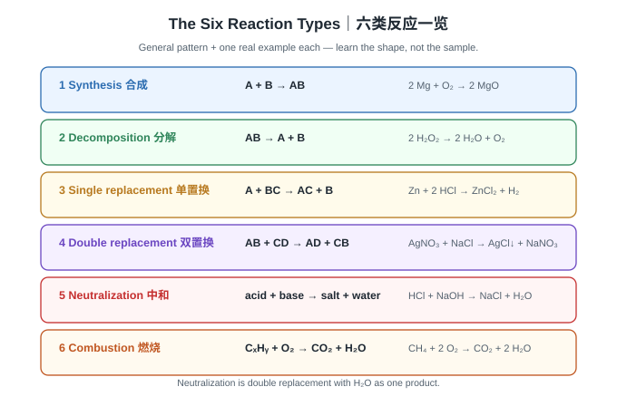
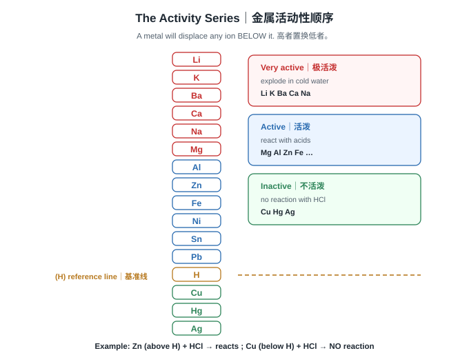
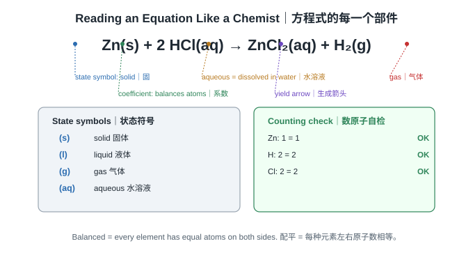
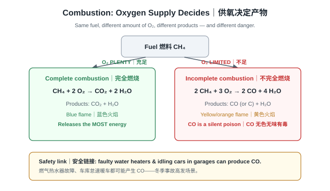

# Ch.9 — Chemical Reactions: From Science 10 to Quantitative Thinking

## Chapter 9 · Chemical Reactions｜第 9 章　化学反应：从 Science 10 到定量思维

> 🗂️ **Scope note｜范围说明**：This chapter reviews the six reaction types from Science 10 and upgrades them: state symbols, product prediction with the activity series and solubility rules, combustion in two modes, and the first quantitative reading of equations. Redox and equilibrium are beyond Chemistry 11.｜本章复习 Science 10 的六类反应并全面升级：状态符号、用活动性顺序与溶解性规则预测产物、燃烧二分、方程式的第一层定量解读。氧化还原与平衡超出 Chemistry 11 范围。

## 1. Content Alignment｜大纲对应

| Item｜项目 | Detail｜细节 |
|---|---|
| Big Idea｜核心概念 | **B4** — *Matter and energy are conserved in chemical reactions.*（本章：物质侧面）｜（本章聚焦物质守恒） |
| Content C9｜内容标准 C9 | types of chemical reactions; writing and balancing equations; predicting products｜反应类型；书写与配平方程式；预测产物 |
| Curricular Competencies｜课程能力 | Planning and conducting（反应证据站）· Evaluating（能否反应的预测-验证）· Applying and innovating（CO 事故研讨） |
| Chapters before｜前置章节 | Ch.2 hydrocarbons（燃烧的燃料侧）；Ch.6 activity（金属活泼性的原子解释） |
| Chapters after｜后继章节 | Ch.10 把系数比变成计算引擎；Ch.12 给溶解性规则完整表；Ch.13 拆成净离子方程式 |

## 2. Learning Objectives｜学习目标

**By the end of this chapter you can｜学完本章你要能做到：**

1. Classify any given reaction into one of the six types by pattern, not memory.｜按模式（而非死记）把反应归入六类之一。
2. Write complete equations with state symbols (s/l/g/aq) and correct diatomic formulas.｜写出带状态符号、双原子分子正确的完整方程式。
3. Predict products: single replacement with the activity series; double replacement with the solubility rules.｜预测产物：单置换查活动性顺序，双置换查溶解性规则。
4. Distinguish complete and incomplete combustion and justify the safety stakes.｜区分完全与不完全燃烧，并说明安全利害。
5. Read coefficients as mole ratios — the sentence Ch.10 will turn into calculations.｜把系数读成摩尔比——这正是 Ch.10 计算引擎的原材料。
6. Refuse to write equations for combinations that do not react.｜对不发生的组合拒绝写方程式。

## 3. Concept Explanations｜概念解析

### 3.1 The Six Types, Upgraded｜六类反应·升级版

The general patterns have not changed since Science 10 (Fig. 9-1):

**中文**：一般式与 Science 10 相同（图 9-1）：

| Type｜类型 | General｜一般式 | Example｜例 |
|---|---|---|
| Synthesis 合成 | A + B → AB | 2 Mg + O₂ → 2 MgO |
| Decomposition 分解 | AB → A + B | 2 H₂O₂ → 2 H₂O + O₂ |
| Single replacement 单置换 | A + BC → AC + B | Zn + 2 HCl → ZnCl₂ + H₂ |
| Double replacement 双置换 | AB + CD → AD + CB | AgNO₃ + NaCl → AgCl(s) + NaNO₃ |
| Neutralization 中和 | acid + base → salt + water | HCl + NaOH → NaCl + H₂O |
| Combustion 燃烧 | CₓHᵧ + O₂ → CO₂ + H₂O | CH₄ + 2 O₂ → CO₂ + 2 H₂O |

What is new in Chemistry 11 is the *discipline around the pattern*: every equation carries state symbols, every product is justified by a rule, and every "equation" for a pair that does not react is rejected.

**中文**：Chemistry 11 的新东西是**纪律**：每个方程式带状态符号，每个产物要有规则背书，凡不反应的组合一律拒绝写。

### 3.2 State Symbols and Conditions｜状态符号与反应条件

- **(s)** solid 固 · **(l)** liquid 液 · **(g)** gas 气 · **(aq)** aqueous 水溶液（dissolved in water 溶于水）
- Conditions sit on the arrow: **Δ** = heated 加热；"catalyst" written above = 催化剂（如 2 H₂O₂ →(MnO₂) 2 H₂O + O₂）。

> 💡 **Key Insight｜关键洞察**：The state symbol (aq) is doing heavy lifting — it tells you the substance has split into mobile ions, which Ch.12 (dissociation) and Ch.13 (net ionic equations) will formalize.｜(aq) 承载了大量信息：它告诉你物质已拆成可自由移动的离子——Ch.12 电离与 Ch.13 净离子方程式都会正式展开。

### 3.3 Predicting Single Replacement: The Activity Series｜单置换：金属活动性顺序

A metal displaces the ion of any metal **below** it in the series (Fig. 9-2). If the candidate metal is lower, there is no reaction — and the correct answer is the sentence "no reaction", not an equation.

**中文**：排在**上面**的金属能把排在其下的金属离子置换出来（图 9-2）。若候选金属更低，则不反应——正确答案是"不反应"三个字，而不是硬写方程式。

```
Zn(s) + 2 HCl(aq) → ZnCl₂(aq) + H₂(g)      Zn above H ✔ reacts
Cu(s) + HCl(aq)   → no reaction            Cu below H ✘
```

### 3.4 Predicting Double Replacement: Solubility Rules｜双置换：溶解性规则

In a double replacement the two partners swap. One of the new pairs must leave the solution (as a solid precipitate, a gas, or water) for a reaction to happen. Whether the candidate pair "leaves" is decided by the **solubility rules（溶解性规则）**— the short version now, the full table in Ch.12:

**中文**：双置换是"交换舞伴"。新组合中必须有一个能离开溶液（沉淀、气体或水）反应才算发生。候选组合能不能离开由**溶解性规则**决定——先记速查版，Ch.12 给全表：

- Always soluble: NO₃⁻, NH₄⁺, Group 1 ions, acetate｜总可溶
- Cl⁻/Br⁻/I⁻ soluble **except** Ag⁺, Pb²⁺｜卤离子除银铅
- SO₄²⁻ soluble **except** Ba²⁺, Pb²⁺ (Ca²⁺ slightly)｜硫酸根除钡铅（钙微溶）
- CO₃²⁻, PO₄³⁻, S²⁻, OH⁻ insoluble **except** with Group 1/NH₄⁺｜其余多数不溶，碱金属铵除外

```
AgNO₃(aq) + NaCl(aq) → AgCl(s) + NaNO₃(aq)     AgCl insoluble ✔ precipitate forms
KNO₃(aq)  + NaCl(aq) → no reaction             all pairs soluble ✘
```

### 3.5 Combustion: Oxygen Supply Decides｜燃烧：供氧决定产物

Complete combustion (O₂ plentiful) turns every carbon into CO₂; incomplete combustion (O₂ limited) produces **CO and/or soot (C)** (Fig. 9-4). Same fuel, different products, very different safety.

**中文**：完全燃烧（O₂ 足量）把每个碳都变成 CO₂；不完全燃烧（O₂ 不足）生成 **CO 和/或碳烟**（图 9-4）。燃料相同、产物不同、安全性天差地别。

```
complete:    CH₄ + 2 O₂ → CO₂ + 2 H₂O          blue flame 蓝焰
incomplete:  2 CH₄ + 3 O₂ → 2 CO + 4 H₂O       yellow flame 黄焰 · CO silent poison
```

> ⚠️ **Safety link｜安全链接**：A faulty water heater or an idling car in a closed garage can fill a room with CO — colourless, odourless, and it binds haemoglobin ~200× more strongly than O₂. Winter is the accident season.｜故障燃气热水器、车库内怠速暖车都可能让 CO 无声积聚——无色无味、与血红蛋白的结合力约为 O₂ 的 200 倍。冬季是事故高发季。

### 3.6 Reading Equations Quantitatively｜方程式的定量读法

The coefficients of a balanced equation are a **particle ratio** and therefore also a **mole ratio**:

**中文**：配平方程式的系数既是**粒子数比**，也是**摩尔比**：

```
2 H₂(g) + O₂(g) → 2 H₂O(g)
2 mol : 1 mol : 2 mol        ← read this way 读作摩尔比
NOT "2 g : 32 g : 36 g"      ← mass is NOT proportional to coefficients 质量不与系数成正比
```

This one sentence is the seed of the whole of Ch.10. Balanced also means: every element has the same atom count on both sides — matter is conserved (the B4 substance side; the energy side waits for Ch.11).

**中文**：这一句是整个 Ch.10 的种子。配平还意味着：每种元素左右原子数相等——物质守恒（B4 的物质侧面；能量侧面等 Ch.11）。

> 🔭 **Extension｜超纲**【Extension → Chemistry 12】：Classifying reactions by *electron transfer* (oxidation-reduction) gives a deeper, unified picture — and lets you predict far more reactions. Chemistry 11 keeps to the six surface patterns.｜按**电子转移**（氧化还原）给反应分类是更深层、更统一的图景，还能预测更多反应。Chemistry 11 只要求六类表层模式。

## 4. Comparison Tables｜表格比对

### Table 9-1　Complete vs Incomplete Combustion｜完全燃烧 vs 不完全燃烧

| Feature｜特征 | Complete 完全 | Incomplete 不完全 |
|---|---|---|
| O₂ supply｜供氧 | plentiful 充足 | limited 不足 |
| Carbon product｜碳产物 | CO₂ | CO and/or C（soot 碳烟） |
| Flame colour｜火焰 | blue 蓝色 | yellow/orange 黄橙 |
| Energy released｜放能 | maximum 最大 | less 较少 |
| Hazard｜危险 | greenhouse gas | **CO — toxic, odourless** 有毒无味 |

### Table 9-2　Activity Series — Reading Rules｜活动性顺序判读

| Zone｜区域 | Metals｜金属 | Behaviour｜表现 |
|---|---|---|
| Very active 极活泼 | Li K Ba Ca Na | react with cold water 与冷水反应 |
| Active 活泼 | Mg Al Zn Fe Ni Sn Pb | react with acids 与酸反应（H 以上） |
| Reference 基准 | **H** | acids are the dividing line 酸是分界线 |
| Inactive 不活泼 | Cu Hg Ag | no reaction with HCl acid 与稀酸不反应 |

### Table 9-3　Solubility Quick Rules｜溶解性速查（Ch.12 给全表）

| Ion｜离子 | Soluble?｜可溶性 | Exceptions｜例外 |
|---|---|---|
| NO₃⁻, NH₄⁺, Group 1 | always 全溶 | none 无 |
| Cl⁻, Br⁻, I⁻ | yes | Ag⁺, Pb²⁺ |
| SO₄²⁻ | yes | Ba²⁺, Pb²⁺ (Ca²⁺ slight 微溶) |
| CO₃²⁻, PO₄³⁻, OH⁻ | no 不溶 | Group 1, NH₄⁺ |

### Table 9-4　"Will it react?" Decision Card｜"能否反应"判定卡

| Given｜组合 | Check｜检查 | Verdict｜判定 |
|---|---|---|
| metal + acid | activity series vs H | above H → salt + H₂; below → no rxn |
| metal + salt solution | order in series | above → displacement; below → no rxn |
| two salt solutions | solubility of both new pairs | one insoluble → precipitate; both soluble → no rxn |
| hydrocarbon + O₂ | O₂ amount | plentiful → CO₂+H₂O; limited → CO/C + H₂O |

## 5. Diagrams & Worked Examples｜图例说明

### Fig. 9-1　The Six Reaction Types｜六类反应一览



### Fig. 9-2　The Activity Series｜金属活动性顺序



### Fig. 9-3　Anatomy of an Equation｜方程式解剖



### Fig. 9-4　Combustion: Oxygen Supply Decides｜供氧决定产物



### Example 9-1　Balance With Polyatomic Groups Intact｜整体配平多原子团

**Question**: Balance: Al(OH)₃ + H₂SO₄ → Al₂(SO₄)₃ + H₂O.

**中文**：配平：Al(OH)₃ + H₂SO₄ → Al₂(SO₄)₃ + H₂O。

**Solution｜解**: Treat SO₄²⁻ and OH⁻ as blocks. Need 2 Al → put 2 Al(OH)₃; need 3 SO₄ → 3 H₂SO₄; that gives 6 OH + 6 H → 6 H₂O:

```
2 Al(OH)₃ + 3 H₂SO₄ → Al₂(SO₄)₃ + 6 H₂O
Al: 2=2  S: 3=3  O: 6+12=12+6=18  H: 6+6=12  ✔
```

*(4 marks: 1 per element/balance check.)*

**中文**：把 SO₄²⁻ 与 OH⁻ 当"整体积木"配。*(4 分：每个元素/自查 1 分。)*

### Example 9-2　Predict, Then Write｜先预测后书写

**Question**: Write the equation, or "no reaction": (a) Mg(s) + AgNO₃(aq); (b) NaNO₃(aq) + KCl(aq).

**中文**：写出方程式或注明"不反应"：(a) Mg(s) + AgNO₃(aq)；(b) NaNO₃(aq) + KCl(aq)。

**Solution｜解**:

```
(a) Mg is above Ag in the series → displacement:
    Mg(s) + 2 AgNO₃(aq) → Mg(NO₃)₂(aq) + 2 Ag(s)
(b) Both swap pairs (KNO₃, NaCl) are soluble → no reaction.
```

*(4 marks: 2 each — 1 for the correct decision, 1 for the correct full equation.)*

**中文**：*(4 分：各 2 分——判断 1 分、完整方程式 1 分。)*

### Example 9-3　A Combustion With a Twist｜一道有转折的燃烧题

**Question**: Write both the complete and an incomplete combustion equation for propane C₃H₈.

**中文**：写出丙烷 C₃H₈ 的完全燃烧与一条不完全燃烧方程式。

**Solution｜解**:

```
complete:    C₃H₈ + 5 O₂ → 3 CO₂ + 4 H₂O
incomplete:  2 C₃H₈ + 7 O₂ → 6 CO + 8 H₂O
```

Check the incomplete one: C 6=6 ✔, H 16=16 ✔, O 14 = 6+8 ✔.

**中文**：不完全那条自查：C 6=6，H 16=16，O 14 = 6+8 ✔。*(4 marks｜4 分)*

## 6. Key Vocabulary｜核心词汇

| English | 中文 | Note｜备注 |
|---|---|---|
| activity series | 金属活动性顺序 | higher displaces lower｜高者置换低者 |
| solubility rules | 溶解性规则 | decide precipitates｜决定沉淀 |
| precipitate | 沉淀 | low-solubility solid formed｜生成的低溶解度固体 |
| state symbol | 状态符号 | (s) (l) (g) (aq)｜四件套 |
| aqueous | 水溶液 | dissolved; ions mobile｜已溶解、离子可动 |
| complete combustion | 完全燃烧 | O₂ plentiful → CO₂ + H₂O｜O₂ 足 |
| incomplete combustion | 不完全燃烧 | O₂ limited → CO/C + H₂O｜O₂ 不足 |
| carbon monoxide | 一氧化碳 | colourless, odourless, toxic｜无色无味有毒 |
| mole ratio | 摩尔比 | coefficients read as mol｜系数读作摩尔 |
| no reaction | 不反应 | a valid, mark-earning answer｜值得分的正确答案 |

## 7. Lab / Activity｜实验与活动

### Activity 9-1　Six Reaction Evidence Stations｜六类反应证据站（升级版）

**Do it｜操作**: Six stations, one reaction each (Mg burning; H₂O₂ with yeast; Zn + HCl; AgNO₃ + NaCl; vinegar + baking soda; candle burning). At each: classify, write the balanced equation **with state symbols**, and name the evidence.

**中文**：六个站点各一个反应（镁条燃烧；酵母催化 H₂O₂；Zn+HCl；AgNO₃+NaCl；醋+小苏打；蜡烛燃烧）。每站：归类、写**带状态符号**的配平方程式、指出证据。`[Planning and conducting]`

### Activity 9-2　Predict–Verify Tournament｜"能否反应"预测-验证赛

**Do it｜操作**: Five metal/solution pairs are listed. Predict with the activity series (react / no reaction + products), then test each in a spot plate and score your own predictions.

**中文**：列出 5 组金属/盐溶液组合。先用活动性顺序预测（反应/不反应 + 产物），再用点滴板实测，自评预测准确率。`[Evaluating]`

### Activity 9-3　CO Case Study｜CO 警示案例研讨

**Do it｜操作**: Read a news report of a winter CO poisoning incident. Identify: the incomplete combustion source, the reason victims got no warning, and write three evidence-based recommendations.

**中文**：读一则冬季 CO 中毒新闻。找出：不完全燃烧源头、受害者为何毫无预警，并写三条有依据的建议。`[Applying and innovating]`

## 8. Common Misconceptions｜常见易错点

| # | Misconception｜错误认识 | Correction｜正确理解 |
|---|---|---|
| 1 | "Coefficients tell you the mass ratio."｜系数就是质量比。 | Coefficients are particle and **mole** ratios; mass needs molar masses (Ch.10's whole job).｜系数是粒子数/摩尔比；质量关系必须经摩尔质量换算（这正是 Ch.10 的全部工作）。 |
| 2 | "H₂ can be written as H because hydrogen means the element."｜氢元素就写 H。 | Hydrogen, nitrogen, oxygen, fluorine, chlorine, bromine, iodine are **diatomic** (H₂ N₂ O₂ F₂ Cl₂ Br₂ I₂).｜七种双原子分子必须写成 H₂ N₂ O₂ F₂ Cl₂ Br₂ I₂。 |
| 3 | "Incomplete combustion makes CO₂ plus some smoke."｜不完全燃烧还是生成 CO₂，只是多点烟。 | It is a different reaction: CO and/or soot **replace** CO₂ as the carbon product.｜那是另一个反应：碳产物是 CO 和/或碳烟，**取代** CO₂。 |
| 4 | "Cu + HCl → CuCl₂ + H₂, balanced and done."｜配平就完事。 | Cu sits below H: no reaction. Writing an equation for a non-reaction is a factual error, not a style issue.｜Cu 在 H 之下：不反应。给不发生的反应写方程式是事实错误。 |
| 5 | "Any balanced numbers will do: 4 H₂ + 2 O₂ → 4 H₂O is fine."｜系数随便放大。 | Reduce to the simplest whole-number ratio: 2 H₂ + O₂ → 2 H₂O.｜必须约成最简整数比。 |
| 6 | "State symbols are decoration."｜状态符号是装饰。 | (aq) vs (s) decides whether a precipitate forms and how Ch.13 splits the equation — they carry chemistry.｜(aq) 与 (s) 决定沉淀是否生成、Ch.13 如何拆——它们承载化学信息。 |
| 7 | "If two solutions are mixed, something must happen."｜两种溶液混一起必有反应。 | If every new pair is soluble, there is no reaction. "No reaction" earns full marks when justified.｜新组合全可溶就是无反应；说理充分的"不反应"拿满分。 |
| 8 | "Neutralization is its own separate thing."｜中和是独立一类。 | It is double replacement whose products are always salt + water.｜中和是产物恒为盐+水的双置换。 |
| 9 | "Catalysts appear as reactants or products."｜催化剂要写进反应物/产物。 | A catalyst sits **above** the arrow and is not consumed.｜催化剂写在**箭头上方**，不被消耗。 |
| 10 | "Burning needs a flame, so combustion is endothermic."｜要点火所以燃烧吸热。 | Ignition supplies activation energy; the combustion itself releases far more than it takes (Ch.11).｜点火提供的是活化能；燃烧本身净放热远大于吸热（Ch.11）。 |
| 11 | "A precipitate is anything that sinks."｜沉底的就是沉淀。 | A precipitate is a **low-solubility solid formed by reaction** — sand sinks too but it is not a precipitate.｜沉淀是**反应生成的低溶解度固体**——沙子也沉底但不是沉淀。 |
| 12 | "Equations may omit charges on ions."｜离子电荷可写可不写。 | Once you write ions (NO₃⁻, Cu²⁺), charges are part of the formula; dropping them is a chemistry error.｜写出离子就必须带电荷，丢电荷是化学错误。 |

## 9. Assessment｜答题评估

### Part A: Foundational｜基础题（10 × 2 = 20 points）

**A1.** Name the six reaction types and give the general pattern of each.

- **中文**：写出六类反应名称及各自的一般式。

**A2.** Balance: K + O₂ → K₂O.

- **中文**：配平：K + O₂ → K₂O。

**A3.** Balance: C₂H₆ + O₂ → CO₂ + H₂O (complete combustion).

- **中文**：配平：C₂H₆ + O₂ → CO₂ + H₂O（完全燃烧）。

**A4.** Balance: Al(OH)₃ + H₂SO₄ → Al₂(SO₄)₃ + H₂O.

- **中文**：配平：Al(OH)₃ + H₂SO₄ → Al₂(SO₄)₃ + H₂O。

**A5.** Write the equation for magnesium burning in oxygen with state symbols.

- **中文**：写出镁在氧气中燃烧的方程式（带状态符号）。

**A6.** Predict: Zn(s) + CuSO₄(aq) → ? Justify with the activity series.

- **中文**：预测：Zn(s) + CuSO₄(aq) → ? 用活动性顺序说理。

**A7.** Predict: Cu(s) + AgNO₃(aq) → ?

- **中文**：预测：Cu(s) + AgNO₃(aq) → ?

**A8.** Predict: BaCl₂(aq) + Na₂SO₄(aq) → ? Name the precipitate.

- **中文**：预测：BaCl₂(aq) + Na₂SO₄(aq) → ? 指出沉淀是什么。

**A9.** Give the three soluble families you should know cold (always-soluble ions).

- **中文**：写出"永远可溶"的三类离子。

**A10.** Read "N₂ + 3 H₂ → 2 NH₃" as mole ratios: how many moles of H₂ per mole of N₂?

- **中文**：把 N₂ + 3 H₂ → 2 NH₃ 读成摩尔比：每摩尔 N₂ 需要几摩尔 H₂？

### Part B: Applied｜应用题（4 × 5 = 20 points）

**B1.** A car engine burning gasoline can emit CO on a cold morning. (a) Write the complete and an incomplete combustion equation for octane C₈H₁₈. (b) Explain in two sentences why the cold morning matters. (c) Name one safety technology that addresses this and what it does. *(4 + 3 + 3 marks)*

- **中文**：(a) 写出辛烷 C₈H₁₈ 的完全燃烧与一条不完全燃烧方程式。(b) 用两句话解释为什么冷车晨间更容易产生 CO。(c) 指出一种针对此问题的安全技术及其作用。*(4 + 3 + 3 分)*

**B2.** Five pairs are proposed for a lab: Mg + HCl; Cu + HCl; Mg + Zn(NO₃)₂; Cu + Mg(NO₃)₂; Ag + HCl. For each: react or not? For those that react, write the balanced equation with state symbols.

- **中文**：某实验提出 5 组组合：Mg + HCl；Cu + HCl；Mg + Zn(NO₃)₂；Cu + Mg(NO₃)₂；Ag + HCl。逐一判断是否反应；反应的写出带状态符号的配平方程式。

**B3.** Mixing AgNO₃(aq) with KCl(aq): (a) predict the products by swapping; (b) consult the solubility rules and decide if a reaction occurs; (c) write the full equation with state symbols, or write "no reaction" with justification.

- **中文**：把 AgNO₃(aq) 与 KCl(aq) 混合：(a) 交换成分写产物；(b) 查溶解性规则判断是否反应；(c) 写出带状态符号的完整方程式，或写"不反应"并说理。

**B4.** A student writes: "2 C₃H₈ + 7 O₂ → 6 CO + 8 H₂O, so burning propane always makes 6 CO for every 8 H₂O." Identify the two errors in that sentence.

- **中文**：某学生写："2 C₃H₈ + 7 O₂ → 6 CO + 8 H₂O，所以丙烷燃烧总是 6 CO 配 8 H₂O。"指出这句话的两个错误。

### Part C: Challenge｜挑战题（2 × 10 = 20 points）

**C1.** Design a two-step identification scheme, using only reactions from this chapter, to tell whether a colourless solution is NaCl or Na₂CO₃. For each step: reagent, expected observation for EACH candidate, and the equation (or the reason no reaction occurs). Then state one limitation of your scheme. *(4 + 4 + 2 marks)*

- **中文**：只用本章学过的反应，设计两步鉴定方案，区分无色溶液是 NaCl 还是 Na₂CO₃。每步给出：试剂、两种候选各自的预期现象、方程式（或不反应的理由）。最后指出方案的一个局限。*(4 + 4 + 2 分)*

**C2.** A warehouse fire involves burning cardboard and a leaking propane cylinder. (a) Write the combustion equations for both fuels, complete and one incomplete each. (b) The fire investigator notes yellow flames and heavy black soot. What does that say about the local O₂ supply, and which hazard kills first in a closed space? (c) Write the safety chain: condition → equation → one engineering control → one behavioural rule. *(4 + 3 + 3 marks)*

- **中文**：某仓库火灾涉及纸板燃烧和泄漏的丙烷钢瓶。(a) 写两种燃料的完全燃烧与各自一条不完全燃烧方程式。(b) 调查员记录到黄色火焰与大量黑烟，说明局部 O₂ 供应如何？密闭空间里哪种危害最先致死？(c) 写出安全链条：条件 → 方程式 → 一条工程控制 → 一条行为规范。*(4 + 3 + 3 分)*

### Answer Key｜参考答案

**Part A**

- **A1.** Synthesis A+B→AB; decomposition AB→A+B; single replacement A+BC→AC+B; double replacement AB+CD→AD+CB; neutralization acid+base→salt+H₂O; combustion CₓHᵧ+O₂→CO₂+H₂O.

  - **中文**：合成、分解、单置换、双置换、中和、燃烧（一般式同上）。

- **A2.** 4 K + O₂ → 2 K₂O.

  - **中文**：4 K + O₂ → 2 K₂O。

- **A3.** 2 C₂H₆ + 7 O₂ → 4 CO₂ + 6 H₂O.

  - **中文**：2 C₂H₆ + 7 O₂ → 4 CO₂ + 6 H₂O。

- **A4.** 2 Al(OH)₃ + 3 H₂SO₄ → Al₂(SO₄)₃ + 6 H₂O.

  - **中文**：2 Al(OH)₃ + 3 H₂SO₄ → Al₂(SO₄)₃ + 6 H₂O。

- **A5.** 2 Mg(s) + O₂(g) → 2 MgO(s).

  - **中文**：2 Mg(s) + O₂(g) → 2 MgO(s)。

- **A6.** Zn is above Cu → reacts: Zn(s) + CuSO₄(aq) → ZnSO₄(aq) + Cu(s); blue fades, red-brown solid forms.

  - **中文**：Zn 在 Cu 之上 → 反应：Zn(s) + CuSO₄(aq) → ZnSO₄(aq) + Cu(s)；蓝色变浅、生成红棕色固体。

- **A7.** Cu is above Ag → reacts: Cu(s) + 2 AgNO₃(aq) → Cu(NO₃)₂(aq) + 2 Ag(s).

  - **中文**：Cu 在 Ag 之上 → 反应：Cu(s) + 2 AgNO₃(aq) → Cu(NO₃)₂(aq) + 2 Ag(s)。

- **A8.** BaSO₄ is insoluble → BaCl₂(aq) + Na₂SO₄(aq) → BaSO₄(s) + 2 NaCl(aq); precipitate = BaSO₄ (white).

  - **中文**：BaSO₄ 不溶 → 反应生成白色 BaSO₄ 沉淀。

- **A9.** NO₃⁻, NH₄⁺ (and ammonium salts), Group 1 metal ions (Li⁺ Na⁺ K⁺ …) — also acetate CH₃COO⁻.

  - **中文**：NO₃⁻、NH₄⁺（铵盐）、第 1 族金属离子（Li⁺ Na⁺ K⁺…），另加醋酸根 CH₃COO⁻。

- **A10.** 3 mol H₂ per 1 mol N₂ (coefficients 1 : 3 : 2).

  - **中文**：每摩尔 N₂ 配 3 mol H₂（系数比 1 : 3 : 2）。

**Part B**

- **B1.** (a) C₈H₁₈ + 12.5 O₂ → 8 CO₂ + 9 H₂O — or doubled: 2 C₈H₁₈ + 25 O₂ → 16 CO₂ + 18 H₂O; incomplete: 2 C₈H₁₈ + 17 O₂ → 16 CO + 18 H₂O. (b) Cold starts run fuel-rich and ignition is poorer, so local O₂ runs short — incomplete combustion becomes likely. (c) A catalytic converter finishes oxidizing CO to CO₂ before exhaust leaves; or a CO detector warns occupants. *(4 + 3 + 3)*

  - **中文**：(a) 完全：2 C₈H₁₈ + 25 O₂ → 16 CO₂ + 18 H₂O；不完全：2 C₈H₁₈ + 17 O₂ → 16 CO + 18 H₂O。(b) 冷启动时混合气偏浓、着火更差，局部 O₂ 不足 → 易发生不完全燃烧。(c) 三元催化器在排气前把 CO 进一步氧化成 CO₂；或 CO 报警器提醒人员。*(4 + 3 + 3 分)*

- **B2.** Mg + HCl → Mg(s) + 2 HCl(aq) → MgCl₂(aq) + H₂(g) ✔; Cu + HCl → no reaction (below H) ✘; Mg + Zn(NO₃)₂ → Mg(s) + Zn(NO₃)₂(aq) → Mg(NO₃)₂(aq) + Zn(s) ✔; Cu + Mg(NO₃)₂ → no reaction (Cu below Mg) ✘; Ag + HCl → no reaction (Ag below H) ✘.

  - **中文**：Mg+HCl 反应（上式）；Cu+HCl 不反应（H 之下）；Mg+Zn(NO₃)₂ 反应：Mg(s) + Zn(NO₃)₂(aq) → Mg(NO₃)₂(aq) + Zn(s)；Cu+Mg(NO₃)₂ 不反应（Cu 在 Mg 之下）；Ag+HCl 不反应（Ag 在 H 之下）。

- **B3.** (a) AgCl and KNO₃. (b) AgCl insoluble (Cl⁻ exception Ag⁺), KNO₃ soluble → reaction occurs. (c) AgNO₃(aq) + KCl(aq) → AgCl(s) + KNO₃(aq); white precipitate.

  - **中文**：(a) 产物 AgCl 与 KNO₃。(b) AgCl 不溶（Cl⁻ 的例外是 Ag⁺），KNO₃ 可溶 → 反应发生。(c) AgNO₃(aq) + KCl(aq) → AgCl(s) + KNO₃(aq)；白色沉淀。

- **B4.** Error 1: that equation describes *incomplete combustion under O₂-limited conditions* — it is not "always". Error 2: coefficients are mole ratios, not a universal fixed recipe; different O₂ limits give different CO/soot splits.

  - **中文**：错误一：该方程描述的是 O₂ 不足条件下的**不完全燃烧**，并非"总是"。错误二：系数是摩尔比，不是万能配方——O₂ 不足程度不同，CO/碳烟分配也不同。

**Part C**

- **C1.** Step 1: add dilute HCl. Na₂CO₃ fizzes (CO₂): Na₂CO₃(aq) + 2 HCl(aq) → 2 NaCl(aq) + H₂O(l) + CO₂(g); NaCl: no reaction (no gas/solid/water pair). If fizzing → Na₂CO₃ confirmed. Step 2 (confirm NaCl): add AgNO₃(aq) → white ppt AgCl: NaCl(aq) + AgNO₃(aq) → AgCl(s) + NaNO₃(aq); Na₂CO₃ would also give Ag₂CO₃ ppt, which is why step 1 must come first. Limitation: single reagents can give similar observations for other anions (e.g. SO₃²⁻ also fizzes), so this scheme presumes the two candidates only.

  - **中文**：第一步：加稀盐酸。Na₂CO₃ 冒泡（CO₂）：Na₂CO₃(aq) + 2 HCl(aq) → 2 NaCl(aq) + H₂O(l) + CO₂(g)；NaCl 不反应（无气体/沉淀/水生成）。冒泡即 Na₂CO₃。第二步（确认 NaCl）：加 AgNO₃(aq) → 白色 AgCl 沉淀：NaCl(aq) + AgNO₃(aq) → AgCl(s) + NaNO₃(aq)（Na₂CO₃ 也会生成 Ag₂CO₃ 沉淀，所以第一步必须先行）。局限：其他阴离子可能有类似现象（如 SO₃²⁻ 也冒泡），方案默认只有两种候选。*(4 + 4 + 2 分)*

- **C2.** (a) Cardboard (cellulose, C₆H₁₀O₅): complete C₆H₁₀O₅ + 6 O₂ → 6 CO₂ + 5 H₂O; incomplete C₆H₁₀O₅ + 3 O₂ → 6 CO + 5 H₂O (any valid O₂-limited split earns credit). Propane: C₃H₈ + 5 O₂ → 3 CO₂ + 4 H₂O; incomplete 2 C₃H₈ + 7 O₂ → 6 CO + 8 H₂O. (b) Yellow flames and soot mean O₂-starved burning — CO output is high; in a closed space **CO** kills first (odourless, binds haemoglobin), before the burn itself. (c) Chain: O₂-limited burning → equations in (a) → engineering: ventilation that keeps O₂ flowing / CO detection; behavioural: never enter until aired and detector-cleared.

  - **中文**：(a) 纸板（纤维素 C₆H₁₀O₅）：完全燃烧 C₆H₁₀O₅ + 6 O₂ → 6 CO₂ + 5 H₂O；不完全燃烧 C₆H₁₀O₅ + 3 O₂ → 6 CO + 5 H₂O（其他 O₂ 不足的合理配平均可）。丙烷：完全 C₃H₈ + 5 O₂ → 3 CO₂ + 4 H₂O；不完全 2 C₃H₈ + 7 O₂ → 6 CO + 8 H₂O。(b) 黄焰与黑烟说明缺氧燃烧——CO 产量高；密闭空间里**CO 最先致死**（无色无味、结合血红蛋白）。(c) 链条：缺氧燃烧 → (a) 的方程式 → 工程控制：保证供氧的通风/CO 探测；行为规范：通风并经探测确认前不得进入。*(4 + 3 + 3 分)*

### Rubric｜评分量规

| Band｜档 | Evidence required｜所需证据 |
|---|---|
| Full marks 满分 | Decision justified by rule (series position / solubility), full state symbols, balanced with simplest ratio｜判断有规则背书（顺序位置/溶解性）、状态符号齐全、配平至最简比 |
| Partial 部分分 | Correct products but missing state symbols or an unjustified "no reaction"｜产物对但缺状态符号，或"不反应"未说理 |
| Minimal 最低分 | Equation written for a non-reaction, or coefficients not in simplest ratio｜给不发生的反应写方程式；系数未约最简 |

## 10. Connection to the Big Idea｜回扣核心概念

> 🎯 **Big Idea B4｜核心概念 B4**：*Matter and energy are conserved in chemical reactions.*
> **中文**：化学反应中物质与能量守恒。

Balancing is conservation made visible: count the atoms — the same number on both sides, nothing created, nothing destroyed. This chapter secured the **matter** side and armed you with the mole-ratio sentence; Ch.10 converts that sentence into quantitative predictions, and Ch.11 closes the loop with the **energy** side.

**中文**：配平就是把守恒画出来：数原子——两边一样多，不凭空产生、不凭空消失。本章拿下**物质**侧面，并把"系数即摩尔比"这句话交给你；Ch.10 把这句话变成定量预测，Ch.11 再补上**能量**侧面闭环。

**How does this connect to the Big Idea?｜本章如何回扣核心概念？** Every equation you wrote is a conservation statement. In Ch.10, "2 H₂ + O₂ → 2 H₂O" stops being a sentence and becomes a calculation: exactly how much water?

**中文**：你写的每个方程式都是一条守恒陈述。到 Ch.10，"2 H₂ + O₂ → 2 H₂O"不再只是句子，而是一道计算题：到底能生成多少克水？
