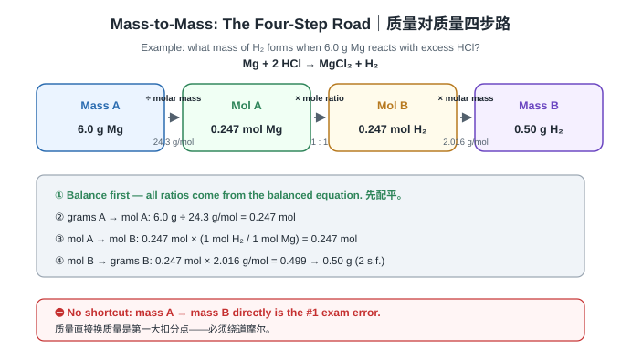
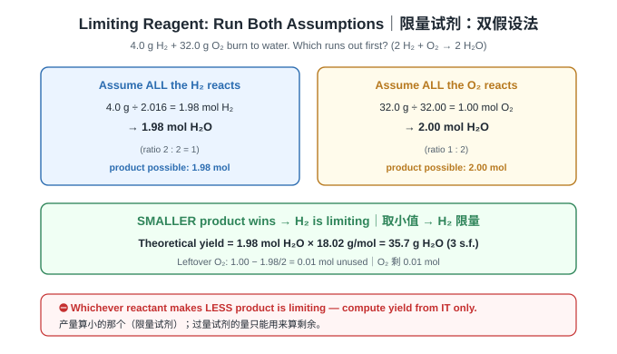
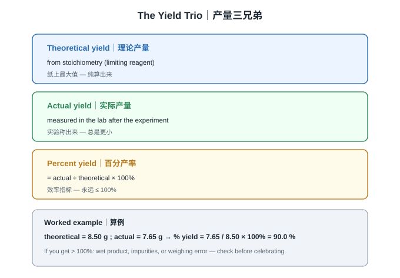
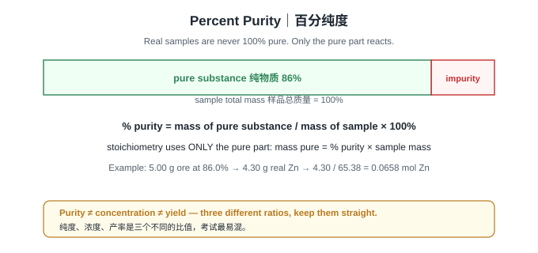

# Ch.10 — Stoichiometry: Amounts in Chemical Reactions

## Chapter 10 · Stoichiometry｜第 10 章　化学计量：反应中的数量关系

> 🗂️ **Scope note｜范围说明**：This is the quantitative summit of the course — official Content **C10**: stoichiometric calculations with significant figures. Everything from Ch.1 (sig figs, dimensional analysis), Ch.8 (the mole) and Ch.9 (mole ratios) converges here.｜本章是全课程量化顶点——官方内容标准 C10：带有效数字的化学计量计算。Ch.1（有效数字、量纲分析）、Ch.8（摩尔）、Ch.9（摩尔比）在此合流。

## 1. Content Alignment｜大纲对应

| Item｜项目 | Detail｜细节 |
|---|---|---|
| Big Idea｜核心概念 | **B4** — *Matter and energy are conserved in chemical reactions.*（物质守恒的定量应用） |
| Content C10｜内容标准 C10 | stoichiometric calculations using significant figures｜使用有效数字的化学计量计算 |
| Curricular Competencies｜课程能力 | Planning and conducting（产率实验）· Processing and analyzing（限量试剂双配比）· Evaluating（误差与改进报告） |
| Chapters before｜前置章节 | Ch.8 three bridges; Ch.9 mole ratios |
| Chapters after｜后继章节 | Ch.13 把"上桥方式"换成浓度与体积，四步结构不变 |

## 2. Learning Objectives｜学习目标

**By the end of this chapter you can｜学完本章你要能做到：**

1. Use mole ratios from a balanced equation as the bridge between any two substances.｜把配平方程式的摩尔比当作任意两种物质之间的桥。
2. Solve mass-mass problems in four standard steps with clean unit chains.｜按标准四步、用干净的单位链求解质量对质量问题。
3. Identify the limiting reagent by two independent methods and justify the verdict.｜用两种独立方法判断限量试剂并给出理由。
4. Compute theoretical, actual and percent yield, and diagnose >100% results.｜计算理论/实际/百分产率，并诊断超过 100% 的结果。
5. Express percent purity and route it correctly into stoichiometry.｜表达百分纯度并正确接入化学计量。
6. Keep significant figures discipline from the first line to the last.｜从第一行到最后一行守住有效数字纪律。

## 3. Concept Explanations｜概念解析

### 3.1 The Mole Ratio Is the Only Bridge｜摩尔比是唯一的桥

A balanced equation says: **2 H₂ + O₂ → 2 H₂O** means 2 mol H₂ reacts with 1 mol O₂ to make 2 mol H₂O. The coefficients give conversion factors like (2 mol H₂O / 1 mol O₂).

**中文**：配平方程式说的是：2 mol H₂ 与 1 mol O₂ 生成 2 mol H₂O。系数给出转换因子，如 (2 mol H₂O / 1 mol O₂)。

To convert between the *mass* of substance A and the *mass* of substance B, there is no direct road — you must cross the mole district (Fig. 10-1):

**中文**：从 A 的质量到 B 的质量没有直达路——必须穿过"摩尔区"（图 10-1）：

```
mass A → (÷ M_A) → mol A → (× mole ratio) → mol B → (× M_B) → mass B
质量 A      摩尔 A         摩尔 B              质量 B
```

> 💡 **Key Insight｜关键洞察**：The middle step is the *only* place chemistry happens. The two outer steps are bookkeeping with molar masses.｜中间一步是**唯一发生化学的地方**；两头只是用摩尔质量记账。

### 3.2 The Standard Four Steps｜标准四步

Worked end-to-end (Example 10-1): balance → mass A to mol A → mole ratio → mol B to mass B. Every line carries units; rounding happens once, at the end.

**中文**：从头到尾演示（例 10-1）：配平 → A 的质量换摩尔 → 摩尔比 → B 的摩尔换质量。每行带单位；只在最后舍入一次。

### 3.3 Limiting and Excess Reagents｜限量试剂与过量试剂

Real recipes never have perfect ratios. Combine 4.0 g H₂ with 32.0 g O₂: which runs out first? Two equivalent methods (Fig. 10-2):

**中文**：现实配方不会恰好成比例。4.0 g H₂ 配 32.0 g O₂：谁先用完？两种等价方法（图 10-2）：

1. **Double assumption 双假设**: compute the product from *each* reactant as if the other were unlimited; the reactant that yields **less** product is limiting.｜把每个反应物都当作足量算一遍产物；产物小的那个是限量试剂。
2. **Divide by coefficients 系数比法**: mol ÷ coefficient; the smaller quotient is limiting.｜摩尔数除以各自系数，商小的为限量。

> ⚠️ **Watch out｜小心**：Once identified, all yield calculations use the **limiting** reagent only. The excess one is used only to compute the leftover.｜判定之后，所有产量计算只用**限量**试剂；过量试剂只用来算"剩多少"。

### 3.4 The Yield Trio｜产量三兄弟

- **Theoretical yield（理论产量）**: what stoichiometry promises, from the limiting reagent.｜化学计量承诺的值，由限量试剂算出。
- **Actual yield（实际产量）**: what the lab balance says.｜天平实际称到的。
- **Percent yield（百分产率）** = actual ÷ theoretical × 100%.｜百分产率 = 实际 ÷ 理论 × 100%。

A yield **above 100%** is not good news — it is a diagnosis: product still wet, impurity mixed in, or a weighing error.｜产率**超过 100%** 不是好消息——是诊断书：产品未干、混入杂质或称量出错。

### 3.5 Percent Purity｜百分纯度

Ore and commercial chemicals are mixtures. Only the pure fraction participates:

**中文**：矿石和商品化学品是混合物，只有纯的那部分参与反应：

```
% purity = mass of pure substance / mass of sample × 100%
```

Route: sample mass → × % purity → pure mass → mol → stoichiometry. Purity applies **before** the mole bridge, not after.

**中文**：路径：样品质量 → × 纯度 → 纯物质质量 → 摩尔 → 计量。纯度在**上桥之前**使用，不是之后。

### 3.6 The Problem-Solving Contract｜解题契约

For every quantitative problem in this course: ① balanced equation first; ② unit chain visible; ③ 4–5 s.f. carried, round once; ④ answer with number + unit + sane s.f.; ⑤ self-check (does the size of the answer make sense?).

**中文**：本课程每道定量题的契约：①先配平；②单位链可见；③中间保 4–5 位、只舍一次；④答案带数值+单位+合理位数；⑤自检（答案的量级合理吗？）。

> 🔭 **Extension｜超纲**【Extension → Chemistry 12】：Solution-phase stoichiometry with limiting reagents and back-titrations extends the same four steps into solution chemistry — Ch.13 gives the preview.｜溶液相的限量试剂计算与返滴定，是同一套四步在溶液化学里的延伸——Ch.13 有预告。

## 4. Comparison Tables｜表格比对

### Table 10-1　The Four-Step Road vs The Wrong Shortcut｜四步正路 vs 错误捷径

| Step｜步骤 | Correct 正确 | Shortcut error 常见错误 |
|---|---|---|---|
| 1 | balance equation 配平 | skip 配平就取系数 |
| 2 | mass A → mol A | mass A → mass B directly 质量直接换质量 |
| 3 | mol A → mol B (ratio) | use mass ratio 用质量比 |
| 4 | mol B → mass B, round once | round at every step 每步都舍入 |

### Table 10-2　Limiting Reagent: Two Methods｜限量试剂两法对照

| Method｜方法 | Procedure｜操作 | Best when｜适用 |
|---|---|---|---|
| Double assumption 双假设 | product from each reactant; smaller wins | 任一反应物算产物，取小 | product needed anyway 反正要求产率 |
| Coefficient quotient 系数比法 | mol ÷ coefficient; smaller wins | 摩尔÷系数，取小 | quick yes/no 判断题 |

### Table 10-3　The Yield Trio and Purity｜产量三兄弟与纯度

| Quantity｜量 | Formula｜公式 | Data source｜数据来源 |
|---|---|---|---|
| theoretical yield | from limiting reagent stoichiometry | balanced equation 配平方程式 |
| actual yield | measured | lab balance 实验称量 |
| percent yield | actual/theoretical × 100% | both of the above |
| percent purity | pure/sample × 100% | analysis data 分析数据 |

### Table 10-4　Diagnostic Sheet for Bad Yields｜坏产率诊断表

| Symptom｜症状 | Likely cause｜可能原因 |
|---|---|---|
| yield > 100% | wet product / impurity / weighing error｜产品未干、混杂质、称量错 |
| yield far below 50% | side reaction / transfer loss / incomplete reaction｜副反应、转移损失、反应不完全 |
| yield varies widely between trials | inconsistent endpoint or timing｜终点或反应时间不一致 |

## 5. Diagrams & Worked Examples｜图例说明

### Fig. 10-1　The Four-Step Road｜质量对质量四步路



### Fig. 10-2　Limiting Reagent: Run Both Assumptions｜限量试剂双假设



### Fig. 10-3　The Yield Trio｜产量三兄弟



### Fig. 10-4　Percent Purity｜百分纯度



### Example 10-1　A Clean Mass-Mass｜一道干净的质量对质量

**Question**: What mass of hydrogen forms when 6.0 g of magnesium reacts with excess hydrochloric acid? (Mg + 2 HCl → MgCl₂ + H₂)

**中文**：6.0 g 镁与足量盐酸反应，生成多少克氢气？

**Solution｜解**:

```
mol Mg = 6.0 g ÷ 24.3 g/mol = 0.247 mol
mole ratio  1 : 1  →  mol H₂ = 0.247 mol
mass H₂ = 0.247 mol × 2.016 g/mol = 0.499 g → 0.50 g (2 s.f.)
```

*(5 marks: 1 mol step, 1 ratio, 1 mass step, 1 s.f., 1 units visible throughout.)*

**中文**：*(5 分：摩尔 1、比例 1、质量 1、有效数字 1、全程带单位 1。)*

### Example 10-2　Limiting Reagent and Leftover｜限量试剂与剩余量

**Question**: 4.0 g H₂ reacts with 32.0 g O₂ (2 H₂ + O₂ → 2 H₂O). (a) Which is limiting? (b) What mass of water forms? (c) What mass of the excess remains?

**中文**：4.0 g H₂ 与 32.0 g O₂ 反应（2 H₂ + O₂ → 2 H₂O）。(a) 谁是限量试剂？(b) 生成多少克水？(c) 剩余多少克过量物？

**Solution｜解**:

```
mol H₂ = 4.0/2.016 = 1.98 mol → makes 1.98 mol H₂O
mol O₂ = 32.0/32.00 = 1.00 mol → makes 2.00 mol H₂O
(a) H₂ limiting (smaller product)
(b) mass H₂O = 1.98 mol × 18.02 = 35.7 g (3 s.f.)
(c) O₂ used = 1.98/2 = 0.99 mol → leftover = 0.01 mol × 32.00 = 0.32 g
```

*(3 + 3 + 4 marks.)*

**中文**：*(3 + 3 + 4 分。)*

### Example 10-3　Purity → Yield, One Chain｜纯度接产率的一条链

**Question**: 5.00 g of impure zinc (86.0% Zn) reacts with excess HCl. The hydrogen produced is used to make 0.120 g of H₂ actual yield... simplify: what is the theoretical mass of H₂, and the percent yield if 0.112 g is collected?

**中文**：5.00 g 含杂锌（纯度 86.0%）与足量盐酸反应。求理论氢气质量；若实际收集 0.112 g，百分产率是多少？

**Solution｜解**:

```
pure Zn = 5.00 × 0.860 = 4.30 g → mol Zn = 4.30/65.38 = 0.0658 mol
ratio 1:1 → mol H₂ = 0.0658 → theoretical = 0.0658 × 2.016 = 0.133 g
% yield = 0.112/0.1326 × 100% = 84.5%   (unrounded theoretical used)
```

*(6 marks: 1 purity, 2 chain, 1 theoretical, 2 percent yield.)*

**中文**：*(6 分：纯度 1、链条 2、理论 1、产率 2。)*

## 6. Key Vocabulary｜核心词汇

| English | 中文 | Note｜备注 |
|---|---|---|
| stoichiometry | 化学计量 | quantitative relations in reactions｜反应中的数量关系 |
| mole ratio | 摩尔比 | coefficients of the balanced equation｜配平系数 |
| limiting reagent | 限量试剂 | runs out first; controls yield｜先用完、控产 |
| excess reagent | 过量试剂 | leftover can be computed｜可算剩余 |
| theoretical yield | 理论产量 | paper maximum from stoichiometry｜纸上最大值 |
| actual yield | 实际产量 | lab measurement｜实验称量 |
| percent yield | 百分产率 | actual/theoretical × 100%｜永远 ≤ 100% 才合理 |
| percent purity | 百分纯度 | pure ÷ sample × 100%｜上桥前先乘 |
| significant figures | 有效数字 | carry 4–5, round once｜中间保位只舍一次 |
| unit chain | 单位链 | every line carries units｜每行带单位 |

## 7. Lab / Activity｜实验与活动

### Activity 10-1　Yield Lab: Baking Soda Decomposition｜小苏打分解产率实验

**Do it｜操作**: Heat a weighed sample of NaHCO₃ to constant mass (2 NaHCO₃ → Na₂CO₃ + H₂O + CO₂). Compute theoretical Na₂CO₃, weigh actual, and report percent yield with an error analysis ranked by impact.

**中文**：称量 NaHCO₃ 加热至恒重（2 NaHCO₃ → Na₂CO₃ + H₂O + CO₂）。算理论 Na₂CO₃、称实际值、报百分产率并按影响大小排序写误差分析。`[Planning and conducting / Evaluating]`

### Activity 10-2　Limiting Reagent, Live｜限量试剂·实际版

**Do it｜操作**: React vinegar + baking soda in two different mass ratios; compare balloon inflation or CO₂ loss by mass. Identify the limiting reagent in each run.

**中文**：用两种质量配比做醋+小苏打，比较气球膨胀或失重法测 CO₂，判断每组的限量试剂。`[Processing and analyzing]`

### Activity 10-3　Build Your Own Flow Card｜制作自己的流程卡

**Do it｜操作**: Draw the mass-mass four steps as a personal exam card (one side), plus the two limiting methods (other side). Cards stay with you all term.

**中文**：把 mass-mass 四步画成自己的考试随身卡（一面），另一面画两种限量判断法。卡片全程使用。`[Communicating]`

## 8. Common Misconceptions｜常见易错点

| # | Misconception｜错误认识 | Correction｜正确理解 |
|---|---|---|---|
| 1 | "Mass A over mass B works if I use the coefficients."｜系数当质量比搭桥。 | Coefficients are **mole** ratios; mass must enter and leave the bridge through molar masses.｜系数是摩尔比；质量必须经摩尔质量上桥下桥。 |
| 2 | "I can skip balancing — the equation looks right."｜方程式看着对就行。 | Every ratio in the problem comes from the balanced equation; skip it and all downstream numbers are wrong.｜一切比都来自配平；不配平后面全错。 |
| 3 | "The limiting reagent is the one with the smaller mass."｜质量小的就是限量。 | Compare in moles **per coefficient**, not grams — 4.0 g H₂ vs 32.0 g O₂: H₂ limits despite being lighter.｜比的是"摩尔÷系数"，不是克数——H₂ 更轻却是限量。 |
| 4 | "Theoretical yield uses the excess reagent to be safe."｜用过量的算更保险。 | Yield comes from the limiting reagent only; the excess determines the leftover, not the product.｜产量只由限量试剂决定；过量试剂只决定剩余。 |
| 5 | "A 103% yield means excellent technique."｜103% 产率说明技术好。 | It means wet product, impurity, or weighing error — yields above 100% are physically impossible for a pure dry product.｜意味着产品未干、杂质或称量错误——纯干产品产率不可能超 100%。 |
| 6 | "Round after every step to keep numbers tidy."｜每步舍入让数字整洁。 | Premature rounding drifts the final digit; carry 4–5 s.f. and round once.｜提前舍入会让末位漂移；中间保 4–5 位，只舍一次。 |
| 7 | "Purity is applied after the mole conversion."｜纯度在摩尔换算之后用。 | Purity applies to the **mass before** the bridge — impurities never enter the reaction.｜纯度在**上桥之前**乘——杂质根本不进反应。 |
| 8 | "Theoretical yield is what I actually got."｜理论产量就是我拿到的。 | Theoretical is computed; actual is measured. Confusing them makes percent yield meaningless.｜理论是算的，实际是称的；混淆两者百分产率就失去意义。 |
| 9 | "Units are only needed on the final answer."｜只有最终答案要单位。 | The unit chain is the working; without units you cannot see cancels or catch errors.｜单位链就是过程本身；没有单位就看不到约分、抓不到错。 |
| 10 | "A balanced equation tells me how fast the reaction goes."｜配平能告诉我反应多快。 | Stoichiometry says nothing about rate — that is kinetics, Chemistry 12.｜计量不回答速度问题——那是动力学，Chemistry 12。 |
| 11 | "Percent yield and percent purity are interchangeable."｜产率与纯度是一回事。 | Yield compares product to prediction; purity compares one component to the whole sample.｜产率比的是"产物 vs 预测"；纯度比的是"某成分 vs 整份样品"。 |
| 12 | "If my answer is close to a friend's, it is right."｜跟同学答案接近就是对的。 | Two identical wrong paths (e.g. both used mass ratio) agree too. Verify with a unit chain, not consensus.｜两条相同的错路也会"一致"；用单位链验证，不靠对答案。 |

## 9. Assessment｜答题评估

### Part A: Foundational｜基础题（10 × 2 = 20 points）

**A1.** What does a balanced equation's coefficient ratio represent?

- **中文**：配平方程式的系数比代表什么？

**A2.** N₂ + 3 H₂ → 2 NH₃. How many moles of NH₃ form from 6.0 mol of H₂?

- **中文**：N₂ + 3 H₂ → 2 NH₃。6.0 mol H₂ 能生成几摩尔 NH₃？

**A3.** 2 Mg + O₂ → 2 MgO. What mass of MgO forms from 4.86 g Mg (M = 24.3)?

- **中文**：2 Mg + O₂ → 2 MgO。4.86 g 镁（M = 24.3）能生成多少克 MgO？

**A4.** State the four steps of a mass-mass calculation in order.

- **中文**：按顺序说出质量对质量计算的四步。

**A5.** 4.0 g H₂ + 32.0 g O₂ (2 H₂ + O₂ → 2 H₂O): which reactant is limiting? Show one method.

- **中文**：4.0 g H₂ 与 32.0 g O₂（2 H₂ + O₂ → 2 H₂O）：谁是限量试剂？写出一种判断法。

**A6.** Define theoretical yield, actual yield, and percent yield.

- **中文**：定义理论产量、实际产量与百分产率。

**A7.** A reaction's theoretical yield is 12.0 g and actual yield is 9.6 g. Calculate the percent yield.

- **中文**：理论产量 12.0 g、实际 9.6 g，求百分产率。

**A8.** A 6.0 g sample is 75.0% pure NaCl. What mass of pure NaCl is present?

- **中文**：6.0 g 样品含 NaCl 75.0%，纯 NaCl 质量是多少？

**A9.** Give two physically possible reasons a yield might come out above 100%.

- **中文**：写出产率超过 100% 的两个物理上可能的原因。

**A10.** CH₄ + 2 O₂ → CO₂ + 2 H₂O. How many grams of CO₂ form from 16.0 g CH₄ (M = 16.04)?

- **中文**：CH₄ + 2 O₂ → CO₂ + 2 H₂O。16.0 g CH₄ 生成多少克 CO₂？

### Part B: Applied｜应用题（4 × 5 = 20 points）

**B1.** Iron(III) oxide reacts with carbon monoxide: Fe₂O₃ + 3 CO → 2 Fe + 3 CO₂. What mass of iron forms from 100.0 g of Fe₂O₃ (M = 159.7) with excess CO? Show the full unit chain.

- **中文**：Fe₂O₃ + 3 CO → 2 Fe + 3 CO₂。100.0 g Fe₂O₃（M = 159.7）与足量 CO 反应，生成多少克铁？写出完整单位链。

**B2.** 8.00 g of H₂ reacts with 64.0 g of O₂. (a) Identify the limiting reagent by two methods. (b) Calculate the mass of water produced. (c) Calculate the mass of excess left over.

- **中文**：8.00 g H₂ 与 64.0 g O₂ 反应。(a) 用两种方法判断限量试剂。(b) 计算生成水的质量。(c) 计算剩余过量物的质量。

**B3.** Zn + 2 HCl → ZnCl₂ + H₂. A 5.00 g sample of impure zinc (90.0% Zn) reacts with excess acid and 0.135 g of H₂ is collected. (a) Theoretical H₂ mass. (b) Percent yield. (c) One plausible error source matching your percent yield.

- **中文**：Zn + 2 HCl → ZnCl₂ + H₂。5.00 g 含杂锌（纯度 90.0%）与足量酸反应，收集到 0.135 g H₂。(a) 理论 H₂ 质量。(b) 百分产率。(c) 给出一个与你算出的产率相符的误差来源。

**B4.** 2 Al + 3 CuSO₄ → 3 Cu + Al₂(SO₄)₃. If 2.70 g Al (M = 27.0) reacts with 24.0 g CuSO₄·5H₂O (M = 249.7): (a) which is limiting? (b) mass of Cu produced (M = 63.5)?

- **中文**：2 Al + 3 CuSO₄ → 3 Cu + Al₂(SO₄)₃。2.70 g Al（M = 27.0）与 24.0 g 五水硫酸铜（M = 249.7）反应：(a) 谁是限量试剂？(b) 生成多少克 Cu（M = 63.5）？

### Part C: Challenge｜挑战题（2 × 10 = 20 points）

**C1.** Your class ran the NaHCO₃ decomposition lab (2 NaHCO₃ → Na₂CO₃ + H₂O + CO₂). Starting from 8.40 g NaHCO₃, a group reports 4.90 g of solid residue. (a) Compute the theoretical mass of Na₂CO₃. (b) Compute the percent yield. (c) The residue still fizzes when acid is added — what does that tell you, and how does it change your reading of the yield? (d) Name the competency this question exercises. *(3 + 2 + 4 + 1 marks)*

- **中文**：班级做了 NaHCO₃ 分解实验（2 NaHCO₃ → Na₂CO₃ + H₂O + CO₂）。从 8.40 g NaHCO₃ 出发，某组报告固体残渣 4.90 g。(a) 算 Na₂CO₃ 的理论质量。(b) 算百分产率。(c) 残渣加酸仍冒泡——这说明什么？如何改变你对产率的解读？(d) 本题训练的是哪项课程能力？*(3 + 2 + 4 + 1 分)*

**C2.** A fertilizer plant makes ammonia by N₂ + 3 H₂ → 2 NH₃. A day's feed is 280 kg N₂ and 72 kg H₂. (a) Which is limiting? (b) The plant collects 300 kg NH₃. Percent yield? (c) The plant manager wants >100% yield and suggests "report the mass of product before drying". Evaluate this proposal in three dimensions: measurement validity, safety, and honesty of reporting. *(3 + 2 + 5)*

- **中文**：某化肥厂按 N₂ + 3 H₂ → 2 NH₃ 合成氨。一天投料 280 kg N₂ 与 72 kg H₂。(a) 谁是限量试剂？(b) 工厂收集到 300 kg NH₃，产率多少？(c) 厂长想要"产率超 100%"，建议"干燥前就报产品质量"。从三个维度评价：测量有效性、安全性、报告诚信。*(3 + 2 + 5 分)*

### Answer Key｜参考答案

**Part A**

- **A1.** The relative numbers of particles (and moles) of each substance reacting and forming.

  - **中文**：各物质反应与生成的粒子数（摩尔数）之比。

- **A2.** 6.0 mol H₂ × (2 NH₃ / 3 H₂) = 4.0 mol NH₃.

  - **中文**：6.0 × (2/3) = 4.0 mol NH₃。

- **A3.** 4.86/24.3 = 0.200 mol Mg → (2/2) 0.200 mol MgO × 40.31 = 8.06 g MgO.

  - **中文**：0.200 mol Mg → 0.200 mol MgO × 40.31 = 8.06 g。

- **A4.** Balance; mass A → mol A; mol A → mol B (ratio); mol B → mass B (round once).

  - **中文**：配平；质量 A→mol A；mol A→mol B（比）；mol B→质量 B（只舍一次）。

- **A5.** H₂: 4.0/2.016 = 1.98 mol → 1.98 mol H₂O; O₂: 1.00 mol → 2.00 mol H₂O. H₂ limiting.

  - **中文**：H₂ 算得 1.98 mol 水、O₂ 算得 2.00 mol 水 → H₂ 限量。

- **A6.** Theoretical: computed maximum from limiting reagent; actual: measured in lab; percent = actual/theoretical × 100%.

  - **中文**：理论：限量试剂算出的最大值；实际：实验测得；百分 = 实际/理论 × 100%。

- **A7.** 9.6/12.0 × 100% = 80.0%.

  - **中文**：80.0%。

- **A8.** 6.0 × 0.750 = 4.5 g pure NaCl.

  - **中文**：4.5 g。

- **A9.** Product still contains water (not dried to constant mass); impurity co-weighed; balance miscalibrated.

  - **中文**：产品带水（未恒重）；杂质被一起称入；天平未校准。

- **A10.** 16.0/16.04 = 0.9975 mol → 1:1 → 0.9975 mol CO₂ × 44.01 = 43.9 g (3 s.f.).

  - **中文**：0.9975 mol CO₂ × 44.01 = 43.9 g（3 位有效数字）。

**Part B**

- **B1.** 100.0 g ÷ 159.7 g/mol = 0.6262 mol Fe₂O₃ → × (2 Fe / 1 Fe₂O₃) = 1.2524 mol Fe → × 55.85 g/mol = 69.9 g Fe (3 s.f.).

  - **中文**：0.6262 mol → 1.2524 mol Fe → 69.9 g（3 位有效数字）。

- **B2.** (a) Method 1: H₂ → 8.00/2.016 = 3.968 mol → 3.968 mol H₂O; O₂ → 64.0/32.00 = 2.00 mol → 4.00 mol H₂O; H₂ limits. Method 2: 3.968/2 = 1.984 vs 2.00/1 = 2.00 → smaller quotient H₂. (b) water = 3.968 mol × 18.02 = 71.5 g. (c) O₂ used = 3.968/2 = 1.984 mol → leftover 0.016 mol × 32.00 = 0.51 g.

  - **中文**：(a) 双假设或系数比法均得 H₂ 限量。(b) 71.5 g。(c) 剩 0.51 g O₂。

- **B3.** (a) pure Zn = 4.50 g → 4.50/65.38 = 0.06882 mol → theoretical H₂ = 0.1388 g. (b) 0.135/0.1388 × 100% = 97.3%. (c) Slight loss of gas during collection (transfer/seal leaks) — consistent with a yield just below 100%.

  - **中文**：(a) 理论 0.1388 g。(b) 97.3%。(c) 收集时轻微漏气（转移/密封），与略低于 100% 的产率相符。

- **B4.** (a) Al: 2.70/27.0 = 0.100 mol → (3/2) 0.150 mol CuSO₄ needed; available CuSO₄·5H₂O: 24.0/249.7 = 0.0961 mol < 0.150 → CuSO₄·5H₂O limits. (b) Cu = 0.0961 × (3/3) = 0.0961 mol × 63.5 = 6.10 g.

  - **中文**：(a) 需 0.150 mol CuSO₄，只有 0.0961 mol → 五水硫酸铜限量。(b) 生成 6.10 g Cu。

**Part C**

- **C1.** (a) 8.40/84.01 = 0.1000 mol NaHCO₃ → 0.0500 mol Na₂CO₃ × 105.99 = 5.30 g. (b) 4.90/5.30 × 100% = 92.5%. (c) Fizzing means unreacted NaHCO₃ remains — decomposition was incomplete, so the "low yield" partly reflects reaction incompleteness, not just product loss; reheat to constant mass and reweigh. (d) Evaluating (evidence-based judgement on data quality).

  - **中文**：(a) 理论 5.30 g。(b) 92.5%。(c) 冒泡说明 NaHCO₃ 未分解完——"产率低"部分反映反应不完全，不只是产物损失；应再加热至恒重重新称量。(d) Evaluating（基于证据判断数据质量）。*(3 + 2 + 4 + 1 分)*

- **C2.** (a) N₂: 280 kg ÷ 28.02 kg/kmol = 9.99 kmol → can make 9.99 × 2 = 19.99 kmol NH₃. H₂: 72 kg ÷ 2.016 kg/kmol = 35.7 kmol → can make 35.7 × (2/3) = 23.8 kmol NH₃. **N₂ is limiting** (19.99 < 23.8). (b) Theoretical = 19.99 kmol × 17.03 kg/kmol = 340 kg NH₃; percent yield = 300/340 × 100% = 88.2%. (c) Measurement validity: pre-drying mass includes water → overstates actual yield, invalid metric. Safety: wet product in pipes and storage invites corrosion and caking hazards. Honesty: a deliberately inflated yield misleads decisions and violates reporting norms; the correct action is to investigate the ~12% loss (leaks, absorption, metering). Verdict: reject the proposal; fix the measurement.

  - **中文**：(a) N₂ 可产 19.99 kmol 氨，H₂ 可产 23.8 kmol 氨 → **N₂ 限量**。(b) 理论 = 19.99 × 17.03 ≈ 340 kg；产率 = 300/340 × 100% = 88.2%。(c) 测量有效性：未干燥质量含水分，虚报实际产量，指标失真；安全性：湿产品在管道与储罐中引起腐蚀、结块隐患；报告诚信：故意虚高误导决策、违反报告规范——正确做法是排查约 12% 的损失（泄漏、吸收、计量）。结论：拒绝该提议，修正测量。*(3 + 2 + 5 分)*

### Rubric｜评分量规

| Band｜档 | Evidence required｜所需证据 |
|---|---|---|
| Full marks 满分 | Balanced equation, mole path visible, limiting identified by rule, single rounding, units at every line｜配平、摩尔路径可见、限量判断有据、只舍一次、逐行带单位 |
| Partial 部分分 | Right path with premature rounding or missing leftover step｜路径对但提前舍入或缺剩余量步骤 |
| Minimal 最低分 | Mass-to-mass shortcut, or yield computed from excess reagent｜质量直接换质量；用过量试剂算产量 |

## 10. Connection to the Big Idea｜回扣核心概念

> 🎯 **Big Idea B4｜核心概念 B4**：*Matter and energy are conserved in chemical reactions.*
> **中文**：化学反应中物质与能量守恒。

Stoichiometry is conservation with numbers on: every gram of product is traceable to grams of reactant through the mole-ratio bridge, no more and no less. Yield and purity analysis then guard the bookkeeping against the messy real world.

**中文**：化学计量就是"带数字的守恒"：每一克产物都能经摩尔比桥追回到反应物——不多不少。产率与纯度分析则替这套账本抵御现实世界的"毛边"。

**How does this connect to the Big Idea?｜本章如何回扣核心概念？** Ch.11 completes B4's other half: while *matter* is conserved exactly (this chapter), *energy* is conserved too — the next chapter's ledgers.

**中文**：第 11 章补上 B4 的另一半：**物质**守恒可以精确记账（本章），**能量**同样守恒——那是下一章的账本。
