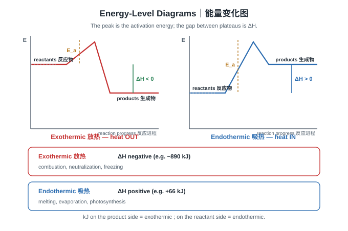
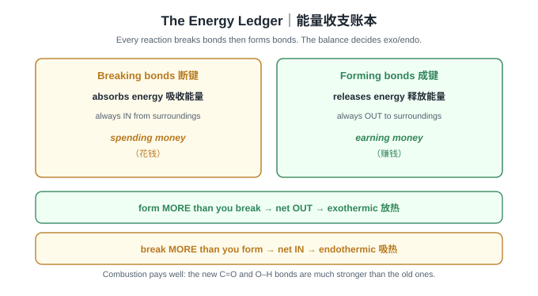
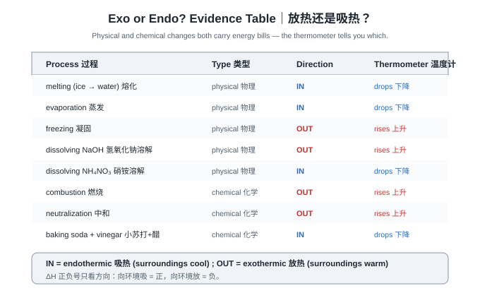
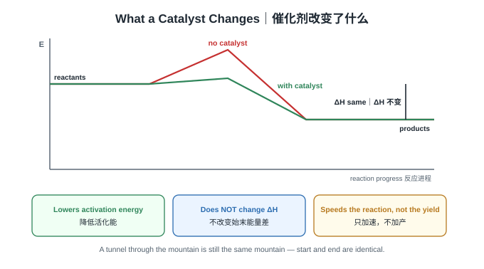

# Ch.11 — Energy Changes in Physical and Chemical Processes

## Chapter 11 · Energy Changes｜第 11 章　物理与化学过程中的能量变化

> 🗂️ **Scope note｜范围说明**：This chapter treats energy changes **qualitatively** — classification, energy-level diagrams, sign conventions. Calorimetry calculations (q = mcΔT), precise ΔH values and Hess's law belong to Chemistry 12.｜本章只做能量的**定性**处理——分类、能量图、符号约定。量热计算（q = mcΔT）、精确 ΔH 与盖斯定律属于 Chemistry 12。

## 1. Content Alignment｜大纲对应

| Item｜项目 | Detail｜细节 |
|---|---|
| Big Idea｜核心概念 | **B4** — *Matter and energy are conserved in chemical reactions.*（能量侧面）｜（能量守恒侧面） |
| Content｜内容标准 | school Unit 4: "Describe energy changes that occur during a physical or chemical change"; C4 qualitative support｜学校 Unit 4：描述物理或化学变化中的能量变化；C4 定性支撑 |
| Curricular Competencies｜课程能力 | Processing and analyzing（温度-时间数据）· Evaluating（数据缺陷识别）· Communicating（能量图绘制） |
| Chapters before｜前置章节 | Ch.9 combustion（放热的化学例）；Ch.10 守恒的记账习惯 |
| Chapters after｜后继章节 | Ch.12 溶解三步的能量视角；Ch.14 分析中的能量证据（焰色） |

## 2. Learning Objectives｜学习目标

**By the end of this chapter you can｜学完本章你要能做到：**

1. Classify processes — physical **and** chemical — as exothermic or endothermic using thermometer evidence.｜用温度计证据把物理与化学过程判定为放热或吸热。
2. Draw and interpret energy-level diagrams including the activation energy peak.｜绘制并解读含活化能峰的能量变化图。
3. Explain energy changes microscopically: bond breaking absorbs, bond forming releases.｜微观解释：断键吸能、成键放能。
4. Read thermochemical notation: heat as a product or reactant, ΔH signs.｜读热化学表示法：热量写在生成物侧或反应物侧、ΔH 符号。
5. State what a catalyst changes and what it does not.｜说出催化剂改变了什么、没改变什么。

## 3. Concept Explanations｜概念解析

### 3.1 Two Conservation Sides Meet｜守恒的两个侧面会师

Ch.9–10 tracked **matter**: atoms rearrange, nothing lost. This chapter tracks **energy**: it changes form and flows between system and surroundings, but it is never created or destroyed. Together they are B4.

**中文**：第 9–10 章追踪**物质**：原子重排、总量不减。本章追踪**能量**：它在系统与环境之间流动、转化，但从不凭空产生或消失。两者合起来就是 B4。

- **Exothermic（放热）**: energy flows OUT to the surroundings — thermometer rises.｜能量流向环境——温度计上升。
- **Endothermic（吸热）**: energy flows IN from the surroundings — thermometer falls.｜能量从环境流入——温度计下降。

Both physical changes (melting, evaporating, dissolving) and chemical reactions carry energy bills; the school course asks you to treat both sides equally.

**中文**：物理变化（熔化、蒸发、溶解）与化学反应都有能量账单；学校大纲要求两边一视同仁。

### 3.2 The Energy-Level Diagram｜能量变化图

One picture (Fig. 11-1) carries everything: reactant plateau, the **activation energy（活化能）** peak, product plateau, and ΔH as the gap between plateaus:

**中文**：一张图（图 11-1）承载全部：反应物平台、**活化能**峰、生成物平台、ΔH 就是平台之差：

- Exothermic: products sit LOWER; ΔH negative; heat written on the product side.｜放热：生成物更低；ΔH 为负；热量写在生成物侧。
- Endothermic: products sit HIGHER; ΔH positive; heat written on the reactant side.｜吸热：生成物更高；ΔH 为正；热量写在反应物侧。

> 💡 **Key Insight｜关键洞察**：The peak is not the energy change — it is the *barrier*. Its height decides the reaction's pace and its ignition requirement, not its overall exo/endo direction.｜峰不是能量变化，是**路障**。它决定反应快慢与点火需求，不决定放热还是吸热。

### 3.3 The Microscopic Ledger｜微观账本

Every reaction first **breaks** bonds (absorbs energy) then **forms** bonds (releases energy) (Fig. 11-2):

**中文**：每个反应先**断键**（吸能）再**成键**（放能）（图 11-2）：

- break more than you form → net absorption → endothermic｜断的多 → 净吸 → 吸热
- form more than you break → net release → exothermic｜成的多 → 净放 → 放热

Combustion pays well: the C=O and O–H bonds formed are far stronger than the ones broken — that surplus is the flame.

**中文**：燃烧的"生意"很好：生成的 C=O 与 O–H 键比断掉的键强得多——差额就是火焰。

### 3.4 Thermochemical Notation, Qualitatively｜热化学表示法·定性读法

```
exothermic:    CH₄ + 2 O₂ → CO₂ + 2 H₂O + 890 kJ   (heat as product)
               ΔH = −890 kJ/mol
endothermic:   2 KClO₃ → 2 KCl + 3 O₂    ΔH positive; heat on the left
```

The sign convention: ΔH negative = energy left the system = exothermic. A negative number is not "energy lost" — it was delivered to the surroundings; conservation holds.

**中文**：符号约定：ΔH 负 = 能量离开系统 = 放热。负号不是"能量丢了"——是交给环境了；守恒不变。

### 3.5 Catalysts Change the Road, Not the Destination｜催化剂改路，不改终点

A catalyst provides a lower-energy pathway: smaller activation energy, faster reaction, unchanged ΔH (Fig. 11-4). It is not consumed and does not appear in the overall equation.

**中文**：催化剂提供一条更低能量的路径：活化能变小、反应变快、ΔH 不变（图 11-4）。它不被消耗，也不写进总方程式。

> 🔭 **Extension｜超纲**【Extension → Chemistry 12】：q = mcΔT calorimetry, bond-energy ΔH bookkeeping, and Hess's law turn this chapter's pictures into precise numbers.｜量热计算、键能法求 ΔH 与盖斯定律会把本章的"图"变成精确的"数"。

## 4. Comparison Tables｜表格比对

### Table 11-1　Exothermic vs Endothermic｜放热 vs 吸热

| Feature｜特征 | Exothermic 放热 | Endothermic 吸热 |
|---|---|---|
| Energy flow｜能量流向 | OUT to surroundings 流向环境 | IN from surroundings 来自环境 |
| Thermometer｜温度计 | rises 上升 | falls 下降 |
| ΔH sign｜符号 | negative 负 | positive 正 |
| Heat position in equation｜热量位置 | product side 生成物侧 | reactant side 反应物侧 |
| Examples｜例子 | combustion, neutralization, freezing 燃烧、中和、凝固 | melting, evaporating, NH₄NO₃ dissolving 熔化、蒸发、硝铵溶解 |

### Table 11-2　Physical vs Chemical Energy Changes｜物理 vs 化学能量变化

| Change｜变化 | Example｜例 | Energy role｜能量角色 |
|---|---|---|
| physical 物理 | melting ice 冰熔化 | particles separate; forces weaken｜粒子分离、作用减弱 |
| physical 物理 | dissolving NaOH 氢氧化钠溶解 | hydration releases strongly｜水合强放热 |
| chemical 化学 | combustion 燃烧 | new bonds much stronger｜新键强得多 |
| chemical 化学 | baking soda + vinegar 小苏打+醋 | products' bonds weaker｜产物键较弱 |

### Table 11-3　What a Catalyst Does / Does Not Change｜催化剂改变/不改变

| Changed｜改变 | Not changed｜不改变 |
|---|---|
| activation energy 活化能 | ΔH (start-to-finish gap) 始末能量差 |
| reaction rate 反应速率 | product yield 平衡前的极限产量（本阶段：不增产） |
| pathway 路径 | the catalyst itself 催化剂自身 |

## 5. Diagrams & Worked Examples｜图例说明

### Fig. 11-1　Energy-Level Diagrams｜能量变化图



### Fig. 11-2　The Energy Ledger｜能量收支账本



### Fig. 11-3　Exo or Endo? Evidence Table｜放热还是吸热证据表



### Fig. 11-4　What a Catalyst Changes｜催化剂改变了什么



### Example 11-1　Classify From Data｜由数据归类

**Question**: A student dissolves 5 g of NH₄NO₃ in 50 mL of water; the temperature drops from 21.0 °C to 14.5 °C. Classify the process and draw the energy-level diagram qualitatively.

**中文**：5 g NH₄NO₃ 溶于 50 mL 水，温度从 21.0 °C 降到 14.5 °C。判定过程类型并定性画出能量图。

**Solution｜解**: Heat flowed from surroundings into the system (thermometer fell) → **endothermic**; products (dissolved ions) sit HIGHER than reactants; ΔH positive.

**中文**：热量由环境流入系统（温度计下降）→ **吸热**；生成物（已溶离子）平台更高；ΔH 为正。*(4 marks: 2 classification with evidence, 2 correct diagram.)*

**中文**：*(4 分：有证据的判定 2 分、图正确 2 分。)*

### Example 11-2　Spot the Wrong Diagram｜找错图

**Question**: A peer's diagram shows an exothermic reaction whose product plateau is *above* the reactant plateau, labelled "ΔH = −200 kJ". Identify both errors and redraw verbally.

**中文**：某同学的图把放热反应的生成物平台画在反应物**上方**，还标 "ΔH = −200 kJ"。指出两处错误并口头重画。

**Solution｜解**: Error 1: exothermic requires products lower. Error 2: with products higher the ΔH would be positive; −200 kJ contradicts the drawing. Correct: products lower, ΔH negative, peak (E_a) between them.

**中文**：错一：放热应生成物更低。错二：若生成物更高 ΔH 应为正，与 −200 kJ 自相矛盾。正确画法：生成物更低、ΔH 负、峰在中间。*(4 marks｜4 分)*

## 6. Key Vocabulary｜核心词汇

| English | 中文 | Note｜备注 |
|---|---|---|
| exothermic | 放热的 | heat OUT; ΔH negative｜放热、ΔH 负 |
| endothermic | 吸热的 | heat IN; ΔH positive｜吸热、ΔH 正 |
| activation energy (E_a) | 活化能 | barrier height 峰高｜点火所需 |
| energy-level diagram | 能量变化图 | plateaus + peak + ΔH｜平台+峰+ΔH |
| thermochemical equation | 热化学方程式 | heat as product or reactant｜热量当产物/反应物写 |
| enthalpy change (ΔH) | 焓变 | concept level only here｜此处只需概念 |
| bond breaking / forming | 断键/成键 | absorb / release｜吸 / 放 |
| system / surroundings | 系统/环境 | energy flows between them｜能量在其间流动 |
| physical change | 物理变化 | no new substance 无新物质 |
| chemical change | 化学变化 | new substance(s) formed 有新物质 |
| catalyst | 催化剂 | lowers E_a only｜只降活化能 |

## 7. Lab / Activity｜实验与活动

### Activity 11-1　Four-Process Temperature Sweep｜温度曲线四连测

**Do it｜操作**: Record temperature-time curves for four processes: NaOH dissolving (exo), NH₄NO₃ dissolving (endo), acid + base neutralization (exo), baking soda + vinegar (endo). Sketch each curve and classify.

**中文**：记录四个过程的温度-时间曲线：NaOH 溶解（放热）、NH₄NO₃ 溶解（吸热）、酸碱中和（放热）、小苏打+醋（吸热）。画曲线并归类。`[Processing and analyzing]`

### Activity 11-2　Cold Pack Autopsy｜冷暖袋拆解

**Do it｜操作**: Read an instant cold pack's ingredient list (water + NH₄NO₃ pouch), link each to its reaction class, and design a "safer or greener" alternative with justification.

**中文**：读一款速冷袋的成分表（水袋 + NH₄NO₃ 袋），把成分对应到反应类型，并设计一个"更安全或更环保"的替代方案并说理。`[Applying and innovating]`

### Activity 11-3　Diagram Assembly Line｜能量图拼装

**Do it｜操作**: Six process cards (freezing, sweating, neutralization, photosynthesis, combustion, wax melting). Pairs draw the energy diagram for each and cross-check labels (plateaus, peak, ΔH sign).

**中文**：六张过程卡（凝固、出汗、中和、光合、燃烧、蜡熔化）。两人一组画能量图并互查标注（平台、峰、ΔH 符号）。`[Communicating]`

## 8. Common Misconceptions｜常见易错点

| # | Misconception｜错误认识 | Correction｜正确理解 |
|---|---|---|
| 1 | "If it needs a flame to start, it must be endothermic."｜要点燃就是吸热反应。 | Ignition supplies the **activation energy**; the reaction itself releases far more than it takes.｜点火提供的是**活化能**；反应本身净放热远大于吸。 |
| 2 | "ΔH is negative, so energy disappeared — conservation broken?"｜ΔH 负能量就少了，不守恒？ | Negative means energy left for the **surroundings**; the universe's total is unchanged.｜负号表示能量交给了**环境**；总账不变。 |
| 3 | "Physical changes have no energy change."｜物理变化没有能量变化。 | Melting, evaporating and dissolving all absorb or release heat — the thermometer proves it.｜熔化、蒸发、溶解都吸放热——温度计就是证据。 |
| 4 | "A catalyst reduces the heat released."｜催化剂减少放热总量。 | It lowers the peak (E_a) only; the plateau gap ΔH is untouched.｜只削峰（活化能）；平台差 ΔH 不动。 |
| 5 | "The activation energy is the gap between products and reactants."｜活化能就是两平台之差。 | E_a is peak **minus reactants**; ΔH is products **minus reactants**.｜活化能 = 峰 − 反应物；ΔH = 生成物 − 反应物。 |
| 6 | "Endothermic means cold forever."｜吸热反应会一直冷下去。 | The system absorbs until mixing/confinement ends and thermal equilibrium returns.｜系统吸热到过程结束，最终与室温平衡。 |
| 7 | "Products in an exothermic diagram can still be drawn higher if ΔH is labelled negative."｜图和标签各写各的。 | The diagram and the sign must agree — inconsistent diagrams are marked wrong even with a correct label.｜图与符号必须一致；自相矛盾的图即使标签对也算错。 |
| 8 | "Bond breaking releases energy because bonds 'snap'."｜断键"啪"一声放能。 | Breaking bonds always **costs** energy; it is forming new bonds that pays it back.｜断键永远**花费**能量；是成键把它赚回来。 |
| 9 | "A catalyst is consumed slowly, like fuel."｜催化剂会被慢慢消耗。 | A catalyst is regenerated each cycle; it may need cleaning/replacing, but it is not a reagent.｜催化剂每轮再生；可能需要清洗更换，但不是反应物。 |
| 10 | "Heat and temperature are the same thing."｜热量就是温度。 | Heat is energy in transit; temperature is a readout of average particle motion. A big ice bath is cold but holds lots of energy.｜热是传递中的能量；温度是粒子平均运动的读数。大冰槽很冷但含能不少。 |
| 11 | "Neutralization always feels hot no matter the amounts."｜中和不管多少都烫。 | Temperature *change* depends on amount and concentration; small dilute samples barely register.｜温度变化取决于用量与浓度；稀少量变化很小。 |
| 12 | "Energy diagrams are only for chemical reactions."｜能量图只给化学反应用。 | Physical changes (state changes, dissolving) get the same diagrams — the school course asks for both.｜物理变化（相变、溶解）用同款图——学校大纲两边都要。 |

## 9. Assessment｜答题评估

### Part A: Foundational｜基础题（10 × 2 = 20 points）

**A1.** Define exothermic and endothermic in terms of energy flow and thermometer behaviour.

- **中文**：用能量流向与温度计表现定义放热与吸热。

**A2.** Classify: (a) ice melting; (b) freezing juice; (c) burning paper.

- **中文**：分类：(a) 冰熔化；(b) 果汁凝固；(c) 纸燃烧。

**A3.** In an energy-level diagram, what does the peak represent?

- **中文**：能量图中的"峰"代表什么？

**A4.** Draw the qualitative energy-level diagram for an endothermic process; label plateaus, peak, ΔH.

- **中文**：定性画出吸热过程的能量图；标注平台、峰、ΔH。

**A5.** Write the general thermochemical form of an exothermic equation in two ways (heat-in-equation and ΔH).

- **中文**：用两种写法（热量入式与 ΔH）写出放热方程式的一般形式。

**A6.** Microscopic view: why is bond formation exothermic?

- **中文**：微观视角：为什么成键放热？

**A7.** A catalyst lowers E_a from 120 kJ to 80 kJ. What happens to ΔH if it was −50 kJ?

- **中文**：催化剂把活化能从 120 kJ 降到 80 kJ，原来 ΔH = −50 kJ，现在 ΔH 是多少？

**A8.** Give one physical-change example of an endothermic process from everyday life.

- **中文**：给一个日常生活中吸热物理变化的例子。

**A9.** Why does a cold pack work only once?

- **中文**：为什么冷袋只能用一次？

**A10.** Classify dissolving NH₄NO₃ vs dissolving NaOH, and name the instrument evidence.

- **中文**：判定 NH₄NO₃ 与 NaOH 溶解的类型，并指出仪器证据。

### Part B: Applied｜应用题（4 × 5 = 20 points）

**B1.** A hand warmer contains iron powder, water, salt and activated carbon. Exposure to air warms it. (a) Name the reaction class and write the main equation. (b) Explain the salt's role qualitatively. (c) Explain why this is exothermic using bonds.

- **中文**：某暖手宝含铁粉、水、盐和活性炭，接触空气即发热。(a) 指出反应类型并写主方程式。(b) 定性解释盐的作用。(c) 用键的观点解释为何放热。

**B2.** Sketch and interpret the temperature-time curve you would record for NH₄NO₃ dissolving in water, marking initial temperature, minimum, and the recovery trend; state the classification and one data-quality concern.

- **中文**：画出 NH₄NO₃ 溶于水的温度-时间曲线示意并解读，标出初温、最低点与回升趋势；给出判定与一条数据质量隐患。

**B3.** Two students draw diagrams for the same reaction. Ava: products lower, ΔH labelled −120 kJ. Ben: products higher, ΔH labelled −120 kJ. Whose diagram is self-consistent, and what does Ben's drawing actually describe?

- **中文**：两个学生画同一反应的图。Ava：生成物更低、标 ΔH = −120 kJ。Ben：生成物更高、标 ΔH = −120 kJ。谁的图自洽？Ben 画的其实是哪种过程？

**B4.** Photosynthesis (6 CO₂ + 6 H₂O → C₆H₁₂O₆ + 6 O₂) absorbs energy from light. (a) Classify it. (b) Draw its energy diagram qualitatively (light on the reactant side). (c) Explain the role of chlorophyll using the catalyst idea.

- **中文**：光合作用（6 CO₂ + 6 H₂O → C₆H₁₂O₆ + 6 O₂）从光吸能。(a) 分类。(b) 定性画能量图（光写在反应物侧）。(c) 用催化剂的观点解释叶绿素的角色。

### Part C: Challenge｜挑战题（2 × 10 = 20 points）

**C1.** Design a procedure to classify four unknown white solids (dissolving in water exo or endo) using only a thermometer, water and a styrofoam cup, including: variables to control, the evidence table you will build, two error sources ranked by importance, and the criterion for "inconclusive". *(Design 5 + table 2 + errors 2 + criterion 1)*

- **中文**：只用温度计、水和泡沫杯，设计区分四种白色固体溶于水是放热还是吸热的方案，包括：需控制的变量、要建的证据表、按重要性排序的两个误差来源、"无法判定"的判据。*(设计 5 + 表 2 + 误差 2 + 判据 1)*

**C2.** An online post claims: "This catalyst makes burning fuel release MORE energy per gram." (a) Use the energy-diagram model to evaluate the claim's mechanism. (b) Identify what the catalyst actually changes and one benefit it still brings. (c) Rewrite the post into a scientifically defensible sentence. *(4 + 3 + 3 marks)*

- **中文**：某网帖称："这种催化剂让每克燃料释放更多能量。"(a) 用能量图模型评估该说法的机制。(b) 指出催化剂实际改变什么、以及它仍然带来的一个好处。(c) 把帖子改写成一句科学上站得住的话。*(4 + 3 + 3 分)*

### Answer Key｜参考答案

**Part A**

- **A1.** Exothermic: energy flows to surroundings, thermometer rises. Endothermic: energy absorbed from surroundings, thermometer falls.

  - **中文**：放热：能量流向环境，温度计上升；吸热：从环境吸能，温度计下降。

- **A2.** (a) endothermic (b) exothermic (c) exothermic.

  - **中文**：(a) 吸热 (b) 放热 (c) 放热。

- **A3.** The activation energy — the maximum-energy arrangement along the pathway, measured from the reactant plateau.

  - **中文**：活化能——路径中能量最高的排布，从反应物平台起量。

- **A4.** Reactants low, products higher, peak above both; ΔH = products − reactants > 0.

  - **中文**：反应物低、生成物更高、峰在两者之上；ΔH > 0。

- **A5.** e.g. A + B → C + heat; or A + B → C with ΔH = −x kJ.

  - **中文**：如 A + B → C + 热量；或 A + B → C，ΔH = −x kJ。

- **A6.** Forming a bond lets particles drop into a lower-energy arrangement; the surplus energy is released to the surroundings.

  - **中文**：成键让粒子落到更低能量的排布；多余能量交给环境。

- **A7.** ΔH stays −50 kJ — catalysts change E_a, not ΔH.

  - **中文**：ΔH 仍是 −50 kJ——催化剂改活化能，不改 ΔH。

- **A8.** E.g. sweat evaporating cools skin; ice melting in a drink chills it.

  - **中文**：如汗液蒸发带走皮肤热量；冰块化在饮料里吸热降温。

- **A9.** The dissolving is single-use: once the solute has dissolved and equilibrium is reached, no further net absorption is available.

  - **中文**：溶解是一次性的：溶质溶完、达到平衡后就没有继续净吸热的余地。

- **A10.** NH₄NO₃: endothermic (temperature falls); NaOH: exothermic (temperature rises). Evidence: thermometer.

  - **中文**：NH₄NO₃ 吸热（降温）、NaOH 放热（升温）；证据是温度计。

**Part B**

- **B1.** (a) oxidation/rusting class: 4 Fe + 3 O₂ → 2 Fe₂O₃ (with xH₂O). (b) Salt makes the water electrolytic, speeding electron/ion flow — a "catalyst-like" role (corrosion accelerant). (c) Fe–O bonds formed in the oxide are much stronger than the metallic bonds broken; net release = heat.

  - **中文**：(a) 氧化（生锈）类：4 Fe + 3 O₂ → 2 Fe₂O₃（可带 xH₂O）。(b) 盐使水导电，加速电子/离子流动——类似"催化剂"的角色（腐蚀加速剂）。(c) 氧化物里生成的 Fe–O 键远强于被断的金属键；净放热。

- **B2.** Curve: starts near 21 °C, dips to a minimum as NH₄NO₃ dissolves, then drifts back toward room temperature. Classification: endothermic. Data concern: heat exchange with the cup/air during the dip causes under-reading of the true ΔT.

  - **中文**：曲线：从约 21 °C 出发，溶解时降至最低，随后向室温回升。判定：吸热。数据隐患：杯壁/空气换热会让最低点偏低、ΔT 读不准。

- **B3.** Ava's diagram is self-consistent (products lower + ΔH negative). Ben's drawing actually describes an endothermic process; his −120 kJ label contradicts it.

  - **中文**：Ava 自洽（生成物更低 + ΔH 负）。Ben 画的其实是吸热过程；−120 kJ 的标注与图矛盾。

- **B4.** (a) Endothermic overall (light energy absorbed). (b) Reactants low with "light" on the left, products (glucose + O₂) higher, ΔH positive. (c) Chlorophyll is not consumed; it enables the energy-absorption pathway — catalyst-like (strictly, a photosensitizer; the catalyst *idea* is the accepted qualitative analogy).

  - **中文**：(a) 总体吸热（吸收光能）。(b) 反应物低、"光"写在左侧，产物（葡萄糖+O₂）更高，ΔH 为正。(c) 叶绿素不被消耗，为吸能提供通路——类似催化剂（严格说是光敏剂；在本阶段用催化剂概念作定性类比即可）。

**Part C**

- **C1.** Design points: same water volume and initial temperature for every trial; same solid mass; stir consistently; thermometer kept in liquid; measure initial temp before adding, record minimum/maximum within a fixed window. Evidence table: solid, T_i, T_min/max, ΔT, classification. Errors: (1) heat exchange with cup/air (largest), (2) unequal dissolution times making windows incomparable. Criterion for "inconclusive": |ΔT| within thermometer precision (e.g. ≤0.5 °C) — call it "no detectable change" rather than guessing.

  - **中文**：设计要点：每次水量、初温相同；固体质量相同；搅拌一致；温度计保持在液面下；加样前先记初温，固定时间窗内记录最高/最低点。证据表：固体、T_i、T_max/min、ΔT、分类。误差：(1) 杯壁与空气换热（最大）；(2) 各样品溶解时间不同导致时间窗不可比。"无法判定"判据：|ΔT| 在温度计精度内（如 ≤0.5 °C）——应写"无可检出变化"，不许硬猜。

- **C2.** (a) Mechanistically impossible: a catalyst reshapes the pathway (lowers E_a); the plateau gap ΔH — which *is* the energy released per the reaction as written — is fixed by the reactants and products, not the road. (b) It changes the rate, and a faster, more complete burn can improve *efficiency of delivery* (less unburned fuel/CO) — a real benefit, but not more energy per gram of fuel. (c) Defensible sentence: "This catalyst speeds combustion and reduces unburned fuel and CO emissions; the energy released per gram of fuel is unchanged."

  - **中文**：(a) 机制上不成立：催化剂只重塑路径（降低活化能）；而每克燃料的放热由 ΔH——即反应物与生成物的平台差——决定，与路径无关。(b) 它改变速率；更快的燃烧可以更完全（少排未燃燃料与 CO）——这是真好处，但不是"每克放更多能"。(c) 站得住的表述："该催化剂加快燃烧、减少未燃燃料与 CO 排放；每克燃料释放的能量不变。"*(4 + 3 + 3 分)*

### Rubric｜评分量规

| Band｜档 | Evidence required｜所需证据 |
|---|---|
| Full marks 满分 | Classification tied to instrument evidence; diagram labels self-consistent (plateaus, peak, ΔH); catalyst claims separated (E_a vs ΔH)｜判定绑定仪器证据；图标注自洽；催化剂两类效应分开说 |
| Partial 部分分 | Correct class but evidence vague, or diagram right but sign missing｜类型对但证据含糊，或图对但缺符号 |
| Minimal 最低分 | Classification by memory without evidence; diagram/sign contradiction｜凭记忆无证据分类；图与符号矛盾 |

## 10. Connection to the Big Idea｜回扣核心概念

> 🎯 **Big Idea B4｜核心概念 B4**：*Matter and energy are conserved in chemical reactions.*
> **中文**：化学反应中物质与能量守恒。

Ch.9–10 conserved the atoms; this chapter conserved the joules. The energy ledger closes the B4 loop: rearrangements cost and repay energy, and the balance — ΔH — goes to the surroundings without exception.

**中文**：第 9–10 章守住了原子，这一章守住了焦耳。能量账本让 B4 闭环：重排有花销也有回收，差额 ΔH 无一例外交给环境。

**How does this connect to the Big Idea?｜本章如何回扣核心概念？** Next chapter, the *dissolving* process reappears in solution chemistry (Ch.12) — the same energy ledger decides how well things dissolve, which is where B5 begins.

**中文**：下一章，"溶解"这个过程会在溶液化学（Ch.12）里重新出现——同一本能量账决定物质溶得有多好，那正是 B5 的起点。
