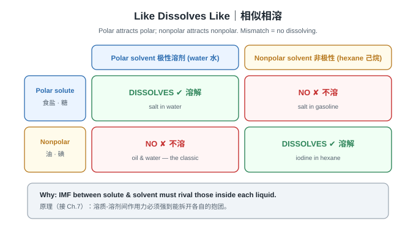
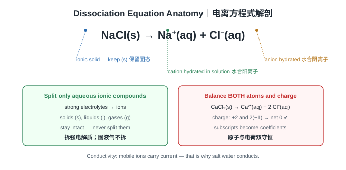
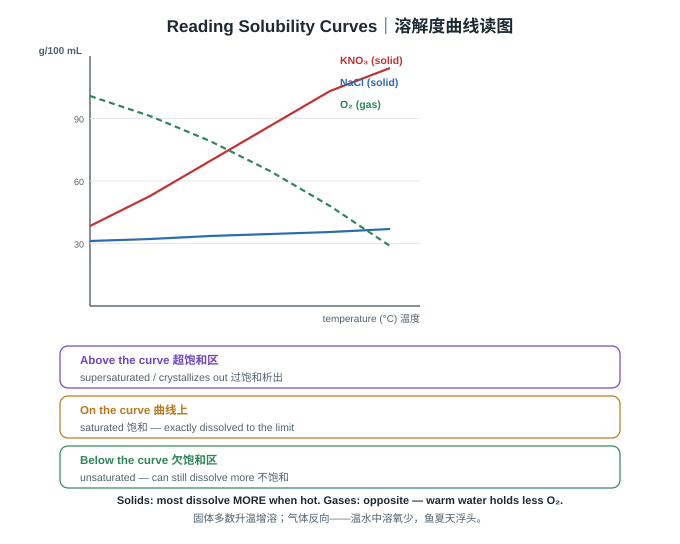
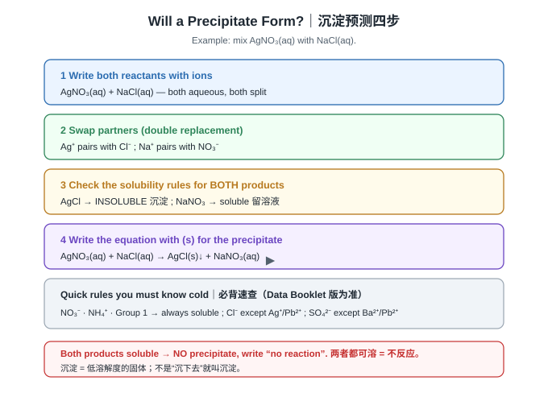

# Ch.12 — Solutions and Solubility

## Chapter 12 · Solutions and Solubility｜第 12 章　溶液与溶解度

> 🗂️ **Scope note｜范围说明**：This chapter covers official Content **C13**: solubility of molecular and ionic compounds. Solubility product (K_sp) is Chemistry 12.｜本章对应官方内容标准 C13：分子化合物与离子化合物的溶解度。溶度积（K_sp）属于 Chemistry 12。

## 1. Content Alignment｜大纲对应

| Item｜项目 | Detail｜细节 |
|---|---|---|
| Big Idea｜核心概念 | **B5** — *Solubility within a solution is determined by the nature of the solute and the solvent.*（本章直接主语） |
| Content C13｜内容标准 C13 | solubility of molecular and ionic compounds｜分子/离子化合物的溶解度 |
| Curricular Competencies｜课程能力 | Planning and conducting（溶解度曲线实测）· Evaluating（沉淀预测-验证）· Processing and analyzing（相似相溶矩阵） |
| Chapters before｜前置章节 | Ch.7 polarity & IMF（原理）；Ch.9 溶解性速查（规则初版）；Ch.11 溶解的能量账 |
| Chapters after｜后继章节 | Ch.13 浓度与溶液计量；Ch.14 沉淀检验作为分析技术 |

## 2. Learning Objectives｜学习目标

**By the end of this chapter you can｜学完本章你要能做到：**

1. Name the roles of solute and solvent and give examples in all three states.｜说出溶质与溶剂的角色，并举三态实例。
2. Explain "like dissolves like" using polarity and intermolecular forces from Ch.7.｜用 Ch.7 的极性与分子间作用力解释"相似相溶"。
3. Write dissociation equations with state symbols.｜书写带状态符号的电离方程式。
4. Apply the full solubility rules table to ionic compounds.｜对离子化合物应用完整溶解性规则表。
5. Read solubility curves: saturated/unsaturated regions, temperature effects, gas exception.｜读溶解度曲线：饱和/不饱和区、温度影响、气体的例外。
6. Predict whether a precipitate forms when two solutions mix, and justify it.｜预测两种溶液混合是否生成沉淀并说理。

## 3. Concept Explanations｜概念解析

### 3.1 What Counts as a Solution｜什么算溶液

A **solution（溶液）** is a homogeneous mixture: **solute（溶质）** dispersed in a **solvent（溶剂）**. The concept is broader than "solid in water":

**中文**：**溶液**是均一混合物：**溶质**分散在**溶剂**中。它远不止"固体溶进水"：

| Type｜类型 | Example｜例 |
|---|---|---|
| gas in gas | air 空气（O₂ in N₂） |
| gas in liquid | fizzy water 汽水（CO₂ in water） |
| liquid in liquid | vinegar 醋（acetic acid in water） |
| solid in liquid | salt water 盐水 |
| solid in solid | alloys 合金（brass = Zn in Cu） |

### 3.2 Dissolving in Three Energy Steps｜溶解的三步能量账

Building on Ch.11's ledger (all three steps together decide the heat you feel):

**中文**：接 Ch.11 的账本（三步之和决定你感到的热效应）：

1. solute particles separate — absorbs｜溶质粒子分离——吸
2. solvent particles separate — absorbs｜溶剂粒子分离——吸
3. solute and solvent combine — releases｜两者结合——放

NaOH: step 3 wins big → exothermic. NH₄NO₃: steps 1–2 win → endothermic. Same process, opposite bills — the nature of the particles decides.

**中文**：NaOH：第三步大赢 → 放热。NH₄NO₃：前两步赢 → 吸热。同为溶解、账单相反——由粒子本性决定。

### 3.3 Like Dissolves Like｜相似相溶

The B5 principle (Fig. 12-1): solvents dissolve solutes whose **intermolecular forces are similar** to their own.

**中文**：B5 落点（图 12-1）：溶剂会溶解**分子间作用力与自身相似**的溶质。

- Polar solvent (water 水) ← polar/ionic solutes (salt, sugar, ethanol)｜极性溶极性/离子
- Nonpolar solvent (hexane 己烷, paint thinner) ← nonpolar solutes (oil, grease, iodine)｜非极性溶非极性

This is why soap has a **hydrophilic head（亲水头）** and a **hydrophobic tail（疏水尾）** — one molecule bridging both worlds (Ch.3 preview paid off).

**中文**：这就是为什么肥皂带**亲水头**与**疏水尾**——一个分子横跨两个世界（Ch.3 的伏笔在此兑现）。

### 3.4 Ionic Compounds Dissolve by Dissociating｜离子化合物：电离式溶解

When an ionic solid enters water, ions leave the lattice and get hydrated:

**中文**：离子固体入水后，离子脱离晶格并被水合：

```
NaCl(s)  →  Na⁺(aq) + Cl⁻(aq)
CaCl₂(s) →  Ca²⁺(aq) + 2 Cl⁻(aq)     subscripts → coefficients 下标变系数
```

Mobile ions carry electric current — salt water conducts, pure water barely does (Fig. 12-2).

**中文**：可自由移动的离子能导电——盐水导电，纯水几乎不导。

### 3.5 The Solubility Rules (Full Table)｜溶解性规则·全表

| Ion｜离子 | Soluble?｜溶解性 | Exceptions｜例外 |
|---|---|---|---|
| NO₃⁻, CH₃COO⁻ | all soluble 全溶 | none |
| Cl⁻, Br⁻, I⁻ | soluble | Ag⁺, Pb²⁺, Hg₂²⁺ |
| SO₄²⁻ | soluble | Ba²⁺, Pb²⁺, Sr²⁺; Ca²⁺, Ag⁺ slightly 微溶 |
| OH⁻ | insoluble 不溶 | Group 1, Ba²⁺, Sr²⁺; Ca²⁺ slightly 微溶 |
| CO₃²⁻, PO₄³⁻, S²⁻, SO₃²⁻ | insoluble | Group 1, NH₄⁺ |

"Insoluble" means **low solubility**, not literally zero — traces still dissolve.｜"不溶"指**低溶解度**，不是绝对为零——痕量仍然溶解。

### 3.6 Solubility Curves｜溶解度曲线

A solubility curve (Fig. 12-3) plots dissolved mass per fixed solvent against temperature:

**中文**：溶解度曲线（图 12-3）画出每份固定溶剂中溶质质量随温度的变化：

- **Below the curve** 不饱和: more can dissolve｜还能再溶
- **On the curve** 饱和: exactly at the limit｜恰好到限
- **Above the curve** 过饱和: unstable excess, crystallizes on disturbance｜不稳定超额，一触即析晶

Most solids dissolve more when hot; **gases are the opposite** — warm water holds less O₂, which is why fish gasp at the surface in warm, stagnant weather.

**中文**：多数固体升温增溶；**气体相反**——温水溶氧少，闷热天鱼在水面张口喘。

### 3.7 Predicting Precipitates｜沉淀预测

Mix two clear solutions → swap partners → check the rules (Fig. 12-4). If either new pair has low solubility, it leaves the solution as a solid — a **precipitate（沉淀）**.

**中文**：混合两种澄清溶液 → 交换成分 → 查规则（图 12-4）。任一新组合低溶解度，它就以固体离开溶液——即**沉淀**。

> 🔭 **Extension｜超纲**【Extension → Chemistry 12】：The solubility product K_sp quantifies "how insoluble" and enables exact prediction of when precipitation begins. Chemistry 11 works with the qualitative rules.｜溶度积 K_sp 给"有多不溶"定量，并精确预测沉淀开始的时机。Chemistry 11 用定性规则即可。

## 4. Comparison Tables｜表格比对

### Table 12-1　Saturated vs Unsaturated vs Supersaturated｜饱和/不饱和/过饱和

| State｜状态 | Meaning｜含义 | Behaviour｜行为 |
|---|---|---|---|---|
| unsaturated 不饱和 | below the limit 未达上限 | accepts more solute 可继续溶 |
| saturated 饱和 | exactly at the limit（with excess solid present）恰好达限（有剩余固体共存） | dissolving = crystallizing 溶解=析晶动态平衡 |
| supersaturated 过饱和 | beyond the limit 超过上限 | unstable; seed crystal triggers crystallization 不稳定，投晶种即析 |

### Table 12-2　Temperature Effects｜温度影响

| Solute｜溶质 | Warming does…｜升温后 | Example consequence｜后果 |
|---|---|---|---|
| most solids 多数固体 | solubility ↑ | recrystallization by cooling 冷却结晶提纯 |
| a few solids（Ce₂(SO₄)₃） | solubility ↓ | rare cases 少数例外 |
| gases 气体 | solubility ↓ | warm water → fish gasp 温水缺氧鱼浮头 |

### Table 12-3　"Soluble" vs "Concentrated"｜“可溶”vs“浓”

| Concept｜概念 | Belongs to｜属于 | Depends on｜取决于 |
|---|---|---|---|
| solubility 溶解度 | the pair 溶质-溶剂对 | temperature, at saturation 饱和态+温度 |
| concentration 浓度 | a particular solution 某份溶液 | how much was added 加了多少（Ch.13） |
| saturated 饱和 | a particular solution | vs the curve 是否到线 |

### Table 12-4　Precipitation Diagnosis｜沉淀诊断卡

| Mixing｜混合 | New pairs｜新组合 | Verdict｜判定 |
|---|---|---|---|
| AgNO₃ + NaCl | AgCl, NaNO₃ | AgCl insoluble → white ppt 白沉 |
| BaCl₂ + Na₂SO₄ | BaSO₄, NaCl | BaSO₄ insoluble → white ppt |
| KNO₃ + NaCl | KCl, NaNO₃ | both soluble → no reaction 不反应 |
| NaOH + CuSO₄ | Cu(OH)₂, Na₂SO₄ | Cu(OH)₂ insoluble → blue ppt 蓝沉 |

## 5. Diagrams & Worked Examples｜图例说明

### Fig. 12-1　Like Dissolves Like｜相似相溶



### Fig. 12-2　Dissociation Anatomy｜电离方程式解剖



### Fig. 12-3　Reading Solubility Curves｜溶解度曲线读图



### Fig. 12-4　Will a Precipitate Form?｜沉淀预测四步



### Example 12-1　Write the Dissociation Equation｜写电离方程式

**Question**: Write the dissociation equation for aluminium sulfate, Al₂(SO₄)₃.

**中文**：写出硫酸铝 Al₂(SO₄)₃ 的电离方程式。

**Solution｜解**:

```
Al₂(SO₄)₃(s) → 2 Al³⁺(aq) + 3 SO₄²⁻(aq)
charge check: 2(+3) + 3(−2) = 0 ✔
```

*(4 marks: 1 ions, 1 coefficients from subscripts, 1 state symbols, 1 charge check.)*

**中文**：*(4 分：离子 1、下标变系数 1、状态符号 1、电荷自查 1。)*

### Example 12-2　Predict the Precipitate｜预测沉淀

**Question**: Solutions of lead(II) nitrate and potassium iodide are mixed. Predict any precipitate and write the full equation.

**中文**：硝酸铅与碘化钾溶液混合。预测沉淀并写出完整方程式。

**Solution｜解**: Swap → PbI₂ and KNO₃. KNO₃ soluble; iodides are soluble **except Pb²⁺** → PbI₂ forms (brilliant yellow):

```
Pb(NO₃)₂(aq) + 2 KI(aq) → PbI₂(s) + 2 KNO₃(aq)
```

*(5 marks: 1 swap, 2 rule application, 1 balanced equation, 1 observation.)*

**中文**：交换 → PbI₂ 与 KNO₃。KNO₃ 可溶；碘化物**除 Pb²⁺ 外**可溶 → 生成亮黄色 PbI₂ 沉淀。*(5 分：交换 1、查规则 2、配平 1、现象 1。)*

### Example 12-3　Read the Curve｜读曲线

**Question**: From Fig. 12-3: a saturated KNO₃ solution is prepared at 60 °C, then cooled to 20 °C. What happens, and why does the reverse (NaCl prepared hot, cooled) barely change?

**中文**：据图 12-3：60 °C 配制饱和 KNO₃ 溶液后降到 20 °C，会发生什么？为什么 NaCl 同样操作却几乎不变？

**Solution｜解**: KNO₃'s curve is steep — cooling from 60 to 20 °C moves far below the saturation limit, so the excess crystallizes out (this is purification by recrystallization). NaCl's curve is nearly flat, so cooling produces little or no crystallization.

**中文**：KNO₃ 曲线陡——降温使其远超饱和限，过量析晶（这正是重结晶提纯的原理）。NaCl 曲线近乎水平，降温几乎不析晶。*(4 marks｜4 分)*

## 6. Key Vocabulary｜核心词汇

| English | 中文 | Note｜备注 |
|---|---|---|
| solution | 溶液 | homogeneous mixture 均一混合物 |
| solute / solvent | 溶质/溶剂 | minority / majority 少/多 |
| dissolution | 溶解 | the process 过程 |
| dissociation | 电离（解离） | ionic solid → ions 离子固体拆离子 |
| hydrated ion | 水合离子 | surrounded by water 被水包围 |
| saturated / unsaturated | 饱和/不饱和 | on / below the curve 线上/线下 |
| supersaturated | 过饱和 | above the curve; unstable 线上之外、不稳定 |
| solubility curve | 溶解度曲线 | g per fixed solvent vs T｜每份溶剂克数对温度 |
| precipitate | 沉淀 | low-solubility solid formed 反应生成的低溶固体 |
| miscible | 互溶的 | two liquids mix fully 两液体全溶 |
| like dissolves like | 相似相溶 | polarity decides 极性决定 |
| hydrophilic / hydrophobic | 亲水/疏水 | soap's two ends 肥皂两端 |

## 7. Lab / Activity｜实验与活动

### Activity 12-1　Solubility Curve by Saturation Method｜饱和法测溶解度曲线

**Do it｜操作**: Add KNO₃ to a fixed mass of water at several temperatures until a trace of solid persists; record the dissolving temperature of each sample; assemble a class curve.

**中文**：在几个温度下向定量水中加 KNO₃ 至固体略有剩余；记录各样品恰好全溶的温度；汇总成班级曲线。`[Planning and conducting]`

### Activity 12-2　Precipitation Tournament｜沉淀预测-验证赛

**Do it｜操作**: Eight pairwise mixings of salt solutions. Predict (ppt + colour / no reaction) using the rules, then mix in a spot plate and score.

**中文**：8 组盐溶液两两混合。先按规则预测（沉淀+颜色/不反应），再点滴板实测打分。`[Evaluating]`

### Activity 12-3　Like-Dissolves-Like Matrix｜相似相溶演示矩阵

**Do it｜操作**: Try dissolving iodine, table salt and wax in water, ethanol and hexane; tabulate the nine results and attribute each to polarity.

**中文**：碘、食盐、蜡分别尝试溶于水、乙醇、己烷；列 9 格结果表并按极性归因。`[Processing and analyzing]`

## 8. Common Misconceptions｜常见易错点

| # | Misconception｜错误认识 | Correction｜正确理解 |
|---|---|---|---|
| 1 | "Solubility and concentration are the same."｜溶解度就是浓度。 | Solubility is a saturated-state property of the *pair*; concentration fits any solution (Ch.13).｜溶解度是"一对"溶质溶剂在饱和态的属性；浓度可以任意（Ch.13）。 |
| 2 | "All nitrates are slightly soluble."｜硝酸盐微溶。 | Nitrates are **always soluble** — the rules' easiest family.｜硝酸盐**全溶**——规则里最好记的一族。 |
| 3 | "Gases dissolve better in hot water."｜气体在热水里溶得多。 | Opposite: gas solubility falls as temperature rises — warm water holds less O₂.｜相反：升温气体溶解度下降——温水溶氧少。 |
| 4 | "NaCl → Na⁺ + Cl⁻ is a complete equation."｜这样写就完整了。 | State symbols belong: NaCl(s) → Na⁺(aq) + Cl⁻(aq).｜状态符号必须带：NaCl(s) → Na⁺(aq) + Cl⁻(aq)。 |
| 5 | "A saturated solution is always concentrated."｜饱和溶液一定是浓溶液。 | AgCl's saturated solution is extremely dilute — saturation is relative to the curve, not to concentration.｜AgCl 的饱和溶液极稀——饱和是对曲线而言，与浓稀无关。 |
| 6 | "'Insoluble' means nothing dissolves."｜"不溶"就是一点都不溶。 | It means **low solubility**; traces still dissolve, which is why precipitate tests work.｜指**低溶解度**；痕量仍溶解——沉淀检验正基于此。 |
| 7 | "Anything that sinks is a precipitate."｜沉底的就是沉淀。 | A precipitate is *formed by reaction*; pre-existing sand is not.｜沉淀由**反应生成**；原有的沙子不算。 |
| 8 | "Oil and water don't mix because water is 'too heavy'."｜油水不混是因为水重。 | Density decides floating, not miscibility. Oil is immiscible because it is nonpolar (B5).｜密度决定浮沉，不决定互溶。油不互溶因为非极性（B5）。 |
| 9 | "Supersaturated solutions are just concentrated."｜过饱和就是比较浓。 | Supersaturation exceeds the curve's limit — it is metastable and crystallizes on disturbance.｜过饱和超过曲线极限——亚稳态，扰动即析晶。 |
| 10 | "Heating always helps dissolving."｜加热总能助溶。 | For most solids yes; for gases no — and a few solids (rare) dissolve less when warm.｜多数固体成立；气体相反；个别固体升温反降。 |
| 11 | "Water is a universal solvent."｜水是万能溶剂。 | Water dissolves polar/ionic solutes; nonpolar greases need nonpolar solvents (that's why dry cleaning exists).｜水溶极性/离子；非极性油污要非极性溶剂（所以有干洗行业）。 |
| 12 | "Dissociation is the same as melting."｜电离就是熔化。 | Dissociating in water splits into ions in solution; melting keeps the substance's composition as a liquid.｜水中电离拆成离子；熔化只是变液态，组成不变。 |

## 9. Assessment｜答题评估

### Part A: Foundational｜基础题（10 × 2 = 20 points）

**A1.** Define solution, solute and solvent, and give one solid-in-solid example.

- **中文**：定义溶液、溶质、溶剂，并给一个"固体溶于固体"的例子。

**A2.** Write the dissociation equation of K₃PO₄ with state symbols.

- **中文**：写出 K₃PO₄ 的电离方程式（带状态符号）。

**A3.** State the "always soluble" ion families from the rules table.

- **中文**：写出规则表中"永远可溶"的离子家族。

**A4.** Which sodium salts are exceptions to the solubility rules? Explain why this question is a trick.

- **中文**：哪些钠盐是溶解性规则的例外？说明为什么这个问题是个"坑"。

**A5.** On a solubility curve, what does a point below the curve mean?

- **中文**：溶解度曲线下方的点表示什么？

**A6.** Why does warm water hold less dissolved oxygen? Relate to B5.

- **中文**：为什么温水溶氧少？联系 B5 说明。

**A7.** Predict: mixing KBr(aq) and AgNO₃(aq) — precipitate or not? Colour?

- **中文**：预测：KBr(aq) 与 AgNO₃(aq) 混合——有无沉淀？什么颜色？

**A8.** Explain "like dissolves like" in one sentence using the word polarity.

- **中文**：用一句话（含"极性"）解释"相似相溶"。

**A9.** Give the two ends of a soap molecule and what each likes.

- **中文**：指出肥皂分子的两端及各自亲和的对象。

**A10.** A saturated KNO₃ solution at 60 °C contains how much solute relative to the curve? What happens on cooling?

- **中文**：60 °C 的饱和 KNO₃ 溶液相对曲线处于什么位置？降温后怎样？

### Part B: Applied｜应用题（4 × 5 = 20 points）

**B1.** For each pair, predict the products and whether a reaction occurs: (a) Na₂CO₃(aq) + BaCl₂(aq); (b) NH₄Cl(aq) + NaNO₃(aq); (c) Pb(NO₃)₂(aq) + K₂SO₄(aq). Write full equations with state symbols for those that react.

- **中文**：逐对预测产物及是否反应：(a) Na₂CO₃ + BaCl₂；(b) NH₄Cl + NaNO₃；(c) Pb(NO₃)₂ + K₂SO₄。反应的写出带状态符号的完整方程式。

**B2.** A student heats 100 g of water with excess KNO₃ to 70 °C (curve value ≈ 138 g/100 g water), stirs until saturated, then cools to 20 °C (curve value ≈ 32 g/100 g water). (a) How much dissolves at 70 °C? (b) How much crystallizes on cooling? (c) Name one everyday process that uses exactly this principle.

- **中文**：学生用 100 g 水加过量 KNO₃ 加热到 70 °C（曲线值 ≈ 138 g/100 g 水），搅拌至饱和后降到 20 °C（曲线值 ≈ 32 g/100 g 水）。(a) 70 °C 溶多少？(b) 降温析出多少？(c) 举一个正好利用该原理的日常过程。

**B3.** An unknown clear solution gives a white precipitate with AgNO₃(aq) and no precipitate with NaOH(aq). Among NaCl, CaCl₂, and MgCl₂ candidates, identify it and justify each exclusion.

- **中文**：某未知澄清溶液加 AgNO₃(aq) 出白色沉淀，加 NaOH(aq) 无沉淀。在 NaCl、CaCl₂、MgCl₂ 候选中鉴定并逐一排除说理。

**B4.** Explain, in a four-step causal chain, why soapy water washes grease off a plate while plain water does not. Use the vocabulary: hydrophilic, hydrophobic, nonpolar, emulsion.

- **中文**：用四步因果链解释为什么肥皂水能洗掉盘上油污而清水不能。用上词汇：亲水、疏水、非极性、乳化。

### Part C: Challenge｜挑战题（2 × 10 = 20 points）

**C1.** Design and justify a procedure to purify a KNO₃ sample contaminated with a small amount of NaCl, using recrystallization. Reference the two curves' shapes, name the impurity's fate, and state one safety and one error consideration. *(5 + 2 + 2 + 1)*

- **中文**：设计并用曲线形状论证：如何用重结晶提纯混有少量 NaCl 的 KNO₃。说明杂质去向、一条安全与一条误差考虑。*(5 + 2 + 2 + 1)*

**C2.** A lake in early summer "turns over": warm surface water cools in autumn, and the whole lake mixes. Fish kills sometimes follow late-summer stagnation. Using gas solubility and curve reasoning, explain (a) why warm stagnant surface water stresses fish, (b) what autumn mixing does for O₂ distribution, and (c) one human activity that worsens the situation and the chemistry behind it. *(4 + 3 + 3)*

- **中文**：初夏的湖泊会在秋季"翻池"：表层水变凉，全湖混合。夏末停滞期有时出现死鱼。用气体溶解度与曲线原理解释：(a) 为什么温暖停滞的表层水让鱼受罪；(b) 秋季混合对 O₂ 分布做了什么；(c) 哪种人类活动会加剧此问题及其化学机理。*(4 + 3 + 3)*

### Answer Key｜参考答案

**Part A**

- **A1.** Solution: homogeneous mixture; solute: the dispersed (minor) component; solvent: the medium (major). Solid-in-solid: brass (Zn in Cu) or steel (C in Fe).

  - **中文**：溶液：均一混合物；溶质：分散的少数组分；溶剂：介质（多数）。固-固：黄铜（Zn 溶于 Cu）或钢（C 溶于 Fe）。

- **A2.** K₃PO₄(s) → 3 K⁺(aq) + PO₄³⁻(aq).

  - **中文**：K₃PO₄(s) → 3 K⁺(aq) + PO₄³⁻(aq)。

- **A3.** NO₃⁻, CH₃COO⁻ (acetate), NH₄⁺ salts, Group 1 metal cations' salts.

  - **中文**：NO₃⁻、CH₃COO⁻（醋酸根）、NH₄⁺ 盐、第 1 族金属阳离子的盐。

- **A4.** None — all sodium (Group 1) salts are soluble. It is a trick because exceptions apply to Cl⁻/SO₄²⁻/OH⁻ etc., never to the Group 1 cation side.

  - **中文**：没有——所有钠盐（第 1 族）全溶。坑在于例外都长在 Cl⁻/SO₄²⁻/OH⁻ 这些阴离子一端，永远不在第 1 族阳离子一端。

- **A5.** Unsaturated: the solution holds less than the limit at that temperature and can dissolve more.

  - **中文**：不饱和：该温度下所溶低于上限，还能继续溶。

- **A6.** Gas solubility falls as temperature rises; dissolved O₂ drops in warm water. B5: what dissolves depends on the nature of solute (O₂) and solvent (water) — and temperature shifts the balance.

  - **中文**：气体溶解度随升温下降；温水中 O₂ 减少。B5：能否溶解取决于溶质（O₂）与溶剂（水）的本性——温度会移动这个平衡。

- **A7.** Precipitate forms: AgBr, pale yellow (Br⁻ except Ag⁺; AgNO₃ all soluble).

  - **中文**：生成淡黄色 AgBr 沉淀（溴化物除 Ag⁺；AgNO₃ 全溶）。

- **A8.** Solvents dissolve solutes whose intermolecular forces (polarity) are similar to their own.

  - **中文**：溶剂会溶解分子间作用力（极性）与自身相似的溶质。

- **A9.** Hydrophilic head — likes polar water; hydrophobic tail — likes nonpolar grease.

  - **中文**：亲水头——亲和极性的水；疏水尾——亲和非极性油污。

- **A10.** On the curve (exactly saturated). On cooling, the excess above the new, lower limit crystallizes out.

  - **中文**：恰在曲线上（饱和）。降温后超出新限量的部分析晶。

**Part B**

- **B1.** (a) Na₂CO₃(aq) + BaCl₂(aq) → BaCO₃(s) + 2 NaCl(aq) — reacts (BaCO₃ insoluble). (b) No reaction — NH₄NO₃ and NaCl both soluble. (c) Pb(NO₃)₂(aq) + K₂SO₄(aq) → PbSO₄(s) + 2 KNO₃(aq) — reacts (PbSO₄ insoluble).

  - **中文**：(a) 反应，生成 BaCO₃ 沉淀。(b) 不反应——NH₄NO₃ 与 NaCl 都可溶。(c) 反应，生成 PbSO₄ 沉淀。

- **B2.** (a) 138 g dissolves at 70 °C. (b) On cooling to 20 °C only 32 g can stay dissolved → 138 − 32 = 106 g crystallizes. (c) Recrystallization purification; also rock candy making / mineral scale in kettles (reverse).

  - **中文**：(a) 70 °C 溶 138 g。(b) 20 °C 只能留 32 g → 析出 106 g。(c) 重结晶提纯；冰糖结晶/水壶水垢（反向）同理。

- **B3.** All three give AgCl with AgNO₃ (white) — so step 1 narrows nothing among the candidates. NaOH: Mg²⁺ and Ca²⁺ (slightly) form hydroxide precipitates; Na⁺ does not → answer: **NaCl**. Justification: NaOH insoluble-family exception covers Group 1, so NaOH(aq) + NaCl(aq) → no reaction.

  - **中文**：三者加 AgNO₃ 都出白色 AgCl——第一步在候选内无区分度。加 NaOH：Mg²⁺（及 Ca²⁺ 微溶）会生成氢氧化物沉淀，Na⁺ 不会 → 答案是 **NaCl**。理由：NaOH 的不溶族例外覆盖第 1 族，NaOH 与 NaCl 不反应。

- **B4.** Chain: (1) grease is nonpolar — water (polar) cannot pull it loose (like dissolves like fails); (2) soap's hydrophobic tails bury into the grease; (3) hydrophilic heads face outward, surrounding droplets of grease; (4) an emulsion forms and rinses away with water.

  - **中文**：链：(1) 油污非极性，极性的水拉不动它（相似相溶不成立）；(2) 肥皂疏水尾扎进油污；(3) 亲水头朝外把油滴围住；(4) 形成乳化液随水冲走。

**Part C**

- **C1.** Procedure: dissolve the mixture in the minimum hot water (KNO₃'s steep curve → high solubility when hot; NaCl's flat curve matters little at this stage); filter hot to remove insolubles; cool slowly — KNO₃ crashes out because the 20 °C limit is low, while NaCl (little present anyway, flat curve) stays dissolved; filter and wash crystals with a few drops of ice-cold water. Impurity fate: remains in the mother liquor. Safety: hot glassware; no open flames near the flammable-adjacent setup (if using hexane elsewhere). Error consideration: cooling too fast traps impurities/occluded mother liquor in the crystals.

  - **中文**：步骤：用最少量的热水溶解混合物（KNO₃ 曲线陡，热溶多；NaCl 曲线平，此阶段影响小）；趁热过滤除不溶物；缓慢冷却——KNO₃ 因 20 °C 上限低而大量析晶，NaCl（本身量少、曲线平）留在母液；过滤并用几滴冰水洗晶体。杂质去向：留在母液中。安全：热玻璃器皿烫手。误差：冷却过快会把杂质/母液包进晶体。

- **C2.** (a) Gas solubility falls with temperature: warm stagnant surface layers hold less O₂ per litre, while biological demand (decomposition) keeps consuming it → fish stress at the surface where they must feed/breathe. (b) Autumn cooling makes surface water denser; it sinks and the lake mixes, redistributing O₂-rich surface water and nutrients through the whole column. (c) E.g. fertilizer runoff → algal blooms → decomposition consumes even more O₂ (eutrophication) — the chemistry is that added nutrients feed aerobic decomposers whose O₂ demand outstrips the curve-limited supply.

  - **中文**：(a) 气体溶解度随温升下降：温暖停滞的表层每升水 O₂ 更少，而分解作用持续耗氧 → 鱼在必须觅食呼吸的表层受压。(b) 秋季降温使表层水变密下沉，全湖混合，把富氧表层水与营养盐重新分布到整个水柱。(c) 如化肥径流 → 藻类暴发 → 分解耗氧更多（富营养化）——化学机理是养分喂饱了好氧分解者，其 O₂ 需求超过曲线限制的供给。*(4 + 3 + 3)*

### Rubric｜评分量规

| Band｜档 | Evidence required｜所需证据 |
|---|---|---|
| Full marks 满分 | Rule cited by ion name, state symbols complete, curve reading with units and temperature, observation predicted｜按离子名引规则、状态符号齐全、曲线读数带单位与温度、预测现象 |
| Partial 部分分 | Correct verdict with wrong or missing exception｜判定对但例外记错/漏 |
| Minimal 最低分 | "Insoluble" treated as zero; density used to explain miscibility｜把"不溶"当绝对为零；用密度解释互溶 |

## 10. Connection to the Big Idea｜回扣核心概念

> 🎯 **Big Idea B5｜核心概念 B5**：*Solubility within a solution is determined by the nature of the solute and the solvent.*
> **中文**：溶液中的溶解度由溶质与溶剂的本性决定。

This chapter **is** B5 made operational: polarity and IMF (Ch.7) decide *whether*, the rules table decides *what precipitates*, and the curve decides *how much at a given temperature*. Nothing here is arbitrary — it is all particle nature.

**中文**：本章就是把 B5 变成操作手册：极性与分子间力（Ch.7）决定**溶不溶**，规则表决定**谁沉淀**，曲线决定**某温度下溶多少**。没有一条是规定——全都源于粒子本性。

**How does this connect to the Big Idea?｜本章如何回扣核心概念？** Ch.13 measures dissolved things precisely: the same solutes, now counted in moles per litre, feeding the analytical techniques of Ch.14.

**中文**：第 13 章把"溶进去了多少"精确量化：同样的溶质，现在按"每升多少摩尔"计数，并汇入 Ch.14 的分析技术。
