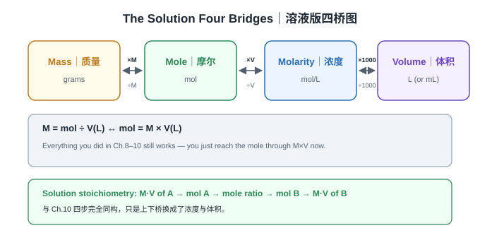
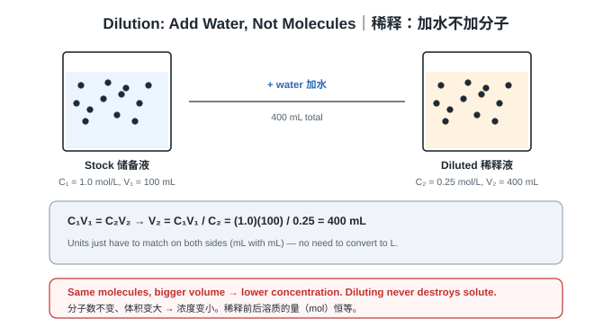
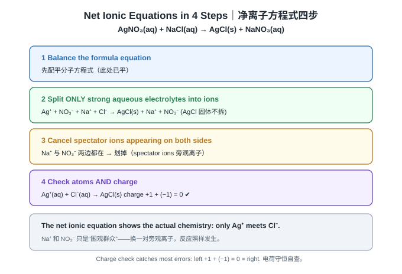
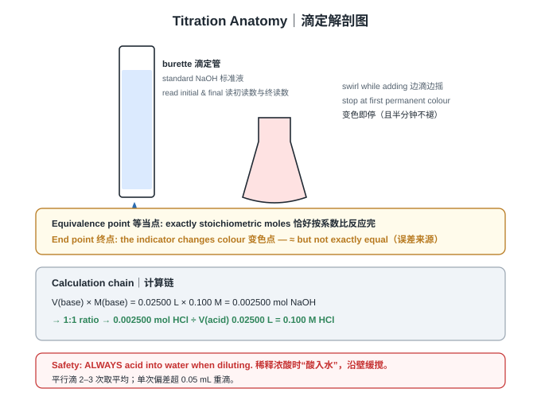

# Ch.13 — Concentration and Solution Stoichiometry

## Chapter 13 · Concentration｜第 13 章　浓度与溶液中的化学计量

> 🗂️ **Scope note｜范围说明**：This chapter covers official Content **C14**: stoichiometric calculations in aqueous solutions — molarity, dilution, net ionic equations, titration. pH = −log[H⁺], K_a/K_b and acid strength quantification are Chemistry 12.｜本章对应官方内容标准 C14：水溶液中的化学计量——摩尔浓度、稀释、净离子方程式、滴定。pH = −log[H⁺]、K_a/K_b 与酸强度定量属于 Chemistry 12。

## 1. Content Alignment｜大纲对应

| Item｜项目 | Detail｜细节 |
|---|---|---|
| Big Idea｜核心概念 | **B5**（溶液本性）→ 回并 **B3/B4**（溶液里的定量）｜solution nature → quantifying it |
| Content C14｜内容标准 C14 | stoichiometric calculations in aqueous solutions｜水溶液中的化学计量计算 |
| Curricular Competencies｜课程能力 | Planning and conducting（定量滴定、配液）· Processing and analyzing（数据表与偏差）· Evaluating（误差分级） |
| Chapters before｜前置章节 | Ch.8 three bridges; Ch.10 four steps; Ch.12 dissociation |
| Chapters after｜后继章节 | Ch.14 titration as an analysis technique; final review |

## 2. Learning Objectives｜学习目标

**By the end of this chapter you can｜学完本章你要能做到：**

1. Calculate molarity and convert among moles, volume and concentration.｜计算摩尔浓度并在摩尔、体积、浓度间换算。
2. Describe preparing a solution of exact concentration with a volumetric flask.｜描述用容量瓶精确配液的全流程。
3. Perform dilution calculations with C₁V₁ = C₂V₂, watching units.｜做稀释计算，盯住单位。
4. Solve solution stoichiometry problems: the Ch.10 four steps with new ramps.｜解溶液化学计量题：Ch.10 四步换坡道。
5. Write net ionic equations, cancelling spectator ions, checking atoms and charge.｜写净离子方程式：消旁观离子、查原子与电荷。
6. Describe titration properly and compute an unknown concentration from data.｜规范描述滴定并由数据算未知浓度。

## 3. Concept Explanations｜概念解析

### 3.1 Molarity: Concentration You Can Compute With｜摩尔浓度：能参与计算的浓度

**Molarity（摩尔浓度）** M = mol solute ÷ L solution. The unit is mol/L, often written M.

**中文**：**摩尔浓度** M = 溶质摩尔数 ÷ 溶液体积（升）。单位 mol/L，也写作 M。

```
0.100 mol NaCl in 0.250 L  →  M = 0.100 / 0.250 = 0.400 mol/L
```

The three-bridge map of Ch.8 now gains a solution entrance: mass ⇄ mol ⇄ **M·V** (Fig. 13-1). Volume must be in litres for the bridge to work.

**中文**：Ch.8 的三桥图多了个溶液入口：质量 ⇄ 摩尔 ⇄ **M·V**（图 13-1）。上桥的体积必须是升。

### 3.2 Preparing a Solution of Exact Concentration｜精确配液

To make 250.0 mL of 0.100 mol/L NaCl: compute the mass (0.0250 mol × 58.44 = 1.46 g), dissolve it **completely in less than the final volume**, transfer to the **volumetric flask（容量瓶）**, rinse the beaker into the flask, then add water **to the mark**, stopper and invert to mix.

**中文**：配 250.0 mL 0.100 mol/L NaCl：算质量（0.0250 mol × 58.44 = 1.46 g），先在**少于终体积**的水里完全溶解，转入**容量瓶**，烧杯涮洗液并入，最后加水**到刻度线**，盖塞倒转混匀。

> 💡 **Key Insight｜关键洞察**：Dissolve first, dilute to the mark *last* — adding solid after the mark overshoots volume and concentration simultaneously.｜先溶后定容——到刻度后再加固体，体积和浓度会一起超。

### 3.3 Dilution: Add Water, Not Molecules｜稀释：加水不加分子

Diluting a stock solution changes volume, not moles: C₁V₁ = C₂V₂ (Fig. 13-2). Units just have to match on both sides — mL with mL is fine.

**中文**：稀释储备液改变的是体积不是摩尔：C₁V₁ = C₂V₂（图 13-2）。两边单位一致即可——毫升对毫升没问题。

```
To make 400 mL of 0.25 M from 1.0 M stock:
V₁ = C₂V₂/C₁ = (0.25)(400)/1.0 = 100 mL stock → dilute to 400 mL
```

### 3.4 Solution Stoichiometry: Same Four Steps, New Ramps｜溶液计量：同四步，换坡道

Where Ch.10 used mass → mol, solution chemistry uses **M × V → mol** (Fig. 13-1's right side):

**中文**：Ch.10 用质量上桥，溶液化学用 **M × V 上桥**（图 13-1 右侧）：

```
M·V of A → mol A → (mole ratio) → mol B → M·V of B
```

Everything else — balance first, units every line, round once — is exactly Ch.10's contract.

**中文**：其余全部沿用 Ch.10 契约：先配平、逐行带单位、只舍一次。

### 3.5 Net Ionic Equations｜净离子方程式

Full equations hide the real action. To get the **net ionic equation（净离子方程式）** (Fig. 13-3):

**中文**：完整方程式掩盖了真正的戏。要得到**净离子方程式**（图 13-3）：

1. balance the formula equation｜先配平
2. split ONLY strong aqueous electrolytes into ions｜只拆强电解质水溶液
3. cancel spectators appearing unchanged on both sides｜消掉两边不变的旁观离子
4. check atoms AND charge｜查原子与电荷

```
AgNO₃(aq) + NaCl(aq) → AgCl(s) + NaNO₃(aq)
Ag⁺ + NO₃⁻ + Na⁺ + Cl⁻ → AgCl(s) + Na⁺ + NO₃⁻
Ag⁺(aq) + Cl⁻(aq) → AgCl(s)          ← the actual chemistry 真正的反应
```

### 3.6 Titration: Measuring Concentration by Reaction｜滴定：用反应测浓度

**Titration（滴定）** delivers one solution from a **burette（滴定管）** into another until an **indicator（指示剂）** signals completion (Fig. 13-4). Vocabulary discipline:

**中文**：**滴定**用滴定管把一种溶液加入另一种，直到指示剂变色（图 13-4）。词汇纪律：

- **standard solution 标准液**: concentration known｜浓度已知
- **equivalence point 等当点**: moles exactly stoichiometric｜恰好按系数比反应完
- **end point 终点**: indicator changes colour｜指示剂变色（≈等当点，但不等——这是误差来源）

```
V(base) × M(base) = 0.02500 L × 0.100 M = 0.002500 mol NaOH
1:1 ratio → 0.002500 mol HCl ÷ 0.02500 L = 0.100 M HCl
```

> ⚠️ **Safety｜安全**：When diluting concentrated acid, add **acid into water** ("AA": always add acid), slowly, with stirring. Acid into water can spatter violently the other way.｜稀释浓酸时**酸入水**（"AA"：always add acid），沿壁缓加并搅拌。反过来水入酸会剧烈飞溅。

> 🔭 **Extension｜超纲**【Extension → Chemistry 12】：pH = −log[H⁺], K_a/K_b, and choosing indicators by titration curve — this chapter stops at end point ≈ equivalence point.｜pH = −log[H⁺]、K_a/K_b、按滴定曲线选指示剂——本章止步于"终点≈等当点"。

## 4. Comparison Tables｜表格比对

### Table 13-1　The Bridge Map: Ch.8 vs Ch.13｜桥图对照

| Ramp｜上桥方式 | Ch.8 dry 摩尔三桥 | Ch.13 solution 溶液版 |
|---|---|---|
| up 上桥 | mass ÷ molar mass | M × V(L) |
| currency 通货 | mol | mol |
| down 下桥 | × molar mass | ÷ M → V(L) |
| extra 额外 | 6.02×10²³ particles | dilution: C₁V₁ = C₂V₂ |

### Table 13-2　Split or Not Split?｜拆与不拆

| Species｜物种 | In net ionic equation｜在净式中 | Why｜原因 |
|---|---|---|---|
| strong acid (HCl, HNO₃…) | split 拆 | fully ionized in water 水中完全电离 |
| soluble salt (Na⁺, NO₃⁻…) | split 拆 | mobile ions 可动离子 |
| solid precipitate (AgCl(s)) | intact 不拆 | not dissolved 未溶解 |
| pure liquid/gas (H₂O(l), CO₂(g)) | intact 不拆 | not aqueous 非水溶液 |
| weak electrolyte (acetic acid) | intact 不拆 | only partially ionized 部分电离 |

### Table 13-3　End Point vs Equivalence Point｜终点 vs 等当点

| Feature｜特征 | Equivalence 等当点 | End point 终点 |
|---|---|---|---|
| defined by｜由谁定义 | stoichiometry 计量学 | indicator chemistry 指示剂 |
| when｜何时 | exact ratio reached 恰好达比 | colour switches 变色 |
| ideal relation｜理想关系 | equal（indicator chosen well） | approximates it 逼近它 |

### Table 13-4　Titration Data Discipline｜滴定数据纪律

| Item｜项 | Rule｜规则 |
|---|---|---|
| burette reading 滴定管读数 | estimate between marks 估读一位 |
| volume used 用量 | final − initial 终读减初读 |
| trials 平行 | 2–3 consistent trials; average consistent ones｜做 2–3 次取一致的平均 |
| rejection 剔除 | discard the outlier, never force agreement｜剔离群值，不许硬凑 |

## 5. Diagrams & Worked Examples｜图例说明

### Fig. 13-1　The Solution Four Bridges｜溶液版四桥图



### Fig. 13-2　Dilution: Add Water, Not Molecules｜稀释



### Fig. 13-3　Net Ionic Equations in 4 Steps｜净离子方程式四步



### Fig. 13-4　Titration Anatomy｜滴定解剖图



### Example 13-1　Molarity Round Trip｜摩尔浓度往返

**Question**: (a) What is the molarity of 0.750 mol of KOH in 2.50 L? (b) What volume of 0.400 mol/L HCl contains 0.0200 mol?

**中文**：(a) 0.750 mol KOH 溶于 2.50 L，摩尔浓度是多少？(b) 0.400 mol/L 的 HCl 多少体积含 0.0200 mol？

**Solution｜解**:

```
(a) M = 0.750 / 2.50 = 0.300 mol/L
(b) V = mol / M = 0.0200 / 0.400 = 0.0500 L = 50.0 mL
```

*(4 marks: 2 each, 1 formula + 1 s.f./unit.)*

**中文**：*(4 分：各 2 分——公式 1、位数与单位 1。)*

### Example 13-2　Solution Stoichiometry, Full Chain｜溶液计量全链条

**Question**: How many millilitres of 0.200 mol/L NaOH react exactly with 25.0 mL of 0.150 mol/L H₂SO₄? (2 NaOH + H₂SO₄ → Na₂SO₄ + 2 H₂O)

**中文**：多少毫升 0.200 mol/L NaOH 恰好与 25.0 mL 0.150 mol/L H₂SO₄ 反应？

**Solution｜解**:

```
mol H₂SO₄ = 0.150 × 0.0250 = 0.00375 mol
mol NaOH = 0.00375 × (2/1) = 0.00750 mol
V = 0.00750 / 0.200 = 0.0375 L = 37.5 mL
```

*(6 marks: 1 mol A, 2 ratio (2:1 — the classic slip), 1 mol B, 1 volume, 1 mL conversion.)*

**中文**：*(6 分：mol A 1、比例 2（2:1——经典滑点）、mol B 1、体积 1、换毫升 1。)*

### Example 13-3　Net Ionic Equation｜写净离子方程式

**Question**: Write the net ionic equation for BaCl₂(aq) + Na₂SO₄(aq) → BaSO₄(s) + NaCl(aq) (balanced).

**中文**：写出 BaCl₂(aq) + Na₂SO₄(aq) → BaSO₄(s) + NaCl(aq) 的净离子方程式。

**Solution｜解**:

```
split: Ba²⁺ + 2Cl⁻ + 2Na⁺ + SO₄²⁻ → BaSO₄(s) + 2Na⁺ + 2Cl⁻
cancel spectators (Na⁺, Cl⁻):
Ba²⁺(aq) + SO₄²⁻(aq) → BaSO₄(s)
charge: +2 + (−2) = 0 ✔
```

*(5 marks: 1 split correctly, 1 coefficients carried, 1 spectators, 1 net equation, 1 charge check.)*

**中文**：*(5 分：正确拆分 1、系数随行 1、消旁观 1、净式 1、电荷自查 1。)*

## 6. Key Vocabulary｜核心词汇

| English | 中文 | Note｜备注 |
|---|---|---|
| molarity (M) | 摩尔浓度 | mol solute per L solution｜每升溶液的摩尔数 |
| stock solution | 储备液 | concentrated source 浓的母液 |
| dilution | 稀释 | add water, not molecules 加水不加分子 |
| volumetric flask | 容量瓶 | exact volume vessel 精确容积 |
| net ionic equation | 净离子方程式 | the actual reaction 真正发生的反应 |
| spectator ion | 旁观离子 | unchanged on both sides 两边原样 |
| titration | 滴定 | measure concentration by reaction 用反应测浓度 |
| burette | 滴定管 | delivers measured volume 定量 delivery |
| standard solution | 标准液 | concentration known 已知浓度 |
| indicator | 指示剂 | colour signal 变色信号 |
| equivalence point | 等当点 | exact stoichiometry 恰好按比 |
| end point | 终点 | indicator switches 指示剂变色 |

## 7. Lab / Activity｜实验与活动

### Activity 13-1　Make 250.0 mL of 0.100 mol/L NaCl｜精确配液

**Do it｜操作**: Weigh 1.46 g, dissolve, transfer to a 250.0 mL volumetric flask, rinse, fill to the mark, invert. Record every number with s.f. discipline.

**中文**：称 1.46 g，溶解，转入 250.0 mL 容量瓶，涮洗，定容，倒转混匀。每个数字按有效数字记录。`[Planning and conducting]`

### Activity 13-2　Quantitative Titration｜定量滴定

**Do it｜操作**: Standardize against known HCl, then titrate an unknown HCl sample with 0.100 mol/L NaOH in 2–3 trials; tabulate burette readings, average consistent trials, compute the unknown with s.f. and rank your error sources.

**中文**：先用已知 HCl 校核，再用 0.100 mol/L NaOH 滴定未知 HCl 2–3 次；列表读数、取一致均值、按有效数字计算并给误差分级。`[Planning and conducting / Processing and analyzing]`

### Activity 13-3　Spectator Hunt｜找旁观离子

**Do it｜操作**: Eight double-replacement equations are posted; write each net ionic equation and trade papers; the marker checks charge conservation specifically.

**中文**：张贴 8 个双置换方程；各写净离子方程式后交换互评，评卷人专门查电荷守恒。`[Communicating]`

## 8. Common Misconceptions｜常见易错点

| # | Misconception｜错误认识 | Correction｜正确理解 |
|---|---|---|---|
| 1 | "C₁V₁ = C₂V₂ needs litres on both sides."｜两边必须用升。 | Units must **match**, not be litres — mL with mL works because the factor cancels.｜单位只需**一致**，不必是升——毫升对毫升照样成立。 |
| 2 | "Split every formula into ions."｜所有化学式都拆成离子。 | Split only strong aqueous electrolytes; solids, gases, pure liquids and weak electrolytes stay intact.｜只拆强电解质水溶液；固、气、纯液、弱电解质不拆。 |
| 3 | "The net equation needs no charge check."｜净式不用查电荷。 | Charge conservation is the fastest error detector: +1 + (−1) = 0 must match the solid's 0.｜电荷守恒是最快的查错器：左端 +1 + (−1) = 0 对上固体的 0。 |
| 4 | "End point and equivalence point are the same thing."｜终点就是等当点。 | The end point *approximates* the equivalence point; the gap between them is a real error source.｜终点只是**逼近**等当点；两者之差是真实误差来源。 |
| 5 | "Burette readings don't need estimating."｜滴定管读数不用估读。 | Read to 0.01 mL — estimate between the marks.｜读到 0.01 mL——刻度间要估读一位。 |
| 6 | "Mix the solution before filling to the mark."｜定容前先摇匀。 | Dissolve first, then fill to the mark, then invert to mix — early mixing loses volume control.｜先溶、再定容、后倒转混匀——提前摇匀会丢体积控制。 |
| 7 | "Water into acid is the safe direction."｜把水倒进酸里更安全。 | Reverse: **acid into water** slowly, with stirring; water into acid can spatter.｜反了：**酸入水**、沿壁慢加、搅拌；水入酸会飞溅。 |
| 8 | "Dilution destroys some of the solute."｜稀释会损失溶质。 | Mole count is untouched; only the volume grows, so concentration drops.｜摩尔数不变；只是体积变大、浓度变小。 |
| 9 | "M × V works with mL directly."｜M×V 直接用毫升。 | M is mol/**L** — convert mL to L (÷1000) before the bridge, or keep consistent units throughout.｜M 的单位是 mol/**L**——上桥前换算或全程统一单位。 |
| 10 | "The indicator participates in the reaction."｜指示剂参与反应。 | It signals by colour with a tiny amount; it is not a reactant in the calculation.｜它以极小量变色报信，不进入计算。 |
| 11 | "One titration trial is enough."｜滴一次就够了。 | Parallel trials reveal technique noise; average only consistent trials.｜平行试验才能暴露手法波动；只平均一致的那几次。 |
| 12 | "If the equation is balanced, the net ionic form follows automatically."｜配平了净式自然对。 | Splitting and cancelling introduce their own errors — coefficients and charges must be re-verified.｜拆与消本身会出错——系数与电荷必须重查。 |

## 9. Assessment｜答题评估

### Part A: Foundational｜基础题（10 × 2 = 20 points）

**A1.** Define molarity and write its formula with units.

- **中文**：定义摩尔浓度并写出带单位的公式。

**A2.** Calculate the molarity of 0.0500 mol of NaOH in 200.0 mL.

- **中文**：0.0500 mol NaOH 溶于 200.0 mL，摩尔浓度是多少？

**A3.** What mass of NaCl is needed for 250.0 mL of 0.100 mol/L solution?

- **中文**：配 250.0 mL 0.100 mol/L 需要多少克 NaCl？

**A4.** 50.0 mL of 2.0 mol/L HCl is diluted to 500.0 mL. Find the new molarity.

- **中文**：50.0 mL 2.0 mol/L HCl 稀释到 500.0 mL，新浓度是多少？

**A5.** List the four steps to a net ionic equation.

- **中文**：写出写净离子方程式的四步。

**A6.** Identify the spectator ions in: KCl(aq) + AgNO₃(aq) → AgCl(s) + KNO₃(aq).

- **中文**：指出 KCl(aq) + AgNO₃(aq) → AgCl(s) + KNO₃(aq) 中的旁观离子。

**A7.** Write the net ionic equation for A6.

- **中文**：写出 A6 的净离子方程式。

**A8.** Distinguish equivalence point from end point in one sentence each.

- **中文**：各用一句话区分等当点与终点。

**A9.** Why is "acid into water" the safe dilution rule?

- **中文**：为什么"酸入水"是安全的稀释规则？

**A10.** A burette reads 0.05 mL at start and 24.35 mL at finish. What volume was delivered?

- **中文**：滴定管初读 0.05 mL、终读 24.35 mL，实际放出多少体积？

### Part B: Applied｜应用题（4 × 5 = 20 points）

**B1.** 20.0 mL of 0.100 mol/L CaCl₂ is mixed with excess Na₂CO₃. (a) Write the full and net ionic equations. (b) What mass of CaCO₃ forms?

- **中文**：20.0 mL 0.100 mol/L CaCl₂ 与足量 Na₂CO₃ 混合。(a) 写完整与净离子方程式。(b) 生成多少克 CaCO₃？

**B2.** What volume of 0.250 mol/L HCl reacts exactly with 1.50 g of CaCO₃ (M = 100.1)? (2 HCl + CaCO₃ → CaCl₂ + H₂O + CO₂)

- **中文**：多少体积的 0.250 mol/L HCl 恰好与 1.50 g CaCO₃（M = 100.1）反应？

**B3.** A 25.00 mL sample of HCl of unknown concentration is titrated with 0.1000 mol/L NaOH. Trial volumes: 23.10 mL, 22.90 mL, 17.45 mL. (a) Handle the outlier properly. (b) Calculate the unknown concentration from the consistent trials. (c) State one reason the outlier may have occurred.

- **中文**：25.00 mL 未知浓度 HCl 用 0.1000 mol/L NaOH 滴定。三次用量：23.10 mL、22.90 mL、17.45 mL。(a) 正确处理离群值。(b) 用一致的两次算未知浓度。(c) 给出离群值的一个可能原因。

**B4.** Describe preparing 500.0 mL of 0.0500 mol/L CuSO₄ from solid CuSO₄·5H₂O (M = 249.7): mass needed, apparatus, and the two steps students most often get wrong.

- **中文**：描述用固体 CuSO₄·5H₂O（M = 249.7）配制 500.0 mL 0.0500 mol/L 溶液：所需质量、仪器，以及学生最容易错的两步。

### Part C: Challenge｜挑战题（2 × 10 = 20 points）

**C1.** Vinegar is acetic acid, a *weak* electrolyte. A 10.00 mL vinegar sample is titrated to its end point with 0.5000 mol/L NaOH, using 34.20 mL. (a) Why does the weak-acid fact not block the calculation? (b) Calculate the acid concentration in mol/L. (c) The label says "5% w/v acetic acid" (5.0 g per 100 mL). Compare with your answer and comment on one possible reason for any difference. *(3 + 4 + 3)*

- **中文**：醋是乙酸——**弱**电解质。10.00 mL 醋样用 0.5000 mol/L NaOH 滴到终点，用去 34.20 mL。(a) 为什么"弱酸"不阻碍计算？(b) 算酸的摩尔浓度。(c) 标签写"5% w/v 乙酸"（每 100 mL 含 5.0 g），与你的答案比较，并就差异给一个可能原因。*(3 + 4 + 3)*

**C2.** A water-quality team checks chloride in drinking water by titrating 50.00 mL samples with 0.0500 mol/L AgNO₃ (Ag⁺ + Cl⁻ → AgCl(s), chromate indicator). (a) Write the net ionic equation and identify the spectator ions in the full molecular reaction with Na₂CrO₄ indicator present. (b) A sample needs 12.00 mL of AgNO₃. Find the chloride concentration in mol/L and mg/L. (c) The team's average of three trials deviates by 0.15 mL. Evaluate whether this precision supports reporting to 0.001 mol/L. *(3 + 5 + 2)*

- **中文**：水质团队用 0.0500 mol/L AgNO₃ 滴定 50.00 mL 水样测氯离子（Ag⁺ + Cl⁻ → AgCl(s)，铬酸根作指示剂）。(a) 写净离子方程式，并在分子反应（含 Na₂CrO₄ 指示剂）中指认旁观离子。(b) 某水样用去 12.00 mL AgNO₃。求氯离子浓度（mol/L 与 mg/L）。(c) 三次平行偏差 0.15 mL，评价该精密度是否支持报告到 0.001 mol/L。*(3 + 5 + 2)*

### Answer Key｜参考答案

**Part A**

- **A1.** M = mol solute / L solution; unit mol/L (M).

  - **中文**：M = 溶质摩尔数 / 溶液升数；单位 mol/L（M）。

- **A2.** M = 0.0500 / 0.2000 = 0.250 mol/L.

  - **中文**：0.250 mol/L。

- **A3.** mol = 0.2500 × 0.100 = 0.0250 mol → × 58.44 = 1.46 g.

  - **中文**：1.46 g。

- **A4.** C₂ = C₁V₁/V₂ = (2.0)(50.0)/500.0 = 0.20 mol/L.

  - **中文**：0.20 mol/L。

- **A5.** Balance; split strong aqueous electrolytes; cancel spectators; check atoms and charge.

  - **中文**：配平；拆强电解质；消旁观离子；查原子与电荷。

- **A6.** K⁺ and NO₃⁻.

  - **中文**：K⁺ 与 NO₃⁻。

- **A7.** Ag⁺(aq) + Cl⁻(aq) → AgCl(s).

  - **中文**：Ag⁺(aq) + Cl⁻(aq) → AgCl(s)。

- **A8.** Equivalence point: exact stoichiometric moles reached. End point: the indicator's colour switch, which approximates it.

  - **中文**：等当点：恰好按系数比反应完；终点：指示剂变色，是它的近似。

- **A9.** Adding water into concentrated acid localizes huge heat release at the addition point and can spatter; acid into water spreads the heat into a larger, stirrable volume.

  - **中文**：水入浓酸时热量集中在加入点、易飞溅；酸入水则把热分散进更大的可搅拌体积。

- **A10.** 24.35 − 0.05 = 24.30 mL.

  - **中文**：24.30 mL。

**Part B**

- **B1.** (a) Full: CaCl₂(aq) + Na₂CO₃(aq) → CaCO₃(s) + 2 NaCl(aq); net: Ca²⁺(aq) + CO₃²⁻(aq) → CaCO₃(s). (b) mol Ca²⁺ = 0.100 × 0.0200 = 0.00200 mol → CaCO₃ = 0.00200 × 100.09 = 0.200 g.

  - **中文**：(a) 如上。(b) 0.00200 mol × 100.09 = 0.200 g。

- **B2.** mol CaCO₃ = 1.50/100.1 = 0.01499 mol → HCl = 2 × 0.01499 = 0.02997 mol → V = 0.02997/0.250 = 0.1199 L = 120 mL (3 s.f. — limited by 1.50 g and 0.250).

  - **中文**：0.02997 mol → 120 mL（3 位有效数字——受 1.50 g 与 0.250 限制）。

- **B3.** (a) 17.45 mL is the outlier — exclude with a recorded reason, never average it in. (b) average of 23.10 & 22.90 = 23.00 mL → mol NaOH = 0.002300 → 1:1 → M(HCl) = 0.002300/0.02500 = 0.0920 mol/L (3 s.f.). (c) e.g. overshot past the end point in one trial (added drop too many / swirled too slowly).

  - **中文**：(a) 17.45 mL 为离群值——记录理由后剔除，不许掺入平均。(b) 均值 23.00 mL → 0.002300 mol → 1:1 → 0.0920 mol/L（3 位）。(c) 如某次冲过终点（多加了一滴/摇慢了）。

- **B4.** mass = 0.5000 L × 0.0500 mol/L × 249.7 g/mol = 6.24 g. Apparatus: balance, beaker, stirring rod, 500.0 mL volumetric flask, wash bottle. Two common errors: adding water to the mark before the solid fully dissolves; rinsing the beaker but not transferring the rinse into the flask (losing solute).

  - **中文**：质量 = 0.5000 × 0.0500 × 249.7 = 6.24 g。仪器：天平、烧杯、玻棒、500.0 mL 容量瓶、洗瓶。最易错两步：固体未全溶就定容；涮了烧杯却没把涮洗液倒回容量瓶（丢溶质）。

**Part C**

- **C1.** (a) Titration counts moles reacting, not ionization strength; the neutralization still proceeds 1:1 (CH₃COOH + NaOH → CH₃COONa + H₂O), so the mole ratio holds. (b) mol NaOH = 0.5000 × 0.03420 = 0.01710 mol → 1:1 → M = 0.01710/0.01000 = 1.71 mol/L. (c) 5.0 g/100 mL → 50.0 g/L ÷ 60.05 g/mol = 0.833 mol/L — far below 1.71. Possible reasons: sample is concentrated vinegar (double-strength) or NaOH was not truly 0.5000 mol/L (never standardized) — the mismatch itself is the finding to investigate.

  - **中文**：(a) 滴定数的是"反应了多少摩尔"，与电离强弱无关；中和仍按 1:1 进行（CH₃COOH + NaOH → CH₃COONa + H₂O），摩尔比成立。(b) 0.01710 mol → 1.71 mol/L。(c) 标签折算 0.833 mol/L，远低于 1.71——可能样品是双倍浓度醋，或 NaOH 并非真正 0.5000 mol/L（未标定）——差异本身就是待查的发现。

- **C2.** (a) Net: Ag⁺(aq) + Cl⁻(aq) → AgCl(s). In the full reaction with indicator: 2 AgNO₃(aq) + Na₂CrO₄(aq) → Ag₂CrO₄(s) + 2 NaNO₃(aq); spectators Na⁺, NO₃⁻. (b) mol Ag⁺ = 0.0500 × 0.01200 = 6.00×10⁻⁴ mol → 1:1 → [Cl⁻] = 6.00×10⁻⁴ / 0.05000 = 0.0120 mol/L → × 35.45 g/L × 1000 = 425 mg/L. (c) 0.15 mL on ~12 mL is ~1.2% relative; 0.001 mol/L on 0.0120 mol/L is ~8% — the claimed precision (8%) exceeds the demonstrated precision (1.2% of volume, plus other errors). Not supported; report 0.012 mol/L or 425 mg/L (3 s.f.).

  - **中文**：(a) 净式 Ag⁺ + Cl⁻ → AgCl(s)；指示剂反应 2 AgNO₃ + Na₂CrO₄ → Ag₂CrO₄(s) + 2 NaNO₃，旁观离子 Na⁺、NO₃⁻。(b) 6.00×10⁻⁴ mol → 0.0120 mol/L → 425 mg/L。(c) 0.15 mL/12 mL ≈ 1.2% 相对偏差；报 0.001 mol/L 相当于约 8% 的精度要求——超出了实测精密度，不支持；应报 0.012 mol/L 或 425 mg/L（3 位）。*(3 + 5 + 2)*

### Rubric｜评分量规

| Band｜档 | Evidence required｜所需证据 |
|---|---|---|
| Full marks 满分 | L conversion handled, ratio from balanced equation, outliers managed with reasons, charge checked on net equations｜升换算处理、比例来自配平、离群值有理由地处理、净式查电荷 |
| Partial 部分分 | Correct path with mL/L slip or unexplained outlier kept｜路径对但毫升/升滑点，或离群值未说明却保留 |
| Minimal 最低分 | Split solids into ions; charge not conserved; force-averaged outlier｜把固体拆成离子；电荷不守恒；硬凑平均 |

## 10. Connection to the Big Idea｜回扣核心概念

> 🎯 **Big Idea B5｜核心概念 B5**：*Solubility within a solution is determined by the nature of the solute and the solvent.*
> **中文**：溶液中的溶解度由溶质与溶剂的本性决定。

Concentration is B5's measuring stick: once the *nature* of the pair has decided what dissolves, molarity counts *how much* is there — and titration turns that count into the numbers chemists report. The net ionic equation even shows B5's hand directly: only the ions whose nature matches (Ag⁺ with Cl⁻) actually react.

**中文**：浓度是 B5 的量尺：本性决定了"溶什么"，摩尔浓度数出"溶了多少"，滴定把这个数变成化学家报告的数字。净离子方程式甚至直接亮出 B5 的手笔——只有本性相配的离子（Ag⁺ 遇 Cl⁻）才真正反应。

**How does this connect to the Big Idea?｜本章如何回扣核心概念？** Ch.14 collects these tools — titration, precipitation, flame tests — into a working analyst's kit, and closes the course by tying all five Big Ideas together.

**中文**：第 14 章把这些工具——滴定、沉淀、焰色——装进分析工作者的工具箱，并把五条 Big Idea 系在一起收束全课程。
