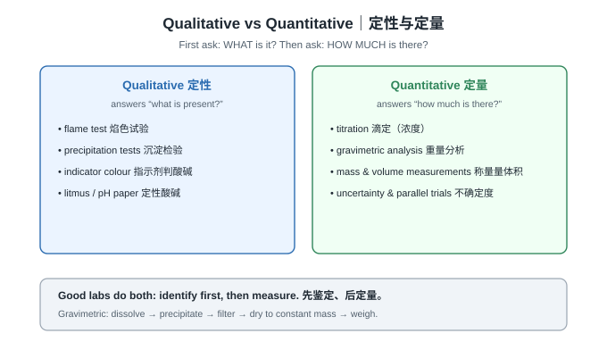
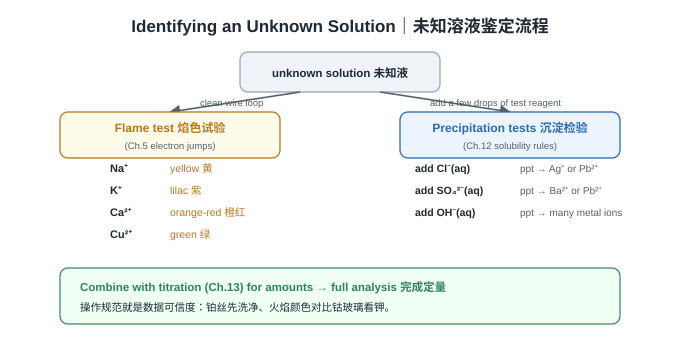
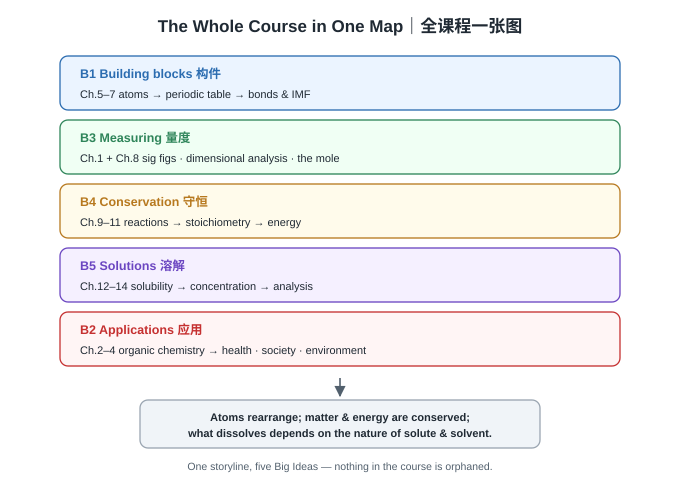
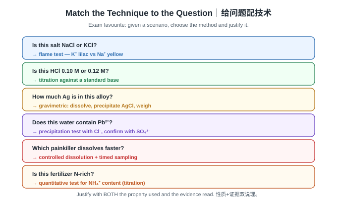

# Ch.14 — Analysis Techniques and Course Synthesis

## Chapter 14 · Analysis Techniques｜第 14 章　分析技术与全课程综合

> 🗂️ **Scope note｜范围说明**：This chapter covers official Content **C15** (analysis techniques) at concept level, and closes the course by integrating C1–C14 around the five Big Ideas. Instrument-level spectroscopy and chromatography theory are beyond scope.｜本章以概念级覆盖官方内容标准 C15（分析技术），并把 C1–C14 围绕五条 Big Idea 综合收束。仪器级光谱与色谱理论不在范围内。

## 1. Content Alignment｜大纲对应

| Item｜项目 | Detail｜细节 |
|---|---|
| Big Ideas｜核心概念 | **B1–B5 all five converge** — this chapter is the course's convergence point｜五条合流——全课程收束点 |
| Content C15｜内容标准 C15 | analysis techniques (qualitative and quantitative)｜分析技术（定性与定量） |
| Curricular Competencies｜课程能力 | Planning and conducting（综合分析挑战）· Evaluating（技术匹配与理由）· Communicating（概念图与口头答辩） |
| Chapters before｜前置章节 | all 13 — every tool reappears here as an instrument |
| Assessment note｜评估注 | aligns with school Final (15%)｜对齐学校期末（15%） |

## 2. Learning Objectives｜学习目标

**By the end of this chapter you can｜学完本章你要能做到：**

1. Distinguish qualitative analysis ("what is there?") from quantitative analysis ("how much?").｜区分定性分析（"有什么"）与定量分析（"有多少"）。
2. Describe flame tests, precipitation tests, titration and gravimetric analysis, and match each to a real question.｜描述焰色、沉淀检验、滴定与重量分析，并匹配真实问题。
3. Explain why operation discipline (clean loops, constant mass, parallel trials) equals data credibility.｜说明操作纪律（洗净铂丝、恒重、平行试验）就是数据可信度。
4. Retell the whole course as one storyline through the five Big Ideas.｜把全课程按五条 Big Idea 复述成一条故事线。
5. Perform on a summative assessment integrating naming, equations, calculation and analysis.｜在总结性测评中综合运用命名、方程、计算与分析。

## 3. Concept Explanations｜概念解析

### 3.1 Qualitative Analysis: What Is There?｜定性分析：有什么？

**Flame tests（焰色试验）**: electrons promoted in the flame fall back and emit characteristic colours — Na⁺ yellow, K⁺ lilac (view through cobalt glass), Ca²⁺ orange-red, Cu²⁺ green. This is Ch.5's electron jumping, put to work.

**中文**：**焰色试验**：电子在火焰中被激发后回落并发出特征色——Na⁺ 黄、K⁺ 紫（隔钴玻璃看）、Ca²⁺ 橙红、Cu²⁺ 绿。这是 Ch.5 的电子跃迁在干活。

**Precipitation tests（沉淀检验）**: add a reagent ion and consult the solubility rules — add Cl⁻ to check for Ag⁺/Pb²⁺; add SO₄²⁻ for Ba²⁺/Pb²⁺; add OH⁻ for many metal ions (Ch.12's rules as a toolkit).

**中文**：**沉淀检验**：加入试剂离子并查溶解性规则——加 Cl⁻ 查 Ag⁺/Pb²⁺；加 SO₄²⁻ 查 Ba²⁺/Pb²⁺；加 OH⁻ 查多种金属离子（Ch.12 规则的工具化）。

**Indicator tests（指示剂判酸碱）**: litmus or other indicators classify a solution as acidic or basic, qualitatively.

**中文**：**指示剂**：石蕊等指示剂定性地把溶液判为酸性或碱性。

### 3.2 Quantitative Analysis: How Much?｜定量分析：有多少？

**Titration（滴定）**: Ch.13's full workflow — standard solution, burette, end point, averaged trials, concentration out.

**中文**：**滴定**：Ch.13 全流程——标准液、滴定管、终点、平行均值、浓度结果。

**Gravimetric analysis（重量分析）**: dissolve, precipitate the target as an insoluble compound, filter, dry **to constant mass**, weigh, and back-calculate the content. The lifeline is the constant-mass discipline: heat–cool–weigh cycles until two consecutive readings agree.

**中文**：**重量分析**：溶解 → 把目标物沉淀为难溶化合物 → 过滤 → 干燥**至恒重** → 称量 → 反推含量。生命线是恒重纪律：加热–冷却–称量循环，直到两次连续读数一致。

**Data quality（数据质量）**: every quantitative claim carries uncertainty, needs parallel trials, and reports deviations — the Evaluating competency in daily uniform.

**中文**：**数据质量**：每个定量结论都要带不确定度、做平行试验、报偏差——Evaluating 能力的日常形态。

### 3.3 Instrument Concepts, Concept Level｜仪器技术·概念级

**Spectroscopy（光谱法）** measures light absorbed or emitted to identify/quantify species; **chromatography（色谱法）** separates mixtures by differential travel. Know *which question each answers*; the deeper physics is Chemistry 12/university material.

**中文**：**光谱法**测物质吸收/发射的光来定性与定量；**色谱法**按迁移速度差分离混合物。知道"什么问题用什么技术"即可；更深的物理属于 Chemistry 12/大学。

### 3.4 The Course as One Storyline｜全课程一条线

> 原子结构（Ch.5）→ 电子排布 → 周期律（Ch.6）→ 键与分子间力（Ch.7）→ 有机词汇（Ch.2–4）→ 摩尔量度（Ch.1/8）→ 反应（Ch.9）→ 计量（Ch.10）→ 能量（Ch.11）→ 溶解（Ch.12）→ 溶液定量与分析（Ch.13–14）

Every chapter is a tool the next one uses; the five Big Ideas (Fig. 14-3) are the load-bearing walls:

**中文**：每章都是下一章的工具；五条 Big Idea（图 14-3）是承重墙：

- **B1** atoms/molecules interact through electric charges → building blocks（构件）
- **B2** organic applications affect health, society, environment（有机应用的影响）
- **B3** the mole makes atoms measurable（摩尔让原子可量）
- **B4** matter and energy are conserved in reactions（反应中物质能量守恒）
- **B5** solubility depends on the nature of solute and solvent（溶解度由本性决定）

### 3.5 Careers｜职业出口

chemical technician 化学技师 · pharmacist 药剂师 · environmental analyst 环境分析员 · food scientist 食品科学家 · lab QA/QC 实验室质量岗位 — every one of them lives on this chapter's toolkit.

**中文**：以上岗位全都以本章工具箱为日常。

> 🔭 **Extension｜超纲**【Extension → Chemistry 12/大学】：Instrumental analysis (UV-Vis, AAS, HPLC, GC-MS) replaces most wet chemistry in modern labs; the wet methods here remain the foundation and the sanity check.｜现代实验室的仪器分析（UV-Vis、AAS、HPLC、GC-MS）大多取代了湿化学；本章湿法仍是地基与校核手段。

## 4. Comparison Tables｜表格比对

### Table 14-1　Qualitative vs Quantitative｜定性 vs 定量

| Aspect｜方面 | Qualitative 定性 | Quantitative 定量 |
|---|---|---|
| question 问题 | what is present? 有什么 | how much? 有多少 |
| techniques 技术 | flame test, ppt tests, indicators | titration, gravimetry, instrumental |
| output 输出 | identity 鉴定 | number + unit + uncertainty 数值+单位+不确定度 |
| quality flag｜质量标志 | clean controls 阴性对照 | parallel trials & deviations 平行与偏差 |

### Table 14-2　Technique Toolbox｜技术工具箱

| Technique｜技术 | Answers｜回答 | Chapter origin｜出处 | Watch-out｜注意 |
|---|---|---|---|
| flame test 焰色 | metal ion identity 金属离子 | Ch.5/Ch.14 | clean loop; cobalt glass for K⁺｜洗铂丝；钾隔钴玻璃 |
| precipitation test 沉淀检验 | anion/cation presence 离子有无 | Ch.12 | run both directions｜双向验证 |
| titration 滴定 | concentration 浓度 | Ch.13 | end vs equivalence point｜终点≠等当点 |
| gravimetry 重量分析 | content by mass 以质量计含量 | Ch.10/14 | constant mass 恒重 |
| spectroscopy 光谱 | identity + amount 定性定量 | concept 概念 | instrument calibration 校准 |
| chromatography 色谱 | mixture composition 组成 | concept 概念 | reference standards 参比 |

### Table 14-3　High-Frequency Exam Items｜高频题型清单（对齐学校 quiz/test）

| Item｜题型 | Core skill｜核心技能 |
|---|---|
| naming both directions 命名互译 | Ch.2–3, Appendix C |
| balancing (incl. combustion) 配平 | Ch.9 |
| mole three-bridges 摩尔三桥 | Ch.8 |
| mass-mass + limiting reagent 计量与限量 | Ch.10 |
| yield & purity 产率纯度 | Ch.10 |
| molarity & dilution 浓度稀释 | Ch.13 |
| net ionic equations 净离子式 | Ch.12–13 |
| titration calculation 滴定计算 | Ch.13 |
| solubility curve reading 溶解度曲线 | Ch.12 |
| trend explanation 趋势解释 | Ch.6 |

### Table 14-4　Error Source Ranking｜误差来源分级

| Rank｜级 | Error｜误差 | Effect｜影响 |
|---|---|---|
| 1 | not drying to constant mass 未恒重 | gravimetry biased high 偏高 |
| 2 | overshooting the titration end point 滴过终点 | concentration biased low 偏低 |
| 3 | dirty flame-test wire 铂丝不净 | false positives 假阳性 |
| 4 | single trial 单次试验 | noise invisible 噪声不可见 |

## 5. Diagrams & Worked Examples｜图例说明

### Fig. 14-1　Qualitative vs Quantitative｜定性与定量



### Fig. 14-2　Identifying an Unknown Solution｜未知溶液鉴定流程



### Fig. 14-3　The Whole Course in One Map｜全课程一张图



### Fig. 14-4　Match the Technique to the Question｜给问题配技术



### Example 14-1　A Full Identification｜一次完整鉴定

**Question**: A colourless solution shows a lilac flame and gives a white precipitate with BaCl₂ solution. Identify it and write the net ionic equation for the precipitate.

**中文**：某无色溶液焰色为紫色，与 BaCl₂ 溶液生成白色沉淀。鉴定它并写出沉淀的净离子方程式。

**Solution｜解**: Lilac flame → K⁺ present. White ppt with Ba²⁺ → SO₄²⁻ likely (BaSO₄). Solution: K₂SO₄(aq).

```
Ba²⁺(aq) + SO₄²⁻(aq) → BaSO₄(s)
```

*(6 marks: 2 flame interpretation, 2 ppt logic, 2 net equation.)*

**中文**：*(6 分：焰色解读 2、沉淀逻辑 2、净式 2。)*

### Example 14-2　Gravimetric Content Calculation｜重量分析含量计算

**Question**: A 2.00 g sample of contaminated barium chloride is dissolved and treated with excess Na₂SO₄; the dried BaSO₄ (M = 233.4) weighs 1.78 g after constant mass. Find the mass percent of BaCl₂ (M = 208.2) in the sample.

**中文**：2.00 g 含杂氯化钡溶解后加足量 Na₂SO₄，恒重后得 BaSO₄（M = 233.4）1.78 g。求样品中 BaCl₂（M = 208.2）的质量百分数。

**Solution｜解**:

```
mol BaSO₄ = 1.78/233.4 = 7.63×10⁻³ mol  → 1:1 → mol BaCl₂ same
mass BaCl₂ = 7.63×10⁻³ × 208.2 = 1.59 g
% BaCl₂ = 1.59/2.00 × 100% = 79.5%
```

*(6 marks: 1 mol, 1 ratio, 1 mass, 1 percent, 2 for constant-mass reasoning in the setup.)*

**中文**：*(6 分：摩尔 1、比例 1、质量 1、百分比 1、恒重论证 2。)*

## 6. Key Vocabulary｜核心词汇

| English | 中文 | Note｜备注 |
|---|---|---|
| qualitative analysis | 定性分析 | what is present 有什么 |
| quantitative analysis | 定量分析 | how much 有多少 |
| flame test | 焰色试验 | electron jumps emit colours 电子跃迁发光 |
| cobalt glass | 钴玻璃 | filters Na yellow for K test｜滤掉钠黄看钾 |
| gravimetric analysis | 重量分析 | precipitate, dry, weigh 沉淀烘干称量 |
| constant mass | 恒重 | consecutive readings agree 连续读数一致 |
| spectroscopy | 光谱法 | light-based identification 光测 |
| chromatography | 色谱法 | separation by travel 按迁移分离 |
| uncertainty | 不确定度 | every number's honesty range｜每个数字的诚实范围 |
| parallel trials | 平行试验 | reproducibility check 重现性 |
| synthesis (of the course) | 综合 | tools into one workflow 工具成流水线 |

## 7. Lab / Activity｜实验与活动

### Activity 14-1　Comprehensive Analysis Challenge｜综合分析挑战

**Do it｜操作**: Four unknown salt solutions. Use flame tests + precipitation tests to identify each qualitatively, then titrate (or gravimetrically process) one assigned unknown to a concentration/mass result with uncertainty.

**中文**：四瓶未知盐溶液。先用焰色+沉淀检验定性鉴定，再对指定的一瓶用滴定（或重量法）定量出浓度/含量并给不确定度。`[Planning and conducting / Evaluating]`

### Activity 14-2　Five Big Ideas Concept Poster｜五 Big Idea 概念图海报

**Do it｜操作**: In groups, connect 20 assigned core concepts into a directed network that displays all five Big Ideas; defend the map orally for three minutes.

**中文**：小组把指定的 20 个核心概念连成有向网络，须呈现五条 Big Idea；3 分钟口头答辩。`[Communicating]`

### Activity 14-3　Give the Technique a Problem｜给技术找问题

**Do it｜操作**: Ten real scenarios (water plant, pharmacy QC, soil survey, sports drink lab, aquarium shop…). Match each to the best technique and justify with both property and evidence.

**中文**：10 个真实情景（水厂、药检、土壤调查、运动饮料实验室、水族店…）。为每个匹配最适技术，并按"性质+证据"双说理。`[Applying and innovating]`

## 8. Common Misconceptions｜常见易错点

| # | Misconception｜错误认识 | Correction｜正确理解 |
|---|---|---|
| 1 | "Titration only measures acids and bases."｜滴定只能测酸碱。 | Precipitation titrations (Ag⁺ vs Cl⁻) and redox titrations exist — the tool is general.｜沉淀滴定（Ag⁺ vs Cl⁻）、氧化还原滴定都存在——工具是通用的。 |
| 2 | "Qualitative and quantitative are just two words for the same lab work."｜定性与定量是一回事。 | One asks identity, the other amount; a full analysis usually needs both in order.｜一个问"是什么"，一个问"有多少"；完整分析通常按序两者都要。 |
| 3 | "A flame test colour proves the ion alone."｜焰色一测就定论。 | Mixtures interfere (Na's yellow drowns others); cobalt glass and clean wires exist for this reason.｜混合物互相干扰（钠黄盖一切）；钴玻璃与净铂丝因此而生。 |
| 4 | "Drying once is enough for gravimetry."｜重量分析烘一次就行。 | Constant mass requires repeated heat–cool–weigh cycles until readings agree.｜恒重要反复加热–冷却–称量直到读数一致。 |
| 5 | "Uncertainty is for university, not for my lab report."｜不确定度是大学的事。 | A number without an uncertainty is an overclaim; this course requires honest ranges.｜没有不确定度的数字是过度声称；本课程要求诚实区间。 |
| 6 | "If the answer computes cleanly, it must be right."｜算得顺就对。 | Clean arithmetic on a wrong setup is still wrong; unit chains and sanity checks guard the setup.｜错误设置上的干净算术仍是错；单位链与量级自检守卫设置。 |
| 7 | "More reagent always gives a better test."｜试剂多加更准。 | Excess reagent can mask colours or create secondary precipitates — follow the tested amount.｜过量试剂会掩蔽颜色或产生次级沉淀——按验证过的量加。 |
| 8 | "Instrumental methods make wet chemistry obsolete."｜有仪器就不需要湿法。 | Wet methods calibrate, verify and teach the chemistry instruments assume.｜湿法负责校准、验证，并教会仪器背后的化学。 |
| 9 | "The five Big Ideas are five separate topics."｜五条 Big Idea 是五个独立主题。 | They are one storyline's five load-bearing walls; the final exam crosses them deliberately.｜它们是一条故事线的五面承重墙；期末故意跨墙出题。 |
| 10 | "Bilingual answers lose marks."｜双语作答会扣分。 | This course's policy: terms may be bilingual, but formulas, IUPAC names and units must be standard English.｜本课程政策：术语可双语，化学式、IUPAC 名与单位必须规范英文。 |
| 11 | "A precipitate confirms exactly one ion."｜一种沉淀就能定死一种离子。 | Several ions can give similar ppts — confirmation tests in a second direction are required.｜多种离子可给相似沉淀——必须第二方向确证。 |
| 12 | "Review means rereading."｜复习就是重读。 | Review here means re-performing: redo the four-step chains, re-run the checks, re-draw the maps.｜本章的复习是"重做"：重算四步、重跑检查、重画图。 |

## 9. Assessment｜答题评估（总结性测评样板｜Summative Template）

### Part A: Foundational｜基础题（10 × 2 = 20 points）

**A1.** State the one-sentence difference between qualitative and quantitative analysis.

- **中文**：一句话说出定性分析与定量分析的区别。

**A2.** A flame test shows yellow. Your partner insists it also contains K⁺. What do you do, and what do you look through?

- **中文**：焰色呈黄色，同伴坚称还含 K⁺。你怎么办？透过什么看？

**A3.** Write the net ionic equation for the white precipitate when AgNO₃ is added to a chloride solution.

- **中文**：写出向氯离子溶液加 AgNO₃ 生成白色沉淀的净离子方程式。

**A4.** Why must gravimetric products be dried to constant mass?

- **中文**：为什么重量分析的产物必须烘至恒重？

**A5.** Balance and add state symbols: Al(s) + HCl(aq) → AlCl₃(aq) + H₂(g).

- **中文**：配平并补状态符号：Al(s) + HCl(aq) → AlCl₃(aq) + H₂(g)。

**A6.** A 3.00 g compound contains 1.20 g C, 0.201 g H and 1.60 g O. Find the empirical formula.

- **中文**：3.00 g 化合物含 C 1.20 g、H 0.201 g、O 1.60 g，求实验式。

**A7.** A 0.500 mol/L solution: what volume contains 0.0200 mol?

- **中文**：0.500 mol/L 溶液多少体积含 0.0200 mol？

**A8.** Fe₂O₃ + 3 CO → 2 Fe + 3 CO₂: what mass of Fe (M = 55.85) forms from 50.0 g Fe₂O₃ (M = 159.7)?

- **中文**：50.0 g Fe₂O₃（M = 159.7）能生成多少克 Fe？

**A9.** Classify as exo or endo: (a) condensation; (b) neutralization; (c) decomposition of water by electrolysis.

- **中文**：判定放热/吸热：(a) 冷凝；(b) 中和；(c) 电解水分解。

**A10.** Why does oil not dissolve in water, in B5 vocabulary?

- **中文**：用 B5 的语言解释油为什么不溶于水。

### Part B: Applied｜应用题（4 × 5 = 20 points）

**B1.** Design an identification plan for three colourless solutions known to be NaCl, Na₂CO₃ and Na₂SO₄, using only reagents from this course. Give reagent, observation table, and the order of tests with reasons.

- **中文**：仅用本课程试剂，为 NaCl、Na₂CO₃、Na₂SO₄ 三瓶无色溶液设计鉴定方案：试剂、现象表、检验顺序及理由。

**B2.** 25.00 mL of NaOH of unknown concentration is titrated with 0.1000 mol/L HCl; consistent trials use 20.00, 19.90, 20.10 mL. Compute the NaOH concentration with proper outlier and s.f. handling.

- **中文**：25.00 mL 未知 NaOH 用 0.1000 mol/L HCl 滴定，一致三次用量 20.00、19.90、20.10 mL。按离群值与有效数字规范算 NaOH 浓度。

**B3.** A student's gravimetric result for sulfate came out 112%. Diagnose the two most likely procedural causes and state the check that would have caught each.

- **中文**：某学生硫酸根重量分析结果 112%。诊断两个最可能的过程原因，并给出各自本可拦住它的检查。

**B4.** From memory, reproduce the four-step mass-mass chain and label where limiting reagent, yield and purity each attach.

- **中文**：默画 mass-mass 四步链，并标注限量试剂、产率、纯度分别接在哪一环。

### Part C: Challenge｜挑战题（2 × 10 = 20 points）

**C1.** An environmental team must report a lake's chloride level after a road-salt spill. Plan the analysis: technique choice with justification, sampling and precision plan (trials, deviations), the calculation path with one worked number set (50.00 mL sample, 0.0500 mol/L AgNO₃, 14.00 mL used), and the report sentence with units and uncertainty. *(3 + 3 + 3 + 1)*

- **中文**：某环境团队要在融雪盐撒漏后报告湖水的氯离子水平。设计分析：技术选择与理由、采样与精密度方案（平行与偏差）、计算路径（带一组数字：50.00 mL 水样、0.0500 mol/L AgNO₃、用去 14.00 mL）、带单位与不确定度的报告句。*(3 + 3 + 3 + 1)*

**C2.** The final synthesis: choose any TWO Big Ideas and write a connected explanation (≤300 words) showing how one specific calculation or technique from this course *embodies* each — cite chapters, show one short equation or chain each, and end with one sentence on how the two ideas meet in a real lab task. *(5 + 5)*

- **中文**：期末综合：任选两条 Big Idea，写一段不超过 300 字的连贯说明，展示本课程某个具体计算或技术如何**体现**各自——引用章节、各给一条简短方程或计算链，结尾用一句话说明两者如何在真实实验任务中相遇。*(5 + 5)*

### Answer Key｜参考答案

**Part A**

- **A1.** Qualitative asks *what* is present; quantitative asks *how much*.

  - **中文**：定性问"有什么"，定量问"有多少"。

- **A2.** Re-test K⁺ through cobalt glass (filters sodium's yellow) with a clean wire loop.

  - **中文**：换净铂丝、隔钴玻璃（滤掉钠黄）重测钾。

- **A3.** Ag⁺(aq) + Cl⁻(aq) → AgCl(s).

  - **中文**：Ag⁺(aq) + Cl⁻(aq) → AgCl(s)。

- **A4.** Residual water inflates the mass; only consecutive agreeing readings certify dryness.

  - **中文**：残留水会虚增质量；只有连续一致读数才证明干燥。

- **A5.** 2 Al(s) + 6 HCl(aq) → 2 AlCl₃(aq) + 3 H₂(g).

  - **中文**：2 Al(s) + 6 HCl(aq) → 2 AlCl₃(aq) + 3 H₂(g)。

- **A6.** C: 1.20/12.01 = 0.0999 mol; H: 0.201/1.008 = 0.1994 mol; O: 1.60/16.00 = 0.1000 mol. ÷ smallest → 1 : 2 : 1 → **CH₂O**.

  - **中文**：C 0.0999、H 0.1994、O 0.1000 mol → 1 : 2 : 1 → **CH₂O**。

- **A7.** V = 0.0200/0.500 = 0.0400 L = 40.0 mL.

  - **中文**：40.0 mL。

- **A8.** 50.0/159.7 = 0.3131 mol → ×2 = 0.6262 mol Fe → ×55.85 = 35.0 g.

  - **中文**：35.0 g。

- **A9.** (a) exo (b) exo (c) endo.

  - **中文**：(a) 放热 (b) 放热 (c) 吸热。

- **A10.** Solubility follows the nature of the pair: water is polar, oil is nonpolar — their IMFs do not match (like dissolves like fails).

  - **中文**：溶解由"这一对"的本性决定：水极性、油非极性，作用力不匹配——相似相溶不成立。

**Part B**

- **B1.** Order matters: (1) add dilute HCl to separate samples — fizzing → Na₂CO₃ (Na₂CO₃ + 2 HCl → 2 NaCl + H₂O + CO₂); no fizz → NaCl or Na₂SO₄. (2) To the non-fizzing samples add BaCl₂(aq) — white ppt → Na₂SO₄ (BaSO₄(s)); no ppt → NaCl. Observation table with three rows; reason for order: the carbonate test is destructive-simple and cannot be confused, and Ba²⁺ would also ppt with CO₃²⁻, so carbonate must be removed/identified first.

  - **中文**：顺序：①分别加稀盐酸——冒泡的是 Na₂CO₃（Na₂CO₃ + 2 HCl → 2 NaCl + H₂O + CO₂）；不冒泡的是另两个。②向不冒泡者加 BaCl₂(aq)——白色沉淀为 Na₂SO₄（BaSO₄(s)）；无沉淀为 NaCl。理由：碳酸盐实验最简单且不会混淆；Ba²⁺ 对 CO₃²⁻ 也沉淀，所以必须先鉴别碳酸盐。

- **B2.** All three consistent (within 0.10 mL): average = 20.00 mL → mol HCl = 0.002000 → 1:1 → M(NaOH) = 0.002000/0.02500 = 0.0800 mol/L (3 s.f.).

  - **中文**：三次一致：均值 20.00 mL → 0.002000 mol → 1:1 → 0.0800 mol/L（3 位）。

- **B3.** Cause 1: product not dried to constant mass (water inflates mass) — check: repeat heat–cool–weigh cycles. Cause 2: impurity co-precipitated (e.g. Ag⁺ additions with other anions) — check: re-dissolve and re-precipitate (reprecipitation), or verify with a second confirming test.

  - **中文**：原因一：未恒重（水虚增质量）——检查：重复加热–冷却–称量。原因二：杂质共沉淀——检查：重溶再沉淀（二次沉淀），或第二方向确证。

- **B4.** mass A → [÷M_A] → mol A → [×ratio] → mol B → [×M_B] → mass B. Limiting reagent attaches at the mol A stage (two parallel computations, keep smaller); purity attaches before the first ramp (mass × %purity); yield attaches after the last ramp (actual/theoretical).

  - **中文**：质量 A → ÷M → mol A → ×比 → mol B → ×M → 质量 B。限量试剂接在 mol A 环（双算取小）；纯度接在第一坡道之前（质量×纯度）；产率接在最后一坡之后（实际/理论）。

**Part C**

- **C1.** Technique: precipitation titration with AgNO₃ (net: Ag⁺ + Cl⁻ → AgCl(s)) — justified: chloride is quantified directly by a 1:1 mole link. Plan: sample replicate sites and depths; 3 titrations each; reject and rerun any pair deviating >0.10 mL; report mean ± spread. Calculation: mol Ag⁺ = 0.0500 × 0.01400 = 7.00×10⁻⁴ mol → [Cl⁻] = 7.00×10⁻⁴/0.05000 = 0.0140 mol/L → ×35.45 g/mol = 0.496 g/L ≈ 496 mg/L. Report sentence: "Chloride = 496 ± 6 mg/L (mean of 3 trials, ± spread of titres)."

  - **中文**：技术：AgNO₃ 沉淀滴定（净式 Ag⁺ + Cl⁻ → AgCl(s)）——理由：1:1 摩尔对应直接定量氯。方案：多点分层采样；每点 3 次滴定；偏差 >0.10 mL 者剔除重做；报均值±极差。计算：7.00×10⁻⁴ mol → 0.0140 mol/L → 496 mg/L。报告句："氯离子 496 ± 6 mg/L（3 次平均，±滴定极差）。"*(3 + 3 + 3 + 1)*

- **C2.** Sample answer skeleton (B3 + B4): B3 — the mole (Ch.8) embodies measurability: e.g. 4.86 g Mg ÷ 24.3 = 0.200 mol, the package that lets a balance count atoms. B4 — conservation (Ch.10): the same 0.200 mol Mg promises 0.200 mol MgO → 8.06 g; yield checks (92.5% in our lab) police the conservation claim against reality. They meet: in the NaHCO₃ lab, B3's counting makes the theoretical yield possible, and B4's conservation explains why every missing gram had to go somewhere (CO₂/H₂O off-gas). *(full credit requires two ideas, chapter citations, one chain each, and the meeting sentence)*

  - **中文**：示例骨架（B3+B4）：B3——摩尔（Ch.8）体现"可量度"：4.86 g Mg ÷ 24.3 = 0.200 mol，让天平"数出"原子。B4——守恒（Ch.10）：同一份 0.200 mol Mg 承诺 0.200 mol MgO → 8.06 g；产率检查（我们实验的 92.5%）替守恒主张对付现实。相遇：在小苏打实验里，B3 的计数让理论产率成为可能，B4 的守恒说明每一克缺失必有去向（CO₂/H₂O 逸出）。*(满分需：两条 Big Idea、章节引用、各一条计算链、相遇句)*

### Rubric｜评分量规

| Band｜档 | Evidence required｜所需证据 |
|---|---|
| Full marks 满分 | Technique justified by property + evidence; numbers with units and uncertainty; Big Ideas cited with chapter references｜技术按"性质+证据"说理；数字带单位与不确定度；Big Idea 引用章节 |
| Partial 部分分 | Correct technique, thin justification; computation clean but uncertainty absent｜技术对但说理薄；计算对但缺不确定度 |
| Minimal 最低分 | Technique mismatched to question; report without units｜技术与问题错配；报告无单位 |

## 10. Connection to the Big Idea｜回扣核心概念

> 🎯 **Big Ideas B1–B5｜核心概念 B1–B5**：All five converge here｜五条在此合流
>
> - B1 *Atoms and molecules are the fundamental building blocks of matter; they interact through electric charges.*｜原子与分子是物质的基本构件，通过电荷相互作用。
> - B2 *Organic chemistry and its applications have significant implications for human health, society, and the environment.*｜有机化学及其应用对健康、社会与环境有重大影响。
> - B3 *The mole is a quantity used to make atoms and molecules measurable.*｜摩尔是使原子与分子可被量度的量。
> - B4 *Matter and energy are conserved in chemical reactions.*｜化学反应中物质与能量守恒。
> - B5 *Solubility within a solution is determined by the nature of the solute and the solvent.*｜溶液中的溶解度由溶质与溶剂的本性决定。

Analysis is where every Big Idea becomes a reading on an instrument: charges give flame colours (B1), applications decide what is worth measuring (B2), the mole turns readings into numbers (B3), conservation guarantees the arithmetic closes (B4), and solubility decides what a solution will tell you (B5).

**中文**：分析技术是五条 Big Idea 变成"仪器读数"的地方：电荷给出焰色（B1）、应用决定什么值得测（B2）、摩尔把读数变成数（B3）、守恒保证账能算平（B4）、溶解度决定溶液肯告诉你什么（B5）。

**How does this connect to the Big Ideas?｜本章如何回扣核心概念？** It is the connection — the final chapter's job is to show the threads in one map (Fig. 14-3) and hand you the tools to keep pulling them in Chemistry 12.

**中文**：本章本身就是"回扣"——用一张图（图 14-3）收拢所有线索，并把继续拉线的工具交给你，直到 Chemistry 12。
