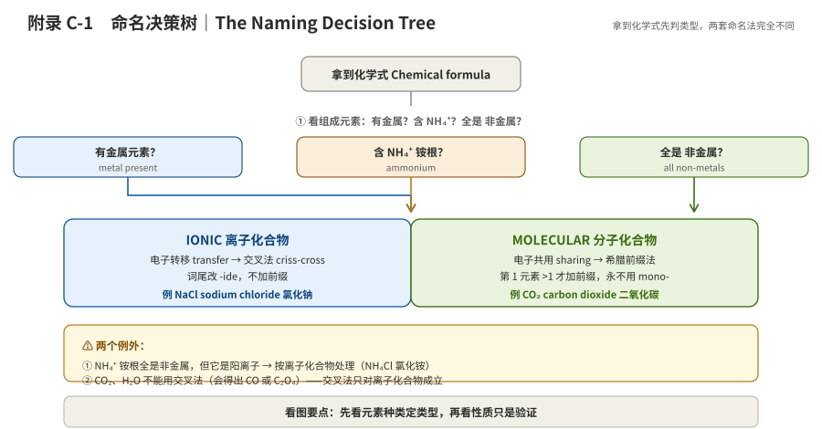
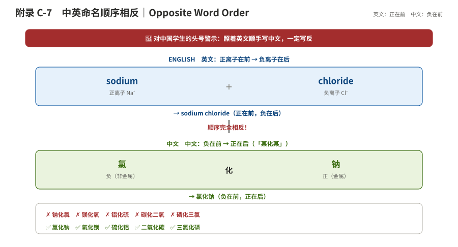
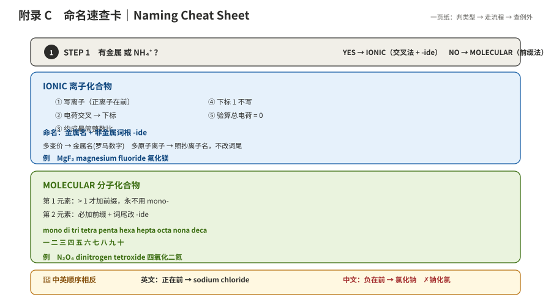

# 附录 C — Naming Cheat Sheet 命名速查表｜英中对照

## BC Science 9 · Chemistry Unit

> 🗂️ **生成时间**：2026-09-18 12:40
> 🗂️ **配套**：附录 A 词汇总表 · 附录 B 常见离子表 · 附录 D 元素中英对照表 · 附录 E 实验与练习单
> 🗂️ **主课文**：Ch.7 离子化合物 · Ch.8 分子（共价）化合物

## C-1 命名决策树｜The Naming Decision Tree

拿到一个化学式，**第一步永远是判断类型**，因为两套命名法完全不同。

**看图要点**：
- **金属 + 非金属 → 离子化合物**（用交叉法，不用前缀）。
- **非金属 + 非金属 → 分子化合物**（用前缀，**必须**加前缀）。
- **NH₄⁺ 铵根虽然全是非金属，但它是阳离子 → 按离子化合物处理**（如 NH₄Cl 氯化铵）。
- 例外：CO₂、H₂O 等虽然含"第二个元素"，但**不能**用交叉法（那会得出 CO 或 C₂O₄）。

## C-2 离子化合物命名｜Ionic Compound Naming（Ch.7）

### C-2.1 三条规则

> 📏 **规则 1（二元固定价 binary, fixed charge）**：金属名照写 + 非金属**词根 + `-ide`**
> 📏 **规则 2（多变价 multivalent metal）**：金属名 + **罗马数字（电荷数）** + 非金属词根 `-ide`
> 📏 **规则 3（含多原子离子 polyatomic ion）**：**直接照抄**该离子名，**不改词尾**

### C-2.2 五步操作流程

| 步骤 | English | 中文 | 例：Al³⁺ + O²⁻ |
|---|---|---|---|
| ① | Identify the ions | 写出两个离子（正离子在前） | Al³⁺　O²⁻ |
| ② | Criss-cross the charges | 电荷交叉变下标 | Al₂O₃ |
| ③ | Reduce to lowest ratio | 约成最简整数比 | 2:3 已最简 |
| ④ | Drop subscript 1 | 下标 1 不写 | Al₂O₃ |
| ⑤ | Name it | 命名 | aluminium oxide **氧化铝** |

### C-2.3 命名实例表

| 化学式 | 正离子 | 负离子 | English name | 中文名 |
|---|---|---|---|---|
| NaCl | Na⁺ | Cl⁻ | sodium chlor**ide** | **氯化钠** |
| MgO | Mg²⁺ | O²⁻ | magnesium ox**ide** | **氧化镁** |
| CaCl₂ | Ca²⁺ | Cl⁻ | calcium chlor**ide** | **氯化钙** |
| Al₂O₃ | Al³⁺ | O²⁻ | aluminium ox**ide** | **氧化铝** |
| Na₂S | Na⁺ | S²⁻ | sodium sulf**ide** | **硫化钠** |
| KBr | K⁺ | Br⁻ | potassium brom**ide** | **溴化钾** |
| CaF₂ | Ca²⁺ | F⁻ | calcium fluor**ide** | **氟化钙** |
| Mg₃N₂ | Mg²⁺ | N³⁻ | magnesium nitr**ide** | **氮化镁** |
| ZnS | Zn²⁺ | S²⁻ | zinc sulf**ide** | **硫化锌** |
| FeCl₂ | Fe²⁺ | Cl⁻ | **iron(II)** chlor**ide** | **氯化亚铁** |
| FeCl₃ | Fe³⁺ | Cl⁻ | **iron(III)** chlor**ide** | **氯化铁** |
| Cu₂O | Cu⁺ | O²⁻ | **copper(I)** ox**ide** | **氧化亚铜** |
| CuO | Cu²⁺ | O²⁻ | **copper(II)** ox**ide** | **氧化铜** |

### C-2.4 含多原子离子（词尾**不改**）

| 化学式 | 离子组合 | English name | 中文名 |
|---|---|---|---|
| NaOH | Na⁺ + OH⁻ | sodium **hydroxide** | **氢氧化钠** |
| KOH | K⁺ + OH⁻ | potassium **hydroxide** | **氢氧化钾** |
| Ca(OH)₂ | Ca²⁺ + 2 OH⁻ | calcium **hydroxide** | **氢氧化钙** |
| CaCO₃ | Ca²⁺ + CO₃²⁻ | calcium **carbonate** | **碳酸钙** |
| Na₂CO₃ | Na⁺ + CO₃²⁻ | sodium **carbonate** | **碳酸钠** |
| NaHCO₃ | Na⁺ + HCO₃⁻ | sodium **hydrogen carbonate** | **碳酸氢钠**（小苏打） |
| CaSO₄ | Ca²⁺ + SO₄²⁻ | calcium **sulfate** | **硫酸钙** |
| KNO₃ | K⁺ + NO₃⁻ | potassium **nitrate** | **硝酸钾** |
| NH₄Cl | NH₄⁺ + Cl⁻ | **ammonium** chlor**ide** | **氯化铵** |
| (NH₄)₂SO₄ | 2 NH₄⁺ + SO₄²⁻ | **ammonium sulfate** | **硫酸铵** |
| Ca₃(PO₄)₂ | 3 Ca²⁺ + 2 PO₄³⁻ | calcium **phosphate** | **磷酸钙** |

> **⚠ 括号规则**：多原子离子个数 **> 1** 必须加括号 —— Mg(OH)₂、Ca₃(PO₄)₂、Al₂(SO₄)₃。
> **绝对不能**写成 MgOH₂、CaPO₄₃、AlSO₄₃。

## C-3 分子化合物命名｜Molecular Compound Naming（Ch.8）

### C-3.1 希腊数字前缀表 Greek Prefixes（必背）

| 数目 | 1 | 2 | 3 | 4 | 5 | 6 | 7 | 8 | 9 | 10 |
|---|---|---|---|---|---|---|---|---|---|---|
| **Prefix** | mono- | di- | tri- | tetra- | penta- | hexa- | hepta- | octa- | nona- | deca- |
| **中文** | 一 | 二 | 三 | 四 | 五 | 六 | 七 | 八 | 九 | 十 |

### C-3.2 两条铁律

> 📏 **铁律 1 — 第一个元素**：只有数目 **> 1** 时才加前缀；数目 = 1 时**什么都不加，永不用 mono-**。
> 📏 **铁律 2 — 第二个元素**：**必须**加前缀，并把元素名结尾改成 **`-ide`**。

**拼写细节**：
- `mono- + oxide` → **monoxide**（去掉一个 o），不是 monooxide
- `tetra- + oxide` → **tetroxide**（去掉 a），不是 tetraoxide

### C-3.3 命名实例表

| 化学式 | 第一元素 | 第二元素 | English name | 中文名 |
|---|---|---|---|---|
| CO₂ | C=1 → **carbon**（不加） | O=2 → **di-**+oxide | carbon **di**oxide | **二氧化碳** |
| CO | C=1 → **carbon** | O=1 → **mon-**+oxide | carbon **mon**oxide | **一氧化碳** |
| SO₂ | S=1 → **sulfur** | O=2 → **di-**+oxide | sulfur dioxide | **二氧化硫** |
| SO₃ | S=1 → **sulfur** | O=3 → **tri-**+oxide | sulfur trioxide | **三氧化硫** |
| NO₂ | N=1 → **nitrogen** | O=2 → **di-**+oxide | nitrogen dioxide | **二氧化氮** |
| N₂O₄ | N=2 → **di-**+nitrogen | O=4 → **tetr-**+oxide | **di**nitrogen **tetr**oxide | **四氧化二氮** |
| N₂O | N=2 → **di-**+nitrogen | O=1 → **mon-**+oxide | dinitrogen monoxide | **一氧化二氮**（笑气） |
| PCl₃ | P=1 → **phosphorus** | Cl=3 → **tri-**+chloride | phosphorus **tri**chloride | **三氯化磷** |
| PCl₅ | P=1 → **phosphorus** | Cl=5 → **penta-**+chloride | phosphorus **penta**chloride | **五氯化磷** |
| CCl₄ | C=1 → **carbon** | Cl=4 → **tetra-**+chloride | carbon **tetra**chloride | **四氯化碳** |
| SF₆ | S=1 → **sulfur** | F=6 → **hexa-**+fluoride | sulfur **hexa**fluoride | **六氟化硫** |

## C-4 `-ide` 词尾对照表｜The `-ide` Suffix Chart

| 元素 | Element | 单原子阴离子 | English `-ide` | 中文（离子） | 中文（化合物中的"化"） |
|---|---|---|---|---|---|
| O | oxygen | O²⁻ | ox**ide** | 氧离子 | 氧化～（氧化镁） |
| Cl | chlorine | Cl⁻ | chlor**ide** | 氯离子 | 氯化～（氯化钠） |
| S | sulfur | S²⁻ | sulf**ide** | 硫离子 | 硫化～（硫化钠） |
| N | nitrogen | N³⁻ | nitr**ide** | 氮离子 | 氮化～（氮化镁） |
| F | fluorine | F⁻ | fluor**ide** | 氟离子 | 氟化～（氟化钙） |
| Br | bromine | Br⁻ | brom**ide** | 溴离子 | 溴化～（溴化钾） |
| I | iodine | I⁻ | iod**ide** | 碘离子 | 碘化～（碘化钠） |
| P | phosphorus | P³⁻ | phosph**ide** | 磷离子 | 磷化～（磷化钙） |
| H | hydrogen | H⁻ | hydr**ide** | 氢离子（负） | 氢化～（氢化钠） |
| C | carbon | C⁴⁻ | carb**ide** | 碳离子（负） | 碳化～（碳化钙） |

> 💡 **一句话**：**`-ide` = 中文的"化"**，且只用于**两种元素**的化合物（或单原子阴离子）。
> 含**多原子离子**时用 `-ate` / `-ite` / `-ide`（OH⁻）—— 见附录 B-4。

## C-5 罗马数字规则｜Roman Numerals（多变价金属）

| 罗马数字 | I | II | III | IV | V |
|---|---|---|---|---|---|
| 数值 | 1 | 2 | 3 | 4 | 5 |

**三条使用规则**：

1. **只有多变价金属才用**：Fe、Cu、Pb、Sn 等。
2. **罗马数字 = 该金属离子的电荷数**，写在金属名后的**括号里**，如 iron(III)。
3. **固定价金属绝不用**：Na⁺、K⁺、Mg²⁺、Ca²⁺、Al³⁺、Zn²⁺、Ag⁺ 一律不加。

| 金属 | 电荷 | English | 中文 | 例（氯化物） |
|---|---|---|---|---|
| Fe | +2 | iron(II) | **亚铁** | FeCl₂ iron(II) chloride **氯化亚铁** |
| Fe | +3 | iron(III) | **铁** | FeCl₃ iron(III) chloride **氯化铁** |
| Cu | +1 | copper(I) | **亚铜** | CuCl copper(I) chloride **氯化亚铜** |
| Cu | +2 | copper(II) | **铜** | CuCl₂ copper(II) chloride **氯化铜** |
| Pb | +2 | lead(II) | 铅(II) | PbO lead(II) oxide **氧化铅(II)** |
| Pb | +4 | lead(IV) | 铅(IV) | PbO₂ lead(IV) oxide **二氧化铅** |
| Sn | +2 | tin(II) | **亚锡** | SnCl₂ tin(II) chloride **氯化亚锡** |
| Sn | +4 | tin(IV) | 锡(IV) | SnCl₄ tin(IV) chloride **氯化锡(IV)** |

> 💡 **反推技巧**：已知化学式求罗马数字 → 用**负离子总电荷**倒推。
> 例：FeCl₃ 中 3 个 Cl⁻ 共 −3 → Fe 必为 +3 → **iron(III)**。

## C-6 必须背的俗名｜Common / Trivial Names

| Formula | Common name（**考试写这个**） | Systematic name（几乎不用） | 中文 |
|---|---|---|---|
| H₂O | **water** | dihydrogen monoxide | **水** |
| NH₃ | **ammonia** | nitrogen trihydride | **氨 / 氨气** |
| CH₄ | **methane** | carbon tetrahydride | **甲烷** |
| O₃ | **ozone** | trioxygen | **臭氧** |
| H₂O₂ | **hydrogen peroxide** | dihydrogen dioxide | **过氧化氢**（双氧水） |

> 💡 **记忆点**：见到这 5 个化学式**直接写俗名**，不要写系统名。

## C-7 ⭐ 英中命名互译规则｜English ↔ Chinese Naming（核心）

### C-7.1 顺序相反（最重要）

| | 英文 English | 中文 Chinese |
|---|---|---|
| **离子化合物** | **正离子在前**：`metal + non-metal-ide` | **负离子在前**：`某化某` = 非金属在前 + **化** + 金属在后 |
| **分子化合物** | **第一元素在前**：`prefix + element + prefix-element-ide` | **第二元素在前**：`[数目]第二元素 + 化 + [数目]第一元素` |

> **🚨 对中国学生的头号警示**：英文读到什么就顺着写中文，**一定写反**。
> ✗ "钠化氯" ✗ "镁化氧" ✗ "铝化硫" ✗ "碳化二氧" ✗ "磷化三氯"
> ✅ 氯化钠 ✅ 氧化镁 ✅ 硫化铝 ✅ 二氧化碳 ✅ 三氯化磷

### C-7.2 数字规则（两者平行，唯一区别是顺序）

- 英文用 **Greek prefixes**（mono-/di-/tri-…），中文用 **一二三…**。
- **同样**只在**第二个元素**前保留"一"（CO = 一氧化碳）；第一元素为 1 时**省略**（CO₂ = 二氧化碳，不说"一碳化二氧"）。

### C-7.3 20 组互译例句｜20 Bilingual Examples（自测用）

遮住一侧自测。

| # | 化学式 | English name | 中文名 |
|---|---|---|---|
| 1 | NaCl | sodium chloride | 氯化钠 |
| 2 | MgO | magnesium oxide | 氧化镁 |
| 3 | CaCl₂ | calcium chloride | 氯化钙 |
| 4 | Al₂O₃ | aluminium oxide | 氧化铝 |
| 5 | Na₂S | sodium sulfide | 硫化钠 |
| 6 | KBr | potassium bromide | 溴化钾 |
| 7 | CaF₂ | calcium fluoride | 氟化钙 |
| 8 | Mg₃N₂ | magnesium nitride | 氮化镁 |
| 9 | FeCl₂ | iron(II) chloride | 氯化亚铁 |
| 10 | FeCl₃ | iron(III) chloride | 氯化铁 |
| 11 | Cu₂O | copper(I) oxide | 氧化亚铜 |
| 12 | CuO | copper(II) oxide | 氧化铜 |
| 13 | NaOH | sodium hydroxide | 氢氧化钠 |
| 14 | CaCO₃ | calcium carbonate | 碳酸钙 |
| 15 | (NH₄)₂SO₄ | ammonium sulfate | 硫酸铵 |
| 16 | CO₂ | carbon dioxide | 二氧化碳 |
| 17 | CO | carbon monoxide | 一氧化碳 |
| 18 | N₂O₄ | dinitrogen tetroxide | 四氧化二氮 |
| 19 | PCl₃ | phosphorus trichloride | 三氯化磷 |
| 20 | SF₆ | sulfur hexafluoride | 六氟化硫 |

## C-8 命名常见错误清单｜Naming Error Checklist

| # | 错误 ✗ | 正确 ✓ | 原因 |
|---|---|---|---|
| 1 | 钠化氯 | **氯化钠** | 中文顺序：负离子在前 |
| 2 | sodium(I) chloride | **sodium chloride** | 固定价金属不加罗马数字 |
| 3 | iron chloride | **iron(II)/iron(III) chloride** | 多变价金属必须标罗马数字 |
| 4 | Mg₂O₂ | **MgO** | 必须约成最简比 |
| 5 | MgOH₂ | **Mg(OH)₂** | 多原子离子个数 >1 加括号 |
| 6 | monocarbon monoxide | **carbon monoxide** | 第一元素永不用 mono- |
| 7 | carbon dioxide 用于 NaCl | NaCl 是**离子**化合物 | 离子化合物不用前缀法 |
| 8 | sodium monochloride | **sodium chloride** | 同上 |
| 9 | monooxide | **monoxide** | 拼写：去掉一个 o |
| 10 | tetraoxide | **tetroxide** | 拼写：去掉 a |
| 11 | 把 III 当成"3 个铁" | III = **Fe³⁺ 的电荷** | 罗马数字是电荷不是个数 |
| 12 | CO₂ 写成"碳化二氧" | **二氧化碳** | 中文第二元素在前 |
| 13 | H₂O 写 dihydrogen monoxide | **water** | 俗名优先 |
| 14 | CaCl 写成 calcium chloride | **CaCl₂** | Ca²⁺ 需 2 个 Cl⁻ 才电荷为零 |
| 15 | NH₄Cl 当分子化合物 | **离子化合物**（含 NH₄⁺） | NH₄⁺ 是阳离子 |

## C-9 一页纸速查卡｜One-Page Quick Card（可打印）

---

*本附录与 Ch.7、Ch.8 正文严格一致。*
