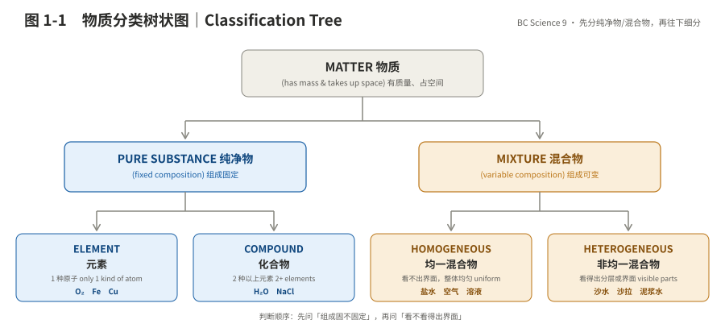
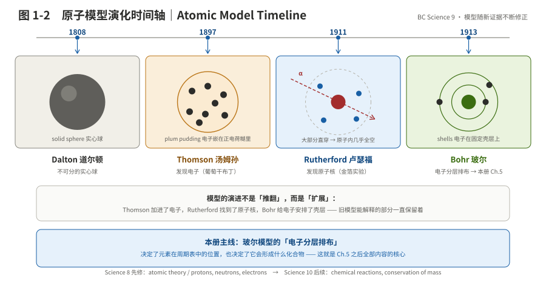
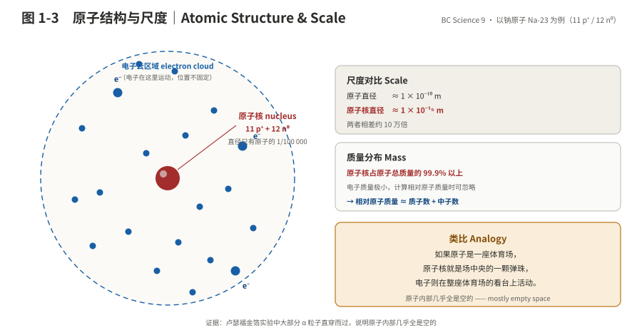

# Ch.1 — Matter, Atoms and Atomic Theory Review
## 第 1 章　物质、原子与原子论回顾

> 🗂️ **大纲对应**：衔接 Science 8「atomic theory and models / kinetic molecular theory / protons, neutrons, and quarks / electrons and leptons」
> ⏱️ **课时 Periods**：2　|　**前置**：无　|　**后继**：Ch.2
> 🗂️ **文件生成时间**：2026-09-18 00:53

## 1. 大纲对应｜Content Alignment

| 项目 | 内容 |
|---|---|
| BC Science 9 Content | 预备章，服务于 C1「element properties as organized in the periodic table」 |
| Science 8 衔接条目 | atomic theory and models；kinetic molecular theory (KMT)；protons, neutrons, and quarks；electrons and leptons |
| Curricular Competencies | [Evaluating] Evaluate the validity and limitations of a model or analogy；Consider the changes in knowledge over time as tools and technologies have developed |
| 是否超纲 | 否（复习性质） |

## 2. 学习目标｜Learning Objectives

**EN — By the end of this chapter, you should be able to:**
1. Classify matter into pure substances and mixtures, and further into elements and compounds.
2. Distinguish physical properties/changes from chemical properties/changes, using observable evidence.
3. Describe the historical development of atomic models: Dalton → Thomson → Rutherford → Bohr.
4. State the charge, mass and location of protons, neutrons and electrons.
5. Explain why scientific models change over time.

**中 — 本章结束后，你应当能够：**
1. 把物质分类为纯净物与混合物，并进一步分为单质（元素）与化合物。
2. 依据可观察的证据区分物理性质/变化与化学性质/变化。
3. 描述原子模型的四个发展阶段：道尔顿 → 汤姆孙 → 卢瑟福 → 玻尔。
4. 说出质子、中子、电子的电荷、质量与所在位置。
5. 解释科学模型为什么会随时间改变。

## 3. 概念解析｜Concept Explanations

### 3.1 Matter 物质

**定义 Definition**：Matter is anything that has mass and takes up space (volume).
**中文**：物质是具有质量并占有体积（空间）的一切东西。

- 判断"某物是不是物质"只需两问：有质量吗？占空间吗？
- 光、热、声音、电**不是**物质（它们没有静质量、不占空间），属于能量形式。
- **Matter 与 Material 的区别**：matter 是科学术语（抽象），material 指"材料"（具体用途），如 "insulating material 隔热材料"。

### 3.2 物质的分类｜Classification of Matter

- **Pure substance 纯净物**：组成固定、性质固定，有确定的熔点沸点。
  - **Element 元素（单质）**：只含**一种原子**，不能用化学方法再分解。如 O₂ 氧气、Fe 铁、Cu 铜。
  - **Compound 化合物**：**两种或更多种元素**按**固定质量比**化学结合而成，可用化学方法分解。如 H₂O 水、NaCl 食盐。
- **Mixture 混合物**：两种或更多种物质**物理混合**，各自保持原有性质，**比例可变**，可用物理方法（过滤、蒸发、磁选）分离。
  - **Homogeneous mixture 均一混合物 / Solution 溶液**：各处组成相同，看不出界面。如盐水、空气。
  - **Heterogeneous mixture 非均一混合物**：能看出不同部分。如沙水、沙拉、花岗岩。

> 📏 **关键判据**：化合物有**固定组成 + 化学式**；混合物没有化学式，配比可以任意变。

### 3.3 Properties and Changes 性质与变化

- **Physical property 物理性质**：不改变物质化学身份就能观察或测量的性质。如颜色、熔点、沸点、密度、硬度、导电性、溶解性。
- **Chemical property 化学性质**：描述物质**能**变成什么新物质。如可燃性 flammability、与酸反应、氧化性、稳定性。
- **Physical change 物理变化**：形态/状态变，但**分子本身没变**。如冰融化、玻璃破碎、食盐溶解、水蒸发。
- **Chemical change 化学变化**：生成了**新物质**。判据见 3.4。

### 3.4 Evidence of Chemical Change 化学变化的证据

| 英文证据 | 中文 | 生活例子 |
|---|---|---|
| colour change | 颜色改变 | 铁生锈（银灰→红棕）、苹果切面变褐 |
| gas produced / bubbles / effervescence | 产生气体、冒气泡 | 小苏打 + 醋冒 CO₂ |
| precipitate formed | 生成沉淀 | 硝酸铅 + 碘化钾 → 黄色沉淀 |
| temperature change (energy released/absorbed) | 温度变化（放热/吸热） | 生石灰加水放热；暖宝宝发热 |
| light produced | 发光 | 镁条燃烧发出耀眼白光 |
| new odour | 产生新气味 | 食物腐败 |

> ⚠️ **注意**：单一证据不一定充分（水沸腾也冒泡，是物理变化）。**必须综合判断，核心是"有没有生成新物质"。**

### 3.5 The Development of Atomic Theory 原子论的发展

| 年代 | 科学家 | 模型 English | 中文 | 关键实验与贡献 | 局限 |
|---|---|---|---|---|---|
| 1808 | John Dalton 道尔顿 | solid sphere / billiard ball model | 实心球模型 | 提出原子是不可分割的实心小球；同种元素原子相同 | 没发现内部结构 |
| 1897 | J.J. Thomson 汤姆孙 | plum pudding model | 葡萄干布丁模型（枣糕模型） | 阴极射线实验发现 **electron 电子**；原子是"正电荷糊里嵌着电子" | 没有原子核 |
| 1911 | Ernest Rutherford 卢瑟福 | nuclear model | 核式模型（行星模型） | **gold foil experiment 金箔实验**：绝大多数 α 粒子直穿，极少数大角度偏转 → 原子内部大部分是空的，中心有极小极密的 **nucleus 原子核** | 无法解释电子为何不坠入核内 |
| 1913 | Niels Bohr 玻尔 | Bohr model / shell model | 玻尔模型（电子层模型） | 电子只能在**特定能量的电子层**上运动 | 只对前 20 号元素好用；真实原子并非行星轨道 |

> **本册主角是玻尔模型**（Ch.5 详解）。BC 大纲要求学生能"考虑知识随工具技术发展而改变"——每一代模型都是被**新证据**推翻的，不是被"更聪明的人"推翻的。

### 3.6 Subatomic Particles 亚原子粒子

| Particle 粒子 | Charge 电荷 | Relative mass 相对质量 | Location 位置 | 中文 |
|---|---|---|---|---|
| Proton 质子 | +1 | 1 | 原子核内 | 决定元素种类 |
| Neutron 中子 | 0 | 1 | 原子核内 | 决定同位素 |
| Electron 电子 | −1 | 1/1836（约 0） | 核外电子层 | 决定化学性质 |

- **原子显电中性**：质子数 = 电子数，正负电荷抵消。
- 原子的质量几乎全部集中在**原子核**（核极小，但占了 99.9% 以上的质量）。
- Science 8 已提及更深一层：质子/中子由 **quarks 夸克**构成，电子属于 **leptons 轻子**——本册不展开。

## 4. 表格比对｜Comparison Tables

### 表 1-1　Pure Substance vs Mixture 纯净物与混合物

| 比较项 | Pure substance 纯净物 | Mixture 混合物 |
|---|---|---|
| 组成 | 固定 definite composition | 可变 variable composition |
| 化学式 | 有（如 H₂O, NaCl） | 无 |
| 熔沸点 | 固定（有确定的 melting/boiling point） | 不固定（一个区间） |
| 各成分性质 | 成分已失去原有性质（化合物） | 各成分**保持**原有性质 |
| 分离方法 | 只能用**化学**方法分解 | 可用**物理**方法（过滤、蒸发、蒸馏、磁选） |
| 例子 | 蒸馏水、氧气、食盐 | 空气、海水、牛奶、花岗岩 |

### 表 1-2　Element vs Compound 元素与化合物

| 比较项 | Element 元素 | Compound 化合物 |
|---|---|---|
| 原子种类 | 只有 1 种 | 2 种或更多种 |
| 化学式 | 用元素符号（Fe, O₂, He） | 用化学式（H₂O, CO₂, NaCl） |
| 能否分解 | **不能**用化学方法再分解 | 能（如电解水 → 氢气 + 氧气） |
| 性质 | 保持该元素自身性质 | **性质与组成元素完全不同**（Na 剧活泼 + Cl₂ 有毒 → NaCl 可食用） |
| 中文名 | 通常叫"某"（铁、氧气） | 叫"某化某""某酸某"（氯化钠、碳酸钙） |

### 表 1-3　Physical vs Chemical Change 物理变化与化学变化

| 比较项 | Physical change 物理变化 | Chemical change 化学变化 |
|---|---|---|
| 是否生成新物质 | 否 | **是** |
| 化学式是否改变 | 不变 | 改变 |
| 是否可逆（一般） | 容易可逆（冰↔水） | 通常难以逆转 |
| 能量变化 | 较小 | 通常较明显 |
| 关键词 | 熔化 melt、凝固 freeze、蒸发 evaporate、溶解 dissolve、破碎 break、弯曲 bend | 燃烧 burn、生锈 rust、腐蚀 corrode、发酵 ferment、腐烂 rot、爆炸 explode |
| 例子 | 冰块融化、糖溶于水、玻璃破碎 | 铁生锈、木柴燃烧、牛奶变酸 |

### 表 1-4　四代原子模型总对比

| 模型 | 英文关键词 | 发现的新粒子/结构 | 把原子想象成 |
|---|---|---|---|
| Dalton | indivisible sphere | — | 台球 |
| Thomson | electrons embedded in positive "pudding" | electron 电子 | 葡萄干布丁 |
| Rutherford | small dense positive nucleus | nucleus 原子核 | 体育场中心的一颗弹珠 |
| Bohr | electrons in fixed energy shells | energy shell 电子层 | 洋葱的多层结构 |

## 5. 图例说明｜Diagrams & Worked Examples

### 图 1-1　物质分类树状图｜Classification Tree

**看图要点**：判断分两步 —— 先问「组成固不固定」分出纯净物／混合物；再问「看不看得出界面」分出均一／非均一。

### 图 1-2　原子模型演化时间轴｜Atomic Model Timeline

**看图要点**：模型的演进不是「推翻」而是「扩展」——汤姆孙加进电子，卢瑟福找到原子核，玻尔给电子安排壳层；旧模型能解释的部分一直保留着。

### 图 1-3　原子结构与尺度｜Atomic Structure & Scale

**看图要点**：核很小却几乎占尽质量——直径只有原子的 1/100 000，却占 99.9% 以上的质量。所以相对原子质量 ≈ 质子数 + 中子数，电子质量可忽略。

### 图 1-4　例题：物质分类｜Worked Example

**题目**：把下列物质归类为 element / compound / homogeneous mixture / heterogeneous mixture：
(a) 铜丝　(b) 二氧化碳　(c) 空气　(d) 泥浆水　(e) 蒸馏水　(f) 黄铜（铜锌合金）

**解析**：

| 选项 | 判断依据 | 分类 | 中文 |
|---|---|---|---|
| (a) 铜丝 Cu | 只有铜一种原子，不可再分解 | element | 元素（单质） |
| (b) 二氧化碳 CO₂ | 有化学式，C 与 O 按 1:2 固定结合 | compound | 化合物 |
| (c) 空气 | N₂、O₂ 等物理混合，比例随地点略变 | homogeneous mixture | 均一混合物 |
| (d) 泥浆水 | 静置会分层，能看到固体颗粒 | heterogeneous mixture | 非均一混合物 |
| (e) 蒸馏水 H₂O | 有化学式，只有 H₂O 分子 | compound | 化合物 |
| (f) 黄铜 | 铜锌熔合，合金中两者比例可变 | homogeneous mixture | 均一混合物（固溶体） |

> ⚠️ **易错提醒**：合金（黄铜、钢）是**混合物**不是化合物，因为金属之间没有固定配比，也没有化学式。

### 图 1-5　例题：物理变化 vs 化学变化

**题目**：判断下列变化类型并说明理由。

| 现象 | 类型 | 理由（Evidence-based） |
|---|---|---|
| 蜡烛熔化 | 物理变化 physical | 石蜡只是由固态变液态，仍是石蜡，没有新物质 |
| 蜡烛燃烧 | 化学变化 chemical | 石蜡与 O₂ 反应生成 CO₂ 和 H₂O，发光放热 |
| 食盐溶于水 | 物理变化 physical | 蒸发水后食盐能原样回收，NaCl 未变 |
| 铁钉生锈 | 化学变化 chemical | 生成了新物质 Fe₂O₃·xH₂O，颜色由银灰变红棕 |
| 小苏打 + 醋 | 化学变化 chemical | 产生大量气泡（CO₂ 气体），是新物质 |

## 6. 核心词汇｜Key Vocabulary

| English | 中文 | 备注 |
|---|---|---|
| matter | 物质 | 有质量、占空间 |
| mass | 质量 | 单位 g / kg |
| volume | 体积 | 单位 mL / L / cm³ |
| pure substance | 纯净物 | 组成固定 |
| mixture | 混合物 | 组成可变 |
| element | 元素 / 单质 | 一种原子 |
| compound | 化合物 | 多种元素化合 |
| homogeneous | 均一的 | 看不出界面 |
| heterogeneous | 非均一的 | 看得出不同部分 |
| solution | 溶液 | 均一混合物 |
| physical property | 物理性质 | 不改变身份即可观察 |
| chemical property | 化学性质 | 描述能否变新物质 |
| physical change | 物理变化 | 无新物质 |
| chemical change | 化学变化 | 有新物质 |
| precipitate | 沉淀 | 两种溶液混合生成固体 |
| atomic theory | 原子论 | — |
| atomic model | 原子模型 | — |
| nucleus | 原子核 | 复数 nuclei |
| proton | 质子 | p⁺ |
| neutron | 中子 | n⁰ |
| electron | 电子 | e⁻ |
| quark | 夸克 | 构成质子/中子（Sci 8） |
| lepton | 轻子 | 电子属于此类（Sci 8） |
| gold foil experiment | 金箔实验 | 卢瑟福 |
| cathode ray | 阴极射线 | 汤姆孙 |
| energy shell | 电子层 | Ch.5 核心 |

## 7. 实验与活动｜Lab / Activity

### 活动 1-1　物质分类墙｜Classification Wall
- **类型**：小组活动（Pair & Share）
- **材料**：20 张常见物品图片卡（铜丝、食盐水、空气、钻石、牛奶、沙水、铁钉、糖、可乐、氧气瓶……）
- **步骤**：
  1. 两人一组，把 20 张卡按图 1-1 的树状图分成四类。
  2. 每组挑 3 张"最有争议"的卡，向全班说明理由。
  3. 全班投票，教师公布答案并点评。
- **训练能力**：[Processing and analyzing] Seek and analyze patterns；[Communicating]
- **安全**：无

### 活动 1-2　化学变化观察站｜Chemical Change Stations
- **类型**：教师演示 + 学生记录（Demo + Observation）
- **材料**：小苏打 + 白醋；钢丝绒 + 水（观察数天）；碘液 + 淀粉；镁带（教师点燃）
- **步骤**：学生用五感（**禁止品尝**）记录 before / after 的证据，填下表：

| Station | 观察前 Before | 观察后 After | 证据类型 | 类型判定 |
|---|---|---|---|---|
| 1 | | | | |
| 2 | | | | |

- **训练能力**：[Planning and conducting]；[Processing and analyzing] Use knowledge of scientific concepts to draw conclusions consistent with evidence
- **安全**：⚠ 护目镜 goggles 必须佩戴；镁带燃烧**禁止直视**（强紫外线伤眼）；教师演示为主

### 活动 1-3　原子模型时间轴海报｜Model Timeline Poster
- **类型**：四人小组项目
- **任务**：为四代原子模型各画一张图 + 一句"这个模型被什么证据推翻了"
- **训练能力**：[Evaluating] Evaluate the validity and limitations of a model；Consider the changes in knowledge over time as tools and technologies have developed
- **评价量规**：科学性 40%、图示清晰度 30%、"模型为何改变"的解释 30%

## 8. 常见易错点｜Common Misconceptions

| # | 错误认识 Misconception | 正确理解 Correction |
|---|---|---|
| 1 | "化合物就是混合物" | 化合物有**固定配比和化学式**（H₂O 永远是 2:1），混合物没有（盐水可浓可淡）。 |
| 2 | "冰融化成水是化学变化，因为样子变了" | 只是状态变，分子仍是 H₂O，**物理变化**。 |
| 3 | "冒泡就一定是化学变化" | 水沸腾也冒泡。必须问：**气泡是不是新物质？** |
| 4 | "原子是实心的" | 原子内部几乎全是空的（Rutherford 金箔实验）。 |
| 5 | "电子质量跟质子差不多" | 电子质量约为质子的 **1/1836**，计算原子质量时可忽略。 |
| 6 | "模型错了，所以科学家很笨" | 模型是**当时证据下的最佳解释**，被新证据推动而更新——这正是科学的运作方式。 |
| 7 | "合金是化合物" | 合金是**混合物**（无固定配比、无化学式）。 |
| 8 | "溶解是化学变化，因为固体'消失'了" | 蒸发可回收原物质，**物理变化**。 |

## 9. 答题评估｜Assessment

### A 组：基础题｜Foundational（每题 2 分，共 20 分）

**A1.** 写出物质的定义，并说明判断某物是否为物质的两个条件。
**A2.** 把下列物质分类：氧气 O₂、海水、碳酸钙 CaCO₃、牛奶、铝箔 Al。
**A3.** 举例说明化合物与组成它的元素性质完全不同（至少 1 例）。
**A4.** 列出化学变化的三条证据。
**A5.** 填写亚原子粒子表：

| Particle | Charge | Location |
|---|---|---|
| proton | | |
| neutron | | |
| electron | | |

**A6.** Thomson 通过什么实验发现了什么粒子？
**A7.** Rutherford 的金箔实验得出了什么结论？
**A8.** Bohr 模型的核心主张是什么？
**A9.** 为什么原子整体上显电中性？
**A10.** 判断：蜡烛熔化是化学变化。（对 / 错，并说明理由）

### B 组：应用题｜Applied（每题 5 分，共 20 分）

**B1.** 小明说："糖溶于水后看不见了，糖消失了，所以是化学变化。"请指出错误并给出正确解释，同时设计一个实验证明你的观点。

**B2.** 下表是某未知物质的测试结果，判断它是纯净物还是混合物，并说明依据：

| 测试 | 结果 |
|---|---|
| 熔点 | 在 112–118 ℃ 之间逐渐熔化 |
| 外观 | 放大镜下可见两种不同颜色的颗粒 |
| 溶解性 | 加水后部分溶解，部分沉淀 |

**B3.** 用原子模型的发展史，说明"科学知识为什么会随时间改变"，举出两个模型被推翻的具体原因。

**B4.** 某固体加热后变成气体，冷却后又变回原固体，且质量不变。这是物理变化还是化学变化？请给出推理过程。

### C 组：挑战题｜Challenge（每题 10 分，共 20 分）

**C1.** 道尔顿认为"原子不可分割"。现代物理发现质子由夸克构成。请论述：这是否意味着道尔顿"完全错了"？科学模型的价值应该如何评价？

**C2.** 设计一套实验方案，区分桌上的三包白色粉末：食盐（NaCl）、白糖（C₁₂H₂₂O₁₁）、小苏打（NaHCO₃）。要求写出：变量、步骤、预期现象、判据、安全注意事项。**不得品尝**。

---

### 参考答案｜Answer Key

**A 组**
- A1. Matter is anything that has mass and takes up space. 两个条件：有质量、占有体积（空间）。
- A2. 氧气 O₂ = element 元素；海水 = homogeneous? 不，海水含泥沙等，通常视为 heterogeneous mixture（若过滤后的盐水则为 homogeneous）——答 mixture 混合物即可；碳酸钙 CaCO₃ = compound 化合物；牛奶 = heterogeneous mixture 非均一混合物；铝箔 Al = element 元素。
- A3. 例：Na（遇水爆炸的活泼金属）+ Cl₂（有毒黄绿色气体）→ NaCl（食盐，可食用）。或 H₂ + O₂（助燃）→ H₂O（灭火）。
- A4. 任答三条：colour change 变色、gas produced 生成气体、precipitate formed 生成沉淀、temperature change 温度变化、light produced 发光、new odour 新气味。
- A5. proton: +1, 原子核内；neutron: 0, 原子核内；electron: −1, 核外电子层。
- A6. Cathode ray experiment 阴极射线实验，发现了 electron 电子。
- A7. 原子内部大部分是空的；中心有一个**极小、极密、带正电**的原子核（nucleus）。
- A8. 电子只能在**特定的、固定能量的电子层（energy shells）**上运动，不能随意处在这两者之间。
- A9. 质子数 = 电子数，+1 与 −1 电荷数相等，整体抵消。
- A10. **错**。石蜡只是由固态变为液态，化学式未变，没有新物质生成，属于 physical change 物理变化。（蜡烛**燃烧**才是化学变化。）

**B 组（要点）**
- B1. 错误：糖并未消失，只是以分子形式分散在水中（溶解）。实验：把糖水加热蒸发（或静置蒸发），水蒸发后会析出白色糖晶体，证明糖仍存在、性质未变 → 物理变化。注意：蒸发时不要加热到糖焦化（那会变成化学变化）。
- B2. **混合物**。依据：① 熔点是一个区间（112–118 ℃）而非固定值 → 纯净物有固定熔点；② 放大镜下可见两种不同颗粒 → 非均一；③ 部分溶解部分沉淀 → 含有不同物质。三条全部指向混合物。
- B3. 参考要点：汤姆孙发现电子 → 道尔顿"原子不可分"被推翻；卢瑟福金箔实验中少数 α 粒子大角度反弹 → 汤姆孙"正电荷均匀分布"被推翻。原因：**新工具（阴极射线管、α 粒子源）产生了新证据**。模型的价值在于它能在当时解释已知现象并做出可检验的预测，即使后来被修正也是进步的阶梯。
- B4. **物理变化**（升华与凝华，如碘 I₂）。推理：变化可逆、冷却后能恢复原状、质量不变（原子种类与数目未变）→ 未生成新物质。注意"可逆"不是充分条件，但结合"质量与性质完全恢复"可判定为物理变化。

**C 组（评分要点）**
- C1. 参考要点：道尔顿在**化合物定比定律、质量守恒**等当时已知事实上做出了正确且可检验的预测，其模型在"化学反应层面"依然有效（化学反应中原子确实不可分）。"不可分割"在化学层面成立，在核物理层面不成立。评价模型应看**解释力与预测力**，而非是否与今天的终极真理一致。**模型是工具，不是真理本身。**（满分需体现"模型的适用范围/局限性"这一概念。）
- C2. 参考方案：
  - 变量：自变量 = 粉末种类；因变量 = 反应现象；控制变量 = 水的体积与温度、粉末质量、测试容器。
  - 步骤：① 各取等量粉末分别加水，观察溶解性与是否结块；② 向三种溶液中分别滴加白醋，观察是否冒泡；③ 对不冒泡的两种做导电性测试（电池 + 灯泡）。
  - 预期现象与判据：小苏打 + 醋 → 剧烈冒泡（CO₂），**先被识别出**；食盐溶液导电（离子化合物，灯泡亮）；白糖溶液不导电（分子化合物，灯泡不亮）。
  - 安全：⚠ 全程佩戴护目镜；**禁止品尝任何物质**；醋避免入眼；实验后洗手；剩余溶液按教师指示处理。

### 评分量规｜Rubric

| 维度 | 优秀 (A) | 达标 (B) | 待改进 (C) |
|---|---|---|---|
| 术语准确性 | 中英术语全部正确，化学式书写规范 | 主要术语正确，偶有大小写错误 | 术语混淆（如 element/compound） |
| 概念理解 | 能解释"为什么"，不止于记忆 | 能正确分类但解释较浅 | 只能背诵定义，不能应用 |
| 证据使用 | 结论明确引用观察证据 | 有证据但不充分 | 无证据，凭感觉 |
| 表达 | 中英双语术语使用得当，逻辑清晰 | 表达清楚 | 表述混乱 |
| 安全（实验/方案题） | 主动列出安全与伦理注意事项 | 提及安全 | 未考虑安全 |

> 👩‍🏫 **教师提示**：A 组用于形成性检测（课堂 10 分钟）；B 组用于单元小测；C 组用于差异化挑战或科学写作任务。
> 🌐 **双语政策**：术语部分允许中英双语作答；**化学式与英文命名必须使用英文**。

## 10. 回扣核心概念｜Connection to the Big Idea

> 🎯 **Big Idea**：*The electron arrangement of atoms impacts their chemical nature.*
> **原子的电子排布决定其化学性质。**

本章还没有正式进入电子排布，但已经埋下了两颗种子：

1. **电子属于核外，且在特定区域活动**（Thomson 发现电子 → Bohr 把它排进电子层）→ 直接通向 Ch.5。
2. **化学性质由"原子如何重新组合"决定**（化学变化 = 原子重排）→ 而原子如何重排，取决于最外层电子 → 这就是整册的主线。

**思考题（下章预热）**：为什么钠（Na）和钾（K）都能与水剧烈反应，而氖（Ne）什么都不做？答案藏在最外层电子数里——我们将在 Ch.4 和 Ch.5 揭晓。

---

*本章对应框架文件 `00_讲义章节框架_Course_Framework.md` Ch.1。下一章：Ch.2 元素、元素符号与元素周期表。*
