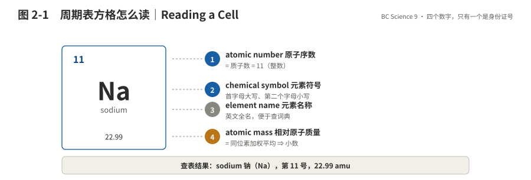
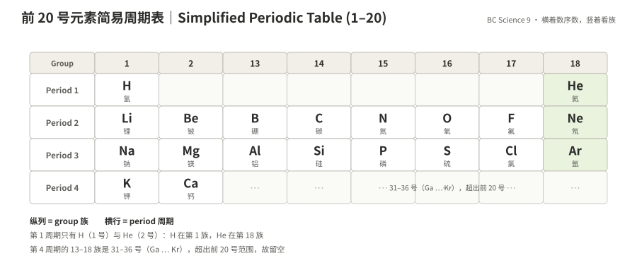
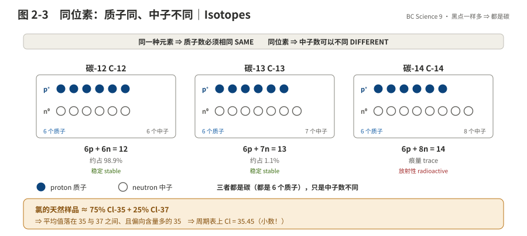
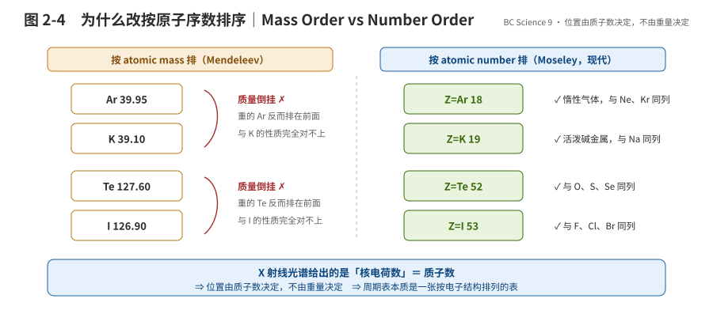

# Ch.2 — Elements, Symbols and the Periodic Table
## 第 2 章　元素、元素符号与元素周期表

> 🗂️ **大纲对应**：BC Science 9 Content C1「element properties as organized in the periodic table」
> ⏱️ **课时 Periods**：2　|　**前置**：Ch.1 物质、原子与原子论　|　**后继**：Ch.3 周期表的组织
> 🗂️ **文件生成时间**：2026-09-18 00:53

## 1. 大纲对应｜Content Alignment

| 项目 | 内容 |
|---|---|
| BC Science 9 Content（官方原文） | **element properties as organized in the periodic table** |
| 本章承担的子条目 | element 的定义；chemical symbol 的读写规则；periodic table cell 的四项信息；atomic number 与 atomic mass 的区别；isotope 概念；周期表的历史改进 |
| Curricular Competencies | [Processing and analyzing] Seek and analyze patterns, trends, and connections（读表找规律）；[Evaluating] Consider the changes in knowledge over time as tools and technologies have developed（门捷列夫→莫塞莱）；[Communicating] 使用科学语言与符号；[Applying and innovating] 用符号表达化学信息 |
| 是否超纲 | 否（全部在 C1 范围内） |
| 超纲提示 | 化学式配平、核反应方程式、电子排布的量子解释均**不属于** Science 9；凡涉及处一律标注【🔭 Extension → Science 10】 |

## 2. 学习目标｜Learning Objectives

**EN — By the end of this chapter, you should be able to:**
1. Define an element as a pure substance made of only one kind of atom that cannot be broken down by chemical means.
2. Write chemical symbols correctly, applying the capitalisation rule and recognising symbols derived from Latin names.
3. Read the four pieces of information in a periodic table cell: atomic number, symbol, name and atomic mass.
4. Explain why most atomic masses are decimal numbers, using isotopes and weighted averages.
5. Describe how Mendeleev's table differed from the modern table, and why ordering by atomic number solved the problem.

**中 — 本章结束后，你应当能够：**
1. 给出元素的定义：由同一种原子组成、不能用化学方法再分解的纯净物。
2. 正确书写元素符号（大小写规则），并识别源自拉丁文的符号。
3. 从周期表方格中读出四项信息：原子序数、符号、名称、相对原子质量。
4. 用同位素与加权平均解释"为什么相对原子质量大多是小数"。
5. 说明门捷列夫周期表与现代周期表的差异，以及改用原子序数排序为何能纠正错位。

## 3. 概念解析｜Concept Explanations

### 3.1 Element 元素

**定义 Definition**：An **element** is a pure substance made of only one kind of atom, which **cannot be broken down into simpler substances by chemical means**.
**中文**：元素是由**同一种原子**组成的纯净物，**不能用化学方法**再分解成更简单的物质。

- 判断"是不是元素"只有一条标准：**能不能用化学反应把它分成别的物质**。氧气（O₂）电解后仍是氧，是元素；水（H₂O）电解出氢气和氧气，是化合物。
- **约 90 余种**元素存在于自然界（常引用"天然元素约 92 种"，指 1–94 号中除 Tc 锝、Pm 钷以外者，后两者仅有痕量）。
- 迄今已确认的元素**共 118 种**（1 号 hydrogen 氢 → 118 号 Og），95 号及以后基本由人工合成，许多只存在极短时间。
- 元素既能以**单质**形式存在（Fe 铁、O₂ 氧气、He 氦），也能存在于**化合物**中（食盐里的 Na、水里的 H 与 O）——元素没有被"消灭"，只是被化学结合了。

### 3.2 Chemical symbol 元素符号

**定义 Definition**：A **chemical symbol** is a one- or two-letter shorthand used worldwide to represent an element.
**中文**：元素符号是全世界通用的 1–2 个字母缩写，表示一种元素。

**三条书写规则：**

| 规则 Rule | 说明 Explanation | 正例 ✓ | 反例 ✗ |
|---|---|---|---|
| 单字母必须大写 | single letter = capital | H、B、C、N、O、F、P、S、K、W | h、c、p |
| 双字母"首大写、次小写" | first capital, second lower-case | He、Li、Na、Cl、Ca、Fe | HE、NA、CL、ca |
| 写法不可随意改动 | never change the case | Co（钴） | CO（一氧化碳） |

- **为什么大小写如此重要**：`Co` 是元素钴（cobalt），`CO` 是化合物一氧化碳。**差一个字母的大小写，意义完全不同。**
- 符号有**双重含义**：宏观表示"某种元素"，微观表示"该元素的一个原子"。例如 `Na` 既指钠元素，也指一个钠原子。
- 中文搭配习惯：写"钠 Na"或"sodium 钠"，不要把中文塞进符号里。

### 3.3 Symbols from Latin names 源自拉丁文的元素符号

有些元素的符号与英文名对不上，因为它来自**拉丁名**（Latin name）——这是本章最容易丢分的地方。

| English name | 中文 | Latin / other origin 来源 | Symbol |
|---|---|---|---|
| sodium | 钠 | **natrium** | Na |
| potassium | 钾 | **kalium** | K |
| iron | 铁 | **ferrum** | Fe |
| copper | 铜 | **cuprum** | Cu |
| silver | 银 | **argentum** | Ag |
| gold | 金 | **aurum** | Au |
| mercury | 汞 | **hydrargyrum**（"液态银"） | Hg |
| lead | 铅 | **plumbum** | Pb |
| tin | 锡 | **stannum** | Sn |
| antimony | 锑 | **stibium** | Sb |
| tungsten | 钨 | **wolfram**（德语 Wolfram） | W |

> 💡 **词根联想**：Pb 铅 ← plumbum，英语 plumbing（管道工程）源于"用铅做管子"的时代；Au 金 ← aurum，与 aurora（极光）共享"发光"词根。
> 注意 **zinc 锌（Zn）** 的符号与英文名接近，源自德语 *Zink*，**不是**拉丁来源。

### 3.4 The periodic table cell 周期表方格（四要素）

见 **图 2-1**。以钠（Na）为例，方格里给出四项信息：

1. **Atomic number 原子序数**：左上角整数，**等于质子数**，也等于中性原子的电子数。
2. **Chemical symbol 元素符号**：中间的 1–2 个字母。
3. **Element name 元素名称**：英文全名（有些表另附拉丁名）。
4. **Atomic mass 相对原子质量**：下方小数，单位记作 **amu**（atomic mass unit 原子质量单位）。

### 3.5 Atomic number vs Atomic mass 原子序数与相对原子质量

- **Atomic number 原子序数**（Z）：一定是**整数**，等于核内质子数，**决定这是哪种元素**。第 11 号一定是 Na，第 79 号一定是 Au。
- **Atomic mass 相对原子质量**：几乎总是**小数**（Cl = 35.45，Cu = 63.55），因为它是天然同位素的**加权平均值**。
- **amu 的基准**：1 amu = **碳-12 原子质量的 1/12**；质子与中子各约 1 amu，电子约 1/1836 amu（可忽略）。
- **严谨说法**：周期表上那一行严格讲是 **relative atomic mass**（一个比值）；教材常写 atomic mass 并加单位 amu，两者数值相同。
- **别混淆 mass number 质量数**：某一个同位素的质量数 A = 质子 + 中子，是整数，如碳-12 的 A = 12。【⏭️ 预告 Ch.5】

### 3.6 Isotope 同位素 — 为什么相对原子质量是小数

**定义 Definition**：**Isotopes** are atoms of the same element with the **same number of protons** but a **different number of neutrons**.
**中文**：同位素是**质子数相同、中子数不同**的同种元素原子。

- 质子数相同 → 仍是**同一种元素**，化学性质几乎相同；
- 中子数不同 → **质量不同**，物理性质（质量、密度、放射性）有差别。
- 例：**carbon-12**（6p + 6n）、**carbon-13**（6p + 7n）、**carbon-14**（6p + 8n），三者都是碳。

**加权平均算式：**

```
average atomic mass = Σ（同位素质量 × 该同位素的天然所占比例）
```

天然氯约 **3/4 是 Cl-35、1/4 是 Cl-37**，平均值落在 35 与 37 之间但更靠近 35 —— 所以周期表写 35.45，而不是 36。

> 💡 **一句话记住**：atomic number 是"数出来的"（必为整数）；atomic mass 是"称完再平均的"（所以是小数）。

### 3.7 From Mendeleev to Moseley 从门捷列夫到莫塞莱

| 时间 | 人物 | 排序依据 | 关键做法 | 结果与局限 |
|---|---|---|---|---|
| 1869 | **Dmitri Mendeleev 门捷列夫**（俄） | **atomic mass 原子质量**递增 | 把性质相似的元素上下对齐；**留空位**并预测未知元素的性质（如"类铝"eka-aluminium、"类硅"eka-silicon） | 后来发现的 **Ga 镓（1875）、Ge 锗（1886）、Sc 钪（1879）** 与其预测高度吻合 → 周期表声望大增；但按质量排会出现"倒挂" |
| 1913–1914 | **Henry Moseley 莫塞莱**（英） | **atomic number 原子序数**递增（据 X 射线实验测得的核电荷数） | 用 X 射线光谱证明"决定元素身份的是质子数/核电荷数"而非质量 | 错位全部消失 → 现代周期表诞生 |

- **错位三例**：**Ar 39.95 必须排在 K 39.10 之前**、**Te 127.60 必须排在 I 126.90 之前**、**Co 58.93 必须排在 Ni 58.69 之前**——只要按质量排就必错。
- **科学史意义**：不是"门捷列夫错了"，而是**新工具（X 射线光谱）产生新证据**，让同一张表更可靠；这正对应 BC 的能力要求 "Consider the changes in knowledge over time as tools and technologies have developed"。

## 4. 表格比对｜Comparison Tables

### 表 2-1　Atomic number vs Atomic mass｜原子序数与相对原子质量

| 比较项 Item | Atomic number 原子序数 | Atomic mass 相对原子质量 |
|---|---|---|
| 数值形态 | 整数（1, 2, 3 …） | 小数（1.008, 35.45 …） |
| 代表什么 | 核内**质子数**（中性原子里 = 电子数） | 天然同位素的**加权平均质量** |
| 单位 | 无 | amu（严格相对值无单位） |
| 是否决定元素身份 | **是**（换一个质子就换了元素） | 否（同位素变而元素不变） |
| 会不会变 | 同种元素恒定 | 来源不同的样品可有极微小差异 |
| 例子 | H=1，Na=11，Au=79 | H=1.008，Na=22.99，Au=196.97 |

### 表 2-2　符号书写正误对照｜Correct vs Incorrect Symbols

| 中文 | English name | 正确符号 ✓ | 常见错写 ✗ | 错在哪 |
|---|---|---|---|---|
| 氢 | hydrogen | H | h | 单字母须大写 |
| 氦 | helium | He | HE | 第二字母须小写 |
| 钠 | sodium | Na | NA / na | 第二字母小写 / 首字母大写 |
| 氯 | chlorine | Cl | CL | 第二字母须小写 |
| 镁 | magnesium | Mg | MG / mg | 同上 |
| 钴 | cobalt | Co | CO | CO 是一氧化碳分子 |

### 表 2-3　前 20 号元素速查表｜Elements 1–20 Quick Reference

| Atomic number 序数 | Symbol 符号 | English name | 中文 | Atomic mass 相对原子质量 |
|---|---|---|---|---|
| 1 | H | hydrogen | 氢 | 1.008 |
| 2 | He | helium | 氦 | 4.003 |
| 3 | Li | lithium | 锂 | 6.94 |
| 4 | Be | beryllium | 铍 | 9.01 |
| 5 | B | boron | 硼 | 10.81 |
| 6 | C | carbon | 碳 | 12.01 |
| 7 | N | nitrogen | 氮 | 14.01 |
| 8 | O | oxygen | 氧 | 16.00 |
| 9 | F | fluorine | 氟 | 19.00 |
| 10 | Ne | neon | 氖 | 20.18 |
| 11 | Na | sodium | 钠 | 22.99 |
| 12 | Mg | magnesium | 镁 | 24.31 |
| 13 | Al | aluminium / aluminum | 铝 | 26.98 |
| 14 | Si | silicon | 硅 | 28.09 |
| 15 | P | phosphorus | 磷 | 30.97 |
| 16 | S | sulfur / sulphur | 硫 | 32.06 |
| 17 | Cl | chlorine | 氯 | 35.45 |
| 18 | Ar | argon | 氩 | 39.95 |
| 19 | K | potassium | 钾 | 39.10 |
| 20 | Ca | calcium | 钙 | 40.08 |

> 建议把表 2-3 做成四联记忆卡（English name / symbol / 中文 / 序数），每天 5 分钟滚动复习。

### 表 2-4　Mendeleev vs Modern Periodic Table｜门捷列夫表与现代周期表

| 比较项 | Mendeleev's table（1869） | Modern periodic table（today） |
|---|---|---|
| 排序依据 | increasing **atomic mass** | increasing **atomic number** |
| 收载元素数 | 63 种 | 118 种 |
| 是否留空位 | 是，并**预测未知元素性质** | 空位已被填满（含人造元素） |
| 主要问题 | 少数位置倒挂（Ar/K、Te/I、Co/Ni） | 无错位，位置与电子排布一致 |
| 关键修正者 | — | **Henry Moseley**（X 射线光谱，1913） |
| 共同点 | 都把**性质相似的元素上下对齐**（同一纵列） | 同左 |

### 表 2-5　同一元素的同位素对比｜Isotopes Compared

| 同位素 | protons 质子 | neutrons 中子 | mass number 质量数 | abundance 天然占比 |
|---|---|---|---|---|
| carbon-12 碳-12 | 6 | 6 | 12 | 约 98.9% |
| carbon-13 碳-13 | 6 | 7 | 13 | 约 1.1% |
| carbon-14 碳-14 | 6 | 8 | 14 | 痕量（放射性，考古测年用） |
| chlorine-35 氯-35 | 17 | 18 | 35 | 约 75.8% |
| chlorine-37 氯-37 | 17 | 20 | 37 | 约 24.2% |

## 5. 图例说明｜Diagrams & Worked Examples

### 图 2-1　周期表方格怎么读｜Reading a Cell




**看图要点**：①在左上角且必为整数；②中间的缩写即元素符号；③英文全名便于查词典；④下方小数是平均值，不是某一个原子的质量。**左上角那个整数才是"身份证号"。**

### 图 2-2　前 20 号元素简易周期表｜Simplified Periodic Table (1–20)




**看图要点**：顺着横行从左往右数，序数连续增长（1, 2, 3 …）；第 1 周期只装得下 2 个元素，暗示第 1 电子层容量为 2【🔗 Ch.5】。

### 图 2-3　同位素：质子同、中子不同｜Isotopes




**看图要点**：三个核中**黑点数一样**（6 个质子 → 都是碳），**白圈数不同**（中子 6/7/8 → 质量不同）。周期表上的小数，就是把这类原子按天然比例**加权平均**的结果。

### 图 2-4　为什么改按原子序数排序｜Mass Order vs Number Order




**看图要点**：左边的箭头是"按重量该有的先后"，右边才是"按性质该处的位置"。两者冲突时，现代表**相信性质、用原子序数重排**——说明周期表本质上是一张**按电子结构排列的表**【⏭️ 预告 Ch.5】。

### 图 2-5　例题：写符号与说来源｜Worked Example

**题目**：写出下列元素的正确符号，并说明其来源是"英文名"还是"拉丁 / 其他古名"。
(a) sodium 钠　(b) potassium 钾　(c) iron 铁　(d) copper 铜　(e) silver 银　(f) gold 金
(g) mercury 汞　(h) lead 铅　(i) tin 锡　(j) antimony 锑　(k) tungsten 钨　(l) neon 氖

**解析**：

| 题号 | English name | Symbol 符号 | 中文 | 来源 origin |
|---|---|---|---|---|
| (a) | sodium | **Na** | 钠 | Latin **natrium** |
| (b) | potassium | **K** | 钾 | Latin **kalium** |
| (c) | iron | **Fe** | 铁 | Latin **ferrum** |
| (d) | copper | **Cu** | 铜 | Latin **cuprum** |
| (e) | silver | **Ag** | 银 | Latin **argentum** |
| (f) | gold | **Au** | 金 | Latin **aurum** |
| (g) | mercury | **Hg** | 汞 | Latin **hydrargyrum** |
| (h) | lead | **Pb** | 铅 | Latin **plumbum** |
| (i) | tin | **Sn** | 锡 | Latin **stannum** |
| (j) | antimony | **Sb** | 锑 | Latin **stibium** |
| (k) | tungsten | **W** | 钨 | 德语 **Wolfram** |
| (l) | neon | **Ne** | 氖 | English name（源自希腊语 neos） |

> ⚠️ **易错提醒**：`Hg` 写成 `HG`、`Ag` 写成 `ag`、`Pb` 写成 `PB` 都算错——**首字母大写 + 第二字母小写**永远适用，不论符号来自哪种语言。

### 图 2-6　例题：算加权平均原子质量｜Worked Example

**题目**：硼（B）有两种稳定同位素：B-10 占 19.9%，B-11 占 80.1%。
(a) 计算硼的相对原子质量；(b) 周期表上硼为 10.81，与你的结果一致吗？为何有微小差别？

**解析**：

| 步骤 Step | 计算 Calculation | 说明 Explanation |
|---|---|---|
| 1. 百分数 → 小数 | 19.9% → **0.199**；80.1% → **0.801** | 二者相加应等于 1 |
| 2. 加权相乘 | 10 × 0.199 = **1.99**；11 × 0.801 = **8.811** | 同位素质量 × 所占比例 |
| 3. 求和 | 1.99 + 8.811 = **10.801 ≈ 10.80** | 平均值必落在两个质量数之间 |
| 4. 对照周期表 | 计算值 10.80 vs 表值 **10.81** | 差别 < 0.01 |
| 5. 解释差别 | 精确同位素质量为 10.013 与 11.009（并非正好等于 10 和 11），用精确值重算即得 10.81 | 用整数近似只是简化 |

**答案**：(a) 约 **10.80**；(b) 基本一致；微小差别来自用整数质量数代替精确同位素质量。

> 🔍 **快速检查法**：算出的平均值必须落在最大与最小同位素质量之间，且**偏向含量高的那一个**；否则一定算错了。

## 6. 核心词汇｜Key Vocabulary

| English | 中文 | 备注 |
|---|---|---|
| element | 元素 / 单质 | 一种原子、不能化学分解 |
| chemical symbol | 元素符号 | 1–2 字母，首字母大写 |
| periodic table | 元素周期表 | 按原子序数排列 |
| atomic number | 原子序数 | = 质子数，整数 |
| proton | 质子 | p⁺，决定元素身份 |
| neutron | 中子 | n⁰，决定同位素 |
| electron | 电子 | e⁻，决定化学性质 |
| atomic mass | 相对原子质量 | 同位素加权平均，小数 |
| relative atomic mass | 相对原子质量 | 上条的严格写法 |
| amu (atomic mass unit) | 原子质量单位 | 基准：碳-12 质量的 1/12 |
| isotope | 同位素 | 质子同、中子不同 |
| mass number | 质量数 | 质子 + 中子（整数）【🔗 Ch.5】 |
| abundance | 丰度 / 所占比例 | 加权平均中的"权" |
| weighted average | 加权平均值 | 而非简单算术平均 |
| cell | （周期表）方格 | 含四项信息，见图 2-1 |
| Mendeleev | 门捷列夫 | 1869，按质量排、留空位 |
| Moseley | 莫塞莱 | 1913，改按原子序数排 |
| X-ray spectroscopy | X 射线光谱学 | 提供"按序数排"的新证据 |
| Latin name | 拉丁名 | Na/K/Fe/Cu/Ag/Au 等的来源 |
| naturally occurring | 天然存在的 | 约 90 余种 |
| synthetic element | 人造元素 | 多在加速器中合成、极不稳定 |

## 7. 实验与活动｜Lab / Activity

### 活动 2-1　元素符号四联卡｜Symbol Flash Cards
- **类型**：个人 / 双人竞技（Drill & Game）
- **材料**：卡纸（或附录 D 的前 20 号元素表）、剪刀、计时器
- **步骤**：
  1. 为 1–20 号元素各做一张卡：正面写 **symbol**，背面写 **English name + 中文名 + 序数**。
  2. 第一轮看符号说中英文名；第二轮看中文名默写出符号（**大小写必须写对**）。
  3. 同桌互批，把写错的符号抄进"错题本"，第二天滚动重测。
- **训练能力**：[Communicating] 使用科学语言与符号表达信息
- **安全**：无

### 活动 2-2　门捷列夫接龙｜Mendeleev's Solitaire
- **类型**：小组推理（Inquiry Puzzle）
- **材料**：12 张元素卡（含 symbol、原子序数、相对原子质量、两条性质描述，如"遇水剧烈反应""惰性气体""黄绿色气体"），其中**抽掉 2 张**
- **步骤**：
  1. 先把卡片按**原子序数**排成一行，观察性质是否周期性重复出现。
  2. 找出空位，根据上下左右相邻元素的性质**预测缺失元素的性质**（常温状态、相对原子质量范围、活泼性）。
  3. 揭开被抽走的卡核对，讨论"哪些预测命中、哪些没命中、为什么"。
- **训练能力**：[Questioning and predicting]；[Processing and analyzing] Seek and analyze patterns, trends, and connections
- **安全**：无

### 活动 2-3　豆袋里的同位素｜Beans in a Bag（加权平均模拟）
- **类型**：动手定量实验（Hands-on Quantitative）
- **材料**：两种质量明显不同的干豆（如鹰嘴豆 vs 扁豆）各一碗、纸杯、天平、密封袋
- **步骤**：
  1. 取一杯混合豆（代表某元素的天然样品），记录每个质量档位（代表一种同位素）的豆子**颗数** n₁、n₂。
  2. 用天平测出每种豆的**单颗平均质量** m₁、m₂（取 20 颗称量后除以 20，减小误差）。
  3. 按比例加权：平均质量 = m₁ × n₁/(n₁+n₂) + m₂ × n₂/(n₁+n₂)。
  4. 把结果与"直接算全部豆子总质量 ÷ 总颗数"对照，应基本相同 → 说明这就是周期表"相对原子质量"的算法。
- **训练能力**：[Planning and conducting]；[Processing and analyzing] 定量记录与数据分析
- **安全**：⚠ 干豆不可食用（实验器材已被污染）；实验后洗手

## 8. 常见易错点｜Common Misconceptions

| # | 错误认识 Misconception | 正确理解 Correction |
|---|---|---|
| 1 | "CO 和 Co 只是写法不同" | `Co` 是元素钴；`CO` 是一氧化碳化合物。大小写含义完全不同。 |
| 2 | "atomic number 和 atomic mass 差不多，都是表格里的数" | number 必为**整数**（质子数）；mass 是**加权平均值**，多为小数。 |
| 3 | "周期表上的 22.99 是钠原子的真实质量（克）" | 它是**相对值**（amu），不是克的数值；单个原子的实际质量约 10⁻²³ g 量级。 |
| 4 | "原子质量 = 质子 + 中子，所以应该是整数" | 单个**同位素**的质量数是整数；周期表给的是多种同位素的**加权平均**，所以是小数。 |
| 5 | "同位素是不同元素" | 质子数相同 → **同种元素**，化学性质几乎相同；只是中子数不同。 |
| 6 | "所有元素符号都来自英文名" | 不少来自拉丁文：Na/K/Fe/Cu/Ag/Au/Hg/Pb/Sn/Sb，W 来自德语。 |
| 7 | "118 种元素都能在自然界找到" | 天然存在的约 90 余种，95 号以后基本是人造元素。 |
| 8 | "原子的质量均匀分布在原子内" | 质量几乎全集中在**极小的原子核**；电子质量可忽略。 |
| 9 | "Mendeleev 的表是错的、被扔掉了" | 他的框架被保留并被证实；莫塞莱只是把**排序依据**改成质子数，使少数错位归位。 |
| 10 | "amu 是随便规定的单位" | 有严格基准：1 amu = 碳-12 原子质量的 1/12。 |

## 9. 答题评估｜Assessment

### A 组：基础题｜Foundational（每题 2 分，共 20 分）

**A1.** 写出 element 元素的定义，答案必须包含两个要点。
**A2.** 写出下列元素的符号：钠、钾、铁、铜、银、金。
**A3.** 改正下列错误写法：co、MG、CL、h、NA。
**A4.** 下图是某元素的周期表方格：

| | |
|---|---|
| 原子序数 | 11 |
| 符号 | Na |
| 名称 | sodium |
| 相对原子质量 | 22.99 |

回答：(a) 原子序数是多少？(b) 一个该元素原子有几个质子？(c) 相对原子质量是多少？
**A5.** 填空：`Na ← natrium`、`K ← ______`、`Fe ← ______`、`Au ← ______`、`Pb ← ______`。
**A6.** 为什么周期表上多数元素的相对原子质量是小数？
**A7.** 原子 A（8 质子 + 8 中子）与原子 B（8 质子 + 10 中子）：它们是同种元素吗？彼此是什么关系？
**A8.** 判断正误：目前已知 118 种元素，全部能在自然界大量找到。（对 / 错并说明理由）
**A9.** Mendeleev 排周期表的依据是什么？现代周期表按什么排序？是谁完成了这一修正？
**A10.** 写出 amu 的定义基准。

### B 组：应用题｜Applied（每题 5 分，共 20 分）

**B1.** 某元素的周期表方格为：20 / Ca / calcium / 40.08。
(a) 它的原子序数是多少？(b) 一个该原子核内有多少质子？(c) 相对原子质量为多少？
(d) 为什么 40.08 不是整数？(e) 若存在一种质量数为 40 的该元素同位素，它的中子数是多少？

**B2.** 氯在自然界约由 **Cl-35（占 75%）** 与 **Cl-37（占 25%）** 组成。
(a) 用加权平均算出氯的相对原子质量；(b) 周期表上写的是 35.45 而不是 35.5，为什么？请给出两条理由。

**B3.** Mendeleev 在自己的表中故意留出空位，并预测了未知元素的性质。
(a) 这种做法体现了科学方法的什么特点？(b) 举出一个后来被证实的具体例子。

**B4.** 元素 X 的天然同位素数据如下：

| 同位素 | mass number 质量数 | abundance 占比 |
|---|---|---|
| X-24 | 24 | 79.0% |
| X-25 | 25 | 10.0% |
| X-26 | 26 | 11.0% |

(a) 计算 X 的相对原子质量；(b) 对照表 2-3 判断 X 是哪种元素。

### C 组：挑战题｜Challenge（每题 10 分，共 20 分）

**C1.** 现代周期表按 atomic number 排序，而 Mendeleev 按 atomic mass 排序。请论述：为什么改用原子序数更合理？回答需包含：(i) atomic number 的物理意义；(ii) 至少一个具体错位例子；(iii) 说明这一改变与"工具技术进步导致知识更新"的关系。

**C2.** 请设计一套实验，用一袋混合豆子模拟"同位素加权平均"并测出模拟元素的平均原子质量。写出：自变量与因变量、控制变量、实验步骤、数据表样例、预期结论、两条可能的误差来源及改进办法、安全注意事项。

---

### 参考答案｜Answer Key

**A 组**
- A1. 元素是**由同一种原子组成的纯净物**，且**不能用化学方法再分解成更简单的物质**。（两个要点缺一不可）
- A2. Na、K、Fe、Cu、Ag、Au。
- A3. Co（钴）、Mg（镁）、Cl（氯）、H（氢）、Na（钠）。
- A4. (a) 11；(b) 11 个质子；(c) 22.99 amu（钠）。
- A5. kalium；ferrum；aurum；plumbum。
- A6. 因为相对原子质量是天然存在的**多种同位素按所占比例的加权平均值**，所以通常不是整数。
- A7. 是同种元素（都是氧，质子数 8）；二者互为**同位素**。（质子数相同、中子数不同。）
- A8. **错**。自然界存在的约 90 余种；95 号及以后基本为人工合成元素，许多极不稳定。
- A9. Mendeleev 按 **atomic mass 相对原子质量**排序；现代周期表按 **atomic number 原子序数**（质子数）排序；由 **Henry Moseley 莫塞莱**（X 射线光谱实验，1913）完成修正。
- A10. 1 amu 定义为**碳-12 原子质量的 1/12**。

**B 组（要点）**
- B1. (a) 20；(b) 20 个质子；(c) 40.08；(d) 它是天然钙同位素的加权平均值（含少量 Ca-44、Ca-48 等），不是单一同位素的质量数；(e) 中子数 = 40 − 20 = **20 个**。
- B2. (a) 35 × 0.75 + 37 × 0.25 = 26.25 + 9.25 = **35.5**（近似值）；(b) 理由：① 实际丰度是约 **75.8% / 24.2%**，而不是整 75/25；② 同位素**精确质量**略小于整数（Cl-35 为 34.969、Cl-37 为 36.966），用精确值计算得 **35.45**。（答出"丰度更精确"与"同位素质量不是整数"两条即可满分。）
- B3. (a) 体现出**科学理论的预测力**：一个好模型不仅能解释已知事实，还能预言尚未观察到的事实，并接受检验；(b) 例子：**eka-aluminium 类铝 → Ga 镓（1875 年发现）**，其密度、熔点与预测几乎一致；也可举 eka-silicon 类硅 → **Ge 锗（1886）**、eka-boron 类硼 → **Sc 钪（1879）**。（任答一例并注明被证实的性质即可。）
- B4. (a) 24 × 0.790 + 25 × 0.100 + 26 × 0.110 = 18.96 + 2.50 + 2.86 = **24.32**；(b) 表 2-3 中 24.31 对应 **Mg 镁**。

**C 组（评分要点）**
- C1. 满分要点：① **atomic number = 质子数 = 核电荷数**，它决定元素的身份与中性原子的电子数，因此决定化学性质；质量只是附带属性，且受同位素丰度影响，不够"本质"。② 具体错位：**Ar 39.95 必须排在 K 39.10 之前**（或 Te/I、Co/Ni），否则同类性质无法对齐；改用序数后错位消失。③ Moseley 借助 **X 射线光谱**这一新工具测得核电荷数：新证据（而非新想法）推动知识更新，体现 "knowledge changes as tools and technologies develop"。能点明"排序依据从重量改为核电核数、 repairing misplacements"三要素齐全者为满分。
- C2. 参考方案：变量——自变量 = 两种豆的混合比例；因变量 = 算出的平均质量；控制变量 = 每份样品总颗数、称量工具、称量步骤。步骤——取 3 组不同比例的混合豆，分别数出各类型颗数、称各类型 20 颗求单颗质量、代入加权公式计算、与"总质量 ÷ 总颗数"交叉验证。数据表应含：类型、颗数、单颗质量、占比、加权贡献。结论——加权平均结果随比例改变，含量高的同位素对平均值影响更大。误差——颗数统计错误、单颗质量差异；改进——增大样本量、重复三次取平均。安全——干豆不得食用、实验后洗手、天平归零后再使用。

### 评分量规｜Rubric

| 维度 | 优秀 (A) | 达标 (B) | 待改进 (C) |
|---|---|---|---|
| 术语准确性 | 中英术语与符号全部正确，大小写无误 | 主要术语正确，偶有大小写错误 | 符号大小写混乱、术语混淆 |
| 概念理解 | 能解释 atomic number / mass 的差异与成因 | 能正确读数但解释较浅 | 只会抄定义，不能迁移 |
| 数据处理 | 加权平均步骤清晰，会自我检查合理性 | 会套公式但缺检验 | 计算错误或概念性错误 |
| 表达 | 中英双语术语使用得当，逻辑清楚 | 表达清楚 | 表述混乱、缺漏关键步骤 |
| 科学史理解 | 能说明"证据推动理论更新" | 能说出人物与贡献 | 只记名字，不明其意义 |

> 👩‍🏫 **教师提示**：A 组用于课堂 10 分钟形成性检测；B 组用于单元小测；C 组用于差异化挑战或科学写作任务。
> 🌐 **双语政策**：术语部分允许中英双语作答；**元素符号与化学式必须用英文书写**。

## 10. 回扣核心概念｜Connection to the Big Idea

> 🎯 **Big Idea**：*The electron arrangement of atoms impacts their chemical nature.*
> **原子的电子排布决定其化学性质。**

本章看似只讲"名词与数字"，其实埋下了这条主线的三颗种子：

1. **atomic number = 质子数 = 中性原子的电子数** → 序数一旦定下，电子数目就定了，**电子如何分层排布**也就有了前提（Ch.5）。
2. **位置与性质绑定**：周期表不是按重量随意码放的清单，而是一张**按电子结构铺开的地图**——正因为位置反映结构，Mendeleev 才能凭空位预测尚未发现的元素。
3. **同位素告诉我们**：决定化学性质的是**质子数（进而决定电子数）**，不是中子数也不是总质量——中子变了，元素身份不变。

**思考题（下章预热）**：为什么第 18 族的 He 与 Ne 都"什么都不愿意做"，而第 1 族的 Li、Na、K 都很活泼？答案就在它们的电子数目与排布里——我们将在 Ch.4 与 Ch.5 揭晓。

---

*本章对应框架文件 `00_讲义章节框架_Course_Framework.md` Ch.2。下一章：Ch.3 周期表的组织：族、周期、金属与非金属。*
