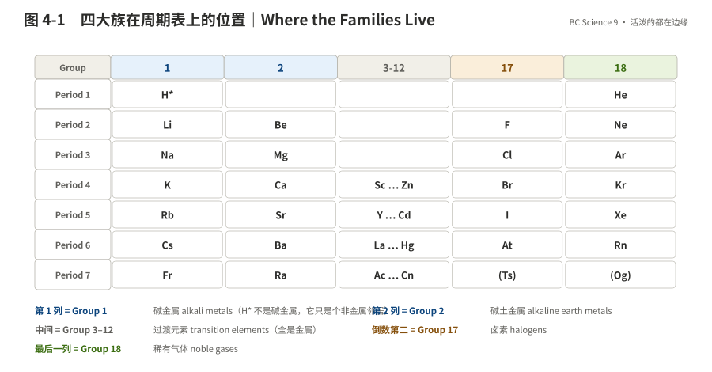
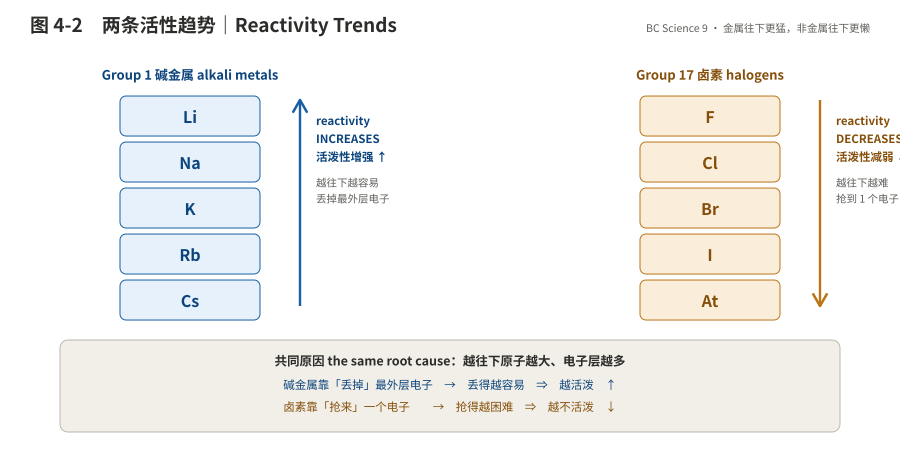
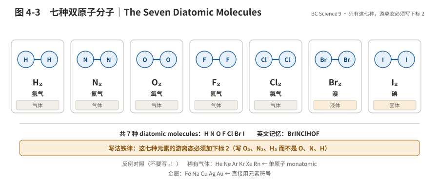
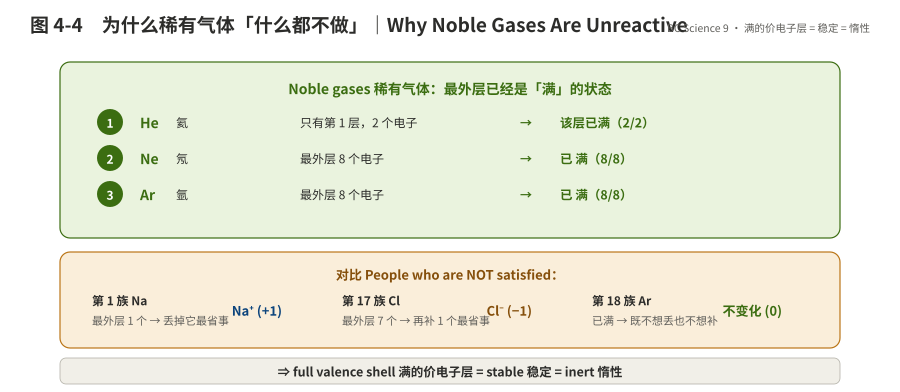
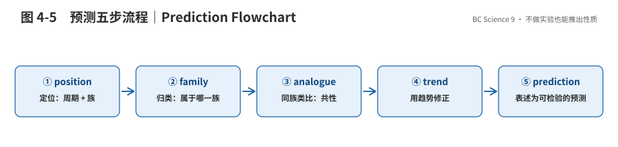

# Ch.4 — Chemical Families and Reactivity Trends
## 第 4 章　化学族与反应性趋势

> 🗂️ **大纲对应**：BC Science 9 Content C1「element properties as organized in the periodic table」（element properties）
> ⏱️ **课时 Periods**：2　|　**前置**：Ch.3 周期表的组织　|　**后继**：Ch.5 原子结构与玻尔模型图
> 🗂️ **文件生成时间**：2026-09-18 00:53

## 1. 大纲对应｜Content Alignment

| 项目 | 内容 |
|---|---|
| BC Science 9 Content（官方原文） | **element properties as organized in the periodic table** |
| 本章承担的子条目 | 四个重要化学族的名称、位置、成员与典型离子电荷；diatomic molecules 双原子分子；稀有气体的稳定性；group 1 与 group 17 的活性趋势；周期表的预测力 predictive power |
| Curricular Competencies | [Processing and analyzing] Seek and analyze patterns, trends, and connections；[Evaluating] 趋势性结论的证据支持；[Communicating] 用表格与图像呈现趋势；[Applying and innovating] 用周期表对陌生元素做预测 |
| 是否超纲 | 否（全部在 C1 范围内） |
| 超纲提示 | 化学方程式书写与配平、置换反应、活泼性顺序与电化学均属 **Science 10**；本章凡涉及反应式处一律标注【🔭 Extension → Science 10】，只要求学生做**现象层面的观察与趋势描述** |

## 2. 学习目标｜Learning Objectives

**EN — By the end of this chapter, you should be able to:**
1. Name, locate and list the members of the four key families: alkali metals, alkaline earth metals, halogens and noble gases.
2. State the typical ion charge (+1, +2, −1, 0) and the degree of reactivity for each of the four families.
3. Explain why noble gases are unreactive and list the seven diatomic molecules.
4. State and explain the reactivity trends: group 1 increases down the group, group 17 decreases down the group.
5. Predict the properties of an unfamiliar element from its position and state the evidence used.

**中 — 本章结束后，你应当能够：**
1. 说出四个重要族的名称、位置与成员：碱金属、碱土金属、卤素、稀有气体。
2. 说出四族的典型离子电荷（+1、+2、−1、0）与活泼程度。
3. 解释稀有气体为何不活泼，并能列出七种双原子分子。
4. 陈述并解释活性趋势：第 1 族**向下增强**、第 17 族**向下减弱**。
5. 由周期表位置预测陌生元素的性质，并说明所依据的证据。

## 3. 概念解析｜Concept Explanations

### 3.1 The four key families 四个重要化学族（一览）

| Group 族 | English name | 中文 | Typical ion charge 典型离子电荷 | Reactivity 活性 |
|---|---|---|---|---|
| 1 | **Alkali metals** | **碱金属** | **+1** | 极活泼：遇水剧烈反应，须**保存在油中** |
| 2 | **Alkaline earth metals** | **碱土金属** | **+2** | 活泼，但明显弱于碱金属 |
| 17 | **Halogens** | **卤素** | **−1** | 最活泼的**非金属**（族名意为"成盐者"） |
| 18 | **Noble gases** | **稀有气体** | **0**（不形成离子） | 极不活泼 / **inert 惰性的** |

> ⚠️ **注意**：第 1 族里的 **H 氢不是碱金属**——它是非金属，只是被放在这一列；所以 alkali metals 的成员是 **Li、Na、K、Rb、Cs、Fr**。
> 🌐 四个族的中文译名全项目统一：alkali metal **碱金属** / alkaline earth metal **碱土金属** / halogen **卤素** / noble gas **稀有气体**（**不译"贵族气体"**）/ inert **惰性的**。

### 3.2 Group 1 — Alkali metals 碱金属

- **成员**：Li 锂、Na 钠、K 钾、Rb 铷、Cs 铯、Fr 钫（**不含 H**）。
- **离子电荷 +1**：每个原子倾向**失去 1 个电子**形成 cation 阳离子（如 Na⁺、K⁺）【🔗 详因见 Ch.6】。
- **物理性质**：很**软**（可用小刀切开）、密度小（Li、Na、K 能浮在水面上）、熔沸点比常见金属低、新鲜切面有银白色光泽但**很快变暗**（表面被氧化）。
- **化学性质**：极活泼，与水反应放出氢气并生成碱性溶液——
  【🔭 Extension → Science 10】完整方程式 `2Na + 2H₂O → 2NaOH + H₂` 属于 Science 10，本章只要求**描述现象**。
- **保存方式**：浸在**矿物油 / 石蜡油**中隔绝空气与水蒸气（stored under oil）。
- **自然界存在形式**：因为太活泼，**从不以单质形式存在于自然界**，只能以化合物形式出现（如 NaCl 食盐）。
- **活性趋势**：由 Li → Fr **逐渐增强**（Fr 最活泼；在常见元素中 **Cs 铯**最活泼）。

### 3.3 Group 2 — Alkaline earth metals 碱土金属

- **成员**：Be 铍、Mg 镁、Ca 钙、Sr 锶、Ba 钡、Ra 镭。
- **离子电荷 +2**：倾向失去 2 个电子形成 Mg²⁺、Ca²⁺ 等阳离子。
- **性质**：比碱金属**更硬、密度更大、熔点更高**，活泼性居第二梯队；多数能与水或蒸汽反应，但比碱金属温和得多。
- **熟悉的身影**：

| 元素 | 生活中的存在 | 用途 / 现象 Uses |
|---|---|---|
| Mg 镁 | 叶绿素的中心原子（植物光合作用） | 燃烧发出**耀眼白光**，用于烟花、信号弹、早期闪光灯 |
| Ca 钙 | 骨骼与牙齿（calcium phosphate 磷酸钙）、石灰石 CaCO₃ | 大理石、粉笔、贝壳的主要成分 |
| Ba 钡 | **BaSO₄ 硫酸钡**不溶于水 | 医学 X 线造影"钡餐"（不溶才安全；**可溶性钡盐有毒**） |
| Ra 镭 | 放射性元素 | 曾用于夜光涂料，因辐射危害已淘汰 |

- **活性趋势**：同样**向下增强**（Ba 比 Mg 活泼），但整体弱于第 1 族。

### 3.4 Group 17 — Halogens 卤素（"成盐者"）

- **成员**：F 氟、Cl 氯、Br 溴、I 碘、At 砹（117 号 Ts 亦属本族，但人工合成、性质仍在研究中）。
- **词源**：halogen 来自希腊语 *hals*（盐）+ *gen*（产生）→ **"成盐者" salt-former**，因为它们与金属反应极易生成盐（Na + Cl → NaCl）。
- **离子电荷 −1**：倾向**得到 1 个电子**形成 anion 阴离子（F⁻、Cl⁻、Br⁻、I⁻）。
- **存在形式**：必须以**双原子分子（diatomic molecules）**书写和记忆：**F₂、Cl₂、Br₂、I₂**（不能写成 F、Cl）。
- **是活泼性最强的一族非金属**；**F 氟是全部元素中最活泼的非金属**。
- **活性趋势**：由 F → At **逐渐减弱**（与我们"越往下越剧烈"的直觉相反！）。

| 元素 | 常温状态 state | 颜色 colour | 备注 |
|---|---|---|---|
| F₂ 氟 | 气体 gas | 淡黄色 pale yellow | 最活泼的非金属，几乎与一切反应 |
| Cl₂ 氯 | 气体 gas | 黄绿色 green-yellow | 自来水消毒、漂白剂 |
| Br₂ 溴 | **液体 liquid** | 红棕色 red-brown | 唯一液态非金属，易挥发、蒸气刺鼻 |
| I₂ 碘 | 固体 solid | 紫黑色（蒸气紫色） | 加碘盐（防甲状腺肿大）、碘伏消毒 |

- **用途举例**：含氟牙膏（fluoride 氟化物，防龋齿）、含氯消毒剂与 PVC、含溴阻燃剂、碘伏/碘酒消毒与加碘盐。

### 3.5 Group 18 — Noble gases 稀有气体

- **成员**：**He 氦、Ne 氖、Ar 氩、Kr 氪、Xe 氙、Rn 氡**（118 号 Og 亦属本族，为人工合成、极不稳定）。
- **离子电荷 0**：既不容易失去也不容易得到电子，**一般不形成离子**。
- **为什么不活泼**：它们的**价电子层已满**（He 的第一层有 2 个电子即满，其余都恰有 8 个）→ 处于稳定状态（stable / full valence shell），无需再得失电子。【🔗 Ch.5 详解】
- **存在形式**：以**单个原子**存在（monatomic，写作 He、Ne、Ar），不像卤素那样成双。
- **ion charge 0 ⇒ 无化合价 ⇒ 难与其他元素结合 ⇒ inert 惰性的**。
- **用途举例**：

| 气体 | 用途 Use | 性质依据 Property |
|---|---|---|
| He 氦 | 气球/飞艇填充气（比空气轻且**不燃烧**） | 密度小 + 惰性（比氢气安全） |
| Ne 氖 | 霓虹灯发出橙红色光 neon lights | 通电发光 + 惰性 |
| Ar 氩 | 焊接保护气、灯泡填充气 | 惰性，隔绝氧气防止金属在高温被氧化 |
| Kr / Xe 氪 / 氙 | 特殊光源、闪光灯、部分麻醉与离子推进 | 惰性与特殊光谱 |
| Rn 氡 | 无正面用途 | **放射性**，可在地下室积聚 → 需通风与检测 |

- **注意"惰性"不等于"绝对不能反应"**：He、Ne 基本不形成化合物，但 **Kr、Xe 在特定条件下可以形成化合物**（如 XeF₂）【🔭 Extension → Science 10】。所以更准确的说法是"**极不活泼**"。

### 3.6 The seven diatomic molecules 七种双原子分子

**定义 Definition**：**Diatomic molecules** are molecules made of **two atoms of the same element** joined together.
**中文**：双原子分子是由**两个同种原子**结合而成的分子。

共 **7 种**，必须记住它们的存在形式：**H₂、N₂、O₂、F₂、Cl₂、Br₂、I₂**。

- 记忆口诀：英文首字母串 **Br I N Cl H O F**（"BrINClHOF"）；或联想"Have No Fear Of Ice Cold Beer"（H N F O I Cl Br）。
- 书写不变量：提到这些元素**以单质形式存在**时必须加分角标 2（写"氧气 O₂"而不是"O"）。
- 反例：稀有气体写 **He、Ne、Ar**（单原子）；金属写 **Fe、Na**（直接用元素符号表示）。

### 3.7 Reactivity trends 活性趋势

| 族 Group | 趋势 Trend | 为什么 Why（定性） |
|---|---|---|
| **1 碱金属** | **向下活泼性增强**（Li < Na < K < Rb < Cs < Fr） | 越往下电子层数越多，最外层那个电子离原子核越远、被吸引得越松 → **更容易失去** → 越活泼 |
| **17 卤素** | **向下活泼性减弱**（F > Cl > Br > I > At） | 越往下原子越大，外界电子要进入的最外层离原子核越远 → **吸引外来电子的能力越弱** → 越难反应 |

- 两条趋势方向相反，根源却是同一个：**往下走，原子变大、核对外层电子的控制力变弱**——金属靠"失电子"反应（变容易），非金属靠"得电子"反应（变困难）。
- 这也是本章对 **Big Idea** 最直接的呼应：**电子排布 → 得失电子的难易 → 化学性质与活泼性**。【🔗 Ch.5–Ch.6 详述机制】

### 3.8 The predictive power of the periodic table 周期表的预测力

- 同一族元素性质相似 → 只要知道一个成员，**其余成员的性质可以推断**。
- 推断方法三步：**① 定位（族 + 周期）→ ② 找同族已知元素类比 → ③ 用趋势修正方向。**
- 经典应用：
  - 预测 **At 砹**（第 17 族第 6 周期）：应为**深色固体**、形成 **At⁻**、活泼性**比 I₂ 更弱**。
  - 预测 **Fr 钫**（第 1 族第 7 周期）：应为**极软的活泼金属**、形成 **Fr⁺**、与水反应**比 Cs 更剧烈**。
  - 历史上 Mendeleev 正是用同样思路预测了 Ga、Ge、Sc【🔗 见 Ch.2】。
- **提醒**：预测必须能被检验；当新证据与预测不符时，改的是我们的理解，而不是数据。

## 4. 表格比对｜Comparison Tables

### 表 4-1　四大族总表｜The Four Key Families at a Glance

| 项目 Item | Group 1 | Group 2 | Group 17 | Group 18 |
|---|---|---|---|---|
| English name | Alkali metals | Alkaline earth metals | Halogens | Noble gases |
| 中文 | 碱金属 | 碱土金属 | 卤素 | 稀有气体 |
| 成员 Members | Li Na K Rb Cs Fr | Be Mg Ca Sr Ba Ra | F Cl Br I At | He Ne Ar Kr Xe Rn |
| Ion charge 离子电荷 | **+1** | **+2** | **−1** | **0** |
| 失/得电子 | 失去 1 个 | 失去 2 个 | 得到 1 个 | 都不发生 |
| 活泼性 Reactivity | 极活泼（金属中最强） | 活泼，次之 | 极活泼（非金属中最强） | 极不活泼 **inert** |
| 存在形式 | 化合物中（从不游离） | 化合物中 | **双原子分子 X₂** | **单原子 He、Ne、Ar** |
| 活性趋势 | 向下**增强** | 向下增强 | 向下**减弱** | 都很不活泼 |
| 例子 Use | NaCl 食盐、K 肥料 | CaCO₃ 石灰石、Mg 叶绿素 | 加碘盐、含氯消毒 | He 气球、Ar 保护气 |

### 表 4-2　碱金属：成员与现象｜Alkali Metals & Observations

| 元素 | 符号 | 与水反应的现象（教师演示）Observation | 相对活泼性 |
|---|---|---|---|
| Li 锂 | Li | 浮在水面、缓慢冒泡 fizzing | 最弱 weakest |
| Na 钠 | Na | 迅速冒泡、熔成小球四处游动 | ↑ |
| K 钾 | K | 剧烈反应、冒出火焰（淡紫色火焰）并可能有轻微爆鸣 | ↑ |
| Rb / Cs 铷 / 铯 | Rb / Cs | 极为剧烈，可在空气中自燃 | 最强 strongest |

> 🧪 **安全说明**：本演示**只能由教师在防护条件下操作**（见活动 4-1），学生**不得**自行取用碱金属。

### 表 4-3　卤素对比｜Halogens Compared

| 元素 | 常温状态 | 颜色 Colour | 存在形式 | 活泼性 | 生活例子 |
|---|---|---|---|---|---|
| F 氟 | 气体 | 淡黄色 | F₂ | **最强** | 含氟牙膏、不粘涂层 |
| Cl 氯 | 气体 | 黄绿色 | Cl₂ | ↓ | 自来水消毒、漂白剂、PVC |
| Br 溴 | **液体** | 红棕色 | Br₂ | ↓ | 阻燃剂 |
| I 碘 | 固体 | 紫黑色（紫色蒸气） | I₂ | ↓ | 加碘盐、碘伏消毒 |
| At 砹 | **预测**为深色固体 | 推测更深 | At₂（推测） | **最弱**（且放射性强） | 极稀有，基本无应用 |

### 表 4-4　稀有气体对比｜Noble Gases Compared

| 元素 | Symbol | 中文 | 用途 Use | 备注 |
|---|---|---|---|---|
| Helium | He | 氦 | 气球、飞艇、超导磁体冷却 | 第二轻的元素，不燃烧，比 H₂ 安全 |
| Neon | Ne | 氖 | 霓虹灯（橙红） | 通电发光 |
| Argon | Ar | 氩 | 焊接保护气、灯泡填充气 | 空气中含量最高的稀有气体（约 0.93%） |
| Krypton | Kr | 氪 | 高性能灯、闪光灯 | 可形成少数化合物 |
| Xenon | Xe | 氙 | 闪光灯、离子推进器、麻醉 | 可形成化合物，如 XeF₂ |
| Radon | Rn | 氡 | 无正面用途 | **放射性**，可在地下室积聚，需通风检测 |

### 表 4-5　七种双原子分子｜The Seven Diatomic Molecules

| 分子式 Formula | English name | 中文 | 常温状态 | 所属类别 |
|---|---|---|---|---|
| H₂ | hydrogen | 氢气 | 气体 | 非金属（特例位置在第 1 族） |
| N₂ | nitrogen | 氮气 | 气体 | 第 15 族非金属 |
| O₂ | oxygen | 氧气 | 气体 | 第 16 族非金属 |
| F₂ | fluorine | 氟气 | 气体 | 卤素 halogen |
| Cl₂ | chlorine | 氯气 | 气体 | 卤素 halogen |
| Br₂ | bromine | 溴 | **液体** | 卤素 halogen |
| I₂ | iodine | 碘 | 固体 | 卤素 halogen |

> 💡 **口诀**：**BrINClHOF**（溴碘氮氯氢氧氟）——七个自己成双成对的元素。

### 表 4-6　两条活性趋势为什么方向相反｜Why the Trends Are Opposite

| 比较项 | Group 1 碱金属 | Group 17 卤素 |
|---|---|---|
| 反应靠什么 | **失去**最外层电子 | **得到**外来电子 |
| 向下走发生什么 | 原子变大，最外层电子离核更远 | 原子变大，外来电子进入更远的外层 |
| 结果 | 束缚变弱 → 更容易失电子 → **活泼性增强** | 吸引力变弱 → 更难得到电子 → **活泼性减弱** |
| 最强成员 | Fr 钫（常见元素中 Cs 铯最强） | F 氟（全部非金属中最强） |
| 最强成员位置 | 底部 bottom | 顶部 top |

## 5. 图例说明｜Diagrams & Worked Examples

### 图 4-1　四大族在周期表上的位置｜Where the Families Live

**看图要点**：四个关键族分布在表的**最左两列**与**最右两列**——活泼的都在边缘，中间的过渡元素相对"温和"。

### 图 4-2　两条活性趋势｜Reactivity Trends

**看图要点**：两个箭头方向相反，但原因完全一样（原子变大 → 核对外层电子的控制力变弱）。记住"**金属往下更猛，非金属往下更懒**"。

### 图 4-3　七种双原子分子｜The Seven Diatomic Molecules

**看图要点**：只有这七种非金属单质是"两个原子手拉手"；稀有气体与金属一律用单符号表示。

### 图 4-4　为什么稀有气体"什么都不做"｜Why Noble Gases Are Unreactive 【⏭️ 预告 Ch.5–Ch.6】

**看图要点**：离子电荷 **+1 / −1 / 0** 不是背出来的，而是"距离满层差几个电子"算出来的；稀有气体已经在终点线上，所以电荷为 0、不活泼。

### 图 4-5　例题：由线索判断族｜Worked Example

**题目**：根据线索判断每种未知元素所在的族、典型离子电荷与活泼性。

| 线索 Clue | 判断族 Group | Ion charge | 判断依据 Evidence |
|---|---|---|---|
| 软到可用刀切开、浮在水面上剧烈冒泡、须保存在油中 | **Group 1** 碱金属 | **+1** | 软 + 与水剧烈反应 + oil 保存，是碱金属三件套 |
| 黄绿色刺激性气体，以 X₂ 形式存在，能与金属生成盐 | **Group 17** 卤素 | **−1** | "成盐者" + 双原子分子 + 活泼非金属 |
| 通电发出橙红色光，几乎不与任何物质反应 | **Group 18** 稀有气体 | **0** | Ne 的特征：惰性 + 通电发光 |
| 灰白金属，燃烧发出耀眼白光，常见离子为 Ca²⁺ 的邻居 | **Group 2** 碱土金属 | **+2** | Mg 燃烧白光；位置在第 2 族，失去 2 个电子 |
| 银白色金属，能被磁铁吸引，有多种化合价 | 过渡元素 Groups 3–12 | 多变（Fe²⁺/Fe³⁺） | 磁性（Fe/Co/Ni）+ 多变价 → 过渡元素特征 |

> ⚠️ **易错提醒**：看到"保存在油中"要立刻想到碱金属；看到"X₂"要立刻想到卤素（或 H₂/N₂/O₂）。

### 图 4-6　例题：预测砹 At 的性质｜Worked Example

**题目**：砹 Astatine（At，第 85 号，第 6 周期第 17 族）极其稀有且放射性强，很难做实验。请利用周期表预测它的性质。

**解析（预测五步）：**

| 步骤 Step | 操作 Action | 结果 Result |
|---|---|---|
| ① 定位 position | 第 17 族、第 6 周期 → 卤素 halogen | 与 F、Cl、Br、I 同类 |
| ② 类比 analogue | 卤素共性：双原子分子、形成 −1 离子、非金属 | 推测以 **At₂** 存在，形成 **At⁻** |
| ③ 状态趋势 state trend | F₂ 气 → Cl₂ 气 → Br₂ 液 → I₂ 固，向下逐渐变重 | At 应为**深色固体**（比 I₂ 更深） |
| ④ 活性趋势 reactivity trend | 第 17 族向下**减弱** | At 活泼性**比 I₂ 更弱**，是卤素中最不活泼者 |
| ⑤ 自我检查 check | 预测必须可检验、只做趋势外推，不做过度断定 | 结论用"预测/推测 predict"表述 |

**答案**：At 预测为**深色固体**，可能以 At₂ 形式存在，形成 **At⁻** 离子，是第 17 族中**活泼性最弱**的成员（且具强放射性）。依据是"同族性质相似 + 沿族的状态与活性趋势"。

### 图 4-5　预测五步流程｜Prediction Flowchart

## 6. 核心词汇｜Key Vocabulary

| English | 中文 | 备注 |
|---|---|---|
| alkali metal | 碱金属 | 第 1 族，不含 H |
| alkaline earth metal | 碱土金属 | 第 2 族 |
| halogen | 卤素 | 第 17 族，"成盐者" salt-former |
| noble gas | 稀有气体 | 第 18 族，**不译"贵族气体"** |
| inert | 惰性的 | = 极不活泼 unreactive |
| reactive / reactivity | 活泼的 / 活泼性 | — |
| family | 族（化学族） | 与 group 同义 |
| ion charge | 离子电荷 | +1 / +2 / −1 / 0 |
| cation | 阳离子 | 失电子带正电【🔗 Ch.6】 |
| anion | 阴离子 | 得电子带负电【🔗 Ch.6】 |
| diatomic molecule | 双原子分子 | H₂ N₂ O₂ F₂ Cl₂ Br₂ I₂ |
| monatomic | 单原子的 | 稀有气体以单原子存在 |
| trend | 趋势 | group 1 ↑、group 17 ↓ |
| increasing / decreasing | 增强 / 减弱 | 描述趋势方向 |
| full valence shell | 满的价电子层 | 稀有气体稳定的原因【🔗 Ch.5】 |
| stable | 稳定的 | 不易发生变化的状态 |
| stored under oil | 保存在油中 | 碱金属的保存方式 |
| predictive power | 预测力 | 周期表最有价值的特征 |
| radioactivity | 放射性 | Ra、Rn、At、Fr 等具强放射性 |
| mineral oil / paraffin oil | 矿物油 / 石蜡油 | 用于隔绝空气与水 |

## 7. 实验与活动｜Lab / Activity

### 活动 4-1　碱金属与水（教师演示）｜Alkali Metals + Water Demo
- **类型**：教师演示 / 视频观察（**Teacher Demo only**）
- **材料**：防护屏、护目镜、镊子、滤纸、矿物油中的 Li / Na / K 小块、装有水的大烧杯、酚酞指示剂、摄像头投影（可用 video 替代实做）
- **步骤**：
  1. 教师用镊子取出小块金属，用滤纸吸干表面的油，**切下绿豆大小**的一小块（切下的碎屑放回油中）。
  2. 依次投入水中（**每次只投一块**），学生记录：是否浮起、是否熔成小球、移动方向、火焰颜色、剧烈程度（1–5 级）。
  3. 若加了酚酞，观察水溶液变红 → 生成了碱性物质（"alkali"碱的名字由来）。
  4. 把观察排成 Li < Na < K 的顺序，画出结论：**第 1 族向下活泼性增强**。
- **训练能力**：[Planning and conducting] 安全规范；[Processing and analyzing] Seek and analyze patterns, trends, and connections
- **安全**：⚠ 全程示范，学生不得接触碱金属；**防护屏 + 护目镜**必须在位；严禁徒手取放；K 的演示须格外谨慎（可能爆燃）；产生的碱性废液按教师指示中和处理

### 活动 4-2　卤素家族卡排序与预测｜Halogen Card Sort & Prediction
- **类型**：小组排序 + 推理（Sorting & Inference）
- **材料**：F、Cl、Br、I 四张卡片（含状态、颜色、常见用途），另加一张**写有 At 的空白卡**
- **步骤**：
  1. 学生按"不确定肤色的（第 17 族、自上而下）"把卡片从上到下排好。
  2. 归纳两条规律：**状态由气 → 液 → 固**；**活泼性由强到弱**。
  3. 给 At 空白卡填写预测（状态、颜色、离子电荷、活泼性、是否双原子分子），并写出每一条的依据。
  4. 与其他组比对，讨论"哪些预测有充分证据、哪些只是猜测"。
- **训练能力**：[Questioning and predicting]；[Evaluating] 区分证据充分的预测与无依据的猜测
- **安全**：⚠ 仅使用图片卡，**不接触卤素实物**（Cl₂ 有毒、Br₂ 腐蚀性）

### 活动 4-3　家族档案馆｜Family Archive Poster
- **类型**：四人小组项目（Project）
- **任务**：四个族各选一族，制作一页"档案"：族名（中英）、位置、全部成员、典型离子电荷、活跃性、两种用途、**一句 Mechanism explanation（为什么这类元素这样的行为）**。要求至少用一张自制表格 + 一张示意图（可手绘）。
- **展示**：每组 90 秒"电梯演讲"，其他组用检查表（checklist）评分：术语准确 / 证据充分 / 图示清楚 / 中英对照规范。
- **训练能力**：[Communicating] 用图表与科学语言表达；[Applying and innovating] 把周期表知识用于解释现实应用
- **安全**：无

## 8. 常见易错点｜Common Misconceptions

| # | 错误认识 Misconception | 正确理解 Correction |
|---|---|---|
| 1 | "noble gas 是贵族气体" | 正确译名是**稀有气体**（也可称惰性气体），**不译"贵族气体"**。 |
| 2 | "稀有气体绝对不能形成化合物" | He、Ne 基本不形成；但 **Kr、Xe 在特定条件下可以**（如 XeF₂）【🔭 Extension → Science 10】。准确说法是"**极不活泼**"。 |
| 3 | "氢是碱金属" | H 是**非金属**，只是因只有 1 个价电子而排在第 1 族；alkali metals = Li、Na、K、Rb、Cs、Fr。 |
| 4 | "碱金属是硬邦邦的重金属" | 它们**软到能用刀切开**，Li、Na、K 的密度比水小，能**浮在水面**上反应。 |
| 5 | "第 1 族向下活泼性减弱" | 第 1 族**向下增强**（Cs 比 Li 猛烈得多）。 |
| 6 | "第 17 族向下活泼性增强" | 第 17 族**向下减弱**（F 最强，At 最弱）。 |
| 7 | "双原子分子只有卤素" | 共 7 种：**H₂、N₂、O₂、F₂、Cl₂、Br₂、I₂**（卤素只占四种）。 |
| 8 | "稀有气体也写成 He₂、Ne₂" | 稀有气体**以单原子存在**，写作 He、Ne、Ar。 |
| 9 | "金属不存在就意味着元素是"消失"了" | 元素从未消失，活泼元素只是以**化合物的形式**存在（如食盐中的 Na）。 |
| 10 | "卤素的离子电荷是 +1" | 卤素**得到**电子 → **−1**（如 Cl⁻）；只有第 1 族失电子才是 +1。 |
| 11 | "钠在水里冒泡很好玩，可以自己动手试" | 反应放出**氢气**并放热，可能起火或爆燃；**必须由教师演示**，学生不得取用碱金属。 |
| 12 | "At₂、At⁻ 的写法违反了双原子/离子规则" | 它们正是对 17 族规律的**外推预测**，属合理预测而非违反规则。 |

## 9. 答题评估｜Assessment

### A 组：基础题｜Foundational（每题 2 分，共 20 分）

**A1.** 第 1 族的英文族名与中文译名是什么？列出全部成员（不含氢）。
**A2.** 第 2 族的英文族名与中文译名是什么？它的典型离子电荷是多少？
**A3.** 第 17 族的英文族名与中文译名是什么？为什么叫这个名字？
**A4.** 第 18 族的英文族名与中文译名是什么？它的典型离子电荷是多少？
**A5.** 写出第 1、2、17、18 族的典型离子电荷。
**A6.** 写出七种双原子分子的分子式。
**A7.** 写出稀有气体的六种成员（符号 + 中文名）。
**A8.** 第 1 族的活泼性沿族向下如何变化？
**A9.** 第 17 族的活泼性沿族向下如何变化？哪一种是最活泼的非金属？
**A10.** 为什么碱金属必须保存在油中？

### B 组：应用题｜Applied（每题 5 分，共 20 分）

**B1.** 下表是 Li、Na、K 与水反应的演示记录，请把表格补完整并回答问题。

| 元素 | 是否浮在水面 | 是否熔成小球 | 有无火焰 | 剧烈程度（1–5） |
|---|---|---|---|---|
| Li | 是 | 否 | 无 | 1 |
| Na | 是 | 是 | 无 | 3 |
| K | 是 | 是 | 有（淡紫色） | 5 |

(a) 把三者按活泼性从弱到强排序；(b) 预测 Rb 与水反应的现象；(c) 这句话体现的是哪一条趋势？

**B2.** 利用周期表预测砹 At（第 85 号，第 6 周期第 17 族）的四项性质，并为每项写出依据。
要求包含：常温状态、是否存在双原子分子、典型离子电荷、与 I₂ 相比的活泼性。

**B3.** 为什么稀有气体如此不活泼？请用"价电子层"来解释；并说明为什么 **He 虽然有 2 个电子却同样稳定**。

**B4.** 卤素为什么被称为"成盐者"？请以熟悉的食盐为例说明，并解释为什么它们在自然界**不以单原子形式存在**。

### C 组：挑战题｜Challenge（每题 10 分，共 20 分）

**C1.** 第 1 族向下活泼性**增强**，第 17 族向下活泼性**减弱**——两条趋势方向相反。请用**同一个原因**解释这两条趋势，说明：(i) 沿族向下原子结构发生了什么变化；(ii) 这种变化为何对金属与对非金属的影响相反；(iii) 这一解释如何回扣 Big Idea。

**C2.** 某未知元素 X 位于第 1 族第 5 周期。请尽可能完整地预测它的性质，并为每一条预测写出依据：常温状态与外观、硬度、密度（与水比较）、保存方式、与水反应的相对剧烈程度、典型离子电荷、在自然界的存在形式。**另需**写出两条在验证过程中必须遵守的安全注意事项。

---

### 参考答案｜Answer Key

**A 组**
- A1. **Alkali metals 碱金属**；成员：**Li 锂、Na 钠、K 钾、Rb 铷、Cs 铯、Fr 钫**。
- A2. **Alkaline earth metals 碱土金属**；离子电荷 **+2**（如 Mg²⁺、Ca²⁺）。
- A3. **Halogens 卤素**；名称源自希腊语"**成盐者 salt-former**"，因为它们与金属反应极易生成盐。
- A4. **Noble gases 稀有气体**（惰性气体）；离子电荷 **0**（不形成离子）。
- A5. 第 1 族 **+1**；第 2 族 **+2**；第 17 族 **−1**；第 18 族 **0**。
- A6. **H₂、N₂、O₂、F₂、Cl₂、Br₂、I₂**（口诀 BrINClHOF）。
- A7. **He 氦、Ne 氖、Ar 氩、Kr 氪、Xe 氙、Rn 氡**。
- A8. **向下逐渐增强**（Fr 最强；常见元素中 Cs 最强）。
- A9. **向下逐渐减弱**；**F 氟**是最活泼的非金属。
- A10. 因为碱金属极活泼，会与空气中的**氧气与水蒸气**反应，油可以隔绝它们；同时也防止与水直接接触引发危险。

**B 组（要点）**
- B1. (a) **Li < Na < K**（活泼性递增）；(b) Rb 应与水反应**比 K 更剧烈**，可能立即起火甚至轻微爆响；(c) 体现"**第 1 族向下活泼性增强**"的趋势，根源是越往下最外层电子越容易被失去。
- B2. ① **常温状态**：预测为**深色固体**（依据：F₂、Cl₂ 气体 → Br₂ 液体 → I₂ 固体，向下逐渐变重，At 在 I 之下）；② **双原子分子**：预测以 **At₂** 形式存在（依据：卤素都以双原子分子存在）；③ **离子电荷 −1**（依据：第 17 族都得到 1 个电子形成 X⁻）；④ **活泼性比 I₂ 更弱**（依据：第 17 族向下活泼性减弱，At 是已知最弱的卤素）。
- B3. 稀有气体的**价电子层已满**（Ne、Ar 等最外层恰有 8 个电子），既不容易失去也不容易得到电子，处于**稳定 stable** 状态，因此 almost 不反应、也不形成离子。He 虽只有 2 个电子，但它的**第 1 层容量就是 2 个**，同样已满，因此同样稳定。
- B4. "成盐者"因为卤素极易与金属化合生成盐：Na 与 Cl 生成 **NaCl 食盐**（Na⁺ 与 Cl⁻ 结合）。卤素原子最外层有 7 个电子，单独存在时"不满足"，因此两两**共用一对电子形成 X₂ 分子**（F₂、Cl₂、Br₂、I₂）才稳定；所以自然界中它们不以单原子形式存在。

**C 组（评分要点）**
- C1. 满分要点：① 沿族向下**电子层数增加、原子半径变大**，最外层电子离原子核更远；② 碱金属靠**失去**电子反应 → 束缚变弱、更易失去 → **活泼性增强**；卤素靠**得到**电子反应 → 原子核对远处外来电子的吸引变弱 → 更难得到 → **活泼性减弱**；③ 两条趋势同源于"**原子变大导致核对最外层电子的控制力下降**"，这正说明 **electron arrangement（电子排布）决定元素能否得失电子、进而决定化学性质**，完全回扣 Big Idea。若只给出结论而无结构解释者至多半分。
- C2. 参考要点：X = **Rb 铷**（第 1 族第 5 周期）。预测——① 常温为**固体**，新鲜切面**银白色有光泽**但迅速变暗；② **很软**，可用刀切割；③ 密度**大于水**（会下沉，与 Li/Na/K 不同，这是本族内部密度递增的趋势）；④ 必须**保存在矿物油中**；⑤ 与水反应**极剧烈**，比 K 更猛烈，可能起火；⑥ 形成 **Rb⁺（+1）**；⑦ 在自然界**只以化合物形式存在**，从不游离。依据每条都要引用"同族类比 + 趋势"。安全：⚠ 只能由**教师演示**，使用**防护屏与护目镜**；取样须用镊子、**极小的一块**；严禁学生自行取放；余下的碎屑放回油中统一处理。

### 评分量规｜Rubric

| 维度 | 优秀 (A) | 达标 (B) | 待改进 (C) |
|---|---|---|---|
| 族与术语 | 四族名称、成员、离子电荷全部正确，中文译名规范 | 主要正确，偶有成员遗漏 | 译名错误（如"贵族气体"）或离子电荷记反 |
| 趋势理解 | 能说出两条趋势的方向并解释共同原因 | 能正确说出方向，解释较浅 | 方向记反或只会背诵 |
| 预测与证据 | 每条预测都注明依据，区分事实与推测 | 有预测，依据不完整 | 无依据的猜测 |
| 双语与安全 | 中英术语规范；主动写明安全事项 | 提及安全 | 未考虑安全 |
| 回扣 Big Idea | 能把趋势归因于电子排布 | 提到"电子"相关 | 完全未联系电子层面 |

> 👩‍🏫 **教师提示**：A 组用于随堂检测；B 组用于单元小测；C 组可用于科学写作或答辩。
> 🌐 **双语政策**：术语允许中英双语作答；**元素符号、分子式与英文名必须用英文**。

## 10. 回扣核心概念｜Connection to the Big Idea

> 🎯 **Big Idea**：*The electron arrangement of atoms impacts their chemical nature.*
> **原子的电子排布决定其化学性质。**

本章是 Big Idea 最直观的一次落地——实验台上看到的一切"差别"，最后都能归结为"差几个电子"：

1. **为什么四族的离子电荷是 +1 / +2 / −1 / 0？** 因为各族最外层分别有 1、2、7、8 个电子；离"满层"差得越少、越靠近终点，就越没动力反应。稀有气体已在终点，所以电荷为 0、几乎不反应。
2. **为什么碱金属与卤素如此活泼？** 因为它们"差一点点"就能达到稀有气体的电子排布——只差 1 个电子的原子，往往是反应最激烈的原子。
3. **为什么两条趋势方向相反？** 因为同往下电子层变多、原子变大：金属"丢电子"更容易（增强），非金属"抢电子"更困难（减弱）。**同一个结构原因，两种相反的表现。**
4. **为什么周期表能预测？** 因为位置反映的是电子排布，而电子排布决定化学性质。所以只要知道一个元素的位置，就能推断它"想丢几个电子、会多剧烈地反应"——这正是 Mendeleev 以来周期表最强大的地方。

**思考题（下章预热）**：我们已经知道"第 1 族都有 1 个价电子、第 17 族都有 7 个"——那么这些电子具体怎么摆放？它们住在第几层、每层能住几个？下一章我们画**玻尔模型图（Bohr diagram）**，把"电子排布"这四个字真正画出来。

---

*本章对应框架文件 `00_讲义章节框架_Course_Framework.md` Ch.4。下一章：Ch.5 原子结构与玻尔模型图。*
