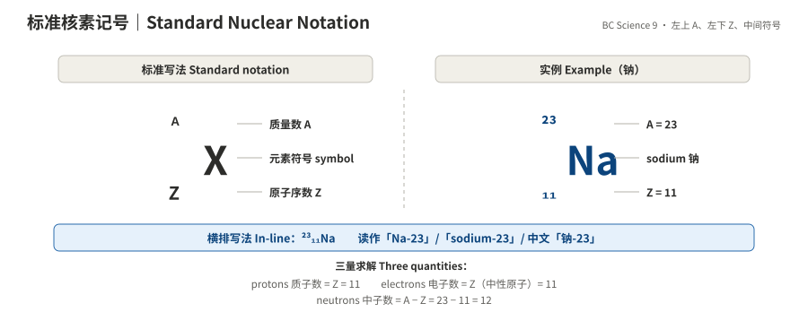
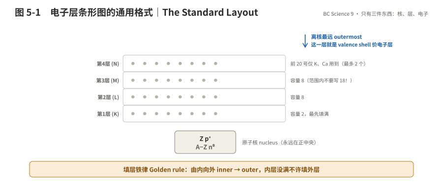
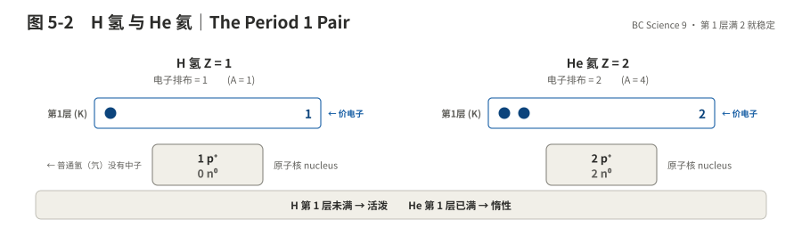
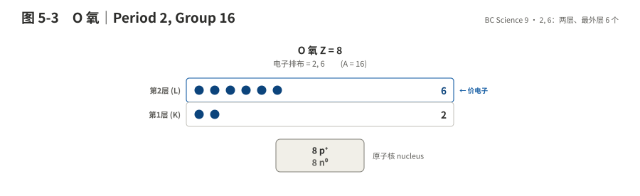
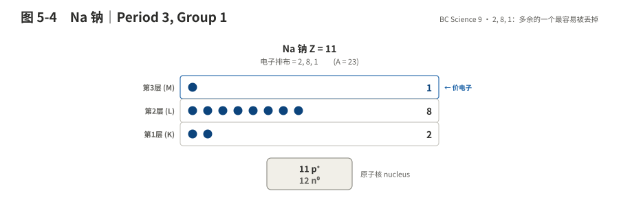
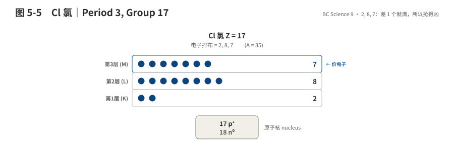
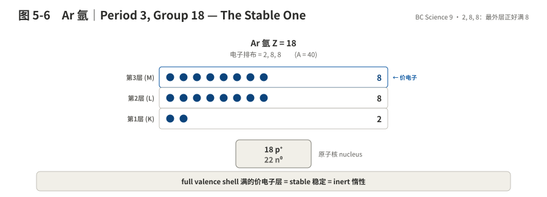
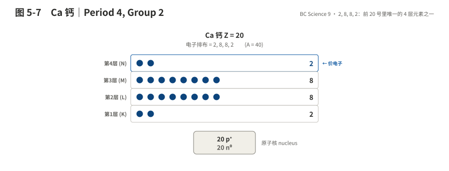
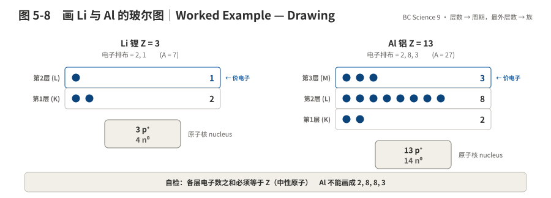
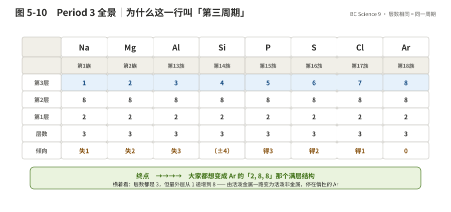

# Ch.5 — Atomic Structure and Bohr Diagrams
## 第 5 章　原子结构与玻尔模型图

> 🗂️ **大纲对应**：BC Science 9 Content C1 → C2「The arrangement of electrons determines the compounds formed by elements」（过渡章：把周期表位置翻译成电子排布）
> ⏱️ **课时 Periods**：3　|　**前置**：Ch.4 化学族与反应性趋势　|　**后继**：Ch.6 离子与路易斯点式
> 🗂️ **文件生成时间**：2026-09-18 00:53

## 1. 大纲对应｜Content Alignment

| 项目 | 内容 |
|---|---|
| BC Science 9 Content（官方原文） | **The arrangement of electrons determines the compounds formed by elements** |
| 本章定位 | **C1 → C2 的桥**：把「周期表位置」翻译成「电子排布」，为 Ch.6 的离子与 Ch.7–8 的化合物铺路 |
| 本章承担的子条目 | Z / A / n 的换算；Bohr diagram 绘制规则；电子层容量 2-8-8；valence electrons 价电子；同族同价电子、同期同层数的规律；稀有气体稳定性；玻尔模型的局限 |
| Curricular Competencies | [Evaluating] **Evaluate the validity and limitations of a model or analogy**；[Processing and analyzing] Seek and analyze patterns, trends, and connections；[Communicating] 用图形、符号与表格表达科学思想 |
| 是否超纲 | 否 |
| 超纲提示 | 亚层 s/p/d/f、原子轨道、量子数、第 3 层真实容量 18 的来源均属 Science 10–12；本章凡涉及处一律标注【🔭 Extension → Science 10】 |

## 2. 学习目标｜Learning Objectives

**EN — By the end of this chapter, you should be able to:**
1. Determine the number of protons, neutrons and electrons in a neutral atom from its atomic number (Z) and mass number (A).
2. State the electron shell capacities used for the first 20 elements (2, 8, 8) and fill the shells in the correct order (inner shells first).
3. Draw a complete Bohr diagram for any of the first 20 elements, labelling the nucleus with p⁺ and n⁰ and marking the valence electrons.
4. Find the valence electrons from a Bohr diagram or from the group number, including the special case of helium.
5. Explain why elements in the same group have similar chemical properties and why period number equals the number of shells; describe at least three limitations of the Bohr model.

**中 — 本章结束后，你应当能够：**
1. 由原子序数 Z 与质量数 A 求出中性原子的质子数、中子数与电子数。
2. 说出前 20 号元素所用的电子层容量（2, 8, 8），并按「从内到外」的顺序正确填层。
3. 画出前 20 号任意元素的完整玻尔模型图，标出原子核的 p⁺、n⁰ 并圈出价电子。
4. 由玻尔图或族号判断价电子数，并正确处理氦（He）的例外。
5. 解释「同族价电子数相同 → 性质相似」「周期数 = 电子层数」，并说出玻尔模型的至少三条局限。

## 3. 概念解析｜Concept Explanations

### 3.1 Three numbers that define an atom 定义原子的三个数

| 名称 | English | 符号 | 定义 | 关键点 |
|---|---|---|---|---|
| 原子序数 | atomic number | **Z** | 核内的**质子数** | Z 决定「这是哪种元素」，改了就换了元素 |
| 质量数 | mass number | **A** | 质子数 + 中子数（**整数**） | 针对某一个具体的原子 |
| 中子数 | neutron number | **n** | A − Z | 只存在于原子核里 |

**中性原子 neutral atom 的三量关系（必背）：**

- **Protons 质子数 p⁺ = Z**
- **Electrons 电子数 e⁻ = Z**（「=」只有**中性**原子成立！离子见 Ch.6）
- **Neutrons 中子数 n⁰ = A − Z**

> **⚠ 易混**：周期表方格上印的是 **atomic mass 相对原子质量**（Cl = 35.45，是同位素加权平均的**小数**），**不是** mass number。求中子数必须用**整数**的 mass number A——通常由相对原子质量四舍五入得到（Cl → A = 35）。

### 3.2 Standard nuclear notation 标准核素记号

### 3.3 Bohr diagram 玻尔模型图：画法六步

**定义 Definition**：A **Bohr diagram（玻尔模型图）** shows the nucleus at the centre with the electrons arranged in **electron shells（电子层）** around it. 它把原子画成"中心的核 + 一圈圈同心层"。

1. **查 Z**：由周期表读出 atomic number → 质子数 = 电子数（中性原子）。
2. **求 n**：用 A − Z（**不是** atomic mass！）。
3. **画核**：在正中画一个小框，写上 `Z p⁺` 与 `n n⁰`（电子**绝不**写在核里）。
4. **画层**：由内到外是 **K、L、M、N** 层；用到第几层就画几层。
5. **填电子**：**由内向外**，**内层没填满不许填外层**。
6. **标价电子**：最外面被占据的一层是 **valence shell（价电子层）**，该层电子数就是 **valence electrons（价电子）**。

### 3.4 Electron shell capacity 电子层容量 — **2, 8, 8**

| Shell 层 | 层名 letter | 前 20 号元素所用容量 | 真实最大容量 | 说明 |
|---|---|---|---|---|
| 第 1 层 | **K** | **2** | 2 | 永远只有 2 |
| 第 2 层 | **L** | **8** | 8 | 永远只有 8 |
| 第 3 层 | **M** | **8**（范围限定） | 18 | ⚠ **前 20 号范围内一律按 8 处理** |
| 第 4 层 | **N** | 前 20 号最多用到 **2**（K、Ca） | 32 | 超出本册范围 |

> **为什么第 3 层按 8 而不是 18？** 氩 Ar（2, 8, 8）之后，第 19、20 个电子会**先跳到第 4 层**（K = 2,8,8,1；Ca = 2,8,8,2），第 3 层要等到更后面的元素才会继续扩张。
> 【🔭 Extension → Science 10】第 3 层的 18 来自 s / p / d 亚层，属后续课程。
> 💡 **要背的口诀**：前 20 号元素的填层顺序是 **2 → 8 → 8 → 2**。

### 3.5 Valence shell and valence electrons 价电子层与价电子

- **Valence shell（价电子层）**：原子**最外面被电子占据**的那一层（不是画出来的空框层）。
- **Valence electrons（价电子）**：价电子层上的电子总数。
- 价电子是化学反应的"**前台**"——内层电子被外面几层挡着，通常不参与成键。

### 3.6 From group number to valence electrons 由族号到价电子数

| Group 族 | 1 | 2 | 13 | 14 | 15 | 16 | 17 | 18 |
|---|---|---|---|---|---|---|---|---|
| Valence electrons 价电子 | 1 | 2 | 3 | 4 | 5 | 6 | 7 | 8 |

- 快捷算法：**第 13–18 族的价电子数 = 族号 − 10**。
- ⚠ **唯一例外 Exceptional case：He 氦只有 2 个价电子**——它只有第 1 层，2 个已满。

### 3.7 Two patterns that run the whole table 贯穿全表的两条规律

1. **同一 Group 族（纵列）→ 价电子数相同 → 化学性质相似**
   例：Li (2,1)、Na (2,8,1)、K (2,8,8,1) 最外层都是 1 → 都极活泼、都形成 +1 离子。
2. **同一 Period 周期（横行）→ 电子层数相同；period number 周期数 = 电子层数**
   例：第 3 周期（Na → Ar）全部有 3 层电子。

### 3.8 Noble gas stability 稀有气体的稳定性 → 引出 Ch.6

- He (2)、Ne (2,8)、Ar (2,8,8) 的价电子层**已满**，叫 **full valence shell（满层）**。
- 满层 = **stable 稳定的** → 既不想丢电子也不想抢电子 → **inert 惰性的**、几乎不形成化合物（呼应 Ch.4）。
- 其余元素最外层都没满 → 它们通过**失去**或**得到**电子，去"变成"最近的稀有气体结构 → 这就是 **Ch.6 离子**的成因。

### 3.9 Limitations of the Bohr model 玻尔模型的局限【官方能力：[Evaluating]】

| 它说对的 It gets right | 它做不到的 What it fails to do |
|---|---|
| 周期数 = 电子层数 | 电子**不是**沿固定圆形轨道像行星那样跑 |
| 同族价电子数相同 | 无法解释过渡元素（第 3–12 族）的光谱细节 |
| 稀有气体满层稳定 | 无法解释分子的三维形状与键角 |
| 定性解释离子电荷（Ch.6） | 图**完全不按比例**：真实的核比画的小得多，却占 99.9% 质量 |

> 📌 **模型观 Key idea**：模型是**工具**不是真理。评价一个模型看它的**解释力、预测力和适用范围**，不看它是否等于终极真相。现代量子力学用 **electron cloud 电子云**（概率分布）描述电子，但在 Science 9 的尺度上，**玻尔模型仍是最好用的教学模型**。

## 4. 表格比对｜Comparison Tables

### 表 5-1　亚原子粒子回顾｜Subatomic Particles Review

| Particle 粒子 | Symbol | Charge 电荷 | Relative mass 相对质量 | Location 位置 | 数量算法 |
|---|---|---|---|---|---|
| Proton 质子 | p⁺ | +1 | 1 | nucleus 原子核内 | = Z |
| Neutron 中子 | n⁰ | 0 | 1 | nucleus 原子核内 | = A − Z |
| Electron 电子 | e⁻ | −1 | ≈ 0（1/1836） | shells 电子层上 | = Z（中性原子） |

### 表 5-2　atomic number 与 mass number 的区分

| 比较项 | Atomic number 原子序数 | Mass number 质量数 | Atomic mass 相对原子质量 |
|---|---|---|---|
| 符号 | Z | A | （无专用符号） |
| 含义 | 质子数 | 质子 + 中子 | 同位素的加权平均值 |
| 数值类型 | 整数 | 整数 | **小数** |
| 是否变化 | 同一元素恒不变 | 同位素不同则不同 | 印刷值，对该元素固定 |
| 用途 | 查电子数、**定元素身份** | 算中子数 | Science 10 计算用 |
| 以 Cl 为例 | 17 | 35（最常见） | 35.45 |

### 表 5-3　族号 → 价电子数 → 得失电子倾向

| Group 族 | 1 | 2 | 13 | 14 | 15 | 16 | 17 | 18 |
|---|---|---|---|---|---|---|---|---|
| Valence e⁻ 价电子 | 1 | 2 | 3 | 4 | 5 | 6 | 7 | 8（**He 为 2**） |
| 离满层还差 How far from full | 丢 1 | 丢 2 | 丢 3 | 难（±4） | 得 3 | 得 2 | 得 1 | 0 |
| 实例 Example | Na (2,8,1) | Mg (2,8,2) | Al (2,8,3) | C (2,4) | N (2,5) | O (2,6) | Cl (2,8,7) | Ne (2,8) |

### 表 5-4　同族 vs 同周期｜Two Ways of Being "Alike"

| 比较项 | 同一 **Group 族**（纵列） | 同一 **Period 周期**（横行） |
|---|---|---|
| 相同的东西 | **价电子数相同** | **电子层数相同** |
| 电子层总数 | 从上到下**递增** | 全部相同（= 周期数） |
| 化学性质 | **相似**（这是重点） | 递变，彼此差异明显 |
| 典型例子 | Li / Na / K 都是 1 个价电子 | Na / Mg / Al / … / Ar 都是 3 层 |
| 回扣 Big Idea | 价电子数相同 ⇒ 性质相似 | 层数只决定"个头"，不决定"性格" |

### 表 5-5　前 20 号元素完整数据表｜Elements 1–20 Data Table

> A 取**最常见同位素的质量数**（由周期表相对原子质量四舍五入得到），并非唯一可能。

| Z | Symbol | English | 中文 | A | p⁺ | n⁰ | e⁻ | 电子排布 | 价电子 | 族 | 周期 |
|---|---|---|---|---|---|---|---|---|---|---|---|
| 1 | H | hydrogen | 氢 | 1 | 1 | 0 | 1 | 1 | 1 | 1 | 1 |
| 2 | He | helium | 氦 | 4 | 2 | 2 | 2 | 2 | **2** | 18 | 1 |
| 3 | Li | lithium | 锂 | 7 | 3 | 4 | 3 | 2, 1 | 1 | 1 | 2 |
| 4 | Be | beryllium | 铍 | 9 | 4 | 5 | 4 | 2, 2 | 2 | 2 | 2 |
| 5 | B | boron | 硼 | 11 | 5 | 6 | 5 | 2, 3 | 3 | 13 | 2 |
| 6 | C | carbon | 碳 | 12 | 6 | 6 | 6 | 2, 4 | 4 | 14 | 2 |
| 7 | N | nitrogen | 氮 | 14 | 7 | 7 | 7 | 2, 5 | 5 | 15 | 2 |
| 8 | O | oxygen | 氧 | 16 | 8 | 8 | 8 | 2, 6 | 6 | 16 | 2 |
| 9 | F | fluorine | 氟 | 19 | 9 | 10 | 9 | 2, 7 | 7 | 17 | 2 |
| 10 | Ne | neon | 氖 | 20 | 10 | 10 | 10 | 2, 8 | 8 | 18 | 2 |
| 11 | Na | sodium | 钠 | 23 | 11 | 12 | 11 | 2, 8, 1 | 1 | 1 | 3 |
| 12 | Mg | magnesium | 镁 | 24 | 12 | 12 | 12 | 2, 8, 2 | 2 | 2 | 3 |
| 13 | Al | aluminium | 铝 | 27 | 13 | 14 | 13 | 2, 8, 3 | 3 | 13 | 3 |
| 14 | Si | silicon | 硅 | 28 | 14 | 14 | 14 | 2, 8, 4 | 4 | 14 | 3 |
| 15 | P | phosphorus | 磷 | 31 | 15 | 16 | 15 | 2, 8, 5 | 5 | 15 | 3 |
| 16 | S | sulfur | 硫 | 32 | 16 | 16 | 16 | 2, 8, 6 | 6 | 16 | 3 |
| 17 | Cl | chlorine | 氯 | 35 | 17 | 18 | 17 | 2, 8, 7 | 7 | 17 | 3 |
| 18 | Ar | argon | 氩 | 40 | 18 | 22 | 18 | 2, 8, 8 | 8 | 18 | 3 |
| 19 | K | potassium | 钾 | 39 | 19 | 20 | 19 | 2, 8, 8, 1 | 1 | 1 | 4 |
| 20 | Ca | calcium | 钙 | 40 | 20 | 20 | 20 | 2, 8, 8, 2 | 2 | 2 | 4 |

### 表 5-6　玻尔图自查清单｜Bohr Diagram Self-Check

| # | 检查项 Check | 通过标准 Pass criterion | 不通过时的典型错误 Typical error |
|---|---|---|---|
| 1 | 核内符号 | 写了 `Z p⁺` 与 `n n⁰`，数字非负整数 | 把电子画进核里；p⁺ 数目与 Z 不符 |
| 2 | p⁺ 与 Z | p⁺ 数目 = Z = 元素在周期表上的序号 | 抄错序号（如 Cl 写成 17 以外的数） |
| 3 | n⁰ 与 A − Z | n⁰ = **质量数** − Z，用整数运算 | 用 35.45 − 17 之类的相对原子质量去减 |
| 4 | 电子总数 | 各层点数相加 = Z（中性原子） | 点数多了或少了 1~2 个 |
| 5 | 填层顺序 | 内层先满：2 → 8 → 8 →（第 4 层） | 画成 2, 3, 8 或把第 3 层填到 9 以上 |
| 6 | 层数与周期 | 层数 = 周期数 | H/He 画了 2 层；Al 画了 4 层 |
| 7 | 价电子标注 | 标出最外层并写出其电子数 | 把"全部电子数"当成价电子数 |
| 8 | He 例外 | He 写作 2 个价电子且算"满层" | 给 He 补成 8 个电子 |

## 5. 图例说明｜Diagrams & Worked Examples

### 图 5-1　电子层条形图的通用格式｜The Standard Layout

**看图要点**：整张图只有三件东西——**中心的核（标 p⁺ 与 n⁰）**、**由内向外的电子层**、**层上的电子点**；最外一层右侧的数字就是价电子数。

### 图 5-2　H 氢 与 He 氦｜The Period 1 Pair

**看图要点**：H 的第 1 层只有 1 个电子、**未满**，所以活泼；He 的第 1 层有 2 个、**已满**，所以惰性。这正是 **He 只有 2 个价电子却属于第 18 族**的原因——它不需要凑够 8 个就满足了。

### 图 5-3　O 氧｜Period 2, Group 16

**看图要点**：8 个电子 = 先填满第 1 层（2 个），剩下的 6 个全在第 2 层。只有 **2 层** → 第 **2** 周期；最外层 6 个 → 第 **16** 族。

### 图 5-4　Na 钠｜Period 3, Group 1

**看图要点**：第 1、2 层已完全填满（2 和 8），第 11 个电子孤零零待在第 3 层。这"多余的一个"正是 Na 极度活泼、极易失去电子变成 Na⁺ 的原因（Ch.6）。

### 图 5-5　Cl 氯｜Period 3, Group 17

**看图要点**：最外层 **7 个**，离"满 8"只差 1 个 → Cl 有强烈的**抢 1 个电子**的倾向 → 形成 Cl⁻（Ch.6）。

### 图 5-6　Ar 氩｜Period 3, Group 18 — The Stable One

**看图要点**：三层恰好是 2、8、8，**最外层正好满 8** → full valence shell → stable → inert 惰性。Na⁺、Cl⁻ 拼命追求的终点站就是这同一张图（Ch.6）。

### 图 5-7　Ca 钙｜Period 4, Group 2

**看图要点**：第 19、20 个电子**跳过了已经有 8 个的第 3 层**，直接去了第 4 层——这就是"第 3 层在前 20 号按 8 处理"的由来。Ca 有 4 层 → 第 4 周期；最外层 2 个 → 第 2 族。

### 图 5-8　例题：画 Li 与 Al 的玻尔图｜Worked Example — Drawing

**题目**：画出 Li（Z = 3, A = 7）与 Al（Z = 13, A = 27）的完整玻尔图，并标出各自的族与周期。

**解析（六步法）：**

| 步骤 Step | Li 锂 | Al 铝 |
|---|---|---|
| ① 查 Z → p⁺ 与 e⁻ | Z = 3 → 3 p⁺，3 e⁻ | Z = 13 → 13 p⁺，13 e⁻ |
| ② 求中子 n = A − Z | 7 − 3 = **4 n⁰** | 27 − 13 = **14 n⁰** |
| ③ 由内向外填层 | 2 → 剩 1 → **2, 1** | 2 → 8 → 剩 3 → **2, 8, 3** |
| ④ 数价电子 → 族 | 1 → **第 1 族** | 3 → **第 13 族** |
| ⑤ 数层数 → 周期 | 2 层 → **第 2 周期** | 3 层 → **第 3 周期** |
| ⑥ 自检 check | 2 + 1 = 3 ✓ 等于 e⁻ | 2 + 8 + 3 = 13 ✓ 等于 e⁻ |

**📊 图 5-8**　画 Li 与 Al 的玻尔图｜Worked Example — Drawing

> 📏 **自检铁律**：各层电子数之和必须等于 Z（中性原子）。不等就是算错了。
> ⚠️ **易错提醒**：Al 常被错画成 2, 8, 8, 3（四层）——错！第 3 层还没超过 8 个，不能开第 4 层。

### 图 5-9　例题：由玻尔图反推元素｜Worked Example — Reading Backwards

**题目**：两张玻尔图给出了核内信息与各层电子数，请回填全部空格。

| 已知信息 | 图 A | 图 B |
|---|---|---|
| 原子核 | 19 p⁺，20 n⁰ | 14 p⁺，14 n⁰ |
| 各层电子 | 第 1 层 2，第 2 层 8，第 3 层 8，第 4 层 1 | 第 1 层 2，第 2 层 8，第 3 层 4 |

**答案**：

| 项目 | 图 A | 图 B |
|---|---|---|
| Atomic number Z | **19** | **14** |
| Element 元素 | **K potassium 钾** | **Si silicon 硅** |
| Mass number A | 19 + 20 = **39** | 14 + 14 = **28** |
| 电子排布 arrangement | 2, 8, 8, 1 | 2, 8, 4 |
| Valence electrons 价电子 | **1** | **4** |
| Group / Period | 第 **1** 族 / 第 **4** 周期 | 第 **14** 族 / 第 **3** 周期 |
| 性质预测 prediction | 与 Li、Na 同族 → 极活泼金属 | 与 C 同族 → 类金属，半导体原料 |

> 📌 **解题钥匙**：先用 **p⁺ 的数目锁定元素（p⁺ = Z）**，再用"层数 → 周期、最外层数 → 族"锁定位置。

### 图 5-10　Period 3 全景｜为什么这一行叫"第三周期"

**看图要点**：横着看，第 3 周期 8 个元素**层数都是 3**，但**最外层从 1 递增到 8**——所以从左到右由活泼金属一路变为活泼非金属，最后停在惰性的 Ar。这张图就是 Ch.4 的"周期律"与 Ch.5 的"电子排布"合二为一。

## 6. 核心词汇｜Key Vocabulary

| English | 中文 | 备注 |
|---|---|---|
| atomic number | 原子序数 | Z，= 质子数 |
| mass number | 质量数 | A，= 质子 + 中子，整数 |
| atomic mass | 相对原子质量 | 周期表上的小数 |
| neutron | 中子 | n⁰，A − Z |
| proton | 质子 | p⁺，决定元素种类 |
| electron | 电子 | e⁻，决定化学性质 |
| Bohr diagram | 玻尔模型图 | 本章核心技能 |
| electron shell / energy shell | 电子层 | 也称 energy level |
| K / L / M / N shell | 第 1 / 2 / 3 / 4 层 | 由内向外的层名 |
| shell capacity | 电子层容量 | 前 20 号为 2, 8, 8 |
| valence shell | 价电子层 | 最外层（被电子占据的） |
| valence electron | 价电子 | 决定化学性质，Ch.6 直接用到 |
| electron arrangement | 电子排布 | 如 2, 8, 1 |
| group / family | 族 | 纵列，价电子数相同 |
| period | 周期 | 横行，层数相同 |
| full valence shell | 满的价电子层 | He 为 2，其余为 8 |
| stable | 稳定的 | 不倾向发生反应 |
| inert | 惰性的 | 稀有气体的特征 |
| nucleus | 原子核 | 中心，含 p⁺ 与 n⁰ |
| electron cloud | 电子云 | 更现代的电子描述【🔭 Extension → Science 10】 |
| limitation of a model | 模型的局限 | 官方 Curricular Competency 关键词 |

## 7. 实验与活动｜Lab / Activity

### 活动 5-1　玻尔模型立体工坊｜Bohr Diagram Workshop
- **类型**：动手制作（Hands-on）+ 画廊漫步 Gallery Walk
- **材料**：4 种尺寸的纸盘（代表 K / L / M / N 层）、豆子或圆点贴纸、记号笔、元素卡（写中文名、English name 与 Z）
- **步骤**：
  1. 每组抽 4 张元素卡（必须包含 Na、Cl、Ar、Ca 中的至少一张）。
  2. 按 2, 8, 8 规则把"电子"贴到对应纸盘上；中心用红色球作核，挂一张写着 `Z p⁺ / n n⁰` 的标签。
  3. 画廊漫步：他组用便利贴写下"这张图对 / 错在哪里"，作者当场回应。
- **训练能力**：[Communicating] 用图形与符号表达科学思想；[Processing and analyzing]
- **安全**：无（若用热熔胶枪须由教师操作）

### 活动 5-2　找出冒牌货｜Find the Fake Bohr Diagram
- **类型**：诊断式练习（Diagnostic task）
- **材料**：教师准备 6–8 张玻尔图卡，其中 3 张故意违反规则：
  - 内层没填满就填外层（把 Al 画成 2, 3, 8）
  - 第 3 层装了 9 ~ 18 个电子（违反"范围内 2, 8, 8"）
  - 把质子画进电子层 / 把电子画进原子核
  - 各层电子总数与 Z 不符
- **步骤**：小组挑出错误 → 指明违反哪一条规则 → 改正并重画。
- **训练能力**：[Processing and analyzing] Seek and analyze patterns；[Evaluating] Evaluate the validity and limitations of a model
- **安全**：无

### 活动 5-3　数据找规律｜Pattern Hunt with Table 5-5
- **类型**：数据处理任务（Data task）
- **任务**：把表 5-5 的 20 行数据录入电子表格（或纸质表格），回答：
  1. 哪些元素的价电子数相同？它们在周期表上的位置有什么关系？
  2. "周期数"与"层数"这两列是否 100 % 一致？有没有反例？
  3. 画一张"价电子数 vs 族号"的柱状图，描述你看到的规律，并指出唯一的例外点。
- **训练能力**：[Processing and analyzing] Construct and analyze tables and graphs；[Communicating]
- **安全**：无

## 8. 常见易错点｜Common Misconceptions

| # | 错误认识 Misconception | 正确理解 Correction |
|---|---|---|
| 1 | "第 3 层能装 18 个电子" | 真实容量确是 18，但**前 20 号元素范围内一律按 8 处理**。K 是 2,8,8,1，不是 2,8,9。 |
| 2 | 用 35.45 − 17 去算 Cl 的中子数 | 必须用**整数质量数 A = 35**。atomic mass 是小数、是平均值，不能直接减。 |
| 3 | "atomic number 就是 mass number" | Z 是质子数，A 是质子 + 中子。Cl：Z = 17，A = 35。 |
| 4 | 内层没填满就开始填外层 | 铁律：**由内向外，内层满才能进外层**。C 是 2, 4 而不是 1, 5。 |
| 5 | 认为所有微粒的电子数都等于质子数 | 中性原子成立；**带电的离子不成立**（见 Ch.6）。 |
| 6 | "He 属第 18 族，所以有 8 个价电子" | **错**。He 只有第 1 层，2 个即满，价电子 = **2**，是全表唯一例外。 |
| 7 | "同一周期的元素化学性质相似" | 相似的是**同族**（纵列）；同周期只是**层数相同**，性质从左到右递变。 |
| 8 | "图里核就那么大，比例是真的" | 图**不按比例**：真实原子核的直径约为原子的 1/100 000，却占 99.9 % 的质量。 |
| 9 | "电子像地球绕太阳那样沿轨道跑" | 现代模型用**电子云（概率）**描述；玻尔图只是**有用的简化模型**。 |
| 10 | "模型被取代说明玻尔错了、没价值" | 模型按**适用范围与预测力**评价。玻尔模型仍能正确解释周期、族与离子电荷。 |

## 9. 答题评估｜Assessment

### A 组：基础题｜Foundational（每题 2 分，共 20 分）

**A1.** 写出「质子数、电子数、中子数」与 Z、A 之间的三个关系式。
**A2.** ²³₁₁Na 有多少个质子、电子、中子？
**A3.** ³⁵₁₇Cl 有多少个质子、电子、中子？电子排布是什么？价电子数是几？
**A4.** 写出前 20 号元素所用的电子层容量（第 1、2、3 层各能放几个）。
**A5.** 什么是 valence electron 价电子？它为什么重要？
**A6.** 第 13、15、17 族的主族元素各有几个价电子？
**A7.** He 氦有几个价电子？为什么它是例外？
**A8.** period number 周期数与什么相等？举一例说明。
**A9.** 写出 Ca（Z = 20）的完整电子排布，并说出它有几个电子层、几个价电子。
**A10.** 判断正误并说明理由：「在玻尔图中，第 3 层最多可以放 18 个电子。」

### B 组：应用题｜Applied（每题 5 分，共 20 分）

**B1.** 画出 O（Z = 8, A = 16）与 Ca（Z = 20, A = 40）的完整玻尔图。要求：标出各层名称（K/L/M/N）、核内的 p⁺ 与 n⁰、每层的电子数、并用箭头指出 valence electrons。
**B2.** 完成下表：

| 元素 | Z | 电子排布 | 价电子 | 族 | 周期 |
|---|---|---|---|---|---|
| H | 1 | | | | |
| Be | 4 | | | | |
| Al | 13 | | | | |
| P | 15 | | | | |
| Ar | 18 | | | | |

**B3.** 用**价电子**解释：为什么 Na 与 K 的化学性质非常相似（都可与水剧烈反应），但 K 比 Na 更活泼？
**B4.** 列出玻尔模型的三条局限，并说明：既然它有这些局限，为什么 Science 9 仍然要教它？

### C 组：挑战题｜Challenge（每题 10 分，共 20 分）

**C1.** 某未知元素 X 有三条线索：① 它的第 3 层有 6 个电子；② 它在第 3 周期；③ 它的阴离子带 2 个单位负电荷。请推断 X 的元素符号、English name、中文名、Z、最常用质量数 A、中子数、完整电子排布、价电子数与族，并写出你的**推断链**和所依据的**两条证据**。

**C2.** 论述题：有人说"玻尔模型是错的，所以课本不该教它"。请写一篇文章评价这一观点。你的文章必须包含：
- 玻尔模型的主张是什么；
- **至少三个**具体例子说明它能成功解释什么现象（用 Na、Cl、稀有气体中的数据）；
- **至少两条**它失效的地方；
- 你认为应该用什么标准来评价一个科学模型，并给出结论。

---

### 参考答案｜Answer Key

**A 组**
- **A1.** 质子数 p⁺ = Z；电子数 e⁻ = Z（仅限中性原子）；中子数 n⁰ = A − Z。
- **A2.** 11 个质子、11 个电子、12 个中子（23 − 11 = 12）。
- **A3.** 17 个质子、17 个电子、18 个中子（35 − 17 = 18）；电子排布 **2, 8, 7**；价电子 **7**。
- **A4.** 第 1 层 2 个，第 2 层 8 个，第 3 层 **8 个**（前 20 号范围内）；口诀 **2, 8, 8**。
- **A5.** Valence electrons 价电子 = 原子**最外层（valence shell 价电子层）**上的电子。它们处在原子最外沿，直接参与得失与共用，**决定元素的化学性质**。
- **A6.** 13 族 → 3；15 族 → 5；17 族 → 7（即「族号 − 10」）。
- **A7.** He 有 **2 个**价电子。因为它只有第 1 层，而第 1 层最多容纳 2 个，2 个已满 → 已满层 → 稳定；**它是第 18 族的唯一例外**。
- **A8.** 周期数 = 该元素原子的**电子层数**。例：Na 的电子排布是 2, 8, 1，有 3 层 → Na 在第 3 周期。
- **A9.** Ca 的电子排布是 **2, 8, 8, 2**；共 **4** 个电子层；价电子 **2** 个。
- **A10.** **错**（至少在前 20 号范围内错）。第 3 层的真实容量确实是 18，但第 19、20 个电子会先进第 4 层，所以画玻尔图时第 3 层一律按 **8** 处理：K 应写作 2, 8, 8, 1，而不是 2, 8, 9。

**B 组（评分要点）**
- **B1.** 两张图应分别为：O = 第 1 层 2、第 2 层 6（核 8 p⁺ / 8 n⁰，价电子 6）；Ca = 2, 8, 8, 2（核 20 p⁺ / 20 n⁰，价电子 2）。**5 分给分点**：① 层数正确（O 两层、Ca 四层）1 分；② 每层电子数符合 2-8-8 规则 2 分；③ 核内 p⁺ 与 n⁰ 数目与标注正确 1 分；④ 标出 valence electrons 并给出正确数目 1 分。**常见失分**：Ca 的第 3 层写成 9 或 18；把电子画进核里；忘记写 n⁰。
- **B2.**

| 元素 | Z | 电子排布 | 价电子 | 族 | 周期 |
|---|---|---|---|---|---|
| H | 1 | 1 | 1 | 1 | 1 |
| Be | 4 | 2, 2 | 2 | 2 | 2 |
| Al | 13 | 2, 8, 3 | 3 | 13 | 3 |
| P | 15 | 2, 8, 5 | 5 | 15 | 3 |
| Ar | 18 | 2, 8, 8 | 8 | 18 | 3 |

  （每行 1 分，共 5 分；电子排布与价电子必须同时正确才给分。）
- **B3.** 参考要点：Na = 2, 8, 1，K = 2, 8, 8, 1，**最外层都只有 1 个电子** → 都倾向失去这 1 个电子形成 +1 离子 → 化学性质相似。**K 更活泼的原因**：K 有 4 层、Na 只有 3 层，K 的最外层电子离核更远、受核吸引更弱，更容易失去 → 更活泼（与 Ch.4 的族内趋势一致）。这说明：**价电子数决定"性格"，而电子层数/原子大小决定"程度"**。
- **B4.** 参考要点（局限任答三条）：① 电子并非沿固定轨道运动，现代用**电子云/概率**描述；② 对第 3–12 族过渡元素基本失效，无法解释精细光谱；③ 无法解释分子的三维形状；④ 图完全不按比例。**为何仍教**：它能正确预测周期数 = 层数、同族价电子数相同、稀有气体稳定、金属与非金属为何得失电子——这些正是 Science 9 要解释的现象。**模型按"是否有用、能否预测"评价，而不是按"是否等于终极真理"评价。**

**C 组（评分要点）**
- **C1.** X = **S sulfur 硫**。
  推断链：第 3 周期 → 有 3 层；第 3 层有 6 个 → 排布 2, 8, 6 → 电子总数 16 → Z = 16 → **S 硫**；最外层 6 个，得 2 个电子即满 → 形成 **S²⁻**，与线索③吻合。
  数据：Z = **16**；A = **32**；中子数 = 32 − 16 = **16**；电子排布 **2, 8, 6**；价电子 **6**；**第 16 族**（第 3 周期）。
  两条证据：① 族号 − 10 = 6 个价电子，与第 3 层 6 个一致；② 与 O（2, 6）同族，符合同族性质相似的规律（Ch.4）。
  **给分点**：Id 与 symbol 2 分；推断链 3 分；五组数据（Z / A / n / 排布 / 价电子与族）3 分；两条证据 2 分。
- **C2.** 参考评分要点：
  ① **主张**（2 分）：电子只能在特定能量的电子层（energy shells）上运动，不能处于层与层之间；玻尔图把核画在中心、电子按层排布。
  ② **成功解释的例子**（每个 2 分，最多 4 分）：Na (2, 8, 1) 只有 1 个价电子 → 预测形成 Na⁺；Cl (2, 8, 7) 差 1 个满层 → 预测形成 Cl⁻；Ne (2, 8) 与 Ar (2, 8, 8) 满层 → 预测惰性；第 3 周期元素都有 3 层 → 解释周期数。
  ③ **失效之处**（2 分）：不描述真实的电子云/概率行为；无法处理过渡元素与分子立体结构；图不按比例。
  ④ **评价标准与结论**（2 分）：应以**解释力、预测力与适用范围**评价模型，而非是否终极正确；结论是在 Science 9 范围内玻尔模型是最有效的教学模型，被更好的模型取代不代表"没价值"。

### 评分量规｜Rubric

| 维度 | 优秀 (A) | 达标 (B) | 待改进 (C) |
|---|---|---|---|
| 术语准确性 | 中英术语全部正确，p⁺ / n⁰ / e⁻ 符号规范 | 主要术语正确，偶有错别字或大小写问题 | 术语混淆（如 atomic number 与 mass number 不分） |
| 图形规范性 | 层数、每层电子数、核内标记与价电子标注全部正确 | 图能看懂，但漏标 n⁰ 或价电子 | 违反 2-8-8 规则，或电子总数 ≠ Z |
| 概念理解 | 能解释"为什么"，能把位置 ⇄ 排布互推 | 能画图但解释较浅 | 只能背诵口诀，不能应用 |
| 证据与逻辑 | 结论明确引用排布或周期表证据 | 有推理但不完整 | 无推理，凭记忆写答案 |
| 双语表达 | 中英术语使用得当，逻辑清晰 | 表达清楚 | 表述混乱、术语混写 |

> 👩‍🏫 **教师提示**：A 组可作课堂 10 分钟形成性检测；B 组用于单元小测；C 组用于科学写作或差异化挑战。
> 🌐 **双语政策**：术语部分允许中英双语作答；**元素符号、核素记号与 English name 必须使用英文**。

## 10. 回扣核心概念｜Connection to the Big Idea

> 🎯 **Big Idea**：*The electron arrangement of atoms impacts their chemical nature.*
> **原子的电子排布决定其化学性质。**

这一章把 Ch.4 的"周期表位置"翻译成了"电子排布"，于是整个现象层有了统一的解释：

1. **为什么同族性质相似？** 因为电子排布的最外层电子数相同（Li 2,1 / Na 2,8,1 / K 2,8,8,1 都只有 1 个价电子）。
2. **为什么周期表的形状是那样的？** 因为周期数就是电子层数，族（主族）的个位数就是价电子数——**整张周期表本质上是一张"电子排布地图"**。
3. **为什么稀有气体什么都不做？** 因为它们的价电子层已满（He 2、Ne 8、Ar 8），没有改动电子的动力。
4. **下一章要发生什么？** 除稀有气体外的所有元素，最外层都没满。它们会**放弃或抢夺电子**去追那个满层结构——失去或得到电子，原子就**带电**了，于是有了 **Ch.6 的离子（ions）**。

**思考题（下章预热）**：Na 的最外层有 1 个电子、Cl 的最外层有 7 个。如果它们相遇，谁会得到电子、谁会失去？失去电子之后，Na 还是钠吗？（答案取决于我们在 Ch.6 要区分的**质子数**与**电子数**。）

---

*本章对应框架文件 `00_讲义章节框架_Course_Framework.md` Ch.5。下一章：Ch.6 离子与路易斯点式。*
