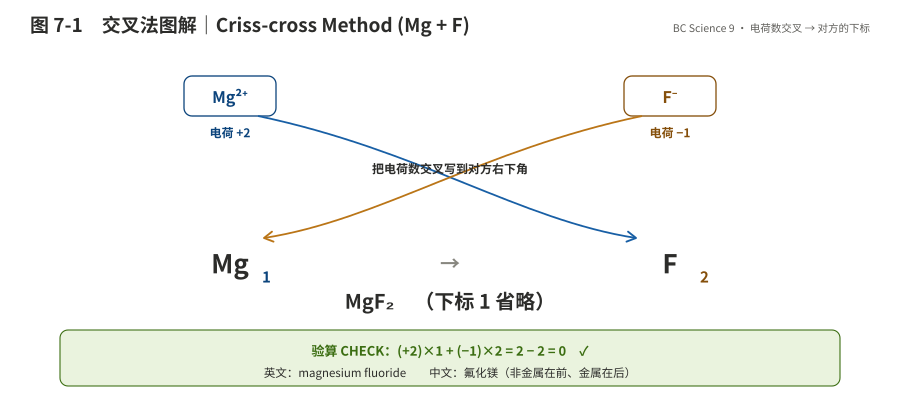
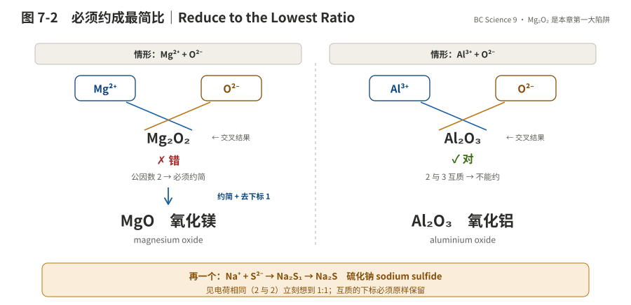
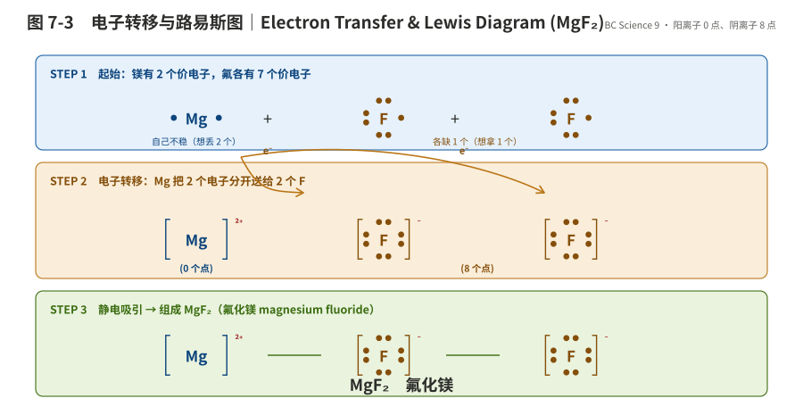
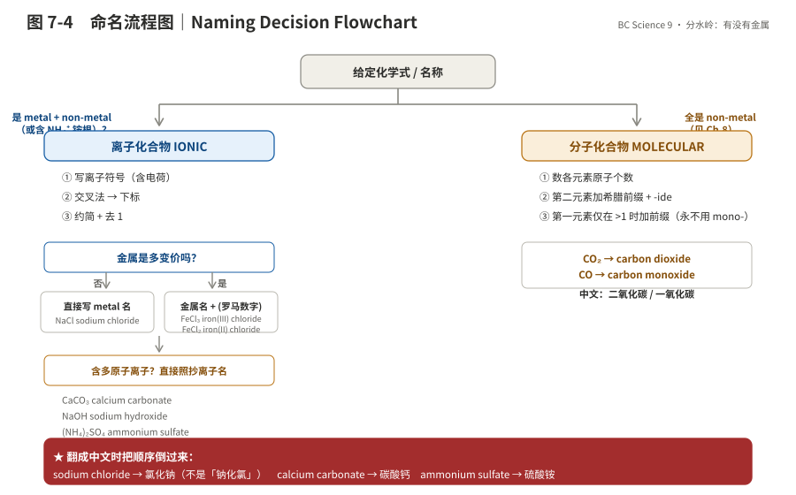
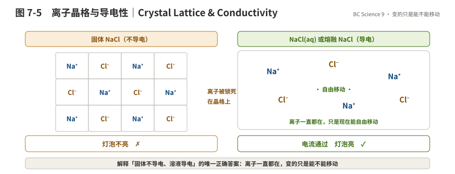
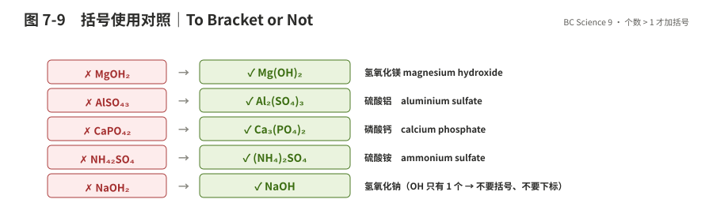
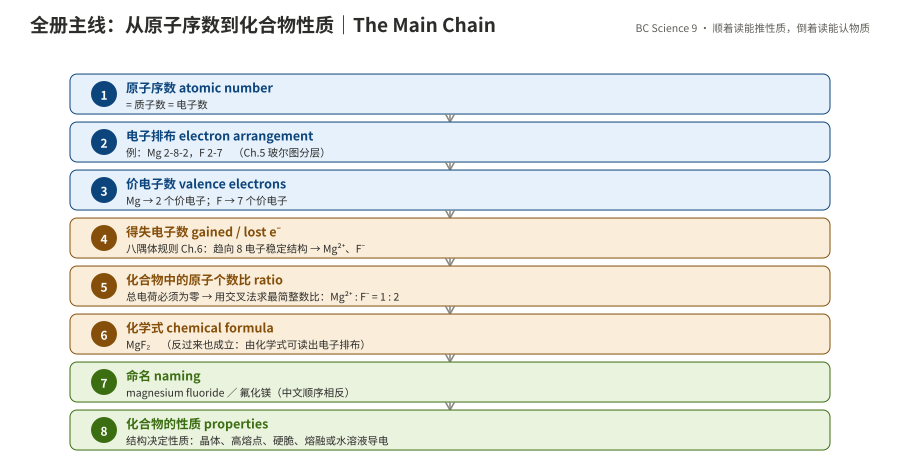

# Ch.7 — Ionic Compounds: Formulas and Naming
## 第 7 章　离子化合物：化学式与命名

> 🗂️ **大纲对应**：BC Science 9 Content **C2** — *The arrangement of electrons determines the compounds formed by elements*（核心章）
> ⏱️ **课时 Periods**：3–4　|　**前置**：Ch.5 玻尔图、Ch.6 离子与路易斯点式　|　**后继**：Ch.8 分子（共价）化合物
> 🗂️ **文件生成时间**：2026-09-18 00:53

## 1. 大纲对应｜Content Alignment

| 项目 | 内容 |
|---|---|
| BC Science 9 Content | **C2** The arrangement of electrons determines the compounds formed by elements |
| Big Idea | **B1** The electron arrangement of atoms impacts their chemical nature.（本章是全册回扣这一句的主战场） |
| Curricular Competencies | [Processing and analyzing] Use knowledge of scientific concepts to draw conclusions consistent with evidence；[Communicating] Communicate scientific ideas using ... scientific language and representations；[Applying and innovating] |
| 是否超纲 | 否。凡涉及化学方程式配平、酸碱命名、溶解度表的内容一律标注 `【🔭 Extension → Science 10】` |

## 2. 学习目标｜Learning Objectives

**EN — By the end of this chapter, you should be able to:**
1. Identify an ionic compound as a combination of a **metal** and a **non-metal** bonded by **transfer of electrons**.
2. Predict the charge of common ions from group number, and state why the **overall charge must be zero**.
3. Write the formula of a binary ionic compound using the **criss-cross method**, then reduce it to the **lowest whole-number ratio**.
4. Name ionic compounds in English, including **multivalent metals (Roman numerals)** and **polyatomic ions**.
5. Convert English names ↔ Chinese names correctly, remembering that the **Chinese order is reversed**.

**中 — 本章结束后，你应当能够：**
1. 判断离子化合物——**金属 + 非金属**，靠**电子转移**成键。
2. 由族号预测常见离子电荷，并说明为什么化合物**总电荷必须为零**。
3. 用**交叉法**写二元离子化合物的化学式，并把比例**约成最简整数比**。
4. 用英文命名离子化合物，含**多变价金属（罗马数字）**与**多原子离子**两类情况。
5. 完成英文名 ↔ 中文名的互译，牢记**中文顺序与英文相反**。

## 3. 概念解析｜Concept Explanations

### 3.1 Ionic Compound 离子化合物

**定义 Definition**：An **ionic compound（离子化合物）** is a compound formed when a **metal** atom **transfers** electrons to a **non-metal** atom, producing oppositely charged **ions（离子）** that attract each other.

- 中文：由**金属元素**与**非金属元素**通过**电子转移（transfer of electrons）**形成的化合物。
- 金属 **失去**电子 → 变成 **cation 阳离子**（正离子，如 Na⁺、Mg²⁺）
- 非金属 **得到**电子 → 变成 **anion 阴离子**（负离子，如 Cl⁻、O²⁻）
- 正负离子靠**静电引力（electrostatic attraction）**结合，这个引力就是 **ionic bond 离子键**。

> 📏 **三步判断法**：看到一种物质，先问"是不是**金属 + 非金属**？" → 是 → **离子化合物**（ionic）。
> 例：NaCl（Na 金属 + Cl 非金属）✓ ionic；CO₂（C + O 都是非金属）✗ 不是（属于 Ch.8 的分子化合物）。

**⚠ 两个必须记住的例外常识**
- **NH₄⁺ ammonium（铵根）** 本身全由非金属组成，但它在化合物里**充当阳离子的角色**，判定时**按"金属"一侧处理**（见 3.6 与图 7-9）。
- 只有一类化合物时不要乱套：两个非金属之间一定不是 ionic。

### 3.2 The Zero-Charge Rule 总电荷为零原则

> **The overall charge of an ionic compound must be zero.
> 离子化合物的总电荷必须为零。**

这是本章的**第一原则**，化学式里每一个下标都由它决定。

**数学写法**：(正离子电荷 × 正离子个数) + (负离子电荷 × 负离子个数) = 0

| 例子 | 验算 | 结论 |
|---|---|---|
| NaCl | (+1)×1 + (−1)×1 = 0 | ✓ |
| MgF₂ | (+2)×1 + (−1)×2 = 0 | ✓ |
| Al₂O₃ | (+3)×2 + (−2)×3 = +6 − 6 = 0 | ✓ |
| Mg₂O₂ | (+2)×2 + (−2)×2 = 0（电荷是对的） | 电荷为零**但比例没约简**，必须写成 **MgO** ✗ |

> ⚠️ **易错核心**：电荷为零是**必要条件**，不是充分条件。化学式还必须满足"**最简整数比**"。

### 3.3 Criss-cross Method 交叉法（五个动作）

**Criss-cross method（交叉法）**：把正、负离子的**电荷数**交叉写到对方符号的**右下角，变成 subscript（下标）**，再约成最简比。

> 💡 五步口诀：**①写离子 → ②交叉 → ③约简 → ④去1 → ⑤验算**

| 步骤 | 动作 English | 中文 | 例：镁 + 氟 |
|---|---|---|---|
| ① 写离子 | Write the two ions | 写出两个离子符号（正离子在前） | Mg²⁺　F⁻ |
| ② 交叉 | Criss-cross the charges | 电荷数交叉，落到对方右下角 | Mg₁F₂ → MgF₂ |
| ③ 约简 | Reduce the ratio | 若两个下标有公因数就约掉 | 1 和 2 无公因数，不动 |
| ④ 去 1 | Drop the subscript 1 | 下标为 1 时**不写** | MgF₂ |
| ⑤ 验算 | Check total charge = 0 | 代回验算 | +2 + 2(−1) = 0 ✓ |

**最简比的例子（必考）**

| 离子 | 交叉后 | 约简 | 最终化学式 | 英文 / 中文 |
|---|---|---|---|---|
| Mg²⁺ + O²⁻ | Mg₂O₂ | 2:2 → **1:1** | **MgO** | magnesium oxide 氧化镁 |
| Ca²⁺ + S²⁻ | Ca₂S₂ | 2:2 → 1:1 | **CaS** | calcium sulfide 硫化钙 |
| Zn²⁺ + O²⁻ | Zn₂O₂ | 2:2 → 1:1 | **ZnO** | zinc oxide 氧化锌 |
| Sn⁴⁺ + O²⁻ | Sn₂O₄ | 2:4 → **1:2** | **SnO₂** | tin(IV) oxide 氧化锡(IV) |
| Pb⁴⁺ + Cl⁻ | PbCl₄ | 1:4 已最简 | **PbCl₄** | lead(IV) chloride 氯化铅(IV) |

> **⚠ 凡是看到两个电荷数相同（如 2+ 与 2−、1+ 与 1−），答案一定是 1:1，绝不能写 2:2**（Mg₂O₂、Na₂S₂、Ba₂O₂ 全错）。

### 3.4 Parentheses 括号规则

当**多原子离子（polyatomic ion）**的个数**大于 1** 时，必须给它加**圆括号**，下标写在括号**外面**。

| 情况 | 写法 | 例子 | 说明 |
|---|---|---|---|
| 个数 = 1 | 不写括号、不写下标 | NaOH、KNO₃、CaCO₃ | OH⁻、NO₃⁻、CO₃²⁻ 都只有 1 个 |
| 个数 > 1 | 必须加括号 | Mg(OH)₂、Ca(OH)₂、Al(OH)₃、(NH₄)₂SO₄、Ca₃(PO₄)₂、Al₂(SO₄)₃ | 括号宣告"整团原子 × N" |

> **⚠ 绝对不能写成 MgOH₂ 或 AlSO₄₃** —— 那样会改变原子团的意义。
> 但如果**多原子离子本身就是单个`(NH₄)₂SO₄`里的 NH₄⁺**，因为它是**正离子**，按规则写在前面，同样要加括号。

### 3.5 English Naming Rules 英文命名三规则

**规则 1（二元 basic binary）**：金属名照写 + 非金属**词根 + `-ide`**

**规则 2（多变价 multivalent metal）**：金属名 + **罗马数字加括号**（罗马数字 = 该金属离子的电荷数）+ 非金属词根 `-ide`

**规则 3（含多原子离子 polyatomic ion）**：直接照抄该离子名（**不做任何词尾改动**）

> 💡 **死记一句话**：罗马数字 = **电荷数**，不是原子个数。iron(III) chloride 的 III 指 Fe³⁺，**不是**"3 个铁"。

### 3.6 ⭐ 专题：英中命名顺序相反（本章最重 ⭐）

| | 英文 English | 中文 Chinese |
|---|---|---|
| **顺序** | **正离子在前** → `metal + non-metal-ide` | **负离子在前** → `某化某` = **非金属在前 + "化" + 金属在后** |
| **sodium chloride** | sodium（钠，正离子）→ chloride（氯，负离子） | **氯化钠**（氯在前，钠在后） |
| **magnesium oxide** | magnesium（镁）→ oxide（氧） | **氧化镁**（氧在前，镁在后） |
| **aluminium sulfide** | aluminium（铝）→ sulfide（硫） | **硫化铝**（硫在前，铝在后） |
| **calcium carbonate** | calcium（钙）→ carbonate（碳酸根） | **碳酸钙**（碳酸根在前，钙在后） |
| **sodium hydroxide** | sodium（钠）→ hydroxide（氢氧根） | **氢氧化钠**（氢氧根在前） |
| **ammonium sulfate** | ammonium（铵）→ sulfate（硫酸根） | **硫酸铵**（硫酸根在前，铵在后） |

> **🚨 对中国学生的头号警示**：英文读到什么就顺着写中文，**一定写反**。
> ✗ **"钠化氯"** —— 错！正确是 **氯化钠**。
> ✗ **"镁化氧"** —— 错！正确是 **氧化镁**。
> ✗ **"铝化硫"** —— 错！正确是 **硫化铝**。
> ✅ 记忆技巧：中文读法 **"负在前、正在后"**，跟英文正好掉个个儿。

**`-ide` 对照中文的"化"**

| English `-ide` | 中文 | English `-ide` | 中文 |
|---|---|---|---|
| oxide | 氧化物 | bromide | 溴化物 |
| chloride | 氯化物 | iodide | 碘化物 |
| sulfide | 硫化物 | phosphide | 磷化物 |
| nitride | 氮化物 | hydride | 氢化物 |
| fluoride | 氟化物 | carbide | 碳化物 |

### 3.7 Multivalent Metals 多变价金属与中文对照

| English name | 中文 | 离子 | 例：氯化物（English） | 例：中文名 |
|---|---|---|---|---|
| iron(II) | 亚铁 | Fe²⁺ | iron(II) chloride | **氯化亚铁** |
| iron(III) | 铁 | Fe³⁺ | iron(III) chloride | **氯化铁** |
| copper(I) | 亚铜 | Cu⁺ | copper(I) oxide | **氧化亚铜** |
| copper(II) | 铜 | Cu²⁺ | copper(II) oxide | **氧化铜** |
| lead(II) | 铅 | Pb²⁺ | lead(II) oxide | **氧化铅(II)** |
| lead(IV) | 铅(IV) | Pb⁴⁺ | lead(IV) oxide | **二氧化铅** |
| tin(II) | 亚锡 | Sn²⁺ | tin(II) chloride | **氯化亚锡** |

> 🌐 中文两套写法并存：**"氯化铁 / 三氯化铁"** 都可以，后者用数字前缀，更接近英文的 read-back。
> ⚠️ **注意**：只有**多变价**金属才需要标罗马数字。Na⁺、Mg²⁺、Ca²⁺、Al³⁺、Zn²⁺、Ag⁺ 电荷固定，**永远不加罗马数字**（写 sodium(I) chloride 是错的）。

### 3.8 Properties of Ionic Compounds 离子化合物的性质

| 性质 Property | English explanation | 中文 | 原因 WHY |
|---|---|---|---|
| Crystalline solid | They form a regular crystal lattice. | 常温下是**晶体**（离子晶格） | 正负离子按几何规律周期性排列 |
| High melting / boiling point | Strong electrostatic forces need much energy to break. | **熔沸点高**（NaCl 熔点 801 ℃，MgO 2852 ℃） | 离子键很强，破坏它需要大量能量 |
| Hard but brittle | Layers shift and like charges repel → shatters. | **硬而脆**，敲击会碎裂 | 错位时同号离子相邻，瞬间互斥崩解 |
| Conductivity | **Conduct electricity when molten or dissolved**；do **not** conduct as a solid. | **溶于水或熔融时导电**，固体**不导电** | 固体内离子被"锁"在晶格上不能移动；溶解或熔化后离子**可以自由移动**形成电流 |
| Solubility | Many dissolve in water. | 多数可溶于水 | 水分子能拉开离子【更深入的溶解度规律属 `【🔭 Extension → Science 10】`】 |

> 🧪 **BC 实验考点**：**electrolyte 电解质** = 其水溶液或熔融态能导电的物质，NaCl 是典型电解质，蔗糖（分子化合物）不是。

## 4. 表格比对｜Comparison Tables

### 表 7-1　常见单原子离子电荷｜Monatomic Ion Charges by Group

| Group 族 | 1 | 2 | 13 | 14 | 15 | 16 | 17 | 18 |
|---|---|---|---|---|---|---|---|---|
| Ion charge 电荷 | +1 | +2 | +3 | ±4 | −3 | −2 | −1 | 0（不成离子） |
| English example | Na⁺ sodium | Mg²⁺ magnesium | Al³⁺ aluminium | 少见 | N³⁻ nitride | O²⁻ oxide | Cl⁻ chloride | — |
| 中文 | 钠离子 | 镁离子 | 铝离子 | — | 氮离子 | 氧离子 | 氯离子 | — |

### 表 7-2　必须背的多原子离子｜Polyatomic Ions to Memorize

| Symbol | English name | 中文名 | Charge |
|---|---|---|---|
| NH₄⁺ | ammonium | 铵根 | +1 |
| OH⁻ | hydroxide | 氢氧根 | −1 |
| NO₃⁻ | nitrate | 硝酸根 | −1 |
| HCO₃⁻ | hydrogen carbonate (bicarbonate) | 碳酸氢根 | −1 |
| CO₃²⁻ | carbonate | 碳酸根 | −2 |
| SO₄²⁻ | sulfate | 硫酸根 | −2 |
| PO₄³⁻ | phosphate | 磷酸根 | −3 |

### 表 7-3　多变价金属：罗马数字 ↔ 中文 ｜Multivalent Metals

| Element | Charges | English (Roman) | 中文离子名 | 举例 English → 化学式 | 中文名 |
|---|---|---|---|---|---|
| Fe 铁 | +2, +3 | iron(II) / iron(III) | 亚铁离子 / 铁离子 | iron(II) chloride → **FeCl₂**；iron(III) chloride → **FeCl₃** | 氯化亚铁 / 氯化铁 |
| Cu 铜 | +1, +2 | copper(I) / copper(II) | 亚铜离子 / 铜离子 | copper(I) oxide → **Cu₂O**；copper(II) oxide → **CuO** | 氧化亚铜 / 氧化铜 |
| Pb 铅 | +2, +4 | lead(II) / lead(IV) | 铅(II)离子 / 铅(IV)离子 | lead(IV) oxide → **PbO₂** | 二氧化铅 |

### 表 7-4　命名 check 清单：三规则 vs 中文 ｜Naming Rules at a Glance

| 情景 Situation | English rule 英文规则 | Chinese rule 中文规则 | Example 英文 → 中文 |
|---|---|---|---|
| 固定价金属 + 非金属 | metal + non-metal root **-ide** | 非金属 + 化 + 金属 | NaCl sodium chloride → 氯化钠 |
| 多变价金属 + 非金属 | metal + **(Roman)** + root **-ide** | 同上（可加数字前缀） | Fe₂O₃ iron(III) oxide → 氧化铁（三氧化二铁） |
| 含多原子离子 | 直接照抄离子名 | 原子团在前 + 金属在后 | CaCO₃ calcium carbonate → 碳酸钙 |
| 含 OH⁻（碱） | metal + **hydroxide** | 氢氧根在前 → **氢氧化某** | NaOH sodium hydroxide → 氢氧化钠 |
| 含 NH₄⁺（铵盐） | **ammonium** + 原子团名 | 原子团在前 + **铵**在后 | (NH₄)₂SO₄ ammonium sulfate → 硫酸铵 |

### 表 7-5　离子化合物 vs 分子（共价）化合物（先剧透，Ch.8 详述）

| 比较项 | Ionic compound 离子化合物 | Molecular (covalent) compound 分子化合物 |
|---|---|---|
| 元素组合 | **metal + non-metal 金属 + 非金属** | **non-metal + non-metal 非金属 + 非金属** |
| 成键方式 | **transfer of electrons 电子转移** | **sharing of electrons 电子共用** |
| 粒子单位 | formula unit 化学式单元（没有独立分子） | molecule 分子 |
| 英文命名 | metal + -ide；用罗马数字；**不用前缀** | 用希腊前缀 mono-/di-/tri-… |
| 熔沸点 | **高** | **低** |
| 导电 | 熔融或水溶液**导电** | **不导电** |
| 例子 | NaCl、MgO、CaCO₃ | H₂O、CO₂、CH₄ |

## 5. 图例说明｜Diagrams & Worked Examples

### 图 7-1　交叉法图解｜Criss-cross Method (Mg + F)



**看图要点**：2 落到 F 的右下角变成 F₂，1 落到 Mg 上但**不写**。凡是"电荷数交叉"都要在心里补一句验算。

### 图 7-2　必须约成最简比｜Reduce to the Lowest Ratio



**看图要点**：**Mg₂O₂ 是本章第一大陷阱**，见电荷 2 与 2 立刻想"1:1"。反过来 Al₂O₃ 的 2 和 3 互质，必须原样保留。

### 图 7-3　电子转移与路易斯图｜Electron Transfer & Lewis Diagram (MgF₂)



**看图要点**：阳离子 **Mg²⁺ 外面 0 个点**（电子已全部失去）；阴离子 F⁻ 画**方括号 + 8 个点 + 电荷**。中文名**氟在前镁在后**。

### 图 7-4　命名流程图｜Naming Decision Flowchart



**看图要点**：先判断 **metal + non-metal？** 这是整条线的分水岭；中文命名是最后一步，**一定要倒序**。

### 图 7-5　离子晶格与导电性｜Crystal Lattice & Conductivity



**看图要点**：离子一直都在，**变的只是能不能移动**。这是解释"固体不导电、溶液导电"的唯一正确答案。

### 图 7-6　例题 A（基础：交叉法）｜Worked Example A

**题目 Problem**：Write the formula and both names for the compound formed from **calcium** and **nitrogen**. 写出钙与氮形成的化合物的化学式和中文名。

**逐步解析 Step-by-step**：

| Step | 内容 | 结果 |
|---|---|---|
| 1 | Identify the ions 判断离子：Ca 在 2 族 → **Ca²⁺**；N 在 15 族 → **N³⁻** | Ca²⁺　N³⁻ |
| 2 | Criss-cross 交叉电荷数 2 与 3 | Ca₃N₂ |
| 3 | Reduce 约简：3 与 2 **互质**，不能再约 | Ca₃N₂ |
| 4 | Drop 1 去 1：没有下标 1 | Ca₃N₂ |
| 5 | Check 验算：(+2)×3 + (−3)×2 = 6 − 6 = **0** ✓ | ✓ |
| 6 | English name：金属不变 + 非金属词根 **-ide** → nitr**ide** | **calcium nitride** |
| 7 | Chinese name：**倒序** → 氮在前 + 化 + 钙在后 | **氮化钙** |

**答案**：**Ca₃N₂，calcium nitride，氮化钙**。
> ✏️ 同理练一题：`Al³⁺ + Cl⁻` → **AlCl₃**，aluminium chloride，**氯化铝**（Al 固定 +3，**不加罗马数字**）。

### 图 7-7　例题 B（多变价：罗马数字）｜Worked Example B

**题目 Problem**：Name **FeCl₃** in English and Chinese. Then give the formula of **copper(II) oxide**. 命名 FeCl₃（英文 + 中文），再写出氧化铜的化学式。

**逐步解析**：

```
  Part 1  FeCl₃ —— 反推铁离子的电荷（罗马数字不是瞎猜的，是算出来的）

     总电荷为零：x + 3×(−1) = 0   →   x = +3
        ↓
     Fe 是 Fe³⁺ → 写罗马数字 (III)
        ↓
     English: iron(III) chloride
     Chinese: 「铁离子」→ 氯化铁（也叫 三氯化铁）
     ⚠ 若写成 iron chloride（缺罗马数字）—— 错，因为铁有多价，信息不全。

  Part 2  copper(II) oxide —— 由罗马数字反写化学式

     roman numeral (II) → Cu²⁺；oxide → O²⁻
        ↓
     交叉：Cu₂O₂  →  约简  →  CuO
        ↓
     验算：(+2) + (−2) = 0  ✓         化学式：CuO
     Chinese: copper(II) 铜 → 氧化铜（注意不是「氧化亚铜」）

  对照记忆：
     Cu₂O  copper(I)  oxide  氧化亚铜   ← 「亚」= 低价
     CuO   copper(II) oxide  氧化铜     ← 无「亚」= 高价
     FeCl₂ iron(II)  chloride 氯化亚铁
     FeCl₃ iron(III) chloride 氯化铁
```
**答案**：FeCl₃ = **iron(III) chloride，氯化铁**；copper(II) oxide = **CuO，氧化铜**。

### 图 7-8　例题 C（多原子离子 + 中英互译）｜Worked Example C

**题目 Problem**：(a) Write the formula for **aluminium sulfate**. (b) 把 **硫酸铵、氢氧化钠、碳酸钙** 翻译成英文并写出化学式。

**逐步解析**：

```
  (a) aluminium sulfate
      离子：Al³⁺   SO₄²⁻
      交叉：Al₂(SO₄)₃        ← SO₄ 出现 3 次 → 加括号
      约简：2 与 3 互质，不动
      验算：(+3)×2 + (−2)×3 = 6 − 6 = 0 ✓
      English: aluminium sulfate   中文: 硫酸铝

  (b) 中译英 —— 先把原子团拆出来，再按英文顺序（阳离子在前）重排
      ┌──────────────┬──────────────┬────────────────┬───────────────────┐
      │ 中文        │ 拆（负离子 / 正离子） │ English          │ Formula            │
      ├──────────────┼──────────────┼────────────────┼───────────────────┤
      │ 硫酸铵      │ SO₄²⁻ / NH₄⁺ │ ammonium sulfate│ (NH₄)₂SO₄         │
      │ 氢氧化钠    │ OH⁻  / Na⁺   │ sodium hydroxide│ NaOH              │
      │ 碳酸钙      │ CO₃²⁻/ Ca²⁺  │ calcium carbonate│ CaCO₃            │
      └──────────────┴──────────────┴────────────────┴───────────────────┘
      验算：(NH₄)₂SO₄ → (+1)×2 + (−2) = 0 ✓
            NaOH     → (+1) + (−1) = 0 ✓
            CaCO₃    → (+2) + (−2) = 0 ✓
```
**答案**：(a) **Al₂(SO₄)₃**；(b) **ammonium sulfate (NH₄)₂SO₄；sodium hydroxide NaOH；calcium carbonate CaCO₃**。
> **⚠ 中文"某酸某"不要读出"化"字**：碳酸钙没有"化"，氢氧化钠、硫酸铵也**没有"化"**。只有 `-ide` 类的二元化合物才有"化"（氯化钠、氧化镁、硫化铝）。

### 图 7-9　括号使用对照｜To Bracket or Not



**看图要点**：**个数 > 1 才加括号，个数 = 1 什么都不加。**

## 6. 核心词汇｜Key Vocabulary

| English | 中文 | 备注 |
|---|---|---|
| ionic compound | 离子化合物 | metal + non-metal |
| ionic bond | 离子键 | 静电引力 |
| transfer of electrons | 电子转移 | ionic 的本质 |
| cation | 阳离子 | metal 失电子，带正电 |
| anion | 阴离子 | non-metal 得电子，带负电 |
| chemical formula | 化学式 | — |
| subscript | 下标 | 右下角数字 |
| overall charge = zero | 总电荷为零 | 第一原则 |
| lowest whole-number ratio | 最简整数比 | 必须约简 |
| criss-cross method | 交叉法 | 五步口诀 |
| reduce | 约简 | Mg₂O₂ → MgO |
| parentheses / brackets | 圆括号 | 多原子离子个数 >1 时用 |
| binary compound | 二元化合物 | 只含 2 种元素 |
| -ide | ……化物 | oxide / chloride / sulfide |
| multivalent / variable charge | 多变价的 | Fe、Cu、Pb、Sn |
| Roman numeral | 罗马数字 | **表示电荷数**，写在括号里 |
| polyatomic ion | 多原子离子 | 带电的原子团 |
| ammonium / hydroxide / carbonate / sulfate / nitrate / phosphate | 铵根 / 氢氧根 / 碳酸根 / 硫酸根 / 硝酸根 / 磷酸根 | 必背 7 个（见表 7-2） |
| crystal lattice | 晶格 | — |
| melting / boiling point | 熔点 / 沸点 | ionic 都高 |
| conduct electricity | 导电 | 需 molten 或 aqueous |
| electrolyte | 电解质 | 水溶液/熔融能导电的物质 |
| brittle | 脆的 | hard & brittle 硬而脆 |
| electrostatic attraction | 静电引力 | ionic bond 的来源 |

## 7. 实验与活动｜Lab / Activity

### 活动 7-1　导电性测试｜Conductivity Lab ⭐
- **类型**：分组实验（Hands-on）
- **材料**：9 V 电池 + 小灯泡（或 LED + 电阻）、石墨电极 2 支、烧杯；固体 NaCl、蒸馏水、NaCl 溶液、蔗糖 C₁₂H₂₂O₁₁ 溶液、MgO 粉末悬浊液
- **步骤**：
  1. 预测 Predict：先把 5 种样品按"会不会导电"排序并写出理由。
  2. 电极**每次用蒸馏水冲洗**，分别插入各样品，记录灯泡亮度（不亮 / 微亮 / 亮）。
  3. 把结论填表：

  | Sample 样品 | Prediction 预测 | Brightness 亮度 | 推断的粒子种类 |
  |---|---|---|---|
  | 蒸馏水 | | | |
  | 固体 NaCl | | | |
  | NaCl 溶液 | | | |
  | 蔗糖溶液 | | | |

- **训练能力**：[Processing and analyzing] Use knowledge of scientific concepts to draw conclusions consistent with evidence；[Questioning and predicting]
- **安全**：⚠ 全程佩戴 **goggles 护目镜**；电池两极**禁止直接用导线短接**（会发烫）；实验后洗手；所有溶液按教师指示倒指定回收杯（**禁止品尝**）。

### 活动 7-2　离子配对卡牌｜Ion Pairing Cards
- **类型**：小组竞赛（Game-based）
- **材料**：阳离子牌（Na⁺、K⁺、Mg²⁺、Ca²⁺、Al³⁺、NH₄⁺、Fe²⁺、Fe³⁺、Cu²⁺）× 阴离子牌（F⁻、Cl⁻、Br⁻、O²⁻、S²⁻、N³⁻、OH⁻、NO₃⁻、CO₃²⁻、SO₄²⁻、PO₄³⁻）
- **步骤**：两人各抽 1 张 → 用交叉法拼出化学式 → **口头说出英文全名** → 再翻成中文 → 交换角色。碰到多变价必须报罗马数字；碰到多原子离子必须判断要不要加括号。
- **加分规则**：能当场完成"总电荷为零"口算验算的小组 +1 分。
- **训练能力**：[Communicating] 使用科学语言 representations；[Applying and innovating]
- **安全**：无（纸牌活动）

### 活动 7-3　晶格模型与"为何脆"｜Crystal Lattice Model
- **类型**：动手建模（Model building）
- **材料**：两种颜色的黏土球或乒乓球（代表 Na⁺ 与 Cl⁻）、热熔胶 / 竹签
- **步骤**：搭出 3×3×2 的 NaCl 晶格 → 用尺子轻推上层，观察"同号离子相遇 → 崩解"的现象 → 画出 ≤ 60 字的解释。
- **训练能力**：[Processing and analyzing] Formulate physical or mental theoretical models；[Evaluating] 模型局限性
- **安全**：⚠ 使用热熔胶枪需教师监督，防烫伤。

## 8. 常见易错点｜Common Misconceptions

| # | 错误认识 Misconception | 正确理解 Correction |
|---|---|---|
| 1 | "Mg₂O₂ 是对的，因为交叉法就是这样" | 交叉后**必须约简**：Mg²⁺ + O²⁻ → Mg₂O₂ → **MgO**。电荷相同的两个离子一定是 1:1。 |
| 2 | "sodium chloride 翻译成中文是钠化氯" | 错！中文**负离子在前**：**氯化钠**。同样：氧化镁、硫化铝、碳酸钙。 |
| 3 | "iron chloride 这个英文名字没问题" | 铁是**多变价**，必须写 **iron(II)/iron(III) chloride**，否则信息不全。 |
| 4 | "FeCl₃ 的罗马数字 III 表示有 3 个铁原子" | 罗马数字 = **该金属离子的电荷数**（Fe³⁺），跟原子个数无关。 |
| 5 | "Na⁺ 只有一种电荷，但写 sodium(I) chloride 更严谨" | 错。固定价金属**永远不加罗马数字**（Na⁺、Mg²⁺、Ca²⁺、Al³⁺、Zn²⁺、Ag⁺）。 |
| 6 | "Mg(OH)₂ 可以简写成 MgOH₂" | 错。多原子离子个数 >1 必须加**括号**：**Mg(OH)₂**、Al₂(SO₄)₃、(NH₄)₂SO₄。 |
| 7 | "NaCl 是离子化合物，所以它的固体也导电" | 错。固体中离子被锁在晶格上不能移动，**不导电**；只有**熔融或溶于水**才导电。 |
| 8 | "只要是 metal + non-metal 就一定溶于水" | 错。很多离子化合物（如 CaCO₃、AgCl）难溶于水 —— 水溶性与导电性是两回事。 |
| 9 | "中文'碳酸钙'里也有一个'化'字" | 错。只有 `-ide`（二元）类才有"化"：**碳酸钙、氢氧化钠、硫酸铵** 都**没有**"化"字。 |
| 10 | "NH₄⁺ 里全是非金属，所以 (NH₄)₂SO₄ 是分子化合物" | 错。NH₄⁺ 是**多原子阳离子**，在命名与判定时按**金属那一侧**处理 → 属于**离子化合物**。 |
| 11 | "交叉法把电荷连符号一起交叉，写成 Mg²⁺→Mg⁻²" | 只交叉**数字**，正负号交叉后**丢弃**，金属永远写在前面。 |
| 12 | "AlCl₃ 应该写成 aluminium(III) chloride" | 不需要。Al 只有 +3，**固定价，无罗马数字** → aluminium chloride。 |

## 9. 答题评估｜Assessment

### A 组：基础题｜Foundational（每题 2 分，共 20 分）

**A1.** 判断下列物质哪些是 **ionic compound**（写 ionic 或 molecular）：NaCl、CO₂、MgO、H₂O、CaCO₃、NH₃。
**A2.** 写出下列元素的离子符号及其电荷：Na、Mg、Al、O、Cl、N。
**A3.** 用交叉法写化学式：**K⁺ + O²⁻**。
**A4.** 用交叉法写化学式：**Al³⁺ + S²⁻**（并说明是否需要约简）。
**A5.** 把 Mg₂O₂ 改正，并写出它的中英文名称。
**A6.** 写出下列化学式的中英文名：Na₂S、K₃N、CaCl₂。
**A7.** 命名（英文 + 中文）：**FeCl₃**、**FeCl₂**。
**A8.** 命名（英文 + 中文）：**Cu₂O**、**CuO**。
**A9.** 写出下列多原子离子的符号与电荷：hydroxide 氢氧根、carbonate 碳酸根、ammonium 铵根、sulfate 硫酸根。
**A10.** 写化学式并处理括号：**magnesium hydroxide**、**aluminium sulfate**、**ammonium sulfate**。

### B 组：应用题｜Applied（每题 5 分，共 20 分）

**B1.** 写出 **iron(III) sulfate** 的化学式，展示完整推导过程（离子 → 交叉 → 约简 → 验算），并给出中文名。

**B2.** 某学生把 **Mg₂O₂** 写成氧化镁的化学式、把 **MgO** 说成 magnesium dioxide。请分别指出两处错误，并用"电荷为零 + 最简比"两条标准说明为什么正确答案只能是 MgO。同时说明为什么对**离子化合物**不能用 di-/tri- 这类前缀。

**B3.** 老师给出一种未知白色固体 X。实验记录如下：常温下为晶体，熔点约 801 ℃，**固体不导电**，但其**水溶液能让灯泡发亮**。请判断 X 是 ionic 还是 molecular compound，写出判断依据（至少 3 条），并说明固体不导电而溶液导电的**粒子层面原因**。

**B4.** 完成下列英中互译表，**并改正其中的错误条目**：

| 原条目 | 你的答案 |
|---|---|
| aluminium sulfide | |
| copper(II) oxide | |
| potassium nitride | |
| 氢氧化钠 | |
| 碳酸钙 | |
| 硫酸铵 | |

### C 组：挑战题｜Challenge（每题 10 分，共 20 分）

**C1.** 某同学说："我只要背住化学式就行了，**为什么一定要用交叉法？**反正考试前答案能背住。请深入地解释交叉法背后的原理——它其实是在解一个什么数学问题？请以 `Al³⁺ + SO₄²⁻` 和 `NH₄⁺ + PO₄³⁻` 两例论证"**为什么有的物质要 2 个 cation 配 3 个 anion，而有的 3 个配 1 个**"，并说明这套方法如何体现"电子不能凭空消失，正负必须相抵"。

**C2.** 下表是四种未知化合物 A–D 的实验数据，请综合运用本章性质知识做出判断并完成表格。

| 样品 | 元素组成 | 熔点 | 固体导电? | 水溶液导电? | ionic / molecular | 推断化学式与英文名 |
|---|---|---|---|---|---|---|
| A | Na, Cl | 801 ℃ | 否 | 是 | | |
| B | C, O | −78 ℃（升华） | 否 | 否（几乎） | | |
| C | Mg, O | 2852 ℃ | 否 | 难溶，熔融后导电 | | |
| D | H, O | 0 ℃ | 否 | 否 | | |

（最后一行 D 请写出它的化学式、**systematic name** 与必须记住的 **common name**，并解释为什么 CO₂ 的水溶液能微弱导电而 D 的纯液体不导电。）

---

### 参考答案｜Answer Key

**A 组**
- **A1.** NaCl = ionic；CO₂ = molecular；MgO = ionic；H₂O = molecular；CaCO₃ = **ionic**（Ca 金属 + C、O 非金属，且含 Ca²⁺ 与 CO₃²⁻ → 判定时金属存在即 ionic）；NH₃ = molecular。
- **A2.** Na⁺、Mg²⁺、Al³⁺、O²⁻、Cl⁻、N³⁻。
- **A3.** K⁺ + O²⁻ → K₂O₁ → **K₂O**（potassium oxide 氧化钾）。验算：(+1)×2 + (−2) = 0 ✓
- **A4.** **Al₂S₃**（aluminium sulfide 硫化铝）。2 与 3 **互质，不需约简**。验算：(+3)×2 + (−2)×3 = 0 ✓
- **A5.** **MgO**；English: **magnesium oxide**；中文: **氧化镁**（不是 Mg₂O₂，必须约简）。
- **A6.** Na₂S = sodium sulfide **硫化钠**；K₃N = potassium nitride **氮化钾**；CaCl₂ = calcium chloride **氯化钙**。
- **A7.** FeCl₃ = **iron(III) chloride，氯化铁**；FeCl₂ = **iron(II) chloride，氯化亚铁**。
- **A8.** Cu₂O = **copper(I) oxide，氧化亚铜**；CuO = **copper(II) oxide，氧化铜**。
- **A9.** hydroxide **OH⁻**（−1）；carbonate **CO₃²⁻**（−2）；ammonium **NH₄⁺**（+1）；sulfate **SO₄²⁻**（−2）。
- **A10.** **Mg(OH)₂**（magnesium hydroxide 氢氧化镁）；**Al₂(SO₄)₃**（aluminium sulfate 硫酸铝）；**(NH₄)₂SO₄**（ammonium sulfate 硫酸铵）。

**B 组（评分要点）**
- **B1.** iron(III) → Fe³⁺；sulfate → SO₄²⁻。交叉得 **Fe₂(SO₄)₃**；2 与 3 互质不约简；SO₄ 出现 3 次**必须加括号**。验算：(+3)×2 + (−2)×3 = 6 − 6 = 0 ✓。中文名 **硫酸铁**（或三硫酸二铁不常用）。⚠ 常见错写：**Fe₂(SO₄)₃ 写成 Fe₂SO₄₃**（漏括号）或 **FeSO₄**（那是 iron(II) sulfate 硫酸亚铁）。
- **B2.** ① Mg₂O₂ 违反了**最简整数比**原则；虽然总电荷也为零，但化学式必须表示为最低比例 → MgO。② "magnesium dioxide" 对离子化合物使用了希腊前缀，这属于 Ch.8 **分子化合物**的命名法；离子化合物中原子比例已由电荷唯一决定，无需、也**不允许**用前缀标注。③ MgO 的正确英文是 **magnesium oxide**。（满分需同时答出"比例最简"与"前缀只用于 molecular"两点。）
- **B3.** **Ionic compound**。依据：① 是晶体（分子化合物多为气体/液体或软固体）；② 熔点很高（801 ℃，分子化合物通常低）；③ 水溶液导电说明存在可自由移动的离子；④ 固体不导电而溶液导电，是离子化合物的标志性特征。**粒子层面原因**：固体 NaCl 中 Na⁺ 与 Cl⁻ 被锁在**晶格固定位置**，不能定向移动 → 不导电；溶于水后晶格被水分子拆散，离子**可以自由移动**，通电时定向迁移形成电流 → 导电。
- **B4.**

  | 原条目 | 正确答案 |
  |---|---|
  | aluminium sulfide | **Al₂S₃ 硫化铝** |
  | copper(II) oxide | **CuO 氧化铜** |
  | potassium nitride | **K₃N 氮化钾** |
  | 氢氧化钠 | **NaOH sodium hydroxide** |
  | 碳酸钙 | **CaCO₃ calcium carbonate** |
  | 硫酸铵 | **(NH₄)₂SO₄ ammonium sulfate** |

  **"错误条目"提示**：若学生把它写成"钠化氯""镁化氧""铝化硫"等即为本章头号错误——中文必须**非金属在前**；另外 **碳酸钙 / 氢氧化钠 / 硫酸铵 均不含"化"字**。

**C 组（评分要点）**
- **C1.** 核心论点：交叉法本质上是在解不定方程 `(charge of cation)·m + (charge of anion)·n = 0` 的**最小正整数解**。① Al³⁺ 与 SO₄²⁻：3m = 2n → 最小解 m=2、n=3 → **Al₂(SO₄)₃**，这就是"2 个阳离子配 3 个阴离子"的来源——因为 3 和 2 的**最小公倍数是 6**，需要 6 个正电荷和 6 个负电荷才能相抵。② NH₄⁺ 与 PO₄³⁻：m = 3n → 最小解 m=3、n=1 → **(NH₄)₃PO₄**（验算 (+1)×3 + (−3) = 0 ✓），这里的 1 不写下标、PO₄ 只有 1 个故**不加括号**。③ 电子不能凭空消失：金属给出的电子总数 = 非金属得到的电子总数，正负必须严格相抵，这正是"总电荷为零"的物理来源；④ 若不用交叉法纯靠背诵，遇到未见过的组合（如题目里的 PO₄³⁻）就会失效，而方程思维可以推广到任何组合。**满分需出现"最小公倍数 / 最小正整数解"这一表述。**
- **C2.**

  | 样品 | 元素组成 | ionic / molecular | 推断化学式与英文名 |
  |---|---|---|---|
  | A | Na, Cl | **ionic** | **NaCl, sodium chloride 氯化钠** |
  | B | C, O | **molecular** | **CO₂, carbon dioxide 二氧化碳** |
  | C | Mg, O | **ionic** | **MgO, magnesium oxide 氧化镁** |
  | D | H, O | **molecular** | **H₂O, dihydrogen monoxide（系统名）/ water（俗名），水** |

  判断依据：离子化合物指标 = 金属元素 + 高熔点 + 熔融/水溶液导电；分子化合物指标 = 全非金属 + 低熔点 + 不导电。**最后一行解释**：CO₂ 溶于水后有少量与水反应生成可自由移动的离子，故能**微弱**导电【详细机制属 `【🔭 Extension → Science 10】`】；而纯水（D）中几乎全部是电中性的 H₂O 分子，**没有可自由移动的带电粒子**，故不导电。这也正是 Ch.8 的核心结论：**分子化合物因为没有离子，所以不导电。**

### 评分量规｜Rubric

| 维度 | 优秀 (A) | 达标 (B) | 待改进 (C) |
|---|---|---|---|
| 化学式准确性 | 下标、括号、罗马数字全对；总电荷验算正确 | 偶漏括号或罗马数字 | 未按最简比约简（Mg₂O₂ 类） |
| 命名规则（英文） | 三规则（−ide / 罗马数字 / 多原子离子）运用无误 | 二元与多原子易混 | 对离子化合物误用 di-/tri- 前缀 |
| 英中互译 | 中英文双向全对，且**自觉倒序** | 偶有"钠化氯"式错误 | 经常按英文顺序直译 |
| 过程展示 | 完整写出"离子 → 交叉 → 约简 → 验算" | 写出关键两步 | 直接给答案无过程 |
| 性质解释 | 能从粒子（离子能否移动）层面解释导电性 | 能回答"何时导电"但不讲原因 | 只能背结论 |

> 👩‍🏫 **教师提示**：A 组建议作为**课堂 10 分钟形成性小测**；B 组用作单元小测；C 组 C1 可改为口头答辩或短论文。
> 🌐 **双语政策 Bilingual policy**：术语解释允许中英双语作答，但**化学式、英文命名、前缀一律必须用英文书写**。

## 10. 回扣核心概念｜Connection to the Big Idea

> 🎯 **Big Idea**：*The electron arrangement of atoms impacts their chemical nature.*
> **原子的电子排布决定其化学性质。**

本章把这句话翻译成了一条完整的因果链，**这就是整册讲义的主线**：



**📊 全册主线：从原子序数到化合物性质｜The Main Chain**


**三点升华**
1. **为什么是 MgF₂ 而不是 MgF₃ 或 Mg₂F？** 因为镁**只能给出 2 个价电子**，氟**每个只能接收 1 个**——比例不是人为规定，而是**电子排布算出来的**。
2. **为什么要用罗马数字区分 Fe²⁺ / Fe³⁺？** 过渡元素的电子排布允许失去不同数量的电子 → **同一种元素能形成不止一种化合物** → 必须用罗马数字标记，否则化学交流就失去准确性。
3. **为什么会长出 ionic 的通性？** 一切都源自"正负离子靠强静电引力联锁成晶格"这一个结构事实：离子键强 → 熔点高；离子被锁 → 固体不导电；解放后能动 → 熔融/溶液导电。

**下章预告**：如果两个原子**都不肯交出电子**（两个非金属相遇），它们该怎么办？答案是**共用——share**。这就是 Ch.8 **分子（共价）化合物**，它要用完全不同的另一套命名法（希腊前缀）。届时你会发现：**判断"金属 + 非金属？"这一个分水岭，统领了 Ch.7 与 Ch.8 两章的全部规则。**

---

*本章对应框架文件 `00_讲义章节框架_Course_Framework.md` Ch.7。下一章：Ch.8 分子（共价）化合物：化学式与命名。*
