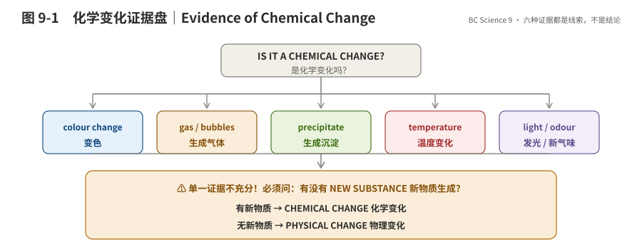
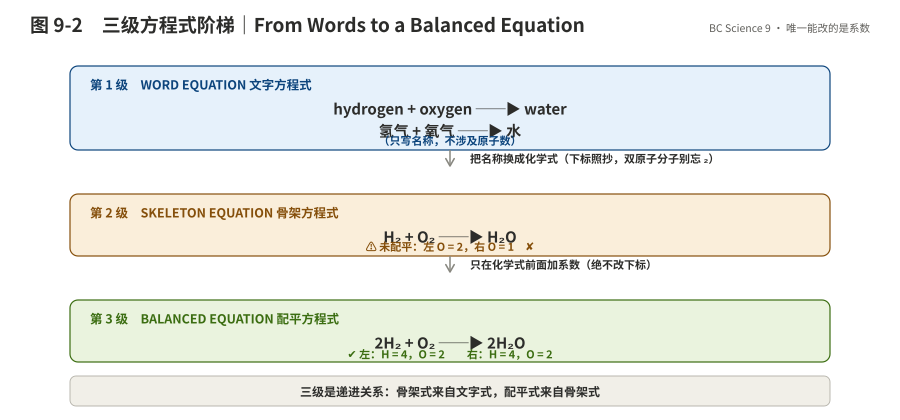
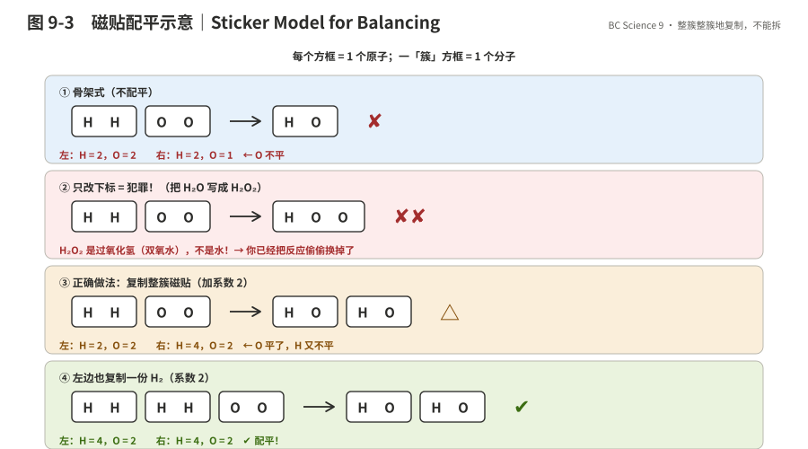
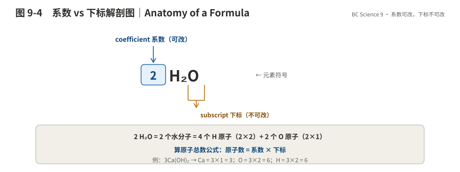

# Ch.9 — Chemical Change and an Introduction to Chemical Equations
## 第 9 章　化学变化与化学方程式入门

> 🗂️ **大纲对应**：**本章为 Extension（拓展）章节**；完整处理属于 **BC Science 10**（官方条目：rearrangement of atoms in chemical reactions / law of conservation of mass / energy change during chemical reactions / acid-base chemistry）
> ⏱️ **课时 Periods**：2　|　**前置**：Ch.1、Ch.6、Ch.7　|　**后继**：Ch.10、Ch.11
> 🗂️ **文件生成时间**：2026-09-18 00:53

## 1. 大纲对应｜Content Alignment

| 项目 | 内容 |
|---|---|
| BC Science 9 官方 Content | **不在** Science 9 官方 Content 清单内（Science 9 只有 C1 元素周期表性质、C2 电子排布决定化合物） |
| 本章定位 | **Extension 拓展 / 衔接桥梁（bridge chapter）**，为 Science 10 打底，只要求"识别 + 书写 + 数原子"，**不要求**复杂配平与计算 |
| **Science 10 官方条目（本章对应）** | ① *rearrangement of atoms in chemical reactions*（化学反应中原子的重新排列）② *law of conservation of mass*（质量守恒定律）③ *energy change during chemical reactions*（反应中的能量变化）④ *acid-base chemistry*（酸碱化学） |
| Curricular Competencies | [Questioning and predicting]；[Processing and analyzing]；[Evaluating] Evaluate the validity and limitations of a model；[Communicating] 用证据化论证 |
| 是否超纲 | **是（Extension）**——正文所有超出 Science 9 的条目均加 `【🔭 Extension → Science 10】` 标记，测评不作重点 |

> 📏 **给学生的说明**：本章是"看一眼明年要学什么"的窗口。今年你要掌握的是三件事：① 判断是不是化学变化；② 会写文字方程式；③ 会数原子检验是否配平。**配平只做最简单的 5–6 个。**

## 2. 学习目标｜Learning Objectives

**EN — By the end of this chapter, you should be able to:**
1. List and recognize at least four lines of evidence that a chemical change has occurred.
2. Distinguish a physical change from a chemical change using observable evidence.
3. Write a **word equation** and convert it into a **skeleton equation**.
4. Count atoms on both sides of an equation to decide whether it is balanced.
5. State the **law of conservation of mass** and explain it in terms of rearrangement of atoms.

**中 — 本章结束后，你应当能够：**
1. 列举并识别化学变化发生的至少四条证据。
2. 依据可观察证据区分物理变化与化学变化。
3. 书写**文字方程式**，并把它转换成**骨架方程式**。
4. 通过数方程式左右两边的原子个数，判断它是否配平。
5. 陈述**质量守恒定律**，并用"原子重新排列"来解释它。

## 3. 概念解析｜Concept Explanations

### 3.1 Chemical Change 化学变化（复习 Ch.1 并加深）

**定义 Definition**：A **chemical change** is a change in which one or more new substances are formed. The atoms are **rearranged**; the substances you start with are called **reactants 反应物**, and the new substances produced are called **products 生成物**.

**中文**：化学变化是生成了**新物质**的变化。原子只是**重新排列组合**，既没有消失也没有新生。变化前的物质叫**反应物**，生成的新物质叫**生成物**。

- 判据只有一句话：**有没有新物质？** 有 → 化学变化；没有 → 物理变化。
- 化学变化的本质是：**旧的连接断开 → 原子重新组合 → 形成新的连接**。
- 因为原子核（质子数）在化学反应中**从不改变**，所以化学反应**不能**把一种元素变成另一种元素（那是核反应）。

### 3.2 Evidence of Chemical Change 化学变化的证据

| # | English 证据 | 中文 | 典型例子 | 容易误判的情况 |
|---|---|---|---|---|
| 1 | colour change | 颜色改变 | 铁生锈（银灰→红棕）、苹果切面变褐 | 有色果汁兑水稀释也会变色（物理） |
| 2 | gas produced / bubbles / effervescence | 生成气体、冒气泡 | 小苏打 + 醋 → CO₂ | 水沸腾也冒泡（物理） |
| 3 | precipitate formed | 生成沉淀 | 硝酸铅 + 碘化钾 → 黄色 PbI₂ 沉淀 | 泥沙沉底是物理沉降 |
| 4 | temperature change (energy released or absorbed) | 温度变化（放热/吸热） | 生石灰 + 水放热；暖宝宝 | 摩擦生热、晒太阳变暖（物理） |
| 5 | light produced | 发光 | 镁条燃烧发出耀眼白光；萤火虫 | 灯泡通电发光（物理） |
| 6 | new odour | 产生新气味 | 食物腐败、鸡蛋变质 | 香水挥发只是扩散（物理） |

> ⚠️ **核心提醒**：**任何单一证据都不充分**（水沸腾冒泡、灯泡发光都是物理变化）。必须综合判断，并始终回到"**有没有新物质生成**"这个根本问题上。

### 3.3 Word Equation 文字方程式

**文字方程式**用**物质名称**和箭头描述反应：

```
  反应物 reactants  ＋  反应物   ──▶  生成物 products ＋ 生成物
  （箭头左侧 / left of the arrow）      （箭头右侧 / right of the arrow）
```

- 箭头 → 读作 "**yields / produces / reacts to form**"（生成 / 变成），中文读"**生成**"。
- "+" 在左边读作 "**reacts with**"（与……反应）；在右边读作 "**and**"（和）。
- 例：`hydrogen + oxygen → water`　读作：*Hydrogen reacts with oxygen to produce water.*（氢气与氧气反应生成水。）

### 3.4 Skeleton Equation 骨架方程式

**骨架方程式**把名称换成**化学式**，但**还没有配平**（原子数不一定相等）：

- `hydrogen + oxygen → water`　→　`H₂ + O₂ → H₂O`
- 关键：写骨架式时**直接照抄已知化学式**，不要动下标。O₂ 是**双原子分子**（Ch.4 七种双原子分子之一：H₂、N₂、O₂、F₂、Cl₂、Br₂、I₂），写单质时不要漏掉下标 2。

### 3.5 Balanced Equation 配平方程式 & 质量守恒定律

```
  Word equation      hydrogen  +  oxygen  →  water
  Skeleton equation      H₂    +    O₂    →   H₂O      ✘ 未配平（右 O=1，左 O=2）
  Balanced equation    2H₂     +    O₂    →  2H₂O      ✔ 配平
```

**Law of conservation of mass 质量守恒定律**

> 📌 **EN**: In a chemical reaction, matter is neither created nor destroyed. The **total mass of the reactants equals the total mass of the products**, because the **number and type of atoms do not change** — atoms are only **rearranged**.
> **中**: 在化学反应中，物质既不会被创造也不会被消灭。**反应物的总质量等于生成物的总质量**，因为**原子的种类与数目都不变**——原子只是被**重新排列**了。

**为何质量守恒？** 因为每个原子的质量不变、原子个数不变，所以总质量必然不变。（科学史：拉瓦锡 Lavoisier 用密闭容器称量，第一次严格证明了这一点。）

### 3.6 Coefficient 系数 vs Subscript 下标（本章最重要）

| 概念 | 写法 | 作用 | 能否改动 |
|---|---|---|---|
| **Coefficient 系数** | 写在化学式**前面**的大数字，如 **2**H₂O | 表示**分子（或式量单位）的个数**——"有几个" | ✅ **可以改**（改的是数量，物质本身不变） |
| **Subscript 下标** | 写在元素符号**右下角**的小数字，如 H**₂**O | 表示**每个分子里该原子的个数**——"长什么样" | ❌ **绝对不能改**（改了就变成另一种物质） |

> 💡 **金句**：**系数改变"数量"，下标改变"身份"。配平只能动系数。**
> 例：把 H₂O 改成 H₂O₂ 来"配平"氧原子——但 H₂O 是**水**，H₂O₂ 是**过氧化氢**（消毒用的双氧水，会灼伤皮肤）！这就把反应改成了另一个反应。

### 3.7 配平四步法｜Balancing in Four Steps

1. **Write the skeleton equation 写骨架式**（把名称换成化学式，**下标照抄**）。
2. **Count the atoms 数原子**：分别数出左右两边每种元素的原子总数（系数 × 下标）。
3. **Add coefficients 加系数**：把系数写在化学式**前面**，从"只出现在一种物质里"的元素开始，通常**最后处理 O 和 H**。
4. **Recheck 再数一遍**：确认每种元素左右相等，且系数为最简整数比。

> 📌 **贴纸 / 磁贴模型（Sticker Model）**：把每个原子想象成一块彩色磁贴，一个分子就是一小簇贴在一起的磁贴。配平就是"**把整簇磁贴复制几份**"（加系数），而**绝不允许把磁贴从一簇里拆出来塞进另一簇**（改下标）。

### 3.8 State Symbols 状态符号与反应条件

`【🔭 Extension → Science 10】` 完整使用属 Science 10，本章仅要求认读：

| 符号 | 英文 | 中文 | 例子 |
|---|---|---|---|
| (s) | solid | 固体 | Mg(s)、NaCl(s) |
| (l) | liquid | 液体 | H₂O(l)、Br₂(l) |
| (g) | gas | 气体 | O₂(g)、CO₂(g) |
| (aq) | aqueous（dissolved in water） | 水溶液 | HCl(aq)、NaCl(aq) |
| △ 或 heat | heated | 加热 | 写在箭头上方 |

- 完整写法示例：`2Mg(s) + O₂(g) → 2MgO(s)`
- 气体上箭头 ↑ 与沉淀下箭头 ↓ 是中国教材常见记号，BC 教材多用 (g) 与 (s)，两者都认得即可。

### 3.9 Science 10 预告｜What Comes Next

`【🔭 Extension → Science 10】` 以下全部属 Science 10，本册**只要求知道名字**：

| 反应类型 Type | English | 中文 | 通式 General form |
|---|---|---|---|
| Synthesis 化合 | synthesis / combination | 化合反应 | A + B → AB |
| Decomposition 分解 | decomposition | 分解反应 | AB → A + B |
| Single replacement 置换 | single replacement | 置换反应 | A + BC → AC + B |
| Double replacement 复分解 | double replacement | 复分解反应 | AB + CD → AD + CB |
| Combustion 燃烧 | combustion | 燃烧反应 | 燃料 + O₂ → CO₂ + H₂O（+ 能量） |

- **Acid-base chemistry 酸碱化学**：Science 10 会学 pH、indicator 指示剂、neutralization 中和反应（acid + base → salt + water）。例：`HCl + NaOH → NaCl + H₂O`
- **Concentration 浓度**：Science 10 会学 molar concentration（mol/L）与稀释计算。
- **Energy change 能量变化**：exothermic 放热（温度上升）vs endothermic 吸热（温度下降）。

## 4. 表格比对｜Comparison Tables

### 表 9-1　Physical Change vs Chemical Change 物理变化与化学变化

| 比较项 | Physical change 物理变化 | Chemical change 化学变化 |
|---|---|---|
| 是否生成新物质 | 否 | **是**（核心判据） |
| 化学式是否改变 | 不变 | **改变** |
| 原子层面发生什么 | 分子间距/排列改变，**分子本身完整** | **原子重新排列**（rearrangement of atoms） |
| 是否可逆（一般） | 较易可逆 | 通常难以逆转 |
| 能量变化 | 通常较小 | 通常明显（放热/吸热/发光） |
| 关键词 | melt 熔化、freeze 凝固、evaporate 蒸发、dissolve 溶解、break 破碎 | burn 燃烧、rust 生锈、corrode 腐蚀、ferment 发酵、rot 腐烂、explode 爆炸 |
| 例子 | 冰融化、食盐溶于水、玻璃破碎 | 铁生锈、镁条燃烧、小苏打 + 醋 |

### 表 9-2　三级方程式对照｜Word / Skeleton / Balanced

| 级别 | English | 中文 | 用了什么 | 原子数是否相等 |
|---|---|---|---|---|
| ① | **Word equation 文字方程式** | 文字方程式 | 物质**名称** + 箭头 | 不涉及 |
| ② | **Skeleton equation 骨架方程式** | 骨架方程式 | 物质**化学式**（未配平） | **不一定相等** |
| ③ | **Balanced equation 配平方程式** | 配平方程式 | 化学式 + **系数** | **一定相等 ✔** |

### 表 9-3　Coefficient vs Subscript 系数与下标（必背）

| 比较项 | Coefficient 系数 | Subscript 下标 |
|---|---|---|
| 位置 | 化学式**前面** | 元素符号**右下角** |
| 写法示例 | **2**H₂O、**3**O₂ | H**₂**O、O**₂** |
| 含义 | 多少个**分子 / 式量单位** | 一个分子里该元素有几个**原子** |
| 计算原子数时 | **乘**进总数（2H₂O → H = 2×2 = 4） | **乘**进总数（H₂O → H = 2） |
| 配平时能否改动 | ✅ 可以（唯一允许改的） | ❌ **不能**（会改变物质本身） |
| 类比 | 有多少盒饼干 | 一盒饼干里装几块 |

### 表 9-4　质量守恒：反应前后对照｜Conservation of Mass

| 项目 | 反应前 Reactants | 反应后 Products |
|---|---|---|
| 原子**种类** | H、O | H、O（**不变**） |
| 原子**数目** | 4 个 H + 2 个 O | 4 个 H + 2 个 O（**不变**） |
| 分子**种类** | H₂、O₂ | H₂O（**变了**） |
| 分子**数目** | 3 个分子（2+1） | 2 个分子（**会变**，这不违反守恒） |
| 总**质量** | 36 g | 36 g（**不变**） |

### 表 9-5　配平练习答案速查｜Balancing Practice Key

| # | 骨架式 Skeleton | 配平式 Balanced | 左 / 右原子数 |
|---|---|---|---|
| 1 | H₂ + O₂ → H₂O | **2**H₂ + O₂ → **2**H₂O | H 4/4；O 2/2 |
| 2 | Na + Cl₂ → NaCl | **2**Na + Cl₂ → **2**NaCl | Na 2/2；Cl 2/2 |
| 3 | Mg + O₂ → MgO | **2**Mg + O₂ → **2**MgO | Mg 2/2；O 2/2 |
| 4 | CH₄ + O₂ → CO₂ + H₂O | CH₄ + **2**O₂ → CO₂ + **2**H₂O | C 1/1；H 4/4；O 4/4 |
| 5 | Fe + O₂ → Fe₂O₃ | **4**Fe + **3**O₂ → **2**Fe₂O₃ | Fe 4/4；O 6/6 |
| 6 | Zn + HCl → ZnCl₂ + H₂ | Zn + **2**HCl → ZnCl₂ + H₂ | Zn 1/1；H 2/2；Cl 2/2 |

## 5. 图例说明｜Diagrams & Worked Examples

### 图 9-1　化学变化证据盘｜Evidence of Chemical Change




**看图要点**：六种证据都是"线索"而不是"结论"。看到气泡先问"水是不是只是烧开了？"，看到变色先问"是不是只是被稀释了？"。**证据必须交叉验证，再落到"有无新物质"这一根本判据上。**

### 图 9-2　三级方程式阶梯｜From Words to a Balanced Equation




**看图要点**：三级是**递进**关系而不是并列关系——骨架式来自文字式，配平式来自骨架式。**唯一被允许改动的地方是"系数"**，下标从文字式阶段就固定下来了。

### 图 9-3　磁贴配平示意｜Sticker Model for Balancing




**看图要点**：配平就是"**整簇整簇地复制**"。磁贴可以整簇变多（系数），但**不能从一簇里拆出一块塞进另一簇**（下标）。这张图是本章最核心的心智模型。

### 图 9-4　系数 vs 下标解剖图｜Anatomy of a Formula




**看图要点**：数原子时**一定不要漏乘系数**。常见错误是"H₂O 前面有 2，但我只数 H₂O 自己"，那就永远配不平。括号右下角的下标要**乘括号里每一个原子**。

### 图 9-5　例题：配平四步法｜Worked Example — Balancing

**题目**：配平 `CH₄ + O₂ → CO₂ + H₂O`（甲烷燃烧）。

**解析**：

| 步骤 | 操作 | 结果 | 原子计数 |
|---|---|---|---|
| 1 | 写骨架式（下标照抄） | CH₄ + O₂ → CO₂ + H₂O | — |
| 2 | 数原子 | — | 左 C1 H4 O2；右 C1 H2 O3 |
| 3a | C 已平；先配 **H**（右加系数 2） | CH₄ + O₂ → CO₂ + **2**H₂O | 左 H4；右 H4 ✔ |
| 3b | 再配 **O**（右现有 O = 2+1 = 3，左需 3 个 O 原子 → O₂ 前写 3/2 不好，直接翻倍） | CH₄ + **2**O₂ → CO₂ + **2**H₂O | 左 O4；右 O2+2=4 ✔ |
| 4 | 复核全部 | **CH₄ + 2O₂ → CO₂ + 2H₂O** | C 1/1；H 4/4；O 4/4 ✔ |

> 📌 **策略小结**：**先 C，再 H，最后 O**。O 常以单质 O₂ 出现，最后处理它最省事——因为改 O₂ 的系数不会牵动其他元素。
> `【🔭 Extension → Science 10】` 此反应属于 **combustion 燃烧反应**，且为 **exothermic 放热**。

### 图 9-6　例题：用质量守恒求质量｜Worked Example — Mass

**题目**：12 g 碳在足量氧气中完全燃烧，生成 44 g 二氧化碳。求参加反应的氧气质量，并说明依据。

**解析**：

| 项目 | 计算 / 说明 |
|---|---|
| 文字方程式 | carbon + oxygen → carbon dioxide |
| 配平方程式 | C + O₂ → CO₂（已配平：C 1/1；O 2/2 ✔） |
| 已知 | m(C) = 12 g，m(CO₂) = 44 g |
| 依据 | law of conservation of mass 质量守恒定律：反应物总质量 = 生成物总质量 |
| 列式 | m(C) + m(O₂) = m(CO₂) → 12 g + m(O₂) = 44 g |
| 答案 | **m(O₂) = 44 − 12 = 32 g** |
| 原子层解释 | 1 个 C 原子 + 1 个 O₂ 分子（2 个 O 原子）重新排列成 1 个 CO₂ 分子，**原子种类与数目都不变**，故质量不变 |

**看图要点**：质量守恒题目的标准套路是"**总进 = 总出**"。如果题目给出"敞口容器中反应后质量变小了"，那不是守恒失效，而是**有气体跑掉了没被称到**——见 C1 题。

## 6. 核心词汇｜Key Vocabulary

| English | 中文 | 备注 |
|---|---|---|
| chemical change | 化学变化 | 生成新物质 |
| physical change | 物理变化 | 无新物质 |
| reactant | 反应物 | 箭头左侧 |
| product | 生成物 | 箭头右侧 |
| yield / produce | 生成 | 箭头 → 的读法 |
| word equation | 文字方程式 | 用名称 |
| skeleton equation | 骨架方程式 | 用化学式，未配平 |
| balanced equation | 配平方程式 | 有系数，原子数相等 |
| **coefficient** | **系数** | 化学式前面的数字，**可改** |
| **subscript** | **下标** | 右下角小数字，**不可改** |
| **law of conservation of mass** | **质量守恒定律** | 原子种类与数目不变 |
| rearrangement of atoms | 原子重新排列 | Science 10 官方条目 |
| **precipitate** | **沉淀** | 两溶液混合生成的固体 |
| effervescence | 冒气泡 / 起泡 | gas produced |
| state symbol | 状态符号 | (s) (l) (g) (aq) |
| aqueous | 水溶液的 | 溶于水 |
| exothermic | 放热的 | 温度上升 |
| endothermic | 吸热的 | 温度下降 |
| synthesis / decomposition | 化合 / 分解 | Science 10 |
| single / double replacement | 置换 / 复分解 | Science 10 |
| combustion | 燃烧 | Science 10 |
| neutralization | 中和 | Science 10（acid + base → salt + water） |

## 7. 实验与活动｜Lab / Activity

### 活动 9-1　化学变化观察站｜Chemical Change Stations
- **类型**：教师演示 + 学生记录（Demo & Observation）
- **材料**：小苏打 + 白醋；硝酸铅溶液 + 碘化钾溶液（**教师演示**）；钢丝绒（数天观察）；镁带（**教师点燃**）
- **步骤**：学生用视觉（**禁止品尝、禁止直接凑近闻**）记录 before / after，填入证据表并判定变化类型。

| Station | 观察前 Before | 观察后 After | 证据 Evidence | 判定 |
|---|---|---|---|---|
| 1 小苏打 + 醋 | | | | |
| 2 Pb(NO₃)₂ + KI | | | | |
| 3 钢丝绒 + 水 | | | | |
| 4 镁带燃烧 | | | | |

- **训练能力**：[Planning and conducting]；[Processing and analyzing] Use knowledge of scientific concepts to draw conclusions consistent with evidence
- **安全**：⚠ 全程佩戴 **goggles 护目镜**；铅盐有毒，**教师演示、学生不接触**；镁带燃烧**禁止直视**（强光伤眼）；闻气体用 **wafting 扇闻法**

### 活动 9-2　磁贴配平工作坊｜Magnet Tile Balancing
- **类型**：动手操作（Hands-on modelling）
- **材料**：彩色圆磁贴 / 纸片（H 用一种颜色、O 用另一种）、白板
- **步骤**：
  1. 两人一组，用磁贴摆出 H₂ + O₂ → H₂O。
  2. 只允许"**整簇复制**"，把两边配成原子数相等。
  3. 依次挑战表 9-5 的 6 道题，每配平一题就记录一次"左/右原子计数"。
  4. 教师故意演示"改下标"，让全班指出为什么错。
- **训练能力**：[Evaluating] Formulate physical or mental theoretical models；[Communicating]
- **安全**：无（磁贴防止误吞，勿放入口鼻）

### 活动 9-3　质量守恒称量挑战｜Mass Conservation Challenge `【🔭 Extension → Science 10】`
- **类型**：教师演示对比实验（Comparative Demo）
- **材料**：电子天平、锥形瓶 + 气球（密闭系统）、小苏打 + 醋
- **步骤**：① 敞口烧杯中混合，称量前后质量 → **变小**；② 锥形瓶上套气球密闭后混合，称量前后质量 → **不变**。学生解释差异。
- **训练能力**：[Processing and analyzing]；[Evaluating] Evaluate the validity and limitations of a model
- **安全**：⚠ 护目镜；气球不要过度充气以防爆裂；醋酸避免入眼

## 8. 常见易错点｜Common Misconceptions

| # | 错误认识 Misconception | 正确理解 Correction |
|---|---|---|
| 1 | **为了配平去改下标**（把 H₂O 写成 H₂O₂） | ❌ 最严重的错误。改下标 = 改物质本身。**只能改系数。** |
| 2 | "冒泡一定是化学变化" | 水沸腾也冒泡。要问：**气泡是不是新物质？** |
| 3 | "发光一定是化学变化" | 灯泡通电发光是物理变化。 |
| 4 | "溶解是化学变化，因为固体'消失'了" | 蒸发可回收原物质 → **物理变化**。 |
| 5 | 数原子时**漏乘系数** | 原子数 = **系数 × 下标**。2H₂O 是 4 个 H，不是 2 个。 |
| 6 | 单质写成单原子（把氧气写成 O） | O₂、H₂、N₂、F₂、Cl₂、Br₂、I₂ 是**双原子分子**，下标 2 必须写。 |
| 7 | "配平后分子数目也必须相等" | ❌ 守恒的是**原子数与质量**，不是分子数。2H₂ + O₂ → 2H₂O：左 3 个分子，右 2 个，仍然配平。 |
| 8 | "化学反应中原子会消失或新生" | 原子**既不消失也不新生**，只是重新排列（rearrangement）。 |
| 9 | 敞口反应后质量"变少"就认为质量守恒失效 | 只是**气体逸出未被称量**。密闭系统称量则质量不变。 |
| 10 | 把系数写成分数（½O₂） | 最终系数必须是**最简整数比**，可先分数过渡，最后全体翻倍化为整数。 |
| 11 | 认为 arrows 左边是"产品" | 左 reactants 反应物 → 右 products 生成物。 |
| 12 | 提前用前缀给离子化合物命名（sodium monochloride） | 分子化合物才用前缀；**离子化合物不用前缀**（见 Ch.7/Ch.8）。 |

## 9. 答题评估｜Assessment

### A 组：基础题｜Foundational（每题 2 分，共 20 分）

**A1.** 写出化学变化的四条证据（English + 中文各两条即可）。
**A2.** 判断：水沸腾冒泡是化学变化。（对 / 错，并说明理由）
**A3.** 把下列文字方程式写成骨架方程式：`sodium + chlorine → sodium chloride`
**A4.** 把 `hydrogen + oxygen → water` 写成配平方程式。
**A5.** 配平：`Na + Cl₂ → NaCl`
**A6.** 说明 coefficient 系数与 subscript 下标的区别，并指出配平时能改哪一个。
**A7.** 陈述 law of conservation of mass 质量守恒定律（中文或英文均可）。
**A8.** 数原子：在 `2H₂O` 中，H 原子有 ______ 个，O 原子有 ______ 个。
**A9.** 写出状态符号 (s)、(l)、(g)、(aq) 各自的中文含义。
**A10.** 配平：`Mg + O₂ → MgO`

### B 组：应用题｜Applied（每题 5 分，共 20 分）

**B1.** 观察下列四个场景，判断各是物理变化还是化学变化，并各写一句证据化理由：
(a) 铁钉放在潮湿空气中一周后表面变红棕　(b) 冰块在桌上化成水　(c) 小苏打倒入白醋中剧烈起泡　(d) 蔗糖溶于水后看不见颗粒

**B2.** 配平下列三个方程式，并在每题后写出"左 / 右原子计数"：
(a) `CH₄ + O₂ → CO₂ + H₂O`　(b) `Fe + O₂ → Fe₂O₃`　(c) `Zn + HCl → ZnCl₂ + H₂`

**B3.** 在密闭容器中，16 g 甲烷（CH₄）与 64 g 氧气完全反应，生成 44 g 二氧化碳和 36 g 水。
(a) 验证数据是否符合质量守恒定律；(b) 用"原子重新排列"解释为什么质量不变。

**B4.** 小明配平 `H₂ + O₂ → H₂O` 时，把右边写成 `H₂O₂`，说"这样氧就平了"。
(a) 指出他的错误；(b) 说明 H₂O 与 H₂O₂ 分别是什么物质；(c) 给出正确配平式。

### C 组：挑战题｜Challenge（每题 10 分，共 20 分）

**C1.** 设计一套实验，用**密闭系统**验证 law of conservation of mass。要求写出：研究问题、假设（If…then…）、自变量/因变量/控制变量、器材、步骤、数据记录表、预期结果、安全注意事项，并解释为什么敞口系统会"看起来"不守恒。

**C2.** 小苏打（NaHCO₃）与醋酸（HC₂H₃O₂）反应生成醋酸钠（NaC₂H₃O₂）、水与二氧化碳。
(a) 写出文字方程式与骨架方程式；(b) 配平它并检查每种元素的原子数；(c) 用**原子模型**论证：为什么这个反应符合质量守恒定律？（要求说明"哪些原子被重新排列、哪些东西没变"。）

---

### 参考答案｜Answer Key

**A 组**
- A1. 任答四条：colour change 变色；gas produced 生成气体；precipitate formed 生成沉淀；temperature change 温度变化；light produced 发光；new odour 新气味。
- A2. **错**。水沸腾只是液态变气态，仍是 H₂O，没有新物质生成 → physical change 物理变化。
- A3. `Na + Cl₂ → NaCl`（**注意 chlorine 是双原子分子 Cl₂**）
- A4. `2H₂ + O₂ → 2H₂O`
- A5. `2Na + Cl₂ → 2NaCl`
- A6. 系数 coefficient 写在化学式**前面**，表示分子个数；下标 subscript 写在元素符号**右下角**，表示分子内原子个数。**配平只能改系数，绝不能改下标。**
- A7. 在化学反应中，物质既不会被创造也不会被消灭；反应物总质量等于生成物总质量，因为**原子的种类与数目不变，只是重新排列**。
- A8. H = **4** 个（2×2）；O = **2** 个（2×1）。
- A9. (s) 固体 solid；(l) 液体 liquid；(g) 气体 gas；(aq) 水溶液 aqueous。
- A10. `2Mg + O₂ → 2MgO`

**B 组（要点）**
- B1. (a) **化学变化**——生成了新物质铁锈（Fe₂O₃·xH₂O），证据：colour change 由银灰变红棕。
  (b) **物理变化**——只是固态变液态，分子仍是 H₂O，无新物质。
  (c) **化学变化**——产生大量气泡即新物质 CO₂，证据：gas produced。
  (d) **物理变化**——蔗糖分子分散在水中，蒸发可回收原蔗糖，溶解是 dissolving 不是反应。
- B2. (a) `CH₄ + 2O₂ → CO₂ + 2H₂O`：C 1/1；H 4/4；O 4/4 ✔
  (b) `4Fe + 3O₂ → 2Fe₂O₃`：Fe 4/4；O 6/6 ✔
  (c) `Zn + 2HCl → ZnCl₂ + H₂`：Zn 1/1；H 2/2；Cl 2/2 ✔
- B3. (a) 反应物总质量 = 16 + 64 = **80 g**；生成物总质量 = 44 + 36 = **80 g**。两边相等 → **符合**质量守恒。
  (b) 反应前 CH₄ 与 O₂ 中的 C、H、O 原子，在反应后重新组合成 CO₂ 与 H₂O。**原子种类（C/H/O）不变、原子数目不变、每个原子质量不变**，只是连接方式变了，所以总质量不变。（分子种类与分子数目变了，这不影响守恒。）
- B4. (a) 错误：他通过**改下标**来"配平"，这改变了物质本身，等于换了一个反应。
  (b) H₂O 是**水**；H₂O₂ 是**过氧化氢**（双氧水，有腐蚀/漂白性）。
  (c) 正确配平式：`2H₂ + O₂ → 2H₂O`

**C 组（评分要点）**
- C1. 参考要点：
  - **问题**：在密闭系统中，小苏打与醋反应前后总质量是否改变？
  - **假设**：If the system is closed, then the total mass before and after the reaction will be the same.（If…then… 格式必须齐全）
  - **变量**：自变量 = 是否发生反应（反应前 / 反应后）；因变量 = 系统总质量 (g)；控制变量 = 同一套器材、同一份药品、同一台天平、温度不变、不移动容器。
  - **器材**：锥形瓶 + 气球（或小苏打用小纸袋悬挂后倒入）、电子天平、小苏打、白醋。
  - **步骤**：① 把醋装入锥形瓶，小苏打装入小袋悬挂在瓶内（**不接触**），塞紧并套气球；② 称量总质量 m₁；③ 倾斜让两者混合，观察气泡使气球鼓起；④ 再称总质量 m₂；⑤ 重复 3 次。
  - **数据表**：列 = 次数、m₁ (g)、m₂ (g)、Δm (g)。
  - **预期结果**：m₁ = m₂（在天平精度范围内，Δm ≈ 0）。
  - **解释**：敞口系统中 CO₂ 逸出到空气中未被称量，所以"看起来"变轻——**不是质量守恒失效，而是称量对象不完整**。
  - **安全**：⚠ 护目镜；禁止品尝；醋酸避免入眼；气球不要充气过满；实验后洗手、按教师指示处理废液。
- C2. (a) 文字式：`sodium hydrogen carbonate + acetic acid → sodium acetate + water + carbon dioxide`（中文：碳酸氢钠 + 醋酸 → 醋酸钠 + 水 + 二氧化碳）
  骨架式：`NaHCO₃ + HC₂H₃O₂ → NaC₂H₃O₂ + H₂O + CO₂`
  (b) **已配平**，无需系数。检查：左 Na 1、H 1+4=5、C 1+2=3、O 3+2=5；右 Na 1、H 3+2=5、C 2+1=3、O 2+1+2=5。**全部相等 ✔**
  （若学生写成 `NaHCO₃ + CH₃COOH → CH₃COONa + H₂O + CO₂` 同样正确，原子数一致。）
  (c) 模型论证要点：反应前共有 Na 1、H 5、C 3、O 5 个原子；反应后仍是 Na 1、H 5、C 3、O 5 个原子。**变的是"谁跟谁连在一起"**（HCO₃ 中的 H 转移到了 H₂O 上，碳酸部分分解出 CO₂），**不变的是每一种原子的个数与原子核本身**（质子数不变 → 元素种类不变）。既然每个原子的质量不变、个数不变，总质量必然不变。

### 评分量规｜Rubric

| 维度 | 优秀 (A) | 达标 (B) | 待改进 (C) |
|---|---|---|---|
| 方程式书写 | 化学式与下标全部正确，系数为最简整数比 | 化学式正确，系数偶有遗漏 | 改下标来"配平"；漏写双原子分子下标 |
| 证据判断 | 能综合多条证据并回到"有无新物质" | 能正确判断但理由单薄 | 凭单一现象下结论 |
| 守恒解释 | 能用"原子重新排列"论证，说明分子数可变 | 能复述定律但不会解释 | 只背结论，无解释 |
| 术语双语 | 中英术语准确，coefficient/subscript 不混 | 主要术语正确 | 中英术语混淆 |
| 实验方案 | 变量齐全、含对照与重复、安全完整 | 步骤清楚但变量/安全不全 | 无变量控制，未提安全 |

> 👩‍🏫 **教师提示**：A 组作课堂 10 分钟形成性检测；B 组作本章小测；C 组作科学写作或差异化挑战。
> 🌐 **双语政策**：术语允许中英双语作答；**化学式与英文命名必须使用英文**。
> 🔭 **Extension 提示**：本章 C 组属于 Science 10 难度，**不作 Science 9 计分要求**，可用于加分或拓展。

## 10. 回扣核心概念｜Connection to the Big Idea

> 🎯 **Big Idea**：*The electron arrangement of atoms impacts their chemical nature.*
> **原子的电子排布决定其化学性质。**

化学变化看似"物质彻底变了"，但在**原子层面**上，什么都没少、什么都没多：

1. **原子核从不参与化学反应**。质子数不变 → 元素种类不变 → 化学反应永远不能把铁变成金（那是核反应）。
2. **真正被重新安排的是核外电子**（Ch.6 的电子转移、Ch.8 的共用电子对）。原子之所以"愿意"这样重新排列，正是因为**最外层电子（价电子）在追求满层的稳定结构**（octet rule 八隅体规则）。
3. 所以：**电子排布 → 决定原子得失电子的倾向 → 决定形成什么离子 → 决定生成什么化合物 → 决定化学方程式写成什么样。** 这正是整册 Ch.5 → Ch.6 → Ch.7 → Ch.8 的主线在本章的落点。
4. 质量守恒之所以成立，本质上也是因为"**电子可以搬家，原子核与原子个数不变**"。

> 💡 **一句话总结**：化学方程式是"原子重新排队"的账本——**左边进多少原子，右边就必须出多少原子**，而谁跟谁排在一起，早就由电子排布写好了剧本。

**思考题（下章预热）**：既然原子只是重新排列，那么我们凭什么"看见"反应发生了？答案是**可测量的变化**（温度、质量、颜色、气体、沉淀）——这正是下一章"如何设计一个能看见变化的公平实验"要解决的问题。

---

*本章对应框架文件 `00_讲义章节框架_Course_Framework.md` Ch.9。下一章：Ch.10 科学探究、实验技能与安全。*
