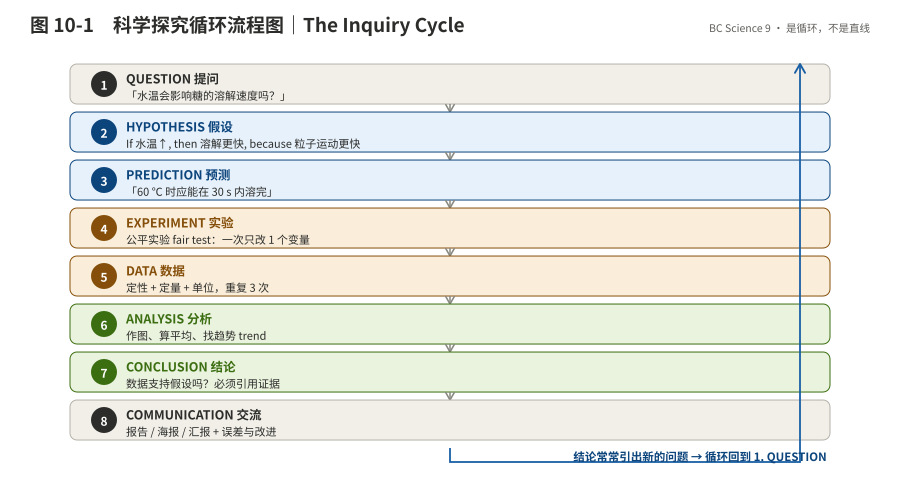
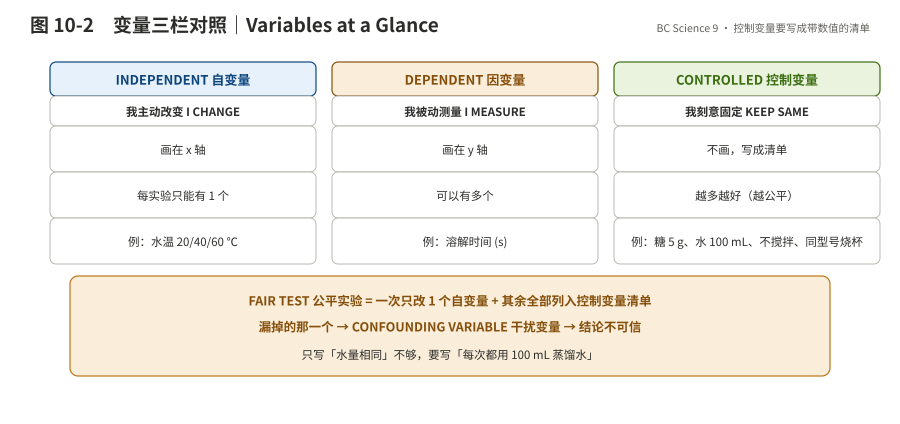
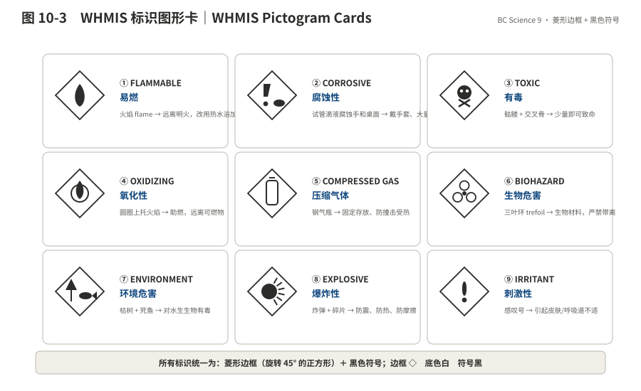
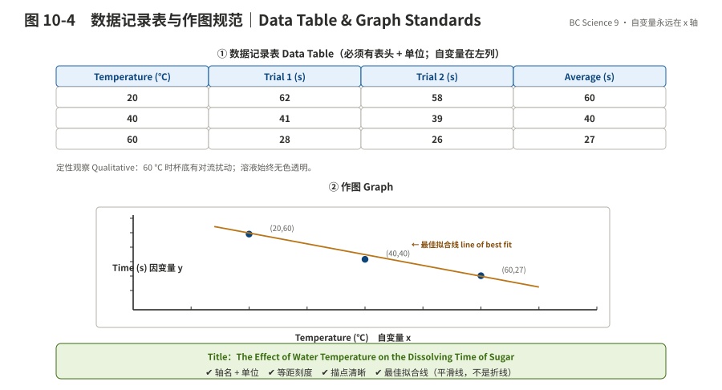
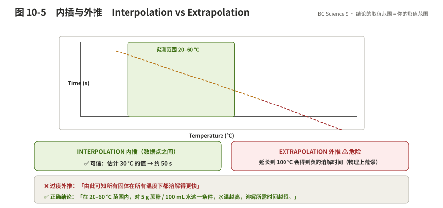

# Ch.10 — Scientific Inquiry, Lab Skills and Safety
## 第 10 章　科学探究、实验技能与安全

> 🗂️ **大纲对应**：**Curricular Competencies（课程能力）**——贯穿全册，非独立知识单元
> ⏱️ **课时 Periods**：2（+ 分散在各章实验中）　|　**前置**：Ch.1 – Ch.9　|　**后继**：Ch.11
> 🗂️ **文件生成时间**：2026-09-18 00:53

## 1. 大纲对应｜Content Alignment

| 项目 | 内容 |
|---|---|
| BC Science 9 官方 Content | 本章**不新增** Content 条目；它服务于 C1「element properties as organized in the periodic table」与 C2「The arrangement of electrons determines the compounds formed by elements」的**探究过程** |
| Curricular Competencies（全覆盖） | ① **Questioning and predicting** 提问与预测　② **Planning and conducting** 计划与实施　③ **Processing and analyzing data and information** 数据处理与信息分析　④ **Evaluating** 评估　⑤ **Applying and innovating** 应用与创新　⑥ **Communicating** 交流 |
| 官方能力原文要点 | Demonstrate a sustained intellectual curiosity about a scientific topic；Formulate questions that can be investigated；Make predictions based on prior knowledge；Design and conduct experiments **safely**；Identify **independent, dependent and controlled variables**；Use **SI units**；Construct and interpret **graphs**；Identify **sources of error** and suggest **improvements**；Communicate using **scientific language, tables and graphs** |
| Big Idea 关系 | 本章提供**获取证据的方法**，用来支撑"电子排布决定化学性质"这一结论 |
| 是否超纲 | 否（能力线，属大纲明确要求） |

> 📏 **给学生的说明**：这一章不是"背了就完事"的知识章。BC 大纲把科学能力分成六条，你本学期**每一次实验报告**都会被这六条里的某几条打分。本章就是那份**评分标准的说明书**。

## 2. 学习目标｜Learning Objectives

**EN — By the end of this chapter, you should be able to:**
1. Describe the steps of the scientific method and write an "If…then…because…" hypothesis.
2. Identify the **independent, dependent and controlled variables** in an investigation and design a **fair test**.
3. Distinguish **qualitative** from **quantitative** data and record measurements with correct **SI units**.
4. Recognize the **WHMIS** hazard symbols and follow standard lab safety rules.
5. Identify sources of **error and uncertainty**, construct a properly labelled **graph**, and use **interpolation** (but not over-extrapolation) to draw conclusions.

**中 — 本章结束后，你应当能够：**
1. 描述科学方法的步骤，并写出"如果……那么……因为……"形式的假设。
2. 在探究中识别**自变量、因变量与控制变量**，设计一个**公平实验**。
3. 区分**定性数据**与**定量数据**，并用正确的**国际单位制单位**记录测量值。
4. 认出 **WHMIS** 危险标识并遵守标准实验室安全规则。
5. 找出**误差与不确定度**的来源，绘制标注规范的**图表**，并用**内插**（而非过度外推）得出结论。

## 3. 概念解析｜Concept Explanations

### 3.1 Scientific Inquiry 科学探究 / Scientific Method 科学方法

科学方法不是一条"必须一步步走"的死板清单，而是一个**可以循环、可以回头**的过程（图 10-1）：

| Step 步骤 | English | 中文 | 要点 |
|---|---|---|---|
| 1 | **Question** | 提出问题 | 必须**可探究**（testable）：能用实验回答，不是"哪个更好看" |
| 2 | **Hypothesis** | 假设 | 对结果的**解释性猜测**，格式为 *If…then…because…* |
| 3 | **Prediction** | 预测 | 对**具体观测值**的预期（"温度升到 60 ℃ 时溶解时间会小于 30 s"） |
| 4 | **Experiment** | 实验 | 设计 **fair test 公平实验**，控制变量，多次重复 |
| 5 | **Observation / Data** | 观察与数据 | qualitative 定性 + quantitative 定量，列表记录，带**单位** |
| 6 | **Analysis** | 分析 | 作图、算平均、找 pattern 规律 / trend 趋势 |
| 7 | **Conclusion** | 结论 | 回答研究问题，说明**数据是否支持假设**，引用证据 |
| 8 | **Communication** | 交流 | 实验报告、海报、口头汇报；说明误差与改进 |

> 📌 **Hypothesis 假设 vs Prediction 预测（高频考点）**：
> - Hypothesis 解释"**为什么会这样**"（含机制，用 because）；
> - Prediction 说"**会看到什么**"（含具体数值或现象）。
> - 例：*If the temperature of the water increases, **then** the sugar will dissolve faster, **because** higher temperature makes particles move faster.*（假设）
> - 例：*At 60 ℃ the sugar should dissolve in under 30 seconds.*（预测）

### 3.2 Variables 变量

- **Independent variable 自变量**：研究者**主动改变**的那个量（"我改什么"）。画在图的 **x 轴**。
- **Dependent variable 因变量**：**被测量**的那个量，它"依赖"自变量而变化（"我测什么"）。画在图的 **y 轴**。
- **Controlled variable 控制变量**：为了公平而**保持不变**的所有其他量（"我固定什么"）。**必须写成清单**，且每一项都要有具体数值/做法。
- **Fair test 公平实验**：**一次只改变一个自变量**，其余全部控制不变。否则无法判断结果是谁造成的。
- **Confounding variable 干扰变量**：本应控制却**没控制住**的变量，会混淆结论（见 3.6）。

> 💡 **记忆口诀**：**我改的是自变量，我测的是因变量，我固定的是控制变量，我漏掉的是干扰变量。**

### 3.3 Qualitative vs Quantitative Data 定性数据与定量数据

- **Qualitative data 定性数据**：用**感官或文字**描述的性质，无数字。如颜色、气味、状态、"是否冒泡"、"表面变粗糙"。
- **Quantitative data 定量数据**：用**仪器测量**得到的**数字 + 单位**。如 25.4 mL、12.3 ℃、0.85 g。
- 好的实验**两者都要**：定量数据让你能作图比较，定性数据常常是意外发现的来源。

**SI Units 国际单位制（le Système international d'unités）**

| 量 Quantity | SI 单位 | 符号 | 学校实验室常用 | 仪器 Instrument |
|---|---|---|---|---|
| length 长度 | metre 米 | m | cm / mm / m | ruler 尺、measuring tape 卷尺 |
| mass 质量 | kilogram 千克 | kg | g / mg | electronic balance 电子天平 |
| time 时间 | second 秒 | s | s / min | stopwatch 秒表 |
| temperature 温度 | kelvin 开尔文 | K | **℃（摄氏度，实验室常用）** | thermometer 温度计 |
| volume 体积 | cubic metre（SI）；**litre 升**（常用） | m³ / L | mL / L | graduated cylinder 量筒 |
| electric current 电流 | ampere 安培 | A | A / mA | ammeter / multimeter 电流表/万用表 |

- 换算：1 L = 1000 mL；1 m = 100 cm = 1000 mm；1 kg = 1000 g；0 ℃ = 273.15 K。
- **读量筒**：视线与**凹液面最低处（meniscus 凹液面）**齐平，从上方或下方读都会产生 **parallax error 视差误差**。

### 3.4 WHMIS 与实验室安全｜Safety

**WHMIS** = **W**orkplace **H**azardous **M**aterials **I**nformation **S**ystem
中文：**工作场所危险物质信息系统**。

- 加拿大法律要求所有危险化学品的容器上贴 **supplier label 供应商标签**，图案为**菱形边框内的黑色符号**。
- 每种化学品还必须配有 **SDS（Safety Data Sheet 安全数据表）**，说明急救、泄漏处理、储存与处置方法。
- 学校实验室还会用 **workplace label 工作场所标签**（简化标签）与实验室自制试剂瓶。

九种常见标识见表 10-4 与图 10-3。**考试常见问法**："看到这个符号，说明该物质有什么危险？你应该怎么做？"

### 3.5 实验室常规安全规则｜Standard Lab Rules

| 规则 | English | 理由 |
|---|---|---|
| 护目镜 | Wear **safety goggles** whenever chemicals, heat or glassware are used | 溅入眼睛是实验室最常见的严重伤害 |
| 禁止品尝 | **Never taste** any chemical | 课本例子：NaCl 可食用，但 Pb(NO₃)₂、CuSO₄ 有毒 |
| 扇闻法 | Use **wafting** — fan the air toward your nose with your hand | 直接凑近闻高浓度气体会灼伤呼吸道 |
| 通风 | Work in a well-ventilated area / **fume hood 通风柜** for volatile substances | 防止吸入有害气体 |
| 毛发与衣物 | Tie back long hair; no loose sleeves; closed-toe shoes | 明火与化学品 |
| 加热 | Never leave a flame unattended; point test tubes **away from people** | 试管内液体可能暴沸喷出 |
| 紧急设备 | Know the location of **eyewash station 洗眼器**、**safety shower 紧急喷淋**、**fire extinguisher 灭火器**、**fire blanket 灭火毯**、**exit 出口** | 出事前就要知道在哪 |
| 事故处理 | Report **every** spill, break or injury to the teacher immediately | 小事故不报会变成大事故 |
| 结束 | Wash hands; dispose of chemicals **as instructed**（不要随意倒入水槽） | 环境与下水道污染 |
| 取用 | **Never return unused chemicals to the stock bottle**；取多少用多少 | 防止整瓶试剂被污染 |

### 3.6 Error, Uncertainty 与不确定性｜Evaluating

- **Error 误差**：测量值与真实值之间的差异。误差**无法完全消除**，只能减小。
- **Systematic error 系统误差**：每次都朝**同一方向**偏（天平未调零、量筒刻度不准）→ 可通过校准仪器消除。
- **Random error 随机误差**：方向不定、时大时小（读数视差、反应瞬间判断）→ 可通过**多次重复取平均**减小。
- **Uncertainty 不确定度**：对测量值可信范围的估计，写成 `20.5 ± 0.5 ℃`。仪器精度越小，不确定度越小。
- **Accuracy 准确度**：测量值离**真值**多近。　**Precision 精密度**：多次测量之间**彼此多接近**。（可用"打靶图"理解：都聚在一起但偏离靶心 = 精密但不准确。）
- **Confounding variable 干扰变量**：没被控制的变量，导致"看起来是 A 造成的，其实是 B 造成的"。
- **Alternative explanation 替代解释**：对同一组数据还能给出的**另一种合理说明**。科学结论的强弱，取决于能否排除替代解释。
- **Outlier / anomalous result 异常值**：明显偏离趋势的数据点，应**保留并说明**（如"可能是读数错误"），不能随手删掉。

### 3.7 Graphing 作图规范

一张合格的科学图表必须包含：

1. **Title 标题**：`The effect of [自变量] on [因变量]`，如 *The effect of water temperature on the dissolving time of sugar*。
2. **Axis labels 坐标轴标注**：名称 + **单位**，如 `Temperature (℃)`、`Time (s)`。
3. **Scales 刻度**：等距、覆盖全部数据、**从 0 开始**（除非有充分理由并标明断轴符号）。
4. **自变量在 x 轴，因变量在 y 轴**。
5. **Plot points 描点**：用小圆圈或叉号，清晰可辨。
6. **Line / curve of best fit 最佳拟合线**：平滑地穿过点群的"中间"，**不是**把点连成折线（line-to-line）。
7. **Legend 图例**：有多组数据时必须有。

### 3.8 Interpolation vs Extrapolation 内插与外推

- **Interpolation 内插**：在**已有数据的范围之内**估计未知值。✅ **可靠**（前提是有合理的趋势）。
- **Extrapolation 外推**：在**已有数据的范围之外**推测。⚠ **危险**——你假设"趋势会一直延续"，而这在现实中常常不成立。
- **Over-extrapolation 过度外推**：把 20 ℃–60 ℃ 的数据外推到 500 ℃，或把 5 次实验的结论推广到"所有物质"——这是 BC 大纲明确要扣分的能力错误。

> 📌 **结论的取值范围**：Your conclusion can only be as broad as your data.（**结论不能超出数据支持的范围。**）

### 3.9 Lab Report 实验报告结构

| 部分 | English | 内容 |
|---|---|---|
| 标题 | Title | 简洁说明研究内容 |
| 问题 | Question | 一个可探究的问题 |
| 假设 | Hypothesis | If…then…because… |
| 变量 | Variables | 自变量 / 因变量 / 控制变量（清单） |
| 材料 | Materials | 含规格（如 100 mL 量筒） |
| 步骤 | Procedure | 编号、被动语态或祈使句、可重复 |
| 观察 | Observations | 数据表（带单位）+ 定性描述 |
| 分析 | Analysis | 图、计算、趋势判断 |
| 结论 | Conclusion | 回答问题 + 是否支持假设 + 引用证据 |
| 评估 | Evaluation | 误差来源 + 改进方案 + 新产生的问题 |

## 4. 表格比对｜Comparison Tables

### 表 10-1　三类变量｜Three Types of Variables

| 变量 | English | 中文 | 提问方式 | 图中位置 | 例子（水温对溶解速度） |
|---|---|---|---|---|---|
| Independent | independent variable | **自变量** | 我**改**什么？ | **x 轴** | 水温（20、40、60 ℃） |
| Dependent | dependent variable | **因变量** | 我**测**什么？ | **y 轴** | 糖完全溶解所需时间 (s) |
| Controlled | controlled variable | **控制变量** | 我**固定**什么？ | 不画图 | 糖的质量 (5 g)、水量 (100 mL)、颗粒大小、是否搅拌、容器形状 |

### 表 10-2　定性 vs 定量｜Qualitative vs Quantitative

| 比较项 | Qualitative 定性 | Quantitative 定量 |
|---|---|---|
| 形式 | 文字描述 | 数字 + 单位 |
| 获取方式 | 感官（**禁止品尝**） | 仪器测量 |
| 例子 | 溶液由无色变蓝；有刺激性气味；生成白色沉淀 | 25.4 mL；12.3 ℃；0.85 g；38 s |
| 优点 | 能捕捉意外现象 | 可比较、可作图、可统计 |
| 缺点 | 主观，难比较 | 可能漏掉未测量的现象 |
| 记录建议 | 即时、具体（避免"变化很大"这种模糊写法） | 保留仪器精度位数（天平 0.01 g 就写 0.85 g） |

### 表 10-3　误差类型与改进｜Errors and Improvements

| 类型 | English | 中文 | 特征 | 例子 | 改进方法 |
|---|---|---|---|---|---|
| Systematic | systematic error | 系统误差 | 总是朝同一方向偏 | 天平未调零，每次多 0.2 g | 校准仪器 / 调零 / 做空白对照 |
| Random | random error | 随机误差 | 忽大忽小，方向随机 | 读凹液面时视线偏高偏低 | **多次重复取平均**；同一人读数 |
| Human | human error | 人为失误 | 可避免的操作错误 | 加错试剂、看错刻度 | 严格按步骤；双人核对 |
| Confounding | confounding variable | 干扰变量 | 变量未被控制 | 一边升温一边搅拌 | 列入控制变量清单并逐项固定 |

### 表 10-4　WHMIS 标识全表｜WHMIS Pictograms（必背）

| # | English | 中文 | 图形长什么样（文字描述） | 危险含义 | 常见例子 |
|---|---|---|---|---|---|
| 1 | **Flammable** | 易燃 | 菱形边框内一簇**向上燃烧的火焰** | 遇火源/高热易燃烧 | ethanol 乙醇、acetone 丙酮 |
| 2 | **Corrosive** | 腐蚀性 | 一支试管**倾倒液滴**，滴到**一只手**和**一块桌面**上，两处都被腐蚀出洞 | 会灼伤皮肤、毁坏金属/桌面 | HCl 盐酸、NaOH 氢氧化钠 |
| 3 | **Toxic** | 有毒 | 一个**骷髅头**加**两根交叉的骨头** | 少量即可致命或造成严重伤害 | 部分重金属盐、甲醇 |
| 4 | **Oxidizing** | 氧化性 | 一个**圆圈（O）上方顶着一簇火焰** | 本身未必可燃，但会**供氧助燃**，使火势更猛 | H₂O₂ 过氧化氢（高浓度）、KMnO₄ |
| 5 | **Compressed gas** | 压缩气体 | 一个**立式气瓶（钢瓶）**图案 | 内装高压气体；受热或撞击可能爆炸，钢瓶可能飞射 | O₂ 钢瓶、CO₂ 钢瓶 |
| 6 | **Biohazard** | 生物危害 | 三个互相交叠的**圆环**围绕一个中心环（三叶形 trefoil） | 含致病微生物或生物毒素 | 细菌培养物、血液样本 |
| 7 | **Environmental hazard** | 环境危害 | 一棵**枯死的树**与一条**死鱼**并排 | 对水生生物或环境有毒，不可随意排放 | 部分农药、重金属废液 |
| 8 | **Explosive** | 爆炸性 | 一个**正在炸开的炸弹**，四周有碎片飞散 | 受热、撞击或摩擦即可能爆炸 | 苦味酸、叠氮化物 |
| 9 | **Irritant** | 刺激性 | 一个粗体的**感叹号 "!"** | 会引起皮肤/眼/呼吸道刺激、过敏或较轻的急性毒性 | 稀氨水、部分清洁剂 |

> **注**：第 9 项 irritant（感叹号）在部分 BC 教室图表与旧版资料中使用；WHMIS 2015 官方体系中与之相近的是 **Health hazard 健康危害**（人形轮廓 + 胸前星芒）。**两者都认得即可**，答题时写"刺激性 / 健康危害"并描述图形都能得分。

### 表 10-5　内插 vs 外推｜Interpolation vs Extrapolation

| 比较项 | Interpolation 内插 | Extrapolation 外推 |
|---|---|---|
| 位置 | 已有数据点**之间** | 已有数据点**之外** |
| 可靠性 | ✅ 较高（趋势已在该区间被验证） | ⚠ 低（假设趋势延续，未经验证） |
| 例子 | 数据有 20 ℃ 与 40 ℃，估计 30 ℃ 的值 | 数据到 60 ℃，却去推测 200 ℃ 的值 |
| 结论写法 | "在 20–60 ℃ 范围内，温度越高溶解越快" | ❌ "因此所有物质在任何温度下都如此" |
| 建议 | 放心用 | 必须写明假设，且最好补做实验验证 |

### 表 10-6　Accuracy vs Precision 准确度与精密度

| 情况 | 打靶类比 | 判断 |
|---|---|---|
| 点都聚在靶心 | 又准又精密 | ✅ 理想 |
| 点聚在一起但偏离靶心 | **精密但不准确** | 有**系统误差**（需校准） |
| 点散开但平均在靶心 | **准确但不精密** | 有**随机误差**（需重复取平均） |
| 点散开且偏离靶心 | 既不准也不精密 | 仪器与操作都有问题 |

## 5. 图例说明｜Diagrams & Worked Examples

### 图 10-1　科学探究循环流程图｜The Inquiry Cycle

**看图要点**：这是一个**循环**而不是直线。第 8 步之后常常会产生新的问题（"为什么 70 ℃ 反而不快了？"），于是又回到第 1 步。**科学就是这样一圈一圈前进的。**

### 图 10-2　变量三栏对照｜Variables at a Glance

**看图要点**：控制变量**必须写成带数值的清单**——只写"水量相同"不够，要写"每次都用 100 mL 蒸馏水"。少一个控制变量，就多一个干扰变量。

### 图 10-3　WHMIS 标识图形卡｜WHMIS Pictogram Cards

**看图要点**：**先看边框（都是菱形），再看里面的图案**。答题时按"图形 → 危险 → 做法"三步走。例：看到火焰 → 易燃 → 远离明火、改用热水浴加热。看到试管滴液腐蚀手和桌面 → 腐蚀性 → 戴手套、若溅到立即用洗眼器/大量水冲洗 15 分钟以上并报告老师。

### 图 10-4　数据记录表与作图规范｜Data Table & Graph Standards

**看图要点**：**自变量永远在 x 轴**。拟合线是"代表趋势的一条平滑线"，不要把所有点用直线连成锯齿。轴名后面**必须带单位**——不带单位的图在 BC 评分中直接扣分。

### 图 10-5　内插与外推｜Interpolation vs Extrapolation

**看图要点**：把外推线延长到足够远，它常常会给出**物理上荒谬的结果**（负的溶解时间、超过 100 ℃ 的冰水）。这就是"为什么不能过度外推"的最直观证明。**结论的取值范围 = 你的取值范围。**

### 图 10-6　例题：找出变量与误差｜Worked Example

**题目**：小红想研究"哪种液体导电性最好"。她取自来水、盐水、糖水、蒸馏水各 50 mL，分别用**同一个**电池—灯泡装置测试灯泡亮度，记录"很亮 / 微亮 / 不亮"。
(a) 找出自变量、因变量与至少三条控制变量；(b) 她的数据属于定性还是定量？如何改进？(c) 指出两个误差来源及改进方法。

**解析**：

| 小问 | 答案 | 说明 |
|---|---|---|
| (a) 自变量 | **液体种类**（自来水 / 盐水 / 糖水 / 蒸馏水） | 她主动更换的量 |
| (a) 因变量 | **导电性强弱**（灯泡亮度） | 被测量的量 |
| (a) 控制变量 | ① 液体体积均为 50 mL；② 同一套电池与灯泡；③ 电极插入深度一致；④ 电极间距一致；⑤ 同一温度 | 每条都要有**具体数值或做法** |
| (b) 数据类型 | 主要为**定性数据**（很亮 / 微亮 / 不亮） | 有文字描述但无数字 |
| (b) 改进 | 改用 **multimeter 万用表**测电流，记录 **current (mA)**，即可得到**定量数据**，能作图比较 | 保留定性观察作为补充 |
| (c) 误差 1 | **电极未清洗**导致上一种液体残留 → 污染下一样品（系统误差） | 每次测试后用蒸馏水冲洗电极并擦干 |
| (c) 误差 2 | 亮度判断**主观**（随机误差） | 用万用表读数代替主观判断；每种液体重复 3 次取平均 |
| (c) 干扰变量 | 若她顺手用了不同浓度的盐水 → **confounding variable 干扰变量** | 必须固定盐水浓度（如"每 100 mL 水加 5 g 盐"） |

> 🎯 **延伸（回扣 Ch.7/Ch.8）**：盐水导电（ionic compound 离子化合物，溶于水后离子可自由移动）；糖水与蒸馏水基本不导电（molecular compound 分子化合物 / 纯水）。这个实验本身就是 **Content C2** 的证据来源。

## 6. 核心词汇｜Key Vocabulary

| English | 中文 | 备注 |
|---|---|---|
| scientific inquiry | 科学探究 | — |
| scientific method | 科学方法 | — |
| question | 研究问题 | 须可探究 testable |
| hypothesis | 假设 | If…then…because… |
| prediction | 预测 | 含具体数值的预期 |
| **independent variable** | **自变量** | 主动改变，x 轴 |
| **dependent variable** | **因变量** | 被测量，y 轴 |
| **controlled variable** | **控制变量** | 保持不变，写清单 |
| **fair test** | **公平实验** | 一次只改一个变量 |
| confounding variable | 干扰变量 | 没控制住的变量 |
| alternative explanation | 替代解释 | 对同一数据的其他说明 |
| **qualitative data** | **定性数据** | 文字描述 |
| **quantitative data** | **定量数据** | 数字 + 单位 |
| SI units | 国际单位制 | m / kg / s / K / L |
| meniscus | 凹液面 | 视线齐平最低处 |
| parallax error | 视差误差 | 读数角度造成 |
| **error** | **误差** | 测量值与真值之差 |
| **uncertainty** | **不确定度** | 如 20.5 ± 0.5 ℃ |
| systematic error | 系统误差 | 单向偏移，可校准 |
| random error | 随机误差 | 随机，重复取平均 |
| accuracy | 准确度 | 接近真值 |
| precision | 精密度 | 彼此接近 |
| outlier / anomalous result | 异常值 | 保留并说明 |
| **WHMIS** | **工作场所危险物质信息系统** | Workplace Hazardous Materials Information System |
| SDS | 安全数据表 | Safety Data Sheet |
| flammable / corrosive / toxic | 易燃 / 腐蚀性 / 有毒 | WHMIS |
| oxidizing / compressed gas | 氧化性 / 压缩气体 | WHMIS |
| biohazard / environmental hazard | 生物危害 / 环境危害 | WHMIS |
| explosive / irritant | 爆炸性 / 刺激性 | WHMIS |
| goggles | 护目镜 | 必戴 |
| wafting | 扇闻法 | 用手扇气闻 |
| fume hood | 通风柜 | — |
| eyewash station | 洗眼器 | 记住位置 |
| **interpolation** | **内插** | 数据范围内，可信 |
| **extrapolation** | **外推** | 数据范围外，谨慎 |
| line of best fit | 最佳拟合线 | 平滑，非折线 |
| trend | 趋势 | — |
| trial / repetition | 试验 / 重复 | 常做 3 次 |
| conclusion | 结论 | 须引用证据 |

## 7. 实验与活动｜Lab / Activity

### 活动 10-1　微型探究：哪种常见液体导电性最好？｜Mini-Inquiry
- **类型**：学生自主探究（Full inquiry cycle）
- **材料**：电池 + 灯泡（或万用表）、四种液体（蒸馏水、自来水、盐水、糖水）、烧杯、电极
- **步骤**：完整走一遍图 10-1 的八步：写问题 → If…then…because… 假设 → 列变量清单 → 做 3 次重复 → 记录定性 + 定量数据 → 作柱状图 → 写结论 → 写误差与改进。
- **训练能力**：[Questioning and predicting]；[Planning and conducting]；[Processing and analyzing]；[Evaluating]；[Communicating]
- **安全**：⚠ 护目镜；**禁止品尝**任何液体；电极每次用后冲洗；避免电池短路发热；实验后按教师指示处理盐水

### 活动 10-2　安全标识配对与实验室巡查｜WHMIS Scavenger Hunt
- **类型**：配对游戏 + 场地巡查
- **材料**：9 张 WHMIS 图形卡（学生手绘，**须画对图形**）+ 9 张含义卡；实验室平面图
- **步骤**：
  1. 两人一组，60 秒内完成图形 ↔ 含义配对。
  2. 教师给出 6 个场景（"酒精灯旁放着一瓶丙酮""这瓶标签上是火焰符号"），学生说出危险与正确做法。
  3. 全班在实验室平面图上标出：**洗眼器、喷淋、灭火器、灭火毯、两个出口、急救箱、废液桶**。
  4. 演练：如果酸液溅入眼睛，前 30 秒该做什么？（答案：立刻喊老师，同伴带你到洗眼器，冲洗 15 分钟以上。）
- **训练能力**：[Planning and conducting] 安全；[Applying and innovating]
- **安全**：本活动为**图面演练**，不实际接触化学品

### 活动 10-3　作图与内插练习｜Graphing & Interpolation Drill
- **类型**：数据处理练习
- **材料**：教师给出一组数据（如不同温度下 5 g 盐的溶解时间），方格纸或电子表格
- **步骤**：① 画轴并标注单位；② 描点；③ 画最佳拟合线；④ 用**内插**读出 30 ℃ 的值；⑤ 写出**限制在数据范围内**的结论；⑥ 同桌互评（用第 3.1 节的八步表检查清单）。
- **训练能力**：[Processing and analyzing] Construct and interpret graphs；[Communicating]
- **安全**：无

## 8. 常见易错点｜Common Misconceptions

| # | 错误认识 Misconception | 正确理解 Correction |
|---|---|---|
| 1 | 把假设写成预测（"我认为会更快"） | 假设要含**机制**：*If…then…because…*；预测要含**数值**。 |
| 2 | 把"控制变量"说成"不变的量"，但不写清单 | 必须**逐条列出并给出具体数值/做法**（"每次 100 mL 蒸馏水"）。 |
| 3 | 自变量和因变量画反了 | **自变量 → x 轴**；因变量 → y 轴。 |
| 4 | 认为"误差"等于"错误" | Error 误差**不可避免**（仪器的极限），mistake 失误**可以避免**（加错试剂）。报告里要写 error，不要写"我算错了"。 |
| 5 | 只做一次实验就下结论 | 必须**重复 3 次取平均**，才能减小随机误差。 |
| 6 | **结论超出数据范围**（过度外推） | "在 20–60 ℃ 范围内……" ✅；"所有物质都……" ❌。 |
| 7 | 把最佳拟合线画成"连接各点的折线" | 拟合线是**平滑的代表趋势线**，允许点分布在线两侧。 |
| 8 | 坐标轴不写单位 | 轴名必须带单位：`Temperature (℃)`。 |
| 9 | 删掉不顺眼的异常值 | 应**保留并说明**可能原因（anomalous result），不能随手涂掉。 |
| 10 | 认为"直接凑近闻"能更好地辨别气体 | 必须用 **wafting 扇闻法**，高浓度气体会灼伤呼吸道。 |
| 11 | 认为"无毒的糖水可以尝" | 实验室**一律禁止品尝**，因为容器可能被污染。 |
| 12 | 把剩余试剂倒回原瓶 | ❌ **绝不能**倒回，会污染整瓶试剂。 |
| 13 | 认为"精密 = 准确" | 精密是**彼此接近**，准确是**接近真值**；可精密而不准确（有系统误差）。 |
| 14 | 认为科学方法是"一步不差的固定流程" | 它是**可循环的**：结论常常引出新的问题（图 10-1）。 |

## 9. 答题评估｜Assessment

### A 组：基础题｜Foundational（每题 2 分，共 20 分）

**A1.** 按顺序列出科学方法的四个核心步骤（英文或中文均可）。
**A2.** 用 *If…then…because…* 格式，为"水温会影响糖的溶解速度吗？"写一个假设。
**A3.** 在"研究肥料用量对植物高度的影响"实验中，指出自变量与因变量。
**A4.** 说出"控制变量"的定义，并为 A3 的实验列出两条控制变量。
**A5.** 判断下列数据是定性还是定量：(a) 溶液变成蓝色　(b) 用时 47 s　(c) 有刺激性气味　(d) 质量为 2.35 g
**A6.** 写出下列物理量的 SI 或实验室常用单位：质量 ______；温度 ______；体积 ______；时间 ______。
**A7.** WHMIS 是什么的缩写？中文名称是什么？
**A8.** 看到"试管滴液腐蚀手和桌面"这个图形，说明该物质有什么危险？你该怎么做？
**A9.** 为什么闻气体要用 **wafting 扇闻法**而不是直接凑近闻？
**A10.** 说明 interpolation 内插与 extrapolation 外推的区别，并指出哪一个更可靠。

### B 组：应用题｜Applied（每题 5 分，共 20 分）

**B1.** 设计实验探究"**水温是否影响食盐在水中的溶解速度**"。要求写出：① 可探究的问题；② 假设（If…then…because…）；③ 自变量、因变量、至少 3 条控制变量（带具体数值）；④ 简要步骤；⑤ 数据记录表（含单位）。

**B2.** 下表是某同学测量"不同质量 NaCl 溶于 100 mL 水所需时间"的数据。

| NaCl 质量 (g) | Trial 1 (s) | Trial 2 (s) | Trial 3 (s) | 平均 (s) |
|---|---|---|---|---|
| 2 | 18 | 22 | 20 | |
| 4 | 35 | 33 | 37 | |
| 6 | 52 | 50 | 54 | |

(a) 算出三次平均值填入表内；(b) 说明应把哪个量画在 x 轴、哪个画在 y 轴；(c) 用内插估计 5 g NaCl 的溶解时间；(d) 说明为什么**不能**用这些数据去推测 50 g NaCl 的溶解时间。

**B3.** 指出下列三个实验中各一个**误差来源**，并分别给出改进方法：
(a) 用天平称 NaCl；(b) 用量筒读水的体积；(c) 用停表计时判断"完全溶解"的瞬间。
并说明哪些属于系统误差、哪些属于随机误差。

**B4.** 实验室里有三瓶试剂，标签图形分别为：① 火焰；② 骷髅头 + 交叉骨；③ 圆圈上方托着一簇火焰。
(a) 说出三瓶各自的危险类别（英文 + 中文）；(b) 针对第 ② 瓶，列出三条操作注意事项；(c) 说明存放第 ③ 瓶时为什么要远离易燃物。

### C 组：挑战题｜Challenge（每题 10 分，共 20 分）

**C1.** 以下是一位同学的实验结论，请评估它并改写：
> "我用 5 g 蔗糖在 20 ℃、40 ℃、60 ℃ 的水里做了实验，发现温度越高溶解越快。所以，温度越高，任何固体在任何液体中都溶解得越快，而且温度每升高 20 ℃ 溶解速度就翻倍。"

要求：① 指出至少两处问题（含**过度外推**）；② 说明"速度翻倍"这一说法缺少什么数据支持；③ 改写成一个**结论范围恰当、有证据**的版本；④ 提出一个能真正检验"翻倍"这一说法的后续实验设计（含变量与步骤）。

**C2.** 设计一套完整的探究方案，回答："**食盐（NaCl）溶液与白糖（C₁₂H₂₂O₁₁）溶液，哪一个导电性更好？为什么？**"
要求：① 研究问题与假设（含 because 的电子层面解释）；② 自变量、因变量、控制变量清单；③ 器材与步骤（含重复次数）；④ 数据记录表（定性 + 定量）；⑤ 预期结果与解释（必须回扣 **ionic compound 离子化合物**与 **molecular compound 分子化合物**的差异）；⑥ 三个误差来源与改进；⑦ 安全注意事项（含 WHMIS）。

---

### 参考答案｜Answer Key

**A 组**
- A1. Question 提问 → Hypothesis 假设 → Experiment 实验 → Analysis 分析 → Conclusion 结论 → Communication 交流（答出前四步或全部六/八步均可）。
- A2. 例：*If the water temperature increases, then the sugar will dissolve faster, because higher temperature makes water particles move faster and collide with the sugar more often.*
- A3. 自变量 = **肥料用量**（主动改变）；因变量 = **植物高度**（被测量）。
- A4. 控制变量 = 为了公平而**刻意保持不变**的所有其他变量。例：同一品种植物、同样的光照时长（每天 8 h）、同样的浇水量（每天 50 mL）、同样大小的花盆与土壤。
- A5. (a) 定性 qualitative；(b) 定量 quantitative；(c) 定性 qualitative；(d) 定量 quantitative。
- A6. 质量 **g（SI：kg）**；温度 **℃（SI：K）**；体积 **mL / L**；时间 **s**。
- A7. **W**orkplace **H**azardous **M**aterials **I**nformation **S**ystem；中文：**工作场所危险物质信息系统**。
- A8. 这是 **corrosive 腐蚀性**标识：会灼伤皮肤并腐蚀桌面/金属。做法：戴手套与护目镜；取用小心，放在托盘里；若溅到皮肤或眼睛，立即用大量清水（眼睛用洗眼器）冲洗 15 分钟以上并**立即报告老师**。
- A9. 直接凑近闻会吸入**高浓度**气体，可能灼伤呼吸道或引起头晕、中毒。扇闻法用手把少量气体扇向鼻子，只闻到稀释后的微量气体，既安全又能辨别。
- A10. 内插是在**已有数据点之间**估计，外推是在**已有数据范围之外**推测。**内插更可靠**（趋势已在该区间被验证）。

**B 组（要点）**
- B1. 参考要点：
  - 问题：Does water temperature affect how fast table salt dissolves?（水温会影响食盐的溶解速度吗？）
  - 假设：*If the water temperature is higher, then the salt will dissolve faster, because particles move faster at higher temperatures.*
  - 自变量 = 水温（20 / 40 / 60 ℃）；因变量 = 食盐完全溶解所需时间 (s)；控制变量 = **食盐质量每次 5 g**、**水量每次 100 mL 蒸馏水**、**同一烧杯与形状**、**都不搅拌**、**颗粒大小相同**、**同一支温度计/停表**。
  - 步骤：① 量 100 mL 蒸馏水倒入烧杯，调至 20 ℃；② 一次倒入 5 g 食盐并开始计时；③ 记录完全溶解（无可见颗粒）的时间；④ 分别在 40 ℃、60 ℃ 重复；⑤ 每个温度做 3 次取平均。
  - 数据表：列 = Temperature (℃)、Trial 1 (s)、Trial 2 (s)、Trial 3 (s)、Average (s)；行 = 20 / 40 / 60。
- B2. (a) 平均值：2 g → **20 s**；4 g → **35 s**；6 g → **52 s**。
  (b) **x 轴 = NaCl 质量 (g)**（自变量）；**y 轴 = 平均溶解时间 (s)**（因变量）。
  (c) 内插：5 g 在 4 g（35 s）与 6 g（52 s）之间，约 **43–44 s**（线性估计约 43.5 s）。
  (d) 不能。50 g 远在 2–6 g 的数据范围之外，属于**外推**；而且 50 g 可能超过该温度下的溶解度（饱和），根本不会全部溶解——趋势并不延续。要回答 50 g 就必须**实际做实验**。
- B3. (a) 天平：误差来自**未调零 / 未归皮（tare）**→ **系统误差**；改进：每次使用前调零并使用称量纸归皮，定期用标准砝码校准。
  (b) 量筒：误差来自**视线未与凹液面最低处齐平**（parallax error）→ **随机误差**（若每次都同样俯视则偏为系统误差）；改进：把量筒放在水平台上，视线与凹液面最低处齐平。
  (c) 停表：误差来自**判断"完全溶解"那一瞬间的主观延迟**（反应时间约 0.2 s）→ **随机误差**；改进：由同一人判断并计时、重复 3 次取平均，或请第二人复核。
- B4. (a) ① **Flammable 易燃**；② **Toxic 有毒**；③ **Oxidizing 氧化性**。
  (b) 针对有毒品：① 全程戴护目镜与手套，**禁止品尝、禁止直接闻**；② 取用最小量，用后立即盖紧并按规定存放（上锁/教师保管）；③ 取用后彻底洗手，若有接触立即报告并按 SDS 处理；④ 废液倒入指定废液桶，**绝不能**倒入水槽。
  (c) 氧化性物质本身可能**不可燃**，但它会**释放氧气助燃**，使可燃物燃烧更剧烈甚至引发爆炸。因此必须与易燃物、还原剂**分开存放**。

**C 组（评分要点）**
- C1. 参考要点：
  - 问题 ①：**过度外推**——数据只覆盖 20–60 ℃ 的**蔗糖/水**体系，不能推广到"任何固体、任何液体"。
  - 问题 ②：**"速度翻倍"没有数据支撑**——要检验"每升高 20 ℃ 速度翻倍"，需要测量**溶解速度（g/s）**并比较 20→40 ℃ 与 40→60 ℃ 两段；原实验只测了 3 个温度点，且记录的是"时间"而非"速度"。以数据 60 s / 40 s / 27 s 计算：60÷40 = 1.5，40÷27 ≈ 1.5，**都不是 2 倍**；而且若换一组数据比值还会变，说明根本不存在固定的"翻倍"关系。
  - 问题 ③：还可能缺重复（未说明是否做了 3 次）、未说明是否搅拌（干扰变量）。
  - 改写范例：*"在 20–60 ℃ 范围内，对 5 g 蔗糖溶于 100 mL 蒸馏水（不搅拌）这一条件，水温越高，完全溶解所需时间越短：20 ℃ 约 60 s，40 ℃ 约 40 s，60 ℃ 约 27 s。数据支持我的假设。本结论仅适用于上述条件，不能推广到其他固体或溶剂。"*
  - 后续实验：自变量 = 水温（20/30/40/50/60/70 ℃，间隔 10 ℃）；因变量 = **溶解速度（g/s，用固定质量除时间）**；控制变量 = 溶质种类与质量、水量、颗粒大小、不搅拌、容器；每个温度重复 3 次；作"速度 vs 温度"图，看是否为线性，才能判断是否存在固定倍数关系。
- C2. 参考要点：
  - 问题：Which solution conducts electricity better, NaCl(aq) or sugar solution?（食盐水与糖水哪个导电性更好？）
  - 假设：*If the solute is NaCl, then the solution will conduct electricity better than a sugar solution, because NaCl is an **ionic compound** that dissociates into mobile Na⁺ and Cl⁻ ions in water, while sugar is a **molecular compound** that dissolves as neutral molecules with no mobile charged particles.*（**because 部分必须落到"有无可自由移动的离子"**）
  - 自变量 = 溶质种类（NaCl / 蔗糖）；因变量 = 电流 (mA) 或灯泡亮度；控制变量 = **水的体积 100 mL**、**溶质质量各 5 g**、**同一套电池与灯泡/万用表**、**电极材料与插入深度**、**电极间距**、**同一温度**、**容器相同**。
  - 器材：烧杯 ×2、蒸馏水、NaCl、蔗糖、电池 + 灯泡（或万用表 + 电极）、天平、量筒、玻璃棒、停表。
  - 步骤：① 各取 100 mL 蒸馏水；② 分别加入 5 g NaCl 与 5 g 蔗糖，搅拌至完全溶解；③ 插入电极（深度与间距固定），读电流 (mA) 并记录灯泡亮度；④ **用蒸馏水冲洗电极并擦干**后换下一杯；⑤ 每种溶液**重复 3 次**取平均。
  - 数据表：列 = Solution、Qualitative（灯泡亮度）、Trial 1/2/3 (mA)、Average (mA)。
  - 预期结果：NaCl 溶液电流明显（灯泡亮/微亮），蔗糖溶液电流 ≈ 0（灯泡不亮，与蒸馏水相近）。解释：离子化合物在水中解离出**可自由移动的离子**→ 能导电（electrolyte 电解质）；分子化合物以**中性分子**分散 → 无载流子 → 不导电。
  - 误差：① 电极残留污染（系统误差）→ 每次用蒸馏水冲洗擦干；② 万用表接触电阻不稳定（随机）→ 固定夹持、重复取平均；③ 蔗糖未完全溶解/浓度不均（干扰变量）→ 搅拌充分、固定 5 g/100 mL；④ 电极间距变化（干扰变量）→ 用固定支架。
  - 安全：⚠ 护目镜；**禁止品尝任何溶液**（即便 NaCl 是食盐，实验室容器可能污染）；避免电池短路发热；实验后按教师指示处理溶液（盐水入指定容器）；本次试剂危险性低，但若改用其他电解质须先查 **WHMIS** 标签与 **SDS**。

### 评分量规｜Rubric

| 维度 | 优秀 (A) | 达标 (B) | 待改进 (C) |
|---|---|---|---|
| 问题与假设 | 问题可探究；假设含 If…then…because… 且机制正确 | 假设格式正确但机制模糊 | 只有"我猜会……"，无机制 |
| 变量控制 | 三类中变量齐全，控制变量带具体数值 | 三类中变量齐全但控制项笼统 | 缺因变量或漏列控制变量 |
| 数据质量 | 定性 + 定量并用，带单位，重复 3 次取平均 | 有数据表但缺单位或次数不足 | 只有零散描述，无表无单位 |
| 图表 | 标题 + 轴名 + 单位 + 刻度 + 最佳拟合线齐全 | 缺 1–2 项（如漏单位） | 轴反了 / 连成折线 |
| 结论与证据 | 结论引用数据，范围不超出数据 | 结论正确但无证据引用 | 过度外推，结论大于数据 |
| 误差与改进 | 区分系统与随机，改进具体可行 | 提到误差但改进笼统 | 把"误差"当"错误"或完全不提 |
| 安全与伦理 | 主动列出护目镜、禁止品尝、WHMIS 与废液处理 | 提及安全 | 未考虑安全 |

> 👩‍🏫 **教师提示**：本章以**能力评估**为主，建议用实验报告量规（rubric）而非选择题计分。A 组可作实验室准入小测（必须全对才允许进实验室操作）。
> 🌐 **双语政策**：术语允许中英双语作答；**化学式、英文命名与单位符号必须使用英文**。

## 10. 回扣核心概念｜Connection to the Big Idea

> 🎯 **Big Idea**：*The electron arrangement of atoms impacts their chemical nature.*
> **原子的电子排布决定其化学性质。**

本章讲的是"**怎么知道**"，而不是"**知道什么**"——但没有可靠的"怎么知道"，任何关于电子排布的结论都只是猜测：

1. **证据是桥**：我们看不见电子，只能通过**可测量的宏观现象**（导电性、溶解性、熔点、反应剧烈程度）来推断微观的电子排布。Ch.7 的导电性实验正是这条桥的典型。
2. **变量控制是桥墩**：正因为宏观现象受很多因素影响（温度、浓度、颗粒大小、纯度），才必须做 **fair test 公平实验**——否则测到的差异可能是干扰变量造成的，而不是电子排布造成的。
3. **误差意识是护栏**：`20.5 ± 0.5 ℃`、`重复 3 次取平均`、区分系统与随机误差——这些做法保证了我们说"钠比镁活泼"时，**说的是数据支持的结论，而不是错觉**。
4. **安全是前提**：卤素有毒、碱金属遇水爆炸、浓酸强碱有腐蚀性——**这些危险全部来自电子排布决定的活泼性**。理解了 WHMIS，才算真正理解"化学性质"这四个字的分量。

> 💡 **一句话总结**：科学方法让我们看不见的**电子排布**，变成看得见的**证据链**；而安全规范让我们在采集证据的过程中不付出代价。

**思考题（下章预热）**：本学期我们学过的所有事实——周期表位置、玻尔图、离子电荷、化学式与命名、化合物性质、化学变化证据、实验方法——它们之间到底是怎么串起来的？下一章我们会用**一张图**把它们全部连起来。

---

*本章对应框架文件 `00_讲义章节框架_Course_Framework.md` Ch.10。下一章：Ch.11 单元综合复习与测评。*
