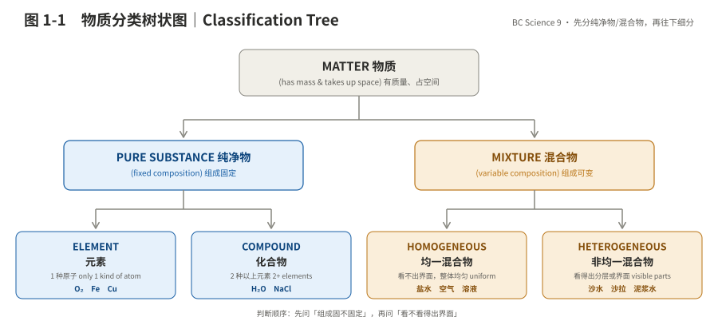
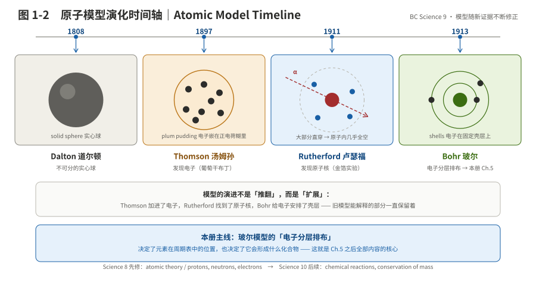
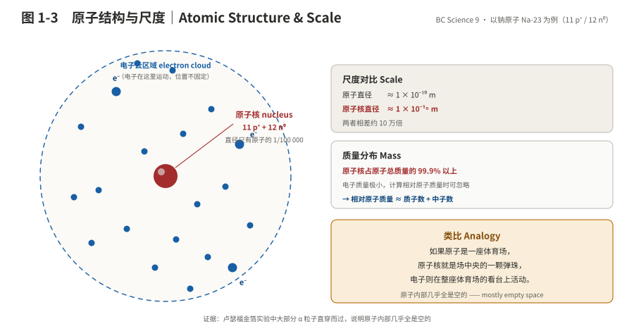

# Ch.1 — Matter, Atoms and Atomic Theory Review
## Chapter 1 · Matter, Atoms and Atomic Theory Review｜第 1 章　物质、原子与原子论回顾

> 🗂️ **Content Alignment｜大纲对应**：Bridging chapter to Science 8 — "atomic theory and models / kinetic molecular theory / protons, neutrons, and quarks / electrons and leptons"｜衔接 Science 8「原子理论与模型 / 分子运动论 / 质子、中子与夸克 / 电子与轻子」
> ⏱️ **Periods｜课时**：2　|　**Prerequisite｜前置**：none 无　|　**Followed by｜后继**：Ch.2
> 🗂️ **Generated｜文件生成时间**：2026-09-18 00:53

## 1. Content Alignment｜大纲对应

| Item｜项目 | Content｜内容 |
|---|---|
| BC Science 9 Content | Preparatory chapter serving C1, "element properties as organized in the periodic table"｜预备章，服务于 C1「元素性质在周期表中的组织方式」 |
| Science 8 bridging items｜Science 8 衔接条目 | atomic theory and models；kinetic molecular theory (KMT)；protons, neutrons, and quarks；electrons and leptons |
| Curricular Competencies | [Evaluating] Evaluate the validity and limitations of a model or analogy；Consider the changes in knowledge over time as tools and technologies have developed｜评估模型或类比的效力与局限；思考知识如何随工具与技术发展而变化 |
| Beyond scope?｜是否超纲 | No — this is review material｜否（复习性质） |

**中文**：本章是衔接复习章，本身不引入新的 Science 9 内容条目，而是为后面 C1「元素周期表」打地基。它的能力训练重点是 *Evaluating*（评估模型的效力与局限），这也是 BC 课程反复强调的一条主线：科学知识会随工具与技术的发展而更新。

## 2. Learning Objectives｜学习目标

**EN — By the end of this chapter, you should be able to:**

1. Classify matter into pure substances and mixtures, and further into elements and compounds.
   - **中文**：把物质分类为纯净物与混合物，并进一步分为元素（单质）与化合物。
2. Distinguish physical properties and physical changes from chemical properties and chemical changes, using observable evidence.
   - **中文**：依据可观察的证据，区分物理性质/物理变化与化学性质/化学变化。
3. Describe the historical development of atomic models: Dalton → Thomson → Rutherford → Bohr.
   - **中文**：描述原子模型的四个发展阶段：道尔顿 → 汤姆孙 → 卢瑟福 → 玻尔。
4. State the charge, mass and location of protons, neutrons and electrons.
   - **中文**：说出质子、中子、电子的电荷、质量与所在位置。
5. Explain why scientific models change over time.
   - **中文**：解释科学模型为什么会随时间改变。

**中文**：本章结束后，你应当能够完成上述五件事。其中第 3 条与第 5 条是本章的"重量级目标"——BC 大纲不只要求你记住模型长什么样，还要求你能说明**模型为什么会变**。

## 3. Concept Explanations｜概念解析

### 3.1 Matter｜物质

**Definition｜定义**：**Matter** is anything that has **mass** and takes up space (has **volume**).

**中文**：物质是具有质量并占有空间（体积）的一切东西。

This definition looks simple, but it is the gatekeeper for all of chemistry. To decide whether something counts as matter, you only need to ask two questions: does it have mass, and does it take up space? If the answer to both is yes, it is matter; if either answer is no, it is not.

**中文**：这个定义看起来简单，却是整个化学的"入门闸门"。要判断某物是不是物质，只需问两个问题：它有质量吗？它占有空间吗？两问都答"是"才算物质；只要有一问答"否"，它就不是物质。

- Does it have mass?
  - **中文**：它有质量吗？
- Does it take up space (have a volume)?
  - **中文**：它占有空间（有体积）吗？

Light, heat, sound and electric current are **not** matter. They have no rest mass and they do not occupy volume, so they belong to a different category altogether: they are forms of **energy**, not forms of matter.

**中文**：光、热、声音、电流都**不是**物质。它们没有静质量，也不占据体积，因此属于完全不同的另一类——它们是**能量的形式**，而不是物质的形式。

> ⚠️ **Misconception｜易错**：Students often say "electricity is matter because it flows through wires like water."｜常有学生说"电是物质，因为它像水一样在导线里流动"。

**中文**：电流是电荷的定向移动，属于能量传递，不是一种物质。导线（铜）才是物质。

One more vocabulary trap: **matter** is the abstract scientific term, while **material** refers to a substance being used for a purpose — a "material" is matter put to work. An insulating material, a building material and a raw material are all matter, but we call them materials because we care about what they *do* for us.

**中文**：还有一个词汇陷阱：**matter** 是抽象的科学术语（物质），**material** 指"材料"，即被拿来派某种用场的具体物质。隔热材料（insulating material）、建筑材料、原材料当然都是物质，但我们称它们为 material，是因为我们关心它们"能为我们做什么"。

### 3.2 Classification of Matter｜物质的分类

Matter is sorted by asking two questions in order. The first question — "is the composition fixed?" — separates pure substances from mixtures. The second question — "can you see boundaries between parts?" — separates homogeneous mixtures from heterogeneous ones.

**中文**：物质的分类按顺序问两个问题。第一个问题——"组成固不固定？"——把纯净物与混合物分开；第二个问题——"看不看得见各部分之间的界面？"——把均一混合物与非均一混合物分开。

- **Pure substance｜纯净物**：A single kind of matter with a fixed composition and fixed properties, including a definite melting point and boiling point.
  - **中文**：纯净物是组成固定、性质固定（有确定的熔点与沸点）的单一物质。
  - **Element｜元素（单质）**：Contains only **one kind of atom** and cannot be broken down into anything simpler by chemical means. Examples: O₂ (oxygen), Fe (iron), Cu (copper).
    - **中文**：只含**一种原子**，不能用化学方法再分解。例如 O₂ 氧气、Fe 铁、Cu 铜。
  - **Compound｜化合物**：Two or more elements chemically combined in a **fixed ratio by mass**; it can be broken down by chemical means. Examples: H₂O (water), NaCl (table salt).
    - **中文**：**两种或更多种元素**按**固定质量比**化学结合而成，可用化学方法分解。例如 H₂O 水、NaCl 食盐。
- **Mixture｜混合物**：Two or more substances mixed **physically**; each keeps its own properties, the **proportions can vary**, and the parts can be separated by physical methods such as filtration, evaporation or magnetic separation.
  - **中文**：两种或更多种物质**物理混合**而成，各自保持原有性质，**比例可变**，可用过滤、蒸发、磁选等物理方法分离。
  - **Homogeneous mixture｜均一混合物 / Solution｜溶液**：The composition is the same everywhere and you cannot see a boundary between parts. Examples: salt water, air.
    - **中文**：各处组成相同，看不出界面。例如盐水、空气。
  - **Heterogeneous mixture｜非均一混合物**：You can see different parts. Examples: sand and water, a salad, granite.
    - **中文**：能看出不同的部分。例如沙水、沙拉、花岗岩。

> 📏 **Rule｜规则**：A compound has a **fixed composition and a chemical formula**; a mixture has neither — its proportions can be anything.｜化合物有**固定组成与化学式**；混合物两者都没有，配比可以任意变。

**中文**：这是本章最好用的一把"快刀"：看到 H₂O 这样的化学式，就一定是化合物（或元素），绝不是混合物；反过来，盐水可以浓可以淡，没有化学式，所以是混合物。

### 3.3 Properties and Changes｜性质与变化

**Properties** describe what a substance is like; **changes** describe what happens to it. In both cases the key question is whether the substance's chemical identity is altered.

**中文**：**性质**描述物质"是什么样的"，**变化**描述物质"发生了什么"。两者的关键问题都是：物质的化学身份有没有被改变。

- **Physical property｜物理性质**：A property you can observe or measure **without changing the substance's chemical identity**. Examples: colour, melting point, boiling point, density, hardness, conductivity, solubility.
  - **中文**：**不改变物质化学身份**就能观察或测量的性质。例如颜色、熔点、沸点、密度、硬度、导电性、溶解性。
- **Chemical property｜化学性质**：Describes **what new substances a substance can become**. Examples: flammability, reacting with acids, oxidizing ability, stability.
  - **中文**：描述物质**能**变成什么新物质。例如可燃性、与酸反应、氧化性、稳定性。
- **Physical change｜物理变化**：The form or state changes, but **the particles themselves are unchanged**. Examples: ice melting, glass breaking, salt dissolving, water evaporating.
  - **中文**：形态或状态变了，但**粒子本身没变**。例如冰融化、玻璃破碎、食盐溶解、水蒸发。
- **Chemical change｜化学变化**：A **new substance is produced**. See 3.4 for the evidence you use to decide.
  - **中文**：生成了**新物质**。判据见 3.4。

> 💡 **Tip｜口诀**：*If the formula changes, it's chemical; if only the look changes, it's physical.*｜化学式变了是化学变化，只是样子变了是物理变化。

**中文**：这句口诀能救急，但要记住它只是辅助——真正的判据永远是"有没有生成新物质"。

### 3.4 Evidence of Chemical Change｜化学变化的证据

You cannot see atoms rearranging, so chemists rely on observable clues. Each clue below suggests a chemical change, but no single clue is proof on its own.

**中文**：我们看不见原子重新组合的过程，所以化学家依靠可观察的线索来判断。下面每一条线索都**提示**可能发生了化学变化，但任何单独一条都不足以构成证明。

| Evidence｜英文证据 | 中文 | Everyday example｜生活例子 |
|---|---|---|
| colour change | 颜色改变 | iron rusting (silver-grey → reddish brown) 铁生锈；a cut apple turning brown 苹果切面变褐 |
| gas produced / bubbles / effervescence | 产生气体、冒气泡 | baking soda + vinegar releases CO₂ 小苏打加醋 |
| precipitate formed | 生成沉淀 | lead nitrate + potassium iodide → yellow precipitate 硝酸铅加碘化钾 |
| temperature change (energy released or absorbed) | 温度变化（放热/吸热） | quicklime + water gives off heat 生石灰加水放热；a hand warmer warming up 暖宝宝发热 |
| light produced | 发光 | burning magnesium ribbon gives a brilliant white light 镁条燃烧发出耀眼白光 |
| new odour | 产生新气味 | food spoiling 食物腐败 |

> ⚠️ **Misconception｜易错**：A single piece of evidence is not enough — boiling water also makes bubbles, but that is a physical change.｜单一证据不一定充分：水沸腾也冒泡，那是物理变化。

**中文**：判定时必须**综合多条线索**，并始终回到核心问题上：**有没有生成新物质？** 气泡是新物质吗？颜色变化是可逆的吗？能量变化是否伴随了成分改变？

### 3.5 The Development of Atomic Theory｜原子论的发展

Atomic models did not appear fully formed. Each one was the best explanation available at the time, and each was replaced when **new evidence** appeared that it could not explain. This is exactly what the BC curriculum asks you to evaluate.

**中文**：原子模型不是一次成型的。每一代模型都是"当时能拿到的最佳解释"，而当**新证据**出现、旧模型解释不了时，它就被下一代模型取代。这正是 BC 大纲要求你评估的那条主线。

| Year｜年代 | Scientist｜科学家 | Model (English)｜模型 | 中文 | Key experiment / contribution｜关键实验与贡献 | Limitation｜局限 |
|---|---|---|---|---|---|
| 1808 | John Dalton 道尔顿 | solid sphere / billiard ball model | 实心球模型（台球模型） | Proposed that atoms are indivisible solid spheres; all atoms of the same element are identical｜提出原子是不可分割的实心小球，同种元素的原子相同 | No internal structure discovered｜没发现内部结构 |
| 1897 | J.J. Thomson 汤姆孙 | plum pudding model | 葡萄干布丁模型（枣糕模型） | Cathode ray experiment discovered the **electron**; the atom is "electrons embedded in a positive paste"｜阴极射线实验发现**电子** | No nucleus｜没有原子核 |
| 1911 | Ernest Rutherford 卢瑟福 | nuclear model | 核式模型（行星模型） | **Gold foil experiment**: most alpha particles passed straight through, a few deflected at large angles → the atom is mostly empty space with a tiny dense **nucleus** at the centre｜**金箔实验**：绝大多数 α 粒子直穿，极少数大角度偏转 | Could not explain why electrons do not spiral into the nucleus｜无法解释电子为何不坠入核内 |
| 1913 | Niels Bohr 玻尔 | Bohr model / shell model | 玻尔模型（电子层模型） | Electrons can only move in **energy shells of fixed energy**｜电子只能在**特定能量的电子层**上运动 | Works well only for the first 20 elements; real atoms are not planetary orbits｜只对前 20 号元素好用，真实原子并非行星轨道 |

The **Bohr model** is the star of this book — you will use it constantly from Ch.5 onward. Notice also *why* each model fell: not because someone was smarter, but because a new instrument produced a new observation. Dalton had no cathode ray tube; Thomson had no alpha source; Rutherford had no way to explain line spectra.

**中文**：**玻尔模型**是本册的主角，从 Ch.5 起会反复使用。还要留意每一代模型"倒下"的原因：不是因为后人更聪明，而是因为**新仪器带来了新观测**。道尔顿没有阴极射线管，汤姆孙没有 α 粒子源，卢瑟福无法解释线状光谱。BC 大纲要求学生"思考知识如何随工具与技术发展而变化"——这一整张表就是最好的例证。

> 🎯 **Big Idea｜核心概念**：Models are overturned by **new evidence**, not by cleverer people.｜模型是被**新证据**推翻的，不是被"更聪明的人"推翻的。

**中文**：把这句话写在笔记本的第一页。考试问"为什么模型会变"，标准答案永远指向**新证据 / 新技术**，而不是"科学家变聪明了"。

### 3.6 Subatomic Particles｜亚原子粒子

An atom is built from three particles. Their charges, masses and locations explain almost everything else in this course.

**中文**：原子由三种粒子构成。它们的电荷、质量与所在位置，几乎可以解释本册后面所有的化学现象。

| Particle｜粒子 | Charge｜电荷 | Relative mass｜相对质量 | Location｜位置 | 中文说明 |
|---|---|---|---|---|
| Proton 质子 | +1 | 1 | inside the nucleus｜原子核内 | determines which element it is｜决定元素种类 |
| Neutron 中子 | 0 | 1 | inside the nucleus｜原子核内 | determines which isotope it is｜决定同位素 |
| Electron 电子 | −1 | 1/1836 (≈ 0) | outside the nucleus, in energy shells｜核外电子层 | determines chemical properties｜决定化学性质 |

- An atom is **electrically neutral**: the number of protons equals the number of electrons, so the positive and negative charges cancel.
  - **中文**：原子显**电中性**：质子数 = 电子数，正负电荷相互抵消。
- Nearly all of an atom's mass is concentrated in the **nucleus** — the nucleus is tiny, yet it holds over 99.9% of the mass.
  - **中文**：原子的质量几乎全部集中在**原子核**——核极小，却占了 99.9% 以上的质量。
- Science 8 already went one level deeper: protons and neutrons are made of **quarks**, and the electron belongs to a family called **leptons**. This book does not go there.
  - **中文**：Science 8 已经提及更深一层：质子与中子由**夸克（quarks）**构成，电子属于**轻子（leptons）**——本册不展开。

> 🔗 **Cross-ref｜参见**：This is why, later on, relative atomic mass ≈ protons + neutrons, and the electron's mass can be ignored.｜正因如此，后面计算相对原子质量时可以写成"质子数 + 中子数"，电子质量可忽略。

**中文**：记住这条推论，Ch.2 讲相对原子质量、Ch.5 讲原子结构时都会用到它。

## 4. Comparison Tables｜表格比对

### Table 1-1　Pure Substance vs Mixture｜纯净物与混合物

| Item｜比较项 | Pure substance｜纯净物 | Mixture｜混合物 |
|---|---|---|
| Composition｜组成 | fixed / definite composition｜固定 | variable composition｜可变 |
| Chemical formula｜化学式 | yes (H₂O, NaCl)｜有 | none｜无 |
| Melting / boiling point｜熔沸点 | definite (a fixed melting/boiling point)｜固定 | not fixed (a range)｜不固定，是一个区间 |
| Properties of components｜各成分性质 | components have lost their original properties (in a compound)｜成分已失去原有性质 | components **keep** their original properties｜各成分**保持**原有性质 |
| Separation｜分离方法 | can only be broken down by **chemical** means｜只能用**化学**方法分解 | can be separated by **physical** means (filtration, evaporation, distillation, magnetic separation)｜可用**物理**方法（过滤、蒸发、蒸馏、磁选） |
| Examples｜例子 | distilled water, oxygen, table salt｜蒸馏水、氧气、食盐 | air, seawater, milk, granite｜空气、海水、牛奶、花岗岩 |

**中文**：这张表最实用的一行是"熔沸点"。纯净物在某一温度下突然熔化；混合物则在一个温度区间里慢慢变软、逐渐熔化——这是实验室里区分两者的常用手段。

### Table 1-2　Element vs Compound｜元素与化合物

| Item｜比较项 | Element｜元素 | Compound｜化合物 |
|---|---|---|
| Kinds of atoms｜原子种类 | only one kind｜只有 1 种 | two or more kinds｜2 种或更多种 |
| Formula｜化学式 | written with the element symbol (Fe, O₂, He)｜用元素符号 | written with a chemical formula (H₂O, CO₂, NaCl)｜用化学式 |
| Can it be broken down?｜能否分解 | **No** — not by chemical means｜**不能**用化学方法再分解 | Yes (e.g. electrolysis of water → hydrogen + oxygen)｜能（如电解水生成氢气与氧气） |
| Properties｜性质 | keeps the properties of that element｜保持该元素自身性质 | **completely different from its elements** (violently reactive Na + poisonous Cl₂ → edible NaCl)｜**与组成元素完全不同** |
| Chinese naming｜中文名 | usually a single name (铁、氧气)｜通常叫"某" | "某化某" / "某酸某" (氯化钠、碳酸钙)｜叫"某化某""某酸某" |

**中文**：注意最后一行：钠（遇水就爆炸的活泼金属）+ 氯气（有毒的黄绿色气体）→ 氯化钠（可以吃的食盐）。化合物**不是**组成元素的简单叠加，这一点在 Ch.7 讲离子化合物时会再次出现。

### Table 1-3　Physical vs Chemical Change｜物理变化与化学变化

| Item｜比较项 | Physical change｜物理变化 | Chemical change｜化学变化 |
|---|---|---|
| New substance formed?｜是否生成新物质 | No｜否 | **Yes**｜**是** |
| Does the formula change?｜化学式是否改变 | No｜不变 | Yes｜改变 |
| Reversible?｜是否可逆（一般） | easily reversible (ice ↔ water)｜容易可逆 | usually hard to reverse｜通常难以逆转 |
| Energy change｜能量变化 | small｜较小 | usually noticeable｜通常较明显 |
| Key words｜关键词 | melt 熔化、freeze 凝固、evaporate 蒸发、dissolve 溶解、break 破碎、bend 弯曲 | burn 燃烧、rust 生锈、corrode 腐蚀、ferment 发酵、rot 腐烂、explode 爆炸 |
| Examples｜例子 | ice melting, sugar dissolving in water, glass breaking｜冰块融化、糖溶于水、玻璃破碎 | iron rusting, wood burning, milk souring｜铁生锈、木柴燃烧、牛奶变酸 |

**中文**：关键词那一列可以直接拿来"秒判"题目：题干出现 burn / rust / rot / ferment 基本就是化学变化；出现 melt / dissolve / bend 基本就是物理变化。但记住关键词只是提示，真正的理由还是要写出来。

### Table 1-4　Four Generations of Atomic Models｜四代原子模型总对比

| Model｜模型 | Key words｜英文关键词 | New particle or structure｜发现的新粒子/结构 | Imagine the atom as｜把原子想象成 |
|---|---|---|---|---|
| Dalton | indivisible sphere | — | a billiard ball｜台球 |
| Thomson | electrons embedded in positive "pudding" | electron 电子 | plum pudding｜葡萄干布丁 |
| Rutherford | small dense positive nucleus | nucleus 原子核 | a marble at the centre of a stadium｜体育场中心的一颗弹珠 |
| Bohr | electrons in fixed energy shells | energy shell 电子层 | the layers of an onion｜洋葱的多层结构 |

**中文**：这四句话就是最省力的记忆锚点。考试若要求"画并标注四代模型"，把每条关键词写全就能拿满分。

## 5. Diagrams & Worked Examples｜图例说明

### Fig. 1-1　Classification Tree｜物质分类树状图

**How to read it｜看图要点**：Sorting takes two steps. First ask "is the composition fixed?" to separate pure substances from mixtures. Then ask "can you see a boundary between parts?" to separate homogeneous from heterogeneous mixtures.

**中文**：判断分两步——先问「组成固不固定」分出纯净物／混合物；再问「看不看得出界面」分出均一／非均一。按图从上往下逐层问，就不会漏项。

### Fig. 1-2　Atomic Model Timeline｜原子模型演化时间轴

**How to read it｜看图要点**：The models did not "overthrow" each other so much as **extend** each other. Thomson added the electron, Rutherford located the nucleus, and Bohr arranged the electrons into shells — and everything the older models could already explain was kept.

**中文**：模型的演进不是「推翻」而是「扩展」——汤姆孙加进电子，卢瑟福找到原子核，玻尔给电子安排壳层；旧模型能解释的那部分一直保留着。所以更准确的说法是：**模型被修正，而不是被丢弃**。

### Fig. 1-3　Atomic Structure & Scale｜原子结构与尺度

**How to read it｜看图要点**：The nucleus is tiny yet holds nearly all the mass — its diameter is only about 1/100 000 of the atom's diameter, but it accounts for over 99.9% of the mass. That is why relative atomic mass ≈ (number of protons) + (number of neutrons), and the electron's mass can be ignored.

**中文**：核很小却几乎占尽质量——直径只有原子的 1/100 000，却占 99.9% 以上的质量。所以相对原子质量 ≈ 质子数 + 中子数，电子质量可忽略。**"原子内部几乎全是空的"这句话，就是从这张图来的。**

### Fig. 1-4　Worked Example: Classifying Matter｜例题：物质分类

**Question｜题目**：Classify each of the following as an **element**, a **compound**, a **homogeneous mixture** or a **heterogeneous mixture**:
(a) copper wire 铜丝　(b) carbon dioxide 二氧化碳　(c) air 空气　(d) muddy water 泥浆水　(e) distilled water 蒸馏水　(f) brass (a copper–zinc alloy) 黄铜

**中文**：题目要求把下列物质归入四类之一：元素 / 化合物 / 均一混合物 / 非均一混合物。

**Worked solution｜解析**：

| Option｜选项 | Reasoning｜判断依据 | Classification｜分类 | 中文 |
|---|---|---|---|
| (a) copper wire, Cu 铜丝 | only copper atoms, cannot be broken down further｜只有铜一种原子，不可再分解 | element | 元素（单质） |
| (b) carbon dioxide, CO₂ | has a formula; C and O combined in a fixed 1:2 ratio｜有化学式，C 与 O 按 1:2 固定结合 | compound | 化合物 |
| (c) air 空气 | N₂, O₂ and others mixed physically; the proportions vary slightly from place to place｜N₂、O₂ 等物理混合，比例随地点略变 | homogeneous mixture | 均一混合物 |
| (d) muddy water 泥浆水 | settles into layers on standing; solid particles are visible｜静置会分层，能看到固体颗粒 | heterogeneous mixture | 非均一混合物 |
| (e) distilled water, H₂O | has a formula; contains only H₂O molecules｜有化学式，只有 H₂O 分子 | compound | 化合物 |
| (f) brass 黄铜 | copper and zinc melted together; the ratio can vary｜铜锌熔合，合金中两者比例可变 | homogeneous mixture | 均一混合物（固溶体） |

> ⚠️ **Misconception｜易错提醒**：An alloy such as brass or steel is a **mixture**, not a compound, because the metals have no fixed ratio and no chemical formula.｜合金（黄铜、钢）是**混合物**不是化合物，因为金属之间没有固定配比，也没有化学式。

**中文**：合金是本章最高频的陷阱。判断时记住两句话：**有化学式 → 化合物；配比可变且无化学式 → 混合物。** 黄铜、钢、青铜全部落入后者。

### Fig. 1-5　Worked Example: Physical vs Chemical Change｜例题：物理变化 vs 化学变化

**Question｜题目**：For each change below, state whether it is physical or chemical and give your reason.

**中文**：判断下列变化的类型，并说明理由。

| Observation｜现象 | Type｜类型 | Evidence-based reason｜理由 |
|---|---|---|
| A candle melting 蜡烛熔化 | physical｜物理变化 | the wax only changes from solid to liquid; it is still wax, no new substance｜石蜡只是由固态变液态，仍是石蜡，没有新物质 |
| A candle burning 蜡烛燃烧 | chemical｜化学变化 | the wax reacts with O₂ to form CO₂ and H₂O, giving out light and heat｜石蜡与 O₂ 反应生成 CO₂ 和 H₂O，发光放热 |
| Table salt dissolving in water 食盐溶于水 | physical｜物理变化 | evaporating the water recovers the salt unchanged; NaCl is still NaCl｜蒸发水后食盐能原样回收，NaCl 未变 |
| An iron nail rusting 铁钉生锈 | chemical｜化学变化 | a new substance (hydrated iron(III) oxide, Fe₂O₃·xH₂O) forms; the colour changes from silver-grey to reddish brown｜生成了新物质 Fe₂O₃·xH₂O，颜色由银灰变红棕 |
| Baking soda + vinegar 小苏打加醋 | chemical｜化学变化 | vigorous bubbling releases CO₂, which is a new substance｜产生大量气泡（CO₂ 气体），是新物质 |

**中文**：蜡烛是本章的经典对照：同一个物体可以同时发生物理变化（熔化）和化学变化（燃烧）。答题时一定要分清你描述的是哪一个过程。

## 6. Key Vocabulary｜核心词汇

| English | 中文 | Notes｜备注 |
|---|---|---|
| matter | 物质 | has mass and takes up space｜有质量、占空间 |
| mass | 质量 | unit: g / kg｜单位 g / kg |
| volume | 体积 | unit: mL / L / cm³｜单位 mL / L / cm³ |
| pure substance | 纯净物 | fixed composition｜组成固定 |
| mixture | 混合物 | variable composition｜组成可变 |
| element | 元素 / 单质 | one kind of atom｜一种原子 |
| compound | 化合物 | two or more elements combined｜多种元素化合 |
| homogeneous | 均一的 | no visible boundary｜看不出界面 |
| heterogeneous | 非均一的 | different parts visible｜看得出不同部分 |
| solution | 溶液 | a homogeneous mixture｜均一混合物 |
| physical property | 物理性质 | observable without changing identity｜不改变身份即可观察 |
| chemical property | 化学性质 | describes what new substances can form｜描述能否变新物质 |
| physical change | 物理变化 | no new substance｜无新物质 |
| chemical change | 化学变化 | a new substance forms｜有新物质 |
| precipitate | 沉淀 | a solid formed by mixing two solutions｜两种溶液混合生成固体 |
| atomic theory | 原子论 | — |
| atomic model | 原子模型 | — |
| nucleus | 原子核 | plural: nuclei｜复数 nuclei |
| proton | 质子 | p⁺ |
| neutron | 中子 | n⁰ |
| electron | 电子 | e⁻ |
| quark | 夸克 | builds protons and neutrons (Science 8)｜构成质子/中子 |
| lepton | 轻子 | electrons belong to this family (Science 8)｜电子属于此类 |
| gold foil experiment | 金箔实验 | Rutherford｜卢瑟福 |
| cathode ray | 阴极射线 | Thomson｜汤姆孙 |
| energy shell | 电子层 | the core idea of Ch.5｜Ch.5 核心 |

## 7. Lab / Activity｜实验与活动

### Activity 1-1　Classification Wall｜物质分类墙

- **Type｜类型**：small-group activity (Pair & Share)｜小组活动
- **Materials｜材料**：20 picture cards of everyday items (copper wire, salt water, air, diamond, milk, sand and water, iron nail, sugar, cola, an oxygen cylinder …)｜20 张常见物品图片卡
- **Procedure｜步骤**:
  1. In pairs, sort the 20 cards into the four categories using the tree in Fig. 1-1.
     - **中文**：两人一组，把 20 张卡按 Fig. 1-1 的树状图分成四类。
  2. Each pair picks the three **most debatable** cards and explains its reasoning to the class.
     - **中文**：每组挑 3 张"最有争议"的卡，向全班说明理由。
  3. The class votes; the teacher reveals the answers and comments.
     - **中文**：全班投票，教师公布答案并点评。
- **Competencies｜训练能力**：[Processing and analyzing] Seek and analyze patterns；[Communicating]
- **Safety｜安全**：none｜无

**中文**：这个活动的关键不在"分对"，而在"说出理由"。争议最大的通常是牛奶、空气、黄铜这类边界案例——把它们辩清楚，分类标准才真正内化。

### Activity 1-2　Chemical Change Stations｜化学变化观察站

- **Type｜类型**：teacher demonstration + student recording (Demo + Observation)｜教师演示 + 学生记录
- **Materials｜材料**：baking soda + white vinegar; steel wool + water (observe over several days); iodine solution + starch; magnesium ribbon (lit by the teacher)｜小苏打 + 白醋；钢丝绒 + 水（观察数天）；碘液 + 淀粉；镁带（教师点燃）
- **Procedure｜步骤**：Using their senses (**tasting is forbidden**), students record the before / after evidence in the table below.｜学生用五感（**禁止品尝**）记录 before / after 的证据，填下表：

| Station | Before｜观察前 | After｜观察后 | Type of evidence｜证据类型 | Verdict｜类型判定 |
|---|---|---|---|---|
| 1 | | | | |
| 2 | | | | |

- **Competencies｜训练能力**：[Planning and conducting]；[Processing and analyzing] Use knowledge of scientific concepts to draw conclusions consistent with evidence｜依据证据得出结论
- **Safety｜安全**：⚠ Safety goggles must be worn; **never look directly** at burning magnesium ribbon (the intense UV damages the eyes); the teacher performs the demonstration.｜⚠ 护目镜必须佩戴；镁带燃烧**禁止直视**（强紫外线伤眼）；教师演示为主

**中文**：填写 Before / After 两栏时，要写**可观察的事实**（"出现了无色气体""温度从 22 ℃ 升到 31 ℃"），不要直接写结论（"发生了化学变化"）。结论放在最后一栏，由证据推出来。

### Activity 1-3　Model Timeline Poster｜原子模型时间轴海报

- **Type｜类型**：group project, four students｜四人小组项目
- **Task｜任务**：Draw one picture for each of the four atomic models, and add one sentence naming **the evidence that overturned that model**.｜为四代原子模型各画一张图 + 一句"这个模型被什么证据推翻了"
- **Competencies｜训练能力**：[Evaluating] Evaluate the validity and limitations of a model；Consider the changes in knowledge over time as tools and technologies have developed｜评估模型的效力与局限；思考知识如何随工具技术发展而改变
- **Rubric｜评价量规**：scientific accuracy 40%, clarity of illustration 30%, quality of the "why the model changed" explanation 30%｜科学性 40%、图示清晰度 30%、"模型为何改变"的解释 30%

**中文**：这句"被什么证据推翻了"是评分重点，也是最容易被写成"因为科学家更聪明了"的地方。正确的写法必须点出**具体的新工具或新实验**。

## 8. Common Misconceptions｜常见易错点

| # | Misconception｜错误认识 | Correction｜正确理解 |
|---|---|---|
| 1 | "A compound is just a mixture."｜"化合物就是混合物" | A compound has a **fixed ratio and a chemical formula** (H₂O is always 2:1); a mixture does not (salt water can be strong or weak).｜化合物有**固定配比和化学式**（H₂O 永远是 2:1），混合物没有（盐水可浓可淡）。 |
| 2 | "Ice melting is a chemical change because it looks different."｜"冰融化成水是化学变化，因为样子变了" | Only the state changes; the molecules are still H₂O. It is a **physical change**.｜只是状态变，分子仍是 H₂O，属于**物理变化**。 |
| 3 | "Bubbles always mean a chemical change."｜"冒泡就一定是化学变化" | Boiling water also bubbles. Always ask: **is the gas a new substance?**｜水沸腾也冒泡。必须问：**气泡是不是新物质？** |
| 4 | "Atoms are solid."｜"原子是实心的" | The inside of an atom is almost entirely empty space (Rutherford's gold foil experiment).｜原子内部几乎全是空的（卢瑟福金箔实验）。 |
| 5 | "Electrons have about the same mass as protons."｜"电子质量跟质子差不多" | An electron is about **1/1836** of a proton; its mass can be ignored when calculating atomic mass.｜电子质量约为质子的 **1/1836**，计算原子质量时可忽略。 |
| 6 | "The old models were wrong, so the scientists were stupid."｜"模型错了，所以科学家很笨" | A model is the **best explanation available given the evidence of its time**, and it is updated when new evidence appears — that is how science works.｜模型是**当时证据下的最佳解释**，被新证据推动而更新——这正是科学的运作方式。 |
| 7 | "An alloy is a compound."｜"合金是化合物" | An alloy is a **mixture** (no fixed ratio, no chemical formula).｜合金是**混合物**（无固定配比、无化学式）。 |
| 8 | "Dissolving is a chemical change because the solid 'disappears'."｜"溶解是化学变化，因为固体消失了" | Evaporating the water recovers the original substance, so it is a **physical change**.｜蒸发可回收原物质，属于**物理变化**。 |

## 9. Assessment｜答题评估

Group A: Foundational｜A 组：基础题（每题 2 分，共 20 分）

**A1.** State the definition of matter and give the two conditions used to decide whether something is matter.｜写出物质的定义，并说明判断某物是否为物质的两个条件。

**A2.** Classify the following: oxygen (O₂), seawater, calcium carbonate (CaCO₃), milk, aluminium foil (Al).｜把下列物质分类：氧气 O₂、海水、碳酸钙 CaCO₃、牛奶、铝箔 Al。

**A3.** Give at least one example showing that a compound's properties are completely different from those of the elements that form it.｜举例说明化合物与组成它的元素性质完全不同（至少 1 例）。

**A4.** List three pieces of evidence for a chemical change.｜列出化学变化的三条证据。

**A5.** Complete the subatomic particle table.｜填写亚原子粒子表：

| Particle | Charge | Location |
|---|---|---|
| proton | | |
| neutron | | |
| electron | | |

**A6.** Which experiment led Thomson to discover which particle?｜Thomson 通过什么实验发现了什么粒子？

**A7.** What conclusion came out of Rutherford's gold foil experiment?｜Rutherford 的金箔实验得出了什么结论？

**A8.** What is the central claim of the Bohr model?｜Bohr 模型的核心主张是什么？

**A9.** Why is an atom electrically neutral overall?｜为什么原子整体上显电中性？

**A10.** True or false: a candle melting is a chemical change. Explain.｜判断：蜡烛熔化是化学变化。（对 / 错，并说明理由）

### B 组：Applied｜应用题（每题 5 分，共 20 分）

**B1.** Xiao Ming says: "The sugar disappeared after dissolving in water, so it's a chemical change." Identify the error, give the correct explanation, and design an experiment that proves your point.｜小明说糖溶于水后看不见了，糖消失了，所以是化学变化。请指出错误并给出正确解释，同时设计一个实验证明你的观点。

**B2.** The table below shows test results for an unknown sample. Decide whether it is a pure substance or a mixture, and justify your answer.｜下表是某未知物质的测试结果，判断它是纯净物还是混合物，并说明依据：

| Test｜测试 | Result｜结果 |
|---|---|
| melting point｜熔点 | melts gradually between 112 °C and 118 °C｜在 112–118 ℃ 之间逐渐熔化 |
| appearance｜外观 | two differently coloured kinds of grain visible under a magnifier｜放大镜下可见两种不同颜色的颗粒 |
| solubility｜溶解性 | partly dissolves in water, partly settles｜加水后部分溶解，部分沉淀 |

**B3.** Using the history of atomic models, explain why scientific knowledge changes over time. Give two specific reasons why particular models were overturned.｜用原子模型的发展史说明"科学知识为什么会随时间改变"，举出两个模型被推翻的具体原因。

**B4.** A solid is heated and turns into a gas; when cooled it returns to the original solid, and its mass is unchanged. Is this a physical or a chemical change? Show your reasoning.｜某固体加热后变成气体，冷却后又变回原固体，且质量不变。这是物理变化还是化学变化？请给出推理过程。

### C 组：Challenge｜挑战题（每题 10 分，共 20 分）

**C1.** Dalton held that atoms are indivisible, yet modern physics has found that protons are made of quarks. Does this mean Dalton was "completely wrong"? How should the value of a scientific model be judged?｜道尔顿认为原子不可分割，而现代物理发现质子由夸克构成。这是否意味着道尔顿"完全错了"？科学模型的价值应该如何评价？

**C2.** Design an experimental plan to distinguish three unlabelled white powders on the bench: table salt (NaCl), granulated sugar (C₁₂H₂₂O₁₁) and baking soda (NaHCO₃). Include variables, procedure, expected observations, decision criteria and safety precautions. **Tasting is not allowed.**｜设计一套实验方案区分三包白色粉末：食盐、白糖、小苏打。要求写出变量、步骤、预期现象、判据、安全注意事项。**不得品尝**。

---

### Answer Key｜参考答案

**A 组**

- **A1.** Matter is anything that has mass and takes up space. The two conditions are: it has mass, and it takes up space (has a volume).｜物质是具有质量并占有空间的一切东西。两个条件：有质量、占有体积（空间）。
- **A2.** Oxygen (O₂) = **element** 元素；seawater = a **mixture** (strictly a heterogeneous mixture because it contains sand and silt; filtered salt water would be homogeneous — answering "mixture" is acceptable) 混合物；calcium carbonate (CaCO₃) = **compound** 化合物；milk = **heterogeneous mixture** 非均一混合物；aluminium foil (Al) = **element** 元素。
- **A3.** Example: Na (a metal that explodes in water) + Cl₂ (a poisonous yellow-green gas) → NaCl (edible table salt). Or H₂ + O₂ (both support combustion) → H₂O (which puts out fires).｜例：Na（遇水爆炸的活泼金属）+ Cl₂（有毒黄绿色气体）→ NaCl（食盐，可食用）。或 H₂ + O₂（助燃）→ H₂O（灭火）。
- **A4.** Any three of: colour change 变色, gas produced 生成气体, precipitate formed 生成沉淀, temperature change 温度变化, light produced 发光, new odour 新气味.
- **A5.** proton: +1, in the nucleus 原子核内；neutron: 0, in the nucleus 原子核内；electron: −1, outside the nucleus in energy shells 核外电子层。
- **A6.** The **cathode ray experiment** (阴极射线实验), which discovered the **electron** 电子.
- **A7.** The inside of an atom is mostly empty space, and at the centre is a **tiny, extremely dense, positively charged nucleus**.｜原子内部大部分是空的；中心有一个**极小、极密、带正电**的原子核。
- **A8.** Electrons can only move in **specific energy shells of fixed energy** — they cannot sit anywhere in between.｜电子只能在**特定的、固定能量的电子层**上运动，不能随意处在两者之间。
- **A9.** The number of protons equals the number of electrons; the +1 and −1 charges balance exactly.｜质子数 = 电子数，+1 与 −1 电荷数相等，整体抵消。
- **A10.** **False.** The wax only changes from solid to liquid; its formula is unchanged and no new substance forms, so it is a **physical change**. (A candle **burning**, on the other hand, is a chemical change.)｜**错**。石蜡只是由固态变为液态，化学式未变，没有新物质生成，属于物理变化。（蜡烛**燃烧**才是化学变化。）

**B 组（key points｜要点）**

- **B1.** The error: the sugar has not disappeared — it is simply dispersed as molecules among the water molecules (dissolving). Experiment: heat or leave the sugar solution to evaporate; white sugar crystals will reappear, proving the sugar is still there and unchanged → a physical change. Caution: do not heat it so hard that the sugar caramelises, because that would be a chemical change.｜错误：糖并未消失，只是以分子形式分散在水中。实验：把糖水蒸发，水蒸发后会析出白色糖晶体，证明糖仍存在、性质未变 → 物理变化。注意不要加热到糖焦化（那会变成化学变化）。
- **B2.** It is a **mixture**. Evidence: ① the melting point is a range (112–118 °C) rather than a fixed value, and pure substances have fixed melting points; ② two different kinds of grain are visible under a magnifier, so it is heterogeneous; ③ part dissolves and part settles, so more than one substance is present. All three point to a mixture.｜**混合物**。依据：① 熔点是一个区间而非固定值；② 放大镜下可见两种颗粒 → 非均一；③ 部分溶解部分沉淀。三条全部指向混合物。
- **B3.** Key points: Thomson's discovery of the electron overturned Dalton's claim that atoms are indivisible; in Rutherford's gold foil experiment, a few alpha particles bounced back at large angles, overturning Thomson's idea that positive charge is spread evenly. The reason in both cases is the same: **new tools (the cathode ray tube, the alpha source) produced new evidence**. A model's value lies in its ability to explain known observations and make testable predictions — even a model that is later revised remains a step forward.｜参考要点：汤姆孙发现电子 → 道尔顿"原子不可分"被推翻；卢瑟福金箔实验中少数 α 粒子大角度反弹 → 汤姆孙"正电荷均匀分布"被推翻。原因：**新工具产生了新证据**。模型的价值在于能解释已知现象并做出可检验的预测，即使后来被修正也是进步的阶梯。
- **B4.** A **physical change** (sublimation and deposition, as with iodine, I₂). Reasoning: the change is reversible, the original substance returns on cooling, and the mass is unchanged (the kinds and numbers of atoms are unchanged) → no new substance was formed. Note that reversibility alone is not a sufficient criterion, but combined with "mass and properties fully restored" it is decisive.｜**物理变化**（升华与凝华，如碘 I₂）。推理：变化可逆、冷却后能恢复原状、质量不变（原子种类与数目未变）→ 未生成新物质。注意"可逆"不是充分条件。

**C 组（scoring points｜评分要点）**

- **C1.** Key points: Dalton made correct, testable predictions about the facts known in his day (the law of definite proportions, conservation of mass), and his model is still valid **at the level of chemical reactions** — atoms really are not split apart in ordinary chemical reactions. "Indivisible" holds chemically but fails in nuclear physics. A model should be judged by its **explanatory and predictive power**, not by whether it matches today's final truth. **A model is a tool, not the truth itself.** (Full marks require the idea of a model's *scope and limitations*.)｜参考要点：道尔顿在化合物定比定律、质量守恒等事实上做出了正确且可检验的预测，其模型在"化学反应层面"依然有效。"不可分割"在化学层面成立，在核物理层面不成立。评价模型应看**解释力与预测力**。**模型是工具，不是真理本身。**（满分需体现"模型的适用范围/局限性"。）
- **C2.** Sample plan｜参考方案:
  - Variables｜变量：independent = type of powder 粉末种类；dependent = observed reaction 反应现象；controlled = volume and temperature of water, mass of powder, test container 水的体积与温度、粉末质量、测试容器。
  - Procedure｜步骤：① take equal amounts of each powder and add water, watching solubility and whether it clumps; ② add white vinegar to each of the three solutions and watch for bubbling; ③ test the conductivity of the two that did not bubble (battery + bulb).｜① 各取等量粉末加水，观察溶解性与是否结块；② 分别滴加白醋，观察是否冒泡；③ 对不冒泡的两种做导电性测试。
  - Expected observations and criteria｜预期现象与判据：baking soda + vinegar → vigorous bubbling (CO₂), so it is **identified first**; salt solution conducts (an ionic compound, the bulb lights); sugar solution does not conduct (a molecular compound, the bulb stays dark).｜小苏打 + 醋 → 剧烈冒泡，先被识别出；食盐溶液导电（灯泡亮）；白糖溶液不导电（灯泡不亮）。
  - Safety｜安全：⚠ wear goggles throughout; **never taste anything**; keep vinegar out of the eyes; wash hands afterwards; dispose of leftovers as the teacher directs.｜⚠ 全程佩戴护目镜；**禁止品尝任何物质**；醋避免入眼；实验后洗手；剩余溶液按教师指示处理。

### Rubric｜评分量规

| Dimension｜维度 | Excellent (A)｜优秀 | Meeting (B)｜达标 | Needs work (C)｜待改进 |
|---|---|---|---|
| Term accuracy｜术语准确性 | all English and Chinese terms correct; formulas written properly｜中英术语全部正确，化学式书写规范 | main terms correct, occasional case errors｜主要术语正确，偶有大小写错误 | terms confused (e.g. element/compound)｜术语混淆 |
| Conceptual understanding｜概念理解 | can explain *why*, not just recall｜能解释"为什么"，不止于记忆 | can classify correctly but explanations are shallow｜能正确分类但解释较浅 | can only recite definitions｜只能背诵定义，不能应用 |
| Use of evidence｜证据使用 | conclusions explicitly cite observations｜结论明确引用观察证据 | evidence present but insufficient｜有证据但不充分 | no evidence, gut feeling only｜无证据，凭感觉 |
| Expression｜表达 | uses bilingual terminology well; logical｜中英双语术语使用得当，逻辑清晰 | clear expression｜表达清楚 | muddled expression｜表述混乱 |
| Safety (labs / plans)｜安全 | proactively lists safety and ethical points｜主动列出安全与伦理注意事项 | mentions safety｜提及安全 | safety not considered｜未考虑安全 |

> 👩‍🏫 **Teacher｜教师提示**：Section A is for formative checks (10 minutes in class); Section B is for a unit quiz; Section C is for differentiated challenge or a scientific writing task.｜A 组用于形成性检测（课堂 10 分钟）；B 组用于单元小测；C 组用于差异化挑战或科学写作任务。
> 🌐 **Bilingual｜双语政策**：Bilingual answers are allowed for terminology, but **chemical formulas and English names must be written in English**.｜术语部分允许中英双语作答；**化学式与英文命名必须使用英文**。

## 10. Connection to the Big Idea｜回扣核心概念

> 🎯 **Big Idea｜核心概念**：*The electron arrangement of atoms impacts their chemical nature.*｜**原子的电子排布决定其化学性质。**

This chapter has not formally introduced electron arrangement yet, but it has planted two seeds that will grow through the rest of the book.

**中文**：本章还没有正式进入电子排布，但已经埋下了两颗种子，它们会在后面的章节里长成主干。

1. **Electrons live outside the nucleus and move in specific regions** (Thomson discovered the electron → Bohr placed it into energy shells). This leads straight to Ch.5.
   - **中文**：**电子属于核外，且在特定区域活动**（Thomson 发现电子 → Bohr 把它排进电子层）→ 直接通向 Ch.5。
2. **Chemical properties are determined by how atoms recombine** (a chemical change = atoms rearranging), and how atoms rearrange depends on their outermost electrons. That is the main thread of the entire book.
   - **中文**：**化学性质由"原子如何重新组合"决定**（化学变化 = 原子重排）；而原子如何重排，取决于最外层电子 → 这就是整册的主线。

**Preview question for the next chapter｜思考题（下章预热）**：Why do sodium (Na) and potassium (K) both react violently with water, while neon (Ne) does nothing at all? The answer lies in the number of outermost electrons — we will reveal it in Ch.4 and Ch.5.

**中文**：为什么钠（Na）和钾（K）都能与水剧烈反应，而氖（Ne）什么都不做？答案藏在最外层电子数里——我们将在 Ch.4 和 Ch.5 揭晓。

---

*This chapter corresponds to Ch.1 of the framework file `00_讲义章节框架_Course_Framework.md`. Next chapter: Ch.2, Elements, Symbols and the Periodic Table.*｜*本章对应框架文件 `00_讲义章节框架_Course_Framework.md` Ch.1。下一章：Ch.2 元素、元素符号与元素周期表。*

