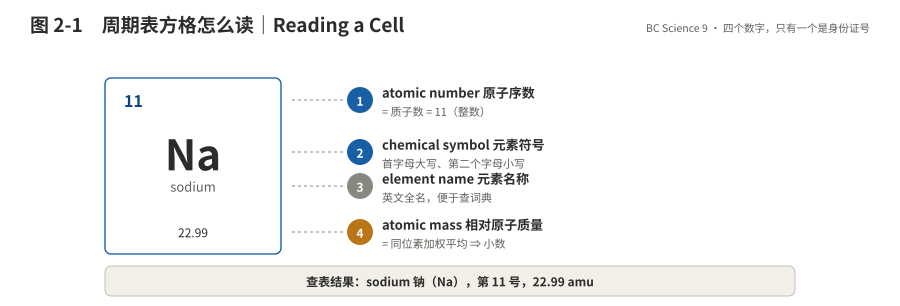
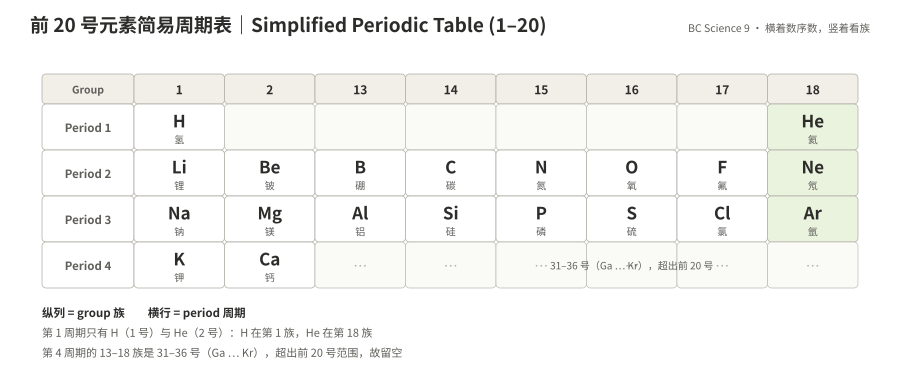
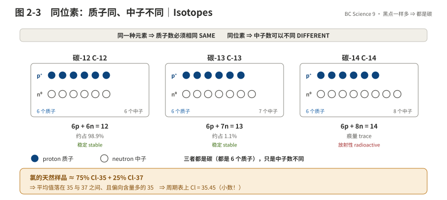
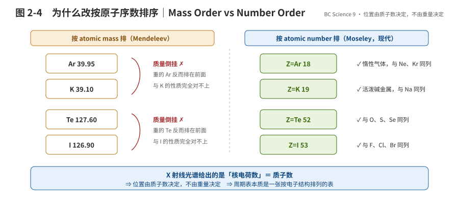

# Ch.2 — Elements, Symbols and the Periodic Table
## Chapter 2 · Elements, Symbols and the Periodic Table｜第 2 章　元素、元素符号与元素周期表

> 🗂️ **Content Alignment｜大纲对应**：BC Science 9 Content C1 — "element properties as organized in the periodic table"｜BC Science 9 内容条目 C1「元素性质在周期表中的组织方式」
> ⏱️ **Periods｜课时**：2　|　**Prerequisite｜前置**：Ch.1 Matter, Atoms and Atomic Theory 物质、原子与原子论　|　**Followed by｜后继**：Ch.3 周期表的组织
> 🗂️ **Generated｜文件生成时间**：2026-09-18 00:53

## 1. Content Alignment｜大纲对应

| Item｜项目 | Content｜内容 |
|---|---|
| BC Science 9 Content (official wording｜官方原文) | **element properties as organized in the periodic table** |
| Sub-topics covered here｜本章承担的子条目 | definition of an element；reading and writing chemical symbols；the four items in a periodic table cell；the difference between atomic number and atomic mass；the idea of an isotope；historical improvements to the periodic table｜元素的定义；元素符号的读写规则；周期表方格的四项信息；原子序数与相对原子质量的区别；同位素概念；周期表的历史改进 |
| Curricular Competencies | [Processing and analyzing] Seek and analyze patterns, trends, and connections (reading the table for patterns)｜读表找规律；[Evaluating] Consider the changes in knowledge over time as tools and technologies have developed (Mendeleev → Moseley)｜门捷列夫→莫塞莱；[Communicating] using scientific language and symbols｜使用科学语言与符号；[Applying and innovating] expressing chemical information with symbols｜用符号表达化学信息 |
| Beyond scope?｜是否超纲 | No — everything here sits inside C1｜否（全部在 C1 范围内） |
| Scope warning｜超纲提示 | Balancing chemical equations, nuclear reaction equations and the quantum explanation of electron arrangement are **not** Science 9. Anything touching them must be marked 【🔭 Extension → Science 10】｜化学式配平、核反应方程式、电子排布的量子解释均**不属于** Science 9，凡涉及处一律标注超纲 |

**中文**：本章是 C1 的第一块正式内容。整章只做三件事：搞清楚"元素"是什么、学会读写元素符号、学会读周期表方格。看似简单，但符号大小写与"序数 / 质量"的区分，是 BC 考试里最稳定的两个失分点。

## 2. Learning Objectives｜学习目标

**EN — By the end of this chapter, you should be able to:**

1. Define an element as a pure substance made of only one kind of atom that cannot be broken down by chemical means.
   - **中文**：给出元素的定义：由同一种原子组成、不能用化学方法再分解的纯净物。
2. Write chemical symbols correctly, applying the capitalisation rule and recognising symbols derived from Latin names.
   - **中文**：正确书写元素符号（大小写规则），并识别源自拉丁文的符号。
3. Read the four pieces of information in a periodic table cell: atomic number, symbol, name and atomic mass.
   - **中文**：从周期表方格中读出四项信息：原子序数、符号、名称、相对原子质量。
4. Explain why most atomic masses are decimal numbers, using isotopes and weighted averages.
   - **中文**：用同位素与加权平均解释"为什么相对原子质量大多是小数"。
5. Describe how Mendeleev's table differed from the modern table, and why ordering by atomic number solved the problem.
   - **中文**：说明门捷列夫周期表与现代周期表的差异，以及改用原子序数排序为何能纠正错位。

**中文**：本章结束后，你应当能够完成上述五件事。第 2 条（符号）和第 4 条（加权平均）是计算与书写类题目的命门；第 5 条则直接对应 *Evaluating* 这一能力要求。

## 3. Concept Explanations｜概念解析

### 3.1 Element｜元素

**Definition｜定义**：An **element** is a pure substance made of only one kind of atom, which **cannot be broken down into simpler substances by chemical means**.

**中文**：元素是由**同一种原子**组成的纯净物，**不能用化学方法**再分解成更简单的物质。

There is only one test for whether something is an element: can a chemical reaction split it into different substances? Oxygen (O₂) survives electrolysis as oxygen, so it is an element; water (H₂O) splits into hydrogen and oxygen, so it is a compound.

**中文**：判断"是不是元素"只有一条标准：**能不能用化学反应把它分成别的物质**。氧气（O₂）电解后仍是氧，是元素；水（H₂O）电解出氢气和氧气，是化合物。

Roughly **90-odd elements** occur naturally on Earth. The commonly quoted figure of "about 92 natural elements" means elements 1–94 excluding technetium (Tc, 锝) and promethium (Pm, 钷), which exist only in trace amounts.

**中文**：自然界存在的元素约 **90 余种**。常说的"天然元素约 92 种"，指的是 1–94 号中除 Tc 锝、Pm 钷以外的元素，后两者仅有痕量存在。

In total, **118 elements** have now been confirmed, running from hydrogen (1) to oganesson (Og, 118). Elements from number 95 onward are essentially synthetic, and many of them exist for only a fraction of a second before decaying.

**中文**：迄今已确认的元素**共 118 种**（1 号 hydrogen 氢 → 118 号 Og 鿫）。95 号及以后基本由人工合成，许多只存在极短时间就衰变掉了。

An element can exist either as a **free element** (Fe iron, O₂ oxygen, He helium) or locked inside a **compound** (the Na in table salt, the H and O in water). An element is never "destroyed" by a chemical reaction — it is only combined.

**中文**：元素既能以**单质**形式存在（Fe 铁、O₂ 氧气、He 氦），也能存在于**化合物**中（食盐里的 Na、水里的 H 与 O）——元素没有被"消灭"，只是被化学结合了。这一点是后面学质量守恒的基础。

### 3.2 Chemical Symbol｜元素符号

**Definition｜定义**：A **chemical symbol** is a one- or two-letter shorthand used worldwide to represent an element.

**中文**：元素符号是全世界通用的 1–2 个字母缩写，表示一种元素。

Symbols are the alphabet of chemistry, and like any alphabet they have strict spelling rules. There are three.

**中文**：符号是化学的字母表，而字母表一定有严格的拼写规则。规则共三条。

**Three writing rules｜三条书写规则：**

| Rule｜规则 | Explanation｜说明 | Correct ✓ | Incorrect ✗ |
|---|---|---|---|
| A single letter is always capitalised｜单字母必须大写 | one letter = one capital | H、B、C、N、O、F、P、S、K、W | h、c、p |
| Two letters: first capital, second lower-case｜双字母"首大写、次小写" | first capital, second lower-case | He、Li、Na、Cl、Ca、Fe | HE、NA、CL、ca |
| Never change the case of a symbol｜写法不可随意改动 | the case carries meaning | Co (cobalt 钴) | CO (carbon monoxide 一氧化碳) |

Why does capitalisation matter so much? Because `Co` is the element cobalt, while `CO` is the compound carbon monoxide. **A single change of case changes the meaning completely.**

**中文**：为什么大小写如此重要？因为 `Co` 是元素钴（cobalt），`CO` 是化合物一氧化碳。**差一个字母的大小写，意义完全不同。** 这在阅卷时是"零分与满分"的差别。

A symbol also carries **two meanings at once**: at the macroscopic level it stands for the element as a substance, and at the microscopic level it stands for **one atom** of that element. So `Na` can mean "sodium" or "one sodium atom", depending on the sentence.

**中文**：符号有**双重含义**：宏观上表示"某种元素"，微观上表示"该元素的一个原子"。例如 `Na` 既指钠元素，也指一个钠原子，具体取哪一种由句子决定。

When writing bilingual notes, keep the languages separate: write "钠 Na" or "sodium 钠", but never push Chinese characters inside the symbol itself.

**中文**：中文搭配习惯：写"钠 Na"或"sodium 钠"，不要把中文塞进符号里（不要写"钠Na"中间的符号变形，也不要把符号改成中文）。

### 3.3 Symbols from Latin Names｜源自拉丁文的元素符号

Some symbols do not match their English names at all, because they come from the element's **Latin name**. This is the easiest place in the whole chapter to lose marks.

**中文**：有些元素的符号与英文名完全对不上，因为它来自该元素的**拉丁名**（Latin name）——这是本章最容易丢分的地方。

| English name | 中文 | Latin / other origin｜来源 | Symbol |
|---|---|---|---|
| sodium | 钠 | **natrium** | Na |
| potassium | 钾 | **kalium** | K |
| iron | 铁 | **ferrum** | Fe |
| copper | 铜 | **cuprum** | Cu |
| silver | 银 | **argentum** | Ag |
| gold | 金 | **aurum** | Au |
| mercury | 汞 | **hydrargyrum** ("liquid silver" 液态银) | Hg |
| lead | 铅 | **plumbum** | Pb |
| tin | 锡 | **stannum** | Sn |
| antimony | 锑 | **stibium** | Sb |
| tungsten | 钨 | **wolfram** (German *Wolfram*) | W |

> 💡 **Tip｜口诀**：Pb for lead comes from *plumbum* — which is also why English "plumbing" (pipe work) exists, from the days when pipes were made of lead. Au for gold comes from *aurum*, sharing the "glowing" root with "aurora".｜Pb 铅 ← plumbum，英语 plumbing（管道工程）源于"用铅做管子"的时代；Au 金 ← aurum，与 aurora（极光）共享"发光"词根。

**中文**：这种词根联想比死记硬背牢得多。考试时若想不起 Pb，就想想"水管工 plumber 和铅的渊源"。

Note that **zinc (Zn, 锌)** is *not* a Latin case: its symbol is close to its English name and comes from German *Zink*. Do not file it with the Latin group.

**中文**：注意 **zinc 锌（Zn）** 的符号与英文名接近，源自德语 *Zink*，**不是**拉丁来源，别把它归进拉丁组。

### 3.4 The Periodic Table Cell｜周期表方格（四要素）

See **Fig. 2-1**. Using sodium (Na) as the example, each cell gives four pieces of information.

**中文**：见**Fig. 2-1**。以钠（Na）为例，一个方格里给出四项信息。

1. **Atomic number｜原子序数**：the whole number in the top corner; it **equals the number of protons**, and also the number of electrons in a neutral atom.
   - **中文**：左上角的整数，**等于质子数**，也等于中性原子的电子数。
2. **Chemical symbol｜元素符号**：the one or two letters in the middle.
   - **中文**：中间的 1–2 个字母。
3. **Element name｜元素名称**：the full English name (some tables also print the Latin name).
   - **中文**：英文全名（有些表另附拉丁名）。
4. **Atomic mass｜相对原子质量**：the decimal number below, in **amu** (atomic mass units 原子质量单位).
   - **中文**：下方的小数，单位记作 **amu**（atomic mass unit 原子质量单位）。

In an exam you can read a cell in a fixed order: the number first (to identify the element), then the symbol (to copy it down), then the mass (only when the question is about mass). Reading in this order prevents the classic error of quoting the atomic mass when the question asks for the number of protons.

**中文**：考试时读方格有固定顺序：先看序数（确定是哪种元素），再看符号（照抄），最后看质量（只有题目涉及质量时才用）。按这个顺序读，就能避免"问质子数却答了相对原子质量"这类经典错误。

### 3.5 Atomic Number vs Atomic Mass｜原子序数与相对原子质量

These two numbers sit in the same cell but mean completely different things. Confusing them is the single most common error in this chapter.

**中文**：这两个数字住在同一个方格里，含义却完全不同。把它们弄混是本章最常见的错误。

- **Atomic number (Z)｜原子序数**：always a **whole number**; it equals the number of protons in the nucleus and **decides which element this is**. Number 11 is always Na; number 79 is always Au.
  - **中文**：一定是**整数**，等于核内质子数，**决定这是哪种元素**。第 11 号一定是 Na，第 79 号一定是 Au。
- **Atomic mass｜相对原子质量**：almost always a **decimal** (Cl = 35.45, Cu = 63.55), because it is a **weighted average** of the naturally occurring isotopes.
  - **中文**：几乎总是**小数**（Cl = 35.45，Cu = 63.55），因为它是天然同位素的**加权平均值**。
- **The amu benchmark｜amu 的基准**：1 amu = **1/12 of the mass of a carbon-12 atom**. A proton and a neutron are each about 1 amu, and an electron is about 1/1836 amu — negligible.
  - **中文**：1 amu = **碳-12 原子质量的 1/12**；质子与中子各约 1 amu，电子约 1/1836 amu（可忽略）。
- **Strict wording｜严谨说法**：strictly speaking, the number printed in the table is the **relative atomic mass** (a ratio with no unit); textbooks usually write "atomic mass" and attach the unit amu. The numerical value is the same either way.
  - **中文**：周期表上那一行严格讲是 **relative atomic mass**（一个比值，无单位）；教材常写 atomic mass 并加单位 amu，两者数值相同。
- **Do not confuse it with mass number｜别混淆质量数**：the **mass number** (A) of one particular isotope is protons + neutrons, and it is a whole number — carbon-12 has A = 12.【⏭️ Preview｜预告 Ch.5】
  - **中文**：某一个同位素的**质量数** A = 质子 + 中子，是整数，如碳-12 的 A = 12。【⏭️ 预告 Ch.5】

### 3.6 Isotope｜同位素 — 为什么相对原子质量是小数

**Definition｜定义**：**Isotopes** are atoms of the same element with the **same number of protons** but a **different number of neutrons**.

**中文**：同位素是**质子数相同、中子数不同**的同种元素原子。

- The same number of protons means they are still **the same element**, with almost identical chemical properties.
  - **中文**：质子数相同 → 仍是**同一种元素**，化学性质几乎相同。
- A different number of neutrons means a **different mass**, so some physical properties (mass, density, radioactivity) differ.
  - **中文**：中子数不同 → **质量不同**，物理性质（质量、密度、放射性）有差别。
- Example: **carbon-12** (6p + 6n), **carbon-13** (6p + 7n) and **carbon-14** (6p + 8n) are all carbon.
  - **中文**：例：**carbon-12**（6p + 6n）、**carbon-13**（6p + 7n）、**carbon-14**（6p + 8n），三者都是碳。

**The weighted average formula｜加权平均算式：**

```
average atomic mass = Σ (isotope mass × natural abundance of that isotope)
                    = Σ（同位素质量 × 该同位素的天然所占比例）
```

Notice that a weighted average is **not** the same as a simple arithmetic mean. If chlorine were 50% Cl-35 and 50% Cl-37, the average would be exactly 36. Because Cl-35 dominates, the average is pulled down towards 35. The more abundant isotope always drags the average towards itself.

**中文**：注意加权平均**不等于**简单算术平均。若氯是 50% Cl-35 + 50% Cl-37，平均值就是整 36；但 Cl-35 占得多，平均值就被"拉"向 35。**含量高的同位素总是把平均值往自己这边拽**，这是判断计算结果是否合理的依据。

Natural chlorine is roughly **three-quarters Cl-35 and one-quarter Cl-37**, so the average falls between 35 and 37 but closer to 35 — which is why the table prints 35.45 rather than 36.

**中文**：天然氯约 **3/4 是 Cl-35、1/4 是 Cl-37**，平均值落在 35 与 37 之间但更靠近 35 —— 所以周期表写 35.45，而不是 36。

> 💡 **Tip｜一句话记住**：The atomic number is **counted** (so it must be a whole number); the atomic mass is **weighed and then averaged** (so it is a decimal).｜atomic number 是"数出来的"（必为整数）；atomic mass 是"称完再平均的"（所以是小数）。

**中文**：这句口诀同时解决了"为什么一个是整数一个是小数"和"该用哪个做题"两个问题。

### 3.7 From Mendeleev to Moseley｜从门捷列夫到莫塞莱

| Time｜时间 | Person｜人物 | Ordering principle｜排序依据 | Key move｜关键做法 | Result and limitation｜结果与局限 |
|---|---|---|---|---|
| 1869 | **Dmitri Mendeleev 门捷列夫** (Russian 俄) | increasing **atomic mass** 原子质量 | lined up elements with similar properties in columns and **left gaps**, predicting the properties of undiscovered elements (e.g. "eka-aluminium" 类铝, "eka-silicon" 类硅)｜把性质相似的元素上下对齐，留空位并预测未知元素的性质 | The later discoveries of **Ga gallium (1875)**, **Ge germanium (1886)** and **Sc scandium (1879)** matched his predictions closely, which made the table famous — but ordering by mass produced a few "inversions"｜后来发现的 Ga 镓、Ge 锗、Sc 钪与其预测高度吻合，周期表声望大增；但按质量排会出现"倒挂" |
| 1913–1914 | **Henry Moseley 莫塞莱** (British 英) | increasing **atomic number** 原子序数 (nuclear charge measured by X-ray experiments)｜据 X 射线实验测得的核电荷数 | used X-ray spectroscopy to prove that **the number of protons / nuclear charge** — not the mass — defines an element's identity｜用 X 射线光谱证明"决定元素身份的是质子数/核电荷数" | every inversion disappeared, and the modern periodic table was born｜错位全部消失，现代周期表诞生 |

**Three famous inversions｜错位三例**：**Ar (39.95) must come before K (39.10)**, **Te (127.60) must come before I (126.90)**, and **Co (58.93) must come before Ni (58.69)**. If you order strictly by mass, all three must be wrong.

**中文**：**Ar 39.95 必须排在 K 39.10 之前**、**Te 127.60 必须排在 I 126.90 之前**、**Co 58.93 必须排在 Ni 58.69 之前**——只要按质量排就必错。这三组数字建议直接背下来，考试举例时用得上。

The historical point is not that "Mendeleev was wrong". It is that a **new tool (X-ray spectroscopy) produced new evidence**, and the same table became more reliable. That matches the BC competency "Consider the changes in knowledge over time as tools and technologies have developed" exactly.

**中文**：科学史意义不在于"门捷列夫错了"，而在于**新工具（X 射线光谱）产生新证据**，让同一张表变得更可靠。这正对应 BC 的能力要求："思考知识如何随工具与技术的发展而改变"。答题时若只写"门捷列夫错了"是拿不到分的。

## 4. Comparison Tables｜表格比对

### Table 2-1　Atomic Number vs Atomic Mass｜原子序数与相对原子质量

| Item｜比较项 | Atomic number｜原子序数 | Atomic mass｜相对原子质量 |
|---|---|---|
| What the number looks like｜数值形态 | a whole number (1, 2, 3 …)｜整数 | a decimal (1.008, 35.45 …)｜小数 |
| What it represents｜代表什么 | the number of **protons** (also the number of electrons in a neutral atom)｜核内**质子数** | the **weighted average mass** of the natural isotopes｜天然同位素的**加权平均质量** |
| Unit｜单位 | none｜无 | amu (strictly a relative value, no unit)｜amu（严格相对值无单位） |
| Does it define the element?｜是否决定元素身份 | **Yes** — change one proton and you change the element｜**是** | No — isotopes change but the element does not｜否 |
| Can it vary?｜会不会变 | fixed for a given element｜同种元素恒定 | samples from different sources can differ very slightly｜来源不同的样品可有极微小差异 |
| Examples｜例子 | H = 1, Na = 11, Au = 79 | H = 1.008, Na = 22.99, Au = 196.97 |

**中文**：考试里只要问"是什么元素"，一律看原子序数；只要问"平均质量是多少"，一律看下方小数。两者绝不能互换。

### Table 2-2　Correct vs Incorrect Symbols｜符号书写正误对照

| 中文 | English name | Correct ✓ | Common error ✗ | What is wrong｜错在哪 |
|---|---|---|---|---|
| 氢 | hydrogen | H | h | a single letter must be capitalised｜单字母须大写 |
| 氦 | helium | He | HE | the second letter must be lower-case｜第二字母须小写 |
| 钠 | sodium | Na | NA / na | second letter lower-case / first letter capital｜第二字母小写且首字母大写 |
| 氯 | chlorine | Cl | CL | the second letter must be lower-case｜第二字母须小写 |
| 镁 | magnesium | Mg | MG / mg | same as above｜同上 |
| 钴 | cobalt | Co | CO | CO is the molecule carbon monoxide｜CO 是一氧化碳分子 |

**中文**：这张表建议抄进错题本第一行。写符号时养成习惯：写完停半秒，检查第二个字母是不是小写。

### Table 2-3　Elements 1–20 Quick Reference｜前 20 号元素速查表

| Atomic number｜序数 | Symbol｜符号 | English name | 中文 | Atomic mass｜相对原子质量 |
|---|---|---|---|---|
| 1 | H | hydrogen | 氢 | 1.008 |
| 2 | He | helium | 氦 | 4.003 |
| 3 | Li | lithium | 锂 | 6.94 |
| 4 | Be | beryllium | 铍 | 9.01 |
| 5 | B | boron | 硼 | 10.81 |
| 6 | C | carbon | 碳 | 12.01 |
| 7 | N | nitrogen | 氮 | 14.01 |
| 8 | O | oxygen | 氧 | 16.00 |
| 9 | F | fluorine | 氟 | 19.00 |
| 10 | Ne | neon | 氖 | 20.18 |
| 11 | Na | sodium | 钠 | 22.99 |
| 12 | Mg | magnesium | 镁 | 24.31 |
| 13 | Al | aluminium | 铝 | 26.98 |
| 14 | Si | silicon | 硅 | 28.09 |
| 15 | P | phosphorus | 磷 | 30.97 |
| 16 | S | sulfur | 硫 | 32.06 |
| 17 | Cl | chlorine | 氯 | 35.45 |
| 18 | Ar | argon | 氩 | 39.95 |
| 19 | K | potassium | 钾 | 39.10 |
| 20 | Ca | calcium | 钙 | 40.08 |

> 💡 **Tip｜口诀**：Turn Table 2-3 into four-part flash cards (English name / symbol / 中文 / atomic number) and review them for five minutes every day.｜建议把 Table 2-3 做成四联记忆卡（English name / symbol / 中文 / 序数），每天 5 分钟滚动复习。

**中文**：注意 13 号在 BC 官方口径里拼作 **aluminium**（美式拼写 aluminum 在加拿大不算标准答案）；16 号 BC 教材常见 **sulfur**（英式 sulphur 亦可接受，但要与你所用教材保持一致）。前 20 号是整册的地基，务必滚瓜烂熟。

### Table 2-4　Mendeleev vs Modern Periodic Table｜门捷列夫表与现代周期表

| Item｜比较项 | Mendeleev's table (1869) | Modern periodic table (today)｜现代周期表 |
|---|---|---|
| Ordering principle｜排序依据 | increasing **atomic mass** | increasing **atomic number** |
| Elements included｜收载元素数 | 63 | 118 |
| Gaps left?｜是否留空位 | yes, and he **predicted the properties** of undiscovered elements｜是，并预测未知元素性质 | the gaps have been filled, including synthetic elements｜空位已被填满（含人造元素） |
| Main problem｜主要问题 | a few inversions (Ar/K, Te/I, Co/Ni)｜少数位置倒挂 | no inversions; positions agree with electron arrangement｜无错位，位置与电子排布一致 |
| Who fixed it｜关键修正者 | — | **Henry Moseley** (X-ray spectroscopy, 1913)｜莫塞莱 |
| What they share｜共同点 | both line up elements with **similar properties** in the same column｜都把性质相似的元素上下对齐 | same｜同左 |

**中文**：共同点那一栏最重要——它说明莫塞莱**没有推翻**门捷列夫的框架，只是把排序依据换了。答题写"Mendeleev 的表被证实并保留，只是改按原子序数排序"最稳妥。

### Table 2-5　Isotopes Compared｜同一元素的同位素对比

| Isotope｜同位素 | protons｜质子 | neutrons｜中子 | mass number｜质量数 | natural abundance｜天然占比 |
|---|---|---|---|---|---|
| carbon-12 碳-12 | 6 | 6 | 12 | about 98.9%｜约 98.9% |
| carbon-13 碳-13 | 6 | 7 | 13 | about 1.1%｜约 1.1% |
| carbon-14 碳-14 | 6 | 8 | 14 | trace (radioactive; used for radiocarbon dating)｜痕量（放射性，考古测年用） |
| chlorine-35 氯-35 | 17 | 18 | 35 | about 75.8%｜约 75.8% |
| chlorine-37 氯-37 | 17 | 20 | 37 | about 24.2%｜约 24.2% |

**中文**：横向看这张表你会发现：同一元素各行**质子数那一列永远不变**，变的只有中子数与质量数。这就是同位素定义的表格版。

## 5. Diagrams & Worked Examples｜图例说明

### Fig. 2-1　Reading a Cell｜周期表方格怎么读



**How to read it｜看图要点**：① the number in the top-left corner, which is always a whole number; ② the abbreviation in the middle, which is the chemical symbol; ③ the full English name, handy for looking the word up in a dictionary; ④ the decimal underneath, which is an **average**, not the mass of any single atom. **The whole number in the top corner is the element's "ID number".**

**中文**：①在左上角且必为整数；②中间的缩写即元素符号；③英文全名便于查词典；④下方小数是平均值，不是某一个原子的质量。**左上角那个整数才是"身份证号"。**

### Fig. 2-2　Simplified Periodic Table (1–20)｜前 20 号元素简易周期表



**How to read it｜看图要点**：read across a row from left to right and the atomic number increases continuously (1, 2, 3 …). The fact that period 1 holds only **two** elements is a hint that the first energy shell has a capacity of 2【🔗 Ch.5】.

**中文**：顺着横行从左往右数，序数连续增长（1, 2, 3 …）；第 1 周期只装得下 2 个元素，暗示第 1 电子层容量为 2【🔗 Ch.5】。这张图的"行数与每行格数"，在 Ch.5 会直接变成电子层与最外层电子数。

### Fig. 2-3　Isotopes: Same Protons, Different Neutrons｜同位素：质子同、中子不同



**How to read it｜看图要点**：in all three nuclei the **number of black dots is the same** (6 protons → all are carbon), while the **number of white circles differs** (6, 7 or 8 neutrons → different masses). The decimal printed in the periodic table is the **weighted average** of atoms like these, mixed in their natural proportions.

**中文**：三个核中**黑点数一样**（6 个质子 → 都是碳），**白圈数不同**（中子 6/7/8 → 质量不同）。周期表上的小数，就是把这类原子按天然比例**加权平均**的结果。

### Fig. 2-4　Mass Order vs Number Order｜为什么改按原子序数排序



**How to read it｜看图要点**：the arrow on the left shows "the order you would get by weight"; the one on the right shows "the position the properties require". When the two conflict, the modern table **trusts the properties and reorders by atomic number** — which tells you that the periodic table is, at bottom, a table arranged by **electron structure**【⏭️ Preview｜预告 Ch.5】.

**中文**：左边的箭头是"按重量该有的先后"，右边才是"按性质该处的位置"。两者冲突时，现代表**相信性质、用原子序数重排**——说明周期表本质上是一张**按电子结构排列的表**【⏭️ 预告 Ch.5】。

### Fig. 2-5　Worked Example: Writing Symbols and Naming Their Origin｜例题：写符号与说来源

**Question｜题目**：Write the correct symbol for each element and state whether it comes from the **English name** or from a **Latin / other ancient name**.
(a) sodium 钠　(b) potassium 钾　(c) iron 铁　(d) copper 铜　(e) silver 银　(f) gold 金
(g) mercury 汞　(h) lead 铅　(i) tin 锡　(j) antimony 锑　(k) tungsten 钨　(l) neon 氖

**中文**：题目要求写出正确符号，并说明来源是"英文名"还是"拉丁 / 其他古名"。

**Worked solution｜解析**：

| No.｜题号 | English name | Symbol｜符号 | 中文 | Origin｜来源 |
|---|---|---|---|---|
| (a) | sodium | **Na** | 钠 | Latin **natrium** |
| (b) | potassium | **K** | 钾 | Latin **kalium** |
| (c) | iron | **Fe** | 铁 | Latin **ferrum** |
| (d) | copper | **Cu** | 铜 | Latin **cuprum** |
| (e) | silver | **Ag** | 银 | Latin **argentum** |
| (f) | gold | **Au** | 金 | Latin **aurum** |
| (g) | mercury | **Hg** | 汞 | Latin **hydrargyrum** |
| (h) | lead | **Pb** | 铅 | Latin **plumbum** |
| (i) | tin | **Sn** | 锡 | Latin **stannum** |
| (j) | antimony | **Sb** | 锑 | Latin **stibium** |
| (k) | tungsten | **W** | 钨 | German **Wolfram**｜德语 Wolfram |
| (l) | neon | **Ne** | 氖 | English name (from Greek *neos*, "new")｜源自希腊语 neos |

> ⚠️ **Misconception｜易错提醒**：`Hg` written as `HG`, `Ag` as `ag`, or `Pb` as `PB` is wrong every time — **capital first letter + lower-case second letter** applies no matter which language the symbol came from.｜把 `Hg` 写成 `HG`、`Ag` 写成 `ag`、`Pb` 写成 `PB` 都算错——**首字母大写 + 第二字母小写**永远适用，不论符号来自哪种语言。

**中文**：最后一题 (l) neon 是唯一的"英文名组"样本，它提醒你：不是所有符号都来自拉丁语，答题时要逐项判断而不是一律写 Latin。

### Fig. 2-6　Worked Example: Calculating a Weighted Average Atomic Mass｜例题：算加权平均原子质量

**Question｜题目**：Boron (B) has two stable isotopes: **B-10** at 19.9% and **B-11** at 80.1%.
(a) Calculate boron's relative atomic mass. (b) The periodic table lists boron as 10.81 — does your answer agree? Why is there a small difference?

**中文**：题目：硼有两种稳定同位素，B-10 占 19.9%，B-11 占 80.1%。(a) 计算硼的相对原子质量；(b) 周期表上硼为 10.81，与你的结果一致吗？为何有微小差别？

**Worked solution｜解析**：

| Step｜步骤 | Calculation｜计算 | Explanation｜说明 |
|---|---|---|
| 1. Percentages → decimals｜百分数 → 小数 | 19.9% → **0.199**；80.1% → **0.801** | the two should add up to 1｜二者相加应等于 1 |
| 2. Multiply by the weights｜加权相乘 | 10 × 0.199 = **1.99**；11 × 0.801 = **8.811** | isotope mass × its abundance｜同位素质量 × 所占比例 |
| 3. Add｜求和 | 1.99 + 8.811 = **10.801 ≈ 10.80** | the average must fall between the two mass numbers｜平均值必落在两个质量数之间 |
| 4. Compare with the table｜对照周期表 | calculated 10.80 vs table value **10.81** | the difference is under 0.01｜差别 < 0.01 |
| 5. Explain the difference｜解释差别 | the exact isotope masses are 10.013 and 11.009 (not exactly 10 and 11); recalculating with the exact values gives 10.81｜精确同位素质量为 10.013 与 11.009（并非正好等于 10 和 11） | using whole numbers is only a simplification｜用整数近似只是简化 |

**Answer｜答案**：(a) about **10.80**; (b) yes, essentially the same — the tiny difference comes from using whole-number mass numbers instead of the exact isotope masses.

**中文**：(a) 约 **10.80**；(b) 基本一致；微小差别来自用整数质量数代替精确同位素质量。

> 🔍 **Self-check｜快速检查法**：A calculated average must fall **between** the largest and smallest isotope masses, and must lean **towards the more abundant one**. If it does not, you have made an error.｜算出的平均值必须落在最大与最小同位素质量之间，且**偏向含量高的那一个**；否则一定算错了。

**中文**：这条自检只需三秒钟，却能挡住九成计算错误。做完加权平均务必回头验一次。

## 6. Key Vocabulary｜核心词汇

| English | 中文 | Notes｜备注 |
|---|---|---|
| element | 元素 / 单质 | one kind of atom, cannot be broken down chemically｜一种原子、不能化学分解 |
| chemical symbol | 元素符号 | 1–2 letters, first one capitalised｜1–2 字母，首字母大写 |
| periodic table | 元素周期表 | ordered by atomic number｜按原子序数排列 |
| atomic number | 原子序数 | = number of protons, a whole number｜= 质子数，整数 |
| proton | 质子 | p⁺, defines the element's identity｜决定元素身份 |
| neutron | 中子 | n⁰, defines the isotope｜决定同位素 |
| electron | 电子 | e⁻, determines chemical properties｜决定化学性质 |
| atomic mass | 相对原子质量 | weighted average of isotopes, a decimal｜同位素加权平均，小数 |
| relative atomic mass | 相对原子质量 | the strict wording for the entry above｜上条的严格写法 |
| amu (atomic mass unit) | 原子质量单位 | benchmark: 1/12 of a carbon-12 atom's mass｜基准：碳-12 质量的 1/12 |
| isotope | 同位素 | same protons, different neutrons｜质子同、中子不同 |
| mass number | 质量数 | protons + neutrons (a whole number)【🔗 Ch.5】｜质子 + 中子（整数） |
| abundance | 丰度 / 所占比例 | the "weight" in a weighted average｜加权平均中的"权" |
| weighted average | 加权平均值 | not a simple arithmetic mean｜而非简单算术平均 |
| cell | （周期表）方格 | holds four items, see Fig. 2-1｜含四项信息，见 Fig. 2-1 |
| Mendeleev | 门捷列夫 | 1869, ordered by mass, left gaps｜按质量排、留空位 |
| Moseley | 莫塞莱 | 1913, reordered by atomic number｜改按原子序数排 |
| X-ray spectroscopy | X 射线光谱学 | supplied the new evidence for ordering by number｜提供"按序数排"的新证据 |
| Latin name | 拉丁名 | the origin of Na/K/Fe/Cu/Ag/Au etc.｜Na/K/Fe/Cu/Ag/Au 等的来源 |
| naturally occurring | 天然存在的 | about 90-odd elements｜约 90 余种 |
| synthetic element | 人造元素 | mostly made in accelerators, very unstable｜多在加速器中合成、极不稳定 |

**中文**：这张词汇表就是本章的最小复习清单。做法建议：遮住右两列，看着英文说出中文与含义；再遮住左列，看着中文默写出英文与符号。两轮都能过，本章就算过关了。

## 7. Lab / Activity｜实验与活动

### Activity 2-1　Symbol Flash Cards｜元素符号四联卡

- **Type｜类型**：individual / pairs (Drill & Game)｜个人 / 双人竞技
- **Materials｜材料**：card stock (or the elements 1–20 table in Appendix D), scissors, a timer｜卡纸（或附录 D 的前 20 号元素表）、剪刀、计时器
- **Procedure｜步骤**:
  1. Make one card for each of elements 1–20: write the **symbol** on the front, and the **English name + 中文名 + atomic number** on the back.
     - **中文**：为 1–20 号元素各做一张卡：正面写 **symbol**，背面写 **English name + 中文名 + 序数**。
  2. Round 1: look at the symbol and say the English and Chinese names. Round 2: look at the Chinese name and write the symbol (**the case must be correct**).
     - **中文**：第一轮看符号说中英文名；第二轮看中文名默写出符号（**大小写必须写对**）。
  3. Mark each other's work, copy every wrong symbol into a "mistake notebook", and retest the next day.
     - **中文**：同桌互批，把写错的符号抄进"错题本"，第二天滚动重测。
- **Competencies｜训练能力**：[Communicating] using scientific language and symbols to express information｜使用科学语言与符号表达信息
- **Safety｜安全**：none｜无

**中文**：这个游戏的难点在第二轮——从中文名反推符号时，大小写最容易崩。建议第二轮单独计时，逼自己在压力下也写对。

### Activity 2-2　Mendeleev's Solitaire｜门捷列夫接龙

- **Type｜类型**：small-group reasoning (Inquiry Puzzle)｜小组推理
- **Materials｜材料**：12 element cards (each showing the symbol, atomic number, atomic mass and two property notes such as "reacts violently with water", "inert gas", "yellow-green gas"), with **2 cards removed**｜12 张元素卡（含 symbol、原子序数、相对原子质量、两条性质描述），其中抽掉 2 张
- **Procedure｜步骤**:
  1. Lay the cards out in a row by **atomic number** and watch whether properties repeat periodically.
     - **中文**：先把卡片按**原子序数**排成一行，观察性质是否周期性重复出现。
  2. Find the gaps and, from the neighbours above, below, left and right, **predict the missing elements' properties** (state at room temperature, range of atomic mass, reactivity).
     - **中文**：找出空位，根据上下左右相邻元素的性质**预测缺失元素的性质**（常温状态、相对原子质量范围、活泼性）。
  3. Reveal the two removed cards and discuss which predictions hit, which missed, and why.
     - **中文**：揭开被抽走的卡核对，讨论"哪些预测命中、哪些没命中、为什么"。
- **Competencies｜训练能力**：[Questioning and predicting]；[Processing and analyzing] Seek and analyze patterns, trends, and connections
- **Safety｜安全**：none｜无

**中文**：这个活动就是让你"重演"门捷列夫做过的推理。讨论环节不要只汇报结果，要说出"我凭哪条相邻性质推出这个结论"。

### Activity 2-3　Beans in a Bag｜豆袋里的同位素（加权平均模拟）

- **Type｜类型**：hands-on quantitative lab｜动手定量实验
- **Materials｜材料**：two bowls of dry beans with clearly different masses (e.g. chickpeas vs lentils), paper cups, a balance, sealable bags｜两种质量明显不同的干豆（如鹰嘴豆 vs 扁豆）各一碗、纸杯、天平、密封袋
- **Procedure｜步骤**:
  1. Take one cup of mixed beans (representing a natural sample of an element) and record the **number of beans** n₁, n₂ in each mass class (each class = one isotope).
     - **中文**：取一杯混合豆（代表某元素的天然样品），记录每个质量档位（代表一种同位素）的豆子**颗数** n₁、n₂。
  2. Use the balance to find the **average mass of a single bean** m₁, m₂ (weigh 20 beans and divide by 20 to reduce error).
     - **中文**：用天平测出每种豆的**单颗平均质量** m₁、m₂（取 20 颗称量后除以 20，减小误差）。
  3. Weight by proportion: average mass = m₁ × n₁/(n₁+n₂) + m₂ × n₂/(n₁+n₂).
     - **中文**：按比例加权：平均质量 = m₁ × n₁/(n₁+n₂) + m₂ × n₂/(n₁+n₂)。
  4. Compare the result with the direct method (total mass of all beans ÷ total number of beans); they should agree — this is exactly how the "atomic mass" in the periodic table is calculated.
     - **中文**：把结果与"直接算全部豆子总质量 ÷ 总颗数"对照，应基本相同 → 说明这就是周期表"相对原子质量"的算法。
- **Competencies｜训练能力**：[Planning and conducting]；[Processing and analyzing] quantitative recording and data analysis｜定量记录与数据分析
- **Safety｜安全**：⚠ the dry beans must not be eaten (lab equipment is considered contaminated); wash hands afterwards｜⚠ 干豆不可食用（实验器材已被污染）；实验后洗手

**中文**：第 4 步的交叉验证是这个实验的精华——它用具体实物证明了"加权平均"与"整体平均"是同一件事，比直接讲公式好懂得多。

## 8. Common Misconceptions｜常见易错点

| # | Misconception｜错误认识 | Correction｜正确理解 |
|---|---|---|
| 1 | "CO and Co are just two ways of writing the same thing."｜"CO 和 Co 只是写法不同" | `Co` is the element cobalt; `CO` is the compound carbon monoxide. Capitalisation changes the meaning completely.｜`Co` 是元素钴；`CO` 是一氧化碳化合物。 |
| 2 | "Atomic number and atomic mass are pretty much the same — both are numbers in the box."｜"两者差不多，都是表格里的数" | The number is always a **whole number** (protons); the mass is a **weighted average**, usually a decimal.｜number 必为**整数**（质子数）；mass 是**加权平均值**，多为小数。 |
| 3 | "The 22.99 on the table is the real mass of a sodium atom in grams."｜"22.99 是钠原子的真实质量（克）" | It is a **relative value** in amu, not a number of grams; one actual atom has a mass around 10⁻²³ g.｜它是**相对值**（amu），不是克；单个原子实际质量约 10⁻²³ g 量级。 |
| 4 | "Atomic mass = protons + neutrons, so it should be a whole number."｜"原子质量 = 质子 + 中子，所以应该是整数" | The **mass number of one isotope** is a whole number; the table gives a **weighted average** of several isotopes.｜单个**同位素**的质量数是整数；周期表给的是多种同位素的**加权平均**。 |
| 5 | "Isotopes are different elements."｜"同位素是不同元素" | Same number of protons → **the same element**, with almost identical chemical properties; only the neutron count differs.｜质子数相同 → **同种元素**。 |
| 6 | "All symbols come from the English name."｜"所有元素符号都来自英文名" | Many come from Latin: Na/K/Fe/Cu/Ag/Au/Hg/Pb/Sn/Sb, and W comes from German.｜不少来自拉丁文，W 来自德语。 |
| 7 | "All 118 elements can be found in nature."｜"118 种元素都能在自然界找到" | About 90-odd occur naturally; from element 95 onward they are essentially synthetic.｜天然存在约 90 余种，95 号以后基本是人造元素。 |
| 8 | "An atom's mass is spread evenly through the atom."｜"原子的质量均匀分布在原子内" | The mass is almost entirely in the **tiny nucleus**; the electrons' mass is negligible.｜质量几乎全集中在**极小的原子核**，电子质量可忽略。 |
| 9 | "Mendeleev's table was wrong and got thrown away."｜"Mendeleev 的表是错的、被扔掉了" | His framework was kept and confirmed; Moseley only changed the **ordering principle** to proton number, which fixed the few inversions.｜他的框架被保留并被证实；莫塞莱只是把**排序依据**改成质子数。 |
| 10 | "amu is an arbitrary unit someone invented."｜"amu 是随便规定的单位" | It has a strict benchmark: 1 amu = 1/12 of the mass of a carbon-12 atom.｜有严格基准：1 amu = 碳-12 原子质量的 1/12。 |

## 9. Assessment｜答题评估

Group A: Foundational｜A 组：基础题（每题 2 分，共 20 分）

**A1.** Write the definition of an **element**. Your answer must include two key points.｜写出 element 元素的定义，答案必须包含两个要点。

**A2.** Write the symbols for: sodium, potassium, iron, copper, silver, gold.｜写出下列元素的符号：钠、钾、铁、铜、银、金。

**A3.** Correct the following incorrect symbols: co, MG, CL, h, NA.｜改正下列错误写法。

**A4.** The cell below belongs to one element.｜下图是某元素的周期表方格：

| | |
|---|---|
| Atomic number｜原子序数 | 11 |
| Symbol｜符号 | Na |
| Name｜名称 | sodium |
| Atomic mass｜相对原子质量 | 22.99 |

Answer: (a) What is the atomic number? (b) How many protons does one atom of this element have? (c) What is the atomic mass?｜回答：(a) 原子序数是多少？(b) 一个该元素原子有几个质子？(c) 相对原子质量是多少？

**A5.** Fill in the blanks: `Na ← natrium`、`K ← ______`、`Fe ← ______`、`Au ← ______`、`Pb ← ______`.

**A6.** Why are the atomic masses of most elements decimals?｜为什么周期表上多数元素的相对原子质量是小数？

**A7.** Atom A has 8 protons + 8 neutrons; atom B has 8 protons + 10 neutrons. Are they the same element? What is their relationship to each other?｜原子 A 与原子 B 是同种元素吗？彼此是什么关系？

**A8.** True or false: 118 elements are known, and all of them can be found in large quantities in nature. Explain.｜判断正误：目前已知 118 种元素，全部能在自然界大量找到。（对 / 错并说明理由）

**A9.** What did Mendeleev use to order his table? What does the modern table use? Who made this correction?｜Mendeleev 排周期表的依据是什么？现代周期表按什么排序？是谁完成了这一修正？

**A10.** State the benchmark used to define 1 amu.｜写出 amu 的定义基准。

### B 组：Applied｜应用题（每题 5 分，共 20 分）

**B1.** An element's cell reads: 20 / Ca / calcium / 40.08.｜某元素的周期表方格为：20 / Ca / calcium / 40.08。
(a) What is its atomic number? (b) How many protons are in one nucleus? (c) What is its atomic mass? (d) Why is 40.08 not a whole number? (e) If an isotope of this element has mass number 40, how many neutrons does it have?

**B2.** Natural chlorine is about **75% Cl-35** and **25% Cl-37**.｜氯在自然界约由 Cl-35（占 75%）与 Cl-37（占 25%）组成。
(a) Use a weighted average to calculate chlorine's relative atomic mass. (b) Why does the table print 35.45 rather than 35.5? Give two reasons.

**B3.** Mendeleev deliberately left gaps in his table and predicted the properties of the missing elements.｜Mendeleev 在自己的表中故意留出空位，并预测了未知元素的性质。
(a) What feature of scientific method does this show? (b) Give one concrete example that was later confirmed.

**B4.** Element X has the following natural isotope data.｜元素 X 的天然同位素数据如下：

| Isotope｜同位素 | Mass number｜质量数 | Abundance｜占比 |
|---|---|---|---|
| X-24 | 24 | 79.0% |
| X-25 | 25 | 10.0% |
| X-26 | 26 | 11.0% |

(a) Calculate the relative atomic mass of X. (b) Use Table 2-3 to identify which element X is.

### C 组：Challenge｜挑战题（每题 10 分，共 20 分）

**C1.** The modern periodic table is ordered by **atomic number**, while Mendeleev ordered his by **atomic mass**. Explain why ordering by atomic number is more reasonable. Your answer must include: (i) the physical meaning of atomic number; (ii) at least one specific example of an inversion; (iii) how this change relates to "knowledge being updated as tools and technologies develop".｜请论述为什么改用原子序数更合理，需包含三点。

**C2.** Design an experiment using a bag of mixed beans to model "isotope weighted averaging" and to measure the average atomic mass of your model element. Include: independent and dependent variables, controlled variables, procedure, a sample data table, the expected conclusion, two possible sources of error with improvements, and safety precautions.｜请设计一套实验，用一袋混合豆子模拟同位素加权平均并测出模拟元素的平均原子质量。

---

### Answer Key｜参考答案

**A 组**

- **A1.** An element is a **pure substance made of only one kind of atom**, and it **cannot be broken down into simpler substances by chemical means**. (Both points are required.)｜元素是**由同一种原子组成的纯净物**，且**不能用化学方法再分解**。（两个要点缺一不可）
- **A2.** Na、K、Fe、Cu、Ag、Au.
- **A3.** Co (cobalt 钴)、Mg (magnesium 镁)、Cl (chlorine 氯)、H (hydrogen 氢)、Na (sodium 钠).
- **A4.** (a) 11; (b) 11 protons; (c) 22.99 amu (sodium 钠).
- **A5.** kalium；ferrum；aurum；plumbum.
- **A6.** Because the relative atomic mass is the **weighted average of all the naturally occurring isotopes in their natural proportions**, so it is usually not a whole number.｜因为相对原子质量是天然存在的多种同位素按所占比例的加权平均值。
- **A7.** Yes — they are the same element (both are oxygen, with 8 protons); they are **isotopes** of each other.｜是同种元素（都是氧，质子数 8）；二者互为**同位素**。
- **A8.** **False.** About 90-odd elements occur naturally; from element 95 onward they are essentially synthetic and many are extremely unstable.｜**错**。自然界存在约 90 余种；95 号及以后基本为人工合成元素。
- **A9.** Mendeleev ordered by **atomic mass**; the modern table orders by **atomic number** (proton number); the correction was made by **Henry Moseley** (X-ray spectroscopy, 1913).｜由 **Henry Moseley 莫塞莱**完成修正。
- **A10.** 1 amu is defined as **1/12 of the mass of a carbon-12 atom**.｜1 amu 定义为碳-12 原子质量的 1/12。

**B 组（key points｜要点）**

- **B1.** (a) 20; (b) 20 protons; (c) 40.08; (d) it is the weighted average of naturally occurring calcium isotopes (including small amounts of Ca-44, Ca-48 and others), not the mass number of one isotope; (e) neutrons = 40 − 20 = **20**.｜(e) 中子数 = 40 − 20 = **20 个**。
- **B2.** (a) 35 × 0.75 + 37 × 0.25 = 26.25 + 9.25 = **35.5** (approximate); (b) two reasons: ① the real abundances are about **75.8% / 24.2%**, not exactly 75/25; ② the **exact isotope masses** are slightly below the whole numbers (Cl-35 = 34.969, Cl-37 = 36.966), and using them gives **35.45**.｜理由：① 实际丰度约 75.8% / 24.2%；② 同位素**精确质量**略小于整数，用精确值计算得 35.45。（答出两条即可满分。）
- **B3.** (a) It shows the **predictive power** of a scientific theory: a good model explains known facts *and* predicts facts not yet observed, then stands up to testing; (b) example: **eka-aluminium → gallium, Ga (discovered 1875)**, whose density and melting point matched the prediction almost exactly. Also acceptable: eka-silicon → **germanium, Ge (1886)**, or eka-boron → **scandium, Sc (1879)**.｜体现出**科学理论的预测力**；例子：**类铝 → Ga 镓（1875）**，密度与熔点几乎一致。
- **B4.** (a) 24 × 0.790 + 25 × 0.100 + 26 × 0.110 = 18.96 + 2.50 + 2.86 = **24.32**; (b) in Table 2-3, 24.31 corresponds to **Mg, magnesium 镁**.

**C 组（scoring points｜评分要点）**

- **C1.** Full-mark points: ① **atomic number = number of protons = nuclear charge**; it fixes the element's identity and the number of electrons in a neutral atom, and therefore its chemical properties. Mass is only a secondary attribute, and it is distorted by isotope abundance, so it is not "essential". ② A concrete inversion: **Ar (39.95) must come before K (39.10)** (or Te/I, or Co/Ni); otherwise elements with similar properties cannot be lined up, and the inversions vanish once you order by number. ③ Moseley measured nuclear charge with the new tool of **X-ray spectroscopy**: it was **new evidence, not a new idea**, that drove the update — exactly "knowledge changes as tools and technologies develop". A full-mark answer covers all three: the ordering principle changed from mass to nuclear charge, and this repaired the misplacements.｜满分要点：① 原子序数 = 质子数 = 核电荷数；② 具体错位 Ar/K（或 Te/I、Co/Ni）；③ 新工具带来新证据推动知识更新。
- **C2.** Sample plan｜参考方案: variables — independent = the mixing ratio of the two kinds of beans; dependent = the calculated average mass; controlled = total number of beans per sample, the balance used, the weighing procedure. Procedure — prepare three samples with different ratios; count the beans of each kind; weigh 20 beans of each kind to get a single-bean mass; substitute into the weighted formula; cross-check against "total mass ÷ total number". The data table should include: kind, number of beans, single-bean mass, proportion, weighted contribution. Conclusion — the weighted average shifts as the proportions change, and the more abundant "isotope" pulls the average harder. Errors — miscounting, and variation between individual beans; improvements — use a larger sample and repeat three times, taking the mean. Safety — the beans must not be eaten, wash hands afterwards, zero the balance before use.｜变量：自变量 = 两种豆的混合比例，因变量 = 算出的平均质量；控制变量 = 每份样品总颗数、称量工具、称量步骤。误差：颗数统计错误、单颗质量差异；改进：增大样本量、重复三次取平均。

### Rubric｜评分量规

| Dimension｜维度 | Excellent (A)｜优秀 | Meeting (B)｜达标 | Needs work (C)｜待改进 |
|---|---|---|---|
| Term accuracy｜术语准确性 | all English and Chinese terms and symbols correct, including case｜中英术语与符号全部正确，大小写无误 | main terms correct, occasional case errors｜主要术语正确，偶有大小写错误 | case混乱、术语混淆 |
| Conceptual understanding｜概念理解 | can explain the difference between atomic number and mass, and why it arises｜能解释 atomic number / mass 的差异与成因 | can read values correctly but explanations are shallow｜能正确读数但解释较浅 | can only copy definitions｜只会抄定义，不能迁移 |
| Data handling｜数据处理 | weighted-average steps are clear and self-checked for reasonableness｜加权平均步骤清晰，会自我检查合理性 | can apply the formula but skips the check｜会套公式但缺检验 | calculation or conceptual errors｜计算错误或概念性错误 |
| Expression｜表达 | uses bilingual terminology well; logical｜中英双语术语使用得当，逻辑清楚 | clear expression｜表达清楚 | muddled, missing key steps｜表述混乱、缺漏关键步骤 |
| Understanding the history｜科学史理解 | can explain "evidence drives theory updates"｜能说明"证据推动理论更新" | can name the people and their contributions｜能说出人物与贡献 | only memorises names｜只记名字，不明其意义 |

> 👩‍🏫 **Teacher｜教师提示**：Section A is a 10-minute formative check in class; Section B is for a unit quiz; Section C is for differentiated challenge or a scientific writing task.｜A 组用于课堂 10 分钟形成性检测；B 组用于单元小测；C 组用于差异化挑战或科学写作任务。
> 🌐 **Bilingual｜双语政策**：Bilingual answers are allowed for terminology, but **element symbols and chemical formulas must be written in English**.｜术语部分允许中英双语作答；**元素符号与化学式必须用英文书写**。

## 10. Connection to the Big Idea｜回扣核心概念

> 🎯 **Big Idea｜核心概念**：*The electron arrangement of atoms impacts their chemical nature.*｜**原子的电子排布决定其化学性质。**

This chapter looks like it is only about "names and numbers", but it has actually planted three seeds along that main thread.

**中文**：本章看似只讲"名词与数字"，其实埋下了这条主线的三颗种子。

1. **Atomic number = number of protons = number of electrons in a neutral atom.** Once the number is fixed, the number of electrons is fixed too, and that sets the stage for **how those electrons are arranged into shells** (Ch.5).
   - **中文**：**atomic number = 质子数 = 中性原子的电子数** → 序数一旦定下，电子数目就定了，**电子如何分层排布**也就有了前提（Ch.5）。
2. **Position is tied to properties.** The periodic table is not a list stacked up by weight; it is a **map laid out by electron structure**. That is precisely why Mendeleev could predict undiscovered elements from empty spaces.
   - **中文**：**位置与性质绑定**：周期表不是按重量随意码放的清单，而是一张**按电子结构铺开的地图**——正因为位置反映结构，Mendeleev 才能凭空位预测尚未发现的元素。
3. **Isotopes tell us something crucial**: what decides chemical properties is the **number of protons** (and therefore the number of electrons) — not the number of neutrons and not the total mass. Change the neutrons and the element's identity stays the same.
   - **中文**：**同位素告诉我们**：决定化学性质的是**质子数（进而决定电子数）**，不是中子数也不是总质量——中子变了，元素身份不变。

**Preview question for the next chapter｜思考题（下章预热）**：Why do He and Ne in Group 18 "refuse to do anything", while Li, Na and K in Group 1 are all very reactive? The answer lies in how many electrons they have and how those electrons are arranged — we will reveal it in Ch.4 and Ch.5.

**中文**：为什么第 18 族的 He 与 Ne 都"什么都不愿意做"，而第 1 族的 Li、Na、K 都很活泼？答案就在它们的电子数目与排布里——我们将在 Ch.4 与 Ch.5 揭晓。

---

*This chapter corresponds to Ch.2 of the framework file `00_讲义章节框架_Course_Framework.md`. Next chapter: Ch.3, Organizing the Periodic Table: Groups, Periods, Metals and Non-metals.*｜*本章对应框架文件 `00_讲义章节框架_Course_Framework.md` Ch.2。下一章：Ch.3 周期表的组织：族、周期、金属与非金属。*
