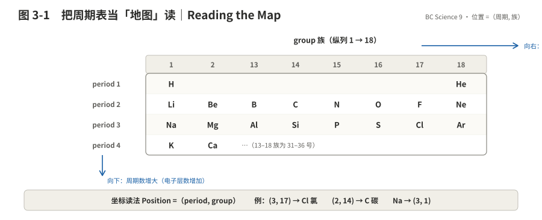
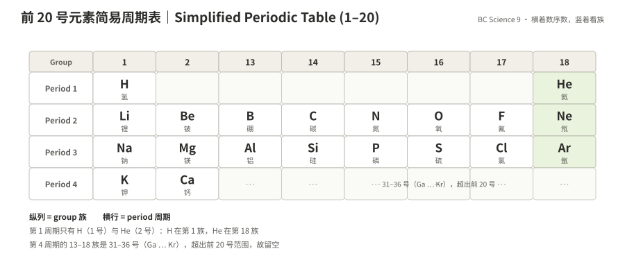
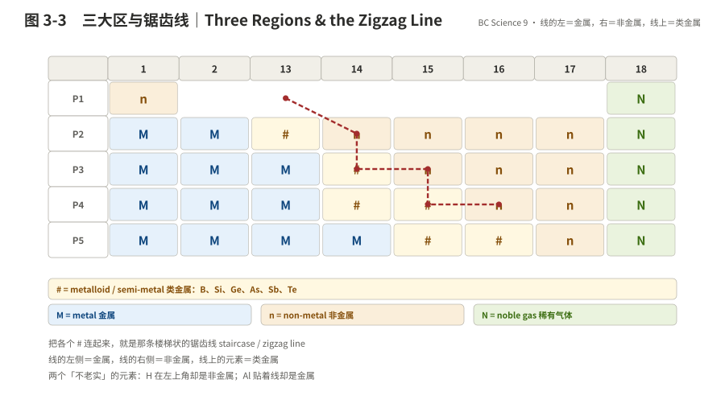
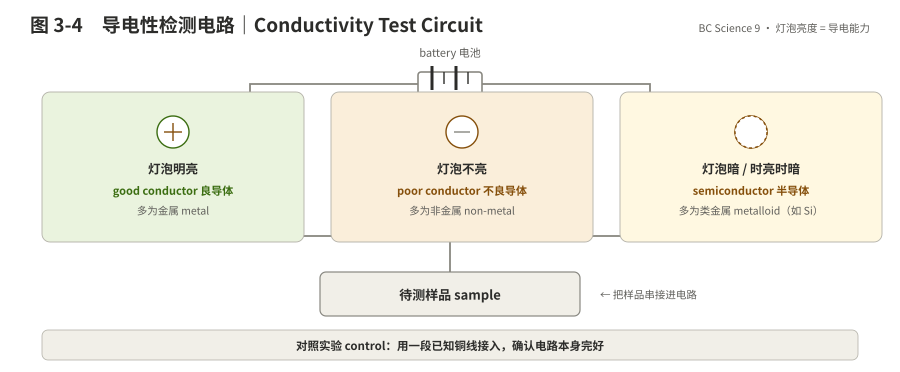

# Ch.3 — Organization of the Periodic Table: Groups, Periods, Metals & Non-metals
## Chapter 3 · Organization of the Periodic Table: Groups, Periods, Metals & Non-metals｜第 3 章　周期表的组织：族、周期、金属与非金属

> 🗂️ **Content Alignment｜大纲对应**：BC Science 9 Content C1「element properties as organized in the periodic table」
> ⏱️ **Periods｜课时**：2–3　|　**Prerequisite｜前置**：Ch.2 Elements, symbols and how to read a periodic-table cell｜Ch.2 元素符号与周期表方格　|　**Followed by｜后继**：Ch.4 Chemical families and reactivity trends｜Ch.4 化学族与反应性趋势
> 🗂️ **File generated｜文件生成时间**：2026-09-18 00:53

## 1. Content Alignment｜大纲对应

| Item｜项目 | Content｜内容 |
|---|---|
| BC Science 9 Content（official wording｜官方原文） | **element properties as organized in the periodic table** |
| Sub-items covered by this chapter｜本章承担的子条目 | How to locate an element using its group and period; the three-way split into metals / non-metals / metalloids (semi-metals) and the properties of each; telling main-group elements apart from transition elements; observable facts such as state at room temperature and magnetism｜族与周期的定位；metals / non-metals / metalloids（semi-metals）三类划分与性质；main-group 与 transition elements 的区分；室温状态与磁性等观察性事实 |
| Curricular Competencies｜课程能力 | [Processing and analyzing] Construct and analyze tables of data｜构建并分析数据表；Seek and analyze patterns, trends, and connections｜寻找并分析模式、趋势与联系；[Planning and conducting] 记录定性/定量数据｜record qualitative and quantitative data；[Evaluating] Evaluate the validity and limitations of a classification model｜评估分类模型的有效性与局限 |
| Beyond Grade 9?｜是否超纲 | No — everything in this chapter sits inside C1｜否（全部在 C1 范围内） |
| Extension note｜超纲提示 | Band theory of semiconductors, the d orbitals of transition metals, and microscopic explanations based on lattices and metallic bonding are all out of scope. This chapter deals only with the match between observable properties and position on the table【🔭 Extension → Science 10 / Physics 11】｜半导体能带理论、过渡金属的 d 轨道、晶格与金属键的微观解释均超纲，本章只讲可观察性质与位置的对应关系 |

## 2. Learning Objectives｜学习目标

**By the end of this chapter, you should be able to｜本章结束后，你应当能够：**

1. Locate any element on the periodic table when you are given its group number and period number, and go the other way — read the group and period off an element's position.
   - **中文**：由族号与周期数在周期表上定位元素，反之亦然。
2. Explain what groups (families) and periods are, and state how many of each the table contains.
   - **中文**：说明族（纵列）与周期（横行）的含义，并说出各有几个。
3. Classify an element as a metal, a non-metal or a metalloid, using both its position on the table and its observed physical properties.
   - **中文**：依据位置与物理性质把元素分为金属、非金属、类金属（半金属）。
4. Compare the physical properties of the three classes: lustre, malleability, ductility, conductivity, state at room temperature and brittleness.
   - **中文**：比较三类元素的物理性质：光泽、延展性、可拉丝性、导电导热性、常温状态与脆性。
5. Distinguish main-group (representative) elements from transition elements, name the two elements that are liquid at room temperature, and name the magnetic elements.
   - **中文**：区分主族元素与过渡元素，说出室温下的两种液态元素与能被磁铁吸引的元素。

## 3. Concept Explanations｜概念解析

The periodic table is not a random list of names. It is a chart with a strict two-coordinate addressing system: every element has an address made of a column number and a row number, and that address tells you a great deal about how the element behaves. In this chapter you learn to read that address, and you learn the three broad "districts" the table is divided into.

**中文**：周期表不是一份随意排列的名字清单，而是一张带有严格坐标系统的图表：每个元素都有一个由"列号 + 行号"组成的地址，而这个地址能告诉你大量关于该元素性质的信息。本章的任务就是学会读这个地址，并认识周期表被划分成的三大"区域"。

### 3.1 Group / Family｜族（纵列）

**Definition｜定义**：A **group**（also called a **family**）is a **vertical column** in the periodic table. There are **18 groups**, numbered 1 to 18 from left to right.

**中文**：族（也称 family）是周期表中的**纵列**，共 **18 个**，从左到右编号 1–18。

- Elements in the same group have **similar chemical properties** — this is the single most important pattern in the whole table, and Chapter 4 will turn it into concrete predictions for four important families.
  - **中文**：**同族元素化学性质相似**——这是周期表最重要的规律，Ch.4 将把它具体化到四个重要族。
- The reason【⏭️ Preview → Ch.5｜预告 Ch.5】：**main-group elements in the same group have the same number of valence electrons**（every element in group 1 has one, every element in group 17 has seven）, and chemical behaviour is governed mainly by that number.
  - **中文**：原因【⏭️ 预告 Ch.5】：**主族元素的价电子数相同**（第 1 族都是 1 个、第 17 族都是 7 个），而化学性质主要由价电子数决定。
- Some older textbooks label the columns IA, IIA, VIIA and so on. BC textbooks and provincial exams use **1–18** exclusively.
  - **中文**：有些旧教材用 IA、IIA、VIIA 编号；BC 教材与考试统一使用 **1–18**。

### 3.2 Period｜周期（横行）

**Definition｜定义**：A **period** is a **horizontal row** in the periodic table. There are **7 periods**.

**中文**：周期是周期表中的**横行**，共 **7 个**。

- As you travel from left to right across a period, **metallic character weakens and non-metallic character strengthens**.
  - **中文**：沿一个周期从左往右走，**金属性逐渐减弱、非金属性逐渐增强**。
- **The period number equals the number of electron shells** occupied by electrons in an atom of that element: period 3 elements have electrons in three shells【⏭️ Preview → Ch.5｜预告 Ch.5】.
  - **中文**：**周期数 = 该元素原子的电子层数**：第 3 周期元素的电子占据 3 个电子层【⏭️ 预告 Ch.5】。
- Period 1 contains only H and He, because the first shell can hold just two electrons. Periods 6 and 7 are long, because they include the lanthanides and actinides.
  - **中文**：第 1 周期只有 H 与 He（第 1 层最多容纳 2 个电子）；第 6、7 周期较长，含镧系与锕系。

### 3.3 Three classes of elements｜三大类元素

A **zigzag line**（also called the **staircase line**）cuts the table into three regions — see **Fig. 3-3**.

**中文**：周期表用一条**锯齿线 / 楼梯线（zigzag line / staircase line）**把元素分成三块，见 **Fig. 3-3**。

#### ① Metals｜金属

Metals sit **below and to the left of the zigzag line**, and account for roughly **three quarters** of the whole table（transition elements included）.

**中文**：金属位于锯齿线的**左下方**，约占全表 3/4（含过渡元素）。

| Property｜性质 | 中文 | Explanation｜说明 |
|---|---|---|
| lustrous / shiny | 有金属光泽 | A freshly cut surface reflects light; the surface darkens later because it oxidises｜新鲜表面反光（切开变暗是表面被氧化） |
| malleable | 有延展性 | Can be hammered into thin sheets, such as aluminium foil or **gold leaf**｜能被敲打成薄片，如铝箔、**金箔** |
| ductile | 可拉成丝 | Can be drawn into thin wires, such as copper wire｜能被拉成细丝，如铜丝 |
| good conductor of heat and electricity | 导热、导电 | Copper is used for wires, aluminium for pot bases｜铜做电线、铝做锅底 |
| solid at room temperature | 室温为固体 | **The one exception is Hg, mercury, which is liquid**｜**唯一例外：Hg 汞为液体** |
| high melting point and high density | 熔沸点高、密度较大 | Tungsten, W, has an extremely high melting point and is used in lamp filaments｜钨 W 熔点极高，用于灯丝 |

#### ② Non-metals｜非金属

Non-metals sit **above and to the right of the zigzag line**, plus **hydrogen** in the top-left corner.

**中文**：非金属位于锯齿线的**右上方**（再加上左上的 hydrogen 氢）。

| Property｜性质 | 中文 | Explanation｜说明 |
|---|---|---|
| dull / not shiny | 无金属光泽 | Neither sulfur nor charcoal shows a shine｜硫黄、木炭都没有光泽 |
| brittle | 脆 | A solid non-metal shatters when struck instead of deforming｜固体受敲击会碎裂而**不会变形** |
| poor conductor | 不良导体 | Generally conducts neither electricity nor heat, so it can serve as insulation｜一般不导电、不导热，可作绝缘/隔热材料 |
| many are gases | 多为气体 | O₂, N₂, Cl₂ and the noble gases; but solids（C, S, P, I₂）and a liquid（Br₂）also exist｜O₂、N₂、Cl₂、稀有气体；也有固体（C、S、P、I₂）与液体（Br₂） |

> ⚠️ **Important exception｜重要例外**：**Graphite**, a form of carbon, conducts electricity. So "it conducts" is **not** an absolute test for a metal — you must combine it with lustre and malleability before deciding.
> **中文**：碳的石墨形态（graphite）能导电。所以"能导电"**不是**判断金属的绝对标准，必须结合光泽、延展性一起判断。

#### ③ Metalloids / semi-metals｜类金属

Metalloids form a narrow band running along **both sides of the zigzag line**.

**中文**：类金属沿锯齿线两侧形成一条窄带。

- **The official BC term is semi-metal**; most textbooks say **metalloid**. The two words are **completely equivalent**, and this handout always renders both as "**类金属**" in Chinese.
  - **中文**：**BC 官方用词 semi-metal**，多数教材用 **metalloid**，**两者完全等价**，本讲义中文统一译"**类金属**"。
- The six you must know are **B boron, Si silicon, Ge germanium, As arsenic, Sb antimony and Te tellurium**. Read them down the staircase: "**硼硅锗砷锑碲**".
  - **中文**：常见六种：**B 硼、Si 硅、Ge 锗、As 砷、Sb 锑、Te 碲**（沿楼梯从上往下记："**硼硅锗砷锑碲**"）。
- Their properties are **intermediate between metals and non-metals**. They may show a metallic lustre, but they are **brittle and cannot be hammered or drawn out**. Their conductivity is middling and changes with conditions such as temperature, which is why they are called **semiconductors** — the basis of computer chips（**silicon** being the classic example）.
  - **中文**：性质**介于金属与非金属之间**：可能有金属光泽，但**脆、不能延展**；导电性中等且随温度等条件变化 → 称为 **semiconductor 半导体**，是计算机芯片的基础（**Si 硅**最典型）。
- **The boundary is not absolute.** Polonium（Po）and astatine（At）are sometimes listed as metalloids, and sources disagree. **BC Science 9 requires only the six listed above.**
  - **中文**：**边界并不绝对**：Po 钋、At 砹有时也被列为类金属，不同教材有分歧；**BC Science 9 只要求掌握上述六种**。

### 3.4 Main-group vs Transition elements｜主族元素与过渡元素

| Name｜名称 | Location｜位置 | 中文 | Features｜特点 |
|---|---|---|---|
| **Main-group / representative elements** | Groups **1, 2, 13, 14, 15, 16, 17, 18** | 主族元素（代表性元素） | Properties vary with group number in a **strongly regular, easy-to-predict** way; most of the first 20 elements are main-group elements｜性质随族号**规律性强**、易预测；前 20 号元素多属主族 |
| **Transition elements** | Groups **3–12** | 过渡元素 | All are metals; high melting points and high densities; often show more than one valence, and their compounds are frequently coloured（CuSO₄ is blue）｜全是金属；熔点高、密度大，常有多种化合价，化合物常有颜色（如 CuSO₄ 蓝色） |

Common transition elements you will meet again and again are **Fe iron, Cu copper, Zn zinc, Ag silver, Au gold, Ni nickel, Cr chromium and Mn manganese**.

**中文**：你会反复遇到的常见过渡元素有 **Fe 铁、Cu 铜、Zn 锌、Ag 银、Au 金、Ni 镍、Cr 铬、Mn 锰**。

- 【⏭️ Preview → Ch.6｜预告 Ch.6】Showing **more than one valence**（such as Fe²⁺ and Fe³⁺）is the signature habit of transition elements.
  - **中文**：【⏭️ 预告 Ch.6】"多种化合价"（如 Fe²⁺ / Fe³⁺）是过渡元素的典型特征。

### 3.5 Special states and magnetism｜状态与磁性的特例

- **Only two elements are liquid at room temperature（about 20–25 °C）**：
  - **Hg, mercury（a metal）** — the only liquid metal, once used in thermometers and still used in fluorescent lamps.
  - **Br, bromine（a non-metal）** — the only liquid non-metal: red-brown, easily vaporised, with a sharp irritating smell.
  - **中文**：**室温（约 20–25 ℃）下呈液态的元素只有两种**：**Hg 汞（mercury，金属）**——唯一液态金属，用于旧式温度计、荧光灯；**Br 溴（bromine，非金属）**——唯一液态非金属，红棕色、易挥发、有刺激性气味。
- **Beware the "almost liquid" pair**: **Ga, gallium**（melting point 29.8 °C）and **Cs, caesium**（melting point 28.4 °C）melt in a warm room or in the palm of your hand, but at standard room temperature they still count as solids.
  - **中文**：**易混淆的"伪液态"**：**Ga 镓**（熔点 29.8 ℃）与 **Cs 铯**（熔点 28.4 ℃）在稍热环境（手心）会熔化，但在标准室温下仍算固体。
- **Gases at room temperature**: all of the noble gases, plus the common elemental gases **H₂, N₂, O₂, F₂ and Cl₂**（Chapter 4 treats these in detail）.
  - **中文**：**室温气体**：全部稀有气体是气体；常见气体单质还有 **H₂、N₂、O₂、F₂、Cl₂**（Ch.4 详述）。
- **Magnetic elements**: the "ferromagnetic" elements attracted by a magnet at room temperature are mainly **Fe iron, Co cobalt and Ni nickel**（and alloys made from them, such as steel）. **The great majority of metals are not attracted by a magnet at all.**
  - **中文**：**磁性元素**：常温下能被磁铁吸引的"铁磁性"元素主要是 **Fe 铁、Co 钴、Ni 镍**（以及它们的合金，如钢）；**绝大多数金属不能被磁铁吸引**。

## 4. Comparison Tables｜表格比对

### Table 3-1　Group vs Period｜族与周期

| Item｜比较项 | Group / Family｜族 | Period｜周期 |
|---|---|---|
| Direction｜方向 | **vertical column** 纵列 | **horizontal row** 横行 |
| How many｜数量 | **18** | **7** |
| Reading order｜阅读顺序 | top to bottom 从上到下 | left to right 从左到右 |
| What members share｜共同点 | same group → **similar chemical properties**（same number of valence electrons）同族 → **化学性质相似**（价电子数相同） | same period → **same number of electron shells**（equal to the period number）同周期 → **电子层数相同**（= 周期数） |
| What changes as you cross｜跨越时变化 | metallic character increases **downwards** 向下 → 金属性增强 | metallic character decreases and non-metallic character increases **to the right** 向右 → 金属性减弱、非金属性增强 |
| Example｜举例 | Group 1: Li, Na and K are all extremely reactive｜第 1 族：Li、Na、K 都极活泼 | Period 3: Na → Mg → Al → Si → P → S → Cl → Ar｜第 3 周期：Na → Mg → Al → Si → P → S → Cl → Ar |

### Table 3-2　Metals vs Non-metals vs Metalloids｜金属、非金属与类金属

| Property｜性质 | Metals｜金属 | Non-metals｜非金属 | Metalloids / semi-metals｜类金属 |
|---|---|---|---|---|
| lustre｜光泽 | shiny 有光泽 | dull 无光泽 | partly lustrous 部分有金属光泽 |
| malleability｜延展性 | malleable, hammered into sheets 可压成薄片 | brittle, shatters 脆、易碎 | brittle 脆 |
| ductility｜可拉成丝 | ductile, drawn into wires 可拉丝 | no 不可 | no 不可 |
| electrical conductivity｜导电性 | good conductor 良导体 | poor conductor 不良导体（graphite 石墨除外） | **semiconductor 半导体** |
| thermal conductivity｜导热性 | good 良导体 | poor 不良导体 | intermediate 中等 |
| state at room temperature｜常温状态 | mostly solid（**Hg 液态**） | gas / liquid / solid all occur（**Br 液态**） | all solid 全部为固体 |
| melting and boiling points｜熔沸点 | mostly high 多较高 | mostly low 多较低 | medium to high 中等到较高 |
| location｜位置 | lower left（about 3/4 of the table）左下方（约 3/4） | upper right, plus H 右上方 + H | along the **zigzag line** 锯齿线 |
| examples｜例子 | Fe, Cu, Al, Au, Na | O, S, Cl, N, C | **B, Si, Ge, As, Sb, Te** |

### Table 3-3　Main-group vs Transition elements｜主族元素与过渡元素

| Item｜比较项 | Main-group elements｜主族元素 | Transition elements｜过渡元素 |
|---|---|---|
| Group numbers｜族号 | 1, 2, 13–18 | 3–12 |
| All metals?｜是否全是金属 | No — they include every non-metal and metalloid｜否（含全部非金属与类金属） | **Yes, all of them are metals** 全部是金属 |
| Predictability｜性质规律 | Very easy to predict from the group number｜极易由族号预测 | Weaker patterns, best learned case by case｜规律性较弱，需单独记 |
| Common valence｜常见化合价 | Single and predictable（group 1 is +1）｜单一、可预测（如第 1 族 +1） | Often several（Fe²⁺ / Fe³⁺）【🔗 Ch.6】｜常有多种 |
| Colour of compounds｜化合物颜色 | Mostly colourless or white｜多为无色或白色 | Often coloured（Cu blue-green, Mn purple）｜常有颜色（Cu 蓝绿、Mn 紫） |
| Examples｜例子 | H, Na, Mg, C, O, Cl, He | Fe, Cu, Zn, Ag, Au, Ni |

### Table 3-4　Property Tests｜性质检验方法与预期结果

| Test｜检验项目 | How｜怎么做 | Metal｜金属的表现 | Non-metal｜非金属的表现 | Metalloid｜类金属的表现 |
|---|---|---|---|---|---|
| lustre｜光泽 | Sand the surface with sandpaper, then look at it｜用砂纸打磨后观察 | clearly reflective, shiny 明显反光 | not reflective, dull 不反光 | may show a dull sheen 可能有暗淡光泽 |
| malleability｜延展性 | Tap the sample gently with a small hammer｜用小锤轻敲样品 | deforms and flattens 变形、变薄 | shatters, brittle 碎裂 | shatters 碎裂 |
| conductivity｜导电性 | Put the sample into a battery-and-bulb circuit（Fig. 3-4）｜接入电池 + 灯泡电路（ Fig. 3-4 ） | bulb lights up 灯泡亮 | bulb stays dark 灯泡不亮 | bulb **glows faintly, or only under certain conditions** 灯泡**微亮或需条件** |
| magnetism｜磁性 | Bring a magnet close｜用磁铁靠近 | only Fe / Co / Ni are attracted 仅 Fe / Co / Ni 被吸引 | not attracted 不被吸引 | not attracted 不被吸引 |
| state｜状态 | Observe directly at room temperature｜室温下直接观察 | mostly solid（Hg 例外） | gas, liquid and solid all occur 气 / 液 / 固都有 | always solid 全为固体 |

### Table 3-5　States at Room Temperature｜室温下的状态归类

| State｜状态 | Elements｜属于该状态的元素 | Notes｜备注 |
|---|---|---|
| gas｜气体 | H, He, N, O, F, Ne, Cl, Ar, Kr, Xe, Rn | As elements they are H₂, N₂, O₂, F₂, Cl₂; the noble gases are single atoms｜单质形式：H₂、N₂、O₂、F₂、Cl₂、稀有气体为单原子 |
| liquid｜液体 | **Hg 汞**、**Br 溴** | **These two only**; Ga（29.8 °C）and Cs（28.4 °C）melt with slight warming｜**只有这两种**；Ga（29.8 ℃）与 Cs（28.4 ℃）稍加热即熔 |
| solid｜固体 | every other element（the remaining metals, plus C, P, S, I₂ and so on）｜其余所有元素（其余金属、C、P、S、I₂ 等） | Solid metals are lustrous and malleable; solid non-metals are brittle and dull｜金属固态有光泽、可延展；非金属固态脆而无光 |

## 5. Diagrams & Worked Examples｜图例说明

### Fig. 3-1　Reading the Map｜周期表地图怎么读

**Key points｜看图要点**：Read the table **column first, then row** — or work backwards from a position to an element. The group number is printed at the top of each column and the period number at the left end of each row, exactly like latitude and longitude on a map.

**中文**：**先竖（列）后横（行）**，或反过来由位置反推元素。族号写在每列顶部，周期号写在每行左端——就像地图的经纬度。

### Fig. 3-2　Simplified Periodic Table (1–20)｜前 20 号元素简易周期表

**Key points｜看图要点**：**Count across to get the atomic number**（H = 1, He = 2, Li = 3 …）and **look down a column to see the group**. Groups 13–18 of period 4 are elements 31–36, which lie outside the first twenty, so those boxes are left blank.

**中文**：**横着数序数**（H=1、He=2、Li=3…），**竖着看族**；第 4 周期的 13–18 族是 31–36 号，超出前 20 号范围，故留空。

### Fig. 3-3　Three Regions & the Zigzag Line｜三大区与锯齿线

**Key points｜看图要点**：The zigzag line is **not a straight line but a staircase**: every metalloid sits on the border between metals and non-metals. Moving down a group, elements become **more metallic** — that is the visible form of the rule "metallic character increases downwards".

**中文**：锯齿线**不是直线而是一段楼梯**：每个类金属处在"金属与非金属的交界"上。**同族越往下越偏金属**——这就是"向下金属性增强"的表现。

### Fig. 3-4　Conductivity Test Circuit｜导电性检测电路

**Key points｜看图要点**：The sample must be **wired into the circuit in series** — the circuit has to be closed before any current can flow. Test a piece of copper wire first as a control, so that you rule out distractions such as a dead bulb or a flat battery.

**中文**：必须**把样品串在电路里**（电路要闭合才有电流）；先用铜线做对照，排除"灯泡坏了、电池没电"这类干扰。

### Fig. 3-5　Worked Example: Classify and Locate from a Description｜例题：按性质描述分类并定位

**Question｜题目**：For each description below, decide whether the sample is a metal, a non-metal or a metalloid, and state roughly where it sits on the periodic table.

**中文**：根据下列描述，判断每种样品属于 metal / non-metal / metalloid，并说明它在周期表上的大致位置。

| Sample｜样品 | Observation｜观察描述 | Class｜分类 | Location｜位置 | Evidence｜判断理由 |
|---|---|---|---|---|---|
| A | Silvery and lustrous, can be drawn into a fine wire, bulb lights up at once｜银白有光泽、能被拉成细丝、灯泡接上就亮 | **metal 金属** | left of the zigzag line 锯齿线左侧 | lustre + ductile + good conductor — all three conditions at once｜有光泽 + ductile 可拉丝 + 良导体，三条同时满足 |
| B | Dull grey powder, shatters when tapped with a hammer, bulb stays dark in the circuit｜暗灰色粉末、用锤敲即碎、接入电路灯泡不亮 | **non-metal 非金属** | right of the zigzag line 锯齿线右侧 | dull + brittle + poor conductor｜dull 无光 + brittle 脆 + 不良导体 |
| C | Grey-black with a lustre but very brittle, bulb glows faintly｜灰黑有光泽但很脆、灯泡微微发亮 | **metalloid 类金属** | on the zigzag line（e.g. Si, Ge）锯齿线上（如 Si、Ge） | lustrous yet brittle, with intermediate conductivity → semiconductor｜有光泽却脆、导电性介于两者之间 → semiconductor |
| D | Colourless gas, does not conduct at all｜无色气体、完全不导电 | **non-metal 非金属** | upper right, or group 18 右上角或第 18 族 | a gas and a non-conductor（most gases are non-metals）｜气体 + 不良导体（多为非金属） |
| E | Lustrous, attracted by a magnet, conducts electricity｜有光泽、能被磁铁吸引、可导电 | **metal 金属**（Fe / Co / Ni） | groups 8–10（transition elements）第 8–10 族（过渡元素） | Magnetism occurs only in a few metals such as Fe, Co and Ni｜磁性只出现在 Fe、Co、Ni 等少数金属中 |

> ⚠️ **Misconception alert｜易错提醒**：In sample E, the fact that it is **magnetic** may make you suspect it is "not an ordinary metal". In fact magnetism is evidence that it **is** a metal（Fe, Co or Ni）— non-metals are never attracted by a magnet.
> **中文**：样品 E **有磁性**这一点容易让人怀疑"它不是普通金属"；磁性恰恰说明它是**金属**（Fe/Co/Ni），非金属从不被磁铁吸引。

### Fig. 3-6　Worked Example: Predicting Properties from Position｜例题：由位置推断性质

**Question｜题目**：Without looking anything up, predict the properties of the element in period 4, group 14（Ge, germanium）, and explain the reasoning behind each prediction.

**中文**：不查资料，预测第 4 周期第 14 族元素（Ge 锗）的性质，并说明依据。

| Step｜步骤 | Reasoning｜推理 | Conclusion｜结论 |
|---|---|---|
| 1. Locate｜定位 | Group 14, period 4 — it sits on the zigzag line｜第 14 族、第 4 周期，位于锯齿线上 | It is a **metalloid 类金属** |
| 2. Compare with the group｜同族类比 | In the same group, C is a non-metal, Si is a metalloid, and Sn / Pb are metals → metallic character increases downwards｜同族的 C 为非金属、Si 为类金属、Sn/Pb 为金属 → 越往下金属性越强 | Ge sits in the middle, so its properties are **between the two**｜Ge 处于中间，性质**介于两者之间** |
| 3. Predict properties｜性质预测 | General metalloid behaviour: dull metallic lustre, **brittle, not malleable**, a semiconductor｜类金属通性：有暗淡金属光泽、**脆、不可延展**、semi-conductor | Grey-white appearance, shatters when struck, conducts less well than a metal but better than a non-metal｜外观灰白、敲击会碎、导电性弱于金属但强于非金属 |
| 4. State｜状态 | All metalloids are solids at room temperature｜类金属在室温下均为固体 | Solid at room temperature 常温为固体 |
| 5. Check yourself｜自我验证 | The prediction agrees with the known fact that metalloids are used in the semiconductor industry｜与"类金属常用于半导体工业"的事实一致 | Ge was one of the first materials used in transistors｜Ge 是最早用于晶体管的材料之一 |

**Answer｜答案**：Germanium is a **solid metalloid** with a dull metallic lustre, brittle behaviour and semiconducting conductivity. The evidence is its position on the zigzag line together with the rule that metallic character increases down a group.

**中文**：Ge 锗为**固体类金属**，有暗淡金属光泽、脆性、半导体；依据是它在锯齿线上，以及"同族向下金属性增强"的规律。

## 6. Key Vocabulary｜核心词汇

| English｜英文 | 中文 | Notes｜备注 |
|---|---|---|
| group / family | 族 | vertical column; 18 in total｜纵列，共 18 个 |
| period | 周期 | horizontal row; 7 in total｜横行，共 7 个 |
| metal | 金属 | lower left, about three quarters of the table｜左下方，占约 3/4 |
| non-metal | 非金属 | upper right, plus H｜右上方 + H |
| metalloid | 类金属 | equivalent to semi-metal｜与 semi-metal 等价 |
| semi-metal | 半金属 / 类金属 | **the official BC term**｜**BC 官方用词** |
| zigzag line / staircase line | 锯齿线 / 楼梯线 | the boundary between the three classes｜三类元素的分界线 |
| lustre / lustrous | 光泽 / 有光泽的 | shiny means the same thing｜shiny 同义 |
| malleable | 有延展性的 | can be hammered into sheets｜可 hammered into sheets |
| ductile | 可延展成丝的 | can be drawn into wires｜可 drawn into wires |
| brittle | 脆的 | breaks under stress instead of deforming｜受力即碎，不变形 |
| conductor | 导体 | good / poor conductor｜良导体 / 不良导体 |
| semiconductor | 半导体 | the hallmark of metalloids｜类金属的典型特征 |
| magnetic | 有磁性的 | Fe, Co, Ni｜铁、钴、镍 |
| transition element | 过渡元素 | groups 3–12｜第 3–12 族 |
| main-group element | 主族元素 | groups 1, 2, 13–18｜第 1、2、13–18 族 |
| representative element | 代表性元素 | same as main-group｜= main-group，同义 |
| state (of matter) | 状态 | solid / liquid / gas｜固 / 液 / 气 |
| room temperature | 室温 | about 20–25 °C｜约 20–25 ℃ |
| alloy | 合金 | a mixture of metals, such as brass or steel｜金属的混合物，如黄铜、钢 |
| graphite | 石墨 | a form of carbon that conducts electricity｜碳的一种形态，能导电 |
| property | 性质 | physical / chemical property｜物理 / 化学性质 |

## 7. Lab / Activity｜实验与活动

### Activity 3-1　Property Test Stations｜金属 vs 非金属性质检验站

- **Type｜类型**: a four-station rotating lab（Station Lab）｜四站轮转实验（Station Lab）
- **Materials｜材料**: iron nail, copper strip, aluminium strip, magnesium ribbon, carbon rod（graphite electrode）, a lump of sulfur, a silicon wafer（an old chip or solar cell, supplied by the teacher）, sandpaper, a small hammer, a **battery + bulb + wire circuit**（Fig. 3-4）, and a bar magnet｜铁钉、铜片、铝片、镁带、碳棒（石墨电极）、硫黄块、硅片（旧芯片/太阳能片，教师提供）、砂纸、小锤、**电池 + 灯泡 + 导线电路**（ Fig. 3-4 ）、条形磁铁
- **Procedure｜步骤**:
  1. Spend five minutes at each station. The four stations are **lustre**（sand the surface, then look）**, malleability**（strike with the hammer; record "flattens" or "shatters"）**, conductivity**（wire it into the circuit; record bright / faint / dark）and **magnetism**（bring the magnet close）.
     - **中文**：每站 5 分钟，四站分别是：**光泽**（砂纸打磨后观察）、**延展性**（锤击，记录"变薄 / 碎裂"）、**导电性**（接入电路，记录灯泡亮/微亮/不亮）、**磁性**（磁铁靠近）。
  2. Record both **qualitative** data（descriptions）and **quantitative** data（a bulb-brightness rating from 0 to 3）in one summary table:
     - **中文**：用下面的一张总表记录**定性**（描述）与**定量**（灯泡亮度等级 0–3）两类数据：

| Sample｜样品 | lustre 光泽 | malleability 延展性 | conductivity 0–3 | magnetism | class 分类 |
|---|---|---|---|---|---|
| iron nail 铁钉 Fe | | | | | |
| sulfur 硫黄 S | | | | | |

  3. Conclude: which properties consistently point to "metal"? Did any sample give contradictory results（graphite, for example）?
     - **中文**：归纳：哪几条性质总能一致地指向"金属"？有没有出现内部矛盾（如石墨）？
- **Competencies｜训练能力**: [Planning and conducting]｜计划与实施；[Processing and analyzing] Construct and analyze tables of data｜构建并分析数据表
- **Safety｜安全**: ⚠ Wear eye protection throughout. When hammering, rest the sample on a wooden block and **never point it at anyone**. The edges of a silicon wafer are extremely sharp — **wear gloves** or let the teacher handle it. Sulfur and other chemicals must not be taken out of the laboratory｜全程佩戴护目镜；锤击时用木块垫着、**不要对着人**；硅片边缘极锋利，**戴手套**或由教师处理；硫黄/化学药品不得带出实验室

### Activity 3-2　Colour-Coding the Periodic Table｜给空白周期表涂色

- **Type｜类型**: individual graphic organiser｜个人整理（Graphic Organizer）
- **Materials｜材料**: a blank periodic table（Appendix E）, three coloured pens or pencils, a ruler｜空白周期表（附录 E）、三色笔或彩铅、直尺
- **Procedure｜步骤**:
  1. Colour **metals red**, **non-metals blue** and **metalloids yellow**; use **orange** for what is left（the transition elements）.
     - **中文**：用**红**涂 metals、**蓝**涂 non-metals、**黄**涂 metalloids，其余（过渡元素）用**橙色**。
  2. Trace a thick **zigzag line** along B–Si–Ge–As–Sb–Te.
     - **中文**：沿 B–Si–Ge–As–Sb–Te 描出粗的 **zigzag line**。
  3. Mark the two liquid elements, Hg and Br, with a ◆; mark Fe, Co and Ni with a magnet symbol.
     - **中文**：用标记（◆）圈出 Hg、Br 两个液体元素；用磁铁符号标出 Fe、Co、Ni。
  4. Write three summary lines beside the table: metals are on the ___ side, non-metals are on the ___ side, metalloids lie ___.
     - **中文**：在表右侧写三行结论：金属在__侧、非金属在__侧、类金属在__上。
- **Competencies｜训练能力**: [Communicating] expressing scientific information with charts and diagrams｜用图表表达科学信息；[Processing and analyzing] Seek and analyze patterns｜寻找并分析模式
- **Safety｜安全**: none｜无

### Activity 3-3　Mystery Sample Challenge｜神秘样品挑战

- **Type｜类型**: small-group reasoning and evidence-based argumentation｜小组推理 + 证据化论证（Argumentation）
- **Materials｜材料**: three numbered envelopes, each holding a photo card and a property-data card for one unknown sample（the real samples are not opened or displayed）｜3 个编号信封，各装一份未知样品的照片卡与性质数据卡（不打开展示实物）
- **Procedure｜步骤**:
  1. Once the group has the data, each student first **decides the class independently**（metal / non-metal / metalloid）and writes down three pieces of evidence quoted from the data.
     - **中文**：每组拿到数据后先**独立判断**类别（metal / non-metal / metalloid），写出三条引用数据的证据。
  2. Build the argument with a one-sentence frame: "We think X is a metal, because the data show that it ___, and the defining features of a metal are ___."
     - **中文**：用一句话模板做论证："我们认为 X 是 metal，因为数据表明它 ___ ，而 metal 的定义特征是 ___。"
  3. Compare conclusions as a class. Where answers differ, discuss **which piece of data is the most convincing**.
     - **中文**：全班比对结论；若出现分歧，讨论**哪一条数据最有说服力**。
- **Competencies｜训练能力**: [Communicating] constructing evidence-based arguments｜构建基于证据的论证；[Evaluating] Evaluate the validity and limitations of a classification model｜评估分类模型的有效性与局限
- **Safety｜安全**: ⚠ Do not open the envelopes, do not taste anything, and do not touch the unknown samples directly｜不打开信封、不品尝、不直接接触未知样品

## 8. Common Misconceptions｜常见易错点

| # | Misconception｜错误认识 | Correction｜正确理解 |
|---|---|---|
| 1 | "H is in group 1, so it must be a metal."｜"H 在第 1 族，所以它是金属" | H is a **non-metal**. It sits in group 1 because it has **only one valence electron**: position is decided by electron arrangement, not by metallic character.｜H 是**非金属**。它排在 1 族是因为**只有 1 个价电子**，位置由电子结构决定，不由金属性决定。 |
| 2 | "All metals are solids."｜"所有金属都是固体" | **Hg, mercury** is liquid at room temperature. Ga（29.8 °C）and Cs（28.4 °C）melt with only slight warming.｜**Hg 汞**在室温下是液体。Ga（29.8 ℃）、Cs（28.4 ℃）稍热即熔。 |
| 3 | "All metals are attracted by a magnet."｜"金属都能被磁铁吸引" | At room temperature only **Fe, Co and Ni**（and their alloys）are ferromagnetic. Copper, aluminium and gold are not attracted by a magnet.｜常温只有 **Fe、Co、Ni**（及其合金）具铁磁性；铜、铝、金都不会被磁铁吸。 |
| 4 | "Anything that conducts electricity must be a metal."｜"能导电的一定是金属" | **Graphite**, a form of carbon, conducts although it is a non-metal; salt solution conducts by moving ions, not by being a metal.｜**石墨**（碳的一种形态）能导电却是非金属；盐水导电靠离子也不是金属。 |
| 5 | "A metalloid is a mixture that is half metal and half non-metal."｜"类金属 = 一半金属一半非金属的混合物" | A metalloid is a **single element** whose properties fall between the two classes（a semiconductor）. It is not a mixture.｜类金属是**单一元素**，性质介于两者之间（半导体），不是混合物。 |
| 6 | "Metalloid and semi-metal are two different things."｜"metalloid 与 semi-metal 是两类不同东西" | The two terms are **equivalent**; the official BC word is **semi-metal**, rendered in Chinese as "类金属".｜两者**等价**；BC 官方用词是 **semi-metal**，中文统一译"类金属"。 |
| 7 | "Everything on the right-hand side of the table is a gas."｜"周期表右边都是气体" | Br is a liquid, and C, P, S and I₂ are solids.｜Br 是液体，C、P、S、I₂ 是固体。 |
| 8 | "I mix up group and period."｜"把 group 和 period 记反了" | **A group is a vertical column; a period is a horizontal row.** Memory aid: a "group" of people **stands in a column**.｜**group 是纵列（竖）**，**period 是横行（横）**；记忆：group 像一"组"人**站成一列**。 |
| 9 | "Group 1 is the first row across the top."｜"第 1 族就是表的第一横行" | Group 1 is the **first column**（H, Li, Na, K …）; the first row across is **period 1**（H and He）.｜第 1 族是**第一纵列**（H、Li、Na、K…）；第一横行是**第 1 周期**（H 与 He）。 |
| 10 | "Non-metals are always soft and light."｜"非金属一定软、一定轻" | **Diamond**（a form of carbon）is extremely hard, and iodine crystals are not soft either. Hardness is not a classification criterion.｜非金属中的**金刚石（碳）**极硬；碘晶体也不软。硬度不是分类依据。 |
| 11 | "Elements in the same row have similar properties."｜"同一横行的元素性质相似" | It is the same **column（group）** that shares properties. Along a row（period）the elements grade from metallic to non-metallic.｜同一**纵列（族）**才相似；同一横行（周期）是从金属渐变到非金属。 |

## 9. Assessment｜答题评估

### A. Foundational｜基础题（2 marks each, 20 marks total｜每题 2 分，共 20 分）

**A1.** What is a group（族）? How many groups does the periodic table contain?
- **中文**：什么是 group（族）？周期表共有多少个族？

**A2.** What is a period（周期）? How many periods does the periodic table contain?
- **中文**：什么是 period（周期）？周期表共有多少个周期？

**A3.** Write down four typical physical properties of metals（in English **and** Chinese）.
- **中文**：写出金属的四个典型物理性质（英文 + 中文）。

**A4.** Write down three typical physical properties of non-metals（in English **and** Chinese）.
- **中文**：写出非金属的三个典型物理性质（英文 + 中文）。

**A5.** Give the **symbols and Chinese names** of the six common metalloids / semi-metals.
- **中文**：写出六种常见 metalloid / semi-metal 的**符号与中文名**。

**A6.** Which two elements are liquid at room temperature? Which of them is a metal?
- **中文**：室温下呈液态的两种元素是什么？其中哪一种是金属？

**A7.** Which three elements are attracted by a magnet at room temperature?
- **中文**：常温下能被磁铁吸引的三种元素是什么？

**A8.** Which group numbers make up the main-group（representative）elements?
- **中文**：main-group（representative）elements 包括哪些族号？

**A9.** Which group numbers make up the transition elements? Give three examples.
- **中文**：transition elements 包括哪些族号？举出三个例子。

**A10.** True or false: hydrogen is in group 1, so it is a metal. Explain your answer.
- **中文**：判断正误：Hydrogen 位于第 1 族，因此它是一种金属。（对 / 错，说明理由）

### B. Applied｜应用题（5 marks each, 20 marks total｜每题 5 分，共 20 分）

**B1.** An unknown sample is a silvery-white solid with a clear lustre, can be hammered into a thin sheet, makes the bulb in a circuit glow brightly, and is attracted by a magnet.
(a) Which class of element is it? (b) Which three elements could it be? (c) Where would it sit roughly on the periodic table — is it a main-group element or a transition element?
- **中文**：某未知样品：银白色固体、光泽明显、能被锤子敲成薄片、接入电路灯泡明亮、能被磁铁吸引。(a) 它属于哪一类元素？(b) 它可能是哪三种元素之一？(c) 它在周期表上的大致位置（说明属于主族还是过渡元素）。

**B2.** The table below shows test data for five samples. Complete the table.
- **中文**：下表是五个样品的测试数据，请把表格补完整。

| Sample｜样品 | lustre | hammer test 锤击结果 | bulb brightness 灯泡亮度 | magnetism 磁性 | Class: metal / non-metal / metalloid 分类 |
|---|---|---|---|---|---|
| P | shiny | flattens into a sheet 变薄成片 | bright 明亮 | none 无 | |
| Q | dull | shatters 碎裂 | dark 不亮 | none 无 | |
| R | shiny | shatters 碎裂 | faint 微亮 | none 无 | |
| S | colourless gas 无色气体 | — | dark 不亮 | none 无 | |
| T | shiny | flattens into a sheet 变薄成片 | bright 明亮 | yes 有 | |

Then answer: which sample exposes the weakness of judging by conductivity alone, and why?
- **中文**：并回答：哪一个样品暴露了"只用导电性判断"这种做法的问题？为什么？

**B3.** Mingming says: "Hydrogen is in group 1, and Li, Na and K in group 1 are all metals, so hydrogen should count as a metal too." Identify his error, and explain why the periodic table still places hydrogen in group 1.
- **中文**：明明说："Hydrogen 在第 1 族，而第 1 族的 Li、Na、K 都是金属，所以氢也应该算金属。"请指出他的错误，并解释周期表为什么仍把氢放在第 1 族。

**B4.** A student uses "it conducts electricity" as the only test for a metal, and ends up classifying **graphite**（carbon）as a metal. Criticise this approach and explain what a reliable classification procedure looks like.
- **中文**：有同学用"能导电"作为判断金属的唯一标准，结果把**石墨（碳）**判成了金属。请评价这种做法的问题，并说明应该怎样分类才可靠。

### C. Challenge｜挑战题（10 marks each, 20 marks total｜每题 10 分，共 20 分）

**C1.** The periodic table is often called "the chemist's map". Discuss why it has **predictive power** in the same way a map does. Your answer must include: (i) the relationship between position and properties; (ii) at least one example of a successful prediction made with the table; (iii) one limitation of this "classification model"（for example, borderline elements or the graphite exception）.
- **中文**：人们常把元素周期表称为"化学家的地图"。请论述：为什么说它像地图一样具有**预测力**？回答需包含：(i) 位置与性质的对应关系；(ii) 至少一个用周期表成功预测的例子；(iii) 指出这种"分类模型"的一个局限（例如边界元素、石墨例外）。

**C2.** On the bench are three unknown solid samples: a piece of metal, a piece of a metalloid（a silicon wafer）and a non-metal powder（sulfur）. Design a set of tests to tell them apart. Write out: the independent variable and the controlled variables, a step-by-step procedure, a data table for recording results, the expected observations and the decision rules, how the conclusion is reached, and at least two safety precautions.
- **中文**：实验桌上有三份未知固体样品，可能分别是：一块金属、一块类金属（硅片）、一份非金属粉末（硫）。请设计一套实验区分它们，写出：自变量与控制变量、逐步操作、记录用的数据表、预期现象与判据、结论如何得出、安全注意事项（至少两条）。

---

### Answer Key｜参考答案

**Set A｜A 组**

- A1. A group / family is a **vertical column** of the periodic table; there are **18** groups in total.
  - **中文**：group / family 是周期表中的**纵列**；共有 **18** 个族。
- A2. A period is a **horizontal row** of the periodic table; there are **7** periods in total.
  - **中文**：period 是周期表中的**横行**；共有 **7** 个周期。
- A3. Any four of: **lustrous / shiny**; **malleable**（can be hammered into sheets）; **ductile**（can be drawn into wires）; a **good conductor of heat and electricity**; mostly solid at room temperature（except Hg）; relatively high melting and boiling points.
  - **中文**：任答四条：**lustrous/shiny 有光泽**；**malleable 有延展性（可压成薄片）**；**ductile 可拉成丝**；**good conductor of heat and electricity 导热导电**；室温多为固体（Hg 除外）；熔沸点较高。
- A4. Any three of: **dull**（no lustre）; **brittle**; a **poor conductor**; mostly gases.
  - **中文**：任答三条：**dull 无光泽**；**brittle 脆**；**poor conductor 不良导体**；多为气体。
- A5. **B boron 硼, Si silicon 硅, Ge germanium 锗, As arsenic 砷, Sb antimony 锑, Te tellurium 碲.**
  - **中文**：**B 硼、Si 硅、Ge 锗、As 砷、Sb 锑、Te 碲**。
- A6. **Hg mercury（a metal）** and **Br bromine（a non-metal）**; Hg is the only metal that is liquid at room temperature.
  - **中文**：**Hg 汞（金属）** 与 **Br 溴（非金属）**；Hg 是其中唯一的液态金属。
- A7. **Fe iron, Co cobalt and Ni nickel.**
  - **中文**：**Fe 铁、Co 钴、Ni 镍**。
- A8. Groups **1, 2, 13, 14, 15, 16, 17 and 18.**
  - **中文**：第 **1、2、13、14、15、16、17、18** 族。
- A9. Groups **3–12**; for example **Fe iron, Cu copper and Zn zinc**（or Ag, Au, Ni, Cr, Mn）.
  - **中文**：第 **3–12** 族；例如 **Fe 铁、Cu 铜、Zn 锌**（或 Ag、Au、Ni、Cr、Mn）。
- A10. **False.** Hydrogen is a **non-metal**. It appears in group 1 because it has one valence electron: its position reflects **electron arrangement**, not metallic character.
  - **中文**：**错**。Hydrogen 是**非金属**。它位于第 1 族是因为它只有 1 个价电子，位置反映**电子排布**，而不是金属性。

**Set B（key points｜要点）**

- B1. (a) A **metal**. (b) The magnetism narrows it to **Fe iron / Co cobalt / Ni nickel**. (c) They are **transition elements**（groups 8–10）; Fe is in **period 4, group 8**.
  - **中文**：(a) **metal 金属**；(b) 依据"有磁性"可锁定 **Fe 铁 / Co 钴 / Ni 镍**（三者之一）；(c) 它们属于**过渡元素**（第 8–10 族），其中 Fe 位于**第 4 周期第 8 族**。
- B2. P = **metal**; Q = **non-metal**; R = **metalloid**; S = **non-metal**（a gas）; T = **metal**（magnetic, so Fe / Co / Ni）. The revealing sample is **R**（lustrous yet brittle, with only middling conductivity）: if you looked at conductivity alone you would call R a metal. It shows that **no single property is enough to classify an element**.
  - **中文**：P = **metal**；Q = **non-metal**；R = **metalloid**；S = **non-metal**（气体）；T = **metal**（具磁性，为 Fe/Co/Ni）。暴露问题的是 **R**（有光泽却脆、导电性中等）：若只看"能导电"，R 会被误判为金属；它说明**单一性质不足以分类**。
- B3. The error is that he treated "same column" as "same class of properties" without checking the evidence. The table does follow the rule that elements in a group behave similarly, but at room temperature and pressure hydrogen is a **colourless gas that does not conduct and cannot be hammered or drawn out** — it has none of the typical metallic features, so it is a **non-metal**. The table still puts it in group 1 because it has **one valence electron**: position reflects **electron arrangement**, not metallic character. That is exactly the "position ↔ electron structure" link at the heart of Chapter 5.
  - **中文**：错误在于：他把"同列位置"当成了"同性质类别"，跳过了对证据的检查。周期表确有"同族性质相似"的规律，但氢在常温常压下是**无色气体、不导电、不能延展**，不具备金属的任何典型特征，所以它是**非金属**。周期表仍把它放在第 1 族，是因为它只有 **1 个价电子**——位置反映的是**电子排布**，而不是金属性。这正是"位置 ↔ 电子结构"的体现，也是 Ch.5 的核心内容。
- B4. The problem is that graphite, although it conducts, is **brittle**（it shatters when struck and cannot be drawn out）and matches no other typical metallic feature, so a single indicator produces a wrong classification. The reliable approach is to **combine several properties**（lustre, malleability versus brittleness, electrical and thermal conductivity, state at room temperature, magnetism）before deciding, and to repeat a test when the result is unclear. At the same time you must accept that the classification model has borderline cases and exceptions.
  - **中文**：问题：石墨虽然能导电，却**脆**（敲击即碎、不可延展）、导热与外观都不符合金属的典型特征；把它判成金属说明单一指标会导致误判。可靠做法是**综合多条性质**（光泽、延展性与脆性、导电导热性、常温状态、磁性）再做分类，必要时多做一次重复试验；同时要承认分类模型有边界与例外。

**Set C（marking points｜评分要点）**

- C1. Full marks require: ① **position ↔ properties** — elements in the same group（column）behave similarly, and metallic character grades into non-metallic character across a period, so a coordinate lets you read off approximate properties; ② a prediction example — Mendeleev left gaps and predicted **Ga gallium / Ge germanium / Sc scandium**, which were later found and matched; or inferring from group 14 that Ge is a semiconducting metalloid; or predicting from group 1 that Rb and Cs would be extremely reactive; ③ a limitation — **borderline elements（Po, At, and the neighbours of Al）are disputed**, and exceptions such as **conducting graphite** show that the three-class split is a **simplified model**, not a complete description. All three parts present = full marks.
  - **中文**：满分要点：① **位置 ↔ 性质**：同族（纵列）性质相似、同周期由金属性过渡到非金属性，因此由坐标就能读出大致性质；② 预测实例：Mendeleev 留空位预测的 **Ga 镓 / Ge 锗 / Sc 钪**被陆续发现且性质吻合；或由第 14 族推断 Ge 是类金属半导体；或由第 1 族预测 Rb、Cs 极为活泼；③ 局限：**边界元素（Po、At、Al 旁侧）归属有争议**、**石墨能导电**等例外说明三类划分是**简化模型**，不能覆盖所有情况。三点齐全为满分。
- C2. Sample plan: independent variable = the sample number; dependent variable = the result of each property test; controlled variables = the same circuit and battery, the same hammering method, the same lighting conditions. Procedure: ① observe and record appearance and lustre; ② bring a magnet close and record whether it is attracted; ③ wire it into the battery-and-bulb circuit and record the brightness rating; ④ hammer a small piece on a wooden block and record "flattens" or "shatters"; ⑤ combine the evidence and decide. The data table should contain lustre, magnetism, conductivity rating, hammering result and conclusion. Decision rules: conducts + malleable + magnetic → metal; dull + shatters + faint bulb → metalloid; dull + shatters + dark bulb → non-metal. Safety: eye protection; gloves or teacher handling for the sharp silicon wafer; no tasting and no inhaling dust; never hammer towards a person.
  - **中文**：参考方案：自变量 = 样品编号；因变量 = 各项性质测试结果；控制变量 = 同一套电路与电池、相同锤击方式、相同光照条件。步骤：① 观察外观与光泽并记录；② 用磁铁靠近，记录是否被吸引；③ 接入电池-灯泡电路，记录灯泡亮度等级；④ 在垫木上锤击小块样品，记录"变薄 / 碎裂"；⑤ 综合判断。数据表应含光泽、磁性、导电等级、锤击结果、结论。判据：三者都导电/可延展/有磁性 → 金属；暗淡+碎裂+灯泡微亮 → 类金属；暗淡+碎裂+不导电 → 非金属。安全：护目镜；硅片锋利戴手套或由教师处理；不品尝、不吸入粉尘；锤击时严禁对人。

### Rubric｜评分量规

| Dimension｜维度 | Excellent (A)｜优秀 | Meeting expectations (B)｜达标 | Needs work (C)｜待改进 |
|---|---|---|---|
| Position and terminology｜位置与术语 | Uses group/period and the three class names confidently, with correct English–Chinese pairing｜熟练使用 group/period 与三类名称，中英对应正确 | Can locate elements but makes occasional wording errors｜能定位但偶有用词错误 | Confuses group with period, or metal with metalloid｜混淆 group 与 period、metal 与 metalloid |
| Comparing properties｜性质比较 | Lists and compares several properties｜能列出多条性质并做对比 | Lists properties but not systematically｜能列出但不够系统 | Draws a conclusion from a single property｜仅凭一条性质下结论 |
| Use of evidence｜证据使用 | Conclusions explicitly cite observed evidence｜结论明确引用观察到的证据 | Some evidence, but incomplete｜有证据但不充分 | No evidence; relies on impressions｜无证据、凭印象 |
| Model awareness｜模型意识 | Points out the boundaries and exceptions of the classification model｜能指出分类模型的边界与例外 | Aware that exceptions exist｜知道有例外 | Treats the classification as absolutely correct｜认为分类绝对正确 |
| Communication and safety｜表达与安全 | Tables complete, argument clear, safety stated unprompted｜表格完整、论证清晰，主动写明安全 | Clear expression, safety mentioned｜表达清楚，提及安全 | No table, no safety notes｜缺表格、无安全提示 |

> 👩‍🏫 **Teacher｜教师提示**：Set A works as a quick classroom check; Set B pairs well with the lab report for Activity 3-1; Set C can be used for scientific writing or an oral defence.
> **中文**：A 组用于课堂快速检测；B 组搭配 Activity 3-1 的实验报告；C 组可用于科学写作或口语答辩。
> 🌐 **Bilingual policy｜双语政策**：Terms may be answered in either language or both; **element symbols must be written in English**.
> **中文**：术语允许中英双语作答；**元素符号必须用英文**。

## 10. Connection to the Big Idea｜回扣核心概念

> 🎯 **Big Idea｜核心概念**：*The electron arrangement of atoms impacts their chemical nature.*
> **原子的电子排布决定其化学性质。**

Every phenomenon in this chapter ultimately traces back to electrons.

**中文**：本章的全部现象，最后都要追溯到电子。

1. **Why do elements in the same group behave similarly?** Because main-group elements in a group have the **same number of valence electrons** — one for group 1, seven for group 17. A column is not drawn arbitrarily; it is "everyone with the same outer-electron arrangement, standing in a line".
   - **中文**：**为什么同一族性质相似？** 因为主族元素**价电子数相同**——第 1 族都是 1 个，第 17 族都是 7 个。纵列不是随意画的，而是"电子排布相同者站成一列"。
2. **Why does metallic character fade along a row?** Because the number of valence electrons climbs toward eight as you move right, and with it the tendency to **gain or lose electrons** changes. The result is a gradient from metals to non-metals, ending at the noble gases of group 18.
   - **中文**：**为什么沿一条横行金属性逐渐消失？** 因为从左到右价电子数逐次增加到 8，**得到/失去电子的倾向**随之改变，于是从金属渐变到非金属，最后到第 18 族的稀有气体。
3. **Why does metallic character strengthen down a group?** Because more electron shells are added, so the outermost electrons sit farther from the nucleus and are held less tightly — they are **lost more easily**, which is precisely what "more metallic" means. This is also the cause of the reactivity trend in Chapter 4.
   - **中文**：**为什么同一族往下金属性增强？** 因为电子层越来越多，最外层电子离原子核越来越远、束缚变弱，**更容易失去** → 更"金属"（这条正是 Ch.4 活性趋势的原因）。
4. **Hg is a liquid, metalloids are semiconductors, graphite conducts.** These "exceptions" remind us that structure determines properties, and the periodic table is only the first sketch of that structural map.
   - **中文**：**Hg 是液体、类是半导体、石墨能导电**：这些"看似反常"的细节提醒我们——结构决定性质，而周期表只是这张结构地图的第一张素描。

**Think ahead to the next chapter｜思考题（下章预热）**：Since elements in the same group behave similarly, just how similar are Na and K in group 1? When they react with water, which one quietly fizzes and which one catches fire or explodes? The answer lies in the reactivity trends of Chapter 4.

**中文**：既然同一族的性质相似，那么第 1 族的 Na 和 K 到底"相似"到什么程度——它们与水反应时，谁是"安静冒泡"，谁会"起火爆炸"？答案就在 Ch.4 的活性趋势里。

---

*This chapter follows the framework file `00_讲义章节框架_Course_Framework.md`, Ch.3. Next chapter: Ch.4 Chemical Families and Reactivity Trends｜下一章：Ch.4 化学族与反应性趋势。*

