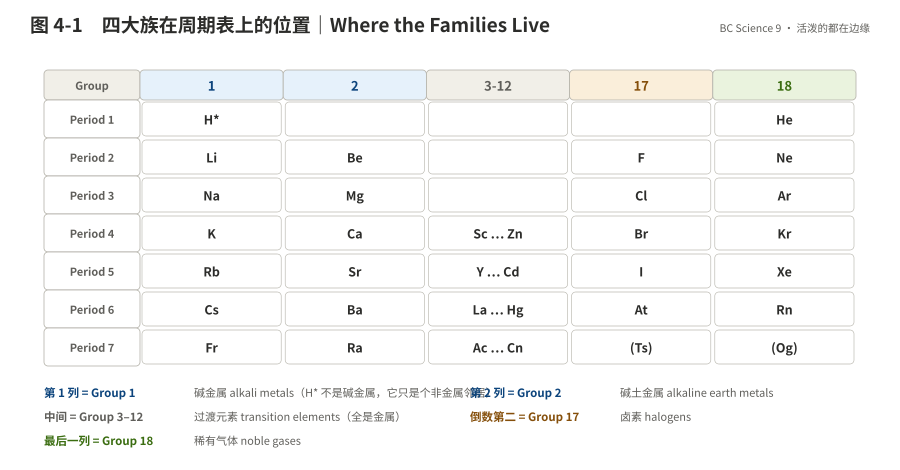
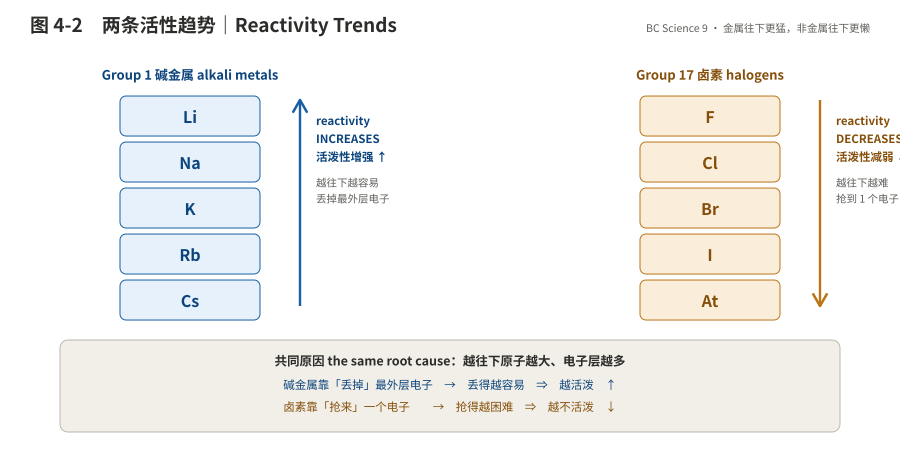
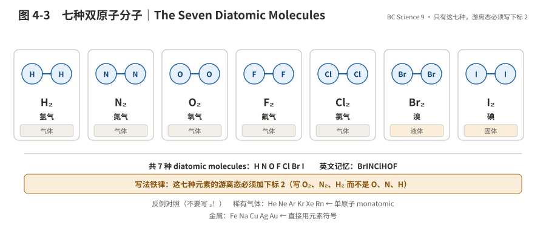
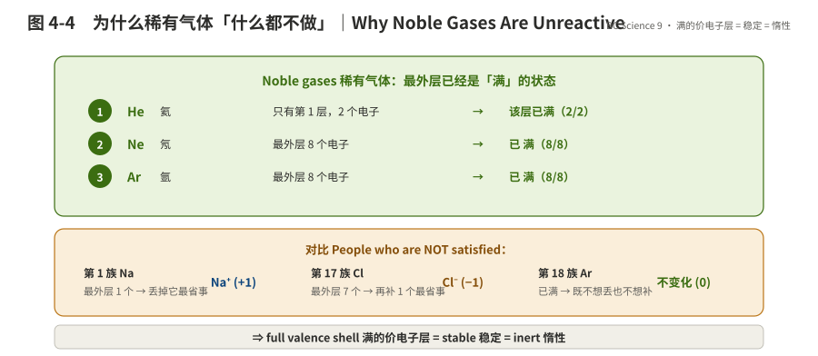
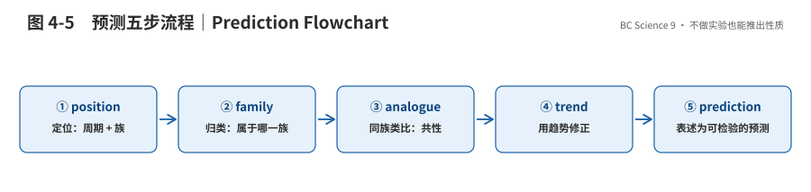

# Ch.4 — Chemical Families and Reactivity Trends
## Chapter 4 · Chemical Families and Reactivity Trends｜第 4 章　化学族与反应性趋势

> 🗂️ **Content Alignment｜大纲对应**：BC Science 9 Content C1「element properties as organized in the periodic table」（element properties）
> ⏱️ **Periods｜课时**：2　|　**Prerequisite｜前置**：Ch.3 How the periodic table is organised｜Ch.3 周期表的组织　|　**Followed by｜后继**：Ch.5 Atomic structure and Bohr diagrams｜Ch.5 原子结构与玻尔模型图
> 🗂️ **File generated｜文件生成时间**：2026-09-18 00:53

## 1. Content Alignment｜大纲对应

| Item｜项目 | Content｜内容 |
|---|---|
| BC Science 9 Content（official wording｜官方原文） | **element properties as organized in the periodic table** |
| Sub-items covered by this chapter｜本章承担的子条目 | The names, positions, members and typical ion charges of the four key families; diatomic molecules; the stability of the noble gases; the reactivity trends of group 1 and group 17; the predictive power of the periodic table｜四个重要化学族的名称、位置、成员与典型离子电荷；diatomic molecules 双原子分子；稀有气体的稳定性；group 1 与 group 17 的活性趋势；周期表的预测力 predictive power |
| Curricular Competencies｜课程能力 | [Processing and analyzing] Seek and analyze patterns, trends, and connections｜寻找并分析模式、趋势与联系；[Evaluating] 趋势性结论的证据支持｜evidence support for trend conclusions；[Communicating] 用表格与图像呈现趋势｜presenting trends in tables and visuals；[Applying and innovating] 用周期表对陌生元素做预测｜using the periodic table to predict an unfamiliar element |
| Beyond Grade 9?｜是否超纲 | No — everything in this chapter sits inside C1｜否（全部在 C1 范围内） |
| Extension note｜超纲提示 | Writing and balancing chemical equations, single replacement reactions, the activity series and electrochemistry all belong to **Science 10**. Wherever a reaction appears in this chapter it is flagged【🔭 Extension → Science 10】; Grade 9 students are asked only to **observe and describe at the level of phenomena and trends**｜化学方程式书写与配平、置换反应、活泼性顺序与电化学均属 **Science 10**；本章凡涉及反应式处一律标注【🔭 Extension → Science 10】，只要求学生做**现象层面的观察与趋势描述** |

## 2. Learning Objectives｜学习目标

**By the end of this chapter, you should be able to｜本章结束后，你应当能够：**

1. Name, locate and list the members of the four key families: alkali metals, alkaline earth metals, halogens and noble gases.
   - **中文**：说出四个重要族的名称、位置与成员：碱金属、碱土金属、卤素、稀有气体。
2. State the typical ion charge（+1, +2, −1, 0）and the degree of reactivity for each of the four families.
   - **中文**：说出四族的典型离子电荷（+1、+2、−1、0）与活泼程度。
3. Explain why the noble gases are unreactive, and list the seven diatomic molecules.
   - **中文**：解释稀有气体为何不活泼，并能列出七种双原子分子。
4. State and explain the reactivity trends: reactivity increases down group 1 and decreases down group 17.
   - **中文**：陈述并解释活性趋势：第 1 族**向下增强**、第 17 族**向下减弱**。
5. Predict the properties of an unfamiliar element from its position on the table, and state the evidence you used.
   - **中文**：由周期表位置预测陌生元素的性质，并说明所依据的证据。

## 3. Concept Explanations｜概念解析

### 3.1 The four key families｜四个重要化学族（一览）

| Group｜族 | English name｜英文 | 中文 | Typical ion charge｜典型离子电荷 | Reactivity｜活性 |
|---|---|---|---|---|
| 1 | **Alkali metals** | **碱金属** | **+1** | Extremely reactive — they react violently with water and must be **stored under oil**｜极活泼：遇水剧烈反应，须**保存在油中** |
| 2 | **Alkaline earth metals** | **碱土金属** | **+2** | Reactive, but clearly less so than the alkali metals｜活泼，但明显弱于碱金属 |
| 17 | **Halogens** | **卤素** | **−1** | The most reactive **non-metals**（the family name means "salt-former"）｜最活泼的**非金属**（族名意为"成盐者"） |
| 18 | **Noble gases** | **稀有气体** | **0**（they do not form ions） | Extremely unreactive / **inert 惰性的**｜极不活泼 |

> ⚠️ **Note｜注意**：**Hydrogen, H, is not an alkali metal**, even though it sits in group 1 — it is a non-metal that happens to be placed in that column. So the members of the alkali metals are **Li, Na, K, Rb, Cs and Fr**.
> **中文**：第 1 族里的 **H 氢不是碱金属**——它是非金属，只是被放在这一列；所以 alkali metals 的成员是 **Li、Na、K、Rb、Cs、Fr**。
> 🌐 **Translation policy｜译名统一**：Across this whole project the four family names are fixed as follows: alkali metal **碱金属**, alkaline earth metal **碱土金属**, halogen **卤素**, noble gas **稀有气体**（**never "贵族气体"**）and inert **惰性的**.
> **中文**：四个族的中文译名全项目统一：alkali metal **碱金属** / alkaline earth metal **碱土金属** / halogen **卤素** / noble gas **稀有气体**（**不译"贵族气体"**）/ inert **惰性的**。

### 3.2 Group 1 — Alkali metals｜碱金属

- **Members｜成员**: Li lithium, Na sodium, K potassium, Rb rubidium, Cs caesium and Fr francium（**H is not included**）.
  - **中文**：Li 锂、Na 钠、K 钾、Rb 铷、Cs 铯、Fr 钫（**不含 H**）。
- **Ion charge +1**: each atom tends to **lose one electron** and become a **cation** such as Na⁺ or K⁺【🔗 the full explanation is in Ch.6｜详因见 Ch.6】.
  - **中文**：**离子电荷 +1**：每个原子倾向**失去 1 个电子**形成 cation 阳离子（如 Na⁺、K⁺）【🔗 详因见 Ch.6】。
- **Physical properties**: they are very **soft**（you can cut them with a knife）and have low densities（Li, Na and K float on water）. Their melting and boiling points are lower than those of familiar metals. A freshly cut surface is silvery and lustrous but **darkens within seconds** as the surface oxidises.
  - **中文**：**物理性质**：很**软**（可用小刀切开）、密度小（Li、Na、K 能浮在水面上）、熔沸点比常见金属低、新鲜切面有银白色光泽但**很快变暗**（表面被氧化）。
- **Chemical properties**: extremely reactive. They react with water, releasing hydrogen gas and producing an alkaline solution【🔭 Extension → Science 10】— the full equation `2Na + 2H₂O → 2NaOH + H₂` belongs to Science 10; in Grade 9 you are asked only to **describe what you observe**.
  - **中文**：**化学性质**：极活泼，与水反应放出氢气并生成碱性溶液——【🔭 Extension → Science 10】完整方程式 `2Na + 2H₂O → 2NaOH + H₂` 属于 Science 10，本章只要求**描述现象**。
- **Storage｜保存方式**: kept immersed in **mineral oil / paraffin oil** to keep out air and water vapour（stored under oil）.
  - **中文**：浸在**矿物油 / 石蜡油**中隔绝空气与水蒸气（stored under oil）。
- **Occurrence in nature｜自然界存在形式**: because they are so reactive they are **never found as free elements in nature**, only in compounds（sodium in NaCl, table salt, for example）.
  - **中文**：因为太活泼，**从不以单质形式存在于自然界**，只能以化合物形式出现（如 NaCl 食盐）。
- **Reactivity trend｜活性趋势**: reactivity **increases** from Li down to Fr（Fr is the most reactive; among the elements you can actually handle, **Cs caesium** is the most reactive）.
  - **中文**：由 Li → Fr **逐渐增强**（Fr 最活泼；在常见元素中 **Cs 铯**最活泼）。

### 3.3 Group 2 — Alkaline earth metals｜碱土金属

- **Members｜成员**: Be beryllium, Mg magnesium, Ca calcium, Sr strontium, Ba barium and Ra radium.
  - **中文**：Be 铍、Mg 镁、Ca 钙、Sr 锶、Ba 钡、Ra 镭。
- **Ion charge +2**: they tend to lose two electrons, forming cations such as Mg²⁺ and Ca²⁺.
  - **中文**：**离子电荷 +2**：倾向失去 2 个电子形成 Mg²⁺、Ca²⁺ 等阳离子。
- **Properties**: **harder, denser and higher-melting** than the alkali metals, and second in line for reactivity. Most of them react with water or steam, but far more gently than group 1 does.
  - **中文**：比碱金属**更硬、密度更大、熔点更高**，活泼性居第二梯队；多数能与水或蒸汽反应，但比碱金属温和得多。
- **Familiar faces｜熟悉的身影**:

| Element｜元素 | Where you meet it｜生活中的存在 | Uses and phenomena｜用途 / 现象 |
|---|---|---|
| Mg magnesium 镁 | The central atom of chlorophyll（photosynthesis in plants）｜叶绿素的中心原子（植物光合作用） | Burns with a **dazzling white light**; used in fireworks, flares and early flash photography｜燃烧发出**耀眼白光**，用于烟花、信号弹、早期闪光灯 |
| Ca calcium 钙 | Bones and teeth（calcium phosphate 磷酸钙）; limestone CaCO₃｜骨骼与牙齿（calcium phosphate 磷酸钙）、石灰石 CaCO₃ | The main component of marble, chalk and shells｜大理石、粉笔、贝壳的主要成分 |
| Ba barium 钡 | **BaSO₄, barium sulfate, is insoluble in water**｜**BaSO₄ 硫酸钡**不溶于水 | The "barium meal" used in medical X-ray imaging — safe precisely because it does not dissolve（**soluble barium salts are toxic**）｜医学 X 线造影"钡餐"（不溶才安全；**可溶性钡盐有毒**） |
| Ra radium 镭 | A radioactive element｜放射性元素 | Once used in luminous paint; abandoned because of radiation hazards｜曾用于夜光涂料，因辐射危害已淘汰 |

- **Reactivity trend｜活性趋势**: also **increases down the group**（Ba is more reactive than Mg）, but the family as a whole is less reactive than group 1.
  - **中文**：同样**向下增强**（Ba 比 Mg 活泼），但整体弱于第 1 族。

### 3.4 Group 17 — Halogens｜卤素（"成盐者"）

- **Members｜成员**: F fluorine, Cl chlorine, Br bromine, I iodine and At astatine（element 117, Ts, also belongs here, but it is synthetic and its properties are still being studied）.
  - **中文**：F 氟、Cl 氯、Br 溴、I 碘、At 砹（117 号 Ts 亦属本族，但人工合成、性质仍在研究中）。
- **Word origin｜词源**: *halogen* comes from the Greek *hals*（salt）+ *gen*（to produce）→ **"salt-former"**, because halogens combine with metals extremely readily to make salts（Na + Cl → NaCl）.
  - **中文**：halogen 来自希腊语 *hals*（盐）+ *gen*（产生）→ **"成盐者" salt-former**，因为它们与金属反应极易生成盐（Na + Cl → NaCl）。
- **Ion charge −1**: they tend to **gain one electron** and become **anions**（F⁻, Cl⁻, Br⁻, I⁻）.
  - **中文**：**离子电荷 −1**：倾向**得到 1 个电子**形成 anion 阴离子（F⁻、Cl⁻、Br⁻、I⁻）。
- **How they exist｜存在形式**: they must be written and remembered as **diatomic molecules**: **F₂, Cl₂, Br₂, I₂**（never as bare F or Cl）.
  - **中文**：必须以**双原子分子（diatomic molecules）**书写和记忆：**F₂、Cl₂、Br₂、I₂**（不能写成 F、Cl）。
- They are **the most reactive family of non-metals**, and **fluorine is the most reactive non-metal of all the elements**.
  - **中文**：**是活泼性最强的一族非金属**；**F 氟是全部元素中最活泼的非金属**。
- **Reactivity trend｜活性趋势**: it **decreases** from F down to At — the opposite of what most people's intuition tells them!
  - **中文**：由 F → At **逐渐减弱**（与我们"越往下越剧烈"的直觉相反！）。

| Element｜元素 | State at room temperature｜常温状态 | Colour｜颜色 | Notes｜备注 |
|---|---|---|---|---|
| F₂ fluorine 氟 | gas 气体 | pale yellow 淡黄色 | The most reactive non-metal; reacts with almost everything｜最活泼的非金属，几乎与一切反应 |
| Cl₂ chlorine 氯 | gas 气体 | green-yellow 黄绿色 | Disinfects tap water; used in bleach｜自来水消毒、漂白剂 |
| Br₂ bromine 溴 | **liquid 液体** | red-brown 红棕色 | The only liquid non-metal; volatile, with a pungent vapour｜唯一液态非金属，易挥发、蒸气刺鼻 |
| I₂ iodine 碘 | solid 固体 | purple-black（violet vapour）紫黑色（蒸气紫色） | Iodised salt（prevents goitre）; iodine antiseptics｜加碘盐（防甲状腺肿大）、碘伏消毒 |

Everyday uses include fluoride toothpaste（fluoride 氟化物 protects against tooth decay）, chlorine disinfectants and PVC, bromine-containing flame retardants, and iodine antiseptics plus iodised salt.

**中文**：用途举例：含氟牙膏（fluoride 氟化物，防龋齿）、含氯消毒剂与 PVC、含溴阻燃剂、碘伏/碘酒消毒与加碘盐。

### 3.5 Group 18 — Noble gases｜稀有气体

- **Members｜成员**: **He helium, Ne neon, Ar argon, Kr krypton, Xe xenon and Rn radon**（element 118, Og, also belongs here but is synthetic and extremely unstable）.
  - **中文**：**He 氦、Ne 氖、Ar 氩、Kr 氪、Xe 氙、Rn 氡**（118 号 Og 亦属本族，为人工合成、极不稳定）。
- **Ion charge 0**: they neither lose nor gain electrons easily, so they **generally do not form ions**.
  - **中文**：**离子电荷 0**：既不容易失去也不容易得到电子，**一般不形成离子**。
- **Why they are unreactive｜为什么不活泼**: their **valence shell is already full**（helium's first shell is complete with two electrons; every other noble gas has exactly eight）→ they are in a **stable** state with a **full valence shell** and have no reason to gain or lose electrons【🔗 Ch.5 explains this in detail｜Ch.5 详解】.
  - **中文**：它们的**价电子层已满**（He 的第一层有 2 个电子即满，其余都恰有 8 个）→ 处于稳定状态（stable / full valence shell），无需再得失电子。【🔗 Ch.5 详解】
- **How they exist｜存在形式**: as **single atoms**（monatomic — written He, Ne, Ar）, unlike the halogens, which pair up.
  - **中文**：以**单个原子**存在（monatomic，写作 He、Ne、Ar），不像卤素那样成双。
- **Ion charge 0 ⇒ no combining power ⇒ hard to bond with other elements ⇒ inert.**
  - **中文**：**ion charge 0 ⇒ 无化合价 ⇒ 难与其他元素结合 ⇒ inert 惰性的**。
- **Uses｜用途举例**:

| Gas｜气体 | Use｜用途 | Property behind it｜性质依据 |
|---|---|---|
| He helium 氦 | Fills balloons and airships（lighter than air and **non-flammable**）｜气球/飞艇填充气（比空气轻且**不燃烧**） | Low density + inertness（safer than hydrogen）｜密度小 + 惰性（比氢气安全） |
| Ne neon 氖 | Orange-red glow in neon lights｜霓虹灯发出橙红色光 | Glows when electrified + inert｜通电发光 + 惰性 |
| Ar argon 氩 | Shielding gas for welding; fills light bulbs｜焊接保护气、灯泡填充气 | Inert — it keeps oxygen away so hot metal does not oxidise｜惰性，隔绝氧气防止金属在高温被氧化 |
| Kr / Xe 氪 / 氙 | Special lamps, flash tubes, some anaesthetics and ion thrusters｜特殊光源、闪光灯、部分麻醉与离子推进 | Inertness and distinctive spectra｜惰性与特殊光谱 |
| Rn radon 氡 | No positive use｜无正面用途 | **Radioactive**; can accumulate in basements → ventilation and testing are needed｜**放射性**，可在地下室积聚 → 需通风与检测 |

- **"Inert" does not mean "absolutely unable to react."** Helium and neon form essentially no compounds, but **krypton and xenon can form compounds under special conditions**（XeF₂, for example）【🔭 Extension → Science 10】. The more accurate wording is therefore "**extremely unreactive**".
  - **中文**：**注意"惰性"不等于"绝对不能反应"**：He、Ne 基本不形成化合物，但 **Kr、Xe 在特定条件下可以形成化合物**（如 XeF₂）【🔭 Extension → Science 10】。所以更准确的说法是"**极不活泼**"。

### 3.6 The seven diatomic molecules｜七种双原子分子

**Definition｜定义**：**Diatomic molecules** are molecules made of **two atoms of the same element** joined together.

**中文**：双原子分子是由**两个同种原子**结合而成的分子。

There are exactly **seven** of them, and you must know how these elements exist in nature: **H₂, N₂, O₂, F₂, Cl₂, Br₂ and I₂**.

**中文**：共 **7 种**，必须记住它们的存在形式：**H₂、N₂、O₂、F₂、Cl₂、Br₂、I₂**。

- Memory aids｜记忆口诀: string the English initials together as **Br I N Cl H O F**（"BrINClHOF"）, or use the sentence "Have No Fear Of Ice Cold Beer"（H N F O I Cl Br）.
  - **中文**：英文首字母串 **Br I N Cl H O F**（"BrINClHOF"）；或联想"Have No Fear Of Ice Cold Beer"（H N F O I Cl Br）。
- Writing rule｜书写不变量: whenever you refer to one of these elements **as a free element**, add the subscript 2（write "oxygen, O₂", not "O"）.
  - **中文**：提到这些元素**以单质形式存在**时必须加分角标 2（写"氧气 O₂"而不是"O"）。
- Counter-examples｜反例: the noble gases are written **He, Ne, Ar**（single atoms）, and metals are written **Fe, Na**（just the bare symbol）.
  - **中文**：稀有气体写 **He、Ne、Ar**（单原子）；金属写 **Fe、Na**（直接用元素符号表示）。

### 3.7 Reactivity trends｜活性趋势

| Group｜族 | Trend｜趋势 | Why（qualitative）｜为什么（定性） |
|---|---|---|
| **1, alkali metals 碱金属** | Reactivity **increases** down the group（Li < Na < K < Rb < Cs < Fr）｜向下活泼性增强 | Further down there are more electron shells, so the single outer electron is farther from the nucleus and held less tightly → **easier to lose** → more reactive｜越往下电子层数越多，最外层那个电子离原子核越远、被吸引得越松 → **更容易失去** → 越活泼 |
| **17, halogens 卤素** | Reactivity **decreases** down the group（F > Cl > Br > I > At）｜向下活泼性减弱 | Further down the atom is larger, so an incoming electron must enter an outer shell farther from the nucleus → the **attraction for an outside electron is weaker** → harder to react｜越往下原子越大，外界电子要进入的最外层离原子核越远 → **吸引外来电子的能力越弱** → 越难反应 |

- The two trends point in opposite directions, yet they share a single root cause: **going down a group, atoms get bigger and the nucleus loses its grip on the outer electrons.** Metals react by **losing** electrons（which becomes easier）; non-metals react by **gaining** electrons（which becomes harder）.
  - **中文**：两条趋势方向相反，根源却是同一个：**往下走，原子变大、核对外层电子的控制力变弱**——金属靠"失电子"反应（变容易），非金属靠"得电子"反应（变困难）。
- This is also the chapter's most direct echo of the **Big Idea**: **electron arrangement → how easily electrons are gained or lost → chemical properties and reactivity**【🔗 Ch.5–Ch.6 explain the mechanism｜Ch.5–Ch.6 详述机制】.
  - **中文**：这也是本章对 **Big Idea** 最直接的呼应：**电子排布 → 得失电子的难易 → 化学性质与活泼性**。【🔗 Ch.5–Ch.6 详述机制】

### 3.8 The predictive power of the periodic table｜周期表的预测力

- Elements in a group behave similarly, so once you know one member you can **infer the properties of the rest**.
  - **中文**：同一族元素性质相似 → 只要知道一个成员，**其余成员的性质可以推断**。
- The inference method has three steps: **① locate it（group + period）→ ② compare it with a known element in the same group → ③ correct the direction using the trend.**
  - **中文**：推断方法三步：**① 定位（族 + 周期）→ ② 找同族已知元素类比 → ③ 用趋势修正方向。**
- Classic applications｜经典应用:
  - Predicting **At, astatine**（group 17, period 6）: it should be a **dark solid**, form **At⁻**, and be **less reactive than I₂**.
  - Predicting **Fr, francium**（group 1, period 7）: it should be an **extremely soft, highly reactive metal**, form **Fr⁺**, and react with water **more violently than Cs does**.
  - Historically, Mendeleev used exactly this reasoning to predict Ga, Ge and Sc【🔗 see Ch.2｜见 Ch.2】.
  - **中文**：预测 **At 砹**（第 17 族第 6 周期）：应为**深色固体**、形成 **At⁻**、活泼性**比 I₂ 更弱**；预测 **Fr 钫**（第 1 族第 7 周期）：应为**极软的活泼金属**、形成 **Fr⁺**、与水反应**比 Cs 更剧烈**；历史上 Mendeleev 正是用同样思路预测了 Ga、Ge、Sc【🔗 见 Ch.2】。
- **A reminder｜提醒**: a prediction must be testable. When new evidence disagrees with a prediction, it is our understanding that changes — not the data.
  - **中文**：预测必须能被检验；当新证据与预测不符时，改的是我们的理解，而不是数据。

## 4. Comparison Tables｜表格比对

### Table 4-1　The Four Key Families at a Glance｜四大族总表

| Item｜项目 | Group 1 | Group 2 | Group 17 | Group 18 |
|---|---|---|---|---|
| English name｜英文 | Alkali metals | Alkaline earth metals | Halogens | Noble gases |
| 中文 | 碱金属 | 碱土金属 | 卤素 | 稀有气体 |
| Members｜成员 | Li Na K Rb Cs Fr | Be Mg Ca Sr Ba Ra | F Cl Br I At | He Ne Ar Kr Xe Rn |
| Ion charge｜离子电荷 | **+1** | **+2** | **−1** | **0** |
| Lose or gain?｜失/得电子 | loses 1 失去 1 个 | loses 2 失去 2 个 | gains 1 得到 1 个 | neither 都不发生 |
| Reactivity｜活泼性 | extremely reactive（strongest among metals）极活泼（金属中最强） | reactive, second in line 活泼，次之 | extremely reactive（strongest among non-metals）极活泼（非金属中最强） | extremely unreactive **inert** 极不活泼 |
| How it exists｜存在形式 | in compounds（never free）化合物中（从不游离） | in compounds 化合物中 | **diatomic molecules X₂ 双原子分子** | **single atoms He、Ne、Ar 单原子** |
| Trend down the group｜活性趋势 | **increases** 向下增强 | increases 向下增强 | **decreases** 向下减弱 | all very unreactive 都很不活泼 |
| Example use｜例子 | NaCl table salt, K in fertiliser｜NaCl 食盐、K 肥料 | CaCO₃ limestone, Mg in chlorophyll｜CaCO₃ 石灰石、Mg 叶绿素 | iodised salt, chlorine disinfectants｜加碘盐、含氯消毒 | He in balloons, Ar as shielding gas｜He 气球、Ar 保护气 |

### Table 4-2　Alkali Metals & Observations｜碱金属：成员与现象

| Element｜元素 | Symbol｜符号 | Observation with water（teacher demo）与水反应的现象 | Relative reactivity｜相对活泼性 |
|---|---|---|---|
| Li lithium 锂 | Li | Floats on the water and fizzes slowly｜浮在水面、缓慢冒泡 fizzing | weakest 最弱 |
| Na sodium 钠 | Na | Fizzes rapidly, melts into a small ball and skates about｜迅速冒泡、熔成小球四处游动 | ↑ |
| K potassium 钾 | K | Reacts violently, giving off a flame（lilac）and possibly a small bang｜剧烈反应、冒出火焰（淡紫色火焰）并可能有轻微爆鸣 | ↑ |
| Rb / Cs 铷 / 铯 | Rb / Cs | Extremely violent; can ignite spontaneously in air｜极为剧烈，可在空气中自燃 | strongest 最强 |

> 🧪 **Safety note｜安全说明**：This demonstration may be performed **only by the teacher, under protective conditions**（see Activity 4-1 ）. Students must **never** take alkali metals themselves.
> **中文**：本演示**只能由教师在防护条件下操作**（见 Activity 4-1 ），学生**不得**自行取用碱金属。

### Table 4-3　Halogens Compared｜卤素对比

| Element｜元素 | State at room temperature｜常温状态 | Colour｜颜色 | Form｜存在形式 | Reactivity｜活泼性 | Everyday example｜生活例子 |
|---|---|---|---|---|---|---|
| F fluorine 氟 | gas 气体 | pale yellow 淡黄色 | F₂ | **strongest 最强** | fluoride toothpaste, non-stick coatings｜含氟牙膏、不粘涂层 |
| Cl chlorine 氯 | gas 气体 | green-yellow 黄绿色 | Cl₂ | ↓ | tap-water disinfection, bleach, PVC｜自来水消毒、漂白剂、PVC |
| Br bromine 溴 | **liquid 液体** | red-brown 红棕色 | Br₂ | ↓ | flame retardants｜阻燃剂 |
| I iodine 碘 | solid 固体 | purple-black（violet vapour）紫黑色（紫色蒸气） | I₂ | ↓ | iodised salt, iodine antiseptics｜加碘盐、碘伏消毒 |
| At astatine 砹 | **predicted** dark solid｜**预测**为深色固体 | predicted to be deeper 推测更深 | At₂（predicted 推测） | **weakest**（and strongly radioactive）**最弱**（且放射性强） | extremely rare, essentially no applications｜极稀有，基本无应用 |

### Table 4-4　Noble Gases Compared｜稀有气体对比

| Element｜元素 | Symbol | 中文 | Use｜用途 | Notes｜备注 |
|---|---|---|---|---|
| Helium | He | 氦 | Balloons, airships, cooling superconducting magnets｜气球、飞艇、超导磁体冷却 | The second lightest element; does not burn, so safer than H₂｜第二轻的元素，不燃烧，比 H₂ 安全 |
| Neon | Ne | 氖 | Neon lights（orange-red）霓虹灯（橙红） | Glows when electrified｜通电发光 |
| Argon | Ar | 氩 | Shielding gas for welding; fills light bulbs｜焊接保护气、灯泡填充气 | The most abundant noble gas in air（about 0.93%）｜空气中含量最高的稀有气体（约 0.93%） |
| Krypton | Kr | 氪 | High-performance lamps, flash tubes｜高性能灯、闪光灯 | Can form a few compounds｜可形成少数化合物 |
| Xenon | Xe | 氙 | Flash tubes, ion thrusters, anaesthesia｜闪光灯、离子推进器、麻醉 | Can form compounds such as XeF₂｜可形成化合物，如 XeF₂ |
| Radon | Rn | 氡 | No positive use｜无正面用途 | **Radioactive**; accumulates in basements, so ventilation and testing are needed｜**放射性**，可在地下室积聚，需通风检测 |

### Table 4-5　The Seven Diatomic Molecules｜七种双原子分子

| Formula｜分子式 | English name｜英文 | 中文 | State at room temperature｜常温状态 | Class｜所属类别 |
|---|---|---|---|---|---|
| H₂ | hydrogen | 氢气 | gas 气体 | non-metal（unusually placed in group 1）非金属（特例位置在第 1 族） |
| N₂ | nitrogen | 氮气 | gas 气体 | group 15 non-metal 第 15 族非金属 |
| O₂ | oxygen | 氧气 | gas 气体 | group 16 non-metal 第 16 族非金属 |
| F₂ | fluorine | 氟气 | gas 气体 | halogen 卤素 |
| Cl₂ | chlorine | 氯气 | gas 气体 | halogen 卤素 |
| Br₂ | bromine | 溴 | **liquid 液体** | halogen 卤素 |
| I₂ | iodine | 碘 | solid 固体 | halogen 卤素 |

> 💡 **Mnemonic｜口诀**：**BrINClHOF**（溴碘氮氯氢氧氟）— the seven elements that pair up with themselves.
> **中文**：七个自己成双成对的元素。

### Table 4-6　Why the Trends Are Opposite｜两条活性趋势为什么方向相反

| Item｜比较项 | Group 1, alkali metals｜碱金属 | Group 17, halogens｜卤素 |
|---|---|---|
| What the reaction relies on｜反应靠什么 | **losing** the outermost electron 失去最外层电子 | **gaining** an outside electron 得到外来电子 |
| What happens going down｜向下走发生什么 | The atom gets bigger and the outer electron sits farther from the nucleus｜原子变大，最外层电子离核更远 | The atom gets bigger and the incoming electron must enter a farther shell｜原子变大，外来电子进入更远的外层 |
| Result｜结果 | Weaker hold → easier to lose the electron → **reactivity increases**｜束缚变弱 → 更容易失电子 → **活泼性增强** | Weaker attraction → harder to gain an electron → **reactivity decreases**｜吸引力变弱 → 更难得到电子 → **活泼性减弱** |
| Strongest member｜最强成员 | Fr francium（Cs caesium among the common elements）｜Fr 钫（常见元素中 Cs 铯最强） | F fluorine（strongest of all non-metals）｜F 氟（全部非金属中最强） |
| Where the strongest member sits｜最强成员位置 | bottom 底部 | top 顶部 |

## 5. Diagrams & Worked Examples｜图例说明

### Fig. 4-1　Where the Families Live｜四大族在周期表上的位置

**Key points｜看图要点**：The four key families occupy the **two leftmost columns** and the **two rightmost columns** of the table. The reactive families are all on the edges; the transition elements in the middle are comparatively "mild".

**中文**：四个关键族分布在表的**最左两列**与**最右两列**——活泼的都在边缘，中间的过渡元素相对"温和"。

### Fig. 4-2　Reactivity Trends｜两条活性趋势

**Key points｜看图要点**：The two arrows point in opposite directions, but for exactly the same reason（atoms get bigger, so the nucleus loses control of the outer electrons）. A useful slogan: "**metals get fiercer going down, non-metals get lazier going down**".

**中文**：两个箭头方向相反，但原因完全一样（原子变大 → 核对外层电子的控制力变弱）。记住"**金属往下更猛，非金属往下更懒**"。

### Fig. 4-3　The Seven Diatomic Molecules｜七种双原子分子

**Key points｜看图要点**：Only these seven non-metallic elements exist as "two atoms holding hands". Noble gases and metals are always written with a single symbol.

**中文**：只有这七种非金属单质是"两个原子手拉手"；稀有气体与金属一律用单符号表示。

### Fig. 4-4　Why Noble Gases Are Unreactive｜为什么稀有气体「什么都不做」【⏭️ Preview → Ch.5–Ch.6｜预告 Ch.5–Ch.6】

**Key points｜看图要点**：The ion charges **+1 / −1 / 0** are not things you memorise — they are worked out by asking "how many electrons short of a full shell am I?" The noble gases are already at the finish line, so their charge is 0 and they do not react.

**中文**：离子电荷 **+1 / −1 / 0** 不是背出来的，而是"距离满层差几个电子"算出来的；稀有气体已经在终点线上，所以电荷为 0、不活泼。

### Fig. 4-5　Worked Example: Identifying a Family from Clues｜例题：由线索判断族

**Question｜题目**：Use each clue to identify the family the unknown element belongs to, together with its typical ion charge and its reactivity.

**中文**：根据线索判断每种未知元素所在的族、典型离子电荷与活泼性。

| Clue｜线索 | Group｜判断族 | Ion charge | Evidence｜判断依据 |
|---|---|---|---|---|
| Soft enough to cut with a knife, floats on water fizzing violently, must be stored under oil｜软到可用刀切开、浮在水面上剧烈冒泡、须保存在油中 | **Group 1** alkali metals 碱金属 | **+1** | Soft + violent reaction with water + stored under oil — the three hallmarks of an alkali metal｜软 + 与水剧烈反应 + oil 保存，是碱金属三件套 |
| A green-yellow irritating gas that exists as X₂ and forms salts with metals｜黄绿色刺激性气体，以 X₂ 形式存在，能与金属生成盐 | **Group 17** halogens 卤素 | **−1** | "Salt-former" + diatomic molecule + reactive non-metal｜"成盐者" + 双原子分子 + 活泼非金属 |
| Glows orange-red when electrified and reacts with almost nothing｜通电发出橙红色光，几乎不与任何物质反应 | **Group 18** noble gases 稀有气体 | **0** | Neon's signature: inert and glows under electric current｜Ne 的特征：惰性 + 通电发光 |
| A grey-white metal that burns with a dazzling white light; its ion is the neighbour of Ca²⁺｜灰白金属，燃烧发出耀眼白光，常见离子为 Ca²⁺ 的邻居 | **Group 2** alkaline earth metals 碱土金属 | **+2** | Magnesium's white flame; group 2 position, losing two electrons｜Mg 燃烧白光；位置在第 2 族，失去 2 个电子 |
| A silvery metal that is attracted by a magnet and shows more than one valence｜银白色金属，能被磁铁吸引，有多种化合价 | transition elements, groups 3–12 过渡元素 | variable（Fe²⁺ / Fe³⁺）多变 | Magnetism（Fe / Co / Ni）+ variable valence → transition element signatures｜磁性（Fe/Co/Ni）+ 多变价 → 过渡元素特征 |

> ⚠️ **Misconception alert｜易错提醒**：When you read "stored under oil", think alkali metal immediately. When you read "X₂", think halogen at once（or H₂ / N₂ / O₂）.
> **中文**：看到"保存在油中"要立刻想到碱金属；看到"X₂"要立刻想到卤素（或 H₂/N₂/O₂）。

### Fig. 4-6　Worked Example: Predicting Astatine｜例题：预测砹 At 的性质

**Question｜题目**：Astatine（At, element 85, period 6, group 17）is extremely rare and strongly radioactive, so experiments are almost impossible. Use the periodic table to predict its properties.

**中文**：砹 Astatine（At，第 85 号，第 6 周期第 17 族）极其稀有且放射性强，很难做实验。请利用周期表预测它的性质。

**Solution（the five prediction steps）｜解析（预测五步）：**

| Step｜步骤 | Action｜操作 | Result｜结果 |
|---|---|---|
| ① Position｜定位 | Group 17, period 6 → a halogen｜第 17 族、第 6 周期 → 卤素 | Same class as F, Cl, Br and I｜与 F、Cl、Br、I 同类 |
| ② Analogue｜类比 | Halogen common features: diatomic molecules, −1 ions, non-metals｜卤素共性：双原子分子、形成 −1 离子、非金属 | Predict that it exists as **At₂** and forms **At⁻**｜推测以 **At₂** 存在，形成 **At⁻** |
| ③ State trend｜状态趋势 | F₂ gas → Cl₂ gas → Br₂ liquid → I₂ solid; the elements get heavier downwards｜F₂ 气 → Cl₂ 气 → Br₂ 液 → I₂ 固，向下逐渐变重 | At should be a **dark solid**（darker than I₂）｜At 应为**深色固体**（比 I₂ 更深） |
| ④ Reactivity trend｜活性趋势 | Group 17 reactivity **decreases** downwards｜第 17 族向下**减弱** | At is **less reactive than I₂** — the least reactive halogen｜At 活泼性**比 I₂ 更弱**，是卤素中最不活泼者 |
| ⑤ Check｜自我检查 | A prediction must be testable; extrapolate the trend without over-claiming｜预测必须可检验、只做趋势外推，不做过度断定 | State the conclusion with "predict / predicted" wording｜结论用"预测/推测 predict"表述 |

**Answer｜答案**：Astatine is predicted to be a **dark solid**, possibly existing as At₂, forming the **At⁻** ion and being the **least reactive** member of group 17（as well as strongly radioactive）. The evidence is "elements in the same group behave similarly" combined with the state and reactivity trends down the group.

**中文**：At 预测为**深色固体**，可能以 At₂ 形式存在，形成 **At⁻** 离子，是第 17 族中**活泼性最弱**的成员（且具强放射性）。依据是"同族性质相似 + 沿族的状态与活性趋势"。

### Fig. 4-5　Prediction Flowchart｜预测五步流程

## 6. Key Vocabulary｜核心词汇

| English｜英文 | 中文 | Notes｜备注 |
|---|---|---|
| alkali metal | 碱金属 | group 1; hydrogen is not included｜第 1 族，不含 H |
| alkaline earth metal | 碱土金属 | group 2｜第 2 族 |
| halogen | 卤素 | group 17, the "salt-former"｜第 17 族，"成盐者" |
| noble gas | 稀有气体 | group 18; **never translate it as "贵族气体"**｜第 18 族，**不译"贵族气体"** |
| inert | 惰性的 | = extremely unreactive 极不活泼 |
| reactive / reactivity | 活泼的 / 活泼性 | — |
| family | 族（化学族） | same meaning as group｜与 group 同义 |
| ion charge | 离子电荷 | +1 / +2 / −1 / 0 |
| cation | 阳离子 | positively charged; formed by losing electrons【🔗 Ch.6】｜失电子带正电 |
| anion | 阴离子 | negatively charged; formed by gaining electrons【🔗 Ch.6】｜得电子带负电 |
| diatomic molecule | 双原子分子 | H₂ N₂ O₂ F₂ Cl₂ Br₂ I₂ |
| monatomic | 单原子的 | noble gases exist as single atoms｜稀有气体以单原子存在 |
| trend | 趋势 | group 1 increases, group 17 decreases｜group 1 ↑、group 17 ↓ |
| increasing / decreasing | 增强 / 减弱 | used to describe the direction of a trend｜描述趋势方向 |
| full valence shell | 满的价电子层 | the reason noble gases are stable【🔗 Ch.5】｜稀有气体稳定的原因 |
| stable | 稳定的 | a state that does not readily change｜不易发生变化的状态 |
| stored under oil | 保存在油中 | how alkali metals are kept｜碱金属的保存方式 |
| predictive power | 预测力 | the most valuable feature of the periodic table｜周期表最有价值的特征 |
| radioactivity | 放射性 | Ra, Rn, At and Fr are strongly radioactive｜Ra、Rn、At、Fr 等具强放射性 |
| mineral oil / paraffin oil | 矿物油 / 石蜡油 | used to keep out air and water｜用于隔绝空气与水 |

## 7. Lab / Activity｜实验与活动

### Activity 4-1　Alkali Metals + Water Demo｜碱金属与水（教师演示）

- **Type｜类型**: teacher demonstration / video observation（**teacher demo only**）｜教师演示 / 视频观察（**Teacher Demo only**）
- **Materials｜材料**: safety screen, safety goggles, tweezers, filter paper, small pieces of Li / Na / K under mineral oil, a large beaker of water, phenolphthalein indicator, a camera for projection（a video may replace the live demo）｜防护屏、护目镜、镊子、滤纸、矿物油中的 Li / Na / K 小块、装有水的大烧杯、酚酞指示剂、摄像头投影（可用 video 替代实做）
- **Procedure｜步骤**:
  1. The teacher lifts out a small piece with tweezers, blots off the oil with filter paper, and **cuts off a piece the size of a green bean**（the offcuts go back into the oil）.
     - **中文**：教师用镊子取出小块金属，用滤纸吸干表面的油，**切下绿豆大小**的一小块（切下的碎屑放回油中）。
  2. Drop the pieces into the water one at a time（**only one piece per trial**）. Students record: does it float, does it melt into a ball, which way does it move, what colour is the flame, and how violent is the reaction（rated 1–5）.
     - **中文**：依次投入水中（**每次只投一块**），学生记录：是否浮起、是否熔成小球、移动方向、火焰颜色、剧烈程度（1–5 级）。
  3. If phenolphthalein has been added, watch the solution turn pink → an alkaline substance has formed（this is where the name "alkali" comes from）.
     - **中文**：若加了酚酞，观察水溶液变红 → 生成了碱性物质（"alkali"碱的名字由来）。
  4. Arrange the observations in the order Li < Na < K and draw the conclusion: **reactivity increases down group 1**.
     - **中文**：把观察排成 Li < Na < K 的顺序，画出结论：**第 1 族向下活泼性增强**。
- **Competencies｜训练能力**: [Planning and conducting] safety routines｜安全规范；[Processing and analyzing] Seek and analyze patterns, trends, and connections｜寻找并分析模式、趋势与联系
- **Safety｜安全**: ⚠ Demonstration only — students must not handle alkali metals. A **safety screen and goggles** must be in place. Never handle the metal with bare hands. The potassium demo calls for extra caution（it may explode into flame）. Dispose of the alkaline waste as the teacher directs｜全程示范，学生不得接触碱金属；**防护屏 + 护目镜**必须在位；严禁徒手取放；K 的演示须格外谨慎（可能爆燃）；产生的碱性废液按教师指示处理

### Activity 4-2　Halogen Card Sort & Prediction｜卤素家族卡排序与预测

- **Type｜类型**: small-group sorting and inference｜小组排序 + 推理（Sorting & Inference）
- **Materials｜材料**: four cards for F, Cl, Br and I（each showing state, colour and common uses）, plus **one blank card for At**｜F、Cl、Br、I 四张卡片（含状态、颜色、常见用途），另加一张**写有 At 的空白卡**
- **Procedure｜步骤**:
  1. Students arrange the cards from top to bottom in the order of the group（group 17, increasing atomic number downwards）.
     - **中文**：学生按第 17 族自上而下（原子序数递增）的顺序把卡片从上到下排好。
  2. Generalise two patterns: **the state runs gas → liquid → solid**, and **reactivity runs from strongest to weakest**.
     - **中文**：归纳两条规律：**状态由气 → 液 → 固**；**活泼性由强到弱**。
  3. Fill in the blank At card with predictions（state, colour, ion charge, reactivity, whether it is diatomic）, writing the evidence for each one.
     - **中文**：给 At 空白卡填写预测（状态、颜色、离子电荷、活泼性、是否双原子分子），并写出每一条的依据。
  4. Compare with other groups and discuss **which predictions are well supported and which are only guesses**.
     - **中文**：与其他组比对，讨论"哪些预测有充分证据、哪些只是猜测"。
- **Competencies｜训练能力**: [Questioning and predicting]｜提问与预测；[Evaluating] telling a well-supported prediction from an unsupported guess｜区分证据充分的预测与无依据的猜测
- **Safety｜安全**: ⚠ Use picture cards only — **never handle real halogens**（Cl₂ is toxic, Br₂ is corrosive）｜仅使用图片卡，**不接触卤素实物**（Cl₂ 有毒、Br₂ 腐蚀性）

### Activity 4-3　Family Archive Poster｜家族档案馆

- **Type｜类型**: group project for four｜四人小组项目（Project）
- **Task｜任务**: each group chooses one of the four families and produces a one-page "archive" containing the family name（in English and Chinese）, its position, all its members, the typical ion charge, the reactivity, two uses, and **one sentence of mechanism explanation（why this family behaves the way it does）**. The page must include at least one self-made table and one diagram（hand-drawn is fine）.
  - **中文**：四个族各选一族，制作一页"档案"：族名（中英）、位置、全部成员、典型离子电荷、活跃性、两种用途、**一句 Mechanism explanation（为什么这类元素这样的行为）**。要求至少用一张自制表格 + 一张示意图（可手绘）。
- **Presentation｜展示**: each group gives a 90-second "elevator pitch"; the other groups score it with a checklist covering accurate terminology / sufficient evidence / clear visuals / correct bilingual formatting.
  - **中文**：每组 90 秒"电梯演讲"，其他组用检查表（checklist）评分：术语准确 / 证据充分 / 图示清楚 / 中英对照规范。
- **Competencies｜训练能力**: [Communicating] using charts and scientific language｜用图表与科学语言表达；[Applying and innovating] using periodic-table knowledge to explain real applications｜把周期表知识用于解释现实应用
- **Safety｜安全**: none｜无

## 8. Common Misconceptions｜常见易错点

| # | Misconception｜错误认识 | Correction｜正确理解 |
|---|---|---|
| 1 | "Noble gas means 贵族气体."｜"noble gas 是贵族气体" | The correct Chinese term is **稀有气体**（惰性气体 is also accepted）— **never "贵族气体"**.｜正确译名是**稀有气体**（也可称惰性气体），**不译"贵族气体"**。 |
| 2 | "Noble gases can never form compounds."｜"稀有气体绝对不能形成化合物" | He and Ne form essentially none, but **Kr and Xe can, under special conditions**（XeF₂, for example）【🔭 Extension → Science 10】. The accurate wording is "**extremely unreactive**".｜He、Ne 基本不形成；但 **Kr、Xe 在特定条件下可以**（如 XeF₂）【🔭 Extension → Science 10】。准确说法是"**极不活泼**"。 |
| 3 | "Hydrogen is an alkali metal."｜"氢是碱金属" | H is a **non-metal**, placed in group 1 only because it has one valence electron. The alkali metals are Li, Na, K, Rb, Cs and Fr.｜H 是**非金属**，只是因只有 1 个价电子而排在第 1 族；alkali metals = Li、Na、K、Rb、Cs、Fr。 |
| 4 | "Alkali metals are hard, heavy metals."｜"碱金属是硬邦邦的重金属" | They are **soft enough to cut with a knife**, and Li, Na and K are **less dense than water**, so they float while reacting.｜它们**软到能用刀切开**，Li、Na、K 的密度比水小，能**浮在水面**上反应。 |
| 5 | "Reactivity decreases down group 1."｜"第 1 族向下活泼性减弱" | Group 1 reactivity **increases** downwards（Cs is far more violent than Li）.｜第 1 族**向下增强**（Cs 比 Li 猛烈得多）。 |
| 6 | "Reactivity increases down group 17."｜"第 17 族向下活泼性增强" | Group 17 reactivity **decreases** downwards（F is strongest, At weakest）.｜第 17 族**向下减弱**（F 最强，At 最弱）。 |
| 7 | "Diatomic molecules are just the halogens."｜"双原子分子只有卤素" | There are seven in all: **H₂, N₂, O₂, F₂, Cl₂, Br₂, I₂**（only four of them are halogens）.｜共 7 种：**H₂、N₂、O₂、F₂、Cl₂、Br₂、I₂**（卤素只占四种）。 |
| 8 | "Noble gases are written He₂, Ne₂."｜"稀有气体也写成 He₂、Ne₂" | Noble gases exist as **single atoms** and are written He, Ne, Ar.｜稀有气体**以单原子存在**，写作 He、Ne、Ar。 |
| 9 | "If the metal does not exist on its own, the element has 'disappeared'."｜"金属不存在就意味着元素是"消失"了" | Elements never disappear. Reactive elements simply occur **in compounds**（sodium in table salt, for example）.｜元素从未消失，活泼元素只是以**化合物的形式**存在（如食盐中的 Na）。 |
| 10 | "The halogen ion charge is +1."｜"卤素的离子电荷是 +1" | Halogens **gain** an electron, so their charge is **−1**（Cl⁻）. Only group 1, which **loses** an electron, is +1.｜卤素**得到**电子 → **−1**（如 Cl⁻）；只有第 1 族失电子才是 +1。 |
| 11 | "Sodium fizzing in water looks fun — I could try it myself."｜"钠在水里冒泡很好玩，可以自己动手试" | The reaction gives off **hydrogen** and heat, and can catch fire or explode. **It must be demonstrated by the teacher**; students must never take alkali metals.｜反应放出**氢气**并放热，可能起火或爆燃；**必须由教师演示**，学生不得取用碱金属。 |
| 12 | "Writing At₂ and At⁻ breaks the diatomic / ion rules."｜"At₂、At⁻ 的写法违反了双原子/离子规则" | They are exactly what you get by **extrapolating** the group 17 pattern — reasonable predictions, not rule-breaking.｜它们正是对 17 族规律的**外推预测**，属合理预测而非违反规则。 |

## 9. Assessment｜答题评估

### A. Foundational｜基础题（2 marks each, 20 marks total｜每题 2 分，共 20 分）

**A1.** What is the English family name and the Chinese name of group 1? List all of its members（excluding hydrogen）.
- **中文**：第 1 族的英文族名与中文译名是什么？列出全部成员（不含氢）。

**A2.** What is the English family name and the Chinese name of group 2? What is its typical ion charge?
- **中文**：第 2 族的英文族名与中文译名是什么？它的典型离子电荷是多少？

**A3.** What is the English family name and the Chinese name of group 17? Why is it called that?
- **中文**：第 17 族的英文族名与中文译名是什么？为什么叫这个名字？

**A4.** What is the English family name and the Chinese name of group 18? What is its typical ion charge?
- **中文**：第 18 族的英文族名与中文译名是什么？它的典型离子电荷是多少？

**A5.** Write down the typical ion charges of groups 1, 2, 17 and 18.
- **中文**：写出第 1、2、17、18 族的典型离子电荷。

**A6.** Write the formulas of the seven diatomic molecules.
- **中文**：写出七种双原子分子的分子式。

**A7.** Name the six noble gases（give the symbol and the Chinese name）.
- **中文**：写出稀有气体的六种成员（符号 + 中文名）。

**A8.** How does the reactivity of group 1 change as you go down the group?
- **中文**：第 1 族的活泼性沿族向下如何变化？

**A9.** How does the reactivity of group 17 change as you go down the group? Which element is the most reactive non-metal?
- **中文**：第 17 族的活泼性沿族向下如何变化？哪一种是最活泼的非金属？

**A10.** Why must alkali metals be stored under oil?
- **中文**：为什么碱金属必须保存在油中？

### B. Applied｜应用题（5 marks each, 20 marks total｜每题 5 分，共 20 分）

**B1.** The table below is the record of a demonstration in which Li, Na and K reacted with water. Complete the table and answer the questions.
- **中文**：下表是 Li、Na、K 与水反应的演示记录，请把表格补完整并回答问题。

| Element｜元素 | Floats?｜是否浮在水面 | Melts into a ball?｜是否熔成小球 | Flame?｜有无火焰 | Vigour (1–5)｜剧烈程度 |
|---|---|---|---|---|---|
| Li | yes 是 | no 否 | none 无 | 1 |
| Na | yes 是 | yes 是 | none 无 | 3 |
| K | yes 是 | yes 是 | yes（lilac 淡紫色） | 5 |

(a) Put the three in order from least to most reactive. (b) Predict what would happen if Rb were added to water. (c) Which trend does this illustrate?
- **中文**：(a) 把三者按活泼性从弱到强排序；(b) 预测 Rb 与水反应的现象；(c) 这句话体现的是哪一条趋势？

**B2.** Use the periodic table to predict four properties of astatine（At, element 85, period 6, group 17）, giving the evidence for each. Your answer must cover: state at room temperature, whether it exists as a diatomic molecule, its typical ion charge, and its reactivity compared with I₂.
- **中文**：利用周期表预测砹 At（第 85 号，第 6 周期第 17 族）的四项性质，并为每项写出依据。要求包含：常温状态、是否存在双原子分子、典型离子电荷、与 I₂ 相比的活泼性。

**B3.** Why are the noble gases so unreactive? Explain using the idea of the **valence shell**, and explain why **helium is equally stable even though it has only two electrons**.
- **中文**：为什么稀有气体如此不活泼？请用"价电子层"来解释；并说明为什么 **He 虽然有 2 个电子却同样稳定**。

**B4.** Why are the halogens called the "salt-formers"? Use the familiar example of table salt to explain, and explain why halogens **do not occur as single atoms in nature**.
- **中文**：卤素为什么被称为"成盐者"？请以熟悉的食盐为例说明，并解释为什么它们在自然界**不以单原子形式存在**。

### C. Challenge｜挑战题（10 marks each, 20 marks total｜每题 10 分，共 20 分）

**C1.** Reactivity **increases** down group 1 but **decreases** down group 17 — the two trends run in opposite directions. Explain both with **one single cause**, covering: (i) what happens to atomic structure as you go down a group; (ii) why that change affects metals and non-metals in opposite ways; (iii) how this explanation connects back to the Big Idea.
- **中文**：第 1 族向下活泼性**增强**，第 17 族向下活泼性**减弱**——两条趋势方向相反。请用**同一个原因**解释这两条趋势，说明：(i) 沿族向下原子结构发生了什么变化；(ii) 这种变化为何对金属与对非金属的影响相反；(iii) 这一解释如何回扣 Big Idea。

**C2.** An unknown element X is in group 1, period 5. Predict its properties as completely as you can, giving the evidence for each prediction: state and appearance at room temperature, hardness, density（compared with water）, how it must be stored, how violently it reacts with water, its typical ion charge, and the form in which it occurs in nature. **In addition**, write two safety precautions that must be followed when testing these predictions.
- **中文**：某未知元素 X 位于第 1 族第 5 周期。请尽可能完整地预测它的性质，并为每一条预测写出依据：常温状态与外观、硬度、密度（与水比较）、保存方式、与水反应的相对剧烈程度、典型离子电荷、在自然界的存在形式。**另需**写出两条在验证过程中必须遵守的安全注意事项。

---

### Answer Key｜参考答案

**Set A｜A 组**

- A1. **Alkali metals 碱金属**; members: **Li lithium 锂, Na sodium 钠, K potassium 钾, Rb rubidium 铷, Cs caesium 铯, Fr francium 钫**.
  - **中文**：**Alkali metals 碱金属**；成员：**Li 锂、Na 钠、K 钾、Rb 铷、Cs 铯、Fr 钫**。
- A2. **Alkaline earth metals 碱土金属**; ion charge **+2**（Mg²⁺, Ca²⁺）.
  - **中文**：**Alkaline earth metals 碱土金属**；离子电荷 **+2**（如 Mg²⁺、Ca²⁺）。
- A3. **Halogens 卤素**; the name comes from the Greek for "**salt-former**", because they combine with metals very readily to make salts.
  - **中文**：**Halogens 卤素**；名称源自希腊语"**成盐者 salt-former**"，因为它们与金属反应极易生成盐。
- A4. **Noble gases 稀有气体**（also called inert gases 惰性气体）; ion charge **0**（they do not form ions）.
  - **中文**：**Noble gases 稀有气体**（惰性气体）；离子电荷 **0**（不形成离子）。
- A5. Group 1 **+1**; group 2 **+2**; group 17 **−1**; group 18 **0**.
  - **中文**：第 1 族 **+1**；第 2 族 **+2**；第 17 族 **−1**；第 18 族 **0**。
- A6. **H₂, N₂, O₂, F₂, Cl₂, Br₂, I₂**（mnemonic: BrINClHOF）.
  - **中文**：**H₂、N₂、O₂、F₂、Cl₂、Br₂、I₂**（口诀 BrINClHOF）。
- A7. **He helium 氦, Ne neon 氖, Ar argon 氩, Kr krypton 氪, Xe xenon 氙, Rn radon 氡.**
  - **中文**：**He 氦、Ne 氖、Ar 氩、Kr 氪、Xe 氙、Rn 氡**。
- A8. It **increases steadily down the group**（Fr is the most reactive; Cs is the most reactive of the commonly encountered elements）.
  - **中文**：**向下逐渐增强**（Fr 最强；常见元素中 Cs 最强）。
- A9. It **decreases steadily down the group**; **F fluorine** is the most reactive non-metal.
  - **中文**：**向下逐渐减弱**；**F 氟**是最活泼的非金属。
- A10. Because alkali metals are so reactive that they would react with the **oxygen and water vapour in air**; the oil seals them off, and also prevents the dangerous direct contact with water.
  - **中文**：因为碱金属极活泼，会与空气中的**氧气与水蒸气**反应，油可以隔绝它们；同时也防止与水直接接触引发危险。

**Set B（key points｜要点）**

- B1. (a) **Li < Na < K**（increasing reactivity）. (b) Rb should react with water **more violently than K**, probably catching fire immediately and perhaps giving a small bang. (c) It illustrates the trend "**reactivity increases down group 1**", which arises because the outermost electron is lost more easily further down.
  - **中文**：(a) **Li < Na < K**（活泼性递增）；(b) Rb 应与水反应**比 K 更剧烈**，可能立即起火甚至轻微爆响；(c) 体现"**第 1 族向下活泼性增强**"的趋势，根源是越往下最外层电子越容易被失去。
- B2. ① **State**: predicted to be a **dark solid**（evidence: F₂ and Cl₂ are gases, Br₂ is a liquid, I₂ is a solid — the elements get heavier downwards, and At lies below I）. ② **Diatomic**: predicted to exist as **At₂**（evidence: every halogen exists as a diatomic molecule）. ③ **Ion charge −1**（evidence: group 17 elements each gain one electron to form X⁻）. ④ **Less reactive than I₂**（evidence: group 17 reactivity decreases downwards, and At is the weakest known halogen）.
  - **中文**：① **常温状态**：预测为**深色固体**（依据：F₂、Cl₂ 气体 → Br₂ 液体 → I₂ 固体，向下逐渐变重，At 在 I 之下）；② **双原子分子**：预测以 **At₂** 形式存在（依据：卤素都以双原子分子存在）；③ **离子电荷 −1**（依据：第 17 族都得到 1 个电子形成 X⁻）；④ **活泼性比 I₂ 更弱**（依据：第 17 族向下活泼性减弱，At 是已知最弱的卤素）。
- B3. The noble gases have a **full valence shell**（Ne, Ar and the rest have exactly eight outer electrons）, so they neither lose nor gain electrons easily; they are in a **stable** state and therefore almost never react or form ions. Helium has only two electrons, but **the first shell holds exactly two**, so it too is full and equally stable.
  - **中文**：稀有气体的**价电子层已满**（Ne、Ar 等最外层恰有 8 个电子），既不容易失去也不容易得到电子，处于**稳定 stable** 状态，因此几乎不反应、也不形成离子。He 虽只有 2 个电子，但它的**第 1 层容量就是 2 个**，同样已满，因此同样稳定。
- B4. They are called "salt-formers" because they combine with metals extremely easily to make salts: sodium and chlorine give **NaCl, table salt**（Na⁺ joined with Cl⁻）. A halogen atom has seven outer electrons and is "unsatisfied" on its own, so two atoms **share a pair of electrons and form an X₂ molecule**（F₂, Cl₂, Br₂, I₂）to become stable. That is why they are not found as single atoms in nature.
  - **中文**："成盐者"因为卤素极易与金属化合生成盐：Na 与 Cl 生成 **NaCl 食盐**（Na⁺ 与 Cl⁻ 结合）。卤素原子最外层有 7 个电子，单独存在时"不满足"，因此两两**共用一对电子形成 X₂ 分子**（F₂、Cl₂、Br₂、I₂）才稳定；所以自然界中它们不以单原子形式存在。

**Set C（marking points｜评分要点）**

- C1. Full marks require: ① going down a group the **number of electron shells increases and the atomic radius grows**, so the outer electrons sit farther from the nucleus; ② alkali metals react by **losing** an electron → the hold weakens and loss becomes easier → **reactivity increases**; halogens react by **gaining** an electron → the nucleus attracts a distant incoming electron less strongly → harder to gain → **reactivity decreases**; ③ both trends spring from the same cause, "**as atoms get bigger the nucleus loses control of the outer electrons**", which shows that **electron arrangement decides whether an element gains or loses electrons and therefore decides its chemical nature** — a full return to the Big Idea. An answer that gives only the conclusions with no structural explanation earns at most half marks.
  - **中文**：满分要点：① 沿族向下**电子层数增加、原子半径变大**，最外层电子离原子核更远；② 碱金属靠**失去**电子反应 → 束缚变弱、更易失去 → **活泼性增强**；卤素靠**得到**电子反应 → 原子核对远处外来电子的吸引变弱 → 更难得到 → **活泼性减弱**；③ 两条趋势同源于"**原子变大导致核对最外层电子的控制力下降**"，这正说明 **electron arrangement（电子排布）决定元素能否得失电子、进而决定化学性质**，完全回扣 Big Idea。若只给出结论而无结构解释者至多半分。
- C2. Model answer: X is **Rb rubidium**（group 1, period 5）. Predictions — ① a **solid** at room temperature, with a **silvery lustrous** fresh surface that darkens rapidly; ② very **soft**, can be cut with a knife; ③ density **greater than water**（it sinks, unlike Li, Na and K; density increases down the group）; ④ must be **stored under mineral oil**; ⑤ reacts with water **extremely violently**, more violently than K and probably catching fire; ⑥ forms **Rb⁺（+1）**; ⑦ in nature it occurs **only in compounds**, never free. Every prediction must cite "comparison within the group + the trend". Safety: ⚠ **teacher demonstration only**, with a **safety screen and goggles**; handle the sample with tweezers and use **a very tiny piece**; students must never take the metal themselves; leftover pieces go back into the oil for disposal.
  - **中文**：参考要点：X = **Rb 铷**（第 1 族第 5 周期）。预测——① 常温为**固体**，新鲜切面**银白色有光泽**但迅速变暗；② **很软**，可用刀切割；③ 密度**大于水**（会下沉，与 Li/Na/K 不同，这是本族内部密度递增的趋势）；④ 必须**保存在矿物油中**；⑤ 与水反应**极剧烈**，比 K 更猛烈，可能起火；⑥ 形成 **Rb⁺（+1）**；⑦ 在自然界**只以化合物形式存在**，从不游离。依据每条都要引用"同族类比 + 趋势"。安全：⚠ 只能由**教师演示**，使用**防护屏与护目镜**；取样须用镊子、**极小的一块**；严禁学生自行取放；余下的碎屑放回油中统一处理。

### Rubric｜评分量规

| Dimension｜维度 | Excellent (A)｜优秀 | Meeting expectations (B)｜达标 | Needs work (C)｜待改进 |
|---|---|---|---|---|
| Families and terminology｜族与术语 | All four family names, members and ion charges correct; Chinese renderings standardised｜四族名称、成员、离子电荷全部正确，中文译名规范 | Mostly correct with occasional missing members｜主要正确，偶有成员遗漏 | Wrong renderings（e.g. "贵族气体"）or ion charges reversed｜译名错误（如"贵族气体"）或离子电荷记反 |
| Understanding trends｜趋势理解 | States the direction of both trends and explains the shared cause｜能说出两条趋势的方向并解释共同原因 | Directions correct but explanation shallow｜能正确说出方向，解释较浅 | Directions reversed, or rote learning only｜方向记反或只会背诵 |
| Prediction and evidence｜预测与证据 | Every prediction is backed by stated evidence; facts kept distinct from inferences｜每条预测都注明依据，区分事实与推测 | Predictions present but evidence incomplete｜有预测，依据不完整 | Guesses with no evidence｜无依据的猜测 |
| Bilingual work and safety｜双语与安全 | Terminology correct in both languages; safety noted unprompted｜中英术语规范；主动写明安全事项 | Safety mentioned｜提及安全 | Safety not considered｜未考虑安全 |
| Connecting to the Big Idea｜回扣 Big Idea | Attributes the trends to electron arrangement｜能把趋势归因于电子排布 | Mentions something electron-related｜提到"电子"相关 | No link to the electron level at all｜完全未联系电子层面 |

> 👩‍🏫 **Teacher｜教师提示**：Set A works as an in-class check; Set B suits a unit quiz; Set C can be used for scientific writing or an oral defence.
> **中文**：A 组用于随堂检测；B 组用于单元小测；C 组可用于科学写作或答辩。
> 🌐 **Bilingual policy｜双语政策**：Terms may be answered in either language or both; **element symbols, formulas and English names must be written in English**.
> **中文**：术语允许中英双语作答；**元素符号、分子式与英文名必须用英文**。

## 10. Connection to the Big Idea｜回扣核心概念

> 🎯 **Big Idea｜核心概念**：*The electron arrangement of atoms impacts their chemical nature.*
> **原子的电子排布决定其化学性质。**

This chapter is where the Big Idea becomes most visible: every "difference" you can see on the lab bench boils down to a difference of a few electrons.

**中文**：本章是 Big Idea 最直观的一次落地——实验台上看到的一切"差别"，最后都能归结为"差几个电子"。

1. **Why are the four family ion charges +1 / +2 / −1 / 0?** Because the outer shells of these families hold 1, 2, 7 and 8 electrons respectively. The closer an atom is to a full shell — the nearer the finish line — the less motivation it has to react. The noble gases are already there, so their charge is 0 and they barely react at all.
   - **中文**：**为什么四族的离子电荷是 +1 / +2 / −1 / 0？** 因为各族最外层分别有 1、2、7、8 个电子；离"满层"差得越少、越靠近终点，就越没动力反应。稀有气体已在终点，所以电荷为 0、几乎不反应。
2. **Why are alkali metals and halogens so reactive?** Because each is "just one electron away" from the electron arrangement of a noble gas. Atoms that are one electron short of stability are usually the ones that react most fiercely.
   - **中文**：**为什么碱金属与卤素如此活泼？** 因为它们"差一点点"就能达到稀有气体的电子排布——只差 1 个电子的原子，往往是反应最激烈的原子。
3. **Why do the two trends run in opposite directions?** Because going down a group, more shells are added and atoms get bigger: metals find it easier to **lose** an electron（reactivity rises）and non-metals find it harder to **grab** one（reactivity falls）. **One structural cause, two opposite effects.**
   - **中文**：**为什么两条趋势方向相反？** 因为同往下电子层变多、原子变大：金属"丢电子"更容易（增强），非金属"抢电子"更困难（减弱）。**同一个结构原因，两种相反的表现。**
4. **Why can the periodic table predict?** Because position reflects electron arrangement, and electron arrangement determines chemical properties. Given an element's position you can infer how many electrons it wants to lose and how violently it will react — which is exactly what has made the table so powerful since Mendeleev.
   - **中文**：**为什么周期表能预测？** 因为位置反映的是电子排布，而电子排布决定化学性质。所以只要知道一个元素的位置，就能推断它"想丢几个电子、会多剧烈地反应"——这正是 Mendeleev 以来周期表最强大的地方。

**Think ahead to the next chapter｜思考题（下章预热）**：We now know that "group 1 elements all have one valence electron" and "group 17 elements all have seven" — but where exactly do those electrons sit? Which shell do they live in, and how many electrons does each shell hold? In the next chapter we will draw **Bohr diagrams** and turn the phrase "electron arrangement" into an actual picture.

**中文**：我们已经知道"第 1 族都有 1 个价电子、第 17 族都有 7 个"——那么这些电子具体怎么摆放？它们住在第几层、每层能住几个？下一章我们画**玻尔模型图（Bohr diagram）**，把"电子排布"这四个字真正画出来。

---

*This chapter follows the framework file `00_讲义章节框架_Course_Framework.md`, Ch.4. Next chapter: Ch.5 Atomic Structure and Bohr Diagrams｜下一章：Ch.5 原子结构与玻尔模型图。*

