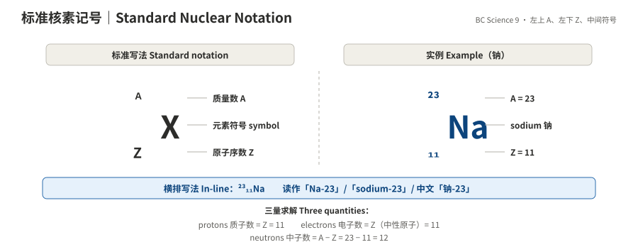
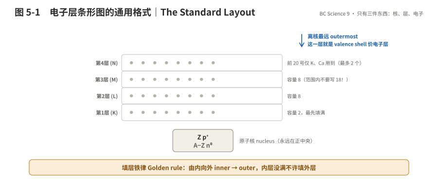
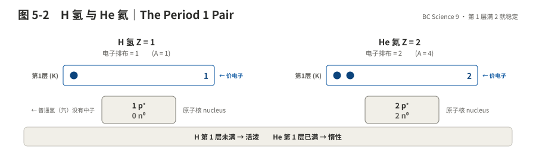
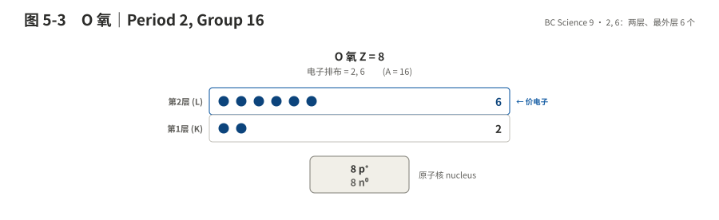
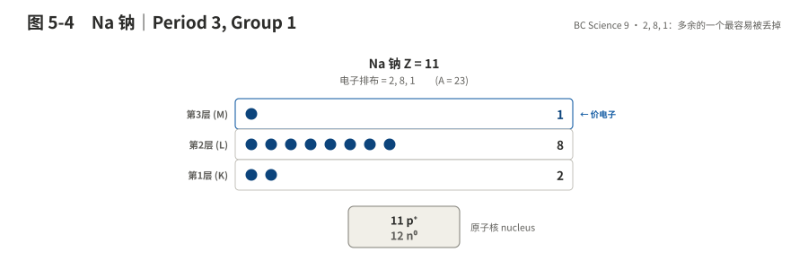
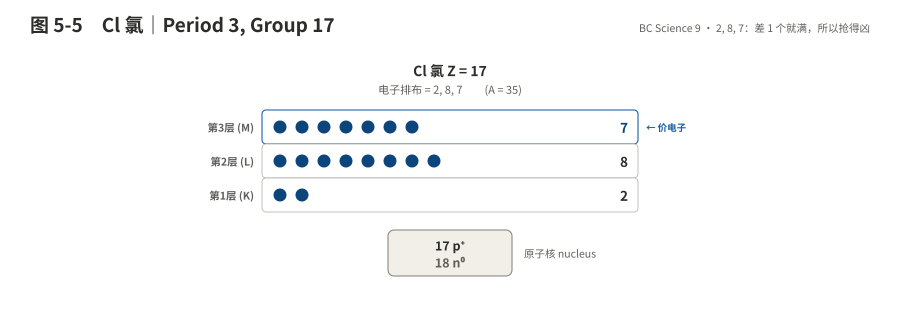
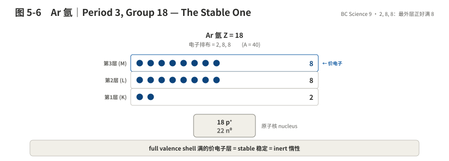
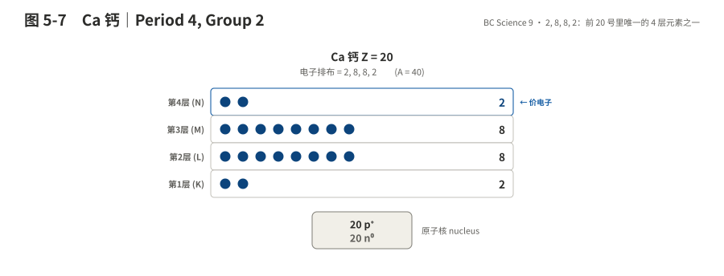
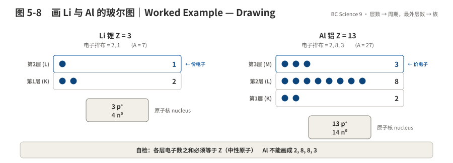
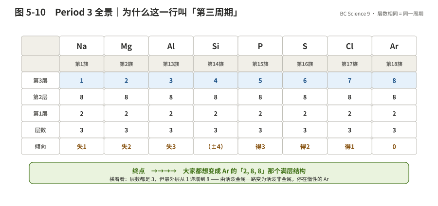

# Ch.5 — Atomic Structure and Bohr Diagrams
## Chapter 5 · Atomic Structure and Bohr Diagrams｜第 5 章　原子结构与玻尔图

> 🗂️ **Content Alignment｜大纲对应**：BC Science 9 Content **C1 → C2** — "The arrangement of electrons determines the compounds formed by elements"｜BC 科学 9 课程内容 C1 → C2「电子的排布决定元素所形成的化合物」（过渡章：把周期表位置翻译成电子排布）
> ⏱️ **Periods｜课时**：3　|　**Prerequisite｜前置**：Ch.4 Chemical Families and Reactivity Trends 化学族与反应性趋势　|　**Follow-up｜后继**：Ch.6 Ions and Lewis Dot Diagrams 离子与路易斯点式
> 🗂️ **Generated｜文件生成时间**：2026-09-18 00:53

This chapter is the bridge between everything you have met so far and everything that follows. In Chapter 4 you learned to read the periodic table as a *map of behaviour*: groups run down, periods run across, and position predicts personality. In this chapter we finally learn *why* that map works, by opening the atom and looking at how its electrons are arranged.

**中文**：这一章是你已经学过的内容和后面全部内容的**桥梁**。在第 4 章里，你学会把周期表当成一张"**行为地图**"来读：族竖着排、周期横着排，位置可以预测性质。而在本章，我们终于要回答"**这张地图为什么管用**"——办法是打开原子，看看它里面的电子究竟是怎么排的。

Everything you draw here will be reused in Chapter 6 (ions), Chapter 7 and Chapter 8 (compounds), so it is worth investing real practice time now. A student who can draw a correct Bohr diagram for any of the first twenty elements has, in effect, learned most of the marking scheme for the whole chemistry unit.

**中文**：你在这一章画的每一张图，都会在第 6 章（离子）、第 7 章与第 8 章（化合物）里反复用到，所以现在值得花时间扎实练。**能准确画出前 20 号任意元素玻尔图**的学生，实际上已经掌握了整个化学单元大半的得分点。

## 1. Content Alignment｜大纲对应

| Item｜项目 | Content｜内容 |
|---|---|
| BC Science 9 Content (official wording)｜BC 课程内容（官方原文） | **The arrangement of electrons determines the compounds formed by elements**｜**电子的排布决定元素所形成的化合物** |
| Role of this chapter｜本章定位 | **The C1 → C2 bridge**：translate "position on the periodic table" into "electron arrangement", preparing the ground for ions in Ch.6 and compounds in Ch.7–8｜**C1 → C2 的桥**：把「周期表位置」翻译成「电子排布」，为 Ch.6 的离子与 Ch.7–8 的化合物铺路 |
| Sub-items covered here｜本章承担的子条目 | The Z / A / n conversions; the rules for drawing a Bohr diagram; shell capacities 2-8-8; valence electrons; the patterns "same group → same valence electrons" and "same period → same number of shells"; noble gas stability; limitations of the Bohr model｜Z / A / n 的换算；Bohr diagram 绘制规则；电子层容量 2-8-8；valence electrons 价电子；同族同价电子、同期同层数的规律；稀有气体稳定性；玻尔模型的局限 |
| Curricular Competencies｜课程能力 | [Evaluating] **Evaluate the validity and limitations of a model or analogy**｜评估模型或类比的效力与局限；[Processing and analyzing] Seek and analyze patterns, trends, and connections｜寻找并分析模式、趋势与联系；[Communicating] Express scientific ideas through drawings, symbols and tables｜用图形、符号与表格表达科学思想 |
| Beyond scope?｜是否超纲 | No｜否 |
| Scope warning｜超纲提示 | Sub-shells s / p / d / f, atomic orbitals, quantum numbers, and the origin of the third shell's true capacity of 18 belong to Science 10–12; every place where this chapter touches them is flagged 【🔭 Extension → Science 10】｜亚层 s/p/d/f、原子轨道、量子数、第 3 层真实容量 18 的来源均属 Science 10–12；本章凡涉及处一律标注【🔭 Extension → Science 10】 |

Note how the official content statement is worded. It does **not** ask you to memorise sub-shells or write quantum numbers. It asks you to connect *electron arrangement* with *the compounds that form*. That single sentence is the reason Chapter 5 exists, and it is also the reason why drawing diagrams — not reciting definitions — is the core skill being assessed.

**中文**：请仔细体会官方这条内容陈述的措辞。它**没有**要求你背亚层、写量子数，而是要求你把"**电子排布**"和"**形成的化合物**"联系起来。这一句话既是第 5 章存在的理由，也解释了为什么本章考核的核心技能是**画图**，而不是背诵定义。

## 2. Learning Objectives｜学习目标

**EN — By the end of this chapter, you should be able to:**
1. Determine the number of protons, neutrons and electrons in a neutral atom from its **atomic number (Z｜原子序数)** and **mass number (A｜质量数)**.
   - **中文**：由**原子序数 Z** 与**质量数 A** 求出中性原子的质子数、中子数与电子数。
2. State the electron shell capacities used for the first 20 elements (2, 8, 8) and fill the shells in the correct order, always working from the inside out.
   - **中文**：说出前 20 号元素所用的电子层容量（2, 8, 8），并按「**从内到外**」的顺序正确填层。
3. Draw a complete Bohr diagram for any of the first 20 elements, labelling the nucleus with p⁺ and n⁰ and marking the **valence electrons（价电子）**.
   - **中文**：画出前 20 号任意元素的完整玻尔模型图，标出原子核的 p⁺、n⁰ 并**圈出价电子**。
4. Find the valence electrons from a Bohr diagram or from the group number, including the special case of helium.
   - **中文**：由玻尔图或族号判断价电子数，并正确处理**氦（He）的例外**。
5. Explain why elements in the same group have similar chemical properties and why the period number equals the number of shells; describe at least three limitations of the Bohr model.
   - **中文**：解释「同族价电子数相同 → 性质相似」「周期数 = 电子层数」，并说出玻尔模型的**至少三条局限**。

Read objective 5 carefully before you start Section 3.9. "[Evaluating] Evaluate the validity and limitations of a model" is one of the BC **Curricular Competencies**, which means it can be assessed directly on a provincial-style question — and, more importantly, it is the kind of thinking scientists actually do. A model is judged by what it lets you *explain and predict*, not by whether it is the final truth.

**中文**：在开始 3.9 节之前，请先把第 5 条学习目标读仔细。"[Evaluating] 评估模型的效力与局限"是 BC **课程能力（Curricular Competency）**之一，意味着它**可能直接在省考风格题目里被考核**——更重要的是，这本身就是科学家真实的思维方式。评价一个模型，看的是它让你能**解释和预测什么**，而不是它是否等于终极真相。

## 3. Concept Explanations｜概念解析

### 3.1 Three Numbers That Define an Atom｜定义原子的三个数

Every atom can be described by three counting numbers. Two of them are printed (or easily derived) from the periodic table, and the third tells you how heavy that particular atom is. Once you can move fluently between these three numbers, almost every question in this unit becomes mechanical.

**中文**：每个原子都可以用三个计数来描述。其中两个可以从周期表上直接读出（或稍加推导），第三个告诉你**这个具体的原子有多重**。一旦你能在这三个数之间自如转换，本单元几乎每一道题都会变成机械操作。

| 名称｜Name | English | Symbol｜符号 | Definition｜定义 | Key point｜关键点 |
|---|---|---|---|---|
| 原子序数 | atomic number | **Z** | the number of **protons** in the nucleus｜核内的**质子数** | Z decides *which element* this is — change Z and you change the element｜Z 决定「这是哪种元素」，改了就换了元素 |
| 质量数 | mass number | **A** | protons + neutrons (a **whole number**)｜质子数 + 中子数（**整数**） | refers to one specific atom｜针对某一个具体的原子 |
| 中子数 | neutron number | **n** | A − Z | found only inside the nucleus｜只存在于原子核里 |

**The three must-know relationships for a neutral atom（中性原子三量关系，必背）：**

- **Protons｜质子数 p⁺ = Z**
  - **中文**：质子数 = **原子序数 Z**。
- **Electrons｜电子数 e⁻ = Z**（this "=" holds **only** for neutral atoms — ions are dealt with in Ch.6）
  - **中文**：电子数 = **原子序数 Z**（这个"="**只有中性原子**才成立，离子见 Ch.6）。
- **Neutrons｜中子数 n⁰ = A − Z**
  - **中文**：中子数 = **质量数 A − 原子序数 Z**。

Learn these as a triple, not as three separate facts. Given any two of {Z, A, p⁺, e⁻, n⁰} you should be able to produce all five, because each one follows from Z either directly or by one subtraction.

**中文**：请把这三条当作**一组联立关系**来记，而不是三个孤立的知识点。只要在 {Z, A, p⁺, e⁻, n⁰} 里给定任意两个，你就应该能推出全部五个——因为每一项要么直接等于 Z，要么由一次减法从 Z 得到。

> **⚠️ Misconception｜易混**：The number printed in a periodic table cell is the **atomic mass（相对原子质量）** — for chlorine it is **35.45**, a *decimal* produced by averaging the isotopes. It is **not** the mass number. To count neutrons you must use the **whole-number** mass number **A**, which is normally found by rounding the atomic mass to the nearest integer (Cl → A = 35).
>
> **中文**：周期表方格上印的是 **atomic mass 相对原子质量**（Cl = 35.45，是同位素加权平均得到的**小数**），**不是** mass number 质量数。要算中子数必须用**整数**的 mass number A——通常由相对原子质量四舍五入得到（Cl → A = 35）。

Why does the distinction matter so much? Because neutrons are counted, and you cannot count objects using an average. If a class has an average of 24.7 students and you write "24.7 students", nobody can check it; but a particular atom either has 18 neutrons or it does not. Mass number A always refers to **one specific atom**.

**中文**：为什么这个区分如此重要？因为**中子是一个一个数的**，而平均数不能用来数数。如果一个班的平均人数是 24.7，你写"24.7 个学生"谁也没法核账；同理，某个具体的原子或者有 18 个中子，或者没有。质量数 A 永远针对**某一个具体的原子**。

### 3.2 Standard Nuclear Notation｜标准核素记号

Chemists need a compact way to write down all three numbers at once, so they use **standard nuclear notation（标准核素记号）**: the mass number goes on the top left of the symbol, and the atomic number goes on the bottom left.

**中文**：化学家需要一种紧凑的写法把三个数一次写全，于是有了 **standard nuclear notation（标准核素记号）**：质量数写在元素符号的**左上角**，原子序数写在**左下角**。



Reading the notation is a three-step routine: read Z from the bottom left (and treat it as "this many protons, and therefore this many electrons if the atom is neutral"), read A from the top left, then subtract to get the neutrons. Nothing in the diagram is decorative — all three positions carry data you will be asked to recover.

**中文**：读这个记号是一个三步流程：**先读左下角的 Z**（把它当作"这么多质子，若原子为中性则电子数同样多"），**再读左上角的 A**，最后相减得到中子数。图里没有任何一处是装饰性的——三个位置全都是你迟早要被要求回填的信息。

### 3.3 Bohr Diagram｜玻尔模型图：画法六步

A **Bohr diagram（玻尔模型图）** shows the nucleus at the centre with the electrons arranged in **electron shells（电子层）** around it. In plain words, it pictures an atom as "a nucleus in the middle, plus a set of concentric rings".

**中文**：**Bohr diagram（玻尔模型图）**把原子核画在正中央，电子则排布在它周围的一圈圈 **electron shells（电子层）**上。用大白话说，它把原子画成"**中心的核 + 一圈圈同心层**"。

The name is honest about what it is: it is a **diagram**, i.e. a drawing that helps us reason, not a photograph of an atom. Nobody has ever seen an atom looking like this. What matters is that the drawing lets you count electrons, locate the valence shell, and predict how the atom will behave — and those three predictions survive even though the picture is not literally true.

**中文**：这个名字诚实地说明了它是什么：它是一张 **diagram（示意图）**，是帮助我们推理的画，而不是原子的照片。从来没有人"看到"原子长成这个样子。重要的是，这张图让你**能数电子、能定位价电子层、能预测原子的行为**——即使图像本身并不字面真实，这三项预测依然成立。

**Bohr diagram｜玻尔模型图** — **Definition｜定义**：A drawing in which the **nucleus（原子核）** sits at the centre holding the protons and neutrons, while the electrons are placed on **electron shells（电子层）**, which are filled from the inside outwards according to fixed capacities.
**中文**：**玻尔模型图**是一种示意图：中心的**原子核**里放着质子与中子，电子则被放在**电子层**上；电子层按固定容量、**由内向外**依次填充。

**The six steps（六步法）:**

1. **Find Z｜查 Z**：read the **atomic number（原子序数）** from the periodic table → protons = electrons (for a neutral atom).
   - **中文**：由周期表读出 **atomic number 原子序数** → 质子数 = 电子数（**中性原子**）。
2. **Find n｜求 n**：use **A − Z**（**not** the atomic mass!）.
   - **中文**：用 **A − Z** 求中子数（**不是**用 atomic mass！）。
3. **Draw the nucleus｜画核**：draw a small box at the centre and write `Z p⁺` and `n n⁰`. Electrons must **never** be written inside the nucleus.
   - **中文**：在正中画一个小框，写上 `Z p⁺` 与 `n n⁰`（电子**绝不**写在核里）。
4. **Draw the shells｜画层**：from the inside out the shells are named **K, L, M, N**; draw exactly as many shells as you actually use.
   - **中文**：由内到外依次是 **K、L、M、N** 层；用到第几层就画几层。
5. **Fill the electrons｜填电子**：fill **from the inside out**; you may not start the next shell until the inner one is full.
   - **中文**：**由内向外**填，**内层没填满不许填外层**。
6. **Mark the valence electrons｜标价电子**：the outermost occupied shell is the **valence shell（价电子层）**, and the number of electrons on it is the **valence electrons（价电子）**.
   - **中文**：最外面**被占据**的那一层是 **valence shell（价电子层）**，该层电子数就是 **valence electrons（价电子）**。

Two of these six steps generate almost all the marks lost in a test. Step 3 catches students who casually drop an electron into the nucleus, and step 5 catches students who spread the electrons evenly instead of filling inner shells first. Check those two every single time.

**中文**：这六步里有两步几乎造成考试中的全部失分。**第 3 步**抓的是"顺手把电子丢进核里"的同学；**第 5 步**抓的是"把电子平均分摊"、而不是先填满内层的同学。这两步**每次都要检查**。

### 3.4 Electron Shell Capacity｜电子层容量 — **2, 8, 8**

Electrons cannot be placed anywhere you like: each shell has a capacity, and once a shell is full the next electron must go further out. For the first twenty elements — which is the entire range of Science 9 — you need only remember three numbers.

**中文**：电子不是想放哪就放哪的：每一层都有容量上限，某一层满了之后，下一个电子就必须往更外层去。对于前 20 号元素（也就是 Science 9 的全部范围），你只需要记住三个数。

| Shell｜层 | Letter｜层名 | Capacity used for elements 1–20｜前 20 号元素所用容量 | True maximum｜真实最大容量 | Note｜说明 |
|---|---|---|---|---|
| 1st shell｜第 1 层 | **K** | **2** | 2 | always 2, no exceptions｜永远只有 2 |
| 2nd shell｜第 2 层 | **L** | **8** | 8 | always 8, no exceptions｜永远只有 8 |
| 3rd shell｜第 3 层 | **M** | **8**（range-limited｜范围限定） | 18 | ⚠ **Treat it as 8 for elements 1–20**｜**前 20 号范围内一律按 8 处理** |
| 4th shell｜第 4 层 | **N** | at most **2** within elements 1–20 (K, Ca)｜前 20 号最多用到 **2**（K、Ca） | 32 | beyond the scope of this book｜超出本册范围 |

> **Why 8 and not 18 for the third shell?｜为什么第 3 层按 8 而不是 18？** After argon, Ar (2, 8, 8), the 19th and 20th electrons **jump out to the fourth shell first** (K = 2,8,8,1; Ca = 2,8,8,2). The third shell only starts expanding again for heavier elements that we do not study here.
>
> **中文**：氩 Ar（2, 8, 8）之后，第 19、20 个电子会**先跳到第 4 层**（K = 2,8,8,1；Ca = 2,8,8,2），第 3 层要等到更后面的元素才会继续扩张，那些元素不在本课程范围内。
>
> 【🔭 Extension → Science 10】The third shell's capacity of 18 comes from the **s / p / d sub-shells**; orbitals, sub-shell capacities and quantum numbers are all taught later, not in Science 9.
>
> **中文**：【🔭 Extension → Science 10】第 3 层的 18 来自 **s / p / d 亚层**；原子轨道、亚层容量与量子数都安排在后续课程，不属于 Science 9。
>
> 💡 **Mnemonic to memorise｜要背的口诀**：For elements 1–20 the filling order is **2 → 8 → 8 → 2**.
>
> **中文**：前 20 号元素的填层顺序是 **2 → 8 → 8 → 2**。

Because the pattern is short, you can check any answer by hand. Count the electrons you have drawn, then re-fill the shells mechanically and compare. If the two disagree, the drawing is wrong — there is no room for judgement in this step.

**中文**：因为这个规律很短，你完全可以手工验算任何答案：先把你画的电子**数一遍总数**，再机械地重新填一遍层，然后对照。两者不一致就一定画错了——这一步没有"见仁见智"的余地。

```text
Filling order for Z electrons (elements 1-20)｜前 20 号元素的填层流程
  remaining ← Z                        # electrons left to place｜还剩多少电子待放
  shell 1 (K) ← put min(remaining, 2)  # capacity 2｜第 1 层最多 2
  shell 2 (L) ← put min(remaining, 8)  # capacity 8｜第 2 层最多 8
  shell 3 (M) ← put min(remaining, 8)  # treated as 8 here｜第 3 层本范围内按 8
  shell 4 (N) ← put the rest (at most 2 for Z ≤ 20)｜剩下的放第 4 层（Z ≤ 20 时最多 2）
  check: sum of all shells = Z ✔       # self-check rule｜自检铁律：各层之和 = Z
```

### 3.5 Valence Shell and Valence Electrons｜价电子层与价电子

- **Valence shell（价电子层）**：the **outermost shell that actually contains electrons**（**not** an empty ring you happened to draw）.
  - **中文**：原子**最外面被电子占据**的那一层（不是画出来的空框层）。
- **Valence electrons（价电子）**：the total number of electrons sitting on the valence shell.
  - **中文**：价电子层上的电子总数。
- Valence electrons are the "**front counter**" of chemistry — inner electrons are screened by the outer shells and normally take no part in bonding.
  - **中文**：价电子是化学反应的"**前台**"——内层电子被外面几层挡着，通常不参与成键。

This is the single most important idea in the chapter. The inner electrons are essentially spectators: they are buried deep inside the atom, close to the positive nucleus, and shielded from the outside world. Only the outermost electrons are exposed to a neighbouring atom, and therefore only they decide what reactions are possible.

**中文**：这是本章最重要的一个观念。内层电子基本是"看客"：它们深埋在原子内部、紧贴带正电的原子核，被与外界隔绝。只有最外层的电子才会暴露给邻近的原子，因此**只有它们决定可能发生什么反应**。

### 3.6 From Group Number to Valence Electrons｜由族号到价电子数

| Group｜族 | 1 | 2 | 13 | 14 | 15 | 16 | 17 | 18 |
|---|---|---|---|---|---|---|---|---|
| Valence electrons｜价电子 | 1 | 2 | 3 | 4 | 5 | 6 | 7 | 8 |

- Shortcut｜快捷算法：**For groups 13–18, the number of valence electrons = group number − 10.**
  - **中文**：**第 13–18 族的价电子数 = 族号 − 10**。
- ⚠ **The one exception｜唯一例外：He has only 2 valence electrons** — it possesses only the first shell, and 2 is already full there.
  - **中文**：**He 氦只有 2 个价电子**——它只有第 1 层，而在第 1 层里 2 个就已经满了。

Notice that the shortcut "minus ten" is not magic: the groups labelled 13–18 are really the third "octet" of main-group columns, and subtracting ten just strips away the counting used for the transition metals in groups 3–12, which Science 9 does not study.

**中文**：请注意"减十"这个捷径并非魔法：标为 13–18 的族其实是主族里的第三组纵列，减去十只是把第 3–12 族过渡元素所占的编号剔除掉，而那些族 Science 9 不涉及。

### 3.7 Two Patterns That Run the Whole Table｜贯穿全表的两条规律

1. **Same group（vertical column）→ same number of valence electrons → similar chemical properties**
   - Example｜例：Li (2,1)、Na (2,8,1)、K (2,8,8,1) all end with 1 outer electron → all are extremely reactive and all form +1 ions.
     - **中文**：Li (2,1)、Na (2,8,1)、K (2,8,8,1) 最外层都是 1 → 都极活泼、都形成 +1 离子。
   - **中文**：**同一 Group 族（纵列）→ 价电子数相同 → 化学性质相似**
2. **Same period（horizontal row）→ same number of electron shells; the period number equals the number of shells**
   - Example｜例：every element in Period 3 (Na → Ar) has exactly 3 shells.
     - **中文**：第 3 周期（Na → Ar）全部有 3 层电子。
   - **中文**：**同一 Period 周期（横行）→ 电子层数相同；period number 周期数 = 电子层数**

Together these two patterns say something remarkable: **the periodic table is not an arbitrary list, it is a map of electron arrangements.** Read a position and you can reconstruct the drawing; draw the arrangement and you can locate the position. Learning to move in both directions is what "understanding the periodic table" actually means in Science 9.

**中文**：这两条规律合起来说明了一件了不起的事：**周期表不是随意排列的清单，它是一张电子排布地图。** 给一个位置，你能还原出那张图；画出排布，你能定位它的位置。**能够双向互推**，才是 Science 9 里"理解周期表"的真正含义。

### 3.8 Noble Gas Stability｜稀有气体的稳定性 → 引出 Ch.6

- He (2)、Ne (2,8)、Ar (2,8,8) have a **full valence shell（满层）**.
  - **中文**：He (2)、Ne (2,8)、Ar (2,8,8) 的价电子层**已满**，叫 **full valence shell（满层）**。
- A full shell means **stable** — the atom neither wants to lose nor to steal electrons, so it is **inert（惰性的）** and forms almost no compounds (this echoes Ch.4).
  - **中文**：满层 = **stable 稳定的** → 既不想丢电子也不想抢电子 → **inert 惰性的**、几乎不形成化合物（呼应 Ch.4）。
- Every other element has an incomplete outer shell → they reach for the nearest noble gas structure by **losing** or **gaining** electrons → that is exactly where the **ions of Ch.6** come from.
  - **中文**：其余元素最外层都没满 → 它们通过**失去**或**得到**电子，去"变成"最近的稀有气体结构 → 这就是 **Ch.6 离子**的成因。

There is an important vocabulary distinction hiding here. "Stable" describes the *electronic situation* (a full outer shell). "Inert" describes the *observed behaviour* (does not react). Noble gases are inert **because** they are already stable — cause first, consequence second, and exams often reward students who keep the two separate.

**中文**：这里藏着一个重要的一词之差。"**Stable 稳定的**"描述的是**电子层面的处境**（外层已满）；"**inert 惰性的**"描述的是**观察到的行为**（不发生反应）。稀有气体之所以惰性，**是因为**它们已经稳定——先有原因，后有结果；考试常常给能把两者分清的学生加分。

### 3.9 Limitations of the Bohr Model｜玻尔模型的局限【Official competency｜官方能力：[Evaluating]】

**[Evaluating]｜评估能力** is assessed here directly: you must be able to say both what the model gets right and where it stops working. Use the table below as a checklist rather than a set of lines to memorise.

**中文**：**[Evaluating]（评估）**这一项在这里被直接考核：你必须同时说出这个模型**做对了什么**和**在哪里失效**。下表请当成检查清单使用，而不是当生硬的背诵条目。

| It gets right｜它说对的 | What it fails to do｜它做不到的 |
|---|---|
| Period number = number of shells｜周期数 = 电子层数 | Electrons do **not** orbit on fixed circular paths like planets｜电子**不是**沿固定圆形轨道像行星那样跑 |
| Same group → same valence electrons｜同族价电子数相同 | It cannot explain spectral details of the transition elements (groups 3–12)｜无法解释过渡元素（第 3–12 族）的光谱细节 |
| Noble gases are stable with a full shell｜稀有气体满层稳定 | It cannot explain the three-dimensional shape or bond angles of molecules｜无法解释分子的三维形状与键角 |
| It gives a qualitative explanation of ionic charge (Ch.6)｜定性解释离子电荷（Ch.6） | The diagram is **not to scale at all**: the real nucleus is far smaller than drawn, yet holds 99.9 % of the mass｜图**完全不按比例**：真实的核比画的小得多，却占 99.9 % 质量 |

> 📌 **Key idea about models｜模型观**：A model is a **tool**, not the truth. Judge a model by its **explanatory power, predictive power and range of usefulness** — not by whether it matches ultimate reality. Modern quantum mechanics describes electrons with an **electron cloud（电子云）**, meaning a region of probability, but at the scale of Science 9 **the Bohr model is still the most useful teaching model available.**【🔭 Extension → Science 10】
>
> **中文**：模型是**工具**不是真理。评价一个模型看它的**解释力、预测力和适用范围**，不看它是否等于终极真相。现代量子力学用 **electron cloud 电子云**（概率分布）描述电子，但在 Science 9 的尺度上，**玻尔模型仍是最好用的教学模型**。【🔭 Extension → Science 10】

Notice that the limitations listed are almost all *beyond* Science 9: molecular shape, transition-metal spectra, quantum orbitals. Inside the range of elements 1–20 and inside the questions this course asks, the Bohr model has no competitor. That is precisely why it is still taught — and it is the argument you should use if you are ever asked to defend it.

**中文**：请注意，上表列出的局限几乎全都**超出** Science 9 的范围：分子形状、过渡金属光谱、量子轨道。在前 20 号元素的范围里、在本课程要问的问题里，玻尔模型没有替代品。这正是它仍然被教的原因——也是万一你要为它辩护时应该使用的论证。

## 4. Comparison Tables｜表格比对

The tables in this section are reference material: you are not expected to memorise every row, but you *are* expected to be able to read them quickly and to reproduce the important patterns from memory. Table 5-5 in particular will be used again in Ch.6 and Ch.7.

**中文**：本节的表格是**查阅型资料**：不要求你把每一行都背下来，但要求你能**快速读懂**，并能凭记忆复现其中重要的规律。尤其是**Table 5-5**，在第 6 章和第 7 章还会再次用到。

### Table 5-1　Subatomic Particles Review｜亚原子粒子回顾

| Particle｜粒子 | Symbol｜符号 | Charge｜电荷 | Relative mass｜相对质量 | Location｜位置 | How to count｜数量算法 |
|---|---|---|---|---|---|---|
| proton｜质子 | p⁺ | +1 | 1 | inside the nucleus｜原子核内 | = Z |
| neutron｜中子 | n⁰ | 0 | 1 | inside the nucleus｜原子核内 | = A − Z |
| electron｜电子 | e⁻ | −1 | ≈ 0（1/1836） | on the shells｜电子层上 | = Z（neutral atom 中性原子） |

Two features of this table do most of the work in later chapters. First, the proton carries the *identity* of the atom: change the number of protons and you have a different element. Second, the electron carries the *behaviour*: electrons are the particles that are rearranged when substances react. Neutrons, conveniently, carry neither.

**中文**：这张表里有两点在后面的章节里承担了主要作用。第一，**质子携带原子的"身份"**：改变质子数，元素就变了。第二，**电子携带原子的"行为"**：物质发生反应时被重新分配的正是电子。而中子两者都不管，反倒省心。

### Table 5-2　Distinguishing the Three "Numbers"｜atomic number 与 mass number 的区分

| Comparison｜比较项 | Atomic number｜原子序数 | Mass number｜质量数 | Atomic mass｜相对原子质量 |
|---|---|---|---|---|
| Symbol｜符号 | Z | A | (no dedicated symbol)｜（无专用符号） |
| Meaning｜含义 | number of protons｜质子数 | protons + neutrons｜质子 + 中子 | weighted average of isotopes｜同位素的加权平均值 |
| Type of value｜数值类型 | integer｜整数 | integer｜整数 | **decimal｜小数** |
| Does it change?｜是否变化 | constant for a given element｜同一元素恒不变 | differs between isotopes｜同位素不同则不同 | printed value, fixed for the element｜印刷值，对该元素固定 |
| Used for｜用途 | find electrons; **identify the element**｜查电子数、**定元素身份** | calculate neutrons｜算中子数 | used in Science 10 calculations｜Science 10 计算用 |
| Example: chlorine｜以 Cl 为例 | 17 | 35（most common 最常见） | 35.45 |

If you ever feel lost mid-question, come back to this table and ask yourself which of the three numbers you were given. Roughly half of all student errors in this unit are really errors of *identifying the given quantity*, not of arithmetic.

**中文**：如果你做题做到一半卡住了，请回到这张表，先问自己：**题目给的是这三个数里的哪一个**。本单元里大约一半的错误其实不是算错，而是**认错了已知量**。

### Table 5-3　Group → Valence Electrons → Tendency｜族号 → 价电子数 → 得失电子倾向

| Group｜族 | 1 | 2 | 13 | 14 | 15 | 16 | 17 | 18 |
|---|---|---|---|---|---|---|---|---|
| Valence e⁻｜价电子 | 1 | 2 | 3 | 4 | 5 | 6 | 7 | 8（**He 为 2**） |
| How far from full｜离满层还差 | lose 1｜丢 1 | lose 2｜丢 2 | lose 3｜丢 3 | hard（±4）｜难（±4） | gain 3｜得 3 | gain 2｜得 2 | gain 1｜得 1 | 0 |
| Example｜实例 | Na (2,8,1) | Mg (2,8,2) | Al (2,8,3) | C (2,4) | N (2,5) | O (2,6) | Cl (2,8,7) | Ne (2,8) |

Read the third row carefully, because it encodes a piece of scientific reasoning rather than a fact. An atom that is *one electron away* from a full shell will work hard to get that one electron; an atom that would need to lose three will find it expensive but still cheaper than gaining five. This "whichever route is shorter" logic is the whole explanation for ionic charge in Ch.6.

**中文**：请仔细读第三行，因为它记录的不是事实，而是一条**推理逻辑**。一个**只差一个电子**就满层的原子，会拼命去抢那一个；一个需要丢掉三个电子的原子会觉得代价高昂，但仍然比去抢五个便宜。这种"**哪条路短走哪条**"的逻辑，就是第 6 章离子电荷的全部解释。

### Table 5-4　Two Ways of Being "Alike"｜同族 vs 同周期

| Comparison｜比较项 | Same **group**｜同一**族**（纵列） | Same **period**｜同一**周期**（横行） |
|---|---|---|
| What is the same｜相同的东西 | **the number of valence electrons｜价电子数相同** | **the number of electron shells｜电子层数相同** |
| Total number of shells｜电子层总数 | **increases** down the group｜从上到下**递增** | identical for all（= period number）｜全部相同（= 周期数） |
| Chemical properties｜化学性质 | **similar（this is the key point）｜相似（这是重点）** | change gradually; members differ clearly from one another｜递变，彼此差异明显 |
| Typical example｜典型例子 | Li / Na / K all have 1 valence electron｜都是 1 个价电子 | Na / Mg / Al / … / Ar all have 3 shells｜都是 3 层 |
| Link to the Big Idea｜回扣核心概念 | same valence electrons ⇒ similar properties｜价电子数相同 ⇒ 性质相似 | shell count decides only "size", not "personality"｜层数只决定"个头"，不决定"性格" |

Students frequently misread the second column as "members of a period are alike". They are not. Elements in the same period are merely the same *size*; their outer shells are at completely different stages of filling, so their chemistry runs the whole spectrum from violently reactive metal to violently reactive non-metal within a single row.

**中文**：学生常把第二列误读成"同一周期的元素彼此相似"。并非如此。同一周期的元素只是**个头相同**；它们的最外层处在完全不同的填充阶段，所以仅仅一横行之内，化学性质就涵盖了从**极活泼金属**到**极活泼非金属**的完整谱。

### Table 5-5　Elements 1–20 Data Table｜前 20 号元素完整数据表

> A here is the **mass number of the most common isotope**（obtained by rounding the atomic mass from the periodic table）, not the only possible value.｜A 取**最常见同位素的质量数**（由周期表相对原子质量四舍五入得到），并非唯一可能。

| Z | Symbol | English | 中文 | A | p⁺ | n⁰ | e⁻ | Arrangement｜电子排布 | Valence｜价电子 | Group｜族 | Period｜周期 |
|---|---|---|---|---|---|---|---|---|---|---|---|
| 1 | H | hydrogen | 氢 | 1 | 1 | 0 | 1 | 1 | 1 | 1 | 1 |
| 2 | He | helium | 氦 | 4 | 2 | 2 | 2 | 2 | **2** | 18 | 1 |
| 3 | Li | lithium | 锂 | 7 | 3 | 4 | 3 | 2, 1 | 1 | 1 | 2 |
| 4 | Be | beryllium | 铍 | 9 | 4 | 5 | 4 | 2, 2 | 2 | 2 | 2 |
| 5 | B | boron | 硼 | 11 | 5 | 6 | 5 | 2, 3 | 3 | 13 | 2 |
| 6 | C | carbon | 碳 | 12 | 6 | 6 | 6 | 2, 4 | 4 | 14 | 2 |
| 7 | N | nitrogen | 氮 | 14 | 7 | 7 | 7 | 2, 5 | 5 | 15 | 2 |
| 8 | O | oxygen | 氧 | 16 | 8 | 8 | 8 | 2, 6 | 6 | 16 | 2 |
| 9 | F | fluorine | 氟 | 19 | 9 | 10 | 9 | 2, 7 | 7 | 17 | 2 |
| 10 | Ne | neon | 氖 | 20 | 10 | 10 | 10 | 2, 8 | 8 | 18 | 2 |
| 11 | Na | sodium | 钠 | 23 | 11 | 12 | 11 | 2, 8, 1 | 1 | 1 | 3 |
| 12 | Mg | magnesium | 镁 | 24 | 12 | 12 | 12 | 2, 8, 2 | 2 | 2 | 3 |
| 13 | Al | aluminium | 铝 | 27 | 13 | 14 | 13 | 2, 8, 3 | 3 | 13 | 3 |
| 14 | Si | silicon | 硅 | 28 | 14 | 14 | 14 | 2, 8, 4 | 4 | 14 | 3 |
| 15 | P | phosphorus | 磷 | 31 | 15 | 16 | 15 | 2, 8, 5 | 5 | 15 | 3 |
| 16 | S | sulfur | 硫 | 32 | 16 | 16 | 16 | 2, 8, 6 | 6 | 16 | 3 |
| 17 | Cl | chlorine | 氯 | 35 | 17 | 18 | 17 | 2, 8, 7 | 7 | 17 | 3 |
| 18 | Ar | argon | 氩 | 40 | 18 | 22 | 18 | 2, 8, 8 | 8 | 18 | 3 |
| 19 | K | potassium | 钾 | 39 | 19 | 20 | 19 | 2, 8, 8, 1 | 1 | 1 | 4 |
| 20 | Ca | calcium | 钙 | 40 | 20 | 20 | 20 | 2, 8, 8, 2 | 2 | 2 | 4 |

Activity 5-3 later in this chapter is built entirely around this table, and for good reason. Everything taught in Ch.5 is visible in these twenty rows: the 2-8-8 rule, the group–valence link, the period–shell link, the helium exception and the K / Ca jump to the fourth shell.

**中文**：本章后面的**Activity 5-3**完全围绕这张表设计，而且是刻意的。第 5 章教的每一个知识点都能在这 20 行里看到：2-8-8 规则、族与价电子的对应、周期与层数的对应、氦的例外、以及 K / Ca 跳到第 4 层的那一跳。

### Table 5-6　Bohr Diagram Self-Check｜玻尔图自查清单

| # | Check｜检查项 | Pass criterion｜通过标准 | Typical error if failed｜不通过时的典型错误 |
|---|---|---|---|
| 1 | nuclear symbols｜核内符号 | `Z p⁺` and `n n⁰` written, numbers non-negative integers｜写了 `Z p⁺` 与 `n n⁰`，数字为非负整数 | electrons drawn inside the nucleus; p⁺ count not matching Z｜把电子画进核里；p⁺ 数目与 Z 不符 |
| 2 | p⁺ vs Z | p⁺ count = Z = the element's position number｜p⁺ 数目 = Z = 元素在周期表上的序号 | miscopying the number（e.g. something other than 17 for Cl）｜抄错序号（如 Cl 写成 17 以外的数） |
| 3 | n⁰ vs A − Z | n⁰ = **mass number** − Z, using whole numbers｜n⁰ = **质量数** − Z，用整数运算 | subtracting an atomic mass such as 35.45 − 17｜用 35.45 − 17 之类的相对原子质量去减 |
| 4 | electron total | sum of dots on all shells = Z（neutral atom）｜各层点数相加 = Z（中性原子） | one or two dots too many or too few｜点数多了或少了 1~2 个 |
| 5 | filling order | inner shells first: 2 → 8 → 8 → (4th shell)｜内层先满：2 → 8 → 8 →（第 4 层） | drawing 2, 3, 8, or putting more than 8 in the 3rd shell｜画成 2, 3, 8 或把第 3 层填到 9 以上 |
| 6 | shells vs period | number of shells = period number｜层数 = 周期数 | drawing 2 shells for H/He, or 4 shells for Al｜H/He 画了 2 层；Al 画了 4 层 |
| 7 | valence marking | the outer shell is identified and its electron count written｜标出最外层并写出其电子数 | reporting the **total** electron count as the valence count｜把"全部电子数"当成价电子数 |
| 8 | the helium exception | He drawn with 2 valence electrons and counted as "full"｜He 写作 2 个价电子且算"满层" | "topping He up" to 8 electrons｜给 He 补成 8 个电子 |

Use this checklist in the order written whenever you finish a diagram. Items 4, 5 and 6 catch roughly nine out of ten mistakes, so if you are short of time, those three are the ones that earn their keep.

**中文**：每画完一张图，请按这里的顺序逐条自查。**第 4、5、6 项**能抓住大约十分之九的错误；如果时间紧张，这三条是最划算的。

## 5. Diagrams & Worked Examples｜图例说明

The figures that follow are the visual spine of the chapter. Study them in the order given: each one isolates a single idea, and by the end you will have seen the whole logic of the periodic table drawn out one step at a time.

**中文**：下面这组图是本章的**视觉主干**。请按给定顺序学习：每一张图只讲一个观念，学完之后，周期表的整套逻辑就被你一图一图地看完了。

### Fig. 5-1　The Standard Layout｜电子层条形图的通用格式



**What to look for｜看图要点：** There are only three things in the whole picture — the **nucleus at the centre**（labelled p⁺ and n⁰）, the **electron shells running outwards from it**, and the **electron dots placed on those shells**. The number written to the right of the outermost shell is the count of valence electrons.

**中文**：整张图只有三件东西——**中心的核（标 p⁺ 与 n⁰）**、**由内向外的电子层**、**层上的电子点**；最外一层右侧的数字就是价电子数。

Commit this layout to memory before moving on. Once the skeleton is automatic, every later diagram costs you no mental effort to read, and you can spend all your attention on the chemistry instead of the drawing.

**中文**：继续往下之前，请把这个版式**记住**。一旦骨架变成自动化的，后面每一张图你都不必费力去"看懂"，注意力就可以全部留给化学本身。

### Fig. 5-2　H and He｜氢 与 氦　The Period 1 Pair



**What to look for｜看图要点：** Hydrogen's first shell holds only 1 electron, so it is **not full** and hydrogen is reactive; helium's first shell holds 2, so it **is full** and helium is inert. This is exactly why **helium has only 2 valence electrons yet sits in Group 18** — it does not need eight to be satisfied.

**中文**：H 的第 1 层只有 1 个电子、**未满**，所以活泼；He 的第 1 层有 2 个、**已满**，所以惰性。这正是 **He 只有 2 个价电子却属于第 18 族**的原因——它不需要凑够 8 个就满足了。

Notice the word "full" rather than "eight". The octet rule people quote casually is really a statement about *capacity*: the first shell's capacity is two, so two is full. Helium is the one place in Science 9 where the shortcut "Group 18 = 8 valence electrons" breaks, and it is a favourite exam trap.

**中文**：请注意这里用的是"**满**"而不是"**八**"。人们随口说的"八隅规则"本质上讲的是**容量**：第 1 层的容量是 2，所以 2 个就是满。氦是 Science 9 里"第 18 族 = 8 个价电子"这条捷径唯一失效的地方，也是命题人最爱设的陷阱之一。

### Fig. 5-3　Oxygen｜氧　Period 2, Group 16



**What to look for｜看图要点：** Eight electrons means filling the first shell first (2 electrons), then putting the remaining 6 in the second shell. There are only **2 shells** → **Period 2**; there are 6 electrons on the outside → **Group 16**.

**中文**：8 个电子 = 先填满第 1 层（2 个），剩下的 6 个全在第 2 层。只有 **2 层** → 第 **2** 周期；最外层 6 个 → 第 **16** 族。

Oxygen is the classic example to practise on, because both directions of reasoning are visible at once: count shells to get the period, count outer electrons to get the group. Do this in your head for oxygen a few times and the habit transfers to every other element automatically.

**中文**：氧是最适合拿来练手的元素，因为**双向推理**在这里同时可见：数层数得周期，数最外层电子得族。对氧在脑子里做几次这个训练，习惯会自动迁移到其他所有元素。

### Fig. 5-4　Sodium｜钠　Period 3, Group 1



**What to look for｜看图要点：** The first and second shells are completely full (2 and 8), and the 11th electron sits alone in the third shell. This one "spare" electron is precisely why sodium is violently reactive and loses an electron so easily to become Na⁺ (Ch.6).

**中文**：第 1、2 层已完全填满（2 和 8），第 11 个电子孤零零待在第 3 层。这"多余的一个"正是 Na 极度活泼、极易失去电子变成 Na⁺ 的原因（Ch.6）。

Sodium is the first case in this chapter where the drawing *explains a behaviour you already observed*. In Ch.4 you learned that Group 1 metals are so reactive they are stored under oil; here is the reason, visible in one glance at the diagram.

**中文**：钠是本章第一个"**图解释了你已经观察到的现象**"的例子。第 4 章里你学过第 1 族金属活泼到必须保存在油中；看一眼这张图，原因就摆在眼前了。

### Fig. 5-5　Chlorine｜氯　Period 3, Group 17



**What to look for｜看图要点：** There are **7 electrons** on the outside, which is exactly 1 short of a full set of 8 → chlorine has a powerful tendency to **take 1 electron** → it forms Cl⁻ (Ch.6).

**中文**：最外层 **7 个**，离"满 8"只差 1 个 → Cl 有强烈的**抢 1 个电子**的倾向 → 形成 Cl⁻（Ch.6）。

Put sodium and chlorine side by side in your notes. One has a single unwanted outer electron and the other has exactly one vacancy; the transfer that turns both of them into ions is the subject of Chapter 6, and it is already predictable from these two drawings.

**中文**：请把钠和氯并排抄在笔记上。**一个有 1 个多余的外层电子，另一个恰好有 1 个空位**；把电子转移过去让两者都变成离子的过程，就是第 6 章的主题，而且仅凭这两张图就已经可以预测。

### Fig. 5-6　Argon｜氩　Period 3, Group 18 — The Stable One



**What to look for｜看图要点：** The three shells hold exactly 2, 8 and 8 electrons, so **the outer shell is full** → full valence shell → stable → inert. The identical picture is the finishing line that Na⁺ and Cl⁻ are striving to reach (Ch.6).

**中文**：三层恰好是 2、8、8，**最外层正好满 8** → full valence shell → stable → inert 惰性。Na⁺、Cl⁻ 拼命追求的终点站就是这同一张图（Ch.6）。

This single comparison — sodium versus chlorine versus argon across one period — is worth more than a page of notes. Same row, same shell count, three completely different personalities, all predicted by how close each outer shell is to being full.

**中文**：**钠、氯、氩在同一横行里的这一个对比**，比一页笔记都值钱。同一行、同样多的层数，三种截然不同的"性格"，而它们全都可以由一个标准预测出来：**最外层离满还差多远**。

### Fig. 5-7　Calcium｜钙　Period 4, Group 2



**What to look for｜看图要点：** The 19th and 20th electrons **skip past the third shell, which already holds 8**, and go straight to the fourth shell — this is where the rule "treat the third shell as 8 within the first 20 elements" comes from. Calcium has 4 shells → **Period 4**; it has 2 outer electrons → **Group 2**.

**中文**：第 19、20 个电子**跳过了已经有 8 个的第 3 层**，直接去了第 4 层——这就是"第 3 层在前 20 号按 8 处理"的由来。Ca 有 4 层 → 第 **4** 周期；最外层 2 个 → 第 **2** 族。

Students who are not watching carefully draw calcium as 2, 8, 10. If that ever happens to you, remember that the rule is about *order*, not about *total capacity*: before the third shell is allowed to expand, the fourth shell claims the next two electrons. Then look at how Ca behaves — a reactive metal that forms Ca²⁺ — and you will see why the drawing must be this way.

**中文**：不够留神的同学会把钙画成 2, 8, 10。如果你也犯了这错，请记住规则讲的是**顺序**而不是**总容量**：在第 3 层获准扩容之前，第 4 层先拿走接下来的两个电子。然后再看看 Ca 的实际表现——活泼金属、形成 Ca²⁺——你就会明白图为什么必须这么画。

### Fig. 5-8　Worked Example — Drawing｜例题：画 Li 与 Al 的玻尔图

**Task｜题目：** Draw complete Bohr diagrams for **Li（Z = 3, A = 7）** and **Al（Z = 13, A = 27）**, and state the group and period of each.

**中文**：画出 **Li（Z = 3, A = 7）** 与 **Al（Z = 13, A = 27）** 的完整玻尔图，并标出各自的族与周期。

**Solution using the six steps｜解析（六步法）：**

| Step｜步骤 | Li｜锂 | Al｜铝 |
|---|---|---|
| ① read Z → p⁺ and e⁻｜查 Z → p⁺ 与 e⁻ | Z = 3 → 3 p⁺，3 e⁻ | Z = 13 → 13 p⁺，13 e⁻ |
| ② neutrons n = A − Z｜求中子 n = A − Z | 7 − 3 = **4 n⁰** | 27 − 13 = **14 n⁰** |
| ③ fill shells inside-out｜由内向外填层 | 2 → 1 left → **2, 1**｜2 → 剩 1 → **2, 1** | 2 → 8 → 3 left → **2, 8, 3**｜2 → 8 → 剩 3 → **2, 8, 3** |
| ④ valence → group｜数价电子 → 族 | 1 → **Group 1｜第 1 族** | 3 → **Group 13｜第 13 族** |
| ⑤ shells → period｜数层数 → 周期 | 2 shells → **Period 2｜第 2 周期** | 3 shells → **Period 3｜第 3 周期** |
| ⑥ self-check｜自检 | 2 + 1 = 3 ✓ equals e⁻｜等于 e⁻ | 2 + 8 + 3 = 13 ✓ equals e⁻｜等于 e⁻ |



**📊 Fig. 5-8**　Worked Example — Drawing｜画 Li 与 Al 的玻尔图

Compare the two rows for a moment. Both elements end up in the "3 valence electrons or fewer" zone, yet one is in Period 2 and the other in Period 3, and their diagrams differ only by a filled second shell. That single extra inner shell is the entire difference between the two rows of the table.

**中文**：请花一点时间比较这两行。两个元素最后都落在"价电子 ≤ 3"的区间，但一个在第 2 周期、另一个在第 3 周期，它们的图只差一层填满的第 2 层。**多出来的那一层内层，就是周期表两行之间的全部差别。**

> 📏 **Iron rule for self-checking｜自检铁律**：The sum of the electrons on all shells must equal Z（for a neutral atom）. If it does not, you have made an arithmetic error.
>
> **中文**：各层电子数之和必须等于 Z（中性原子）。不等就是算错了。
>
> ⚠️ **Common error｜易错提醒**：Al is often drawn wrongly as 2, 8, 8, 3（four shells）— wrong! The third shell has not yet exceeded 8 electrons, so a fourth shell cannot be opened.
>
> **中文**：Al 常被错画成 2, 8, 8, 3（四层）——错！第 3 层还没超过 8 个，不能开第 4 层。

### Fig. 5-9　Worked Example — Reading Backwards｜例题：由玻尔图反推元素

**Task｜题目：** Two Bohr diagrams give the nuclear information and the electrons on each shell. Fill in every blank.

**中文**：两张玻尔图给出了核内信息与各层电子数，请回填全部空格。

| Given information｜已知信息 | Diagram A｜图 A | Diagram B｜图 B |
|---|---|---|
| Nucleus｜原子核 | 19 p⁺，20 n⁰ | 14 p⁺，14 n⁰ |
| Electrons per shell｜各层电子 | shell 1: 2, shell 2: 8, shell 3: 8, shell 4: 1｜第 1 层 2，第 2 层 8，第 3 层 8，第 4 层 1 | shell 1: 2, shell 2: 8, shell 3: 4｜第 1 层 2，第 2 层 8，第 3 层 4 |

**Answers｜答案：**

| Item｜项目 | Diagram A｜图 A | Diagram B｜图 B |
|---|---|---|
| Atomic number Z | **19** | **14** |
| Element｜元素 | **K potassium 钾** | **Si silicon 硅** |
| Mass number A | 19 + 20 = **39** | 14 + 14 = **28** |
| Electron arrangement｜电子排布 | 2, 8, 8, 1 | 2, 8, 4 |
| Valence electrons｜价电子 | **1** | **4** |
| Group / Period｜族 / 周期 | Group **1** / Period **4**｜第 **1** 族 / 第 **4** 周期 | Group **14** / Period **3**｜第 **14** 族 / 第 **3** 周期 |
| Property prediction｜性质预测 | same group as Li and Na → extremely reactive metal｜与 Li、Na 同族 → 极活泼金属 | same group as carbon → semi-metal, semiconductor material｜与 C 同族 → 类金属，半导体原料 |

> 📌 **Key to solving｜解题钥匙**：First use the **number of protons to lock in the element（p⁺ = Z）**, then use "shells → period, outer electrons → group" to locate it on the table.
>
> **中文**：先用 **p⁺ 的数目锁定元素（p⁺ = Z）**，再用"层数 → 周期、最外层数 → 族"锁定位置。

Why is the order important? Because the proton count is the only piece of information that identifies an element unambiguously. A drawing showing 2, 8, 4 tells you the *pattern*, but a drawing showing 14 p⁺ tells you the *name* — and exam questions usually want both.

**中文**：为什么顺序很重要？因为**质子数是唯一能明确确定元素身份的信息**。2, 8, 4 这张图告诉你的是"**模式**"，而 14 p⁺ 告诉你的是"**名字**"——而考题通常两者都要。

### Fig. 5-10　Period 3 Panorama｜Period 3 全景：为什么这一行叫「第三周期」



**What to look for｜看图要点：** Read across and you will see that all eight Period 3 elements have **3 shells**, while their **outer shell climbs step by step from 1 to 8** — which is why the row runs from a reactive metal through to a reactive non-metal and finally stops at inert argon. This picture fuses the Ch.4 "periodic law" with the Ch.5 "electron arrangement" into a single image.

**中文**：横着看，第 3 周期 8 个元素**层数都是 3**，但**最外层从 1 递增到 8**——所以从左到右由活泼金属一路变为活泼非金属，最后停在惰性的 Ar。这张图就是 Ch.4 的"周期律"与 Ch.5 的"电子排布"合二为一。

If you could keep only one image from this chapter, keep this one. It explains at a glance why the periodic table has its shape, why properties repeat rather than drift, and why the row ends where it does.

**中文**：如果本章只能留下一张图，就留这张。它一眼解释了：**周期表为什么是这个形状**、**性质为什么是重复而不是漂移**、以及**这一行为什么停在那个位置**。

## 6. Key Vocabulary｜核心词汇

Terms are the currency of exam answers. A correct idea expressed with the wrong word loses marks, so treat this list as something to drill rather than to skim.

**中文**：术语就是考试答案里的"**通货**"。想法正确但用词不对照样扣分，所以这份表请用来**反复练习**，而不是随便翻翻。

| English | 中文 | Note｜备注 |
|---|---|---|
| atomic number | 原子序数 | Z，= number of protons｜= 质子数 |
| mass number | 质量数 | A，= protons + neutrons, a whole number｜= 质子 + 中子，整数 |
| atomic mass | 相对原子质量 | the decimal printed on the periodic table｜周期表上的小数 |
| neutron | 中子 | n⁰，A − Z |
| proton | 质子 | p⁺，determines the identity of the element｜决定元素种类 |
| electron | 电子 | e⁻，determines chemical properties｜决定化学性质 |
| Bohr diagram | 玻尔模型图 | the core skill of this chapter｜本章核心技能 |
| electron shell / energy shell | 电子层 | also called energy level｜也称 energy level |
| K / L / M / N shell | 第 1 / 2 / 3 / 4 层 | shell names counted outwards｜由内向外的层名 |
| shell capacity | 电子层容量 | 2, 8, 8 for the first 20 elements｜前 20 号为 2, 8, 8 |
| valence shell | 价电子层 | the outermost shell（that contains electrons）｜最外层（被电子占据的） |
| valence electron | 价电子 | drives chemical behaviour; used directly in Ch.6｜决定化学性质，Ch.6 直接用到 |
| electron arrangement | 电子排布 | e.g. 2, 8, 1｜如 2, 8, 1 |
| group / family | 族 | vertical column; same valence count｜纵列，价电子数相同 |
| period | 周期 | horizontal row; same number of shells｜横行，层数相同 |
| full valence shell | 满的价电子层 | 2 for He, 8 for the rest｜He 为 2，其余为 8 |
| stable | 稳定的 | no tendency to react｜不倾向发生反应 |
| inert | 惰性的 | characteristic of the noble gases｜稀有气体的特征 |
| nucleus | 原子核 | centre; contains p⁺ and n⁰｜中心，含 p⁺ 与 n⁰ |
| electron cloud | 电子云 | a more modern description of electrons【🔭 Extension → Science 10】｜更现代的电子描述【🔭 Extension → Science 10】 |
| limitation of a model | 模型的局限 | a keyword of the official Curricular Competency｜官方 Curricular Competency 关键词 |

Pay special attention to the pair **stable / inert** and the trio **atomic number / mass number / atomic mass**. Mixing up any of those five terms is the most common reason a well-reasoned answer is marked down in this unit.

**中文**：请特别留意 **stable / inert** 这一对，以及 **atomic number / mass number / atomic mass** 这三个。把这五个词里的任何一个搞混，都是本单元里"推理正确却被扣分"的最常见原因。

## 7. Lab / Activity｜实验与活动

The three activities below are deliberately different in kind: one builds something with your hands, one diagnoses errors, and one works with data. Together they cover the three things that make the diagrams stick — muscle memory, critical checking, and pattern hunting.

**中文**：下面三个活动的训练方式刻意不同：一个动手做，一个诊断错误，一个处理数据。三者合起来覆盖了让这些图真正记住的三种途径——**肌肉记忆、批判检查、寻找规律**。

### Activity 5-1　Bohr Diagram Workshop｜玻尔模型立体工坊

- **Type｜类型**：hands-on construction（动手制作）+ gallery walk｜画廊漫步
  - **中文**：动手制作（Hands-on）+ 画廊漫步 Gallery Walk。
- **Materials｜材料**：paper plates in 4 sizes（representing the K / L / M / N shells）, beans or dot stickers, markers, and element cards（showing the Chinese name, the English name and Z）
  - **中文**：4 种尺寸的纸盘（代表 K / L / M / N 层）、豆子或圆点贴纸、记号笔、元素卡（写中文名、English name 与 Z）。
- **Procedure｜步骤**：
  1. Each group draws 4 element cards（the set must include at least one of Na, Cl, Ar, Ca）.
     - **中文**：每组抽 4 张元素卡（必须包含 Na、Cl、Ar、Ca 中的至少一张）。
  2. Stick the "electrons" onto the matching plates following the 2, 8, 8 rule; use a red ball as the nucleus in the centre with a label reading `Z p⁺ / n n⁰`.
     - **中文**：按 2, 8, 8 规则把"电子"贴到对应纸盘上；中心用红色球作核，挂一张写着 `Z p⁺ / n n⁰` 的标签。
  3. Gallery walk：other groups write on sticky notes "what is right / wrong about this diagram", and the authors respond on the spot.
     - **中文**：画廊漫步：他组用便利贴写下"这张图对 / 错在哪里"，作者当场回应。
- **Competencies trained｜训练能力**：[Communicating] expressing scientific ideas through drawings and symbols｜用图形与符号表达科学思想；[Processing and analyzing]
- **Safety｜安全**：none（if a hot-glue gun is used, only the teacher operates it）｜无（若用热熔胶枪须由教师操作）

The gallery walk is the valuable part, so do not skip it. Explaining somebody else's mistake forces you to put the rule into words, and students who can *state* the 2-8-8 rule rarely violate it again.

**中文**：画廊漫步才是最有价值的部分，千万别跳过。**向别人解释他犯的错**会迫使你把规则说成语言；能把 2-8-8 规则**讲出来**的学生，几乎不会再违反它。

### Activity 5-2　Find the Fake Bohr Diagram｜找出冒牌货

- **Type｜类型**：diagnostic task｜诊断式练习
  - **中文**：诊断式练习（Diagnostic task）。
- **Materials｜材料**：the teacher prepares 6–8 diagram cards, of which 3 deliberately break a rule:
  - **中文**：教师准备 6–8 张玻尔图卡，其中 3 张故意违反规则：
  - filling an outer shell before an inner one is full（drawing Al as 2, 3, 8）｜内层没填满就填外层（把 Al 画成 2, 3, 8）
    - **中文**：内层没填满就填外层（把 Al 画成 2, 3, 8）。
  - putting 9–18 electrons in the third shell（breaking "2, 8, 8 within range"）｜第 3 层装了 9 ~ 18 个电子（违反"范围内 2, 8, 8"）
    - **中文**：第 3 层装了 9 ~ 18 个电子（违反"范围内 2, 8, 8"）。
  - drawing protons on a shell / drawing electrons inside the nucleus｜把质子画进电子层 / 把电子画进原子核
    - **中文**：把质子画进电子层 / 把电子画进原子核。
  - the electron total not matching Z｜各层电子总数与 Z 不符
    - **中文**：各层电子总数与 Z 不符。
- **Procedure｜步骤**：groups find the errors → name the rule that was broken → correct and redraw.
  - **中文**：小组挑出错误 → 指明违反哪一条规则 → 改正并重画。
- **Competencies trained｜训练能力**：[Processing and analyzing] Seek and analyze patterns｜寻找并分析模式；[Evaluating] Evaluate the validity and limitations of a model｜评估模型的效力与局限
- **Safety｜安全**：none｜无

### Activity 5-3　Pattern Hunt with Table 5-5｜数据找规律

- **Type｜类型**：data task｜数据处理任务
  - **中文**：数据处理任务（Data task）。
- **Task｜任务**：enter the twenty rows of Table 5-5 into a spreadsheet（or use the paper table）and answer:
  - **中文**：把 Table 5-5 的 20 行数据录入电子表格（或纸质表格），回答：
  1. Which elements share the same number of valence electrons? How are they arranged on the periodic table?｜哪些元素的价电子数相同？它们在周期表上的位置有什么关系？
     - **中文**：哪些元素的价电子数相同？它们在周期表上的位置有什么关系？
  2. Do the columns "period number" and "number of shells" agree 100 %? Is there any counter-example?｜"周期数"与"层数"这两列是否 100 % 一致？有没有反例？
     - **中文**："周期数"与"层数"这两列是否 100 % 一致？有没有反例？
  3. Draw a bar chart of "valence electrons vs group number", describe the pattern you see, and identify the single exception.｜画一张"价电子数 vs 族号"的柱状图，描述你看到的规律，并指出唯一的例外点。
     - **中文**：画一张"价电子数 vs 族号"的柱状图，描述你看到的规律，并指出唯一的例外点。
- **Competencies trained｜训练能力**：[Processing and analyzing] Construct and analyze tables and graphs｜构建并分析表格与图像；[Communicating]
- **Safety｜安全**：none｜无

## 8. Common Misconceptions｜常见易错点

Every entry below has been selected because it is both common and costly. Read the left column honestly and check whether any of these is something you currently believe.

**中文**：下面每一条都是因为**既常见又代价高**才被选进来的。请诚实地看左栏，检查一下其中有没有你现在仍然相信的说法。

| # | Misconception｜错误认识 | Correction｜正确理解 |
|---|---|---|
| 1 | "The third shell can hold 18 electrons."｜"第 3 层能装 18 个电子" | The true capacity is indeed 18, but **within the first 20 elements always treat it as 8**. Potassium is 2,8,8,1 — not 2,8,9.｜真实容量确是 18，但**前 20 号元素范围内一律按 8 处理**。K 是 2,8,8,1，不是 2,8,9。 |
| 2 | Using 35.45 − 17 to count chlorine's neutrons｜用 35.45 − 17 去算 Cl 的中子数 | You must use the **whole-number mass number A = 35**. Atomic mass is a decimal average and cannot be subtracted directly.｜必须用**整数质量数 A = 35**。atomic mass 是小数、是平均值，不能直接减。 |
| 3 | "Atomic number is the same as mass number."｜"atomic number 就是 mass number" | Z counts protons; A counts protons + neutrons. For chlorine: Z = 17, A = 35.｜Z 是质子数，A 是质子 + 中子。Cl：Z = 17，A = 35。 |
| 4 | Starting an outer shell before the inner one is full｜内层没填满就开始填外层 | The iron rule: **inside out, and no outer shell until the inner one is full**. Carbon is 2, 4 — not 1, 5.｜铁律：**由内向外，内层满才能进外层**。C 是 2, 4 而不是 1, 5。 |
| 5 | Assuming every particle has electrons = protons｜认为所有微粒的电子数都等于质子数 | True for neutral atoms; **false for charged ions**（see Ch.6）.｜中性原子成立；**带电的离子不成立**（见 Ch.6）。 |
| 6 | "Helium is in Group 18, so it has 8 valence electrons."｜"He 属第 18 族，所以有 8 个价电子" | **Wrong.** Helium has only the first shell, which is full at 2, so it has **2** valence electrons — the only exception in the whole table.｜**错**。He 只有第 1 层，2 个即满，价电子 = **2**，是全表唯一例外。 |
| 7 | "Elements in the same period have similar properties."｜"同一周期的元素化学性质相似" | It is the **same group**（column）that is similar; a shared period means only shared shell count, and properties change gradually across the row.｜相似的是**同族**（纵列）；同周期只是**层数相同**，性质从左到右递变。 |
| 8 | "The nucleus really is that big in proportion."｜"图里核就那么大，比例是真的" | The diagram is **not to scale**: a real nucleus is roughly 1/100 000 of the atom's diameter, yet holds 99.9 % of its mass.｜图**不按比例**：真实原子核的直径约为原子的 1/100 000，却占 99.9 % 的质量。 |
| 9 | "Electrons travel along orbits the way Earth orbits the Sun."｜"电子像地球绕太阳那样沿轨道跑" | The modern model uses an **electron cloud（probability）**; the Bohr diagram is only a **useful simplified model**.｜现代模型用**电子云（概率）**描述；玻尔图只是**有用的简化模型**。 |
| 10 | "Replaced means Bohr was wrong and worthless."｜"模型被取代说明玻尔错了、没价值" | Models are judged by their **range of usefulness and predictive power**. The Bohr model still explains periods, groups and ionic charge correctly.｜模型按**适用范围与预测力**评价。玻尔模型仍能正确解释周期、族与离子电荷。 |

Items 1, 2 and 6 account for the majority of lost marks in this unit, and all three are *rules about how to count* rather than difficult concepts. Fixing them is simply a matter of practising until the correct habit runs automatically.

**中文**：第 **1、2、6** 条造成本单元大部分失分，而这三全都是"**怎么数**"的规则，而不是难懂的概念。纠正它们只需要练到正确习惯自动化为止。

## 9. Assessment｜答题评估

Write full English answers where the question is asked in English, and be careful to use the correct symbols p⁺, n⁰ and e⁻ throughout. Marks are awarded for *method* as well as for the final number.

**中文**：题目用英文提问时，请用**完整英文**作答；全文请注意正确使用符号 p⁺、n⁰、e⁻。分数既给**最终答案**，也给**解题方法**。

### Group A: Foundational｜A 组：基础题（2 marks each, 20 marks total｜每题 2 分，共 20 分）

**A1.** Write the three relationships that connect the numbers of protons, electrons and neutrons to Z and A.
- **中文**：写出「质子数、电子数、中子数」与 Z、A 之间的三个关系式。

**A2.** How many protons, electrons and neutrons does ²³₁₁Na contain?
- **中文**：²³₁₁Na 有多少个质子、电子、中子？

**A3.** How many protons, electrons and neutrons does ³⁵₁₇Cl contain? What is its electron arrangement, and how many valence electrons does it have?
- **中文**：³⁵₁₇Cl 有多少个质子、电子、中子？电子排布是什么？价电子数是几？

**A4.** State the electron shell capacities used for the first 20 elements（how many electrons fit in shells 1, 2 and 3）.
- **中文**：写出前 20 号元素所用的电子层容量（第 1、2、3 层各能放几个）。

**A5.** What is a **valence electron**? Why does it matter?
- **中文**：什么是 valence electron 价电子？它为什么重要？

**A6.** How many valence electrons do main-group elements in Groups 13, 15 and 17 have?
- **中文**：第 13、15、17 族的主族元素各有几个价电子？

**A7.** How many valence electrons does helium have? Explain why it is an exception.
- **中文**：He 氦有几个价电子？为什么它是例外？

**A8.** What does the **period number** equal? Illustrate your answer with one example.
- **中文**：period number 周期数与什么相等？举一例说明。

**A9.** Write the full electron arrangement of Ca（Z = 20）and state how many shells and how many valence electrons it has.
- **中文**：写出 Ca（Z = 20）的完整电子排布，并说出它有几个电子层、几个价电子。

**A10.** Decide whether the following statement is true or false, and justify your answer: "In a Bohr diagram, the third shell can hold up to 18 electrons."
- **中文**：判断正误并说明理由：「在玻尔图中，第 3 层最多可以放 18 个电子。」

### Group B: Applied｜B 组：应用题（5 marks each, 20 marks total｜每题 5 分，共 20 分）

**B1.** Draw complete Bohr diagrams for **O（Z = 8, A = 16）** and **Ca（Z = 20, A = 40）**. Requirements: label each shell with its name（K/L/M/N）, show p⁺ and n⁰ inside the nucleus, record the electron count on every shell, and use an arrow to point out the **valence electrons**.
- **中文**：画出 O（Z = 8, A = 16）与 Ca（Z = 20, A = 40）的完整玻尔图。要求：标出各层名称（K/L/M/N）、核内的 p⁺ 与 n⁰、每层的电子数、并用箭头指出 valence electrons。

**B2.** Complete the table below.
- **中文**：完成下表：

| Element｜元素 | Z | Arrangement｜电子排布 | Valence｜价电子 | Group｜族 | Period｜周期 |
|---|---|---|---|---|---|---|
| H | 1 | | | | | |
| Be | 4 | | | | | |
| Al | 13 | | | | | |
| P | 15 | | | | | |
| Ar | 18 | | | | | |

**B3.** Use **valence electrons** to explain why Na and K have very similar chemical properties（both react vigorously with water）, yet K is more reactive than Na.
- **中文**：用**价电子**解释：为什么 Na 与 K 的化学性质非常相似（都可与水剧烈反应），但 K 比 Na 更活泼？

**B4.** List three limitations of the Bohr model, then explain why — given those limitations — Science 9 still teaches it.
- **中文**：列出玻尔模型的三条局限，并说明：既然它有这些局限，为什么 Science 9 仍然要教它？

### Group C: Challenge｜C 组：挑战题（10 marks each, 20 marks total｜每题 10 分，共 20 分）

**C1.** An unknown element X is described by three clues: ① its third shell holds 6 electrons; ② it is in Period 3; ③ its anion carries a 2− charge. Deduce the symbol, **English name**, Chinese name, Z, most common mass number A, neutron number, full electron arrangement, number of valence electrons and group of X, and write out your **deduction chain** together with the **two pieces of evidence** you relied on.
- **中文**：某未知元素 X 有三条线索：① 它的第 3 层有 6 个电子；② 它在第 3 周期；③ 它的阴离子带 2 个单位负电荷。请推断 X 的元素符号、English name、中文名、Z、最常用质量数 A、中子数、完整电子排布、价电子数与族，并写出你的**推断链**和所依据的**两条证据**。

**C2.** Essay question. Someone claims: "The Bohr model is wrong, so textbooks should not teach it." Write a response evaluating this claim. Your response must contain:
- **中文**：论述题：有人说"玻尔模型是错的，所以课本不该教它"。请写一篇文章评价这一观点。你的文章必须包含：
- what the Bohr model claims;
  - **中文**：玻尔模型的主张是什么；
- **at least three** concrete examples of what it succeeds in explaining（use data for Na, Cl and the noble gases）;
  - **中文**：**至少三个**具体例子说明它能成功解释什么现象（用 Na、Cl、稀有气体中的数据）；
- **at least two** places where it fails;
  - **中文**：**至少两条**它失效的地方；
- the standard you think should be used to judge a scientific model, plus your conclusion.
  - **中文**：你认为应该用什么标准来评价一个科学模型，并给出结论。

---

### Answer Key｜参考答案

**Group A｜A 组**
- **A1.** Protons p⁺ = Z; electrons e⁻ = Z（**only for neutral atoms**）；neutrons n⁰ = A − Z.
  - **中文**：质子数 p⁺ = Z；电子数 e⁻ = Z（**仅限中性原子**）；中子数 n⁰ = A − Z。
- **A2.** 11 protons, 11 electrons, 12 neutrons（23 − 11 = 12）.
  - **中文**：11 个质子、11 个电子、12 个中子（23 − 11 = 12）。
- **A3.** 17 protons, 17 electrons, 18 neutrons（35 − 17 = 18）；electron arrangement **2, 8, 7**；**7** valence electrons.
  - **中文**：17 个质子、17 个电子、18 个中子（35 − 17 = 18）；电子排布 **2, 8, 7**；价电子 **7**。
- **A4.** Shell 1 holds 2, shell 2 holds 8, and shell 3 holds **8**（within the first 20 elements）；mnemonic: **2, 8, 8**.
  - **中文**：第 1 层 2 个，第 2 层 8 个，第 3 层 **8 个**（前 20 号范围内）；口诀 **2, 8, 8**。
- **A5.** **Valence electrons｜价电子** are the electrons on the atom's **outermost shell（valence shell｜价电子层）**. They sit at the very edge of the atom, so they take part directly in losing, gaining and sharing, and therefore **determine the element's chemical properties**.
  - **中文**：Valence electrons 价电子 = 原子**最外层（valence shell 价电子层）**上的电子。它们处在原子最外沿，直接参与得失与共用，**决定元素的化学性质**。
- **A6.** Group 13 → 3; Group 15 → 5; Group 17 → 7（i.e. "group number − 10"）.
  - **中文**：13 族 → 3；15 族 → 5；17 族 → 7（即「族号 − 10」）。
- **A7.** Helium has **2** valence electrons. It possesses only the first shell, whose capacity is 2, so with 2 electrons it already has a **full shell** → **stable**; **it is the single exception in Group 18**.
  - **中文**：He 有 **2 个**价电子。因为它只有第 1 层，而第 1 层最多容纳 2 个，2 个已满 → 已满层 → 稳定；**它是第 18 族的唯一例外**。
- **A8.** The period number equals the **number of electron shells** in the atom. Example: sodium's arrangement is 2, 8, 1, which gives 3 shells → Na is in Period 3.
  - **中文**：周期数 = 该元素原子的**电子层数**。例：Na 的电子排布是 2, 8, 1，有 3 层 → Na 在第 3 周期。
- **A9.** Calcium's arrangement is **2, 8, 8, 2**; it has **4** shells in total and **2** valence electrons.
  - **中文**：Ca 的电子排布是 **2, 8, 8, 2**；共 **4** 个电子层；价电子 **2** 个。
- **A10.** **False**（at least within the first 20 elements）. The third shell's true capacity is indeed 18, but the 19th and 20th electrons enter the fourth shell first, so when drawing diagrams the third shell is always treated as **8**: potassium is written 2, 8, 8, 1 rather than 2, 8, 9.
  - **中文**：**错**（至少在前 20 号范围内错）。第 3 层的真实容量确实是 18，但第 19、20 个电子会先进第 4 层，所以画玻尔图时第 3 层一律按 **8** 处理：K 应写作 2, 8, 8, 1，而不是 2, 8, 9。

**Group B（marking points）｜B 组（评分要点）**
- **B1.** The two diagrams should be: O = shell 1 holds 2, shell 2 holds 6（nucleus 8 p⁺ / 8 n⁰, 6 valence electrons）; Ca = 2, 8, 8, 2（nucleus 20 p⁺ / 20 n⁰, 2 valence electrons）. **How the 5 marks are awarded：** ① correct number of shells（two for O, four for Ca）1 mark; ② every shell count obeying the 2-8-8 rule 2 marks; ③ correct p⁺ and n⁰ numbers and labels in the nucleus 1 mark; ④ valence electrons marked with the correct count 1 mark. **Common losses：** writing 9 or 18 in calcium's third shell; drawing electrons inside the nucleus; forgetting n⁰.
  - **中文**：两张图应分别为：O = 第 1 层 2、第 2 层 6（核 8 p⁺ / 8 n⁰，价电子 6）；Ca = 2, 8, 8, 2（核 20 p⁺ / 20 n⁰，价电子 2）。**5 分给分点**：① 层数正确（O 两层、Ca 四层）1 分；② 每层电子数符合 2-8-8 规则 2 分；③ 核内 p⁺ 与 n⁰ 数目与标注正确 1 分；④ 标出 valence electrons 并给出正确数目 1 分。**常见失分**：Ca 的第 3 层写成 9 或 18；把电子画进核里；忘记写 n⁰。
- **B2.**

| Element｜元素 | Z | Arrangement｜电子排布 | Valence｜价电子 | Group｜族 | Period｜周期 |
|---|---|---|---|---|---|---|
| H | 1 | 1 | 1 | 1 | 1 |
| Be | 4 | 2, 2 | 2 | 2 | 2 |
| Al | 13 | 2, 8, 3 | 3 | 13 | 3 |
| P | 15 | 2, 8, 5 | 5 | 15 | 3 |
| Ar | 18 | 2, 8, 8 | 8 | 18 | 3 |

  （1 mark per row, 5 marks total; a row earns its mark only if **both** the arrangement and the valence count are correct.）｜（每行 1 分，共 5 分；电子排布与价电子必须同时正确才给分。）
- **B3.** Model points: Na = 2, 8, 1 and K = 2, 8, 8, 1 — **both have just 1 outer electron** → both tend to lose that electron to form a +1 ion → similar chemistry. **Why K is more reactive:** K has 4 shells while Na has only 3, so potassium's outer electron is farther from the nucleus, held less tightly, and lost more easily → more reactive（consistent with the group trend in Ch.4）. Conclusion: **the valence count decides the "personality", while the shell count / atomic size decides the "degree".**
  - **中文**：参考要点：Na = 2, 8, 1，K = 2, 8, 8, 1，**最外层都只有 1 个电子** → 都倾向失去这 1 个电子形成 +1 离子 → 化学性质相似。**K 更活泼的原因**：K 有 4 层、Na 只有 3 层，K 的最外层电子离核更远、受核吸引更弱，更容易失去 → 更活泼（与 Ch.4 的族内趋势一致）。这说明：**价电子数决定"性格"，而电子层数/原子大小决定"程度"**。
- **B4.** Model points（any three limitations）: ① electrons do not move on fixed orbits; the modern description uses an **electron cloud / probability**; ② it largely fails for the transition elements in Groups 3–12 and cannot explain fine spectra; ③ it cannot explain the three-dimensional shape of molecules; ④ the diagram is not to scale at all. **Why we still teach it:** it correctly predicts that period number = shell count, that a group shares its valence count, that noble gases are stable, and why metals lose while non-metals gain electrons — which are exactly the phenomena Science 9 must explain. **A model is judged by whether it is useful and predictive, not by whether it is the ultimate truth.**
  - **中文**：参考要点（局限任答三条）：① 电子并非沿固定轨道运动，现代用**电子云/概率**描述；② 对第 3–12 族过渡元素基本失效，无法解释精细光谱；③ 无法解释分子的三维形状；④ 图完全不按比例。**为何仍教**：它能正确预测周期数 = 层数、同族价电子数相同、稀有气体稳定、金属与非金属为何得失电子——这些正是 Science 9 要解释的现象。**模型按"是否有用、能否预测"评价，而不是按"是否等于终极真理"评价。**

**Group C（marking points）｜C 组（评分要点）**
- **C1.** X = **S, sulfur｜硫**.
  - **中文**：X = **S sulfur 硫**。
  - Deduction chain｜推断链: Period 3 → 3 shells; the third shell holds 6 → arrangement 2, 8, 6 → total electrons 16 → Z = 16 → **S｜硫**; the outer shell needs 2 more electrons to be full → it forms **S²⁻**, matching clue ③.
    - **中文**：第 3 周期 → 有 3 层；第 3 层有 6 个 → 排布 2, 8, 6 → 电子总数 16 → Z = 16 → **S 硫**；最外层 6 个，得 2 个电子即满 → 形成 **S²⁻**，与线索③吻合。
  - Data｜数据: Z = **16**; A = **32**; neutrons = 32 − 16 = **16**; arrangement **2, 8, 6**; valence electrons **6**; **Group 16**（Period 3｜第 3 周期）.
    - **中文**：Z = **16**；A = **32**；中子数 = 32 − 16 = **16**；电子排布 **2, 8, 6**；价电子 **6**；**第 16 族**（第 3 周期）。
  - Two pieces of evidence｜两条证据: ① group number − 10 = 6 valence electrons, matching the 6 electrons in the third shell; ② it shares a group with oxygen（2, 6）, consistent with the rule that elements in the same group behave alike（Ch.4）.
    - **中文**：① 族号 − 10 = 6 个价电子，与第 3 层 6 个一致；② 与 O（2, 6）同族，符合同族性质相似的规律（Ch.4）。
  - **Marking｜给分点**: identity and symbol 2 marks; deduction chain 3 marks; the five data sets（Z / A / n / arrangement / valence + group）3 marks; two pieces of evidence 2 marks.
    - **中文**：Id 与 symbol 2 分；推断链 3 分；五组数据（Z / A / n / 排布 / 价电子与族）3 分；两条证据 2 分。
- **C2.** Model marking points｜参考评分要点:
  ① **What the model claims**（2 marks）: electrons can exist only on shells of specific energy and never between shells; the Bohr diagram places the nucleus at the centre with electrons arranged by shell.
  - **中文**：**主张**（2 分）：电子只能在特定能量的电子层（energy shells）上运动，不能处于层与层之间；玻尔图把核画在中心、电子按层排布。
  ② **Examples it explains successfully**（2 marks each, up to 4 marks）: Na（2, 8, 1）has only 1 valence electron → predicts the formation of Na⁺; Cl（2, 8, 7）is one short of a full shell → predicts Cl⁻; Ne（2, 8）and Ar（2, 8, 8）are full → predicts inertness; all Period 3 elements have 3 shells → explains the period number.
  - **中文**：**成功解释的例子**（每个 2 分，最多 4 分）：Na (2, 8, 1) 只有 1 个价电子 → 预测形成 Na⁺；Cl (2, 8, 7) 差 1 个满层 → 预测形成 Cl⁻；Ne (2, 8) 与 Ar (2, 8, 8) 满层 → 预测惰性；第 3 周期元素都有 3 层 → 解释周期数。
  ③ **Where it fails**（2 marks）: it does not describe the real electron-cloud / probability behaviour; it cannot handle transition elements or the 3-D structure of molecules; the diagram is not to scale.
  - **中文**：**失效之处**（2 分）：不描述真实的电子云/概率行为；无法处理过渡元素与分子立体结构；图不按比例。
  ④ **Judging standard and conclusion**（2 marks）: a model should be judged by its **explanatory power, predictive power and range of usefulness**, not by whether it is ultimately correct; the conclusion is that within Science 9 the Bohr model is the most effective teaching model available, and being superseded by a better model does not mean it has "no value".
  - **中文**：**评价标准与结论**（2 分）：应以**解释力、预测力与适用范围**评价模型，而非是否终极正确；结论是在 Science 9 范围内玻尔模型是最有效的教学模型，被更好的模型取代不代表"没价值"。

### Rubric｜评分量规

| Dimension｜维度 | Excellent (A)｜优秀 (A) | Meets expectations (B)｜达标 (B) | Needs work (C)｜待改进 (C) |
|---|---|---|---|---|
| Terminology accuracy｜术语准确性 | every term correct in both languages; p⁺ / n⁰ / e⁻ symbols used properly｜中英术语全部正确，p⁺ / n⁰ / e⁻ 符号规范 | main terms correct, occasional typos or capitalisation slips｜主要术语正确，偶有错别字或大小写问题 | terms confused（e.g. atomic number mixed up with mass number）｜术语混淆（如 atomic number 与 mass number 不分） |
| Quality of diagrams｜图形规范性 | shell count, electrons per shell, nucleus labels and valence marking all correct｜层数、每层电子数、核内标记与价电子标注全部正确 | readable but missing n⁰ or the valence count｜图能看懂，但漏标 n⁰ 或价电子 | breaks the 2-8-8 rule, or electron total ≠ Z｜违反 2-8-8 规则，或电子总数 ≠ Z |
| Conceptual understanding｜概念理解 | can explain "why" and convert position ⇄ arrangement in both directions｜能解释"为什么"，能把位置 ⇄ 排布互推 | can draw but explains only superficially｜能画图但解释较浅 | can only recite the mnemonic, cannot apply it｜只能背诵口诀，不能应用 |
| Evidence and logic｜证据与逻辑 | conclusions explicitly cite arrangement or periodic-table evidence｜结论明确引用排布或周期表证据 | reasoning present but incomplete｜有推理但不完整 | no reasoning; answers written from memory｜无推理，凭记忆写答案 |
| Bilingual expression｜双语表达 | uses both languages' terminology appropriately; logic is clear｜中英术语使用得当，逻辑清晰 | expression is clear｜表达清楚 | muddled writing; terms mixed between languages｜表述混乱、术语混写 |

> 👩‍🏫 **Teacher｜教师**：Group A works well as a 10-minute formative check in class; Group B suits a unit quiz; Group C is intended for scientific writing practice or differentiated challenge.
>
> **中文**：A 组可作课堂 10 分钟形成性检测；B 组用于单元小测；C 组用于科学写作或差异化挑战。
>
> 🌐 **Bilingual policy｜双语政策**：answers may use bilingual terminology, but **element symbols, nuclear notation and English names must be written in English.**
>
> **中文**：术语部分允许中英双语作答；**元素符号、核素记号与 English name 必须使用英文**。

## 10. Connection to the Big Idea｜回扣核心概念

> 🎯 **Big Idea｜核心概念**：*The electron arrangement of atoms impacts their chemical nature.*
> **中文**：**原子的电子排布决定其化学性质。**

This chapter translated the "periodic-table position" of Ch.4 into "electron arrangement", and with that one translation the whole layer of observations you collected earlier suddenly has a single explanation.

**中文**：这一章把 Ch.4 的"周期表位置"翻译成了"电子排布"，而仅仅因为这一次翻译，你早先收集的**整个现象层**突然有了统一的解释。

1. **Why do elements in the same group behave alike?** Because their arrangements end with the same outer electron count（Li 2,1 / Na 2,8,1 / K 2,8,8,1 each have just one valence electron）.
   - **中文**：**为什么同族性质相似？** 因为电子排布的最外层电子数相同（Li 2,1 / Na 2,8,1 / K 2,8,8,1 都只有 1 个价电子）。
2. **Why does the periodic table have that particular shape?** Because the period number *is* the number of shells, and the units digit of a main-group number *is* the number of valence electrons — **the entire table is, at heart, a map of electron arrangements.**
   - **中文**：**为什么周期表的形状是那样的？** 因为周期数就是电子层数，族（主族）的个位数就是价电子数——**整张周期表本质上是一张"电子排布地图"**。
3. **Why do the noble gases do nothing?** Because their valence shells are already full（He 2, Ne 8, Ar 8）and they have no reason to rearrange anything.
   - **中文**：**为什么稀有气体什么都不做？** 因为它们的价电子层已满（He 2、Ne 8、Ar 8），没有改动电子的动力。
4. **What happens next chapter?** Every element except the noble gases has an incomplete outer shell. They will **give up or grab electrons** in pursuit of that full-shell structure — and the moment an atom loses or gains an electron, it becomes **charged**, which is how we arrive at the **ions of Ch.6**.
   - **中文**：**下一章要发生什么？** 除稀有气体外的所有元素，最外层都没满。它们会**放弃或抢夺电子**去追那个满层结构——失去或得到电子，原子就**带电**了，于是有了 **Ch.6 的离子（ions）**。

**Preview question（warm-up for the next chapter）｜思考题（下章预热）：** Sodium's outer shell holds 1 electron and chlorine's holds 7. If they meet, which one gains an electron and which one loses? After losing its electron, is sodium still sodium?（The answer depends on keeping **proton number** and **electron number** separate — which is exactly what Ch.6 teaches.）

**中文**：Na 的最外层有 1 个电子、Cl 的最外层有 7 个。如果它们相遇，谁会得到电子、谁会失去？失去电子之后，Na 还是钠吗？（答案取决于我们在 Ch.6 要区分的**质子数**与**电子数**。）

---

*This chapter corresponds to Ch.5 of the framework file `00_讲义章节框架_Course_Framework.md`. Next chapter: **Ch.6 Ions and Lewis Dot Diagrams｜离子与路易斯点式**.*

**中文**：*本章对应框架文件 `00_讲义章节框架_Course_Framework.md` Ch.5。下一章：Ch.6 离子与路易斯点式。*


