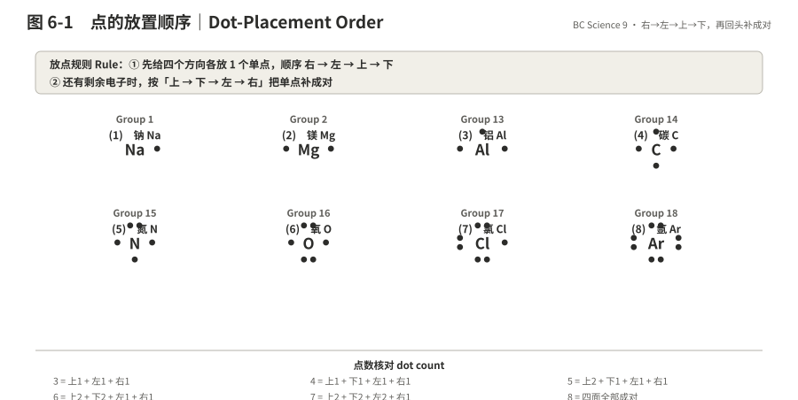
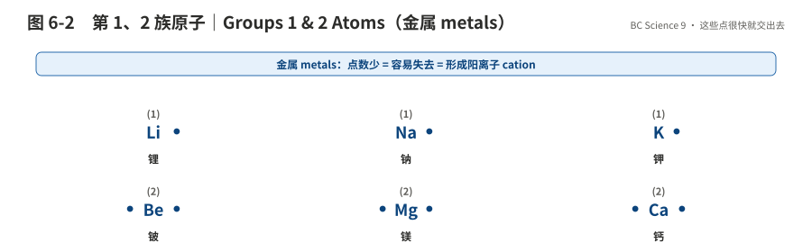
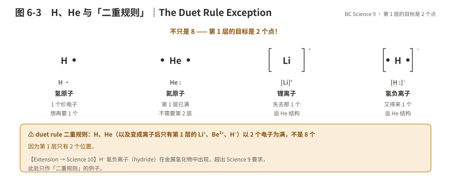
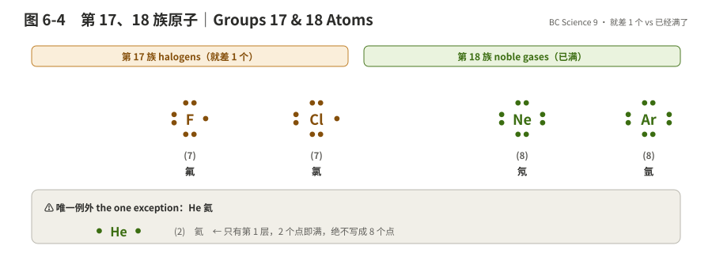
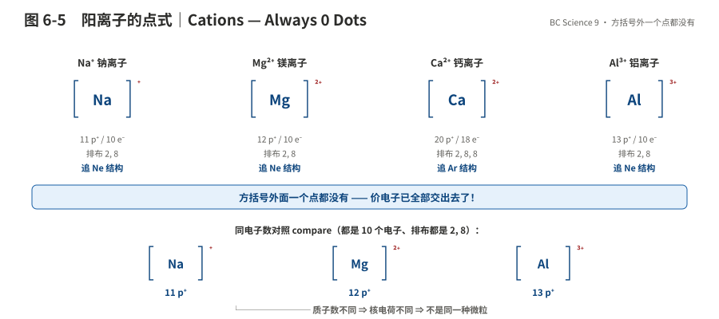
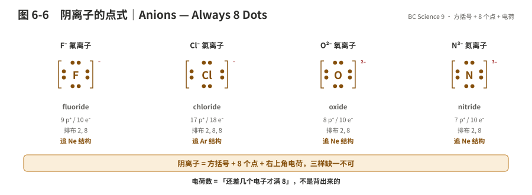
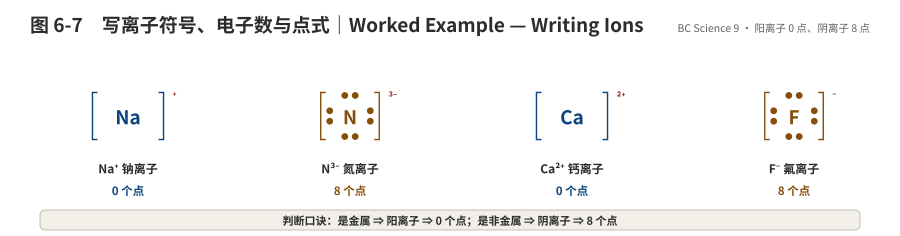
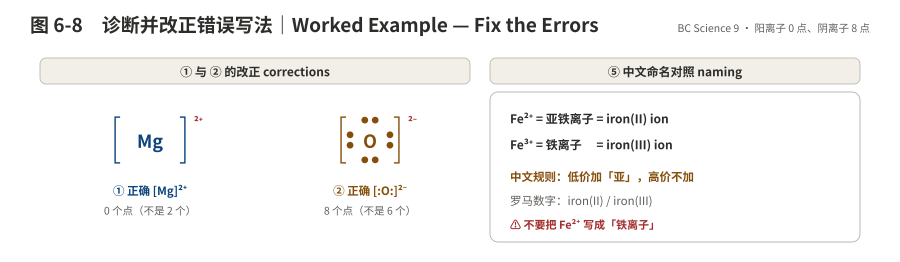
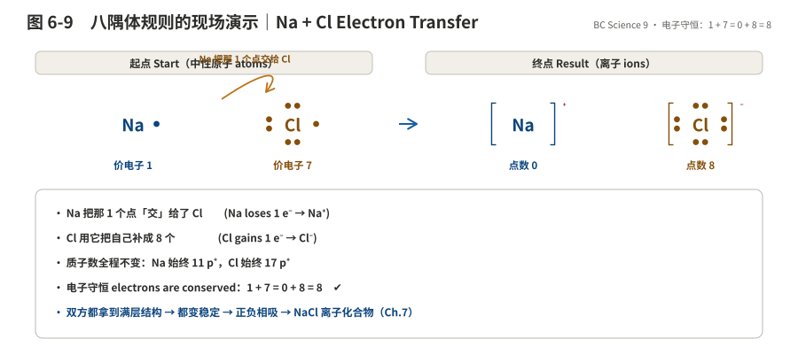

# Ch.6 — Ions and Lewis Dot Diagrams
## Chapter 6 · Ions and Lewis Dot Diagrams｜第 6 章　离子与路易斯点式

> 🗂️ **Content Alignment｜大纲对应**：BC Science 9 Content **C2** — "The arrangement of electrons determines the compounds formed by elements"｜BC 科学 9 课程内容 C2「电子的排布决定元素所形成的化合物」
> ⏱️ **Periods｜课时**：2–3　|　**Prerequisite｜前置**：Ch.5 Atomic Structure and Bohr Diagrams 原子结构与玻尔模型图　|　**Follow-up｜后继**：Ch.7 Ionic Compounds: Formulas and Naming 离子化合物：化学式与命名
> 🗂️ **Generated｜文件生成时间**：2026-09-18 00:53

Chapter 5 ended with a question: if sodium's outer shell holds one electron and chlorine's holds seven, what happens when they meet? This chapter answers it. Atoms rearrange their electrons to reach a full outer shell, and when they do, they become electrically charged — they become **ions**. Almost everything in the rest of this course rests on that single idea.

**中文**：第 5 章最后留了一个问题：钠的最外层有 1 个电子、氯有 7 个，它们相遇会发生什么？本章就来回答。原子会**重新安排自己的电子**以达到满层，而一旦这样做，它就**带电**了——它就变成**离子（ion）**。本课程后面几乎所有内容都建立在这一条观念之上。

By the end of the chapter you will also have met the **Lewis dot diagram**, which is simply a faster way of drawing an atom when you only care about its outer electrons. Where a Bohr diagram is a full portrait, a Lewis diagram is a note-to-self — and in Chapter 7 you will use those notes to work out chemical formulas without memorising any of them.

**中文**：学完本章，你还会认识 **Lewis dot diagram（路易斯点式）**——当你只关心最外层电子时，它是一种更快的画法。玻尔图是**全身像**，路易斯点式是**给自己看的便签**；到了第 7 章，你会用这些便签推出化学式，而且**一个都不用背**。

## 1. Content Alignment｜大纲对应

| Item｜项目 | Content｜内容 |
|---|---|
| BC Science 9 Content (official wording)｜BC 课程内容（官方原文） | **The arrangement of electrons determines the compounds formed by elements**｜**电子的排布决定元素所形成的化合物** |
| Sub-items covered here｜本章承担的子条目 | why ions form; the difference between a **cation（阳离子）** and an **anion（阴离子）**; the **octet rule（八隅体规则）**; predicting ion charge from group number; **multivalent elements（多变价元素）**, including Roman-numeral naming; **polyatomic ions（多原子离子）**; the **Lewis dot diagram（路易斯点式）**｜ion 离子的形成原因；cation 与 anion 的区别；octet rule 八隅体规则；由族号预测离子电荷；multivalent elements 多变价元素（含罗马数字命名）；polyatomic ions 多原子离子；Lewis dot diagram 路易斯点式 |
| Curricular Competencies｜课程能力 | [Applying and innovating] **Formulate physical or mental theoretical models**｜构建实物或心智理论模型；[Processing and analyzing] Seek and analyze patterns, trends, and connections｜寻找并分析模式、趋势与联系；[Communicating] Express scientific ideas using symbols, diagrams and bilingual terminology｜用符号、图形与双语术语表达科学思想 |
| Beyond scope?｜是否超纲 | No｜否 |
| Scope warning｜超纲提示 | Redox reactions, half-reactions, ionic equations and the covalent structure of polyatomic ions（including double bonds and resonance）belong to Science 10–12; every place where this chapter touches them is flagged 【🔭 Extension → Science 10】｜氧化还原反应、半反应、离子方程式、多原子离子的共价结构（含双键与共振）属 Science 10–12；凡涉及处标注【🔭 Extension → Science 10】 |

Notice that nothing in this chapter requires balancing equations, calculating concentration, or classifying reaction types. Those are **Science 10** topics, and if a question here seems to lead towards them, it will always be labelled as extension material. In Science 9 the job is narrower and clearer: explain *why* ions form, and predict *which* ion each element forms.

**中文**：请注意，本章没有任何内容需要你配平方程式、计算浓度或给反应分类。那些属于 **Science 10** 的主题；万一这里似乎要往那边走，一定会被标为超纲内容。Science 9 的任务更窄也更清楚：**解释为什么形成离子，并预测每个元素形成哪种离子**。

## 2. Learning Objectives｜学习目标

**EN — By the end of this chapter, you should be able to:**
1. Explain why atoms form ions, using the idea of a **stable (full) valence shell（稳定的满层价电子层）**.
   - **中文**：用「**稳定的满层价电子层**」解释原子为什么会形成离子。
2. Define an ion, state that **only electrons change（never protons）**, and calculate the number of electrons in any ion.
   - **中文**：说出离子的定义，说明**只有电子变、质子数绝不变**，并计算任意离子的电子数。
3. Distinguish cations from anions by **charge**, by **formation**（loss vs gain of electrons）and by **metal vs non-metal**.
   - **中文**：从**电荷**、**得失电子方式**、**金属/非金属**三个角度区分阳离子与阴离子。
4. Predict ion charge from the **group number（族号）** and name multivalent ions using **Roman numerals（罗马数字）**.
   - **中文**：由族号预测离子电荷，并用罗马数字命名多变价离子。
5. Draw **Lewis dot diagrams（路易斯点式）** for atoms, cations and anions, and name the common **polyatomic ions（多原子离子）**.
   - **中文**：绘制原子、阳离子与阴离子的路易斯点式，并说出常见多原子离子的名称与符号。

Objective 2 deserves special attention from Chinese-speaking students. The English and Chinese really do differ here: the English `-ide` endings tell you immediately whether you are looking at an anion, while a Chinese name does not. Throughout this chapter, and especially in Sections 3.3 and 3.6, watch how the two languages carry information differently.

**中文**：第 2 条目标请母语为中文的同学格外留意。中英文并非允许同样的错误：**英文的 -ide 词尾**能立刻告诉你这是不是阴离子，而**中文名看不出来**。本章通篇——尤其是 3.3 与 3.6 节——请留意这两种语言承载信息的方式有何不同。

## 3. Concept Explanations｜概念解析

### 3.1 Why Atoms Form Ions｜原子为什么要变成离子

Every ion in this chapter exists for one reason: an atom with an incomplete outer shell is unsettled, and a full outer shell is calm. Once you accept that single sentence, ionic charges stop being a list to memorise and become something you can reason out from any periodic table.

**中文**：本章里的每一个离子都只有一个成因：**最外层没满的原子不安分，满层的原子才安稳。** 一旦你接受这一句话，离子电荷就不再是待背的清单，而变成你拿着任何一张周期表都能推出来的东西。

- Recall the conclusion of Ch.5｜Ch.5 的结论：the noble gases **He (2), Ne (2,8), Ar (2,8,8)** have a **full valence shell（满层）**, so they are stable.
  - **中文**：稀有气体 **He (2)、Ne (2,8)、Ar (2,8,8)** 的价电子层是**满的（full valence shell）**，所以稳定。
- Every other element has an **incomplete** outer shell → it will **lose** or **gain** electrons, rewriting its own arrangement until it looks like *one of those noble gases*.
  - **中文**：其余元素的最外层**都没满** → 它们会通过**失去**或**得到**电子，去改写自己的电子排布，直到变成"某个稀有气体那样"的满层结构。
- An **ion（离子）** is an atom (or a group of atoms) that has **gained or lost electrons** and therefore carries a **net electric charge（净电荷）**.
  - **中文**：**离子是得失电子后带电的原子（或原子团）**。

> 📏 **The golden rule｜铁律：When an ion forms, only electrons change — the proton number never changes.** The proton count decides *which element this is*: after losing its electron, sodium is still sodium, because its nucleus still contains 11 protons.
>
> **中文**：形成离子时「**只有电子变**」，**质子数从不改变**。质子数决定"这是哪种元素"——Na 失去电子后仍然是钠，因为核里还是 11 个质子。

This is the idea that Chapter 5's preview question was pointing at. Sodium does not turn into neon when it loses an electron; it turns into a sodium *ion* that merely *looks like* neon from the electrons' point of view. Identity is carried by the nucleus, behaviour is carried by the electrons.

**中文**：这正是第 5 章那道思考题所指向的观念。钠失去电子后并没有变成氖，而是变成了**钠离子**——它只是**从电子的角度看像氖**而已。**身份由原子核携带，行为由电子携带。**

### 3.2 The Universal Electron-Count Formula｜电子数的万能公式

There is one formula that handles every case — atoms, cations, anions, any charge at all — and it is worth learning properly rather than guessing. Enter the charge **with its sign**, and the arithmetic takes care of itself.

**中文**：有一个公式能够处理**所有情况**——原子也好、阳离子也好、阴离子也好、任何电荷都行——值得认真学会，而不是靠猜。把**电荷连符号一起代入**，算式自己会算出结果。

```text
    electrons｜电子数  =  Z  −  (charge, entered with its sign｜电荷，带符号代入)
                        ↑
                      atomic number = proton number (never changes)
                      ｜原子序数 = 质子数（永远不变）

    Check｜验算：
      neutral Na：e = 11 −  0    = 11  ✔
      Na⁺       ：e = 11 − (+1) = 10  ✔  （1 electron fewer｜少了 1 个电子）
      O²⁻       ：e =  8 − (−2) = 10  ✔  （2 electrons more｜多了 2 个电子）
```

In words: **electrons = Z − charge**. A positive charge subtracts, making the electron count smaller; a negative charge adds, making it larger. Notice how the answer for Na⁺ and O²⁻ comes out the same (10 electrons) even though the two ions have nothing else in common — a hint of something you will examine carefully in B4.

**中文**：用语言表述就是：**电子数 = Z − 电荷**。正电荷做减法，使电子数变少；负电荷做加法，使电子数变多。请注意 Na⁺ 与 O²⁻ 算出来的结果**完全相同**（都是 10 个电子），尽管这两种离子毫无共同之处——这里埋着一个伏笔，你在 B4 题里会仔细分析它。

- A cation has **fewer** electrons than protons; an anion has **more** electrons than protons.
  - **中文**：阳离子 → 电子数**少**于质子数；阴离子 → 电子数**多**于质子数。
- If you cannot recall the formula, draw instead: sketch the arrangement of the atom first, then add or remove outer electrons according to the charge.
  - **中文**：记不住公式就画图：先画原子的排布，再按电荷加/减最外层电子。

### 3.3 Cation｜阳离子 vs Anion｜阴离子（一句话版本）

The two words are easy to confuse, so learn the two definitions as a matched pair. Everything else about ions — charges, dot diagrams, naming — branches off from this one distinction.

**中文**：这两个词很容易搞混，请把两条定义当成**成对的一组**来记。关于离子的一切——电荷、点式、命名——都从这一条区分上分岔出去。

- **Cation｜阳离子**：a **metal** that has **lost** electrons → fewer electrons → **positively** charged → written with `n⁺` at the top right（Na⁺、Mg²⁺、Al³⁺）.
  - **中文**：**Cation 阳离子**：金属**失去**电子 → 电子数变少 → 带**正电** → 符号右上角写 `n⁺`（如 Na⁺、Mg²⁺、Al³⁺）。
- **Anion｜阴离子**：a **non-metal** that has **gained** electrons → more electrons → **negatively** charged → written with `n⁻` at the top right（Cl⁻、O²⁻、N³⁻）.
  - **中文**：**Anion 阴离子**：非金属**得到**电子 → 电子数变多 → 带**负电** → 符号右上角写 `n⁻`（如 Cl⁻、O²⁻、N³⁻）。

A memory aid students find useful: the letter **t** in ca**t**ion looks like a plus sign, and "an**ion**" reads like "**a negative ion**". Use whichever works for you, but be careful never to rely on such tricks alone — the definitions matter more than the mnemonics.

**中文**：一个学生觉得好用的记忆法：ca**t**ion 里的字母 **t** 看起来像加号，而 "an**ion**" 读起来像 "**a n**egative **ion**"（一个负离子）。哪种管用就用哪种，但千万别只靠这类小窍门——**定义比口诀重要**。

> ⚠️ **A naming warning for Chinese speakers｜中文命名提醒**：In Chinese, both cations and anions are simply called "**某离子**"（钠离子、氯离子）, so the name alone does not reveal the sign. **English does reveal it**: monatomic anions change their stem to **-ide** — compare *sodium* ion（Na⁺）with ***chloride*** ion（Cl⁻）, ***oxide*** ion（O²⁻）and ***nitride*** ion（N³⁻）. The complete naming rules come in Ch.7.
>
> **中文**：中文里阳离子和阴离子都叫「**某离子**」（钠离子、氯离子），看不出谁正谁负；**英文能看出来**——单原子阴离子把词根改成 **-ide**：sodium ion（Na⁺）vs **chloride** ion（Cl⁻）、**oxide** ion（O²⁻）、**nitride** ion（N³⁻）。完整命名规则见 Ch.7。
>
> 📌 **Writing convention｜写法规矩**：Write the charge as a **superscript** with the **number first and the sign second**, and **never write the 1** — use `Mg²⁺` and `Cl⁻`, **not** `Mg⁺²` or `Cl⁻¹`.
>
> **中文**：电荷写成上标，**数字在前、正负号在后**，且 **1 不写** —— 写作 `Mg²⁺`、`Cl⁻`；**不要**写成 `Mg⁺²`、`Cl⁻¹`。

That last rule is not pedantry. `Mg⁺²` reads as "positive two" in the wrong order and immediately signals to a marker that the student has not yet absorbed the convention, so it costs marks for no reason.

**中文**：最后这条规矩不是吹毛求疵。`Mg⁺²` 把"正二"的顺序写反了，阅卷者一看就知道这位同学还没掌握书写约定，**白白丢分**。

### 3.4 Octet Rule｜八隅体规则

The **octet rule（八隅体规则）** states that atoms tend to gain, lose or share electrons so as to have **8 electrons in the valence shell** — the same arrangement as a noble gas.

**中文**：原子倾向于通过得失（或共用）电子，使**最外层达到 8 个电子**的稀有气体结构。

The word *octet* simply means "a set of eight", and that is all the rule claims: eight outer electrons is the arrangement nature prefers for nearly every element you will meet in Science 9.

**中文**：*octet* 这个词的意思就是"**一组八个**"，这条规则说的也只是这意思：**最外层八个电子**几乎是你在 Science 9 里遇到的所有元素都偏好的排布。

- ⚠ **Two exceptions｜两个例外：H and He aim for only 2 electrons**（because the first shell has just two places）；this is called the **duet rule（二重规则）**.
  - **中文**：**H 氢与 He 氦只追求 2 个电子**（第 1 层只有 2 个位置），这叫 **duet rule（二重规则）**。
- What each ion is chasing｜各离子追的是谁的结构：Li⁺、Be²⁺、H⁻ chase **He**（2 electrons｜2 个）; Na⁺、Mg²⁺、O²⁻、F⁻ chase **Ne**（2, 8）; K⁺、Ca²⁺、Cl⁻、S²⁻ chase **Ar**（2, 8, 8）.
  - **中文**：Li⁺、Be²⁺、H⁻ 追的是 **He** 的结构（2 个）；Na⁺、Mg²⁺、O²⁻、F⁻ 追的是 **Ne** 的结构（2, 8）；K⁺、Ca²⁺、Cl⁻、S²⁻ 追的是 **Ar** 的结构（2, 8, 8）。
- **Why "the cheapest route" always wins｜为什么总是"选择代价最小的路"**：sodium has 1 valence electron, and losing 1（cost 1）is far cheaper than gaining 7（cost 7）→ **Na⁺**; chlorine has 7, and gaining 1（cost 1）is far cheaper than losing 7 → **Cl⁻**.
  - **中文**：Na 有 1 个价电子，失去 1 个（代价 1）比得到 7 个（代价 7）便宜得多 → Na⁺；Cl 有 7 个，得到 1 个（代价 1）比失去 7 个便宜得多 → Cl⁻。

Thinking in terms of *cost* is the real skill here. You are not recalling a table; you are comparing two routes and picking the shorter one. Elements with 1, 2 or 3 outer electrons take the losing route; elements with 5, 6 or 7 take the gaining route; and the ones already at 8 do nothing at all.

**中文**：用"**代价**"来思考才是这里的真正技能。你不是在回忆一张表，而是在**比较两条路然后挑短的那条**：最外层 1、2、3 个的元素走"失去"路线，5、6、7 个的走"得到"路线，而本来就有 8 个的**什么也不做**。

### 3.5 Predicting Ion Charge from Group Number｜由族号预测离子电荷

| Group｜族 | 1 | 2 | 13 | 14 | 15 | 16 | 17 | 18 |
|---|---|---|---|---|---|---|---|---|
| Valence e⁻｜价电子 | 1 | 2 | 3 | 4 | 5 | 6 | 7 | 8 |
| **Ion charge｜电荷** | **+1** | **+2** | **+3** | **±4** | **−3** | **−2** | **−1** | **0** |
| Examples｜常见离子 | Na⁺ K⁺ | Mg²⁺ Ca²⁺ | Al³⁺ | （see note below｜见下方说明） | N³⁻ P³⁻ | O²⁻ S²⁻ | F⁻ Cl⁻ | none｜无 |

This table looks like something to memorise, but it is really just the "cheapest route" logic written out in a row. Take any group, count its valence electrons, and ask whether it is cheaper to empty that shell or fill it. The answer is the charge.

**中文**：这张表看起来像是要背的东西，但它其实只是把"代价最小的路"这一逻辑横写成一行。**随便挑一个族，数它的价电子，然后问：把这一层倒空便宜，还是填满便宜？** 答案就是电荷。

> ⚠️ **A caution about ±4｜易错提醒 ±4**：Group 14's theoretical charge is ±4, but carbon and silicon in practice **hardly ever form simple ions**; they take the **sharing（covalent｜共价）** route covered in Ch.8 instead. So the ±4 in the table above is only a **theoretical reference value**.
>
> **中文**：第 14 族理论电荷是 ±4，但 C 与 Si 实际上**几乎不形成简单离子**，而是走 Ch.8 的**共用电子（共价）**路线。所以上表的 ±4 只是一条"理论参考值"。
>
> 📌 **Group 18 is 0｜第 18 族为 0**：the noble gases already have a full shell and do not form ions — which is exactly why they are inert（Ch.4, Ch.5）.
>
> **中文**：稀有气体已满层，不形成离子——这是它们惰性的原因（Ch.4、Ch.5）。

### 3.6 Multivalent Elements｜多变价元素

Some elements — mostly transition metals — can form ions with **more than one possible charge**. These are called **multivalent elements（多变价元素）**, and English names them very differently from Chinese.

**中文**：某些元素（多为过渡元素）可以形成**两种以上不同电荷**的离子，叫 **multivalent elements（多变价元素）**；而中英文的命名方式差别很大。

| Element｜元素 | Ion｜离子 | English name (Roman numeral)｜英文名（罗马数字） | 中文名 | Note｜备注 |
|---|---|---|---|---|
| Fe 铁 | **Fe²⁺** | **iron(II) ion** | **亚铁离子** | ⚠ Chinese requires the prefix 亚 for +2｜中文"+2 价必须带『亚』字" |
| Fe 铁 | **Fe³⁺** | **iron(III) ion** | **铁离子** | the one **without** 亚 is the higher state｜中文不带"亚"的就是较高价态 |
| Cu 铜 | Cu⁺ | copper(I) ion | 亚铜离子 | |
| Cu 铜 | Cu²⁺ | copper(II) ion | 铜离子 | more common｜更常见 |
| Pb 铅 | Pb²⁺ | lead(II) ion | 铅(II)离子（often shortened to 铅离子｜常简称铅离子） | Pb⁴⁺ is rarer｜Pb⁴⁺ 较少见 |
| Pb 铅 | Pb⁴⁺ | lead(IV) ion | 铅(IV)离子 | |
| Sn 锡 | Sn²⁺ | tin(II) ion | 亚锡离子 | |
| Sn 锡 | Sn⁴⁺ | tin(IV) ion | 锡离子 / 锡(IV)离子 | |

> 💡 **This is the single item Chinese-speaking students most often lose marks on — memorise it:**
> **中文**：**这一条是中文学生最容易丢分的地方，务必记住：**
> **Fe²⁺ = 亚铁离子 = iron(II) ion**；**Fe³⁺ = 铁离子 = iron(III) ion**.
> 📏 **Chinese rule｜中文规则**：**add the prefix 亚 for the lower state, omit it for the higher one｜低价态加「亚」字，高价态不加**。So a bare "**某**离子" is usually the **higher** state, while "**亚某**离子" is the **lower** one.
> **中文**：**低价态加「亚」字，高价态不加**。看到中文"**某**离子"（不带亚）通常是**较高价**；看到"**亚某**离子"是**较低价**。
> 📏 **English rule｜英文规则**：mark the charge with a **Roman numeral** placed in **round brackets** immediately after the metal name, **with no space**（iron(III), not iron (III)）.
> **中文**：用**罗马数字**标出电荷数，放在金属名后的**圆括号**里，**不加空格**（iron(III)，不是 iron (III)）。
> These elements all lie beyond element 20（iron is Z = 26）, so **Science 9 does not require you to draw their Bohr diagrams** — only to write their ion symbols and names.
> **中文**：这些元素都在前 20 号之后（Fe 为 26 号），**Science 9 不要求画它们的玻尔图**，只要求能写离子符号与名称。

Why do the two languages disagree structurally? Chinese compresses the distinction into one extra character at the front; English moves the information to a bracketed numeral after the name. Neither is redundant, so a bilingual student must learn **both** systems rather than translating one into the other.

**中文**：为什么两种语言的结构不一样？中文把区别压缩成前面**多一个字**，英文则把信息挪到名字后面**括号里的罗马数字**。两者都不是多余的，所以双语学生必须**两套都学**，而不是把一套翻译成另一套。

### 3.7 Polyatomic Ions｜多原子离子

A **polyatomic ion（多原子离子）** is a group of **covalently bonded atoms** that carries an overall charge and behaves as a **single unit**.

**中文**：**多原子离子是几个原子结合成团、整体带电，并在反应中作为一个整体出现的带电原子团。**

The key phrase is "single unit". In every reaction you will meet in this course, a polyatomic ion travels as one piece: it is not a mixture you can divide up, and it does not come apart to be rearranged.

**中文**：关键词是"**一个整体**"。在本课程遇到的每一个反应里，多原子离子都是**整块移动**的：它不是可以随意拆分的混合物，也不会散开重新组合。

| Symbol｜符号 | English name | 中文名 |
|---|---|---|
| **NH₄⁺** | ammonium | 铵根（铵根离子） |
| **OH⁻** | hydroxide | 氢氧根 |
| **NO₃⁻** | nitrate | 硝酸根 |
| **CO₃²⁻** | carbonate | 碳酸根 |
| **SO₄²⁻** | sulfate | 硫酸根 |
| **HCO₃⁻** | hydrogen carbonate（bicarbonate） | 碳酸氢根 |
| **PO₄³⁻** | phosphate | 磷酸根 |

- The only common **polyatomic cation** is **NH₄⁺, ammonium｜铵根**; nearly all the others are anions.
  - **中文**：唯一常见的**多原子阳离子**是 **NH₄⁺ 铵根**；其余常见者多为阴离子。
- **Treat it as a unit｜处理原则**：a polyatomic ion must never be split apart when writing formulas; when more than one is needed, put it in **brackets（括号）**（details in Ch.7）.
  - **中文**：写化学式时多原子离子不能被拆散；数量超过 1 个时加**括号**（Ch.7 详述）。
- 【🔭 Extension → Science 10】Inside a polyatomic ion the atoms are held by covalent bonds, and their dot structures（including double bonds and resonance forms）are beyond Science 9; **this book asks only that you recognise the symbol, write the name and know the charge.**
  - **中文**：【🔭 Extension → Science 10】多原子离子内部是共价键，其点式结构（含双键与共振式）超出 Science 9 要求；**本册只要求认符号、写名称、知道电荷**。

Learn these seven by name before moving on, because Ch.7 will assume you know them instantly. A useful observation: the pairs **-ate / -ite** and the prefixes will be explained later, but for now simply notice that most common polyatomic ions end in **-ate**, and the one with an extra hydrogen is called **hydrogen carbonate**.

**中文**：继续之前请把这七个**记熟名字**，因为第 7 章会假定你一眼就能认出它们。一条有用的观察：**-ate / -ite** 的配对和前缀以后再讲，现在只需注意——常见的多原子离子大多以 **-ate** 结尾，而多一个氢的那个叫 **hydrogen carbonate**。

### 3.8 Lewis Dot Diagram｜路易斯点式：三条规则

A **Lewis dot diagram（路易斯点式）** uses the **element symbol** to stand for the nucleus plus the inner electrons, and **dots** around it to stand for the **valence electrons**.

**中文**：**路易斯点式用元素符号表示原子核与内层电子，用符号四周的点表示价电子**，是一种简图。

Everything hidden *inside* the symbol is deliberate. Drawing all the inner electrons again would be wasted effort, because they never take part in what happens next; only the outer dots carry information about bonding.

**中文**：把内层电子全部**藏进符号里**是刻意的。把内层电子再画一遍是纯粹的浪费——它们从不参与接下来的事，**只有外面的点携带成键信息**。

**Dot-placement order（a convention used throughout this book）｜画点顺序（本讲义统一约定）：**

1. First place **one single dot** in each of the four directions: right → left → top → bottom（this covers groups 1, 2, 13 and 14）.
   - **中文**：先给四个方向各放 **1 个单点**：右 → 左 → 上 → 下（对应第 1、2、13、14 族）。
2. If electrons remain, **pair up the single dots in the order top → bottom → left → right**（groups 15, 16, 17 and 18）.
   - **中文**：还有剩余电子时，**按 上 → 下 → 左 → 右 的顺序把单点补成对**（对应第 15、16、17、18 族）。
3. **Notation convention in this book｜本讲义的书写约定**：a **pair** of dots written above and below each other beside the symbol is drawn as **`:`**（a colon turned on its side）, and a **single** dot is written **`·`**.
   - **中文**：符号**两侧上下成对的 2 个点写作 `:`**（像冒号一样立着的两个点），单个点写作 `·`。

Other textbooks use slightly different orders, and any consistent order earns full marks in Science 9. Pick this book's convention and use it every time, because consistency is what makes your diagrams readable to an examiner.

**中文**：其他教材可能采用略微不同的顺序，而在 Science 9 里**任何自洽的顺序都算满分**。请认准本讲义的约定并每次都用它，因为**一致性**才是让阅卷者看懂你图的关键。

**How atoms, cations and anions differ（heavily examined）｜原子、阳离子、阴离子的点式差别（必考）：**

| Object｜对象 | Square brackets｜方括号 | Number of dots｜点数 | Charge｜电荷写法 | Example｜例子 |
|---|---|---|---|---|---|
| Neutral atom｜中性原子 | **no** brackets｜**不要**括号 | = valence electrons（1–8）｜= 价电子数（1~8） | none｜不写 | `Na ·`、`: Cl ·` |
| **Cation｜阳离子** | **yes**, `[ ]`｜要 | **0**（all outer electrons have been lost）｜**0 个**（最外层电子已全部失去） | `n⁺` at top right｜右上角 `n⁺` | `[Na]⁺`、`[Mg]²⁺` |
| **Anion｜阴离子** | **yes**, `[ ]`｜要 | **8**（filled up; 2 for H⁻）｜**8 个**（补满；H⁻ 为 2 个） | `n⁻` at top right｜右上角 `n⁻` | `[:Cl:]⁻`、`[:O:]²⁻` |

> **Why do cations have 0 dots?｜为什么阳离子 0 个点？** A cation loses exactly **all** of its valence electrons（sodium gives away its single outer electron）, and its new outermost shell is the old inner one, which is already full — so **no dots are drawn outside the brackets at all**.
>
> **中文**：阳离子失去的正是它的**全部价电子**（如 Na 把唯一的 1 个价电子丢了），新的最外层是原来的内层，已经是满的了，所以**外面一个点都不画**。
>
> **Why do anions always have 8 dots?｜为什么阴离子一定 8 个点？** The whole purpose of an anion is to top its outer shell up to 8, so the diagram **must show 8**（the exception is H⁻, which shows 2）.
>
> **中文**：阴离子的目标就是"把最外层补到 8 个"，所以画出来必须**满 8**（H⁻ 例外，2 个）。

Students often resist the "0 dots" rule because it feels as though something is missing. Remember what the brackets mean: they say "we are now looking at this particle *after* the transfer". Nothing is missing; everything that was removable has been removed.

**中文**：学生常常不愿意接受"阳离子 0 个点"，觉得好像**少了点什么**。请记住方括号的含义：它表示"我们现在看的是电子转移**之后**的这个微粒"。什么都没少——**能被拿走的都已经被拿走了**。

### 3.9 Why Lewis Diagrams Matter｜为什么点式重要 → Ch.7

- A dot diagram turns an abstract electron arrangement into something you can **count by eye**: who is short of how many, and who has how many spare, become obvious at a glance.
  - **中文**：点式把"抽象的电子排布"变成看得见的**可数数**的图形：谁缺几个、谁多几个一目了然。
- Metals carry few dots（1–3）→ they tend to **give** them away; non-metals carry many（5–7）→ they tend to **want a few more**.
  - **中文**：金属的点少（1~3 个）→ 倾向于**给出**；非金属的点多（5~7 个）→ 倾向于**再要几个**。
- When the two meet, one gives and one takes → both become ions → opposite charges attract → an **ionic compound（离子化合物）** forms（Ch.7）.
  - **中文**：两者相遇时，一个给一个收 → 都变成离子 → 正负相吸 → 形成 **ionic compound 离子化合物**（Ch.7）。

This is the last piece of preparation Ch.7 needs. Once you can see that magnesium has two dots to offer and each chlorine wants exactly one, the formula MgCl₂ stops being a fact to memorise and becomes a conclusion you reached yourself.

**中文**：这是第 7 章需要的最后一块铺垫。一旦你能看出**镁有两个点可以给出，而每个氯只要一个**，那么 MgCl₂ 就不再是需要背的事实，而是你**自己推出来的结论**。

## 4. Comparison Tables｜表格比对

These five tables gather everything quantitative in the chapter. Table 6-5 deserves particular attention: it lines up atoms beside their ions so that you can see at once what changed and — crucially — what did not.

**中文**：这五张表集中了本章全部可量化的数据。**Table 6-5** 尤其值得留意：它把原子与其离子并排对照，让你一眼看出**什么变了**，以及更关键的——**什么没变**。

### Table 6-1　Cation vs Anion｜阳离子与阴离子

| Comparison｜比较项 | **Cation｜阳离子** | **Anion｜阴离子** |
|---|---|---|
| How it forms｜形成方式 | **loses** electrons｜**失去**电子 | **gains** electrons｜**得到**电子 |
| Charge｜电荷 | **positive｜正** | **negative｜负** |
| Electrons vs protons｜电子数 vs 质子数 | e⁻ **<** p⁺ | e⁻ **>** p⁺ |
| Which elements form it｜通常由哪类元素形成 | **metals**（left side of the table）｜**金属**（周期表左侧） | **non-metals**（right side）｜**非金属**（右侧） |
| Symbol notation｜符号写法 | `n⁺` at top right（e.g. Al³⁺）｜右上角标 `n⁺`（如 Al³⁺） | `n⁻` at top right（e.g. O²⁻）｜右上角标 `n⁻`（如 O²⁻） |
| Lewis dot diagram｜路易斯点式 | **0 dots** outside the `[ ]`｜`[ ]` 外 **0 个点** | **8 dots** inside the `[ ]`｜`[ ]` 内 **8 个点** |
| English name (monatomic)｜英文名（单原子） | element name + ion: *sodium* ion｜元素名 + ion：sodium ion | stem + **-ide** + ion: ***chloride*** ion｜词根 + **-ide** + ion：**chloride** ion |
| Chinese name｜中文名 | 某离子（钠离子） | 某离子（氯离子）— Chinese does not show the sign, so you must check the charge｜中文看不出正负，需查电荷 |
| Examples｜实例 | Na⁺、Mg²⁺、Al³⁺、K⁺、Ca²⁺ | F⁻、Cl⁻、O²⁻、S²⁻、N³⁻ |

Read the last three rows together, because they contain the bilingual trap this chapter keeps warning about. Chinese names are identical in form for cations and anions; English is not. When you answer in Chinese, you therefore have the extra duty of stating the charge explicitly.

**中文**：请把最后三行连起来读，因为本章反复警告的**双语陷阱**就在里面。中文名对阳离子和阴离子**形式完全相同**，英文则不同。所以当你用中文作答时，就多了一项义务：**必须明确写出电荷**。

### Table 6-2　Group number → ion charge｜由族号到离子电荷

| Group｜族 | 1 | 2 | 13 | 14 | 15 | 16 | 17 | 18 |
|---|---|---|---|---|---|---|---|---|
| Valence e⁻｜价电子 | 1 | 2 | 3 | 4 | 5 | 6 | 7 | 8 |
| Ion charge｜电荷 | **+1** | **+2** | **+3** | ±4（theoretical｜理论） | **−3** | **−2** | **−1** | **0** |
| Cost of reaching a full shell｜距离满层的代价 | lose 1｜失 1 | lose 2｜失 2 | lose 3｜失 3 | hard — takes the covalent route｜难（走共价路线） | gain 3｜得 3 | gain 2｜得 2 | gain 1｜得 1 | already full, no change｜已满，不动 |
| Whose structure it becomes｜变成谁的结构 | Ne / Ar | Ne / Ar | Ne | — | Ne / Ar | Ne / Ar | Ne / Ar | already is one｜本来就是 |

The third row is the reasoning, and the second row is the result. If you can rebuild row two from row three, you no longer need to memorise anything in this table — and you will still be right even if the exam asks about an element you never studied.

**中文**：第三行是**推理**，第二行是**结果**。如果你能由第三行重建出第二行，那么这张表你就**什么都不必背**了——即使考题问到一个你从没学过的元素，你也依然能答对。

### Table 6-3　Multivalent Elements & Bilingual Naming｜多变价元素与双语命名

| Element｜元素 | Lower state｜较低价 | 中文 | English | Higher state｜较高价 | 中文 | English |
|---|---|---|---|---|---|---|---|
| Fe 铁 | Fe²⁺ | **亚铁**离子 | iron(II) ion | Fe³⁺ | **铁**离子 | iron(III) ion |
| Cu 铜 | Cu⁺ | **亚铜**离子 | copper(I) ion | Cu²⁺ | **铜**离子 | copper(II) ion |
| Sn 锡 | Sn²⁺ | **亚锡**离子 | tin(II) ion | Sn⁴⁺ | **锡(IV)**离子 | tin(IV) ion |
| Pb 铅 | Pb²⁺ | 铅(II)离子 | lead(II) ion | Pb⁴⁺ | 铅(IV)离子 | lead(IV) ion |

> 📌 **How the two languages differ in thinking｜中英对照的思维差异**：Chinese marks the lower state with the **prefix 亚**; English states the charge with a **Roman numeral**. Both systems must be memorised, because translation questions between them are common.
>
> **中文**：中文用**前缀「亚」**区分低价，英文用**罗马数字**标明电荷。两者都必须背诵——考试常考互译。

Note the irregularity in the table: some Chinese names take 亚（亚锡离子）while others borrow the Roman numeral instead（锡(IV)离子）. Both forms are accepted in practice; what matters is that you are never ambiguous about *which* ion you mean.

**中文**：请注意表里的不规则之处：有些中文名用「亚」（亚锡离子），另一些则直接借用罗马数字（锡(IV)离子）。两种写法在实践中都被接受；真正重要的是——**你说的是哪一个离子，永远不能有歧义**。

### Table 6-4　Common Polyatomic Ions｜常见多原子离子

| Symbol｜符号 | English name | 中文名 | Charge｜电荷 | Memory hint｜记忆提示 |
|---|---|---|---|---|
| NH₄⁺ | ammonium | 铵根 | +1 | the only common **polyatomic cation**｜唯一常见的**多原子阳离子** |
| OH⁻ | hydroxide | 氢氧根 | −1 | the "signature" of bases｜碱的"标志"（Science 10） |
| NO₃⁻ | nitrate | 硝酸根 | −1 | a fertiliser ingredient｜化肥成分 |
| HCO₃⁻ | hydrogen carbonate | 碳酸氢根 | −1 | baking soda｜小苏打 |
| CO₃²⁻ | carbonate | 碳酸根 | −2 | limestone, shells｜石灰石、贝壳 |
| SO₄²⁻ | sulfate | 硫酸根 | −2 | gypsum, Epsom salts｜石膏、泻盐 |
| PO₄³⁻ | phosphate | 磷酸根 | −3 | fertiliser, the backbone of DNA｜化肥、DNA 骨架 |

Two of the memory hints point towards **Science 10** topics（bases, and their signatures）. They are included only as everyday anchors for remembering the ions; nothing about acid–base behaviour is required here.

**中文**：其中两条记忆提示指向 **Science 10** 的主题（碱及其标志）。它们只是用来帮你记住这些离子的日常锚点；**本册不要求任何酸碱性质的内容**。

### Table 6-5　Atoms vs Ions at a Glance｜Atom vs Ion：质子、电子、排布、点数全对照

| Particle｜微粒 | Z | p⁺ | e⁻ | Arrangement｜电子排布 | Outer shell｜最外层 | Lewis dots｜路易斯点数 | English / 中文名 |
|---|---|---|---|---|---|---|---|
| Na 钠原子 | 11 | 11 | 11 | 2, 8, 1 | 1 | 1 | sodium atom / 钠原子 |
| **Na⁺** | 11 | 11 | **10** | 2, 8 | 8 | **0** | sodium ion / 钠离子 |
| Mg 镁原子 | 12 | 12 | 12 | 2, 8, 2 | 2 | 2 | magnesium atom / 镁原子 |
| **Mg²⁺** | 12 | 12 | **10** | 2, 8 | 8 | **0** | magnesium ion / 镁离子 |
| O 氧原子 | 8 | 8 | 8 | 2, 6 | 6 | 6 | oxygen atom / 氧原子 |
| **O²⁻** | 8 | 8 | **10** | 2, 8 | 8 | **8** | oxide ion / 氧离子 |
| Cl 氯原子 | 17 | 17 | 17 | 2, 8, 7 | 7 | 7 | chlorine atom / 氯原子 |
| **Cl⁻** | 17 | 17 | **18** | 2, 8, 8 | 8 | **8** | chloride ion / 氯离子 |
| Ca 钙原子 | 20 | 20 | 20 | 2, 8, 8, 2 | 2 | 2 | calcium atom / 钙原子 |
| **Ca²⁺** | 20 | 20 | **18** | 2, 8, 8 | 8 | **0** | calcium ion / 钙离子 |

> 📏 **How to read this table｜读表要点**：within every pair（atom ⇄ ion）the number of **p⁺ is completely unchanged**; only e⁻ and the arrangement change. Moreover, **the outer shell of every ion has become 8** — which is the most direct evidence for the octet rule you will find anywhere.
>
> **中文**：每一对（原子 ⇄ 离子）里 **p⁺ 完全不变**，只有 e⁻ 与电子排布改变；而且**所有离子的最外层都变成了 8 个**——这正是八隅体规则最直接的证据。

Look also at the last row carefully. Calcium's atom has four shells but its ion has only three, because losing the two outer electrons removes the fourth shell entirely. This surprises many students, yet it follows inevitably from the rules you already know.

**中文**：也请仔细看最后一行。**钙原子有 4 层，但它的离子只有 3 层**——因为失去那两个外层电子时，第 4 层整个消失了。这让很多同学感到意外，但它其实是已有规则的必然推论。

### Table 6-6　Lewis Dot Diagram Rules at a Glance｜路易斯点式规则总表

| Object｜对象 | Add `[ ]`?｜是否加 `[ ]` | Number of dots｜点数 | Charge at top right｜右上角电荷 | Example (this book's notation)｜例子（本讲义写法） |
|---|---|---|---|---|---|
| main-group atoms, groups 1–2｜主族原子 group 1–2 | no｜否 | 1 / 2 | none｜无 | `Na ·`　`· Mg ·` |
| main-group atoms, groups 13–17｜主族原子 group 13–17 | no｜否 | 3 / 4 / 5 / 6 / 7 | none｜无 | `· Al ·`　`: Cl ·` |
| main-group atoms, group 18｜主族原子 group 18 | no｜否 | 8（**2 for He**｜**He 为 2**） | none｜无 | `: Ar :` |
| **cation｜阳离子** | **yes｜是** | **0** | `n⁺` | `[Na]⁺`　`[Mg]²⁺` |
| **anion｜阴离子** | **yes｜是** | **8**（2 for H⁻｜H⁻ 为 2） | `n⁻` | `[:Cl:]⁻`　`[:O:]²⁻` |
| polyatomic ion｜多原子离子 | treated as a unit; this book does not draw its dots｜当作整体，本册不画点式 | — | overall charge｜整体电荷 | NH₄⁺　SO₄²⁻ |

## 5. Diagrams & Worked Examples｜图例说明

> 📌 **Notation used throughout this book｜全书统一约定**：a **pair** of dots sitting above and below each other beside a symbol is written as **`:`**（a sideways colon）; a **single** dot is written **`·`**. Dots are placed in the order given in Section 3.8.
>
> **中文**：符号**两侧**上下成对的 2 个点写作 **`:`**（竖着的一对点）；单个点写作 **`·`**。点数按 3.8 的顺序放置。

### Fig. 6-1　Dot-Placement Order｜点的放置顺序



**What to look for｜看图要点：** The dot count **rises one step at a time** — from group 1 to group 18 it runs 1 → 8 dots; by group 18（Ar）all four sides are paired, giving exactly 8, which is why a noble gas has no reason to react again. Notice also that aluminium has three electron shells yet carries the same 3 dots as boron, which has only two shells — **the dot count follows the group, never the shell count.**

**中文**：点数是**逐个增加**的——第 1 族到第 18 族依次为 1 → 8 个点；第 18 族（Ar）四面全成对，正好 8 个，这就是稀有气体不需要再反应的原因。注意 Al 虽然有 3 层电子，但它的点数与只有 2 层的 B 一样是 3——**同族点数相同，与层数无关**。

That last observation is the bridge back to Ch.5, and it is worth saying out loud: Lewis diagrams deliberately throw away the shell information, because for bonding only the outer count matters. Which is exactly why two elements in the same group behave alike.

**中文**：最后这条观察正是回到第 5 章的桥，值得大声说出来：**路易斯点式刻意丢掉了层数信息**，因为对成键而言只有最外层的数目重要。这恰恰就是同族元素性质相同的原因。

### Fig. 6-2　Groups 1 & 2 Atoms｜第 1、2 族原子（metals｜金属）



**What to look for｜看图要点：** Group 1 carries 1 dot and group 2 carries 2; these dots are about to be **handed over**, which is why these elements form **+1 / +2 cations**（same group, same valence count — referring back to Ch.5）.

**中文**：第 1 族 1 个点、第 2 族 2 个点；这些点很快就要"交出去"——所以它们形成 **+1 / +2 的阳离子**（同族价电子数相同，回扣 Ch.5）。

Only two dots separate the most violently reactive metals in the course from the merely reactive ones, which is a good reminder of how much chemistry is packed into such a small drawing.

**中文**：本课程里"最暴烈的金属"与"只是比较活泼的金属"之间**只差两个点**——这很好地提醒我们：这么小的一张图里，装着多少化学。

### Fig. 6-3　H, He and the Duet Rule｜H、He 与「二重规则」



**What to look for｜看图要点：** **Helium is drawn with only 2 dots** and **Li⁺ has no dots at all** — whenever a particle's electrons involve the first shell only, "full" means **2 rather than 8**. This is one of the two official exceptions to the octet rule.

**中文**：**He 只画 2 个点**、**Li⁺ 一个点都没有**——凡是电子只涉及第 1 层的微粒，都按 2 个（而不是 8 个）判断是否"满"。这是八隅体规则的两个法定例外之一。

Do not let the phrase "octet rule" mislead you into forcing eight electrons onto hydrogen or lithium. The rule is named after the common case; the underlying principle is *full capacity of the outermost shell*, whatever that capacity happens to be.

**中文**：别被"八隅体规则"这个名字误导，硬把 8 个电子塞给氢或锂。规则是依**常见情况**命名的，底下的原理其实是"**最外层达到满容量**"，而这个容量是多少就是多少。

### Fig. 6-4　Groups 17 & 18 Atoms｜第 17、18 族原子（非金属与稀有气体）



**What to look for｜看图要点：** Group 17 shows **three paired sides and one single dot**（2 + 2 + 1 + 2 = 7）, just one short → it urgently wants 1 more electron → a **−1 anion**; group 18 has **all four sides paired**（8）→ already full → no reaction.

**中文**：第 17 族四面里**有三面成对、一面单点**（2+2+1+2 = 7），就差最后 1 个 → 强烈想要 1 个电子 → **−1 阴离子**；第 18 族**四面全成对**（8 个）→ 已满 → 不反应。

The halogens are the mirror image of the alkali metals: where sodium has one dot to get rid of, chlorine has one vacancy to fill. Both are one step away from perfection, which is why both are dangerously reactive in their pure form.

**中文**：卤素是碱金属的**镜像**：钠有一个点要甩掉，氯有一个空位要填上。两者都**离完美只差一步**，所以它们单质形态都危险地活泼。

### Fig. 6-5　Cations — Always 0 Dots｜阳离子的点式



**What to look for｜看图要点：** Every cation has **not a single dot** outside its brackets, because it has **given away all** of its outer electrons. Study the last row especially: **two particles can have the same number of electrons and still be completely different if their proton numbers differ.**

**中文**：所有阳离子的方括号外**一个点都没有**——因为它们把最外层电子**全部丢光**了。注意最后一行：**电子数可以相同，但质子数不同就绝不是同一种微粒**。

### Fig. 6-6　Anions — Always 8 Dots｜阴离子的点式



**What to look for｜看图要点：** Anions are always **8 dots plus a negative charge at the top right**, with all four sides paired; moreover, the **proton number is always smaller than the electron number**（O²⁻ has 8 protons holding 10 electrons, leaving 2 units of negative charge）. Compare it with the atom（an O atom has only 6 dots）— the extra dots are exactly the electrons it went out and took.

**中文**：阴离子一律是 **8 个点 + 右上角负电荷**，四面全部成对；而且**质子数一定比电子数少**（如 O²⁻ 是 8 个质子拉住 10 个电子，多出 2 个负电荷）。对比它的原子（O 原子只有 6 个点）——多的那些点就是它"要来"的电子。

Put Fig. 6-5 and Fig. 6-6 side by side and you have the whole of Chapter 6 in two pictures: cations empty their outside, anions fill it up, and either way the result is a full outer shell with a charge attached.

**中文**：把 Fig. 6-5 与 Fig. 6-6 并排放，六章的核心就在两张图里：**阳离子清空外面，阴离子填满外面**，而无论哪种，结果都是"**满的最外层 + 一个电荷**"。

### Fig. 6-7　Worked Example — Writing Ions｜例题：写离子符号、电子数与点式

**Task｜题目：** For the four elements **sodium（钠）**, **nitrogen（氮）**, **calcium（钙）** and **fluorine（氟）**, write ① the number of valence electrons, ② whether electrons are lost or gained and how many, ③ the ion symbol, ④ the name of the ion（in English and Chinese）, ⑤ the number of electrons in the ion, and ⑥ its Lewis dot diagram.

**中文**：对 **sodium（钠）**、**nitrogen（氮）**、**calcium（钙）**、**fluorine（氟）** 四种元素，写出它们形成稳定离子时的①价电子数、②得失方式与个数、③离子符号、④离子符号的名称（EN / 中）、⑤离子的电子数、⑥路易斯点式。

**Solution｜解析：**

| Step｜步骤 | Na｜钠 | N｜氮 | Ca｜钙 | F｜氟 |
|---|---|---|---|---|
| ① Z and atomic arrangement｜Z 与原子的电子排布 | 11 → 2, 8, 1 | 7 → 2, 5 | 20 → 2, 8, 8, 2 | 9 → 2, 7 |
| ② valence electrons｜价电子数 | **1** | **5** | **2** | **7** |
| ③ cheapest route｜代价最小的路 | lose 1（cheaper than gaining 7）｜失 1（比得 7 便宜） | gain 3（cheaper than losing 5）｜得 3（比失 5 便宜） | lose 2（cheaper than gaining 6）｜失 2（比得 6 便宜） | gain 1（cheaper than losing 7）｜得 1（比失 7 便宜） |
| ④ ion symbol｜离子符号 | **Na⁺** | **N³⁻** | **Ca²⁺** | **F⁻** |
| ⑤ English / Chinese name｜English / 中文名 | sodium ion / **钠离子** | nitride ion / **氮离子** | calcium ion / **钙离子** | fluoride ion / **氟离子** |
| ⑥ electrons e = Z − charge｜电子数 e = Z − 电荷 | 11 − (+1) = **10** | 7 − (−3) = **10** | 20 − (+2) = **18** | 9 − (−1) = **10** |
| ⑦ arrangement after ionising｜离子后的电子排布 | 2, 8（like Ne｜像 Ne） | 2, 8（like Ne｜像 Ne） | 2, 8, 8（like Ar｜像 Ar） | 2, 8（like Ne｜像 Ne） |



**📊 Fig. 6-7**　Worked Example — Writing Ions｜写离子符号、电子数与点式

Notice row ⑤ once more. In English every anion announces itself by changing its ending to **-ide**（nitride, fluoride）, while the cations keep the plain element name. In Chinese all four are simply "某离子". This asymmetry is the reason bilingual naming is drilled so hard in this chapter.

**中文**：请再看一眼第 ⑤ 行。英文里每个阴离子都把词尾改成 **-ide**（nitride、fluoride）来表明身份，阳离子则保留元素原名；而中文里四个全都叫"某离子"。这种不对称，正是本章反复训练双语命名的原因。

> ⚠️ **Common error｜易错提醒**：Ca²⁺ reaches the **argon** structure（2, 8, 8 — 18 electrons in total）, **not** the neon structure — calcium is in Period 4, so you must count its shells carefully.
>
> **中文**：Ca²⁺ 得到的是 **Ar 的结构**（2, 8, 8，共 18 个电子），不是 Ne 的结构——Ca 在第 4 周期，一定要数清层数。
>
> 📏 **Iron rule for self-checking｜自检铁律**：an ion's electron arrangement must match **some noble gas** exactly; if it does not, the charge is wrong.
>
> **中文**：离子的电子排布必须与某个**稀有气体**完全一致；若不一致，说明电荷写错了。

That self-check is one of the most powerful tools in the whole unit, so use it habitually. It turns "did I get this right?" into a question you can answer with one subtraction, without needing the answer key.

**中文**：这条自检是整个单元里最有力的工具之一，请养成习惯使用它。它把"我做对了吗？"变成一个**一次减法就能回答**的问题，不必翻答案。

### Fig. 6-8　Worked Example — Fix the Errors｜例题：诊断并改正错误写法

**Task｜题目：** Each of the five entries below contains an error. Identify what is wrong and write the correct form.

**中文**：下面 5 条写法都有错误，请指出错误类型并写出正确形式。

| # | Wrong｜错误写法 | What is wrong｜错误类型 | Correct｜正确写法 |
|---|---|---|---|---|
| ① | Mg²⁺ drawn as `[·Mg·]²⁺`｜点式画成了 `[·Mg·]²⁺` | **a cation must not carry 2 dots｜阳离子外面不能有 2 个点**：its valence electrons have all been removed, so there should be **0**（它的价电子已全部失去，应为 0 个点） | **`[Mg]²⁺`** |
| ② | O²⁻ drawn with only 6 dots, `[:O:]²⁻`｜点式画成了 6 个点 `[:O:]²⁻` | **an anion must have a full 8 dots｜阴离子必须满 8 个点**：O²⁻ does not stop until it reaches 8（O²⁻ 是补到 8 个才停的） | **8 dots｜8 个点**：2 top, 2 bottom, 2 left, 2 right（上 2、下 2、左 2、右 2）→ `[:O:]²⁻` |
| ③ | the potassium ion written as `K¹⁺`｜把钾离子写成 `K¹⁺` | **the 1 is never written｜电荷里的 1 不写**；potassium is in Group 1 and loses just one electron（钾 K 属第 1 族，只失去 1 个电子） | **`K⁺`** |
| ④ | the magnesium ion written as `Mg⁺²`｜把镁离子写成 `Mg⁺²` | **number first, sign second｜数字在前、正负号在后**（written as a superscript｜作为右上角标） | **`Mg²⁺`** |
| ⑤ | "**铁**离子" written as Fe²⁺｜把「**铁**离子」写成 Fe²⁺ | **the Chinese naming is reversed｜中文命名反了**：the form without 亚 is the higher state（不带"亚"的是较高价）; Fe²⁺ should be **亚铁离子**, and only Fe³⁺ is **铁离子** | **Fe²⁺ = 亚铁离子 = iron(II) ion**；**Fe³⁺ = 铁离子 = iron(III) ion** |

All five mistakes are ones that markers see in every year group, and each has a single check that catches it. Make those five checks automatic and you will remove most of the avoidable losses from any test on this chapter.

**中文**：这五个错误是每年阅卷都会见到的，而且每一个都有**一条专门的检查可以抓住**。把这五条检查练到自动化，你就消灭了本章任何测验里大部分**本可避免的失分**。



**📊 Fig. 6-8**　Worked Example — Fix the Errors｜诊断并改正错误写法

Errors ①, ②, ③ and ④ are all *notation* errors, and each one is worth marks you should never lose. Error ⑤ is different in kind: it is a **bilingual naming** error, and it is the one that most reliably separates a good answer from a perfect one among Chinese-speaking students.

**中文**：①、②、③、④ 全都是**书写规范**类错误，扣的都本是不该丢的分。⑤ 的性质不同：它是**双语命名**错误，而在母语为中文的学生里，**它最能区分"好答案"与"满分答案"**。

### Fig. 6-9　Na + Cl Electron Transfer｜八隅体规则的现场演示【⏭️ Preview｜预告 Ch.7】



**What to look for｜看图要点：** Electrons do **not vanish** — they simply move from one atom to another; the direction of travel is always from the side with **few dots** to the side with **many**, until both sides satisfy the octet rule.

**中文**：电子**没有消失**，只是从一个原子搬到了另一个原子；搬运的方向总是由"点少的一方"流向"点多的一方"，直到两边都满足八隅体规则。

This figure is the hinge of the whole chemistry sequence. Everything from here onward — writing formulas, predicting ratios, naming compounds — is a consequence of one electron moving from a sodium atom to a chlorine atom, exactly as drawn.

**中文**：这张图是整个化学单元的**枢纽**。从这里往后的一切——写化学式、预测个数比、给化合物命名——都源于**一个电子从钠原子搬到氯原子**这件事，正如图上画的那样。

## 6. Key Vocabulary｜核心词汇

Bilingual accuracy is assessed directly in this unit, so treat this list as a drill rather than a glossary. Pay particular attention to the pairs **cation / anion**, **-ate / -ide**, and the two words **multivalent** and **polyatomic**, which look similar but describe completely different things.

**中文**：本单元**直接考核双语准确性**，所以请把这份清单当作**训练材料**而不是查阅表。请特别留意 **cation / anion**、**-ate / -ide** 这两对，以及 **multivalent** 与 **polyatomic** 这两个词——它们长得很像，描述的却是完全不同的东西。

| English | 中文 | Note｜备注 |
|---|---|---|
| ion | 离子 | a charged particle formed by losing or gaining electrons｜得失电子后的带电微粒 |
| cation | 阳离子 | positive; formed when a metal loses electrons｜带正电，金属失去电子形成 |
| anion | 阴离子 | negative; formed when a non-metal gains electrons｜带负电，非金属得到电子形成 |
| positive / negative charge | 正 / 负电荷 | written `n⁺` / `n⁻`｜符号 `n⁺` / `n⁻` |
| net charge | 净电荷 | the algebraic sum of proton and electron charges｜质子电荷与电子电荷的代数和 |
| octet rule | 八隅体规则 | tending towards 8 outer electrons｜趋向最外层 8 个电子 |
| duet rule | 二重规则 | H and He aim for 2｜H、He 只求 2 个 |
| stable / full valence shell | 稳定的 / 满的价电子层 | the state of the noble gases｜稀有气体的状态 |
| electron transfer | 电子转移 | losing and gaining happen together｜失与得同时进行 |
| Lewis dot diagram | 路易斯点式 | symbol + dots; the core skill of this chapter｜符号 + 点，本章核心技能 |
| valence electron | 价电子 | exactly what the dots represent｜点式里画的就是它 |
| noble gas configuration | 稀有气体结构 | the arrangement an ion is trying to reach｜离子想达成的目标 |
| multivalent | 多变价的 | one element, several possible charges｜同一元素多种电荷 |
| roman numeral | 罗马数字 | used in English naming: iron(II) / iron(III)｜英文命名用 iron(II) / iron(III) |
| polyatomic ion | 多原子离子 | a charged group handled as a single unit｜带电的原子团，整体处理 |
| ammonium | 铵根 | NH₄⁺, the only common polyatomic cation｜NH₄⁺，唯一的常见多原子阳离子 |
| hydroxide | 氢氧根 | OH⁻ |
| nitrate | 硝酸根 | NO₃⁻ |
| carbonate | 碳酸根 | CO₃²⁻ |
| sulfate | 硫酸根 | SO₄²⁻ |
| bicarbonate / hydrogen carbonate | 碳酸氢根 | HCO₃⁻ |
| phosphate | 磷酸根 | PO₄³⁻ |
| -ide | ……化物 / 单原子阴离子词尾 | chloride、oxide、nitride（full details in Ch.7｜详见 Ch.7） |

## 7. Lab / Activity｜实验与活动

### Activity 6-1　Ion Role-Play｜离子角色扮演

Role-playing may look like a game, but it trains **[Applying and innovating]｜应用与创新**, one of the competencies named in this chapter. Turning an invisible process into something you physically do helps enormously when you later have to describe it in words.

**中文**：角色扮演看起来像玩游戏，但它训练的是本章点名的课程能力 **[Applying and innovating]（应用与创新）**。把看不见的过程变成你亲手做过的事，对以后要用语言描述它帮助极大。

- **Type｜类型**：role-play simulation（physical model）｜角色扮演模拟（Physical model）
  - **中文**：角色扮演模拟（Physical model）。
- **Materials｜材料**：each student wears a tag showing a p⁺ number（representing an element）and holds a set of paper discs marked "e⁻"; students playing Group 18 receive a **full** set and may neither give nor receive
  - **中文**：每人一个挂牌（写 p⁺ 数目代表不同元素）＋ 一把写着"e⁻"的圆纸片；第 18 族同学领到**已挂满**的电子，不能收发。
- **Procedure｜步骤**：
  1. The teacher deals the cards: Na holds 11 e⁻, Cl holds 17, Mg holds 12, Ar holds 18, and so on.
     - **中文**：教师发牌：Na 持 11 张 e⁻、Cl 持 17 张 e⁻、Mg 持 12 张 e⁻、Ar 持 18 张 e⁻……
  2. On the instruction "reach an octet", students decide for themselves whether to **hand out** or **collect** electrons, then hold up their new charge.
     - **中文**：播放指令"达成八隅体"：学生自行决定是**交出**还是**索取**电子，最终举手报出自己的新电荷。
  3. When trading finishes, the teacher asks: "Are you still the same element? Why?"（Answer: **yes**, because the proton tag was never exchanged.）
     - **中文**：交换完成后，教师追问："你还是原来的元素吗？为什么？"（答：**是**，因为质子挂牌没换过。）
- **Competencies trained｜训练能力**：[Applying and innovating] **Formulate physical or mental theoretical models**｜构建实物或心智理论模型；[Communicating]
- **Safety｜安全**：no running while moving around; keep the paper discs out of mouths; count them again afterwards so none are left behind
  - **中文**：走动时禁止奔跑；纸片不得入口；结束后清点纸片防止遗落。

That final question is the real point of the activity. Everything else in this chapter — every charge, every dot count, every `-ide` ending — follows from the fact that the nucleus never changes while electrons move.

**中文**：最后那个追问才是这个活动的真正重点。本章其余一切——每个电荷、每个点数、每个 -ide 词尾——都得自于一个事实：**原子核永远不变，动的只有电子**。

### Activity 6-2　Lewis Card Match｜路易斯点式配对赛

- **Type｜类型**：card game for practice｜卡牌游戏（Game-based practice）
  - **中文**：卡牌游戏（Game-based practice）。
- **Materials｜材料**：three decks — ① element cards（Z, symbol, Chinese name）② ion-symbol cards（Na⁺、Mg²⁺、O²⁻、Cl⁻、N³⁻…）③ dot-diagram cards（a mix of correct and incorrect ones）
  - **中文**：三组卡——①元素卡（写 Z、符号、中文名）②离子符号卡（Na⁺、Mg²⁺、O²⁻、Cl⁻、N³⁻…）③点式卡（正确与错误各若干）。
- **Procedure｜步骤**：
  1. In pairs, match 12 sets into triples: "element ⇄ ion symbol ⇄ dot diagram".
     - **中文**：两人一组，把 12 组卡配成"元素 ⇄ 离子符号 ⇄ 点式"三联。
  2. Four **wrong** dot cards are mixed in（a cation with dots, an anion with only 6 dots, a charge written `Mg⁺²`, Fe²⁺ labelled "铁离子"）; find them and correct them.
     - **中文**：混入 4 张**错误点式**（阳离子带点、阴离子只有 6 个点、电荷写成 `Mg⁺²`、Fe²⁺ 标成"铁离子"），要求挑出并改正。
  3. Time limit 8 minutes; record the accuracy rate, and the group with the most errors reviews them with the whole class.
     - **中文**：计时 8 分钟，统计正确率，错得最多的一组在全班复盘。
- **Competencies trained｜训练能力**：[Processing and analyzing] Seek and analyze patterns｜寻找并分析模式；[Communicating]
- **Safety｜安全**：none｜无

### Activity 6-3　Multivalent Naming Cards｜多变价双语命名档案卡

- **Type｜类型**：bilingual vocabulary task｜双语词汇项目
  - **中文**：双语词汇项目（Bilingual vocabulary task）。
- **Task｜任务**：each student takes one multivalent element（Fe / Cu / Sn / Pb）and makes an A5 card: the front shows the symbol and Z, and the back has two columns for the lower and higher states.
  - **中文**：每人领一种多变价元素（Fe / Cu / Sn / Pb），制作一张 A5 卡，正面写元素符号与 Z，背面两栏分别写较低价与较高价：

| | Ion symbol｜离子符号 | English (roman numeral) | 中文名 |
|---|---|---|---|
| Lower state｜较低价 | | | |
| Higher state｜较高价 | | | |

- **Procedure｜步骤**: when finished, work in pairs — one person gives the Chinese or English name and the partner writes the symbol together with the corresponding naming rule.
  - **中文**：完成后两两互考"老师说中英文，同伴写出符号与中文规则"。
- **Competencies trained｜训练能力**：[Communicating] using scientific language and bilingual terminology｜使用科学语言与双语术语
- **Safety｜安全**：none｜无

## 8. Common Misconceptions｜常见易错点

Read each misconception honestly and check whether you currently believe it. Items 1, 2, 3 and 4 account for most of the marks lost on this chapter.

**中文**：请诚实地逐条对照，看看其中有没有你现在仍然相信的说法。**第 1、2、3、4 条**造成本章大部分失分。

| # | Misconception｜错误认识 | Correction｜正确理解 |
|---|---|---|
| 1 | "Na becomes Na⁺ because it loses a proton."｜" Na 变成 Na⁺ 是因为失去了一个质子" | **The proton number never changes**（both Na and Na⁺ have 11 p⁺）. What changes is the **electrons**: Na⁺ has only 10.｜**质子数绝不变**（Na 与 Na⁺ 都是 11 p⁺）。变的是**电子**：Na⁺ 只有 10 个电子。 |
| 2 | Drawing dots inside a cation's brackets, e.g. `[·Mg·]²⁺`｜阳离子的点式里还画点（如 `[·Mg·]²⁺`） | **Cations always have 0 dots** — every outer electron has been lost.｜**阳离子一律 0 个点**——最外层电子已全部失去。 |
| 3 | Drawing an anion with the atom's original count, e.g. 6 dots for O²⁻｜阴离子画成原子原来的点数（如 O²⁻ 画 6 个点） | **Anions always show 8 dots**（H⁻ is the exception, with 2）—— it went out and took electrons precisely in order to reach 8.｜**阴离子一律 8 个点**（H⁻ 例外，2 个）。它正是为了补到 8 才去拿电子的。 |
| 4 | "Fe²⁺ is called 铁离子."｜"Fe²⁺ 叫铁离子" | **Wrong!** **Fe²⁺ = 亚铁离子 = iron(II) ion**；**Fe³⁺ = 铁离子 = iron(III) ion**. In Chinese the **lower** state takes the prefix 亚.｜**错**！中文**低价加「亚」**。 |
| 5 | Writing charges as `Mg⁺²` or `Cl⁻¹`｜电荷写成 `Mg⁺²`、`Cl⁻¹` | The correct form is **number first, sign second**, and **the 1 is not written**: `Mg²⁺`, `Cl⁻`.｜规范写法是**数字在前、正负号在后**且 **1 不写**。 |
| 6 | "Every element can form an ion."｜"所有元素都能形成离子" | Group **18**（the noble gases）forms none; group **14**（C, Si）usually takes the **covalent** route（Ch.8）rather than forming simple ±4 ions.｜第 **18** 族（稀有气体）不形成离子；第 **14** 族的 C、Si 通常走**共价**路线（Ch.8）。 |
| 7 | "All ions want 8 valence electrons."｜"所有离子都要 8 个价电子" | **H⁻, Li⁺ and Be²⁺ are chasing helium's 2-electron structure**（duet rule｜二重规则）.｜**H⁻、Li⁺、Be²⁺ 追的是 He 的 2 个电子结构**。 |
| 8 | "Electrons disappear when ions form."｜"电子在形成离子时消失了" | Electrons are **conserved**: the one sodium loses is the one chlorine takes（1 + 7 = 0 + 8）.｜电子**守恒**：Na 丢的那个电子被 Cl 拿走了（1 + 7 = 0 + 8）。 |
| 9 | Treating a polyatomic ion as a mixture that can be split up freely｜把 polyatomic ion 当成可以随意拆散的混合物 | A polyatomic ion is **a single unit** held together internally by covalent bonds; it must not be split when writing formulas（Ch.7）.｜多原子离子是**一个整体**，内部靠共价键结合，写化学式时不能被拆。 |
| 10 | Thinking Na⁺ and Ne（both 2, 8）are the same thing｜认为 Na⁺ 与 Ne（都是 2, 8）是同一种东西 | Their proton numbers differ（11 vs 10）→ different nuclear charge → Na⁺ is positively charged and bonds with other ions, whereas Ne is neutral and inert.｜质子数不同（11 vs 10）→ 核电荷不同 → Na⁺ 带正电并能与其他离子成键，Ne 中性且惰性。 |

Items 9 and 10 look like fine details, but both are examined because both test the same question: do you understand what makes a particle *be* what it is? The answer, in every case, is the nucleus.

**中文**：第 9、10 条看起来像细枝末节，但两者都会被考，因为它们考的是同一个问题：**你理解"一个微粒到底是什么"吗？** 答案永远是——**看原子核**。

## 9. Assessment｜答题评估

Write ion symbols, formulas and English names in English. Explanatory sentences may use either language, but terms must be correct in whichever you choose.

**中文**：离子符号、化学式与 English name 请用英文书写。解释性句子中英文均可，但无论用哪种，术语都必须正确。

### Group A: Foundational｜A 组：基础题（2 marks each, 20 marks total｜每题 2 分，共 20 分）

**A1.** What is an **ion**? Which particle's count **never changes** when an ion forms?
- **中文**：什么是 ion 离子？形成离子时，哪种粒子的数目**一定不变**？

**A2.** State the difference between a **cation** and an **anion** in terms of electron movement and charge sign.
- **中文**：说出 cation 阳离子与 anion 阴离子在"得失电子"和"电荷符号"上的区别。

**A3.** How many electrons does Cl⁻ contain? Show your calculation.
- **中文**：Cl⁻ 有多少个电子？写出计算式。

**A4.** How many electrons does Mg²⁺ contain? Show your calculation.
- **中文**：Mg²⁺ 有多少个电子？写出计算式。

**A5.** What is the typical ion charge of a Group 16 element? Give the symbols of two such ions.
- **中文**：第 16 族元素的典型离子电荷是多少？写出两种该族离子的符号。

**A6.** What is the typical ion charge of a Group 2 element? Give the symbols of two such ions.
- **中文**：第 2 族元素的典型离子电荷是多少？写出两种该族离子的符号。

**A7.** Give the English name and the Chinese name of NH₄⁺.
- **中文**：写出 NH₄⁺ 的 English name 与中文名。

**A8.** Give the symbols and Chinese names of the sulfate ion and the nitrate ion.
- **中文**：写出硫酸根与硝酸根的符号与中文名。

**A9.** Give the Chinese names and English names（including Roman numerals）of Fe²⁺ and Fe³⁺.
- **中文**：写出 Fe²⁺ 与 Fe³⁺ 的中文名与 English name（含罗马数字）。

**A10.** In a Lewis dot diagram, how many dots go inside / outside the brackets for a cation and for an anion? Give one example of each.
- **中文**：阳离子与阴离子的路易斯点式，方括号内/外应各画几个点？各举一例。

### Group B: Applied｜B 组：应用题（5 marks each, 20 marks total｜每题 5 分，共 20 分）

**B1.** Complete the table below.
- **中文**：完成下表：

| Particle｜微粒 | p⁺ | e⁻ | Arrangement｜电子排布 | Lewis dot diagram｜路易斯点式 | English / 中文名 |
|---|---|---|---|---|---|
| Al 原子 | | | | | |
| Al³⁺ | | | | | |
| S 原子 | | | | | |
| S²⁻ | | | | | |

**B2.** Use electron arrangement and the octet rule to explain why sodium forms **+1** rather than +2, and why magnesium forms **+2** rather than +3.
- **中文**：用电子排布与八隅体规则解释：为什么 Na 形成 **+1** 而不是 +2？为什么 Mg 形成 **+2** 而不是 +3？

**B3.** Draw Lewis dot diagrams for Ca and Ca²⁺, and for N and N³⁻. State in each case whether the proton number changes and how the dot count changes.
- **中文**：画出 Ca 与 Ca²⁺、N 与 N³⁻ 的路易斯点式，分别说明各自质子数是否改变、点数如何变化。

**B4.** The ions Na⁺, Mg²⁺, O²⁻ and F⁻ all contain 10 electrons. Give the proton number, symbol and electron arrangement of each, and explain **why they are not the same particle.**
- **中文**：Na⁺、Mg²⁺、O²⁻、F⁻ 四种离子的电子数都是 10。写出它们各自的质子数、离子符号与电子排布，并说明：**为什么它们不是同一种微粒？**

### Group C: Challenge｜C 组：挑战题（10 marks each, 20 marks total｜每题 10 分，共 20 分）

**C1.** Essay question. Ca²⁺ and Ar have **exactly** the same electron arrangement（both 2, 8, 8）, yet Ca²⁺ combines with Cl⁻ to form CaCl₂ while Ar reacts with almost nothing. Explain this difference, and say what it adds to a correct understanding of the octet rule.
- **中文**：论述题：Ca²⁺ 与 Ar 的电子排布**完全相同**（都是 2, 8, 8），但 Ca²⁺ 能与 Cl⁻ 结合形成 CaCl₂，而 Ar 几乎不与任何物质反应。请解释这一差别，并说明它对"如何正确理解八隅体规则"有什么补充。

**C2.** Reasoning question. An unknown metal M forms an ion M²⁺ whose electron arrangement is identical to that of **Ne**. Deduce: ① neon's arrangement and electron count; ② the Z and identity of M（symbol + English name + Chinese name）; ③ the arrangement, valence count, group and period of an M atom; ④ the symbol, English name, Chinese name and electron count of M²⁺; ⑤ if M combines with a Group 17 element X（which forms X⁻）, predict the formula produced and justify it【⏭️ Preview Ch.7｜预告 Ch.7】.
- **中文**：推理题：某未知金属元素 M 形成的离子 M²⁺ 与 **Ne** 具有完全相同的电子排布。请推断：① Ne 的电子排布与电子数；② M 原子的 Z 与元素身份（符号 + English name + 中文名）；③ M 原子的电子排布、价电子数、族与周期；④ M²⁺ 的离子符号、English name 与中文名，以及 M²⁺ 的电子数；⑤ 若 M 与第 17 族某元素 X（形成 X⁻）结合，预测形成的化学式并说明理由【⏭️ 预告 Ch.7】。

---

### Answer Key｜参考答案

**Group A｜A 组**
- **A1.** An **ion｜离子** is an atom（or group of atoms）that has become charged by **gaining or losing electrons**. The **proton number never changes** — it determines the element, so only the electron count changes.
  - **中文**：Ion 离子是**得失电子后带电**的原子（或原子团）。形成离子时**质子数一定不变**——质子数决定元素种类，改变的只有电子数。
- **A2.** A **cation｜阳离子 loses** electrons and is **positively** charged（Na⁺）; an **anion｜阴离子 gains** electrons and is **negatively** charged（Cl⁻）.
  - **中文**：Cation 阳离子：**失去**电子、带**正电**（如 Na⁺）；Anion 阴离子：**得到**电子、带**负电**（如 Cl⁻）。
- **A3.** Cl⁻: e = Z − charge = 17 − (−1) = **18 electrons**（one more than a neutral Cl atom）.
  - **中文**：Cl⁻：e = Z − 电荷 = 17 − (−1) = **18 个电子**（比中性 Cl 多 1 个）。
- **A4.** Mg²⁺: e = 12 − (+2) = **10 electrons**（two fewer than a neutral Mg atom）.
  - **中文**：Mg²⁺：e = 12 − (+2) = **10 个电子**（比中性 Mg 少 2 个）。
- **A5.** **−2**. Examples: **O²⁻**（oxide｜氧离子）and **S²⁻**（sulfide｜硫离子）.
  - **中文**：**−2**。如 **O²⁻**（oxide 氧离子）、**S²⁻**（sulfide 硫离子）。
- **A6.** **+2**. Examples: **Mg²⁺**（magnesium ion｜镁离子）and **Ca²⁺**（calcium ion｜钙离子）.
  - **中文**：**+2**。如 **Mg²⁺**（magnesium ion 镁离子）、**Ca²⁺**（calcium ion 钙离子）。
- **A7.** NH₄⁺ = **ammonium**, Chinese **铵根**（铵根离子）.
  - **中文**：NH₄⁺ = **ammonium**，中文 **铵根**（铵根离子）。
- **A8.** Sulfate｜硫酸根 = **SO₄²⁻**（sulfate）; nitrate｜硝酸根 = **NO₃⁻**（nitrate）.
  - **中文**：硫酸根 **SO₄²⁻**（sulfate）；硝酸根 **NO₃⁻**（nitrate）。
- **A9.** **Fe²⁺ = 亚铁离子 = iron(II) ion**；**Fe³⁺ = 铁离子 = iron(III) ion**.
  - **中文**：同上，中文**低价加「亚」**。
- **A10.** **A cation shows 0 dots**（e.g. `[Na]⁺`）; **an anion shows 8 dots**（e.g. `[:Cl:]⁻`; 2 dots for H⁻）.
  - **中文**：**阳离子 0 个点**（如 `[Na]⁺`）；**阴离子 8 个点**（如 `[:Cl:]⁻`；H⁻ 为 2 个点）。

**Group B（marking points）｜B 组（评分要点）**
- **B1.**

| Particle｜微粒 | p⁺ | e⁻ | Arrangement｜电子排布 | Lewis dot diagram｜路易斯点式 | English / 中文名 |
|---|---|---|---|---|---|
| Al 原子 | 13 | 13 | 2, 8, 3 | 1 dot top, 1 left, 1 right（3 total）, no brackets｜上方 1 点、左右各 1 点（共 3 个），无括号 | aluminium atom / 铝原子 |
| Al³⁺ | 13 | **10** | 2, 8 | **`[Al]³⁺`（0 dots｜0 个点）** | aluminium ion / 铝离子 |
| S 原子 | 16 | 16 | 2, 8, 6 | 2 dots top and bottom, 1 left and right（6 total）, no brackets｜上下各 2 点、左右各 1 点（共 6 个），无括号 | sulfur atom / 硫原子 |
| S²⁻ | 16 | **18** | 2, 8, 8 | **`[:S:]²⁻`（8 dots around｜四周共 8 个点）** | sulfide ion / 硫离子 |

  **Marking｜给分点**: per row, p⁺ and arrangement 1 mark, correct dot diagram 0.5 mark, name 0.25 mark — 1.25 marks per row.
  - **中文**：每行 p⁺ 与排布 1 分、点式正确 0.5 分、名称 0.25 分，合计每行 1.25 分。
- **B2.** Model points: sodium's arrangement is **2, 8, 1**, so losing 1 electron gives **2, 8**（the Ne structure with 8 outer electrons）at minimum cost; losing a second electron would mean breaking open an **already-full inner shell**, which is prohibitively expensive, so it stops at **+1**. Magnesium is **2, 8, 2**: losing 2 gives **2, 8** at a cost of 2, and a third would again require dismantling a full shell, so it stops at **+2**. **The octet rule supplies the target (8 electrons), while "which route is cheapest" fixes the actual charge.**
  - **中文**：参考要点：Na 排布 **2, 8, 1**，失去 1 个电子即得 **2, 8**（Ne 结构，最外层 8 个），代价最小；若再失第 2 个，就要破坏**已经满 8 的内层**，代价极大，所以停在 **+1**。Mg 排布 **2, 8, 2**，失去 2 个电子得 **2, 8**，代价 2；再失第 3 个同样要拆满层，所以停在 **+2**。**八隅体规则提供目标（8 个），而"哪条路代价最小"决定具体电荷数。**
- **B3.** Ca: `· Ca ·`（2 dots｜2 个点）; Ca²⁺: `[Ca]²⁺`（0 dots｜0 个点）. N: 2 dots on top and one dot each left, bottom, right（5 total｜上 2 点、左下右各 1 点，共 5 个）; N³⁻: `[:N:]³⁻`（8 dots｜8 个点）. **In neither case does the proton number change**（Ca stays 20 p⁺, N stays 7 p⁺）; calcium goes from 2 dots to 0（losing 2 electrons）, nitrogen goes from 5 dots to 8（gaining 3）.
  - **中文**：Ca：`· Ca ·`（2 个点）；Ca²⁺：`[Ca]²⁺`（0 个点）。N：上 2 点、左下右各 1 点（共 5 个）；N³⁻：`[:N:]³⁻`（8 个点）。**两种情况下质子数都不变**（Ca 始终 20 p⁺，N 始终 7 p⁺）；Ca 由 2 点减到 0 点（失去 2 个），N 由 5 点增到 8 点（得到 3 个）。
- **B4.** Na⁺: **11** p⁺, 2, 8; Mg²⁺: **12** p⁺, 2, 8; O²⁻: **8** p⁺, 2, 8; F⁻: **9** p⁺, 2, 8. **Why they are not the same particle:** the arrangement is identical, but the **proton number（nuclear charge）differs** → ① different elements; ② different net charges（+1, +2, −2, −1 respectively）; ③ completely different chemistry（Mg²⁺ and O²⁻ attract each other to form MgO, while F⁻ and Na⁺ form NaF）.
  - **中文**：Na⁺：**11** p⁺，2, 8；Mg²⁺：**12** p⁺，2, 8；O²⁻：**8** p⁺，2, 8；F⁻：**9** p⁺，2, 8。**为什么不是同一种微粒**：电子排布相同，但**质子数（核电荷）不同** → ① 元素种类不同；② 净电荷不同（分别为 +1、+2、−2、−1）；③ 化学性质完全不同（Mg²⁺ 与 O²⁻ 会互相吸引成 MgO，而 F⁻ 与 Na⁺ 成 NaF）。
- 【🔭 Extension → Science 10】The larger the nuclear charge, the more tightly it holds the same 10 electrons and the smaller the ionic radius becomes（O²⁻ > F⁻ > Na⁺ > Mg²⁺）.
  - **中文**：【🔭 Extension → Science 10】核电荷越大，对同样 10 个电子束缚越紧，离子半径越小（O²⁻ > F⁻ > Na⁺ > Mg²⁺）。

**Group C（marking points）｜C 组（评分要点）**
- **C1.** Model points:
  ① **What they share**（2 marks）: both have the arrangement 2, 8, 8, so both have a full outer shell of 8.
  - **中文**：**共同点**（2 分）：两者的电子排布都是 2, 8, 8，最外层都是满 8。
  ② **The crucial difference**（3 marks）: **the proton number** — calcium has **20 p⁺** while argon has only **18 p⁺**. Ca²⁺ uses **20 positive charges to hold 18 electrons**, giving a net charge of **+2**; Ar uses **18 positive charges to hold 18 electrons**, giving a net charge of **0**.
  - **中文**：**关键差别**（3 分）：**质子数不同** —— Ca 是 **20 p⁺**，Ar 只有 **18 p⁺**。Ca²⁺ 用 **20 个正电荷拉住 18 个电子**，净电荷为 **+2**；Ar 用 **18 个正电荷拉住 18 个电子**，净电荷为 **0**。
  ③ **The difference in behaviour**（2 marks）: because it carries +2, Ca²⁺ is electrostatically attracted to negative Cl⁻ ions and combines into **CaCl₂**; neutral Ar neither offers nor accepts electrons, so it forms no compounds.
  - **中文**：**行为差别**（2 分）：因为有 +2 净电荷，Ca²⁺ 会被带负电的 Cl⁻ 静电吸引并结合成 **CaCl₂**；净电荷为 0 的 Ar 既不给出也不索取电子，所以不形成化合物。
  ④ **What it adds to the octet rule**（3 marks）: a full shell explains "**why an atom tends to become like that**", but what governs its **subsequent behaviour** is the **net difference between protons and electrons（the net charge）**. Both together give the complete picture: **electron arrangement + nuclear charge together determine chemical nature** — which is the full version of the Big Idea.
  - **中文**：**对八隅体规则的补充**（3 分）：满层解释的是"**为什么倾向变成那样**"，但决定**后续行为**的是**质子数与电子数的净差额（净电荷）**。两点合起来才是完整理解：**电子排布 + 核电荷共同决定化学性质**——这正是 Big Idea 的完整版。
- **C2.**
  ① Neon's arrangement is **2, 8**, giving **10** electrons in total.（2 marks）
  - **中文**：Ne 的电子排布是 **2, 8**，共 **10** 个电子。（2 分）
  ② M²⁺ has 10 electrons → an M atom has 10 + 2 = **12** electrons → Z = 12 → **Mg, magnesium｜镁**.（3 marks）
  - **中文**：M²⁺ 有 10 个电子 → M 原子有 10 + 2 = **12** 个电子 → Z = 12 → **Mg magnesium 镁**。（3 分）
  ③ An M atom has the arrangement **2, 8, 2**; **2** valence electrons; **Group 2**（alkaline earth metal｜碱土金属）, **Period 3**.（2 marks）
  - **中文**：M 原子电子排布 **2, 8, 2**；价电子 **2**；**第 2 族**（碱土金属 alkaline earth metal）、**第 3 周期**。（2 分）
  ④ **Mg²⁺**; **magnesium ion**; Chinese **镁离子**; **10** electrons（arrangement 2, 8）.（2 marks）
  - **中文**：**Mg²⁺**；**magnesium ion**；中文 **镁离子**；电子数 **10**（排布 2, 8）。（2 分）
  ⑤ Predicted formula: **MgX₂**（e.g. MgCl₂, magnesium chloride｜氯化镁）. Reason: Mg²⁺ carries 2 positive charges while each X⁻ carries only 1 negative charge, so **two X⁻ ions** are needed to make the **total charge zero**.（1 mark — a preview of Ch.7）
  - **中文**：化学式预测：**MgX₂**（如 MgCl₂ 氯化镁）。理由：Mg²⁺ 带 2 个正电荷、每个 X⁻ 只带 1 个负电荷，需要 **2 个 X⁻** 才能让**总电荷为零**。（1 分，属 Ch.7 预告）

### Rubric｜评分量规

| Dimension｜维度 | Excellent (A)｜优秀 (A) | Meets expectations (B)｜达标 (B) | Needs work (C)｜待改进 (C) |
|---|---|---|---|---|
| Terminology accuracy｜术语准确性 | cation / anion / octet / multivalent etc. correct in both languages｜cation / anion / octet / multivalent 等中英术语全对 | main terms correct with occasional slips｜主要术语正确，偶有笔误 | terms confused（e.g. cation and anion reversed）｜术语混淆（如 cation 与 anion 说反） |
| Notation and dot diagrams｜符号与点式规范性 | charges written correctly（number first, no 1）, dot counts correct, brackets used correctly｜电荷写法规范（数字在前、1 不写）、点数正确、括号使用正确 | symbols correct but occasional wrong dot counts｜符号正确但点式偶有点数错误 | charges written as `Mg⁺²`; cations drawn with dots; anions not filled to 8｜电荷写成 `Mg⁺²`、阳离子画点、阴离子不满 8 |
| Conceptual understanding｜概念理解 | can explain causes using "protons never change, only electrons do" and "the cheapest route"｜能用"质子不变、只有电子变"与"代价最小路径"解释成因 | can calculate charges but explains superficially｜能算出电荷但解释较浅 | can only recite the group–charge table without explaining it｜只能背诵族号–电荷表，不能解释 |
| Logic and evidence｜逻辑与证据 | complete reasoning chain that explicitly cites arrangements or noble gas structures as evidence｜推理链完整，明确引用电子排布或稀有气体结构作证据 | reasoning present but incomplete｜有推理但不完整 | no reasoning; answers written from memory｜无推理，凭记忆作答 |
| Bilingual expression｜双语表达 | Chinese–English naming translated accurately（including Fe²⁺/Fe³⁺ and Roman numerals）｜中英命名对译准确（含 Fe²⁺/Fe³⁺ 与罗马数字） | expression is clear｜表达清楚 | languages mixed chaotically; Chinese names missing 亚｜中英混写混乱、中文命名漏「亚」 |

> 👩‍🏫 **Teacher｜教师**：Group A works well as an 8–10 minute formative check in class; Group B suits a unit quiz; Group C is intended for scientific writing practice or differentiated challenge.
>
> **中文**：A 组可作课堂 8–10 分钟形成性检测；B 组用于单元小测；C 组用于科学写作或差异化挑战。
>
> 🌐 **Bilingual policy｜双语政策**：answers may use bilingual terminology in their explanations, but **ion symbols, formulas and English names must be written in English.**
>
> **中文**：解释部分允许中英双语作答；**离子符号、化学式与 English name 必须使用英文**。

## 10. Connection to the Big Idea｜回扣核心概念

> 🎯 **Big Idea｜核心概念**：*The electron arrangement of atoms impacts their chemical nature.*
> **中文**：**原子的电子排布决定其化学性质。**

Chapter 6 advances this Big Idea from *description* to *prediction*. Everything below is a direct consequence of that one sentence.

**中文**：Ch.6 把这条核心概念从"**描述**"推进到了"**预测**"。下面每一条都是这一句话的直接推论。

1. **Arrangement decides whether an ion forms at all.** The lonely valence electron of Na (2, 8, 1) is its weakness, and the one vacancy in Cl (2, 8, 7) is its desire — neither is satisfied, so both are reactive; Ar (2, 8, 8) is already satisfied, so it does nothing.
   - **中文**：**排布决定要不要变成离子**：Na (2, 8, 1) 的孤零零一个价电子是它的弱点，Cl (2, 8, 7) 差一个的空位是它的渴望——两者都不满足，所以都活泼；Ar (2, 8, 8) 已经满足，所以什么都不做。
2. **Arrangement decides *which* charge.** The cheapest route（lose 1 / lose 2 / gain 1 / gain 2 / gain 3）*is* the ionic charge, which gives us a group–charge table that can be **worked out rather than memorised**.
   - **中文**：**排布决定变成什么电荷**：代价最小的那条路（失 1 / 失 2 / 得 1 / 得 2 / 得 3）就是它的离子电荷，于是有了可以**背之前先算出来**的族号–电荷表。
3. **Arrangement decides the recipe of the compound.** Lewis diagrams make "who is short of how many, who has how many spare" visible at a glance, so magnesium's 2 dots go to two chlorines that each want 1 — giving **MgCl₂ in Ch.7**, with no memorisation required.
   - **中文**：**排布决定化合物的配方**：路易斯点式让"谁缺几个、谁多几个"一眼可见，所以 Mg 的 2 个点要给两个各缺 1 个的 Cl——这就是 **Ch.7 的 MgCl₂**，不需要死记。
4. **But arrangement is not everything.** Final behaviour also depends on the **nuclear charge（proton number）** — Ca²⁺ and Ar share the arrangement 2, 8, 8 yet behave completely differently, because one carries a net +2 and the other zero.
   - **中文**：**但排布不是全部**：最终的化学性质还要看**核电荷（质子数）**——同样排布 2, 8, 8 的 Ca²⁺ 与 Ar 行为天差地别，因为一个净带 +2，一个为 0。

**The whole chain in one line｜一句话串起来：** **electron arrangement → valence electrons → the "cost" of reaching a full shell → ionic charge → Lewis dot diagram → the formula of the compound（Ch.7）→ the properties of the compound.**

**中文**：**电子排布 → 价电子数 → 距离满层的"代价" → 离子电荷 → 路易斯点式 → 化合物的化学式（Ch.7）→ 化合物的性质。**

**Preview question（warm-up for the next chapter）｜思考题（下章预热）：** Magnesium has 2 dots to offer, and chlorine takes just 1 each. How many chlorines does it take to satisfy both sides? And how would you write that "recipe" as a formula? — The answer lies in the **criss-cross method（交叉法）** of Ch.7.

**中文**：Mg 有 2 个点可给，Cl 每次只要 1 个。要让两边都满意，需要几个 Cl？这个"配方"要怎么写成一个化学式？——答案就在 **Ch.7 离子化合物的交叉法（criss-cross method）**。

---

*This chapter corresponds to Ch.6 of the framework file `00_讲义章节框架_Course_Framework.md`. Next chapter: **Ch.7 Ionic Compounds: Formulas and Naming｜离子化合物：化学式与命名**.*

**中文**：*本章对应框架文件 `00_讲义章节框架_Course_Framework.md` Ch.6。下一章：Ch.7 离子化合物：化学式与命名。*


