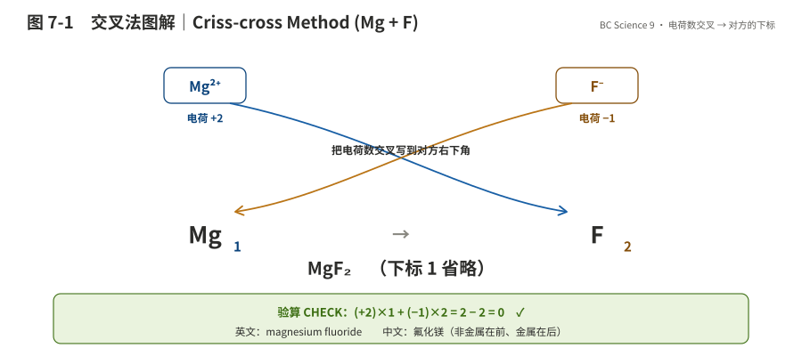
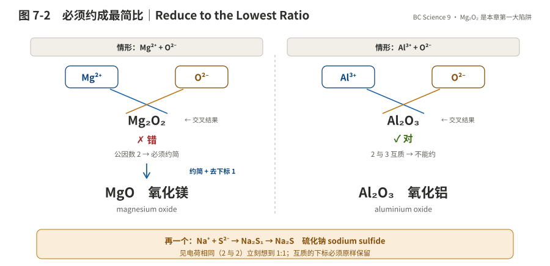
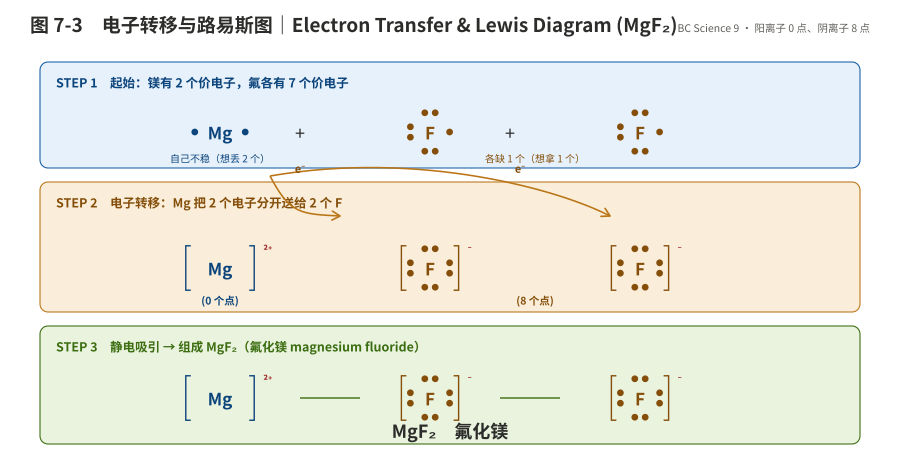
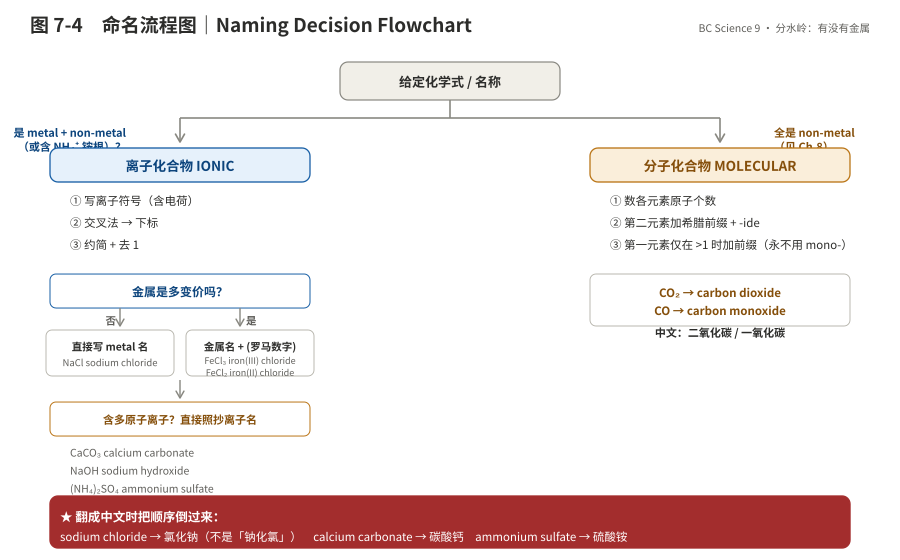
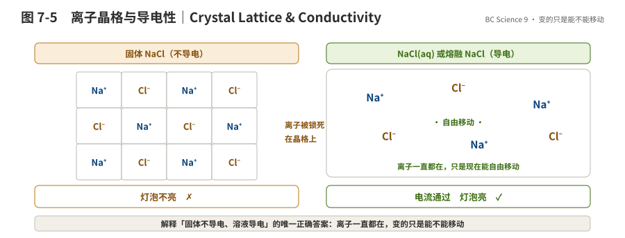
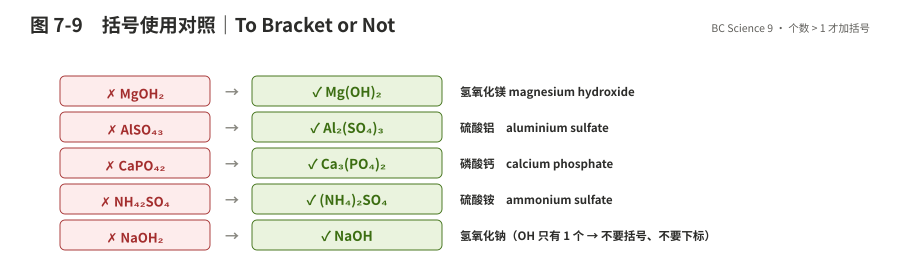
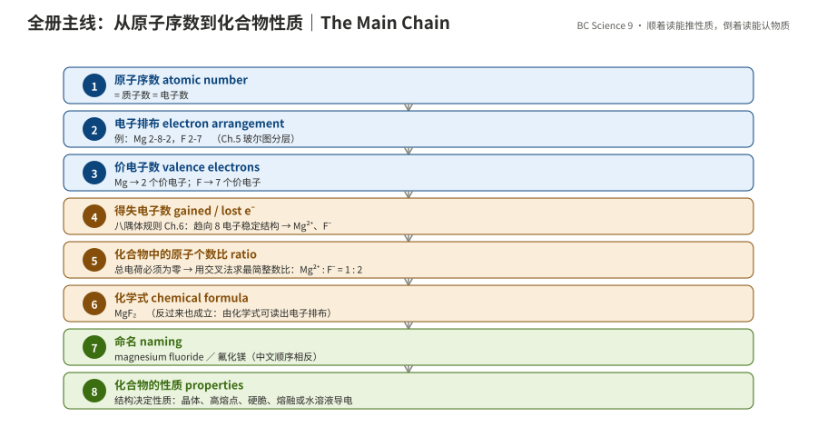

# Ch.7 — Ionic Compounds: Formulas and Naming
## Chapter 7 · Ionic Compounds: Formulas and Naming｜第 7 章　离子化合物：化学式与命名

> 🗂️ **Content Alignment｜大纲对应**：BC Science 9 Content **C2** — *The arrangement of electrons determines the compounds formed by elements*（core chapter｜核心章）
> ⏱️ **Periods｜课时**：3–4　|　**Prerequisites｜前置**：Ch.5 Bohr diagrams｜玻尔图、Ch.6 Ions and Lewis dot diagrams｜离子与路易斯点式　|　**Followed by｜后继**：Ch.8 Molecular (covalent) compounds｜分子（共价）化合物
> 🗂️ **Generated｜文件生成时间**：2026-09-18 00:53

## 1. Content Alignment｜大纲对应

| Item｜项目 | Content｜内容 |
|---|---|
| BC Science 9 Content | **C2** The arrangement of electrons determines the compounds formed by elements |
| Big Idea | **B1** The electron arrangement of atoms impacts their chemical nature.（This chapter is where the whole course comes back to that one sentence｜本章是全册回扣这一句的主战场） |
| Curricular Competencies | [Processing and analyzing] Use knowledge of scientific concepts to draw conclusions consistent with evidence；[Communicating] Communicate scientific ideas using ... scientific language and representations；[Applying and innovating] |
| Beyond Grade 9?｜是否超纲 | No. Anything involving **balancing chemical equations**, **naming acids and bases**, or **solubility tables** is flagged `【🔭 Extension → Science 10】`｜否。凡涉及化学方程式配平、酸碱命名、溶解度表的内容一律标注 `【🔭 Extension → Science 10】` |

This chapter sits directly on **Content C2**: because an atom's electrons are arranged in a particular way, that atom is forced to combine with other atoms in a particular ratio. Everything you will do here — predicting ion charges, criss-crossing them, and writing names — is really just reading the consequences of electron arrangement.

**中文**：本章正对着**内容要点 C2**：原子的电子按某种方式排布，就迫使它只能按某个固定比例与其他原子结合。本章你要做的每一件事——预测离子电荷、交叉电荷数、写名称——本质上都是在读出电子排布的后果。

## 2. Learning Objectives｜学习目标

**EN — By the end of this chapter, you should be able to:**
1. Identify an ionic compound as a combination of a **metal** and a **non-metal** bonded by **transfer of electrons**.
2. Predict the charge of common ions from group number, and state why the **overall charge must be zero**.
3. Write the formula of a binary ionic compound using the **criss-cross method**, then reduce it to the **lowest whole-number ratio**.
4. Name ionic compounds in English, including **multivalent metals (Roman numerals)** and **polyatomic ions**.
5. Convert English names ↔ Chinese names correctly, remembering that the **Chinese order is reversed**.
   - **中文**：完成英文名 ↔ 中文名的互译，牢记**中文顺序与英文相反**。

**中 — 本章结束后，你应当能够：**
1. 判断离子化合物——**金属 + 非金属**，靠**电子转移（transfer of electrons）**成键。
2. 由族号预测常见离子电荷，并说明为什么化合物**总电荷（overall charge）必须为零**。
3. 用**交叉法（criss-cross method）**写二元离子化合物的化学式，并把比例**约成最简整数比（lowest whole-number ratio）**。
4. 用英文命名离子化合物，含**多变价金属（罗马数字 Roman numeral）**与**多原子离子（polyatomic ion）**两类情况。
5. 完成英文名 ↔ 中文名的互译，牢记**中文顺序与英文相反**。

## 3. Concept Explanations｜概念解析

### 3.1 Ionic Compound｜离子化合物

**Definition｜定义**：An **ionic compound（离子化合物）** is a compound formed when a **metal** atom **transfers** electrons to a **non-metal** atom, producing oppositely charged **ions（离子）** that attract each other.

In plain terms, a metal atom on the left of the periodic table gives up its outer electrons, a non-metal atom on the right accepts them, and the two opposite charges then lock together.

**中文**：**离子化合物**是由**金属元素**与**非金属元素**通过**电子转移（transfer of electrons）**形成的化合物。周期表左侧的金属把最外层电子交出去，右侧的非金属接收它们，正负电荷随后锁在一起。

- A **metal loses** electrons and becomes a positively charged **cation（阳离子）**, such as Na⁺ or Mg²⁺.
  - **中文**：金属**失去**电子 → 变成 **cation 阳离子**（正离子，如 Na⁺、Mg²⁺）。
- A **non-metal gains** those electrons and becomes a negatively charged **anion（阴离子）**, such as Cl⁻ or O²⁻.
  - **中文**：非金属**得到**电子 → 变成 **anion 阴离子**（负离子，如 Cl⁻、O²⁻）。
- The opposite charges pull the ions together by **electrostatic attraction（静电引力）**; that attractive force *is* the **ionic bond（离子键）**.
  - **中文**：正负离子靠**静电引力（electrostatic attraction）**结合，这个引力就是 **ionic bond 离子键**。

> 📏 **Three-step test｜三步判断法**：Look at a substance and ask first, "Is it **metal + non-metal**?" If yes → it is **ionic**. For example, NaCl (Na metal + Cl non-metal) ✓ ionic; CO₂ (C and O are both non-metals) ✗ not ionic — it belongs to Ch.8 as a molecular compound.
> **中文**：看到一种物质，先问"是不是**金属 + 非金属**？" → 是 → **离子化合物（ionic）**。例：NaCl（Na 金属 + Cl 非金属）✓ ionic；CO₂（C + O 都是非金属）✗ 不是（属于 Ch.8 的分子化合物）。

**⚠ Two exceptions you simply have to memorise｜两个必须记住的例外常识**

- **NH₄⁺ ammonium（铵根）** is made entirely of non-metals, but inside a compound it **plays the role of a cation**, so you treat it as the **"metal" side** when classifying (see 3.6 and Fig. 7-9).
  - **中文**：**NH₄⁺ ammonium（铵根）**本身全由非金属组成，但它在化合物里**充当阳离子的角色**，判定时**按"金属"一侧处理**（见 3.6）。
- Do not over-apply the rule when only one kind of compound is possible: **two non-metals together are never ionic**, no exceptions beyond ammonium.
  - **中文**：只有一类化合物时不要乱套：两个非金属之间一定不是 ionic。

### 3.2 The Zero-Charge Rule｜总电荷为零原则

> **The overall charge of an ionic compound must be zero.
> 离子化合物的总电荷必须为零。**

This is the **first principle** of the whole chapter. Every single subscript you write in a formula is decided by it. If the charges do not cancel, the formula does not exist.

**中文**：这是本章的**第一原则**，化学式里每一个下标都由它决定。如果正负电荷不能相抵，这个化学式就不存在。

**Mathematical form｜数学写法**：(charge of cation × number of cations) + (charge of anion × number of anions) = 0

| Example｜例子 | Check｜验算 | Conclusion｜结论 |
|---|---|---|
| NaCl | (+1)×1 + (−1)×1 = 0 | ✓ |
| MgF₂ | (+2)×1 + (−1)×2 = 0 | ✓ |
| Al₂O₃ | (+3)×2 + (−2)×3 = +6 − 6 = 0 | ✓ |
| Mg₂O₂ | (+2)×2 + (−2)×2 = 0（the charge is right｜电荷是对的） | Charge is zero **but the ratio was not reduced**; it must be written **MgO** ✗｜电荷为零**但比例没约简**，必须写成 **MgO** ✗ |

> ⚠️ **The heart of the trap｜易错核心**：Zero total charge is a **necessary** condition, not a **sufficient** one. A formula must also satisfy the **lowest whole-number ratio**.
> **中文**：电荷为零是**必要条件**，不是充分条件。化学式还必须满足"**最简整数比**"。

### 3.3 Criss-cross Method｜交叉法（五个动作）

**Criss-cross method（交叉法）**：Take the **charge number** of each ion and cross it over to become the **subscript（下标）** at the lower right of the *other* ion's symbol, then reduce the ratio to the simplest whole numbers.

**中文**：**交叉法（criss-cross method）**：把正、负离子的**电荷数**交叉写到对方符号的**右下角，变成 subscript（下标）**，再约成最简比。

> 💡 **Five moves in order｜五步口诀**：**① Write the ions｜写离子 → ② Criss-cross｜交叉 → ③ Reduce｜约简 → ④ Drop the 1｜去 1 → ⑤ Check｜验算**

| Step｜步骤 | Action English｜动作 | Chinese｜中文 | Example: magnesium + fluorine｜例：镁 + 氟 |
|---|---|---|---|
| ① Write the ions｜写离子 | Write the two ions | 写出两个离子符号（正离子在前） | Mg²⁺　F⁻ |
| ② Criss-cross｜交叉 | Criss-cross the charges | 电荷数交叉，落到对方右下角 | Mg₁F₂ → MgF₂ |
| ③ Reduce｜约简 | Reduce the ratio | 若两个下标有公因数就约掉 | 1 和 2 无公因数，不动 |
| ④ Drop the 1｜去 1 | Drop the subscript 1 | 下标为 1 时**不写** | MgF₂ |
| ⑤ Check｜验算 | Check total charge = 0 | 代回验算 | +2 + 2(−1) = 0 ✓ |

**Reducing to the lowest ratio (always examined)｜最简比的例子（必考）**

| Ions｜离子 | After criss-cross｜交叉后 | Reduce｜约简 | Final formula｜最终化学式 | English / Chinese｜英文 / 中文 |
|---|---|---|---|---|
| Mg²⁺ + O²⁻ | Mg₂O₂ | 2:2 → **1:1** | **MgO** | magnesium oxide 氧化镁 |
| Ca²⁺ + S²⁻ | Ca₂S₂ | 2:2 → 1:1 | **CaS** | calcium sulfide 硫化钙 |
| Zn²⁺ + O²⁻ | Zn₂O₂ | 2:2 → 1:1 | **ZnO** | zinc oxide 氧化锌 |
| Sn⁴⁺ + O²⁻ | Sn₂O₄ | 2:4 → **1:2** | **SnO₂** | tin(IV) oxide 氧化锡(IV) |
| Pb⁴⁺ + Cl⁻ | PbCl₄ | 1:4 already lowest｜已最简 | **PbCl₄** | lead(IV) chloride 氯化铅(IV) |

> **⚠ Whenever the two charge numbers are the same (2+ with 2−, or 1+ with 1−), the answer is always 1:1 — never 2:2.** Mg₂O₂, Na₂S₂ and Ba₂O₂ are all wrong.
> **中文**：**凡是看到两个电荷数相同（如 2+ 与 2−、1+ 与 1−），答案一定是 1:1，绝不能写 2:2**（Mg₂O₂、Na₂S₂、Ba₂O₂ 全错）。

### 3.4 Parentheses｜括号规则

When the number of a **polyatomic ion（多原子离子）** in a formula is **greater than 1**, you must put that ion inside **round brackets（圆括号）** and write the subscript **outside** the closing bracket.

**中文**：当**多原子离子（polyatomic ion）**的个数**大于 1** 时，必须给它加**圆括号**，下标写在括号**外面**。

| Situation｜情况 | How to write｜写法 | Examples｜例子 | Note｜说明 |
|---|---|---|---|
| Number = 1｜个数 = 1 | No brackets, no subscript｜不写括号、不写下标 | NaOH、KNO₃、CaCO₃ | OH⁻、NO₃⁻、CO₃²⁻ 各只有 1 个 |
| Number > 1｜个数 > 1 | Brackets are compulsory｜必须加括号 | Mg(OH)₂、Ca(OH)₂、Al(OH)₃、(NH₄)₂SO₄、Ca₃(PO₄)₂、Al₂(SO₄)₃ | The brackets say "the whole group × N"｜括号宣告"整团原子 × N" |

The brackets are a message about grouping: `Mg(OH)₂` means "one Mg²⁺ plus **two whole OH⁻ groups**", i.e. two oxygen atoms and two hydrogen atoms. Without the brackets, the reader cannot tell whether the subscript applies to the last atom or to the whole cluster.

**中文**：括号传递的是"整体"的信息：`Mg(OH)₂` 表示"1 个 Mg²⁺ 加**两个完整的 OH⁻ 原子团**"，也就是 2 个氧原子和 2 个氢原子。没有括号，读者无法判断下标是只作用于最后一个原子，还是作用于整团原子。

> **⚠ Never write MgOH₂ or AlSO₄₃** — that changes the meaning of the ion group.
> **中文**：**绝对不能写成 MgOH₂ 或 AlSO₄₃** —— 那样会改变原子团的意义。
> But when the polyatomic ion is itself the **positive** ion — the NH₄⁺ inside `(NH₄)₂SO₄` — it follows the same rule: it is written first (because it is the cation) **and** it still needs brackets, because there are two of them.
> **中文**：但如果**多原子离子本身就是正离子**（如 `(NH₄)₂SO₄` 里的 NH₄⁺），因为它是**正离子**，按规则写在前面，同样要加括号。

### 3.5 English Naming Rules｜英文命名三规则

**Rule 1 (basic binary｜二元)**：Keep the **metal name unchanged** + the **non-metal root + `-ide`**.

**中文**：**规则 1（二元 basic binary）**：金属名照写 + 非金属**词根 + `-ide`**。

**Rule 2 (multivalent metal｜多变价金属)**：Metal name + a **Roman numeral in brackets** (the numeral equals the **charge of that metal ion**) + the non-metal root with `-ide`.

**中文**：**规则 2（多变价 multivalent metal）**：金属名 + **罗马数字加括号**（罗马数字 = 该金属离子的电荷数）+ 非金属词根 `-ide`。

**Rule 3 (polyatomic ion present｜含多原子离子)**：Copy the **ion name exactly as it is** — change **no ending at all**. Carbonate stays carbonate; sulfate stays sulfate.

**中文**：**规则 3（含多原子离子 polyatomic ion）**：直接照抄该离子名（**不做任何词尾改动**）。carbonate 还是 carbonate，sulfate 还是 sulfate。

> 💡 **One sentence to memorise｜死记一句话**：The Roman numeral is the **charge**, not the number of atoms. In iron(III) chloride, the III refers to **Fe³⁺**; it does **not** mean "three irons".
> **中文**：罗马数字 = **电荷数**，不是原子个数。iron(III) chloride 的 III 指 Fe³⁺，**不是**"3 个铁"。

### 3.6 ⭐ Spotlight: English and Chinese Name Order Are Reversed｜专题：英中命名顺序相反（本章最重 ⭐）

This is the single most important idea in the chapter for a student whose first language is Chinese. **English reads the positive ion first; Chinese reads the negative ion first.** If you simply translate word by word, you will get every name backwards.

**中文**：对母语为中文的学生，这是本章最重要的一点。**英文正离子在前，中文负离子在前。**如果逐字直译，每一个名字都会写反。

| | English｜英文 | Chinese｜中文 |
|---|---|---|
| **Order｜顺序** | **positive ion first** → `metal + non-metal-ide`｜**正离子在前** | **negative ion first** → `某化某` = **non-metal first + "化" + metal last**｜**负离子在前** → `某化某` = **非金属在前 + "化" + 金属在后** |
| **sodium chloride** | sodium (钠, the cation｜正离子) → chloride (氯, the anion｜负离子) | **氯化钠**（氯在前，钠在后） |
| **magnesium oxide** | magnesium（镁）→ oxide（氧） | **氧化镁**（氧在前，镁在后） |
| **aluminium sulfide** | aluminium（铝）→ sulfide（硫） | **硫化铝**（硫在前，铝在后） |
| **calcium carbonate** | calcium（钙）→ carbonate（碳酸根） | **碳酸钙**（碳酸根在前，钙在后） |
| **sodium hydroxide** | sodium（钠）→ hydroxide（氢氧根） | **氢氧化钠**（氢氧根在前） |
| **ammonium sulfate** | ammonium（铵）→ sulfate（硫酸根） | **硫酸铵**（硫酸根在前，铵在后） |

> **🚨 Warning number one for Chinese-speaking students｜对中国学生的头号警示**：If you write the Chinese name in the same order you read the English, you will get it wrong every time.
> **中文**：英文读到什么就顺着写中文，**一定写反**。
> ✗ **"钠化氯"** — wrong｜错！正确是 **氯化钠**。
> ✗ **"镁化氧"** — wrong｜错！正确是 **氧化镁**。
> ✗ **"铝化硫"** — wrong｜错！正确是 **硫化铝**。
> ✅ Memory trick｜记忆技巧：In Chinese, read it as "**negative first, positive last**" — exactly the reverse of English.
> ✅ 记忆技巧：中文读法 **"负在前、正在后"**，跟英文正好掉个个儿。

A useful way to check yourself: look at the English name, find the word that ends in `-ide` (or the polyatomic ion name), put that word at the **front** of the Chinese name, add 化 if it is an `-ide`, then put the metal at the end.

**中文**：一个自检办法：看英文名，找出以 `-ide` 结尾的词（或多原子离子名），把它放到中文名的**最前面**，若是 `-ide` 类就加"化"，最后才放金属名。

**`-ide` matched to the Chinese "化"｜`-ide` 对照中文的"化"**

| English `-ide` | 中文 | English `-ide` | 中文 |
|---|---|---|---|
| oxide | 氧化物 | bromide | 溴化物 |
| chloride | 氯化物 | iodide | 碘化物 |
| sulfide | 硫化物 | phosphide | 磷化物 |
| nitride | 氮化物 | hydride | 氢化物 |
| fluoride | 氟化物 | carbide | 碳化物 |

### 3.7 Multivalent Metals｜多变价金属与中文对照

A **multivalent（多变价）** metal is one that can form more than one stable ion. Because "iron chloride" would be ambiguous — it could mean FeCl₂ or FeCl₃ — English adds a Roman numeral, and Chinese uses a different word for the lower charge.

**中文**：**多变价金属（multivalent metal）**是能形成一种以上稳定离子的金属。"iron chloride"有歧义（可能是 FeCl₂ 也可能是 FeCl₃），所以英文加罗马数字，中文则对低价态另用一个字。

| English name | 中文 | Ion｜离子 | Example: chloride（English）例：氯化物 | Chinese name｜中文名 |
|---|---|---|---|---|
| iron(II) | 亚铁 | Fe²⁺ | iron(II) chloride | **氯化亚铁** |
| iron(III) | 铁 | Fe³⁺ | iron(III) chloride | **氯化铁** |
| copper(I) | 亚铜 | Cu⁺ | copper(I) oxide | **氧化亚铜** |
| copper(II) | 铜 | Cu²⁺ | copper(II) oxide | **氧化铜** |
| lead(II) | 铅 | Pb²⁺ | lead(II) oxide | **氧化铅(II)** |
| lead(IV) | 铅(IV) | Pb⁴⁺ | lead(IV) oxide | **二氧化铅** |
| tin(II) | 亚锡 | Sn²⁺ | tin(II) chloride | **氯化亚锡** |

The pattern in Chinese is worth noticing: the character **亚** marks the **lower** charge, while the plain element name marks the **higher** one. 亚铁 = Fe²⁺, 铁 = Fe³⁺; 亚铜 = Cu⁺, 铜 = Cu²⁺; 亚锡 = Sn²⁺.

**中文**：中文的规律值得注意：**亚**字标**低价**，不带"亚"的元素名标**高价**。亚铁 = Fe²⁺，铁 = Fe³⁺；亚铜 = Cu⁺，铜 = Cu²⁺；亚锡 = Sn²⁺。

> 🌐 **Two acceptable Chinese styles｜中文两套写法并存**：Both **"氯化铁"** and **"三氯化铁"** are accepted; the second uses number prefixes and reads more like the English name.
> **中文**：**"氯化铁 / 三氯化铁"** 都可以，后者用数字前缀，更接近英文的 read-back。
> ⚠️ **Note｜注意**：Only **multivalent** metals need a Roman numeral. Na⁺, Mg²⁺, Ca²⁺, Al³⁺, Zn²⁺ and Ag⁺ have **fixed** charges, so they **never** take a Roman numeral — writing "sodium(I) chloride" is wrong.
> **中文**：只有**多变价**金属才需要标罗马数字。Na⁺、Mg²⁺、Ca²⁺、Al³⁺、Zn²⁺、Ag⁺ 电荷固定，**永远不加罗马数字**（写 sodium(I) chloride 是错的）。

### 3.8 Properties of Ionic Compounds｜离子化合物的性质

| Property｜性质 | English explanation | 中文 | Why｜原因 |
|---|---|---|---|
| Crystalline solid | They form a regular crystal lattice. | 常温下是**晶体**（离子晶格） | Positive and negative ions line up in a repeating geometric pattern｜正负离子按几何规律周期性排列 |
| High melting / boiling point | Strong electrostatic forces need much energy to break. | **熔沸点高**（NaCl 熔点 801 ℃，MgO 2852 ℃） | The ionic bond is strong, so breaking it costs a lot of energy｜离子键很强，破坏它需要大量能量 |
| Hard but brittle | Layers shift and like charges repel → shatters. | **硬而脆**，敲击会碎裂 | When layers slip, ions of the same charge come face to face and the crystal flies apart｜错位时同号离子相邻，瞬间互斥崩解 |
| Conductivity | **Conduct electricity when molten or dissolved**；do **not** conduct as a solid. | **溶于水或熔融时导电**，固体**不导电** | In a solid the ions are locked in the lattice and cannot move; melting or dissolving **frees** them, and moving charges are a current｜固体内离子被"锁"在晶格上不能移动；溶解或熔化后离子**可以自由移动**形成电流 |
| Solubility | Many dissolve in water. | 多数可溶于水 | Water molecules can pull the ions apart｜水分子能拉开离子【更深入的溶解度规律属 `【🔭 Extension → Science 10】`】 |

The property that BC exams return to again and again is **conductivity**, and the correct explanation is always about *movement*, not about the *existence* of ions. The ions are present in solid sodium chloride — they simply cannot travel.

**中文**：BC 考试反复考的性质是**导电性**，而正确的解释永远是"能不能移动"，不是"有没有离子"。固态氯化钠里离子一直存在，只是不能移动。

> 🧪 **BC lab focus｜BC 实验考点**：An **electrolyte（电解质）** is a substance whose water solution or molten state conducts electricity. Sodium chloride is a typical electrolyte; sucrose (a molecular compound) is not.
> **中文**：**electrolyte 电解质** = 其水溶液或熔融态能导电的物质，NaCl 是典型电解质，蔗糖（分子化合物）不是。

## 4. Comparison Tables｜表格比对

### Table 7-1　Monatomic Ion Charges by Group｜常见单原子离子电荷

| Group｜族 | 1 | 2 | 13 | 14 | 15 | 16 | 17 | 18 |
|---|---|---|---|---|---|---|---|---|
| Ion charge｜电荷 | +1 | +2 | +3 | ±4 | −3 | −2 | −1 | 0（does not form ions｜不成离子） |
| English example | Na⁺ sodium | Mg²⁺ magnesium | Al³⁺ aluminium | rare｜少见 | N³⁻ nitride | O²⁻ oxide | Cl⁻ chloride | — |
| 中文 | 钠离子 | 镁离子 | 铝离子 | — | 氮离子 | 氧离子 | 氯离子 | — |

Read this table left to right and you can see the reason behind every charge: atoms in Groups 1, 2 and 13 **lose** 1, 2 or 3 electrons to empty their outer shell; atoms in Groups 15, 16 and 17 **gain** 3, 2 or 1 electrons to fill theirs. Group 18 atoms already have a full outer shell, so they form no ions at all.

**中文**：从左到右读这张表，每个电荷的来历一目了然：第 1、2、13 族原子**失去** 1、2、3 个电子以清空最外层；第 15、16、17 族原子**得到** 3、2、1 个电子以填满最外层。第 18 族最外层已满，因此根本不成离子。

### Table 7-2　Polyatomic Ions to Memorise｜必须背的多原子离子

| Symbol | English name | 中文名 | Charge |
|---|---|---|---|
| NH₄⁺ | ammonium | 铵根 | +1 |
| OH⁻ | hydroxide | 氢氧根 | −1 |
| NO₃⁻ | nitrate | 硝酸根 | −1 |
| HCO₃⁻ | hydrogen carbonate (bicarbonate) | 碳酸氢根 | −1 |
| CO₃²⁻ | carbonate | 碳酸根 | −2 |
| SO₄²⁻ | sulfate | 硫酸根 | −2 |
| PO₄³⁻ | phosphate | 磷酸根 | −3 |

A **polyatomic ion（多原子离子）** is a group of atoms that carries a charge and behaves as a **single unit** in a compound. Treat it like one tile in a game: it moves around whole, and it keeps its own name in both languages.

**中文**：**多原子离子**是带电的原子团，在化合物中作为**一个整体**行动。把它当成一块积木：整块搬动，名称在中英两种语言里都照抄不改。

### Table 7-3　Multivalent Metals: Roman Numeral ↔ Chinese｜多变价金属：罗马数字 ↔ 中文

| Element｜元素 | Charges | English (Roman) | 中文离子名 | Example English → formula｜举例 | 中文名 |
|---|---|---|---|---|---|
| Fe 铁 | +2, +3 | iron(II) / iron(III) | 亚铁离子 / 铁离子 | iron(II) chloride → **FeCl₂**；iron(III) chloride → **FeCl₃** | 氯化亚铁 / 氯化铁 |
| Cu 铜 | +1, +2 | copper(I) / copper(II) | 亚铜离子 / 铜离子 | copper(I) oxide → **Cu₂O**；copper(II) oxide → **CuO** | 氧化亚铜 / 氧化铜 |
| Pb 铅 | +2, +4 | lead(II) / lead(IV) | 铅(II)离子 / 铅(IV)离子 | lead(IV) oxide → **PbO₂** | 二氧化铅 |

Notice how the two directions work. Going **name → formula**, the Roman numeral tells you the charge directly. Going **formula → name**, you must *calculate* the charge from the zero-charge rule (see Fig. 7-7).

**中文**：注意两个方向的做法。**名称 → 化学式**时，罗马数字直接告诉你电荷；**化学式 → 名称**时，必须靠总电荷为零**算出**电荷（见 Fig. 7-7 ）。

### Table 7-4　Naming Checklist: Three Rules vs Chinese｜命名 check 清单：三规则 vs 中文

| Situation｜情景 | English rule｜英文规则 | Chinese rule｜中文规则 | Example English → Chinese｜例 |
|---|---|---|---|
| Fixed-charge metal + non-metal｜固定价金属 + 非金属 | metal + non-metal root **-ide** | 非金属 + 化 + 金属 | NaCl sodium chloride → 氯化钠 |
| Multivalent metal + non-metal｜多变价金属 + 非金属 | metal + **(Roman numeral)** + root **-ide** | same, number prefixes also allowed｜同上（可加数字前缀） | Fe₂O₃ iron(III) oxide → 氧化铁（三氧化二铁） |
| Contains a polyatomic ion｜含多原子离子 | copy the ion name unchanged｜直接照抄离子名 | ion group first + metal last｜原子团在前 + 金属在后 | CaCO₃ calcium carbonate → 碳酸钙 |
| Contains OH⁻ (a base)｜含 OH⁻（碱） | metal + **hydroxide** | 氢氧根在前 → **氢氧化某** | NaOH sodium hydroxide → 氢氧化钠【酸碱性质与中和反应属 `【🔭 Extension → Science 10】`】 |
| Contains NH₄⁺ (an ammonium salt)｜含 NH₄⁺（铵盐） | **ammonium** + ion group name｜**ammonium** + 原子团名 | ion group first + **铵** last｜原子团在前 + **铵**在后 | (NH₄)₂SO₄ ammonium sulfate → 硫酸铵 |

### Table 7-5　Ionic vs Molecular (Covalent) Compounds｜离子化合物 vs 分子（共价）化合物（先剧透，Ch.8 详述）

| Item｜比较项 | Ionic compound｜离子化合物 | Molecular (covalent) compound｜分子化合物 |
|---|---|---|
| Element combination｜元素组合 | **metal + non-metal**｜金属 + 非金属 | **non-metal + non-metal**｜非金属 + 非金属 |
| Bonding｜成键方式 | **transfer of electrons**｜电子转移 | **sharing of electrons**｜电子共用 |
| Unit particle｜粒子单位 | formula unit｜化学式单元（没有独立分子） | molecule｜分子 |
| English naming｜英文命名 | metal + `-ide`；Roman numerals；**no prefixes**｜用罗马数字；**不用前缀** | Greek prefixes mono-/di-/tri-…｜用希腊前缀 |
| Melting / boiling point｜熔沸点 | **high**｜高 | **low**｜低 |
| Conductivity｜导电 | conducts when molten or in solution｜熔融或水溶液**导电** | does **not** conduct｜**不导电** |
| Examples｜例子 | NaCl、MgO、CaCO₃ | H₂O、CO₂、CH₄ |

Keep this table in mind as a preview only. The one line that decides everything is the first row: **is there a metal?** If yes, you are in this chapter; if no, you are in Ch.8. Naming, formulas, and even the way you explain the properties all follow from that single decision.

**中文**：这张表只是预告。真正决定一切的是第一行：**有没有金属？**有 → 用本章规则；没有 → 走 Ch.8。命名、化学式、乃至解释性质的方式，都由这一个判断派生出来。

## 5. Diagrams & Worked Examples｜图例说明

### Fig. 7-1　Criss-cross Method (Mg + F)｜交叉法图解



**What to look for｜看图要点**：The **2** from Mg²⁺ lands at the lower right of F and becomes F₂, while the **1** from F⁻ lands on Mg but is **never written**. Every time you cross charges over, add one silent check in your head: does the total come to zero?

**中文**：**2** 落到 F 的右下角变成 F₂，**1** 落到 Mg 上但**不写**。凡是"电荷数交叉"都要在心里补一句验算。

### Fig. 7-2　Reduce to the Lowest Ratio｜必须约成最简比



**What to look for｜看图要点**：**Mg₂O₂ is the number-one trap of this chapter** — when you see a charge of 2 paired with 2, think "1:1" immediately. By contrast, the 2 and 3 in Al₂O₃ share no common factor, so they must be kept exactly as they are.

**中文**：**Mg₂O₂ 是本章第一大陷阱**，见电荷 2 与 2 立刻想"1:1"。反过来 Al₂O₃ 的 2 和 3 互质，必须原样保留。

### Fig. 7-3　Electron Transfer & Lewis Diagram (MgF₂)｜电子转移与路易斯图



**What to look for｜看图要点**：The cation **Mg²⁺ is drawn with zero dots** (it has lost them all); each anion F⁻ is drawn inside **square brackets with 8 dots and the charge**. In Chinese the name puts 氟 first and 镁 last.

**中文**：阳离子 **Mg²⁺ 外面 0 个点**（电子已全部失去）；阴离子 F⁻ 画**方括号 + 8 个点 + 电荷**。中文名**氟在前镁在后**。

### Fig. 7-4　Naming Decision Flowchart｜命名流程图



**What to look for｜看图要点**：The first question — **metal + non-metal?** — is the watershed for the entire decision tree. The Chinese name is the **last** step, and it must be written in **reverse order**.

**中文**：先判断 **metal + non-metal？** 这是整条线的分水岭；中文命名是最后一步，**一定要倒序**。

### Fig. 7-5　Crystal Lattice & Conductivity｜离子晶格与导电性



**What to look for｜看图要点**：The ions are always there — **what changes is only whether they can move**. That is the only correct answer to "why doesn't the solid conduct but the solution does?"

**中文**：离子一直都在，**变的只是能不能移动**。这是解释"固体不导电、溶液导电"的唯一正确答案。

### Fig. 7-6　Worked Example A｜例题 A（基础：交叉法）

**Problem｜题目**：Write the formula and both names for the compound formed from **calcium** and **nitrogen**. 写出钙与氮形成的化合物的化学式和中文名。

**Step-by-step｜逐步解析**：

| Step | Content｜内容 | Result｜结果 |
|---|---|---|
| 1 | Identify the ions｜判断离子：Ca is in Group 2 → **Ca²⁺**；N is in Group 15 → **N³⁻** | Ca²⁺　N³⁻ |
| 2 | Criss-cross the charges 2 and 3｜交叉电荷数 2 与 3 | Ca₃N₂ |
| 3 | Reduce：3 and 2 are **coprime**, so nothing to reduce｜约简：3 与 2 **互质**，不能再约 | Ca₃N₂ |
| 4 | Drop the 1：no subscript 1 appears｜去 1：没有下标 1 | Ca₃N₂ |
| 5 | Check：(+2)×3 + (−3)×2 = 6 − 6 = **0** ✓ | ✓ |
| 6 | English name：metal unchanged + non-metal root **-ide** → nitr**ide** | **calcium nitride** |
| 7 | Chinese name：**reverse the order** → nitrogen first + 化 + calcium last｜**倒序** → 氮在前 + 化 + 钙在后 | **氮化钙** |

**Answer｜答案**：**Ca₃N₂，calcium nitride，氮化钙**。

> ✏️ Try the same moves｜同理练一题：`Al³⁺ + Cl⁻` → **AlCl₃**, aluminium chloride，**氯化铝**（Al is fixed at +3, so **no Roman numeral**｜Al 固定 +3，**不加罗马数字**）。
> **中文**：`Al³⁺ + Cl⁻` → **AlCl₃**，aluminium chloride，**氯化铝**。Al 只有 +3 一种电荷，**不加罗马数字**。

### Fig. 7-7　Worked Example B｜例题 B（多变价：罗马数字）

**Problem｜题目**：Name **FeCl₃** in English and Chinese. Then give the formula of **copper(II) oxide**. 命名 FeCl₃（英文 + 中文），再写出氧化铜的化学式。

**Step-by-step｜逐步解析**：

```
  Part 1  FeCl₃ —— work backwards to the charge of the iron ion
  （罗马数字不是瞎猜的，是算出来的）

     总电荷为零 Total charge = 0：x + 3×(−1) = 0   →   x = +3
        ↓
     Fe is Fe³⁺ → write the Roman numeral (III)｜Fe 是 Fe³⁺ → 写罗马数字 (III)
        ↓
     English: iron(III) chloride
     Chinese: 「铁离子」→ 氯化铁（也叫 三氯化铁）
     ⚠ Writing just "iron chloride" is wrong｜若写成 iron chloride（缺罗马数字）—— 错，
       because iron has more than one charge, so the name is incomplete.
       因为铁有多价，信息不全。

  Part 2  copper(II) oxide —— from the Roman numeral back to the formula

     Roman numeral (II) → Cu²⁺；oxide → O²⁻
        ↓
     Criss-cross｜交叉：Cu₂O₂  →  reduce｜约简  →  CuO
        ↓
     Check｜验算：(+2) + (−2) = 0  ✓         Formula｜化学式：CuO
     Chinese: copper(II) = 铜 → 氧化铜（注意不是「氧化亚铜」）

  对照记忆 Compare and remember：
     Cu₂O  copper(I)  oxide  氧化亚铜   ← 「亚」= 低价 lower charge
     CuO   copper(II) oxide  氧化铜     ← 无「亚」= 高价 higher charge
     FeCl₂ iron(II)  chloride 氯化亚铁
     FeCl₃ iron(III) chloride 氯化铁
```

**Answer｜答案**：FeCl₃ = **iron(III) chloride，氯化铁**；copper(II) oxide = **CuO，氧化铜**。

### Fig. 7-8　Worked Example C｜例题 C（多原子离子 + 中英互译）

**Problem｜题目**：(a) Write the formula for **aluminium sulfate**. (b) 把 **硫酸铵、氢氧化钠、碳酸钙** 翻译成英文并写出化学式。

**Step-by-step｜逐步解析**：

```
  (a) aluminium sulfate
      ions｜离子：Al³⁺   SO₄²⁻
      criss-cross｜交叉：Al₂(SO₄)₃        ← SO₄ appears 3 times → brackets｜加括号
      reduce｜约简：2 与 3 互质，不动 (2 and 3 are coprime, leave them)
      check｜验算：(+3)×2 + (−2)×3 = 6 − 6 = 0 ✓
      English: aluminium sulfate   中文: 硫酸铝

  (b) Chinese → English —— split off the ion groups first, then rebuild in English order
      （先把原子团拆出来，再按英文顺序 cation first 重排）
      ┌──────────────┬──────────────┬────────────────┬───────────────────┐
      │ 中文        │ 拆（负离子 / 正离子） │ English          │ Formula            │
      ├──────────────┼──────────────┼────────────────┼───────────────────┤
      │ 硫酸铵      │ SO₄²⁻ / NH₄⁺ │ ammonium sulfate│ (NH₄)₂SO₄         │
      │ 氢氧化钠    │ OH⁻  / Na⁺   │ sodium hydroxide│ NaOH              │
      │ 碳酸钙      │ CO₃²⁻/ Ca²⁺  │ calcium carbonate│ CaCO₃            │
      └──────────────┴──────────────┴────────────────┴───────────────────┘
      check｜验算：(NH₄)₂SO₄ → (+1)×2 + (−2) = 0 ✓
            NaOH     → (+1) + (−1) = 0 ✓
            CaCO₃    → (+2) + (−2) = 0 ✓
```

**Answer｜答案**：(a) **Al₂(SO₄)₃**；(b) **ammonium sulfate (NH₄)₂SO₄；sodium hydroxide NaOH；calcium carbonate CaCO₃**。

> **⚠ Do not add a "化" when the Chinese name is a 某酸某 name｜中文"某酸某"不要读出"化"字**：碳酸钙 has no 化, and neither do 氢氧化钠 or 硫酸铵. Only binary `-ide` compounds contain 化（氯化钠、氧化镁、硫化铝）.
> **中文**：**碳酸钙没有"化"，氢氧化钠、硫酸铵也**没有"化"**。只有 `-ide` 类的二元化合物才有"化"**（氯化钠、氧化镁、硫化铝）。

### Fig. 7-9　To Bracket or Not｜括号使用对照



**What to look for｜看图要点**：**Add brackets only when the number is greater than 1; when the number is 1, add nothing at all.**

**中文**：**个数 > 1 才加括号，个数 = 1 什么都不加。**

## 6. Key Vocabulary｜核心词汇

| English | 中文 | Note｜备注 |
|---|---|---|
| ionic compound | 离子化合物 | metal + non-metal |
| ionic bond | 离子键 | electrostatic attraction｜静电引力 |
| transfer of electrons | 电子转移 | the essence of ionic bonding｜ionic 的本质 |
| cation | 阳离子 | metal loses electrons → positive｜金属失电子，带正电 |
| anion | 阴离子 | non-metal gains electrons → negative｜非金属得电子，带负电 |
| chemical formula | 化学式 | — |
| subscript | 下标 | the small number at the lower right｜右下角数字 |
| overall charge = zero | 总电荷为零 | the first principle｜第一原则 |
| lowest whole-number ratio | 最简整数比 | must reduce｜必须约简 |
| criss-cross method | 交叉法 | the five-step chant｜五步口诀 |
| reduce | 约简 | Mg₂O₂ → MgO |
| parentheses / brackets | 圆括号 | used when a polyatomic ion count > 1｜多原子离子个数 >1 时用 |
| binary compound | 二元化合物 | contains only 2 elements｜只含 2 种元素 |
| -ide | ……化物 | oxide / chloride / sulfide |
| multivalent / variable charge | 多变价的 | Fe、Cu、Pb、Sn |
| Roman numeral | 罗马数字 | **shows the charge**, written in brackets｜**表示电荷数**，写在括号里 |
| polyatomic ion | 多原子离子 | a charged group of atoms｜带电的原子团 |
| ammonium / hydroxide / carbonate / sulfate / nitrate / phosphate | 铵根 / 氢氧根 / 碳酸根 / 硫酸根 / 硝酸根 / 磷酸根 | 7 ions to memorise｜必背（见 Table 7-2 ） |
| crystal lattice | 晶格 | — |
| melting / boiling point | 熔点 / 沸点 | both high for ionic compounds｜ionic 都高 |
| conduct electricity | 导电 | requires molten or aqueous｜需 molten 或 aqueous |
| electrolyte | 电解质 | conducts in solution or when molten｜水溶液/熔融能导电的物质 |
| brittle | 脆的 | hard & brittle｜硬而脆 |
| electrostatic attraction | 静电引力 | the source of the ionic bond｜离子键的来源 |

## 7. Lab / Activity｜实验与活动

### Activity 7-1　Conductivity Lab｜导电性测试 ⭐

- **Type｜类型**：group hands-on investigation｜分组实验（Hands-on）
- **Materials｜材料**：a 9 V battery with a small bulb (or an LED with a resistor), two graphite electrodes, beakers；solid NaCl, distilled water, NaCl solution, sucrose C₁₂H₂₂O₁₁ solution, MgO powder suspension｜9 V 电池 + 小灯泡（或 LED + 电阻）、石墨电极 2 支、烧杯；固体 NaCl、蒸馏水、NaCl 溶液、蔗糖溶液、MgO 粉末悬浊液
- **Procedure｜步骤**：
  1. **Predict｜预测**：rank the five samples from "will conduct" to "will not conduct", and write a reason for each.
     - **中文**：先把 5 种样品按"会不会导电"排序并写出理由。
  2. **Rinse the electrodes with distilled water between every sample**, then record the bulb brightness (off / dim / bright).
     - **中文**：电极**每次用蒸馏水冲洗**，分别插入各样品，记录灯泡亮度（不亮 / 微亮 / 亮）。
  3. Fill in the results table｜把结论填表：

  | Sample｜样品 | Prediction｜预测 | Brightness｜亮度 | Particles inferred｜推断的粒子种类 |
  |---|---|---|---|
  | distilled water｜蒸馏水 | | | |
  | solid NaCl｜固体 NaCl | | | |
  | NaCl solution｜NaCl 溶液 | | | |
  | sucrose solution｜蔗糖溶液 | | | |

- **Competencies｜训练能力**：[Processing and analyzing] Use knowledge of scientific concepts to draw conclusions consistent with evidence；[Questioning and predicting]｜使用科学概念得出与证据一致的结论；提问与预测
- **Safety｜安全**：⚠ Wear **goggles** for the whole activity; **never** short the battery by connecting its terminals directly with a wire (it gets hot); wash your hands afterwards; pour every solution into the collection beaker your teacher designates (**never taste anything**).
  - **中文**：⚠ 全程佩戴 **goggles 护目镜**；电池两极**禁止直接用导线短接**（会发烫）；实验后洗手；所有溶液按教师指示倒指定回收杯（**禁止品尝**）。

### Activity 7-2　Ion Pairing Cards｜离子配对卡牌

- **Type｜类型**：team game｜小组竞赛（Game-based）
- **Materials｜材料**：cation cards (Na⁺、K⁺、Mg²⁺、Ca²⁺、Al³⁺、NH₄⁺、Fe²⁺、Fe³⁺、Cu²⁺) × anion cards (F⁻、Cl⁻、Br⁻、O²⁻、S²⁻、N³⁻、OH⁻、NO₃⁻、CO₃²⁻、SO₄²⁻、PO₄³⁻)
- **Procedure｜步骤**：Each partner draws one card → build the formula with the criss-cross method → **say the full English name aloud** → translate it into Chinese → swap roles. For a multivalent metal you must state the Roman numeral; for a polyatomic ion you must decide whether brackets are needed.
  - **中文**：两人各抽 1 张 → 用交叉法拼出化学式 → **口头说出英文全名** → 再翻成中文 → 交换角色。碰到多变价必须报罗马数字；碰到多原子离子必须判断要不要加括号。
- **Scoring｜加分规则**：A team that completes the "total charge = zero" mental check on the spot earns +1 point｜能当场完成"总电荷为零"口算验算的小组 +1 分。
- **Competencies｜训练能力**：[Communicating] using scientific language and representations｜使用科学语言与表征；[Applying and innovating]
- **Safety｜安全**：none (card activity)｜无（纸牌活动）

### Activity 7-3　Crystal Lattice Model｜晶格模型与"为何脆"

- **Type｜类型**：model building｜动手建模（Model building）
- **Materials｜材料**：clay balls or ping-pong balls in two colours (standing for Na⁺ and Cl⁻), plus a hot-glue gun or bamboo skewers｜两种颜色的黏土球或乒乓球（代表 Na⁺ 与 Cl⁻）、热熔胶 / 竹签
- **Procedure｜步骤**：Build a 3×3×2 NaCl lattice → push the top layer gently with a ruler and watch what happens when like charges meet → write an explanation of **60 characters or fewer**.
  - **中文**：搭出 3×3×2 的 NaCl 晶格 → 用尺子轻推上层，观察"同号离子相遇 → 崩解"的现象 → 画出 ≤ 60 字的解释。
- **Competencies｜训练能力**：[Processing and analyzing] Formulate physical or mental theoretical models；[Evaluating] the limitations of a model｜模型的局限性
- **Safety｜安全**：⚠ A hot-glue gun must be used under teacher supervision to avoid burns｜使用热熔胶枪需教师监督，防烫伤。

## 8. Common Misconceptions｜常见易错点

| # | Misconception｜错误认识 | Correction｜正确理解 |
|---|---|---|
| 1 | "Mg₂O₂ is right, because that is what the criss-cross method gives."｜"Mg₂O₂ 是对的，因为交叉法就是这样" | You must **reduce** after criss-crossing: Mg²⁺ + O²⁻ → Mg₂O₂ → **MgO**. Two ions with equal charge are always 1:1.｜交叉后**必须约简**；电荷相同的两个离子一定是 1:1。 |
| 2 | "The Chinese for sodium chloride is 钠化氯." | Wrong — Chinese puts the **negative ion first**: **氯化钠**. The same applies to 氧化镁、硫化铝、碳酸钙.｜错！中文**负离子在前**。 |
| 3 | "The English name 'iron chloride' is fine." | Iron is **multivalent**, so you must write **iron(II)** or **iron(III) chloride**; otherwise the name is incomplete.｜铁是**多变价**，必须写 iron(II)/iron(III) chloride，否则信息不全。 |
| 4 | "The III in FeCl₃ means there are 3 iron atoms." | The Roman numeral is the **charge of that metal ion** (Fe³⁺); it has nothing to do with the number of atoms.｜罗马数字 = **该金属离子的电荷数**（Fe³⁺），跟原子个数无关。 |
| 5 | "Na⁺ has only one charge, but writing sodium(I) chloride is more careful." | Wrong. Fixed-charge metals **never** take a Roman numeral (Na⁺、Mg²⁺、Ca²⁺、Al³⁺、Zn²⁺、Ag⁺).｜错。固定价金属**永远不加罗马数字**。 |
| 6 | "Mg(OH)₂ can be shortened to MgOH₂." | Wrong. When a polyatomic ion count is > 1, **brackets are required**: **Mg(OH)₂**、Al₂(SO₄)₃、(NH₄)₂SO₄.｜错。个数 >1 必须加**括号**。 |
| 7 | "NaCl is ionic, so its solid conducts too." | Wrong. In the solid the ions are locked in the lattice and **cannot conduct**; only the **molten** or **dissolved** state conducts.｜错。固体中离子被锁在晶格上**不导电**。 |
| 8 | "Anything that is metal + non-metal must dissolve in water." | Wrong. Many ionic compounds (CaCO₃、AgCl) are nearly insoluble — solubility and conductivity are two different questions.｜错。很多离子化合物（如 CaCO₃、AgCl）难溶于水 —— 水溶性与导电性是两回事。 |
| 9 | "The Chinese name 碳酸钙 also contains a 化." | Wrong. Only `-ide` (binary) names contain 化：**碳酸钙、氢氧化钠、硫酸铵** contain **no** 化.｜错。只有 `-ide`（二元）类才有"化"。 |
| 10 | "NH₄⁺ is all non-metals, so (NH₄)₂SO₄ is a molecular compound." | Wrong. NH₄⁺ is a **polyatomic cation**, treated as the **metal side** → the compound is **ionic**.｜错。NH₄⁺ 是**多原子阳离子**，按**金属那一侧**处理 → 属于**离子化合物**。 |
| 11 | "Criss-cross the charge together with its sign, so Mg²⁺ becomes Mg⁻²." | Cross over the **number only**; the + and − signs are discarded, and the metal is always written first.｜只交叉**数字**，正负号交叉后**丢弃**，金属永远写在前面。 |
| 12 | "AlCl₃ should be aluminium(III) chloride." | Not needed. Aluminium is always +3 — a **fixed charge**, so no Roman numeral → aluminium chloride.｜不需要。Al 只有 +3，**固定价，无罗马数字**。 |

## 9. Assessment｜答题评估

Group A: Foundational｜A 组：基础题（每题 2 分，共 20 分）

**A1.** Classify each substance as an **ionic compound** or a **molecular compound** (write ionic or molecular): NaCl、CO₂、MgO、H₂O、CaCO₃、NH₃.
**中文**：判断下列物质哪些是 **ionic compound**（写 ionic 或 molecular）。

**A2.** Write the ion symbol and charge for each element: Na、Mg、Al、O、Cl、N.
**中文**：写出下列元素的离子符号及其电荷。

**A3.** Use the criss-cross method to write the formula for **K⁺ + O²⁻**.
**中文**：用交叉法写化学式。

**A4.** Use the criss-cross method to write the formula for **Al³⁺ + S²⁻**, and state whether it needs reducing.
**中文**：用交叉法写化学式 **Al³⁺ + S²⁻**（并说明是否需要约简）。

**A5.** Correct **Mg₂O₂**, then give its English and Chinese names.
**中文**：把 Mg₂O₂ 改正，并写出它的中英文名称。

**A6.** Give the English and Chinese names of: Na₂S、K₃N、CaCl₂.
**中文**：写出下列化学式的中英文名。

**A7.** Name the following in English **and** Chinese: **FeCl₃**、**FeCl₂**.
**中文**：命名（英文 + 中文）。

**A8.** Name the following in English **and** Chinese: **Cu₂O**、**CuO**.
**中文**：命名（英文 + 中文）。

**A9.** Give the symbol and charge of each polyatomic ion: hydroxide（氢氧根）、carbonate（碳酸根）、ammonium（铵根）、sulfate（硫酸根）.

**A10.** Write the formulas, dealing with brackets correctly: **magnesium hydroxide**、**aluminium sulfate**、**ammonium sulfate**.
**中文**：写化学式并处理括号。

### B 组：Applied｜应用题（每题 5 分，共 20 分）

**B1.** Write the formula of **iron(III) sulfate**, showing the complete derivation (ions → criss-cross → reduce → check), and give the Chinese name.
**中文**：写出 **iron(III) sulfate** 的化学式，展示完整推导过程（离子 → 交叉 → 约简 → 验算），并给出中文名。

**B2.** A student writes **Mg₂O₂** as the formula of magnesium oxide and calls **MgO** "magnesium dioxide". Identify both errors, and use the two criteria "charge = zero" and "lowest ratio" to explain why the only correct answer is MgO. Then explain why **di-/tri-** prefixes cannot be used for **ionic** compounds.
**中文**：请分别指出两处错误，并用"电荷为零 + 最简比"两条标准说明为什么正确答案只能是 MgO。同时说明为什么对**离子化合物**不能用 di-/tri- 这类前缀。

**B3.** A teacher provides an unknown white solid X. Records: crystalline at room temperature, melting point about 801 ℃, **does not conduct as a solid**, but **its water solution lights a bulb**. Decide whether X is ionic or molecular, give at least three pieces of evidence, and explain at the **particle level** why the solid does not conduct while the solution does.
**中文**：请判断 X 是 ionic 还是 molecular compound，写出判断依据（至少 3 条），并说明固体不导电而溶液导电的**粒子层面原因**。

**B4.** Complete the following English ↔ Chinese table, **and correct any entries that are wrong**｜完成下列英中互译表，**并改正其中的错误条目**：

| Original entry｜原条目 | Your answer｜你的答案 |
|---|---|
| aluminium sulfide | |
| copper(II) oxide | |
| potassium nitride | |
| 氢氧化钠 | |
| 碳酸钙 | |
| 硫酸铵 | |

### C 组：Challenge｜挑战题（每题 10 分，共 20 分）

**C1.** A classmate says: "I only need to memorise the formulas — why must I use the criss-cross method? I can just remember the answers before the test." Explain in depth the principle behind the criss-cross method — what mathematical problem is it really solving? Use `Al³⁺ + SO₄²⁻` and `NH₄⁺ + PO₄³⁻` to argue **why some substances need 2 cations for 3 anions while others need 3 for 1**, and show how the method expresses the idea that "electrons cannot simply vanish; positive and negative must exactly cancel".
**中文**：请深入地解释交叉法背后的原理——它其实是在解一个什么数学问题？请以 `Al³⁺ + SO₄²⁻` 和 `NH₄⁺ + PO₄³⁻` 两例论证"**为什么有的物质要 2 个 cation 配 3 个 anion，而有的 3 个配 1 个**"，并说明这套方法如何体现"电子不能凭空消失，正负必须相抵"。

**C2.** The table below gives experimental data for four unknown compounds A–D. Use the properties you learned in this chapter to complete it｜请综合运用本章性质知识做出判断并完成表格。

| Sample｜样品 | Elements｜元素组成 | Melting point｜熔点 | Solid conducts?｜固体导电? | Solution conducts?｜水溶液导电? | ionic / molecular | Inferred formula & English name｜推断化学式与英文名 |
|---|---|---|---|---|---|---|---|
| A | Na, Cl | 801 ℃ | no｜否 | yes｜是 | | |
| B | C, O | −78 ℃（sublimes｜升华） | no｜否 | no (almost)｜否（几乎） | | |
| C | Mg, O | 2852 ℃ | no｜否 | insoluble; conducts when molten｜难溶，熔融后导电 | | |
| D | H, O | 0 ℃ | no｜否 | no｜否 | | |

For the last row (D), give its formula, its **systematic name**, and the **common name** you must memorise, and explain why a solution of CO₂ conducts weakly while pure liquid D does not conduct at all.
**中文**：最后一行 D 请写出它的化学式、**systematic name** 与必须记住的 **common name**，并解释为什么 CO₂ 的水溶液能微弱导电而 D 的纯液体不导电。

---

### Answer Key｜参考答案

**A 组｜Group A**
- **A1.** NaCl = ionic；CO₂ = molecular；MgO = ionic；H₂O = molecular；CaCO₃ = **ionic**（Ca is a metal with C and O non-metals, and it contains Ca²⁺ and CO₃²⁻ → the presence of a metal settles it：Ca 金属 + C、O 非金属，含 Ca²⁺ 与 CO₃²⁻ → 判定时金属存在即 ionic）；NH₃ = molecular.
- **A2.** Na⁺、Mg²⁺、Al³⁺、O²⁻、Cl⁻、N³⁻.
- **A3.** K⁺ + O²⁻ → K₂O₁ → **K₂O**（potassium oxide 氧化钾）. Check｜验算：(+1)×2 + (−2) = 0 ✓
- **A4.** **Al₂S₃**（aluminium sulfide 硫化铝）. 2 and 3 are **coprime**, so no reduction is needed｜2 与 3 **互质，不需约简**. Check：(+3)×2 + (−2)×3 = 0 ✓
- **A5.** **MgO**；English: **magnesium oxide**；Chinese: **氧化镁**（not Mg₂O₂ — you must reduce｜不是 Mg₂O₂，必须约简）.
- **A6.** Na₂S = sodium sulfide **硫化钠**；K₃N = potassium nitride **氮化钾**；CaCl₂ = calcium chloride **氯化钙**.
- **A7.** FeCl₃ = **iron(III) chloride，氯化铁**；FeCl₂ = **iron(II) chloride，氯化亚铁**.
- **A8.** Cu₂O = **copper(I) oxide，氧化亚铜**；CuO = **copper(II) oxide，氧化铜**.
- **A9.** hydroxide **OH⁻**（−1）；carbonate **CO₃²⁻**（−2）；ammonium **NH₄⁺**（+1）；sulfate **SO₄²⁻**（−2）.
- **A10.** **Mg(OH)₂**（magnesium hydroxide 氢氧化镁）；**Al₂(SO₄)₃**（aluminium sulfate 硫酸铝）；**(NH₄)₂SO₄**（ammonium sulfate 硫酸铵）.

**B 组（评分要点）｜Group B (marking points)**
- **B1.** iron(III) → Fe³⁺；sulfate → SO₄²⁻. Criss-crossing gives **Fe₂(SO₄)₃**；2 and 3 are coprime, so no reduction; because SO₄ appears three times, **brackets are compulsory**. Check: (+3)×2 + (−2)×3 = 6 − 6 = 0 ✓. Chinese name **硫酸铁**. ⚠ Common wrong answers: **Fe₂SO₄₃**（brackets missing｜漏括号）or **FeSO₄**（that is iron(II) sulfate，硫酸亚铁）.
  - **中文**：交叉得 **Fe₂(SO₄)₃**；2 与 3 互质不约简；SO₄ 出现 3 次**必须加括号**。验算：(+3)×2 + (−2)×3 = 6 − 6 = 0 ✓。中文名 **硫酸铁**。
- **B2.** ① Mg₂O₂ breaks the **lowest whole-number ratio** rule: even though its total charge is also zero, a formula must be written in the lowest ratio → MgO. ② "Magnesium dioxide" applies a Greek prefix to an ionic compound; that is the naming system of Ch.8 **molecular** compounds. In an ionic compound the ratio is already fixed uniquely by the charges, so a prefix is unnecessary **and not allowed**. ③ The correct English name of MgO is **magnesium oxide**. (Full marks require both "the ratio must be lowest" and "prefixes are for molecular compounds only".)
  - **中文**：① Mg₂O₂ 违反了**最简整数比**原则；② "magnesium dioxide" 对离子化合物使用了希腊前缀，这属于 Ch.8 **分子化合物**的命名法；离子化合物中原子比例已由电荷唯一决定，无需、也**不允许**用前缀标注。③ MgO 的正确英文是 **magnesium oxide**。（满分需同时答出"比例最简"与"前缀只用于 molecular"两点。）
- **B3.** **Ionic compound**. Evidence: ① it is crystalline (molecular compounds are usually gases, liquids or soft solids); ② the melting point is very high (801 ℃; molecular compounds are usually low); ③ the solution conducts, so freely moving ions must exist; ④ solid does not conduct but solution does — the signature of an ionic compound. **Particle-level reason**: in solid NaCl the Na⁺ and Cl⁻ ions are locked into **fixed lattice positions** and cannot move in one direction → no conduction; once dissolved, water molecules pull the lattice apart and the ions **can move freely**, so they migrate and carry a current → conduction.
  - **中文**：**Ionic compound**。依据：① 是晶体；② 熔点很高（801 ℃）；③ 水溶液导电说明存在可自由移动的离子；④ 固体不导电而溶液导电是离子化合物的标志性特征。**粒子层面原因**：固体中 Na⁺ 与 Cl⁻ 被锁在**晶格固定位置**，不能定向移动 → 不导电；溶于水后离子**可以自由移动** → 导电。
- **B4.**

  | Original entry｜原条目 | Correct answer｜正确答案 |
  |---|---|
  | aluminium sulfide | **Al₂S₃ 硫化铝** |
  | copper(II) oxide | **CuO 氧化铜** |
  | potassium nitride | **K₃N 氮化钾** |
  | 氢氧化钠 | **NaOH sodium hydroxide** |
  | 碳酸钙 | **CaCO₃ calcium carbonate** |
  | 硫酸铵 | **(NH₄)₂SO₄ ammonium sulfate** |

  **Note on the "wrong entries"｜"错误条目"提示**：If a student writes 钠化氯、镁化氧 or 铝化硫, that is the number-one error of this chapter — Chinese must put the **non-metal first**; also remember that **碳酸钙 / 氢氧化钠 / 硫酸铵 contain no 化 at all**.
  - **中文**：若学生把它写成"钠化氯""镁化氧""铝化硫"等即为本章头号错误——中文必须**非金属在前**；另外 **碳酸钙 / 氢氧化钠 / 硫酸铵 均不含"化"字**。

**C 组（评分要点）｜Group C (marking points)**
- **C1.** Core argument: the criss-cross method is really solving the equation `(charge of cation)·m + (charge of anion)·n = 0` for its **smallest positive-integer solution**. ① Al³⁺ with SO₄²⁻: 3m = 2n → smallest solution m = 2, n = 3 → **Al₂(SO₄)₃**. That is where "2 cations for 3 anions" comes from: the **lowest common multiple** of 3 and 2 is 6, so you need 6 positive charges and 6 negative charges to cancel. ② NH₄⁺ with PO₄³⁻: m = 3n → smallest solution m = 3, n = 1 → **(NH₄)₃PO₄**（check: (+1)×3 + (−3) = 0 ✓）; here the 1 is not written, and since PO₄ appears once it takes **no brackets**. ③ Electrons cannot vanish: the total number of electrons given up by metal atoms equals the total accepted by non-metal atoms, so positive and negative must cancel exactly — that is the physical origin of "overall charge = zero". ④ Pure memorisation fails the moment you meet an unfamiliar combination such as PO₄³⁻, whereas the equation works for any pair. **Full marks require the phrase "lowest common multiple / smallest positive-integer solution".**
  - **中文**：核心论点：交叉法本质上是在解不定方程 `(charge of cation)·m + (charge of anion)·n = 0` 的**最小正整数解**。① Al³⁺ 与 SO₄²⁻：3m = 2n → 最小解 m=2、n=3 → **Al₂(SO₄)₃**；因为 3 和 2 的**最小公倍数是 6**，需要 6 个正电荷和 6 个负电荷才能相抵。② NH₄⁺ 与 PO₄³⁻：m = 3n → 最小解 m=3、n=1 → **(NH₄)₃PO₄**，这里的 1 不写下标、PO₄ 只有 1 个故**不加括号**。③ 电子不能凭空消失，正负必须严格相抵，这正是"总电荷为零"的物理来源。④ 纯靠背诵遇到未见过的组合就会失效。**满分需出现"最小公倍数 / 最小正整数解"这一表述。**
- **C2.**

  | Sample｜样品 | Elements｜元素组成 | ionic / molecular | Inferred formula & English name｜推断化学式与英文名 |
  |---|---|---|---|
  | A | Na, Cl | **ionic** | **NaCl, sodium chloride 氯化钠** |
  | B | C, O | **molecular** | **CO₂, carbon dioxide 二氧化碳** |
  | C | Mg, O | **ionic** | **MgO, magnesium oxide 氧化镁** |
  | D | H, O | **molecular** | **H₂O, dihydrogen monoxide (systematic｜系统名) / water (common｜俗名)，水** |

  Basis for the decisions｜判断依据：the ionic signature = a metal element + high melting point + conducts when molten or dissolved; the molecular signature = all non-metals + low melting point + does not conduct. **Explaining the last row**: when CO₂ dissolves, a small fraction of it reacts with water to produce freely moving ions, so the solution conducts **weakly**【the detailed mechanism belongs to `【🔭 Extension → Science 10】`】; pure water (D), by contrast, is almost entirely neutral H₂O molecules with **no freely moving charged particles**, so it does not conduct. This is also the central conclusion of Ch.8: **because molecular compounds have no ions, they do not conduct.**
  - **中文**：判断依据：离子化合物指标 = 金属元素 + 高熔点 + 熔融/水溶液导电；分子化合物指标 = 全非金属 + 低熔点 + 不导电。**最后一行解释**：CO₂ 溶于水后有少量与水反应生成可自由移动的离子，故能**微弱**导电【详细机制属 `【🔭 Extension → Science 10】`】；而纯水（D）中几乎全部是电中性的 H₂O 分子，**没有可自由移动的带电粒子**，故不导电。这也正是 Ch.8 的核心结论：**分子化合物因为没有离子，所以不导电。**

### Rubric｜评分量规

| Dimension｜维度 | Excellent (A)｜优秀 | Meeting (B)｜达标 | Needs work (C)｜待改进 |
|---|---|---|---|
| Formula accuracy｜化学式准确性 | Subscripts, brackets and Roman numerals all correct; charge check correct｜下标、括号、罗马数字全对；总电荷验算正确 | Occasionally misses brackets or Roman numerals｜偶漏括号或罗马数字 | Not reduced to the lowest ratio (Mg₂O₂ type)｜未按最简比约简 |
| English naming rules｜命名规则（英文） | All three rules (-ide / Roman numeral / polyatomic ion) applied correctly｜三规则运用无误 | Confuses binary with polyatomic｜二元与多原子易混 | Uses di-/tri- prefixes on ionic compounds｜对离子化合物误用前缀 |
| English ↔ Chinese｜英中互译 | Correct in both directions and **reverses the order automatically**｜双向全对，且**自觉倒序** | Occasional "钠化氯" style slip｜偶有"钠化氯"式错误 | Frequently translates word-for-word in English order｜经常按英文顺序直译 |
| Showing the process｜过程展示 | Writes "ions → criss-cross → reduce → check" in full｜完整写出四步 | Writes the two key steps｜写出关键两步 | Gives the answer with no working｜直接给答案无过程 |
| Explaining properties｜性质解释 | Explains conductivity at the particle level (can the ions move?)｜能从粒子层面解释导电性 | Says *when* it conducts but not *why*｜能回答"何时导电"但不讲原因 | Can only recite the conclusion｜只能背结论 |

> 👩‍🏫 **Teacher｜教师提示**：Group A works well as a **10-minute formative quiz** in class; Group B suits a unit test; C1 can be turned into an oral defence or a short essay.
> **中文**：A 组建议作为**课堂 10 分钟形成性小测**；B 组用作单元小测；C 组 C1 可改为口头答辩或短论文。
> 🌐 **Bilingual policy｜双语政策**：Students may answer terminology questions bilingually, but **formulas, English names and prefixes must always be written in English**.
> **中文**：术语解释允许中英双语作答，但**化学式、英文命名、前缀一律必须用英文书写**。

## 10. Connection to the Big Idea｜回扣核心概念

> 🎯 **Big Idea｜核心概念**：*The electron arrangement of atoms impacts their chemical nature.*
> **原子的电子排布决定其化学性质。**

This chapter turns that sentence into a complete chain of cause and effect — the main thread running through the whole course.

**中文**：本章把这句话翻译成了一条完整的因果链，**这就是整册讲义的主线**。



**📊 The Main Chain: from Atomic Number to the Properties of Compounds｜全册主线：从原子序数到化合物性质**

**Three points to take further｜三点升华**

1. **Why MgF₂ and not MgF₃ or Mg₂F?** Because magnesium **can only give away 2 valence electrons** and each fluorine **can only accept 1**. The ratio is not a rule someone invented — it is **calculated from the electron arrangement**.
   - **中文**：**为什么是 MgF₂ 而不是 MgF₃ 或 Mg₂F？** 因为镁**只能给出 2 个价电子**，氟**每个只能接收 1 个**——比例不是人为规定，而是**电子排布算出来的**。
2. **Why do we need Roman numerals to separate Fe²⁺ from Fe³⁺?** The electron arrangement of transition elements allows them to lose different numbers of electrons, so **the same element can form more than one compound**. Without the numeral, chemical communication loses its precision.
   - **中文**：**为什么要用罗马数字区分 Fe²⁺ / Fe³⁺？** 过渡元素的电子排布允许失去不同数量的电子 → **同一种元素能形成不止一种化合物** → 必须用罗马数字标记，否则化学交流就失去准确性。
3. **Why do all ionic compounds share the same set of properties?** Everything follows from one structural fact: positive and negative ions lock into a lattice by strong electrostatic attraction. Strong ionic bonds → high melting point; locked ions → the solid does not conduct; freed ions → the melt or solution conducts.
   - **中文**：**为什么会长出 ionic 的通性？** 一切都源自"正负离子靠强静电引力联锁成晶格"这一个结构事实：离子键强 → 熔点高；离子被锁 → 固体不导电；解放后能动 → 熔融/溶液导电。

**Preview of the next chapter｜下章预告**：What happens when two atoms **both refuse to hand over electrons** — when two non-metals meet? The answer is that they **share**. That is Ch.8, **molecular (covalent) compounds**, which uses a completely different naming system (Greek prefixes). You will find that the single question "**metal + non-metal?**" governs every rule in both Ch.7 and Ch.8.

**中文**：如果两个原子**都不肯交出电子**（两个非金属相遇），它们该怎么办？答案是**共用——share**。这就是 Ch.8 **分子（共价）化合物**，它要用完全不同的另一套命名法（希腊前缀）。届时你会发现：**判断"金属 + 非金属？"这一个分水岭，统领了 Ch.7 与 Ch.8 两章的全部规则。**

---

*This chapter corresponds to Ch.7 of the framework file `00_讲义章节框架_Course_Framework.md`. Next: Ch.8, Molecular (Covalent) Compounds: Formulas and Naming｜下一章：Ch.8 分子（共价）化合物：化学式与命名。*

