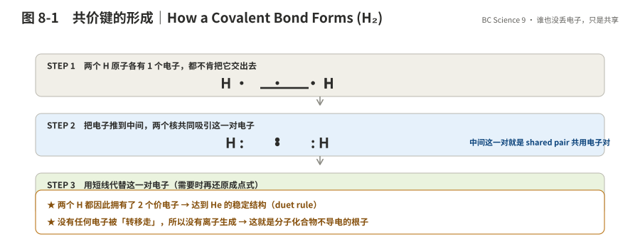
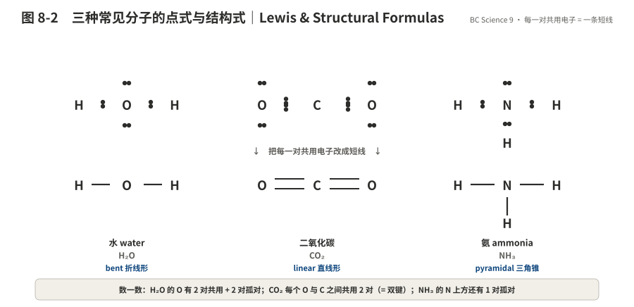
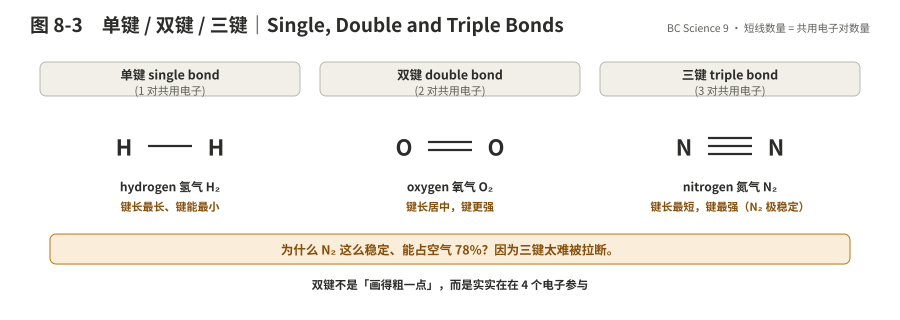
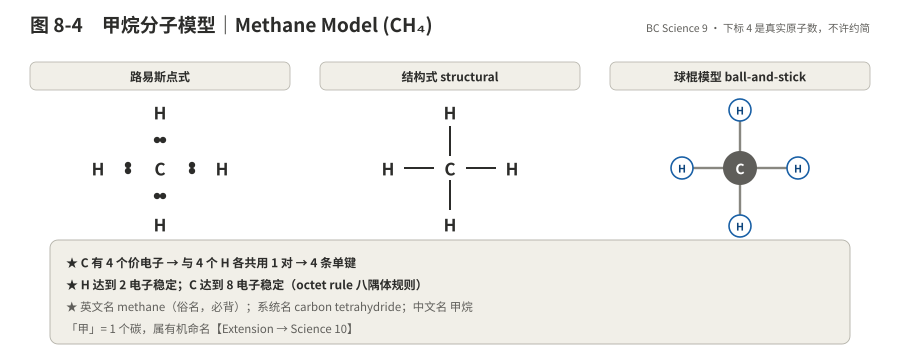
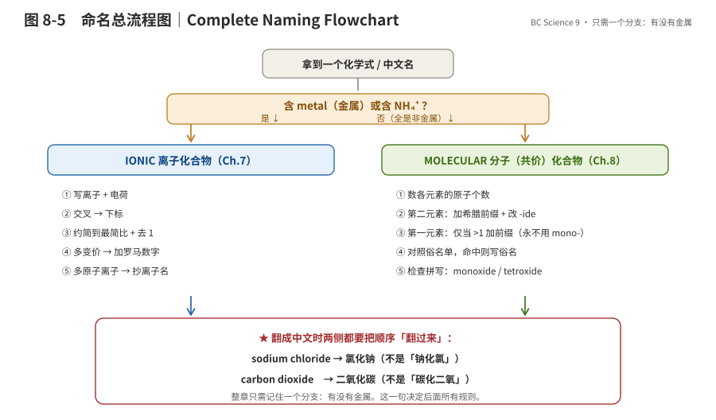
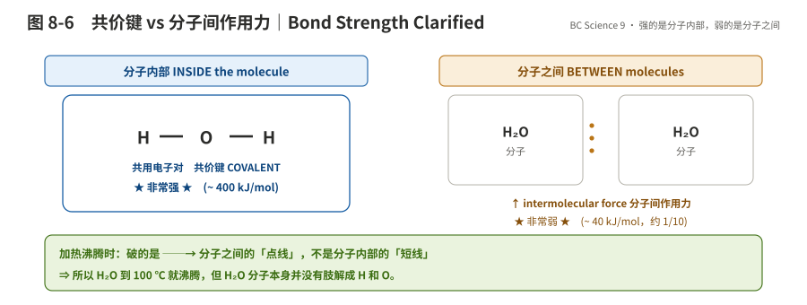
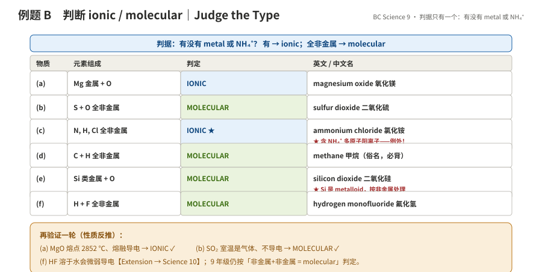
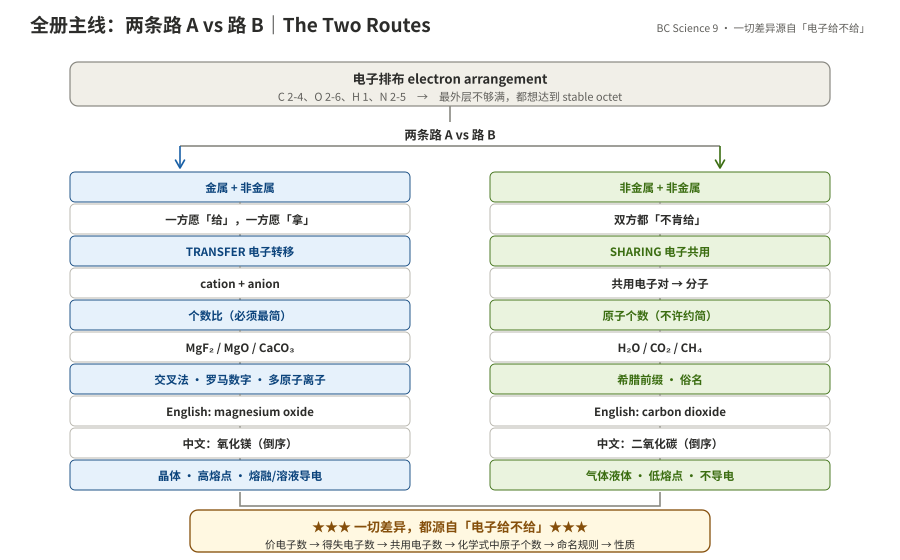

# Ch.8 — Molecular (Covalent) Compounds: Formulas and Naming
## Chapter 8 · Molecular (Covalent) Compounds: Formulas and Naming｜第 8 章　分子（共价）化合物：化学式与命名

> 🗂️ **Content Alignment｜大纲对应**：BC Science 9 Content **C2** — *The arrangement of electrons determines the compounds formed by elements*（core chapter｜核心章）
> ⏱️ **Periods｜课时**：3　|　**Prerequisites｜前置**：Ch.6 Ions and Lewis dot diagrams｜离子与路易斯点式、Ch.7 Ionic compounds｜离子化合物　|　**Followed by｜后继**：Ch.9 Introduction to chemical change and equations｜化学变化与方程式入门
> 🗂️ **Generated｜文件生成时间**：2026-09-18 00:53

## 1. Content Alignment｜大纲对应

| Item｜项目 | Content｜内容 |
|---|---|
| BC Science 9 Content | **C2** The arrangement of electrons determines the compounds formed by elements |
| Big Idea | **B1** The electron arrangement of atoms impacts their chemical nature. |
| Curricular Competencies | [Processing and analyzing] Seek and analyze patterns, trends, and connections；[Communicating] Communicate scientific ideas ... constructing evidence-based arguments；[Evaluating] Evaluate the validity and limitations of a model |
| Beyond Grade 9?｜是否超纲 | No. **VSEPR (electron-pair repulsion) theory**, **molecular polarity**, **organic naming** and **the naming of oxyacids** are all flagged `【🔭 Extension → Science 10】`｜否。电子对互斥理论（VSEPR）、分子极性、有机命名、含氧酸命名均标注 `【🔭 Extension → Science 10】` |

This chapter is the mirror image of Ch.7. Last chapter asked what happens when one atom is willing to give electrons away; this chapter asks what happens when **neither** atom is. The answer — sharing — produces a completely different kind of substance, and therefore a completely different naming system.

**中文**：本章是 Ch.7 的镜像。上一章问"一个原子愿意交出电子会怎样"，本章问"**两个都不愿意**会怎样"。答案是共用——它产生出一类完全不同的物质，因而也配一整套完全不同的命名法。

## 2. Learning Objectives｜学习目标

**EN — By the end of this chapter, you should be able to:**
1. Identify a **molecular (covalent) compound** as a combination of **two or more non-metals** bonded by **sharing electrons**.
2. Draw and read **Lewis structures** using dots for lone pairs and **lines (single / double / triple)** for shared pairs.
3. Distinguish **ionic** from **molecular** compounds from their element combination and from observed properties.
4. Name binary molecular compounds using the **Greek prefixes**, remembering that **mono- is never used on the first element**.
5. Recall the five **common names** (water, ammonia, methane, ozone, hydrogen peroxide) and compare the properties of the two compound classes.
   - **中文**：背出五个**常见俗名**（水、氨、甲烷、臭氧、过氧化氢），并对比两类化合物的性质。

**中 — 本章结束后，你应当能够：**
1. 判断分子（共价）化合物——**非金属 + 非金属**，靠**共用电子对（shared pair of electrons）**成键。
2. 画读路易斯结构式（Lewis structure）：点表示孤对电子（lone pair），**短线**表示共用电子对（单键 single / 双键 double / 三键 triple）。
3. 依据元素组合与实测性质**区分离子化合物（ionic）与分子化合物（molecular）**。
4. 用**希腊数字前缀（Greek prefix）**命名二元分子化合物，牢记**第一个元素永不用 mono-**。
5. 背出五个**常见俗名（common name）**，并对比两类化合物的性质。

## 3. Concept Explanations｜概念解析

### 3.1 Molecular / Covalent Compound｜分子（共价）化合物

**Definition｜定义**：A **molecular compound（分子化合物）** — also called a **covalent compound（共价化合物）** — is formed when **two or more non-metal atoms share electrons** to achieve a stable outer shell.

The smallest unit that can exist independently is a **molecule（分子）**: one water molecule is a genuine, separate particle made of exactly two hydrogen atoms and one oxygen atom.

**中文**：**分子化合物**（也称**共价化合物 covalent compound**）由**非金属元素**之间通过**共用电子（sharing of electrons）**形成；其独立存在的最小单位是 **molecule 分子**——一个水分子就是一个真实、独立的粒子，恰好由 2 个氢原子和 1 个氧原子组成。

- **Rule of thumb｜判断口诀**：**Look for a metal first.** If there is a metal (or NH₄⁺) → Ch.7, an ionic compound; if it is **all non-metals** → this chapter, a molecular compound.
  - **中文**：**先看有没有金属。** 有金属（或 NH₄⁺）→ Ch.7 离子化合物；**全是非金属** → 本章的分子化合物。
- Examples｜例：H₂O、CO₂、NH₃、CH₄、O₃、CCl₄、SF₆ — every one of them contains only non-metals.
  - **中文**：例：H₂O、CO₂、NH₃、CH₄、O₃、CCl₄、SF₆ —— 全部只含非金属。

> **⚠ The one exception｜唯一反例**：**NH₄⁺ ammonium（铵根）** is built entirely from non-metals, but it is a **positively charged group of atoms**, so compounds containing it (NH₄Cl、(NH₄)₂SO₄) are **ionic** (see Fig. 7-9 in Ch.7). Do not misclassify anything containing NH₄.
> **中文**：**NH₄⁺ ammonium（铵根）**虽然全由非金属组成，但它是**带正电的原子团**，含它的化合物（NH₄Cl、(NH₄)₂SO₄）属于**离子化合物**。遇到 NH₄ 时不要误判。

### 3.2 Covalent Bond｜共价键

**Definition｜定义**：A **covalent bond（共价键）** is the attraction between two nuclei and a **shared pair of electrons（共用电子对）**. In drawings a shared pair is shown as a **line（短线）**.

```
   H ·  +  · H   →   H : H   →   H — H      （1 shared pair = a single bond｜1 对共用电子 = single bond 单键）
```

| Shared pairs｜共用电子对数目 | Bond type｜键型 | English | 中文 | Symbol｜表示法 | Examples｜例子 |
|---|---|---|---|---|---|---|
| 1 pair｜1 对 | single bond | single covalent bond | 单键 | — | H₂（H—H）、H₂O、CH₄ |
| 2 pairs｜2 对 | double bond | double covalent bond | 双键 | = | O₂（O=O）、CO₂（O=C=O） |
| 3 pairs｜3 对 | triple bond | triple covalent bond | 三键 | ≡ | N₂（N≡N） |

- The **number of lines equals the number of shared electron pairs**. A double bond is shorter and stronger than a single bond, and a triple bond is stronger still.
  - **中文**：短线数量 = 共用电子对数目。双键比单键**更短更强**，三键更强。
- In a **Lewis diagram（路易斯点式）** the shared pair is drawn as dots; in a **structural formula（结构式）** it is drawn as a line. The two drawings describe exactly the same thing.
  - **中文**：路易斯图（Lewis diagram）里写成点，结构式（structural formula）里写成线，两者表达同一件事。

> ⚠️ **Important clarification｜易错澄清（重要）**：**A covalent bond is itself very strong** — of the same order of magnitude as an ionic bond. Molecular compounds have low melting points **not** because the covalent bond is weak, but because the **attractions between molecules（intermolecular forces｜分子间作用力）** are weak. See 3.8 and Fig. 8-6.
> **中文**：**共价键本身很强**（和离子键同数量级）。分子化合物熔点低，**不是**因为共价键弱，而是因为**分子之间的吸引力（intermolecular force 分子间作用力）很弱**。

### 3.3 Molecule vs Formula Unit｜分子与化学式单元

| | Molecular compound｜分子化合物 | Ionic compound｜离子化合物 |
|---|---|---|
| Basic unit｜基本单位 | **molecule（分子）** — one independently existing H₂O molecule | **formula unit（化学式单元）** — only the lowest ratio |
| Meaning of the formula｜化学式含义 | the **real number of atoms** in one molecule（H₂O really is 2 H + 1 O）｜一个分子里**真实的原子数** | the **lowest ratio** of ions（NaCl means 1:1; the crystal holds countless pairs）｜阴阳离子的**最简个数比** |
| Can you reduce it?｜能不能约分 | **No**（H₂O₂ must not be written HO）｜**不能** | Yes — you must reduce（Mg₂O₂ → MgO）｜必须约到最简 |

> 📌 This is a deep difference between the two classes: **a subscript in a molecular formula is a real count, while a subscript in an ionic formula is a ratio.**
> **中文**：这是两类化合物一个非常本质的差别：**分子化合物的下标是"实打实 count"，离子化合物的下标是"比例 ratio"。**

### 3.4 ⭐ English Naming Rules: The Greek Prefix System｜英文命名规则：希腊前缀法

| Number｜数目 | 1 | 2 | 3 | 4 | 5 | 6 | 7 | 8 | 9 | 10 |
|---|---|---|---|---|---|---|---|---|---|---|
| **Prefix｜前缀** | mono- | di- | tri- | tetra- | penta- | hexa- | hepta- | octa- | nona- | deca- |
| **中文** | 一 | 二 | 三 | 四 | 五 | 六 | 七 | 八 | 九 | 十 |

**Two golden rules｜两条铁律**

> 📌 **Rule 1 — The first element (the one written first, the less electronegative one): add a prefix only when its number is greater than 1; when the number is 1, add nothing at all — mono- is never used on the first element.**
> **中文**：**第一个元素（写在前面、电负性较小的那个）：只有数目 > 1 时才加前缀；数目 = 1 时什么都不加，永不用 mono-。**
> 📌 **Rule 2 — The second element: it must carry a prefix, and the ending of the element name changes to `-ide`.**
> **中文**：**第二个元素：必须加前缀，并且把元素名结尾改成 `-ide`。**

**Two spelling details｜两个拼写细节**

- `mono- + oxide` → **monoxide** (drop the second o of mono), not monooxide.
  - **中文**：`mono- + oxide` → **monoxide**（去掉 mono 的第二个 o），不是 monooxide。
- `tetra- + oxide` → **tetroxide** (drop the a of tetra), not tetraoxide.
  - **中文**：`tetra- + oxide` → **tetroxide**（去掉 tetra 的 a），不是 tetraoxide。

### 3.5 The Rule in Action｜例子速解

| Formula｜化学式 | Step 1 first element｜第一元素 | Step 2 second element｜第二元素 | English name | 中文名 |
|---|---|---|---|---|
| CO₂ | C = 1 → **carbon**（no mono-｜不加） | O = 2 → **di-** + ox**ide** | carbon dioxide | **二氧化碳** |
| CO | C = 1 → **carbon** | O = 1 → **mon-** + **oxide** | carbon monoxide | **一氧化碳** |
| N₂O₄ | N = 2 → **di-** + nitrogen | O = 4 → **tetr-** + **oxide** = tetroxide | dinitrogen tetroxide | **四氧化二氮** |
| PCl₃ | P = 1 → **phosphorus** | Cl = 3 → **tri-** + chlor**ide** | phosphorus trichloride | **三氯化磷** |
| SF₆ | S = 1 → **sulfur** | F = 6 → **hexa-** + fluor**ide** | sulfur hexafluoride | **六氟化硫** |
| N₂O | N = 2 → dinitrogen | O = 1 → monoxide | dinitrogen monoxide | **一氧化二氮**（笑气 laughing gas） |
| CCl₄ | C = 1 → carbon | Cl = 4 → tetrachloride | carbon tetrachloride | **四氯化碳** |

Read any row from left to right and you are doing exactly what the rule asks: count the atoms, decide on the first prefix, decide on the second prefix plus `-ide`, then put it together.

**中文**：从左到右读任何一行，你做的就是规则要求的动作：数原子 → 定第一个前缀 → 定第二个前缀并改 `-ide` → 组合起来。

### 3.6 Common / Trivial Names｜必须背的俗名

| Formula | Common name｜俗名（**write this in the exam｜考试要写这个**） | Systematic name｜系统名（almost never used｜几乎不用） | 中文 |
|---|---|---|---|
| H₂O | **water** | dihydrogen monoxide | **水** |
| NH₃ | **ammonia** | nitrogen trihydride | **氨 / 氨气** |
| CH₄ | **methane** | carbon tetrahydride | **甲烷** |
| O₃ | **ozone** | trioxygen | **臭氧** |
| H₂O₂ | **hydrogen peroxide** | dihydrogen dioxide | **过氧化氢**（双氧水） |

> 💡 **Memory point｜记忆点**：The moment you see one of these five formulas, **write the common name**; do not build the systematic name from the two groups.
> **中文**：一见到这 5 个化学式，**直接写俗名**，不要写两个群体的系统名字。

Why do these five survive side by side with the systematic system? Because they were in everyday use long before chemists agreed on a set of rules, and because they are still the names used on product labels, in laboratories and in the news. Using the systematic name for water in a test answer would be technically defensible but socially wrong — it would mark you out as someone who does not use the language chemists actually use.

**中文**：为什么这五个俗名能和命名系统并存？因为早在化学家约定规则之前，它们就已在日常生活中使用，而且至今仍是产品标签、实验室和新闻里的叫法。考试里把水写成系统名，技术上说得通，但在化学交流中是错的——那等于告诉别人你不会用化学家真正使用的语言。

### 3.7 English ↔ Chinese Naming｜英中命名对照

| | English｜英文 | Chinese｜中文 |
|---|---|---|
| **Order｜顺序** | first element (less electronegative) + second element + `-ide`｜第一个元素在前（电负性较小）+ 第二元素 + `-ide` | `[number of the second element] + second element` **first** + `化` + `[number of the first element] + first element` **last**｜`[第二元素数目]+第二元素` **在前** + `化` + `[第一元素数目]+第一元素` **在后** |
| **CO₂** | carbon dioxide（C first｜C 在前） | **二氧 化 碳**（氧在前，碳在后） |
| **SF₆** | sulfur hexafluoride（S first｜S 在前） | **六氟 化 硫**（氟在前，硫在后） |
| **N₂O₄** | dinitrogen tetroxide | **四氧 化 二氮** |
| **PCl₃** | phosphorus trichloride | **三氯 化 磷** |
| **CCl₄** | carbon tetrachloride | **四氯 化 碳** |

> **🌟 Good news｜好消息**：The **number rules are exactly parallel** in the two languages. Chinese also counts 一二三…, and it also **keeps a "一" only in front of the second element** (CO = 一氧化碳; when the first element is 1 it is dropped → 二氧化碳, never "一碳化二氧").
> **中文**：中文与英文的**数字规则完全平行**——中文也用"一二三…"，并且**同样只在第二元素前保留"一"**（CO = 一氧化碳；而第一元素为 1 时省略 → 二氧化碳，不说"一碳化二氧"）。
> 📌 **The only difference is still the order**：English puts the **less electronegative** element first; Chinese puts the **more electronegative (negative) one** first — just as in Ch.7, the two are **reversed**.
> **中文**：**唯一区别还是顺序**：英文 "less-electronegative first"，中文 "负 / 电负性大的在前"，跟 Ch.7 一样，仍然是**倒过来**的关系。
> **🚨 Forbidden Chinese forms｜中文书写禁区**：✗ "碳化二氧" ✗ "磷化三氯" ✗ "硫氟六" — the correct forms are **二氧化碳、三氯化磷、六氟化硫**.

### 3.8 Properties of Molecular Compounds｜分子化合物的性质

| Property｜性质 | English | 中文 | Why｜原因 |
|---|---|---|---|
| Low melting / boiling point | They have low melting and boiling points. | **熔沸点低**（H₂O 0/100 ℃，CO₂ sublimes at −78 ℃｜在 −78 ℃ 直接升华） | Melting or boiling only has to overcome the **weak intermolecular forces**; the covalent bonds are never broken｜熔化沸腾只需克服**弱的分子间作用力**，共价键本身没断 |
| Poor / no conductivity | They do **not** conduct electricity in any state. | **不导电**（纯液体、水溶液都不导） | Molecules are **electrically neutral** and there are **no freely moving charged particles**｜分子是**电中性**的，**没有自由移动的带电粒子** |
| Physical state | Often gases or liquids; if solid, soft. | 多为**气体 / 液体**或**软固体**（石蜡、蔗糖、碘） | Same reason as above｜同上 |
| Solubility | Many do not dissolve well in water. | 多数**难溶于水**（油、石蜡） | Water is a polar solvent; non-polar molecules do not dissolve in it｜水是极性溶剂；非极性分子不溶于水【极性属 `【🔭 Extension → Science 10】`】 |

> 💡 **One-line test｜判据一句话**：**Low melting point + no conduction = molecular**；**high melting point + conducts when molten or dissolved = ionic**.
> **中文**：**熔沸点低 + 不导电 = 分子化合物**；**熔沸点高 + 熔融/水溶液导电 = 离子化合物**。

## 4. Comparison Tables｜表格比对

### Table 8-1　Greek Prefixes 1–10｜希腊前缀全表（必背）

| Number｜数目 | 1 | 2 | 3 | 4 | 5 | 6 | 7 | 8 | 9 | 10 |
|---|---|---|---|---|---|---|---|---|---|---|
| **Prefix｜前缀** | **mono-** | **di-** | **tri-** | **tetra-** | **penta-** | **hexa-** | **hepta-** | **octa-** | **nona-** | **deca-** |
| 中文 | 一 | 二 | 三 | 四 | 五 | 六 | 七 | 八 | 九 | 十 |
| Example (2nd element)｜例（第二元素） | monoxide 一氧化物 | dioxide 二氧化物 | trichloride 三氯化物 | tetroxide 四氧化物 | pentoxide 五氧化物 | hexafluoride 六氟化物 | heptoxide 七氧化物 | octoxide 八氧化物 | nonoxide 九氧化物 | decoxide 十氧化物 |

The first five are the ones that appear most often in Grade 9 questions; learn the whole row anyway, because reading a name backwards (tetroxide → 4) is the skill being tested.

**中文**：前五个在 9 年级题目里出现最多；但整行都要背，因为考试真正考的是**反向读名**（tetroxide → 4 个氧）。

### Table 8-2　Naming Rules Side by Side｜命名规则对照：英文 vs 中文

| Position｜位置 | English｜英文 | Chinese｜中文 | Same?｜共同点 |
|---|---|---|---|
| First element (number 1)｜第一个元素（数目 1） | **no prefix**（carbon monoxide） | **no "一"**（一氧化碳里的 **碳**） | ✔ both omit it｜两者都不加 |
| First element (number >1)｜第一个元素（数目 >1） | add di-/tri-/tetra-…（dinitrogen） | add 二/三/四…（**二**氮） | ✔ identical｜完全一致 |
| Second element (number 1)｜第二个元素（数目 1） | must add **mono-** and change to `-ide`（monoxide） | must add **"一"** + `化`（一氧**化**） | ✔ identical｜完全一致 |
| Second element (number >1)｜第二个元素（数目 >1） | add the prefix and change to `-ide`（tetroxide） | add 四 + `化`（四氧**化**） | ✔ identical｜完全一致 |
| **Order of the two elements｜排列顺序** | **first element first** | **second element first**（X 化 Y） | ✘ **the only difference｜唯一差别** |

### Table 8-3　The Master Comparison: Ionic vs Molecular｜Ionic vs Molecular 全面对比（本章核心表）

| Item｜比较项 | **Ionic compound｜离子化合物** | **Molecular (covalent) compound｜分子（共价）化合物** |
|---|---|---|
| Element combination｜元素组合 | **metal + non-metal**（or contains NH₄⁺） | **non-metal + non-metal**（all non-metals｜全是非金属） |
| Bonding｜成键方式 | **transfer of electrons｜电子转移** → cation + anion | **sharing of electrons｜电子共用** → shared pairs｜共用电子对 |
| Name of the bond｜键的名称 | **ionic bond｜离子键**（electrostatic attraction｜静电引力） | **covalent bond｜共价键**（shared pair｜共用电子对） |
| Basic particle｜基本粒子 | **ion｜离子**（Na⁺、Cl⁻），no independent molecules｜无独立分子 | **molecule｜分子**（H₂O、CO₂） |
| Meaning of the formula｜化学式含义 | lowest whole-number ratio（**must reduce**｜必须约简） | real atom count（**must not reduce**｜不能约简） |
| English naming｜英文命名 | metal + `-ide`；Roman numerals for multivalent metals；copy polyatomic ion names；**never use prefixes**｜**绝不用前缀** | Greek prefixes mono-/di-/tri-…；**never use Roman numerals**｜**永不用罗马数字** |
| Chinese naming｜中文命名 | non-metal + 化 + metal（**氯化钠**）；oxyanion salts are 某酸某（**碳酸钙**） | number + second element + 化 + number + first element（**二氧化碳**） |
| Melting / boiling point｜熔点 / 沸点 | **high｜高**（NaCl 801 ℃，MgO 2852 ℃） | **low｜低**（H₂O 0 ℃，CO₂ −78 ℃ sublimes｜升华） |
| Conductivity｜导电性 | solid does not conduct; **molten or dissolved conducts**｜熔融或水溶液导电 | **does not conduct in any state**｜任何状态都不导电（no freely moving charged particles｜无自由移动的带电粒子） |
| State at room temperature｜室温状态 | crystalline solid｜晶体固体 | gas, liquid or soft solid｜气体、液体或软固体 |
| Examples｜例子 | NaCl、MgO、CaCO₃、FeCl₃、(NH₄)₂SO₄ | H₂O、CO₂、NH₃、CH₄、CCl₄、SF₆ |

### Table 8-4　Common vs Systematic Names｜俗名 vs 系统名

| Formula | Common name you must write｜必须写的 Common name | Systematic name | 中文俗名 | Note｜备注 |
|---|---|---|---|---|
| H₂O | water | dihydrogen monoxide | 水 | in everyday life it is only ever called water｜生活中只叫 water |
| NH₃ | ammonia | nitrogen trihydride | 氨 / 氨气 | the smell in fertilisers and cleaners｜化肥、清洁剂里的味道 |
| CH₄ | methane | carbon tetrahydride | 甲烷 | main component of natural gas, a greenhouse gas｜天然气主要成分，温室气体 |
| O₃ | ozone | trioxygen | 臭氧 | protects us in the upper atmosphere; a pollutant at ground level｜高空臭氧层；地面则为污染物 |
| H₂O₂ | hydrogen peroxide | dihydrogen dioxide | 过氧化氢 | used to disinfect and bleach (in dilute solution)｜消毒漂白用（稀溶液） |

### Table 8-5　Drill List｜练习清单（先盖住右侧自测）

| Formula | English name | 中文名 | Type｜类型 |
|---|---|---|---|
| CO | carbon monoxide | 一氧化碳 | molecular |
| CO₂ | carbon dioxide | 二氧化碳 | molecular |
| SO₂ | sulfur dioxide | 二氧化硫 | molecular |
| N₂O₄ | dinitrogen tetroxide | 四氧化二氮 | molecular |
| PCl₅ | phosphorus pentachloride | 五氯化磷 | molecular |
| SiO₂ | silicon dioxide | 二氧化硅 | molecular（Si is a metalloid｜Si 是 metalloid 类金属） |
| NaCl | sodium chloride | 氯化钠 | **ionic** |
| NH₄Cl | ammonium chloride | 氯化铵 | **ionic**（the NH₄⁺ exception｜NH₄⁺ 例外！） |
| MgO | magnesium oxide | 氧化镁 | **ionic** |

Cover the two right-hand columns and test yourself down the list. The exercise is not just recall: each row forces the decision "ionic or molecular?" first, and only then the choice of a naming system. That order — classify, then name — is the habit this chapter is trying to build.

**中文**：盖住右侧两列自测。这个练习不只是背：每一行都强迫你先做"ionic 还是 molecular？"的判断，然后才选命名体系。**先分类、后命名**——这正是本章要养成的习惯。

## 5. Diagrams & Worked Examples｜图例说明

### Fig. 8-1　How a Covalent Bond Forms (H₂)｜共价键的形成



**What to look for｜看图要点**：Compare it with Ch.7 — there, Mg **handed its electrons over completely** to F; here, neither H atom **loses** anything, they simply **share**. The dot picture and the line picture are two ways of drawing the same thing｜点式 ←→ 线式是同一件事的两种画法。

### Fig. 8-2　Lewis & Structural Formulas｜三种常见分子的点式与结构式



**What to look for｜看图要点**：Count carefully — in H₂O the oxygen has **2 shared pairs and 2 lone pairs**; in CO₂ each O shares **2 pairs** with the carbon (that is a double bond); in NH₃ the nitrogen still carries **1 lone pair** on top (it takes no part in bonding, but it must be drawn).

**中文**：数一数：H₂O 里 O 有 2 对共用 + 2 对孤对；CO₂ 里每个 O 与 C 之间**共用 2 对**（= 双键）；NH₃ 里 N 上方还有 1 对孤对电子（没参与成键，但必须画）。

### Fig. 8-3　Single, Double and Triple Bonds｜单键 / 双键 / 三键



**What to look for｜看图要点**：**The number of lines equals the number of shared electron pairs.** A double bond is not "a line drawn more heavily" — it is genuinely **4 electrons** taking part.

**中文**：短线**数量 = 共用电子对数量**。双键不是"画得粗一点"，而是**实实在在 4 个电子**参与。

### Fig. 8-4　Methane Model (CH₄)｜甲烷分子模型



**What to look for｜看图要点**：The subscript 4 in CH₄ is a **real atom count** — there is nothing to "reduce" here, the way there was with Mg₂O₂ → MgO in Ch.7.

**中文**：CH₄ 的下标 4 是**真实原子数**，绝不能像 Ch.7 那样"约简"——没有任何东西可约。

### Fig. 8-5　Complete Naming Flowchart｜命名总流程图



**What to look for｜看图要点**：The whole two-chapter story needs only one branch — **is there a metal?** That single question decides every rule that follows.

**中文**：整第二章只需一个分支——**有没有金属**。这一句话决定了后面所有的规则。

### Fig. 8-6　Bond Strength Clarified｜共价键 vs 分子间作用力（易错澄清）



**What to look for｜看图要点**：Keep these two levels apart and you can explain why a molecule can have strong bonds yet boil easily. This is the most frequently tested misconception in Ch.8.

**中文**：把这两层分开，才解释得清"为什么分子既有强键又很容易沸腾"。这是 Ch.8 最高频的易错点。

### Fig. 8-7　Worked Example A｜例题 A（前缀命名）

**Problem｜题目**：(a) Name **N₂O₄** in English and Chinese, showing every prefix decision. (b) Write the formula for **phosphorus pentachloride** and name it in Chinese.

**Step-by-step｜逐步解析**：

```
  (a) N₂O₄
      STEP 1  Count the atoms：N = 2,  O = 4｜数原子
      STEP 2  First element N：number 2 > 1 → add di-
                                          →  di + nitrogen = dinitrogen
      STEP 3  Second element O：must take a prefix; 4 = tetra-, and oxide
              is spelled tetroxide｜必须加前缀 4 = tetra-，并把 oxide 拼成 tetroxide
                                          →  tetra + oxide = tetroxide
      STEP 4  Put it together：dinitrogen tetroxide
      STEP 5  Chinese（reverse order + parallel numbers）：四氧化二氮
              ⚠ Do not write 「二氮化四氧」—— that is a word-for-word
                translation of the English order and it is wrong.
                ⚠ 不要写成「二氮化四氧」——那是照英文顺序直译的错误写法。

  (b) phosphorus pentachloride
      STEP 1  Read the name：phosphorus（P，no prefix → 1 atom）；
              pentachloride = penta-(5) + chloride
      STEP 2  Write the formula：P₁Cl₅ → PCl₅（the subscript 1 is not written｜下标 1 不写）
      STEP 3  Chinese：五氯化磷
      ⚠ You must NOT change anything for "charge balance" — in a molecular
        compound the subscripts are given directly by the name, not calculated.
        ⚠ 「不能」因为电荷平衡改成别的——分子化合物的下标由名称直接给定，不是算出来的。
```

**Answer｜答案**：(a) **dinitrogen tetroxide，四氧化二氮**；(b) **PCl₅，五氯化磷**。

### Fig. 8-8　Worked Example B｜例题 B（判断 ionic / molecular）

**Problem｜题目**：Classify each as **ionic** or **molecular** and justify briefly:
(a) MgO　(b) SO₂　(c) NH₄Cl　(d) CH₄　(e) SiO₂　(f) HF

**Step-by-step｜逐步解析**：



**📊 Worked Example B — Judge the Type｜例题 B　判断 ionic / molecular**

**Answer｜答案**：see the table in the figure｜见表格；**ionic = (a)、(c)；molecular = (b)、(d)、(e)、(f)**。

> 💡 **Everything above adds up to one sentence: apart from the NH₄⁺ exception, the single question "is there a metal?" earns you full marks.**
> **中文**：**总结只有一句话：除了 NH₄⁺ 这个例外，"有没有金属"这一道题就能拿满分。**

### Fig. 8-9　Worked Example C｜例题 C（俗名 + 性质推理）

**Problem｜题目**：An unknown gas X was tested: it is a gas at room temperature; melting point −182 ℃, boiling point −164 ℃; **neither the liquid nor its solution conducts**; the atom ratio in its formula is 1:4 (one atom of one element to four of another). Identify X's formula and name, and explain why its melting and boiling points are so low.
**中文**：给一未知气体 X 测得：室温为气体；熔点 −182 ℃、沸点 −164 ℃；**液态与溶液均不导电**；化学式中原子个数比 1:4。判断 X 的化学式与名称，并说明为什么它熔沸点这么低。

**Step-by-step｜逐步解析**：

```
  STEP 1  Evidence from the properties｜性质证据：
           extremely low melting/boiling points + no conduction + gas at RT
                                          →  classify as MOLECULAR 分子化合物

  STEP 2  Atom ratio 1 : 4 —— within the Grade 9 range the only common
          carbon–hydrogen combination that fits is CH₄
          （9 年级范围内唯一符合的常见碳氢组合 → CH₄）

  STEP 3  English name: the common name methane
          （系统名 carbon tetrahydride — not used）；Chinese name：甲烷

  STEP 4  Draw the structure（4 single bonds; each H reaches 2 electrons,
          C reaches 8）：
                    H
                    |
              H — C — H
                    |
                    H

  STEP 5  ★ Why are the melting and boiling points so low? —— two levels:
          ★ 为什么熔沸点这么低？——两层拆解：
          the C—H covalent bonds INSIDE the molecule are STRONG and are
          NOT broken at all when it boils；
          分子内部的 C—H 共价键很【强】，沸腾时【完全没有断裂】；
          what heat overcomes is only the intermolecular force BETWEEN
          molecules, and that is WEAK → very little energy is needed →
          low melting and boiling points.
          被热运动克服的只是分子之间的 intermolecular force 分子间作用力，
          而它很【弱】 → 只需要很少的能量就沸腾 → 熔沸点低。
          ❌ Common wrong answer: "because the covalent bond is weak" —
             this answer fails. ❌ 常见错误答案：「因为共价键弱」——这句挂科。
```

**Answer｜答案**：**CH₄，methane，甲烷**。Reason｜原因：分子间作用力弱（weak intermolecular forces），而非共价键弱。

## 6. Key Vocabulary｜核心词汇

| English | 中文 | Note｜备注 |
|---|---|---|
| molecular compound | 分子化合物 | also called covalent compound｜也称 covalent compound |
| covalent compound | 共价化合物 | equivalent to the term above｜与上面的说法等价 |
| covalent bond | 共价键 | based on a shared pair of electrons｜靠共用电子对 |
| shared pair of electrons | 共用电子对 | drawn as one short line｜画成一条短线 |
| lone pair | 孤对电子 | a pair of dots that takes no part in bonding｜没参与成键的那对点 |
| single / double / triple bond | 单键 / 双键 / 三键 | — / = / ≡ |
| Lewis diagram | 路易斯点式 | dots stand for electrons｜点表示电子 |
| structural formula | 结构式 | lines stand for shared pairs｜线表示共用电子对 |
| molecule | 分子 | the basic unit of a molecular compound｜molecular 的基本单位 |
| diatomic molecule | 双原子分子 | H₂、N₂、O₂、F₂、Cl₂、Br₂、I₂ |
| formula unit | 化学式单元 | used only for ionic compounds｜ionic 才用这个词 |
| Greek prefix | 希腊数字前缀 | mono- … deca- |
| mono- / di- / tri- / tetra- / penta- | 一 / 二 / 三 / 四 / 五 | — |
| hexa- / hepta- / octa- / nona- / deca- | 六 / 七 / 八 / 九 / 十 | — |
| -ide | ……化物 | oxide / chloride / fluoride |
| monoxide / tetroxide | 一氧化物 / 四氧化物 | special spellings｜特殊拼写 |
| binary molecular compound | 二元分子化合物 | contains only 2 non-metals｜只含 2 种非金属 |
| common / trivial name | 俗名 | water、ammonia… |
| systematic name | 系统名 | dihydrogen monoxide… |
| water / ammonia / methane / ozone / hydrogen peroxide | 水 / 氨 / 甲烷 / 臭氧 / 过氧化氢 | 5 common names to memorise｜5 个必背俗名 |
| intermolecular force | 分子间作用力 | **weak**; it explains the low melting points｜**弱**，决定低熔沸点 |
| conductivity | 导电性 | molecular → none｜分子化合物不导电 |
| low melting / boiling point | 低熔点 / 低沸点 | — |
| polar / non-polar | 极性 / 非极性 | `【🔭 Extension → Science 10】` |

## 7. Lab / Activity｜实验与活动

### Activity 8-1　Ball-and-Stick Modelling｜分子模型搭建

- **Type｜类型**：hands-on model building｜动手建模（Hands-on）
- **Materials｜材料**：a ball-and-stick kit, or clay plus toothpicks；task cards for H₂、O₂、N₂、H₂O、CO₂、NH₃、CH₄｜球棍模型套件或黏土 + 牙签；任务卡
- **Procedure｜步骤**：
  1. Build the model → count the shared electron pairs → decide how many connectors to use → draw the **structural formula**.
     - **中文**：搭出模型 → 数共用电子对 → 决定用几条连线 → 画出 structural formula。
  2. Mark whether each **first** atom in the molecule reaches an octet (or a duet, for hydrogen).
     - **中文**：标出每个原子是否达到 octet（或 H 的 duet）。
  3. Draw the same molecule **once with dots and once with lines**, then swap with your partner for peer review.
     - **中文**：把同一分子用**点式**与**线式**各画一次，同桌互评。

  | Molecule | Shared pairs｜共用电子对 | Bond type｜键型 | Structural formula｜结构式 |
  |---|---|---|---|
  | H₂ | | | |
  | O₂ | | | |
  | N₂ | | | |
  | H₂O | | | |
  | CO₂ | | | |
  | NH₃ | | | |
  | CH₄ | | | |

- **Competencies｜训练能力**：[Processing and analyzing] Formulate physical or mental theoretical models；[Evaluating] the limitations of a model｜模型的局限
- **Safety｜安全**：⚠ Toothpick tips can prick the skin; **never** put model parts in your mouth; count all the pieces at the end.
  - **中文**：⚠ 牙签尖端小心扎手；**禁止**把模型零件放入口中；结束清点零件数量。

### Activity 8-2　Property Showdown: NaCl vs Paraffin / Sucrose｜性质对比实验

- **Type｜类型**：teacher demonstration with student recording｜教师演示 + 学生记录（Demo + Data table）
- **Materials｜材料**：table salt NaCl, sucrose C₁₂H₂₂O₁₁, paraffin；a crucible, an alcohol burner or hot plate；a conductivity set-up (battery + bulb)；distilled water, beakers｜食盐、蔗糖、石蜡；坩埚、酒精灯或加热板；导电装置；蒸馏水、烧杯
- **Procedure｜步骤**：Test three properties in order — ① appearance and hardness (crush with a pestle: brittle or soft?) ② heat to 200 ℃ and see whether it melts ③ dissolve it and test conductivity. Fill in the table｜依次测三项——① 外观与硬度（研杵碾压，观察脆 vs 软）② 加热至 200 ℃ 看是否熔化 ③ 配成溶液测导电性：

  | Sample | State｜状态 | Melts at 200 ℃?｜200 ℃ 是否熔化 | Bulb in solution｜溶液灯泡 | ionic / molecular｜判定 |
  |---|---|---|---|---|
  | NaCl | | | | |
  | sucrose｜蔗糖 | | | | |
  | paraffin｜石蜡 | | | | |

- **Competencies｜训练能力**：[Processing and analyzing]；[Communicating] build an argument from evidence｜用证据构建论证
- **Safety｜安全**：⚠ **Wear goggles throughout**; the hot plate is very hot and the crucible must never be touched with bare hands; paraffin is flammable, so keep it away from open flames; **never taste any sample**; wash your hands afterwards.
  - **中文**：⚠ **护目镜全程佩戴**；加热台高温，禁止徒手触碰坩埚；石蜡易燃，远离明火；**禁止品尝任何样品**；实验后洗手。

### Activity 8-3　Prefix Relay｜命名接龙

- **Type｜类型**：whole-class game｜全班竞赛（Game）
- **Materials｜材料**：30 formula cards, mixing ionic and molecular compounds and including the 5 common-name cards｜化学式卡 30 张（混合 ionic 与 molecular，含 5 个俗名卡）
- **Procedure｜步骤**：Every card requires three steps — ① call out ionic or molecular ② give the full English name ③ give the Chinese name. Any mistake and the turn passes on. A common-name card scores double if the student gives **both** the common name and the systematic name.
  - **中文**：每张卡必须完成三步——① 喊 ionic/molecular ② 报英文全名 ③ 报中文名。错任一步换人。俗名卡必须同时给出俗名与系统名双倍分。
- **Competencies｜训练能力**：[Communicating]；[Questioning and predicting]
- **Safety｜安全**：none (card activity), but walk rather than run while moving around｜无（纸牌活动，走动时注意不要奔跑）

## 8. Common Misconceptions｜常见易错点

| # | Misconception｜错误认识 | Correction｜正确理解 |
|---|---|---|
| 1 | "CO should be monocarbon monoxide — mono- shows there is 1 carbon." | Wrong. **Rule 1: the first element never takes mono-.** The correct name is **carbon monoxide**（一氧化碳）. |
| 2 | "Since we use prefixes, NaCl should be sodium monochloride." | Wrong. Greek prefixes are **only for molecular compounds**; in an ionic compound the ratio is fixed by the charges, so write **sodium chloride**（氯化钠）. |
| 3 | "Molecular compounds melt at low temperatures because the covalent bond is weak." | Wrong. **The covalent bond is strong.** The low melting point comes from the **weak intermolecular forces** — see Fig. 8-6.｜**共价键很强**，低熔点的原因是**分子间作用力（intermolecular force）很弱**。 |
| 4 | "The Chinese for carbon dioxide is 碳化二氧, translated straight across." | Wrong. Chinese also reverses the order and uses the same numbers: **二氧化碳**. ✗ 碳化二氧　✗ 磷化三氯　✗ 硫氟六. |
| 5 | "Whenever I see 2 oxygens I call it dioxide." | Wrong — read the **actual subscript**: NO₂ = nitrogen dioxide, but N₂O = dinitrogen **monoxide** (only 1 oxygen).｜要看**实际下标**。 |
| 6 | "The proper English name of H₂O is dihydrogen monoxide." | In most contexts write **water**. Likewise NH₃ = **ammonia** and CH₄ = **methane** — the common names are the right answers. |
| 7 | "NH₄Cl is all non-metals, so it is molecular." | Wrong. NH₄⁺ is a **polyatomic cation**, treated as the metal side → **ionic（氯化铵）**. |
| 8 | "Since we need the lowest ratio, H₂O₂ should be written HO." | Wrong. **Molecular formulas are never reduced** — the subscripts are real atom counts; only ionic formulas are reduced.｜**分子化合物不能约简**。 |
| 9 | "SiO₂ contains the metal silicon, so it is ionic." | Wrong. Si is a **metalloid（类金属）**, treated as a non-metal in Grade 9 → silicon dioxide **二氧化硅** is molecular（the deeper network-structure story is `【🔭 Extension → Science 10】`）. |
| 10 | "Molecular compounds never conduct, including their solutions." | Correct in principle; but a **few** (such as solutions of CO₂ or HF) conduct **weakly** because a reaction produces ions — the full explanation is `【🔭 Extension → Science 10】`, so for Grade 9 still record "molecular → does not conduct".｜原则上正确；少数（CO₂、HF 水溶液）**微弱**导电，9 年级仍记"molecular → 不导电"。 |
| 11 | "Mono- plus oxide is spelled monooxide." | Spelling rule: **monoxide** (drop one o); by the same rule **tetroxide** (drop the a of tetra), not tetraoxide. |
| 12 | "Drawing O=C=O is just two strokes; it has nothing to do with 4 electrons." | Wrong. A double bond = **2 shared pairs = 4 electrons**; a triple bond = 6. The number of lines must match the number of electron pairs.｜双键 = **2 对共用电子 = 4 个电子**；三键 = 6 个电子。 |

## 9. Assessment｜答题评估

Group A: Foundational｜A 组：基础题（每题 2 分，共 20 分）

**A1.** Classify each as **ionic** or **molecular**: MgO、SO₂、NH₄Cl、CH₄、HF、CaCO₃.
**中文**：判断 ionic 或 molecular。

**A2.** Write out the Greek prefix table from memory (the English prefix plus the Chinese number, 1–10).
**中文**：默写希腊前缀表（1–10 的 English prefix + 中文数字）。

**A3.** Name in English **and** Chinese: **CO₂**、**CO**.

**A4.** Name in English **and** Chinese: **N₂O₄**、**PCl₃**.

**A5.** Write the formula and the Chinese name: **sulfur dioxide**、**sulfur trioxide**.
**中文**：写化学式 + 中文名。

**A6.** Write the formula and the Chinese name: **phosphorus pentachloride**、**carbon tetrachloride**.
**中文**：写化学式 + 中文名。

**A7.** Write the formula and the English name — take care to distinguish the common name from the systematic name: 水、氨、甲烷.
**中文**：写化学式 + 英文名（注意区分俗名/系统名）。

**A8.** Draw the **Lewis diagram** and the **structural formula** of **N₂**, and state what kind of bond it is.
**中文**：画出 **N₂** 的路易斯点式与结构式，说明是几键。

**A9.** State how many shared pairs a single, a double and a triple bond represent, and give the symbol used for each.
**中文**：说明 single / double / triple bond 分别代表几对共用电子、用什么符号表示。

**A10.** Give three typical properties of molecular compounds, with one example for each.
**中文**：写出分子化合物三条典型性质，并各给一个例子。

### B 组：Applied｜应用题（每题 5 分，共 20 分）

**B1.** Name and translate: **SF₆**、**N₂O**、**SiO₂**、**CS₂**、**NO₂**. For at least two of them, show the full four-step working — "Step 1 count the atoms → Step 2 first element → Step 3 second element → Step 4 reverse for Chinese".
**中文**：命名并互译。要求写出至少两题的全过程。

**B2.** A student answered as follows. Judge each answer right or wrong, correct the wrong ones, and say which rule was broken｜请逐条判断对错并把错的改正，同时说明违反了哪一条规则：
① CO → monocarbon monoxide　② NaCl → sodium monochloride　③ N₂O₄ → 二氮化四氧　④ H₂O → dihydrogen monoxide（as the official name｜当作正式名）　⑤ NH₄Cl → molecular compound.

**B3.** Two unknown substances W and Z gave the data below. Decide ionic or molecular for each and explain｜请据数据判断 ionic / molecular 并解释：

| Sample｜样品 | Melting point｜熔点 | Boiling point｜沸点 | Solid conducts｜固体导电 | Solution conducts｜水溶液导电 | State at RT｜室温状态 |
|---|---|---|---|---|---|---|
| W | 801 ℃ | 1413 ℃ | no｜否 | yes｜是 | crystalline｜晶体 |
| Z | −114 ℃ | 78 ℃ | no｜否 | no｜否 | liquid｜液体 |

**B4.** Build a self-check table showing "how to decide in one second whether a formula belongs to Ch.7 or Ch.8". It must contain: the decision criterion, a comparison of the two naming systems, and three pieces of supporting evidence from properties; then run **CO₂** and **MgO** through the whole table as examples.
**中文**：请用一张自检表说明"如何一秒钟判定一个化学式属于 Ch.7 还是 Ch.8"，要求包含：判据、两个命名体系对比、性质佐证三条，并举例 CO₂ 与 MgO 各走一遍。

### C 组：Challenge｜挑战题（每题 10 分，共 20 分）

**C1.** Essay question: "Oxygen combines with a non-metal in both cases, so why does **CO₂ sublime into a gas at −78 ℃** while **SiO₂ (sand) does not melt until 1713 ℃**?" You must: ① state whether both are molecular compounds; ② use the two-level picture "inside a molecule vs between molecules" to explain the key to this enormous difference; ③ explain why a one-level answer such as "because SiO₂'s covalent bonds are weaker / stronger" is not acceptable. (Hint: consider that in SiO₂ each Si is joined to 4 O atoms, extending into a network in space, at which point the idea of a "molecule" breaks down.)
**中文**：请：① 指出两者是否都是 molecular compound；② 用"分子内部 vs 分子之间"两层结构解释导致巨大差异的关键；③ 说明为什么不能简单说"因为 SiO₂ 的共价键更弱/更强"这样的单层回答。

**C2.** Integrated problem: six substances are given — NaCl、CO₂、H₂O、NH₃、CH₄、NH₄NO₃. You must:
① classify each as ionic or molecular and give the name in **both** languages (use the common names for NH₃ and CH₄);
② draw the electron-dot (Lewis) diagram or the structural formula for **three** of the molecular compounds;
③ predict their state and conductivity at room temperature, presented as a table;
④ in **no more than 100 English words**, connect them all back to this chapter's Big Idea.
**中文**：① 逐个判定 ionic / molecular 并写出中英双语名称（NH₃、CH₄ 写俗名）；② 画出其中**三个**分子化合物的电子式（点式）或结构式；③ 预判它们在室温下的状态与导电性，列表呈现；④ 用不超过 100 词（英文）打通它们到本章 Big Idea 的逻辑。

---

### Answer Key｜参考答案

**A 组｜Group A**
- **A1.** MgO = **ionic**；SO₂ = **molecular**；NH₄Cl = **ionic**（it contains the polyatomic cation NH₄⁺ — the exception｜含 NH₄⁺ 多原子阳离子，例外）；CH₄ = **molecular**；HF = **molecular**（both H and F are non-metals｜H、F 均为非金属）；CaCO₃ = **ionic**（contains the metal Ca｜含 Ca 金属）.
- **A2.** mono- 一、di- 二、tri- 三、tetra- 四、penta- 五、hexa- 六、hepta- 七、octa- 八、nona- 九、deca- 十.
- **A3.** CO₂ = carbon dioxide **二氧化碳**；CO = carbon monoxide **一氧化碳**.
- **A4.** N₂O₄ = dinitrogen tetroxide **四氧化二氮**；PCl₃ = phosphorus trichloride **三氯化磷**.
- **A5.** **SO₂** 二氧化硫；**SO₃** 三氧化硫.
- **A6.** **PCl₅** 五氯化磷；**CCl₄** 四氯化碳.
- **A7.** 水 = **H₂O**, water（systematic name dihydrogen monoxide｜系统名）；氨 = **NH₃**, ammonia（nitrogen trihydride）；甲烷 = **CH₄**, methane（carbon tetrahydride）. ⚠ In an exam you should write **water / ammonia / methane**.
- **A8.** **Lewis diagram｜路易斯点式**：three shared pairs between the two N atoms, with one lone pair left on each end.

  ```
      ··           ··
       N ::: N          （the middle ::: = 3 shared pairs = 6 electrons｜3 对共用电子 = 6 个电子）
  ```

  **Structural formula｜结构式**：**N≡N**；it is a **triple bond（三键）**. This is why N₂ is extremely stable and makes up about 78% of the air. ⚠ Common wrong drawing: a single line (N—N), which leaves each N with only 2 electrons and breaks the octet rule｜常见错画：只画 1 条线（写成 N—N）→ 每个 N 就只有 2 个电子，不满足八隅体。
- **A9.** A **single bond** = 1 shared pair, symbol **—**；a **double bond** = 2 shared pairs, symbol **=**；a **triple bond** = 3 shared pairs, symbol **≡**.｜single bond 单键 = 1 对共用电子，符号 **—**；double bond 双键 = 2 对，符号 **=**；triple bond 三键 = 3 对，符号 **≡**。
- **A10.** Any three of: ① **low melting and boiling points**（H₂O 0/100 ℃，CO₂ sublimes at −78 ℃）；② **does not conduct**（neither the pure liquid nor the solution has freely moving charged particles｜纯液态与溶液均无自由移动的带电粒子）；③ at room temperature usually a **gas or liquid**, or a **soft** solid if solid（石蜡、蔗糖、碘）. Bonus: ④ most are **poorly soluble in water**（oil、paraffin｜油、石蜡）.

**B 组（评分要点）｜Group B (marking points)**
- **B1.** **SF₆** sulfur hexafluoride **六氟化硫**；**N₂O** dinitrogen monoxide **一氧化二氮**；**SiO₂** silicon dioxide **二氧化硅**；**CS₂** carbon disulfide **二硫化碳**；**NO₂** nitrogen dioxide **二氧化氮**.
  Model full working (SF₆)｜示范全过程：Step 1 count the atoms, S = 1, F = 6；Step 2 first element S has number 1 → **no prefix** → sulfur；Step 3 second element F has number 6 → **hexa-** + change the ending to **-ide** → hexafluoride；Step 4 reverse for Chinese → 六氟化硫.
  ⚠ Traps: the Chinese for CS₂ is **二硫化碳**（not "碳化二硫"）; in NO₂ the N count is 1, so English uses **no prefix** on nitrogen.
- **B2.**
  ① **Wrong** — breaks Rule 1 (the first element never takes mono-) → **carbon monoxide**.
  ② **Wrong** — prefixes are for molecular compounds only; NaCl is ionic → **sodium chloride**.
  ③ **Wrong** — Chinese must reverse the order → **四氧化二氮**（"二氮化四氧" is a word-for-word translation of English）.
  ④ **Poor** — the usual, accepted name of H₂O is **water**; dihydrogen monoxide is only the systematic name (and is sometimes used as a joke).
  ⑤ **Wrong** — NH₄Cl contains the polyatomic cation **NH₄⁺** → an **ionic compound**, 氯化铵.
- **B3.**
  - **W = ionic**（evidence: a very high melting point of 801 ℃, crystalline at room temperature, the solid does not conduct but the solution does — the classic ionic signature, matching NaCl）.
  - **Z = molecular**（evidence: melting point −114 ℃, boiling point 78 ℃, neither the substance nor its solution conducts, liquid at room temperature — the classic molecular signature, matching ethanol C₂H₅OH）.
  - The key comparison｜关键对比: the **difference in conductivity** comes from whether freely moving ions exist; the **difference in melting and boiling points** comes from **which level of attraction has to be overcome**（ionic bonds vs intermolecular forces｜离子键 vs 分子间作用力）.
- **B4.** Model points｜参考要点：① **Criterion｜判据** — a metal or NH₄⁺ in the formula → Ch.7 ionic；all non-metals (including metalloids) → Ch.8 molecular. ② **Naming systems｜命名体系** — ionic uses `-ide` + Roman numerals + polyatomic ion names, **never** prefixes, and must be reduced to the lowest ratio; molecular uses the Greek prefixes mono- … deca-, never puts mono- on the first element, and its subscripts must **not** be reduced. ③ **Property support｜性质佐证** — high melting point plus conduction when molten or dissolved = ionic；low melting point plus no conduction in any state = molecular. ④ Running both through it｜走一遍：CO₂ contains C and O, all non-metals → molecular → carbon dioxide 二氧化碳；MgO contains the metal Mg → ionic → criss-cross Mg²⁺/O²⁻ → Mg₂O₂ → reduce → MgO, magnesium oxide 氧化镁.

**C 组（评分要点）｜Group C (marking points)**
- **C1.** Model points｜参考要点：① CO₂ is a typical **molecular compound** — it exists as separate, independent **O=C=O three-atom molecules**；SiO₂ is also covalent in a strict sense, but in the context of a Grade 9 question you must **stop describing it as "little independent molecules"**. ② The key difference lies at the "between molecules" level: melting or boiling CO₂ only has to overcome the **intermolecular forces** (weak); in SiO₂ every Si is joined to 4 O atoms and every O bridges 2 Si atoms, extending endlessly in three dimensions, so **there are no individual SiO₂ molecules** — to melt it you must actually break the **Si—O covalent bonds** themselves (strong). ③ So the one-level answer "because SiO₂'s covalent bonds are stronger" is not rigorous: the covalent bonds inside both substances are strong; the real difference is **which level has to be broken** — CO₂ breaks intermolecular forces, SiO₂ breaks the covalent network. **Full marks require the explicit idea of whether an "independent molecule" exists.**
  - **中文**：① CO₂ 是典型的 molecular compound，以一个个独立的 O=C=O 三原子分子存在；SiO₂ 严格说也是 covalent 网状结构，但 9 年级语境下**不能再用"独立小分子"去描述**。② 关键差异在"分子之间"这一层：CO₂ 只需克服**分子间作用力**（很弱）；SiO₂ 中每个 Si 与 4 个 O 相连、每个 O 桥接 2 个 Si，向三维空间无限延伸，**没有"一个个 SiO₂ 小分子"**，要熔化就必须真正破坏 **Si—O 共价键**本身（很强）。③ 因此"因为 SiO₂ 的共价键更强"这种单层回答不严谨。**满分需明确表达"independent molecule 是否存在"这一概念。**
- **C2.**
  ① NaCl = **ionic，sodium chloride 氯化钠**；CO₂ = **molecular，carbon dioxide 二氧化碳**；H₂O = **molecular，water 水**；NH₃ = **molecular，ammonia 氨**；CH₄ = **molecular，methane 甲烷**；NH₄NO₃ = **ionic，ammonium nitrate 硝酸铵**（it contains the cation NH₄⁺ → ionic）.
  ② Structural formulas｜结构式参考：`O=C=O`；`H—O—H`；`H—N—H`（with a third H below the N）；`H—C` joined to 4 H. For dot diagrams you must add the lone pairs: 2 pairs on each O, 1 pair on N.（点式需补出孤对电子：O 各 2 对，N 有 1 对。）
  ③ Predictions｜预判表：

  | Substance｜物质 | State at RT｜室温状态 | Conductivity｜导电性 | Basis｜依据 |
  |---|---|---|---|
  | NaCl | crystalline solid｜固体晶体 | solution conducts, solid does not｜水溶液导电，固体不导 | ionic |
  | CO₂ | gas｜气体 | does not conduct｜不导 | molecular, molecules are neutral｜分子电中性 |
  | H₂O | liquid｜液体 | does not conduct (pure water)｜不导（纯水） | molecular |
  | NH₃ | gas｜气体 | does not conduct｜不导 | molecular |
  | CH₄ | gas｜气体 | does not conduct｜不导 | molecular |
  | NH₄NO₃ | crystalline solid｜固体晶体 | solution conducts, solid does not｜水溶液导电，固体不导 | ionic |

  ④ Model Big Idea paragraph (≤ 100 words)｜Big Idea 短文参考（≤100 词）：*"Atoms bond so that each can reach a stable outer shell. Where electrons can be **transferred**, ions form and electrostatic attraction locks them into a lattice — giving ionic compounds like NaCl their high melting points and their ability to conduct once the ions can move. Where neither atom will give electrons up, they must **share** pairs instead, producing neutral molecules like CO₂ and CH₄ held to each other only by weak intermolecular forces — hence low melting points and no conductivity. The **electron arrangement** of each atom therefore decides the ratio, the formula, the name and every property that follows."*

### Rubric｜评分量规

| Dimension｜维度 | Excellent (A)｜优秀 | Meeting (B)｜达标 | Needs work (C)｜待改进 |
|---|---|---|---|
| Classification｜分类判断 | ionic/molecular all correct, including the NH₄⁺ exception｜含 NH₄⁺ 例外 | Occasionally misses the NH₄⁺ exception｜偶漏 NH₄⁺ 例外 | Decides by "does it contain oxygen?"｜常凭"有没有氧"判断 |
| Using the prefixes｜前缀运用 | All 10 prefixes correct; never mono- on the first element｜10 个前缀全对；第一元素永不用 mono- | Occasional missing prefix or spelling slip (monooxide)｜偶漏前缀或拼写错 | Systematically adds mono- or omits the second prefix｜系统性地加 mono- 或漏第二元素前缀 |
| Common names｜俗名掌握 | All 5 common names with their formulas and systematic names correct｜5 个俗名与其化学式、系统名均正确 | Remembers only water/ammonia｜只记得 water/ammonia | Writes the systematic name where the common name is wanted｜把俗名写成系统名 |
| Drawing structures｜结构图画法 | Dot and line forms both accurate, lone pairs complete｜点式/线式都准确，孤对电子完整 | Draws the skeleton but omits lone pairs｜画出主骨架但漏孤对 | Bond type does not match the electron-pair count｜键型与电子对数量不一致 |
| Explaining properties｜性质解释 | Explains the low melting point with the "two-level" picture｜能用"两层结构"解释低熔沸点 | Can recite the properties but not explain them｜能背性质但不解释原因 | Still says "the covalent bond is weak"｜仍说"共价键很弱" |
| English ↔ Chinese｜英中互译 | Correct in both directions and reverses the order automatically｜双向全对且自觉倒序 | Occasional word-for-word slip｜偶有直译错误 | Frequently writes Chinese in English order｜经常按英文顺序写中文 |

> 👩‍🏫 **Teacher｜教师提示**：Group A works well as a **5-minute starter quiz** (especially A2, the prefix dictation); B4 in Group B is worth turning into a **one-page checklist** for notebooks; C1 is hard, so use it as **extension discussion** or a team defence.
> **中文**：A 组作为**课前 5 分钟小测**（尤其 A2 前缀默写）；B 组 B4 适合做成**一页纸 checklist** 贴进笔记本；C 组 C1 难度较高，建议作为**拓展讨论**或团队答辩。
> 🌐 **Bilingual policy｜双语政策**：Terminology may be answered bilingually, but **formulas, English names and Greek prefixes must be written in English**.
> **中文**：作答中术语可用中英双语，但**化学式、英文命名、希腊前缀必须用英文**。

## 10. Connection to the Big Idea｜回扣核心概念

> 🎯 **Big Idea｜核心概念**：*The electron arrangement of atoms impacts their chemical nature.*
> **原子的电子排布决定其化学性质。**

Put Ch.7 and Ch.8 together and this main thread finally closes into a loop.

**中文**：把 Ch.7 与 Ch.8 拼起来，这条主线才真正闭合。



**📊 The Two Routes: Route A vs Route B｜全册主线：两条路 A vs 路 B**

**Three points to take further｜三点升华**

1. **Both routes are calculated from the number of outer electrons.** Oxygen has 6 outer electrons and needs 8, so it is **2 short** — therefore it can either **take 2 from Mg** (giving MgO) or **share one pair with each of two H atoms** (giving H₂O). **The very same "2 electrons short" gives birth to two completely different compounds and two completely different naming systems.**
   - **中文**：**两条路都是从"最外层电子数"算出来的。** 氧最外层 6 个、要凑 8 → 差 2 个 → 所以它可以**从 Mg 拿 2 个**（得到 MgO），也可以**和两个 H 各共用 1 对**（得到 H₂O）。**同一句差 2 个电子，催生出两种完全不同的化合物与两套命名法。**
2. **Why don't molecular compounds conduct?** Because the electrons are only **shared** — they never actually move house — so the molecule as a whole is **neutral and has no freely moving charged particles** → no conduction. You can derive this whole causal chain straight out of the word *sharing*.
   - **中文**：**为什么分子化合物不导电？** 因为电子只是被"共享"，从未真正搬家，分子整体**电中性、无自由移动的带电粒子** → 不导电。这条因果链可以直接从"sharing"这个词推出来。
3. **Why must ionic formulas be reduced but molecular ones must not?** Because an ionic compound is a lattice that extends endlessly through space (what you write down is only the lowest ratio), while a molecule is a **real, separate individual** — H₂O₂ really does contain 4 atoms, and writing HO would turn it into something else entirely.
   - **中文**：**为什么 ionic 必须最简比而 molecular 不能约？** 因为离子化合物是向空间无限延伸的**晶格**（写出来的只是最简配比），而分子是**一个个实实在在的独立个体**（H₂O₂ 里真的就是 4 个原子，写成 HO 就把它变成另一种东西了）。

**Looking back over the whole course｜全册回味**：Put Ch.1 to Ch.8 together now — the atomic model from Science 8 → the periodic table and the groups in Ch.2–4 → reading valence electrons from Bohr diagrams in Ch.5 → ions and Lewis dot diagrams in Ch.6 → **the formulas and names of the two compound families in Ch.7/Ch.8**. Every step answers the same sentence: **how an atom arranges its electrons decides what kind of compound it will form.**
**中文**：现在把 Ch.1–Ch.8 串起来——Science 8 的原子模型 → Ch.2–4 的周期表与族 → Ch.5 玻尔图读出价电子 → Ch.6 离子与路易斯点式 → **Ch.7/Ch.8 两套化合物的化学式与命名** ——每一步都在回答同一句话：**原子怎么排布电子，决定了它会形成怎样的化合物。**

**Preview of the next chapter｜下章预告**：So far we have only been **naming** substances. In Ch.9 we put them into **change** for the first time — when atoms recombine, how do we record that with symbols? That is the bridge to **chemical equations in Science 10**.
**中文**：我们至今只是在**给物质起名字**。下一章 Ch.9 将第一次把它们放进**"变化"**里考察——当原子重新组合时，我们怎么用符号记录这件事？那是通往 **Science 10 化学方程式**的桥梁。

---

*This chapter corresponds to Ch.8 of the framework file `00_讲义章节框架_Course_Framework.md`. Next: Ch.9, Introduction to Chemical Change and Equations (a bridging chapter with extensions)｜下一章：Ch.9 化学变化与化学方程式入门（Extension 衔接章）。*

