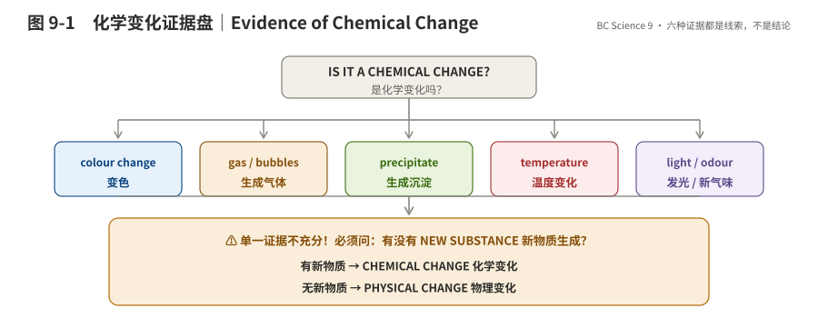
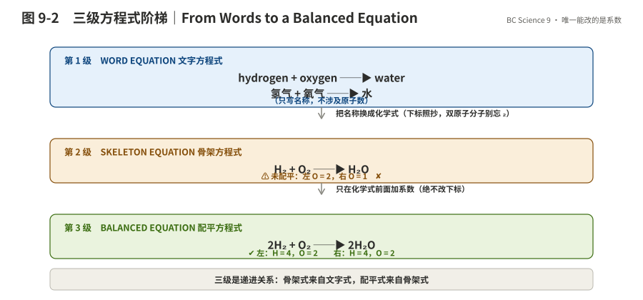
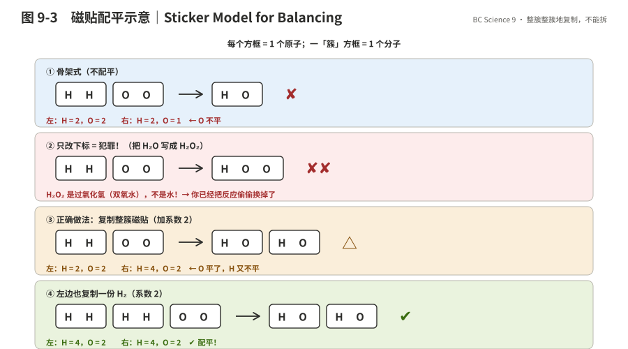
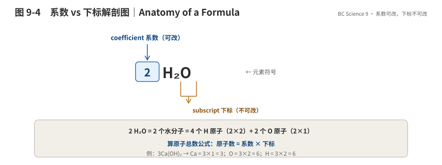

# Ch.9 — Chemical Change and an Introduction to Chemical Equations
## Chapter 9 · Chemical Change and an Introduction to Chemical Equations｜第 9 章　化学变化与化学方程式入门

> 🗂️ **Content Alignment｜大纲对应**：**This chapter is an Extension (bridge) chapter**; the full treatment belongs to **BC Science 10** (official entries: *rearrangement of atoms in chemical reactions* / *law of conservation of mass* / *energy change during chemical reactions* / *acid-base chemistry*)｜**本章为 Extension（拓展）章节**；完整处理属于 **BC Science 10**（官方条目：rearrangement of atoms in chemical reactions / law of conservation of mass / energy change during chemical reactions / acid-base chemistry）
> ⏱️ **Periods｜课时**：2　|　**Prerequisites｜前置**：Ch.1、Ch.6、Ch.7　|　**Followed by｜后继**：Ch.10、Ch.11
> 🗂️ **Generated｜文件生成时间**：2026-09-18 00:53

## 1. Content Alignment｜大纲对应

| Item｜项目 | Details｜内容 |
|---|---|
| BC Science 9 official Content | **Not** on the official Science 9 Content list (Science 9 contains only C1 — element properties as organized in the periodic table, and C2 — the electron arrangement determines the compounds formed)｜**不在** Science 9 官方 Content 清单内（Science 9 只有 C1 元素周期表性质、C2 电子排布决定化合物） |
| Role of this chapter | **Extension / bridge chapter** that prepares you for Science 10. It asks only for *recognising*, *writing* and *counting atoms* — **not** for complex balancing or calculations｜**Extension 拓展 / 衔接桥梁（bridge chapter）**，为 Science 10 打底，只要求"识别 + 书写 + 数原子"，**不要求**复杂配平与计算 |
| Science 10 entries matched here | ① *rearrangement of atoms in chemical reactions*（化学反应中原子的重新排列）② *law of conservation of mass*（质量守恒定律）③ *energy change during chemical reactions*（反应中的能量变化）④ *acid-base chemistry*（酸碱化学） |
| Curricular Competencies | [Questioning and predicting]；[Processing and analyzing]；[Evaluating] Evaluate the validity and limitations of a model；[Communicating] evidence-based arguments｜用证据化论证 |
| Beyond Grade 9? | **Yes (Extension)** — every item in this chapter that goes past Science 9 carries a `【🔭 Extension → Science 10】` tag and is **not** a priority for assessment｜**是（Extension）**——正文所有超出 Science 9 的条目均加 `【🔭 Extension → Science 10】` 标记，测评不作重点 |

> 📏 **Note to students｜给学生的说明**
>
> This chapter is a window onto what you will learn next year. Only three things are required of you this year: ① decide whether a change is chemical or physical; ② write a **word equation**; ③ count atoms to test whether an equation is balanced. You will balance only **the five or six simplest equations**.
>
> **中文**：本章是"看一眼明年要学什么"的窗口。今年你要掌握的是三件事：① 判断是不是化学变化；② 会写文字方程式；③ 会数原子检验是否配平。**配平只做最简单的 5–6 个。**

## 2. Learning Objectives｜学习目标

**EN — By the end of this chapter, you should be able to:**

1. List and recognize at least four lines of evidence that a chemical change has occurred.
2. Distinguish a physical change from a chemical change using observable evidence.
3. Write a **word equation** and convert it into a **skeleton equation**.
4. Count the atoms on both sides of an equation to decide whether it is balanced.
5. State the **law of conservation of mass** and explain it in terms of the rearrangement of atoms.

**中文 — 本章结束后，你应当能够：**

1. 列举并识别化学变化发生的至少四条证据。
2. 依据可观察证据区分物理变化与化学变化。
3. 书写**文字方程式**，并把它转换成**骨架方程式**。
4. 通过数方程式左右两边的原子个数，判断它是否配平。
5. 陈述**质量守恒定律**，并用"原子重新排列"来解释它。

## 3. Concept Explanations｜概念解析

### 3.1 Chemical Change｜化学变化（Reviewing and Extending Ch.1｜复习 Ch.1 并加深）

**Definition｜定义**：A **chemical change** is a change in which one or more new substances are formed. The atoms are **rearranged**; the substances you start with are called **reactants（反应物）**, and the new substances produced are called **products（生成物）**.

**中文**：化学变化是生成了**新物质**的变化。原子只是**重新排列组合**，既没有消失也没有新生。变化前的物质叫**反应物**，生成的新物质叫**生成物**。

- The test is a single question: **has a new substance been formed?** If yes → chemical change; if no → physical change.
  - **中文**：判据只有一句话：**有没有新物质？** 有 → 化学变化；没有 → 物理变化。
- At its heart, a chemical change is: **old links break → atoms regroup → new links form**.
  - **中文**：化学变化的本质是：**旧的连接断开 → 原子重新组合 → 形成新的连接**。
- Because the **nucleus (proton number) never changes** in a chemical reaction, a chemical reaction can **never** turn one element into another — that would be a nuclear reaction.
  - **中文**：因为原子核（质子数）在化学反应中**从不改变**，所以化学反应**不能**把一种元素变成另一种元素（那是核反应）。

### 3.2 Evidence of Chemical Change｜化学变化的证据

| # | Evidence｜证据 | 中文 | Typical example｜典型例子 | Easy to misread｜容易误判的情况 |
|---|---|---|---|---|
| 1 | colour change | 颜色改变 | iron rusting (silver-grey → red-brown); a cut apple turning brown｜铁生锈（银灰→红棕）、苹果切面变褐 | diluting coloured juice also changes colour — that is **physical**｜有色果汁兑水稀释也会变色（物理） |
| 2 | gas produced / bubbles / effervescence | 生成气体、冒气泡 | baking soda + vinegar → CO₂｜小苏打 + 醋 → CO₂ | boiling water also bubbles — that is **physical**｜水沸腾也冒泡（物理） |
| 3 | precipitate formed | 生成沉淀 | lead(II) nitrate + potassium iodide → yellow PbI₂ precipitate｜硝酸铅 + 碘化钾 → 黄色 PbI₂ 沉淀 | mud settling out is physical sedimentation｜泥沙沉底是物理沉降 |
| 4 | temperature change (energy released or absorbed) | 温度变化（放热/吸热） | quicklime + water gives out heat; hand warmers｜生石灰 + 水放热；暖宝宝 | friction warms things up; sunshine warms things up — both **physical**｜摩擦生热、晒太阳变暖（物理） |
| 5 | light produced | 发光 | a burning magnesium ribbon gives a dazzling white flame; fireflies｜镁条燃烧发出耀眼白光；萤火虫 | a lamp glows when current passes — that is **physical**｜灯泡通电发光（物理） |
| 6 | new odour | 产生新气味 | food rotting; an egg going bad｜食物腐败、鸡蛋变质 | perfume simply evaporates and diffuses — **physical**｜香水挥发只是扩散（物理） |

> ⚠️ **Key reminder｜核心提醒**
>
> **No single piece of evidence is enough on its own** — boiling water bubbles and a glowing lamp are both physical changes. You must weigh the evidence together and always return to the fundamental question: **“Has a new substance been formed?”**
>
> **中文**：**任何单一证据都不充分**（水沸腾冒泡、灯泡发光都是物理变化）。必须综合判断，并始终回到"**有没有新物质生成**"这个根本问题上。

### 3.3 Word Equation｜文字方程式

A **word equation** describes a reaction using the **names of the substances** and an arrow.

**中文**：**文字方程式**用**物质名称**和箭头描述反应。

```
  reactant｜反应物   +   reactant｜反应物   ──▶   product｜生成物   +   product｜生成物
  (left of the arrow｜箭头左侧)                    (right of the arrow｜箭头右侧)
```

- The arrow → is read as "**yields**", "**produces**" or "**reacts to form**"; in Chinese it is read as "**生成**".
  - **中文**：箭头 → 读作 "**yields / produces / reacts to form**"（生成 / 变成），中文读"**生成**"。
- On the **left** of the arrow, the "+" is read as "**reacts with**"; on the **right** it is read as "**and**".
  - **中文**："+" 在左边读作 "**reacts with**"（与……反应）；在右边读作 "**and**"（和）。
- Example: `hydrogen + oxygen → water`, read as *Hydrogen reacts with oxygen to produce water.*（氢气与氧气反应生成水。）

### 3.4 Skeleton Equation｜骨架方程式

A **skeleton equation** replaces the names with **chemical formulas**, but it is **not yet balanced** — the atom counts do not necessarily match.

**中文**：**骨架方程式**把名称换成**化学式**，但**还没有配平**（原子数不一定相等）。

- `hydrogen + oxygen → water` becomes `H₂ + O₂ → H₂O`.
  - **中文**：`hydrogen + oxygen → water` 写成 `H₂ + O₂ → H₂O`。
- The key rule: when you write a skeleton equation, **copy the formulas you already know exactly as they are** — do not touch the subscripts. O₂ is a **diatomic molecule**（one of the seven from Ch.4: H₂、N₂、O₂、F₂、Cl₂、Br₂、I₂）, so never drop the subscript 2 when you write an element.
  - **中文**：关键：写骨架式时**直接照抄已知化学式**，不要动下标。O₂ 是**双原子分子**（Ch.4 七种双原子分子之一：H₂、N₂、O₂、F₂、Cl₂、Br₂、I₂），写单质时不要漏掉下标 2。

### 3.5 Balanced Equations and the Law of Conservation of Mass｜配平方程式与质量守恒定律

`【🔭 Extension → Science 10】` Balancing equations in full is Science 10 work; in Grade 9 you only need to recognise a balanced equation and count atoms.

`【🔭 Extension → Science 10】` 完整配平属于 Science 10；九年级只要求认读配平式并会数原子。

```
  Word equation      hydrogen  +  oxygen  →  water
  Skeleton equation      H₂    +    O₂    →   H₂O      ✘ not balanced (O: right = 1, left = 2)｜未配平（右 O=1，左 O=2）
  Balanced equation    2H₂     +    O₂    →  2H₂O      ✔ balanced｜配平
```

**Law of conservation of mass｜质量守恒定律**

> 📌 **EN**：In a chemical reaction, matter is neither created nor destroyed. The **total mass of the reactants equals the total mass of the products**, because the **number and type of atoms do not change** — atoms are only **rearranged**.
> **中文**：在化学反应中，物质既不会被创造也不会被消灭。**反应物的总质量等于生成物的总质量**，因为**原子的种类与数目都不变**——原子只是被**重新排列**了。

**Why is mass conserved?** Because the mass of each atom stays the same and the number of atoms stays the same, so the total mass cannot change. (History: Lavoisier used a sealed container and careful weighing to prove this rigorously for the first time.)

**中文**：**为何质量守恒？** 因为每个原子的质量不变、原子个数不变，所以总质量必然不变。（科学史：拉瓦锡 Lavoisier 用密闭容器称量，第一次严格证明了这一点。）

### 3.6 Coefficient vs Subscript｜系数与下标（the most important idea in this chapter｜本章最重要）

`【🔭 Extension → Science 10】` Coefficients are used for balancing, which is Science 10 content; Grade 9 students should be able to read and compare them.

`【🔭 Extension → Science 10】` 系数用于配平，属 Science 10 内容；九年级学生要能认读并区分。

| Concept｜概念 | How it is written｜写法 | What it does｜作用 | May you change it?｜能否改动 |
|---|---|---|---|---|
| **Coefficient｜系数** | a full-size number written **in front of** a formula, e.g. **2**H₂O | tells you **how many molecules (or formula units)** — "how many"｜表示**分子（或式量单位）的个数**——"有几个" | ✅ **Yes** (you change the quantity, not the substance)｜**可以改**（改的是数量，物质本身不变） |
| **Subscript｜下标** | a small number written at the **lower right** of an element symbol, e.g. H**₂**O | tells you **how many atoms of that element are in each molecule** — "what it looks like"｜表示**每个分子里该原子的个数**——"长什么样" | ❌ **Never** (changing it makes a different substance)｜**绝对不能改**（改了就变成另一种物质） |

> 💡 **Golden rule｜金句**
>
> **A coefficient changes the “how many”; a subscript changes the “who”. Balancing may only move coefficients.**
>
> **中文**：**系数改变"数量"，下标改变"身份"。配平只能动系数。**
> Example: "fixing" the oxygen atoms by turning H₂O into H₂O₂ — but H₂O is **water**, and H₂O₂ is **hydrogen peroxide**（the disinfectant that burns skin）! You have just rewritten the reaction into a different one.
> **中文（例）**：把 H₂O 改成 H₂O₂ 来"配平"氧原子——但 H₂O 是**水**，H₂O₂ 是**过氧化氢**（消毒用的双氧水，会灼伤皮肤）！这就把反应改成了另一个反应。

### 3.7 Balancing in Four Steps｜配平四步法

`【🔭 Extension → Science 10】` The full balancing method belongs to Science 10; this is a preview only.

`【🔭 Extension → Science 10】` 完整配平方法属于 Science 10，此处仅为预览。

1. **Write the skeleton equation｜写骨架式** — replace names with formulas and **copy the subscripts exactly**.
   - **中文**：**写骨架式**（把名称换成化学式，**下标照抄**）。
2. **Count the atoms｜数原子** — count the total number of atoms of each element on each side (coefficient × subscript).
   - **中文**：**数原子**：分别数出左右两边每种元素的原子总数（系数 × 下标）。
3. **Add coefficients｜加系数** — write coefficients **in front of** formulas, starting with the element that appears in only one substance on each side, and usually leaving **O and H until last**.
   - **中文**：**加系数**：把系数写在化学式**前面**，从"只出现在一种物质里"的元素开始，通常**最后处理 O 和 H**。
4. **Recheck｜再数一遍** — confirm that every element matches on both sides and that the coefficients are in the simplest whole-number ratio.
   - **中文**：**再数一遍**：确认每种元素左右相等，且系数为最简整数比。

> 📌 **Sticker / magnet model｜贴纸 / 磁贴模型（Sticker Model）**
>
> Picture every atom as a coloured magnet tile, and a molecule as a small cluster of tiles stuck together. Balancing means **making extra copies of a whole cluster** (adding a coefficient); it is **never** allowed to pull one tile out of a cluster and push it into another (changing a subscript).
>
> **中文**：把每个原子想象成一块彩色磁贴，一个分子就是一小簇贴在一起的磁贴。配平就是"**把整簇磁贴复制几份**"（加系数），而**绝不允许把磁贴从一簇里拆出来塞进另一簇**（改下标）。

### 3.8 State Symbols and Reaction Conditions｜状态符号与反应条件

`【🔭 Extension → Science 10】` Full use belongs to Science 10; this chapter only asks you to recognise them.

`【🔭 Extension → Science 10】` 完整使用属 Science 10，本章仅要求认读。

| Symbol｜符号 | English | 中文 | Example｜例子 |
|---|---|---|---|
| (s) | solid | 固体 | Mg(s)、NaCl(s) |
| (l) | liquid | 液体 | H₂O(l)、Br₂(l) |
| (g) | gas | 气体 | O₂(g)、CO₂(g) |
| (aq) | aqueous（dissolved in water） | 水溶液 | HCl(aq)、NaCl(aq) |
| △ or heat | heated | 加热 | written above the arrow｜写在箭头上方 |

- A complete example: `2Mg(s) + O₂(g) → 2MgO(s)`.
  - **中文**：完整写法示例：`2Mg(s) + O₂(g) → 2MgO(s)`。
- The upward arrow ↑ for a gas and the downward arrow ↓ for a precipitate are common in Chinese textbooks, while BC textbooks mostly use (g) and (s). Recognise both.
  - **中文**：气体上箭头 ↑ 与沉淀下箭头 ↓ 是中国教材常见记号，BC 教材多用 (g) 与 (s)，两者都认得即可。

### 3.9 What Comes Next in Science 10｜Science 10 预告

`【🔭 Extension → Science 10】` Everything below belongs to Science 10; in this book you only need to know the names.

`【🔭 Extension → Science 10】` 以下全部属 Science 10，本册**只要求知道名字**。

| Type｜反应类型 | English | 中文 | General form｜通式 |
|---|---|---|---|
| Synthesis 化合 | synthesis / combination | 化合反应 | A + B → AB |
| Decomposition 分解 | decomposition | 分解反应 | AB → A + B |
| Single replacement 置换 | single replacement | 置换反应 | A + BC → AC + B |
| Double replacement 复分解 | double replacement | 复分解反应 | AB + CD → AD + CB |
| Combustion 燃烧 | combustion | 燃烧反应 | fuel + O₂ → CO₂ + H₂O (+ energy)｜燃料 + O₂ → CO₂ + H₂O（+ 能量） |

- **Acid-base chemistry｜酸碱化学**：In Science 10 you will learn pH, **indicators** and **neutralization**（acid + base → salt + water）. Example: `HCl + NaOH → NaCl + H₂O`.
  - **中文**：Science 10 会学 pH、indicator 指示剂、neutralization 中和反应（acid + base → salt + water）。例：`HCl + NaOH → NaCl + H₂O`。
- **Concentration｜浓度**：Science 10 covers molar concentration (mol/L) and dilution calculations.
  - **中文**：Science 10 会学 molar concentration（mol/L）与稀释计算。
- **Energy change｜能量变化**：**exothermic** releases energy (temperature rises) versus **endothermic** absorbs energy (temperature falls).
  - **中文**：exothermic 放热（温度上升）vs endothermic 吸热（温度下降）。

## 4. Comparison Tables｜表格比对

### Table 9-1　Physical Change vs Chemical Change｜物理变化与化学变化

| Compared｜比较项 | Physical change｜物理变化 | Chemical change｜化学变化 |
|---|---|---|
| Is a new substance formed?｜是否生成新物质 | No｜否 | **Yes — the deciding test**｜**是**（核心判据） |
| Does the formula change?｜化学式是否改变 | No｜不变 | **Yes**｜**改变** |
| What happens at the atomic level｜原子层面发生什么 | spacing / arrangement of molecules changes; **the molecules stay intact**｜分子间距/排列改变，**分子本身完整** | **atoms are rearranged**（rearrangement of atoms）｜**原子重新排列** |
| Reversible? (in general)｜是否可逆（一般） | fairly easy to reverse｜较易可逆 | usually hard to reverse｜通常难以逆转 |
| Energy change｜能量变化 | usually small｜通常较小 | usually obvious (heat released / absorbed / light)｜通常明显（放热/吸热/发光） |
| Keywords｜关键词 | melt 熔化、freeze 凝固、evaporate 蒸发、dissolve 溶解、break 破碎 | burn 燃烧、rust 生锈、corrode 腐蚀、ferment 发酵、rot 腐烂、explode 爆炸 |
| Examples｜例子 | ice melting; table salt dissolving in water; glass breaking｜冰融化、食盐溶于水、玻璃破碎 | iron rusting; a magnesium ribbon burning; baking soda + vinegar｜铁生锈、镁条燃烧、小苏打 + 醋 |

### Table 9-2　Word / Skeleton / Balanced Equations｜三级方程式对照

| Level｜级别 | English | 中文 | What it uses｜用了什么 | Are atom counts equal?｜原子数是否相等 |
|---|---|---|---|---|
| ① | **Word equation｜文字方程式** | 文字方程式 | substance **names** + an arrow｜物质**名称** + 箭头 | not applicable｜不涉及 |
| ② | **Skeleton equation｜骨架方程式** | 骨架方程式 | substance **formulas**, not yet balanced｜物质**化学式**（未配平） | **not necessarily**｜**不一定相等** |
| ③ | **Balanced equation｜配平方程式** | 配平方程式 | formulas + **coefficients**｜化学式 + **系数** | **always equal ✔**｜**一定相等 ✔** |

### Table 9-3　Coefficient vs Subscript｜系数与下标（必背 · must memorise）

| Compared｜比较项 | Coefficient｜系数 | Subscript｜下标 |
|---|---|---|
| Position｜位置 | **in front of** the formula｜化学式**前面** | at the **lower right** of the element symbol｜元素符号**右下角** |
| Written as｜写法示例 | **2**H₂O、**3**O₂ | H**₂**O、O**₂** |
| Meaning｜含义 | how many **molecules / formula units**｜多少个**分子 / 式量单位** | how many **atoms** of that element in one molecule｜一个分子里该元素有几个**原子** |
| When counting atoms｜计算原子数时 | **multiply** it into the total（2H₂O → H = 2 × 2 = 4）｜**乘**进总数（2H₂O → H = 2×2 = 4） | **multiply** it into the total（H₂O → H = 2）｜**乘**进总数（H₂O → H = 2） |
| May you change it when balancing?｜配平时能否改动 | ✅ Yes — the **only** thing you may change｜✅ 可以（唯一允许改的） | ❌ **No** — it would change the substance｜❌ **不能**（会改变物质本身） |
| Analogy｜类比 | how many boxes of biscuits｜有多少盒饼干 | how many biscuits in one box｜一盒饼干里装几块 |

### Table 9-4　Conservation of Mass: Before and After｜质量守恒：反应前后对照

| Item｜项目 | Before — reactants｜反应前 | After — products｜反应后 |
|---|---|---|
| **Types** of atoms｜原子**种类** | H、O | H、O（**unchanged｜不变**） |
| **Number** of atoms｜原子**数目** | 4 H + 2 O | 4 H + 2 O（**unchanged｜不变**） |
| **Types** of molecules｜分子**种类** | H₂、O₂ | H₂O（**changed｜变了**） |
| **Number** of molecules｜分子**数目** | 3 molecules（2 + 1） | 2 molecules（**may change**, and that does not break conservation）｜**会变**，这不违反守恒 |
| Total **mass**｜总**质量** | 36 g | 36 g（**unchanged｜不变**） |

### Table 9-5　Balancing Practice Key｜配平练习答案速查　`【🔭 Extension → Science 10】`

| # | Skeleton｜骨架式 | Balanced｜配平式 | Left / right atom counts｜左 / 右原子数 |
|---|---|---|---|
| 1 | H₂ + O₂ → H₂O | **2**H₂ + O₂ → **2**H₂O | H 4/4；O 2/2 |
| 2 | Na + Cl₂ → NaCl | **2**Na + Cl₂ → **2**NaCl | Na 2/2；Cl 2/2 |
| 3 | Mg + O₂ → MgO | **2**Mg + O₂ → **2**MgO | Mg 2/2；O 2/2 |
| 4 | CH₄ + O₂ → CO₂ + H₂O | CH₄ + **2**O₂ → CO₂ + **2**H₂O | C 1/1；H 4/4；O 4/4 |
| 5 | Fe + O₂ → Fe₂O₃ | **4**Fe + **3**O₂ → **2**Fe₂O₃ | Fe 4/4；O 6/6 |
| 6 | Zn + HCl → ZnCl₂ + H₂ | Zn + **2**HCl → ZnCl₂ + H₂ | Zn 1/1；H 2/2；Cl 2/2 |

## 5. Diagrams & Worked Examples｜图例说明

### Fig. 9-1　Evidence of Chemical Change｜化学变化证据盘



**How to read the diagram｜看图要点**

All six kinds of evidence are **clues, not verdicts**. When you see bubbles, ask first, "Is the water simply boiling?" When you see a colour change, ask, "Has it just been diluted?" Evidence must be cross-checked, then traced back to the one fundamental test: **whether a new substance has been formed**.

**中文**：六种证据都是"线索"而不是"结论"。看到气泡先问"水是不是只是烧开了？"，看到变色先问"是不是只是被稀释了？"。**证据必须交叉验证，再落到"有无新物质"这一根本判据上。**

### Fig. 9-2　From Words to a Balanced Equation｜三级方程式阶梯



**How to read the diagram｜看图要点**

The three levels are **sequential, not parallel** — the skeleton equation comes from the word equation, and the balanced equation comes from the skeleton equation. The **only thing you are ever allowed to change is the coefficient**; the subscripts were fixed back at the word-equation stage.

**中文**：三级是**递进**关系而不是并列关系——骨架式来自文字式，配平式来自骨架式。**唯一被允许改动的地方是"系数"**，下标从文字式阶段就固定下来了。

### Fig. 9-3　Sticker Model for Balancing｜磁贴配平示意



**How to read the diagram｜看图要点**

Balancing is "**copying whole clusters**". Clusters may become more numerous (coefficient), but you may **never** pull one tile out of a cluster and push it into another (subscript). This picture is the single most important mental model in the chapter.

**中文**：配平就是"**整簇整簇地复制**"。磁贴可以整簇变多（系数），但**不能从一簇里拆出一块塞进另一簇**（下标）。这张图是本章最核心的心智模型。

### Fig. 9-4　Anatomy of a Formula｜系数 vs 下标解剖图



**How to read the diagram｜看图要点**

When counting atoms, **never forget to multiply by the coefficient**. The classic mistake is "there is a 2 in front of H₂O, but I will just count the H₂O itself" — with that habit you will never get an equation to balance. A subscript outside brackets must be **multiplied by every atom inside the brackets**.

**中文**：数原子时**一定不要漏乘系数**。常见错误是"H₂O 前面有 2，但我只数 H₂O 自己"，那就永远配不平。括号右下角的下标要**乘括号里每一个原子**。

### Fig. 9-5　Worked Example — Balancing｜例题：配平四步法　`【🔭 Extension → Science 10】`

**Question｜题目**：Balance `CH₄ + O₂ → CO₂ + H₂O`（the combustion of methane）.（配平 `CH₄ + O₂ → CO₂ + H₂O`（甲烷燃烧）。）

**Solution｜解析**：

| Step｜步骤 | Action｜操作 | Result｜结果 | Atom count｜原子计数 |
|---|---|---|---|---|
| 1 | write the skeleton equation, copying subscripts｜写骨架式（下标照抄） | CH₄ + O₂ → CO₂ + H₂O | — |
| 2 | count the atoms｜数原子 | — | left C1 H4 O2；right C1 H2 O3｜左 C1 H4 O2；右 C1 H2 O3 |
| 3a | C already matches; balance **H** first (coefficient 2 on the right)｜C 已平；先配 **H**（右加系数 2） | CH₄ + O₂ → CO₂ + **2**H₂O | left H4；right H4 ✔｜左 H4；右 H4 ✔ |
| 3b | then balance **O** (right has O = 2 + 1 = 3; rather than writing 3/2, double everything)｜再配 **O**（右现有 O = 2+1 = 3，左需 3 个 O 原子 → O₂ 前写 3/2 不好，直接翻倍） | CH₄ + **2**O₂ → CO₂ + **2**H₂O | left O4；right O2 + 2 = 4 ✔｜左 O4；右 O2+2=4 ✔ |
| 4 | recheck everything｜复核全部 | **CH₄ + 2O₂ → CO₂ + 2H₂O** | C 1/1；H 4/4；O 4/4 ✔ |

> 📌 **Strategy summary｜策略小结**
>
> **Carbon first, then hydrogen, oxygen last.** Oxygen usually appears as the element O₂, so handling it last is easiest — changing the coefficient of O₂ does not disturb any other element.
>
> **中文**：**先 C，再 H，最后 O**。O 常以单质 O₂ 出现，最后处理它最省事——因为改 O₂ 的系数不会牵动其他元素。
> `【🔭 Extension → Science 10】` This reaction is a **combustion** reaction and it is **exothermic**.｜此反应属于 **combustion 燃烧反应**，且为 **exothermic 放热**。

### Fig. 9-6　Worked Example — Using Conservation of Mass｜例题：用质量守恒求质量　`【🔭 Extension → Science 10】`

**Question｜题目**：12 g of carbon burns completely in an excess of oxygen and produces 44 g of carbon dioxide. Find the mass of oxygen that reacted, and state the principle you used.（12 g 碳在足量氧气中完全燃烧，生成 44 g 二氧化碳。求参加反应的氧气质量，并说明依据。）

**Solution｜解析**：

| Item｜项目 | Calculation / explanation｜计算 / 说明 |
|---|---|
| Word equation｜文字方程式 | carbon + oxygen → carbon dioxide |
| Balanced equation｜配平方程式 | C + O₂ → CO₂（already balanced: C 1/1；O 2/2 ✔）｜（已配平：C 1/1；O 2/2 ✔） |
| Given｜已知 | m(C) = 12 g，m(CO₂) = 44 g |
| Principle｜依据 | law of conservation of mass｜质量守恒定律：total mass of reactants = total mass of products｜反应物总质量 = 生成物总质量 |
| Working｜列式 | m(C) + m(O₂) = m(CO₂) → 12 g + m(O₂) = 44 g |
| Answer｜答案 | **m(O₂) = 44 − 12 = 32 g** |
| Atomic-level explanation｜原子层解释 | 1 C atom + 1 O₂ molecule (2 O atoms) rearrange into 1 CO₂ molecule; **the types and numbers of atoms do not change**, so the mass does not change｜1 个 C 原子 + 1 个 O₂ 分子（2 个 O 原子）重新排列成 1 个 CO₂ 分子，**原子种类与数目都不变**，故质量不变 |

**How to read the diagram｜看图要点**

The standard pattern for a conservation-of-mass question is "**total in = total out**". If a question says that the mass got smaller after a reaction in an open container, conservation has not failed — **a gas escaped and was never weighed**. See question C1.

**中文**：质量守恒题目的标准套路是"**总进 = 总出**"。如果题目给出"敞口容器中反应后质量变小了"，那不是守恒失效，而是**有气体跑掉了没被称到**——见 C1 题。

## 6. Key Vocabulary｜核心词汇

| English | 中文 | Notes｜备注 |
|---|---|---|
| chemical change | 化学变化 | a new substance is formed｜生成新物质 |
| physical change | 物理变化 | no new substance｜无新物质 |
| reactant | 反应物 | left of the arrow｜箭头左侧 |
| product | 生成物 | right of the arrow｜箭头右侧 |
| yield / produce | 生成 | how to read the arrow →｜箭头 → 的读法 |
| word equation | 文字方程式 | uses names｜用名称 |
| skeleton equation | 骨架方程式 | uses formulas, unbalanced｜用化学式，未配平 |
| balanced equation | 配平方程式 | has coefficients, atom counts equal｜有系数，原子数相等 |
| **coefficient** | **系数** | number in front of a formula, **may be changed**｜化学式前面的数字，**可改** |
| **subscript** | **下标** | small number at the lower right, **must not be changed**｜右下角小数字，**不可改** |
| **law of conservation of mass** | **质量守恒定律** | types and numbers of atoms unchanged｜原子种类与数目不变 |
| rearrangement of atoms | 原子重新排列 | official Science 10 entry｜Science 10 官方条目 |
| **precipitate** | **沉淀** | a solid formed when two solutions are mixed｜两溶液混合生成的固体 |
| effervescence | 冒气泡 / 起泡 | gas produced｜生成气体 |
| state symbol | 状态符号 | (s) (l) (g) (aq) |
| aqueous | 水溶液的 | dissolved in water｜溶于水 |
| exothermic | 放热的 | temperature rises｜温度上升 |
| endothermic | 吸热的 | temperature falls｜温度下降 |
| synthesis / decomposition | 化合 / 分解 | Science 10 |
| single / double replacement | 置换 / 复分解 | Science 10 |
| combustion | 燃烧 | Science 10 |
| neutralization | 中和 | Science 10（acid + base → salt + water） |

## 7. Lab / Activity｜实验与活动

### Activity 9-1　Chemical Change Stations｜化学变化观察站

- **Type｜类型**：teacher demonstration + student recording（Demo & Observation）｜教师演示 + 学生记录
  - **中文**：教师演示 + 学生记录。
- **Materials｜材料**：baking soda + white vinegar; lead(II) nitrate solution + potassium iodide solution（**teacher demonstration only**）; steel wool (observed over several days); magnesium ribbon（**lit by the teacher**）｜小苏打 + 白醋；硝酸铅溶液 + 碘化钾溶液（**教师演示**）；钢丝绒（数天观察）；镁带（**教师点燃**）
  - **中文**：小苏打 + 白醋；硝酸铅溶液 + 碘化钾溶液（**教师演示**）；钢丝绒（数天观察）；镁带（**教师点燃**）。
- **Procedure｜步骤**：Students use sight only（**no tasting, no leaning in to smell**）to record before / after, then fill in the evidence table and decide what type of change occurred.
  - **中文**：学生用视觉（**禁止品尝、禁止直接凑近闻**）记录 before / after，填入证据表并判定变化类型。

| Station | Before｜观察前 | After｜观察后 | Evidence｜证据 | Verdict｜判定 |
|---|---|---|---|---|
| 1 baking soda + vinegar｜小苏打 + 醋 | | | | |
| 2 Pb(NO₃)₂ + KI | | | | |
| 3 steel wool + water｜钢丝绒 + 水 | | | | |
| 4 burning magnesium ribbon｜镁带燃烧 | | | | |

- **Competencies trained｜训练能力**：[Planning and conducting]；[Processing and analyzing] Use knowledge of scientific concepts to draw conclusions consistent with evidence
- **Safety｜安全**：⚠ Wear **goggles** throughout; lead salts are toxic, so the **teacher demonstrates and students never handle them**; **never look directly** at burning magnesium (the intense light damages the eyes); smell gases only by **wafting**.
  - **中文**：⚠ 全程佩戴 **goggles 护目镜**；铅盐有毒，**教师演示、学生不接触**；镁带燃烧**禁止直视**（强光伤眼）；闻气体用 **wafting 扇闻法**。

### Activity 9-2　Magnet Tile Balancing｜磁贴配平工作坊　`【🔭 Extension → Science 10】`

- **Type｜类型**：hands-on modelling｜动手操作
  - **中文**：动手操作。
- **Materials｜材料**：coloured round magnets or paper discs (one colour for H, another for O) and a whiteboard｜彩色圆磁贴 / 纸片（H 用一种颜色、O 用另一种）、白板
  - **中文**：彩色圆磁贴 / 纸片（H 用一种颜色、O 用另一种）、白板。
- **Procedure｜步骤**：
  1. In pairs, lay out H₂ + O₂ → H₂O with the tiles.（两人一组，用磁贴摆出 H₂ + O₂ → H₂O。）
  2. Only "**copying whole clusters**" is allowed — make the two sides equal in atom count.（只允许"**整簇复制**"，把两边配成原子数相等。）
  3. Work through the six equations in Table 9-5 in turn, recording the left/right atom count each time.（依次挑战 Table 9-5 的 6 道题，每配平一题就记录一次"左/右原子计数"。）
  4. The teacher deliberately demonstrates "changing a subscript", and the class explains why it is wrong.（教师故意演示"改下标"，让全班指出为什么错。）
- **Competencies trained｜训练能力**：[Evaluating] Formulate physical or mental theoretical models；[Communicating]
- **Safety｜安全**：none chemically — but keep the tiles out of mouths and noses（no swallowing）｜无（磁贴防止误吞，勿放入口鼻）

### Activity 9-3　Mass Conservation Challenge｜质量守恒称量挑战　`【🔭 Extension → Science 10】`

- **Type｜类型**：teacher demonstration, comparative experiment｜教师演示对比实验
  - **中文**：教师演示对比实验。
- **Materials｜材料**：electronic balance, Erlenmeyer flask + balloon（a closed system）, baking soda + vinegar｜电子天平、锥形瓶 + 气球（密闭系统）、小苏打 + 醋
  - **中文**：电子天平、锥形瓶 + 气球（密闭系统）、小苏打 + 醋。
- **Procedure｜步骤**：① Mix them in an open beaker and weigh before and after → the mass **gets smaller**; ② mix them inside a flask sealed with a balloon and weigh before and after → the mass **stays the same**. Students explain the difference.
  - **中文**：① 敞口烧杯中混合，称量前后质量 → **变小**；② 锥形瓶上套气球密闭后混合，称量前后质量 → **不变**。学生解释差异。
- **Competencies trained｜训练能力**：[Processing and analyzing]；[Evaluating] Evaluate the validity and limitations of a model
- **Safety｜安全**：⚠ goggles; do not over-inflate the balloon (it may burst); keep acetic acid out of the eyes｜护目镜；气球不要过度充气以防爆裂；醋酸避免入眼
  - **中文**：⚠ 护目镜；气球不要过度充气以防爆裂；醋酸避免入眼。

## 8. Common Misconceptions｜常见易错点

| # | Misconception｜错误认识 | Correction｜正确理解 |
|---|---|---|
| 1 | **Changing a subscript in order to balance** — writing H₂O as H₂O₂（为了配平去改下标） | ❌ The most serious mistake. Changing a subscript changes the substance itself. **Only coefficients may be changed.**（改下标 = 改物质本身。**只能改系数。**） |
| 2 | "Bubbles always mean a chemical change"（冒泡一定是化学变化） | Boiling water bubbles too. Ask: **is the gas a new substance?**（水沸腾也冒泡。要问：**气泡是不是新物质？**） |
| 3 | "Light always means a chemical change"（发光一定是化学变化） | A lamp glowing when current flows is a physical change.（灯泡通电发光是物理变化。） |
| 4 | "Dissolving is a chemical change, because the solid 'disappears'"（溶解是化学变化，因为固体"消失"了） | You can recover the original substance by evaporating → **physical change**.（蒸发可回收原物质 → **物理变化**。） |
| 5 | **Forgetting to multiply by the coefficient** when counting atoms（数原子时漏乘系数） | Atom count = **coefficient × subscript**. 2H₂O contains 4 H atoms, not 2.（原子数 = **系数 × 下标**。2H₂O 是 4 个 H，不是 2 个。） |
| 6 | Writing an element as a single atom — writing oxygen as O（单质写成单原子，把氧气写成 O） | O₂、H₂、N₂、F₂、Cl₂、Br₂、I₂ are **diatomic molecules**; the subscript 2 is compulsory.（是**双原子分子**，下标 2 必须写。） |
| 7 | "The number of molecules must also be equal after balancing"（配平后分子数目也必须相等） | ❌ What is conserved is the **number of atoms and the mass**, not the number of molecules. In 2H₂ + O₂ → 2H₂O there are 3 molecules on the left and 2 on the right, and it is still balanced.（守恒的是**原子数与质量**，不是分子数。） |
| 8 | "Atoms disappear or are created in a chemical reaction"（化学反应中原子会消失或新生） | Atoms are **neither lost nor created**; they are only rearranged.（原子**既不消失也不新生**，只是重新排列。） |
| 9 | Thinking conservation has failed because the mass "got smaller" in an open container（敞口反应后质量"变少"就认为质量守恒失效） | A gas simply escaped and was **not weighed**. In a closed system the mass does not change.（只是**气体逸出未被称量**。密闭系统称量则质量不变。） |
| 10 | Writing coefficients as fractions（½O₂）（把系数写成分数） | The final coefficients must be the **simplest whole-number ratio**; you may use fractions as a step, then double everything to clear them.（最终系数必须是**最简整数比**，可先分数过渡，最后全体翻倍化为整数。） |
| 11 | Thinking the left of the arrow holds the "products"（认为箭头左边是"产品"） | Left = reactants｜反应物; right = products｜生成物. |
| 12 | Using prefixes to name ionic compounds too early (sodium monochloride)（提前用前缀给离子化合物命名） | Prefixes are for molecular compounds only; **ionic compounds do not use prefixes** (see Ch.7 / Ch.8).（分子化合物才用前缀；**离子化合物不用前缀**。） |

## 9. Assessment｜答题评估

### Group A: Foundational｜A 组：基础题（2 marks each, 20 marks total｜每题 2 分，共 20 分）

**A1.** Write down four lines of evidence that a chemical change has occurred (two in English and two in Chinese is fine).（写出化学变化的四条证据，English + 中文各两条即可。）

**A2.** True or false: water boiling and bubbling is a chemical change. Explain your answer.（判断：水沸腾冒泡是化学变化。对 / 错，并说明理由。）

**A3.** Convert this word equation into a skeleton equation: `sodium + chlorine → sodium chloride`.（把下列文字方程式写成骨架方程式。）

**A4.** `【🔭 Extension → Science 10】` Write `hydrogen + oxygen → water` as a balanced equation.（把 `hydrogen + oxygen → water` 写成配平方程式。）

**A5.** `【🔭 Extension → Science 10】` Balance: `Na + Cl₂ → NaCl`.（配平。）

**A6.** Explain the difference between a **coefficient** and a **subscript**, and state which one you may change when balancing.（说明 coefficient 系数与 subscript 下标的区别，并指出配平时能改哪一个。）

**A7.** State the **law of conservation of mass**（in Chinese or in English）.（陈述 law of conservation of mass 质量守恒定律。）

**A8.** Count the atoms: in `2H₂O` there are ______ H atoms and ______ O atoms.（数原子。）

**A9.** Give the Chinese meaning of each state symbol: (s)、(l)、(g)、(aq).（写出状态符号各自的中文含义。）

**A10.** `【🔭 Extension → Science 10】` Balance: `Mg + O₂ → MgO`.（配平。）

### Group B: Applied｜B 组：应用题（5 marks each, 20 marks total｜每题 5 分，共 20 分）

**B1.** For each of the four situations below, decide whether it is a physical change or a chemical change, and give one evidence-based reason for each.（观察下列四个场景，判断各是物理变化还是化学变化，并各写一句证据化理由。）

- (a) An iron nail left in damp air for a week turns red-brown on the surface.（铁钉放在潮湿空气中一周后表面变红棕）
- (b) An ice cube melts into water on the table.（冰块在桌上化成水）
- (c) Baking soda poured into white vinegar foams vigorously.（小苏打倒入白醋中剧烈起泡）
- (d) Sugar dissolved in water can no longer be seen as grains.（蔗糖溶于水后看不见颗粒）

**B2.** `【🔭 Extension → Science 10】` Balance the three equations below, and write the left/right atom count after each one.（配平下列三个方程式，并在每题后写出"左 / 右原子计数"。）

- (a) `CH₄ + O₂ → CO₂ + H₂O`
- (b) `Fe + O₂ → Fe₂O₃`
- (c) `Zn + HCl → ZnCl₂ + H₂`

**B3.** `【🔭 Extension → Science 10】` In a closed container, 16 g of methane (CH₄) reacts completely with 64 g of oxygen, producing 44 g of carbon dioxide and 36 g of water.（在密闭容器中，16 g 甲烷（CH₄）与 64 g 氧气完全反应，生成 44 g 二氧化碳和 36 g 水。）

- (a) Check whether the data fit the law of conservation of mass.（验证数据是否符合质量守恒定律）
- (b) Use "rearrangement of atoms" to explain why the mass does not change.（用"原子重新排列"解释为什么质量不变）

**B4.** `【🔭 Extension → Science 10】` Xiaoming was balancing `H₂ + O₂ → H₂O` and wrote the right-hand side as `H₂O₂`, saying "now the oxygen is balanced".（小明配平 `H₂ + O₂ → H₂O` 时把右边写成 `H₂O₂`，说"这样氧就平了"。）

- (a) Identify his mistake.（指出他的错误）
- (b) State what the substances H₂O and H₂O₂ are.（说明 H₂O 与 H₂O₂ 分别是什么物质）
- (c) Give the correct balanced equation.（给出正确配平式）

### Group C: Challenge｜C 组：挑战题（10 marks each, 20 marks total｜每题 10 分，共 20 分）

**C1.** Design an experiment that uses a **closed system** to test the law of conservation of mass. You must include: a research question; a hypothesis (in *If…then…* form); the independent, dependent and controlled variables; the equipment; the procedure; a data table; the expected result; and the safety precautions. Also explain why an open system only "looks" as though mass is not conserved.（设计一套实验，用**密闭系统**验证质量守恒定律，并解释为什么敞口系统会"看起来"不守恒。）

**C2.** `【🔭 Extension → Science 10】` Baking soda (NaHCO₃) reacts with acetic acid (HC₂H₃O₂) to produce sodium acetate (NaC₂H₃O₂), water and carbon dioxide.（小苏打（NaHCO₃）与醋酸（HC₂H₃O₂）反应生成醋酸钠（NaC₂H₃O₂）、水与二氧化碳。）

- (a) Write the word equation and the skeleton equation.（写出文字方程式与骨架方程式）
- (b) Balance it and check the atom count of every element.（配平它并检查每种元素的原子数）
- (c) Using an **atomic model**, argue why this reaction obeys the law of conservation of mass — say **which atoms are rearranged and what does not change**.（用**原子模型**论证：为什么这个反应符合质量守恒定律？）

---

### Answer Key｜参考答案

**Group A｜A 组**

- **A1.** Any four: colour change｜变色; gas produced｜生成气体; precipitate formed｜生成沉淀; temperature change｜温度变化; light produced｜发光; new odour｜新气味.
- **A2.** **False｜错**. Boiling water only changes liquid into gas; it is still H₂O and no new substance is formed → a **physical change**.（水沸腾只是液态变气态，仍是 H₂O，没有新物质生成 → physical change 物理变化。）
- **A3.** `Na + Cl₂ → NaCl`（**note: chlorine is the diatomic molecule Cl₂**｜**注意 chlorine 是双原子分子 Cl₂**）
- **A4.** `2H₂ + O₂ → 2H₂O`
- **A5.** `2Na + Cl₂ → 2NaCl`
- **A6.** A **coefficient** is written **in front of** a formula and tells you how many molecules; a **subscript** is written at the **lower right** of an element symbol and tells you how many atoms are in one molecule. **When balancing you may change only the coefficient, never the subscript.**（系数写在化学式**前面**，表示分子个数；下标写在元素符号**右下角**，表示分子内原子个数。**配平只能改系数，绝不能改下标。**）
- **A7.** In a chemical reaction, matter is neither created nor destroyed: the total mass of the reactants equals the total mass of the products, because **the types and numbers of atoms do not change — they are only rearranged**.（在化学反应中，物质既不会被创造也不会被消灭；反应物总质量等于生成物总质量，因为**原子的种类与数目不变，只是重新排列**。）
- **A8.** H = **4**（2 × 2）; O = **2**（2 × 1）.
- **A9.** (s) solid｜固体；(l) liquid｜液体；(g) gas｜气体；(aq) aqueous｜水溶液.
- **A10.** `2Mg + O₂ → 2MgO`

**Group B (key points)｜B 组（要点）**

- **B1.**
  - (a) **Chemical change｜化学变化** — a new substance, rust (Fe₂O₃·xH₂O), has formed; evidence: **colour change** from silver-grey to red-brown.（生成了新物质铁锈；证据：colour change 由银灰变红棕。）
  - (b) **Physical change｜物理变化** — only solid has become liquid; the molecules are still H₂O and there is no new substance.（只是固态变液态，分子仍是 H₂O，无新物质。）
  - (c) **Chemical change｜化学变化** — the vigorous bubbles are the new substance CO₂; evidence: **gas produced**.（产生大量气泡即新物质 CO₂；证据：gas produced。）
  - (d) **Physical change｜物理变化** — sugar molecules are simply dispersed in the water and can be recovered by evaporating; **dissolving** is not a reaction.（蔗糖分子分散在水中，蒸发可回收原蔗糖，溶解是 dissolving 不是反应。）
- **B2.**
  - (a) `CH₄ + 2O₂ → CO₂ + 2H₂O`：C 1/1；H 4/4；O 4/4 ✔
  - (b) `4Fe + 3O₂ → 2Fe₂O₃`：Fe 4/4；O 6/6 ✔
  - (c) `Zn + 2HCl → ZnCl₂ + H₂`：Zn 1/1；H 2/2；Cl 2/2 ✔
- **B3.**
  - (a) Total mass of reactants = 16 + 64 = **80 g**; total mass of products = 44 + 36 = **80 g**. The two sides are equal, so the data **fit** the law of conservation of mass.（两边相等 → **符合**质量守恒。）
  - (b) The C, H and O atoms in CH₄ and O₂ regroup into CO₂ and H₂O. **The types of atoms (C/H/O) do not change, the numbers of atoms do not change, and the mass of each atom does not change** — only the way they are joined changes, so the total mass is unchanged. (The types and numbers of *molecules* do change, and that does not affect conservation.)（**原子种类、原子数目、每个原子质量都不变**，只是连接方式变了，所以总质量不变。）
- **B4.**
  - (a) He tried to balance by **changing a subscript**, which changes the substance itself — he has written a different reaction.（他通过**改下标**来"配平"，这改变了物质本身，等于换了一个反应。）
  - (b) H₂O is **water｜水**; H₂O₂ is **hydrogen peroxide｜过氧化氢**（双氧水，有腐蚀/漂白性）.
  - (c) The correct balanced equation is `2H₂ + O₂ → 2H₂O`.（正确配平式。）

**Group C (marking points)｜C 组（评分要点）**

- **C1.** Reference points:
  - **Question｜问题**：In a closed system, does the total mass change before and after the reaction between baking soda and vinegar?（在密闭系统中，小苏打与醋反应前后总质量是否改变？）
  - **Hypothesis｜假设**：*If the system is closed, then the total mass before and after the reaction will be the same.*（The *If…then…* format must be complete｜If…then… 格式必须齐全）
  - **Variables｜变量**：independent = whether the reaction has happened (before / after)｜自变量 = 是否发生反应（反应前 / 反应后）; dependent = total mass of the system (g)｜因变量 = 系统总质量 (g); controlled = the same equipment, the same chemicals, the same balance, constant temperature, container not moved｜控制变量 = 同一套器材、同一份药品、同一台天平、温度不变、不移动容器.
  - **Equipment｜器材**：Erlenmeyer flask + balloon (or baking soda hung in a small paper bag and then tipped in), electronic balance, baking soda, white vinegar.（锥形瓶 + 气球（或小苏打用小纸袋悬挂后倒入）、电子天平、小苏打、白醋。）
  - **Procedure｜步骤**：① put the vinegar in the flask and hang the small bag of baking soda inside **without contact**, stopper the flask and fit the balloon; ② weigh the total mass m₁; ③ tilt so that the two mix and watch the balloon inflate; ④ weigh the total mass m₂ again; ⑤ repeat 3 times.
  - **Data table｜数据表**：columns = trial、m₁ (g)、m₂ (g)、Δm (g)｜列 = 次数、m₁ (g)、m₂ (g)、Δm (g).
  - **Expected result｜预期结果**：m₁ = m₂（within the precision of the balance, Δm ≈ 0）.
  - **Explanation｜解释**：In an open system CO₂ escapes into the air and is never weighed, so the system "looks" lighter — **conservation has not failed; the thing being weighed is incomplete**.（敞口系统中 CO₂ 逸出未被称量，"看起来"变轻——**不是质量守恒失效，而是称量对象不完整**。）
  - **Safety｜安全**：⚠ goggles; no tasting; keep acetic acid out of the eyes; do not overfill the balloon; wash hands afterwards and dispose of the waste as the teacher directs.（护目镜；禁止品尝；醋酸避免入眼；气球不要充气过满；实验后洗手、按教师指示处理废液。）
- **C2.**
  - (a) Word equation｜文字式：`sodium hydrogen carbonate + acetic acid → sodium acetate + water + carbon dioxide`（中文：碳酸氢钠 + 醋酸 → 醋酸钠 + 水 + 二氧化碳）; skeleton equation｜骨架式：`NaHCO₃ + HC₂H₃O₂ → NaC₂H₃O₂ + H₂O + CO₂`
  - (b) It is **already balanced** — no coefficients are needed. Check: left Na 1、H 1 + 4 = 5、C 1 + 2 = 3、O 3 + 2 = 5; right Na 1、H 3 + 2 = 5、C 2 + 1 = 3、O 2 + 1 + 2 = 5. **All equal ✔**（若学生写成 `NaHCO₃ + CH₃COOH → CH₃COONa + H₂O + CO₂` 同样正确，原子数一致。）
  - (c) Model argument｜模型论证要点：before the reaction there are Na 1、H 5、C 3、O 5 atoms; after the reaction there are still Na 1、H 5、C 3、O 5 atoms. **What changes is "who is bonded to whom"**（the H in HCO₃ moves into H₂O and the carbonate portion breaks out as CO₂）; **what does not change is the number of atoms of each kind and the nuclei themselves**（proton number unchanged → element unchanged）. Since the mass of each atom and the number of atoms are both unchanged, the total mass must be unchanged.

### Rubric｜评分量规

| Dimension｜维度 | Excellent (A)｜优秀 | Meeting expectations (B)｜达标 | Needs work (C)｜待改进 |
|---|---|---|---|---|
| Writing equations｜方程式书写 | formulas and subscripts all correct; coefficients in the simplest whole-number ratio｜化学式与下标全部正确，系数为最简整数比 | formulas correct, coefficients occasionally omitted｜化学式正确，系数偶有遗漏 | "balances" by changing subscripts; omits diatomic subscripts｜改下标来"配平"；漏写双原子分子下标 |
| Judging evidence｜证据判断 | combines several lines of evidence and returns to "is there a new substance?"｜能综合多条证据并回到"有无新物质" | judges correctly but the reasoning is thin｜能正确判断但理由单薄 | concludes from a single observation｜凭单一现象下结论 |
| Explaining conservation｜守恒解释 | argues from "rearrangement of atoms" and notes that molecule counts may change｜能用"原子重新排列"论证，说明分子数可变 | can restate the law but cannot explain it｜能复述定律但不会解释 | only recites the conclusion｜只背结论，无解释 |
| Bilingual terminology｜术语双语 | Chinese and English terms both accurate; coefficient and subscript never confused｜中英术语准确，coefficient/subscript 不混 | main terms correct｜主要术语正确 | Chinese and English terms mixed up｜中英术语混淆 |
| Experimental design｜实验方案 | variables complete, includes a control and repetition, safety complete｜变量齐全、含对照与重复、安全完整 | steps clear but variables or safety incomplete｜步骤清楚但变量/安全不全 | no variable control, no mention of safety｜无变量控制，未提安全 |

> 👩‍🏫 **Teacher｜教师提示**
>
> Group A works well as a 10-minute formative check in class; Group B can be used as the chapter quiz; Group C suits scientific writing or as a differentiated challenge.
>
> **中文**：A 组作课堂 10 分钟形成性检测；B 组作本章小测；C 组作科学写作或差异化挑战。
> 🌐 **Bilingual policy｜双语政策**：Terms may be answered in either language, but **chemical formulas and English names must be written in English**.（术语允许中英双语作答；**化学式与英文命名必须使用英文**。）
> 🔭 **Extension note｜Extension 提示**：Group C is at Science 10 difficulty and is **not counted as a Science 9 requirement**; it can be used for bonus marks or enrichment.（本章 C 组属于 Science 10 难度，**不作 Science 9 计分要求**。）

## 10. Connection to the Big Idea｜回扣核心概念

> 🎯 **Big Idea｜核心概念**：*The electron arrangement of atoms impacts their chemical nature.*
> **中文**：原子的电子排布决定其化学性质。

A chemical change looks as though "the substance has completely become something else", yet at the **atomic level** nothing is missing and nothing has been added.

**中文**：化学变化看似"物质彻底变了"，但在**原子层面**上，什么都没少、什么都没多。

1. **The nucleus never takes part in a chemical reaction.** Because the proton number does not change, the element cannot change — a chemical reaction can never turn iron into gold (that would be a nuclear reaction).
   - **中文**：**原子核从不参与化学反应**。质子数不变 → 元素种类不变 → 化学反应永远不能把铁变成金（那是核反应）。
2. **What is really rearranged is the electrons outside the nucleus** (electron transfer in Ch.6, shared electron pairs in Ch.8). Atoms "agree" to rearrange precisely because **their outer (valence) electrons are chasing the stability of a full shell** (the **octet rule**).
   - **中文**：**真正被重新安排的是核外电子**（Ch.6 的电子转移、Ch.8 的共用电子对）。原子之所以"愿意"这样重新排列，正是因为**最外层电子（价电子）在追求满层的稳定结构**（octet rule 八隅体规则）。
3. So: **electron arrangement → the tendency to gain or lose electrons → which ions form → which compounds form → how the chemical equation is written.** That is exactly where the main thread of Ch.5 → Ch.6 → Ch.7 → Ch.8 lands in this chapter.
   - **中文**：所以：**电子排布 → 决定原子得失电子的倾向 → 决定形成什么离子 → 决定生成什么化合物 → 决定化学方程式写成什么样。** 这正是整册主线在本章的落点。
4. Conservation of mass holds for the same reason: "**electrons can move house, but the nuclei and the number of atoms do not change**."
   - **中文**：质量守恒之所以成立，本质上也是因为"**电子可以搬家，原子核与原子个数不变**"。

> 💡 **One-sentence summary｜一句话总结**
>
> A chemical equation is the account book of "atoms lining up again": **however many atoms go in on the left, that many must come out on the right** — and who ends up standing next to whom was scripted long ago by the electron arrangement.
>
> **中文**：化学方程式是"原子重新排队"的账本——**左边进多少原子，右边就必须出多少原子**，而谁跟谁排在一起，早就由电子排布写好了剧本。

**Preview question for next chapter｜思考题（下章预热）**：If atoms are only rearranged, how can we "see" that a reaction has happened at all? The answer is **measurable changes** — temperature, mass, colour, gas, precipitate — and that is exactly the problem the next chapter tackles: how to design a fair experiment in which the change becomes visible.

**中文**：既然原子只是重新排列，那么我们凭什么"看见"反应发生了？答案是**可测量的变化**（温度、质量、颜色、气体、沉淀）——这正是下一章"如何设计一个能看见变化的公平实验"要解决的问题。

---

*This chapter corresponds to Ch.9 of the framework file `00_讲义章节框架_Course_Framework.md`. Next chapter: Ch.10 — Scientific Inquiry, Lab Skills and Safety.（本章对应框架文件 Ch.9。下一章：Ch.10 科学探究、实验技能与安全。）*

