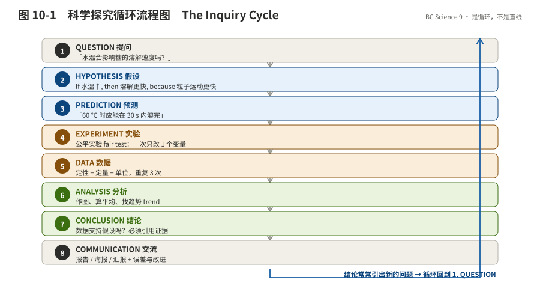
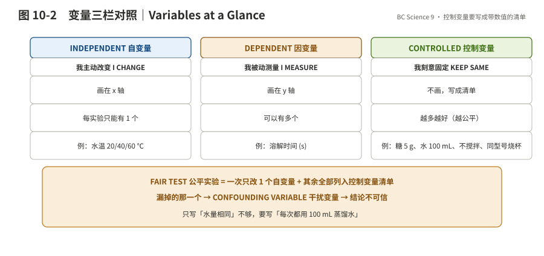
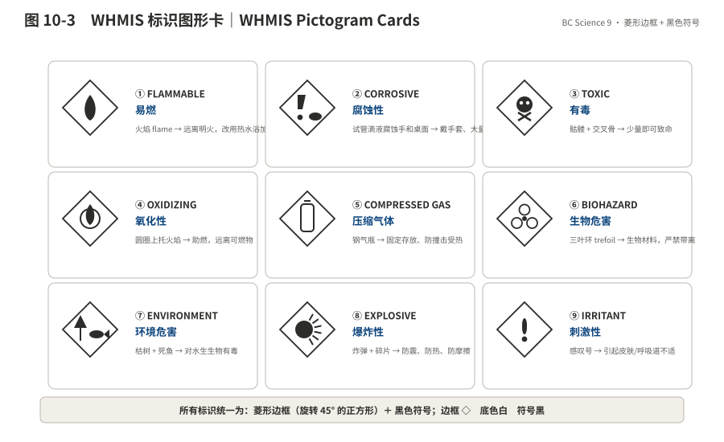
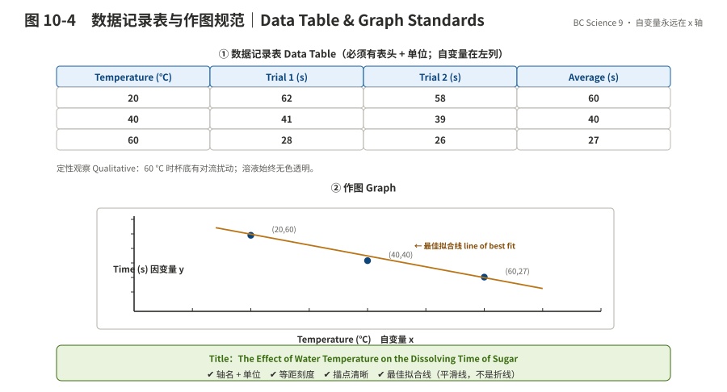
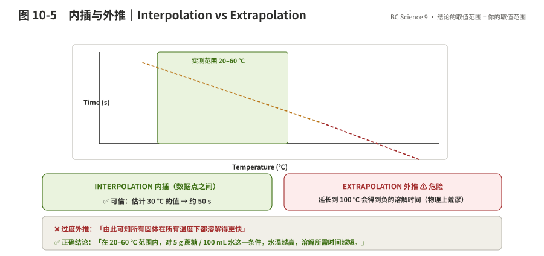

# Ch.10 — Scientific Inquiry, Lab Skills and Safety
## Chapter 10 · Scientific Inquiry, Lab Skills and Safety｜第 10 章　科学探究、实验技能与安全

> 🗂️ **Content Alignment｜大纲对应**：**Curricular Competencies（课程能力）** — these run through the whole book; this is not a separate content unit｜**Curricular Competencies（课程能力）**——贯穿全册，非独立知识单元
> ⏱️ **Periods｜课时**：2（+ 分散在各章实验中｜spread across the labs in every chapter）　|　**Prerequisites｜前置**：Ch.1 – Ch.9　|　**Followed by｜后继**：Ch.11
> 🗂️ **Generated｜文件生成时间**：2026-09-18 00:53

## 1. Content Alignment｜大纲对应

| Item｜项目 | Details｜内容 |
|---|---|
| BC Science 9 official Content | This chapter adds **no** new Content item; it serves the **inquiry process** behind C1 (*element properties as organized in the periodic table*) and C2 (*the arrangement of electrons determines the compounds formed by elements*)｜本章**不新增** Content 条目；它服务于 C1 与 C2 的**探究过程** |
| Curricular Competencies (all six)｜课程能力（全覆盖） | ① **Questioning and predicting**｜提问与预测　② **Planning and conducting**｜计划与实施　③ **Processing and analyzing data and information**｜数据处理与信息分析　④ **Evaluating**｜评估　⑤ **Applying and innovating**｜应用与创新　⑥ **Communicating**｜交流 |
| Key wording from the official competencies｜官方能力原文要点 | Demonstrate a sustained intellectual curiosity about a scientific topic; formulate questions that can be investigated; make predictions based on prior knowledge; design and conduct experiments **safely**; identify **independent, dependent and controlled variables**; use **SI units**; construct and interpret **graphs**; identify **sources of error** and suggest **improvements**; communicate using **scientific language, tables and graphs** |
| Relation to the Big Idea｜Big Idea 关系 | This chapter supplies the **method for gathering evidence** that supports the conclusion "electron arrangement determines chemical nature"｜本章提供**获取证据的方法** |
| Beyond Grade 9?｜是否超纲 | No — this is the competency strand and is explicitly required by the curriculum｜否（能力线，属大纲明确要求） |

> 📏 **Note to students｜给学生的说明**
>
> This is not a chapter you simply memorise and forget. The BC curriculum splits scientific ability into six competencies, and **every lab report you write this year will be marked against some of them**. This chapter is the instruction manual for that marking scheme.
>
> **中文**：这一章不是"背了就完事"的知识章。BC 大纲把科学能力分成六条，你本学期**每一次实验报告**都会被这六条里的某几条打分。本章就是那份**评分标准的说明书**。

## 2. Learning Objectives｜学习目标

**EN — By the end of this chapter, you should be able to:**

1. Describe the steps of the scientific method and write an *If…then…because…* hypothesis.
2. Identify the **independent, dependent and controlled variables** in an investigation and design a **fair test**.
3. Distinguish **qualitative** from **quantitative** data and record measurements with correct **SI units**.
4. Recognize the **WHMIS** hazard symbols and follow standard lab safety rules.
5. Identify sources of **error and uncertainty**, construct a properly labelled **graph**, and use **interpolation** (but not over-extrapolation) to draw conclusions.

**中文 — 本章结束后，你应当能够：**

1. 描述科学方法的步骤，并写出"如果……那么……因为……"形式的假设。
2. 在探究中识别**自变量、因变量与控制变量**，设计一个**公平实验**。
3. 区分**定性数据**与**定量数据**，并用正确的**国际单位制单位**记录测量值。
4. 认出 **WHMIS** 危险标识并遵守标准实验室安全规则。
5. 找出**误差与不确定度**的来源，绘制标注规范的**图表**，并用**内插**（而非过度外推）得出结论。

## 3. Concept Explanations｜概念解析

### 3.1 Scientific Inquiry and the Scientific Method｜科学探究与科学方法

The scientific method is **not** a rigid checklist that must be followed step by step; it is a **cycle that can loop back on itself** (Fig. 10-1).

**中文**：科学方法不是一条"必须一步步走"的死板清单，而是一个**可以循环、可以回头**的过程（ Fig. 10-1 ）。

| Step｜步骤 | English | 中文 | Key point｜要点 |
|---|---|---|---|
| 1 | **Question** | 提出问题 | must be **testable** — answerable by an experiment, not "which one looks nicer"｜必须**可探究**（testable） |
| 2 | **Hypothesis** | 假设 | an **explanatory guess** about the result, written as *If…then…because…*｜对结果的**解释性猜测** |
| 3 | **Prediction** | 预测 | an expectation about a **specific measured value**（"at 60 ℃ the dissolving time will be under 30 s"）｜对**具体观测值**的预期 |
| 4 | **Experiment** | 实验 | design a **fair test**, control the variables, repeat several times｜设计 **fair test 公平实验** |
| 5 | **Observation / Data** | 观察与数据 | **qualitative** + **quantitative**, recorded in a table with **units**｜带**单位**列表记录 |
| 6 | **Analysis** | 分析 | graph it, average it, look for a **pattern** or **trend**｜作图、算平均、找规律 / 趋势 |
| 7 | **Conclusion** | 结论 | answer the question, state **whether the data support the hypothesis**, cite evidence｜引用证据 |
| 8 | **Communication** | 交流 | lab report, poster, oral presentation; state errors and improvements｜说明误差与改进 |

> 📌 **Hypothesis vs prediction (a favourite exam question)｜假设与预测（高频考点）**
>
> - A **hypothesis** explains **why it would turn out that way** — it contains a mechanism and uses *because*.
> - A **prediction** says **what you will observe** — it contains a specific value or event.
> - Example (hypothesis｜假设): *If the temperature of the water increases, **then** the sugar will dissolve faster, **because** higher temperature makes particles move faster.*
> - Example (prediction｜预测): *At 60 ℃ the sugar should dissolve in under 30 seconds.*
>
> **中文**：Hypothesis 解释"**为什么会这样**"（含机制，用 because）；Prediction 说"**会看到什么**"（含具体数值或现象）。

### 3.2 Variables｜变量

- **Independent variable｜自变量**：the quantity the investigator **deliberately changes**（"what I change"）. It is plotted on the **x-axis** of a graph.
  - **中文**：研究者**主动改变**的那个量（"我改什么"）。画在图的 **x 轴**。
- **Dependent variable｜因变量**：the quantity that is **measured**; it "depends" on the independent variable（"what I measure"）. It is plotted on the **y-axis**.
  - **中文**：**被测量**的那个量，它"依赖"自变量而变化（"我测什么"）。画在图的 **y 轴**。
- **Controlled variable｜控制变量**：**every other quantity that is kept constant** so that the test is fair（"what I hold fixed"）. It must be written out as a **list**, and every item needs a specific value or method.
  - **中文**：为了公平而**保持不变**的所有其他量（"我固定什么"）。**必须写成清单**，且每一项都要有具体数值/做法。
- **Fair test｜公平实验**：**change only one independent variable at a time** and keep everything else controlled. Otherwise you cannot tell what caused the result.
  - **中文**：**一次只改变一个自变量**，其余全部控制不变。否则无法判断结果是谁造成的。
- **Confounding variable｜干扰变量**：a variable that *should* have been controlled but **was not**; it muddies the conclusion (see 3.6).
  - **中文**：本应控制却**没控制住**的变量，会混淆结论（见 3.6）。

> 💡 **Memory rhyme｜记忆口诀**
>
> **What I change is the independent variable; what I measure is the dependent variable; what I hold fixed is the controlled variable; what I forget is the confounding variable.**
>
> **中文**：**我改的是自变量，我测的是因变量，我固定的是控制变量，我漏掉的是干扰变量。**

### 3.3 Qualitative vs Quantitative Data｜定性数据与定量数据

- **Qualitative data｜定性数据**：properties described with **the senses or with words**, with no numbers — colour, odour, state, "does it bubble", "the surface became rough".
  - **中文**：用**感官或文字**描述的性质，无数字。如颜色、气味、状态、"是否冒泡"、"表面变粗糙"。
- **Quantitative data｜定量数据**：a **number plus a unit** obtained by measuring with an **instrument** — 25.4 mL, 12.3 ℃, 0.85 g.
  - **中文**：用**仪器测量**得到的**数字 + 单位**。如 25.4 mL、12.3 ℃、0.85 g。
- A good investigation uses **both**: quantitative data let you graph and compare, while qualitative data are often the source of unexpected discoveries.
  - **中文**：好的实验**两者都要**：定量数据让你能作图比较，定性数据常常是意外发现的来源。

**SI Units｜国际单位制（le Système international d'unités）**

| Quantity｜量 | SI unit｜SI 单位 | Symbol｜符号 | Commonly used at school｜学校实验室常用 | Instrument｜仪器 |
|---|---|---|---|---|---|
| length｜长度 | metre｜米 | m | cm / mm / m | ruler 尺、measuring tape 卷尺 |
| mass｜质量 | kilogram｜千克 | kg | g / mg | electronic balance 电子天平 |
| time｜时间 | second｜秒 | s | s / min | stopwatch 秒表 |
| temperature｜温度 | kelvin｜开尔文 | K | **℃**（degrees Celsius — what the lab actually uses｜摄氏度，实验室常用） | thermometer 温度计 |
| volume｜体积 | cubic metre (SI); **litre** (common)｜立方米（SI）；**升**（常用） | m³ / L | mL / L | graduated cylinder 量筒 |
| electric current｜电流 | ampere｜安培 | A | A / mA | ammeter / multimeter 电流表 / 万用表 |

- Conversions｜换算：1 L = 1000 mL；1 m = 100 cm = 1000 mm；1 kg = 1000 g；0 ℃ = 273.15 K.
- **Reading a graduated cylinder｜读量筒**：keep your eye level with the **bottom of the meniscus（凹液面）**; reading from above or below produces a **parallax error（视差误差）**.
  - **中文**：视线与**凹液面最低处（meniscus 凹液面）**齐平，从上方或下方读都会产生 **parallax error 视差误差**。

### 3.4 WHMIS and Laboratory Safety｜WHMIS 与实验室安全

**WHMIS** = **W**orkplace **H**azardous **M**aterials **I**nformation **S**ystem. In Chinese it is 工作场所危险物质信息系统.

**中文**：WHMIS 全称 **W**orkplace **H**azardous **M**aterials **I**nformation **S**ystem，中文：**工作场所危险物质信息系统**。

- Canadian law requires every container of a hazardous chemical to carry a **supplier label**, whose pictogram is a **black symbol inside a diamond-shaped border**.
  - **中文**：加拿大法律要求所有危险化学品的容器上贴 **supplier label 供应商标签**，图案为**菱形边框内的黑色符号**。
- Every chemical must also have an **SDS (Safety Data Sheet｜安全数据表)** giving first aid, spill response, storage and disposal information.
  - **中文**：每种化学品还必须配有 **SDS（Safety Data Sheet 安全数据表）**，说明急救、泄漏处理、储存与处置方法。
- School laboratories also use **workplace labels**（simplified labels）and reagent bottles prepared in the lab itself.
  - **中文**：学校实验室还会用 **workplace label 工作场所标签**（简化标签）与实验室自制试剂瓶。

The nine common pictograms are given in Table 10-4 and Fig. 10-3. **A typical exam question** is: "Seeing this symbol, what hazard does the substance present, and what should you do?"

**中文**：九种常见标识见 Table 10-4 与 Fig. 10-3 。**考试常见问法**："看到这个符号，说明该物质有什么危险？你应该怎么做？"

### 3.5 Standard Lab Rules｜实验室常规安全规则

| Rule｜规则 | English | Reason｜理由 |
|---|---|---|
| Eye protection｜护目镜 | Wear **safety goggles** whenever chemicals, heat or glassware are in use | splashes into the eyes are the most common serious lab injury｜溅入眼睛是实验室最常见的严重伤害 |
| No tasting｜禁止品尝 | **Never taste** any chemical | textbook example: NaCl is edible, but Pb(NO₃)₂ and CuSO₄ are poisonous｜NaCl 可食用，但 Pb(NO₃)₂、CuSO₄ 有毒 |
| Wafting｜扇闻法 | Use **wafting** — fan the air toward your nose with your hand | smelling a concentrated gas directly can burn the airways｜直接凑近闻高浓度气体会灼伤呼吸道 |
| Ventilation｜通风 | Work in a well-ventilated area, or use a **fume hood（通风柜）** for volatile substances | prevents inhalation of harmful gases｜防止吸入有害气体 |
| Hair and clothing｜毛发与衣物 | Tie back long hair; no loose sleeves; closed-toe shoes | open flames and chemicals｜明火与化学品 |
| Heating｜加热 | Never leave a flame unattended; point test tubes **away from people** | liquid in a test tube can boil over and spray out｜试管内液体可能暴沸喷出 |
| Emergency equipment｜紧急设备 | Know the location of the **eyewash station（洗眼器）**, **safety shower（紧急喷淋）**, **fire extinguisher（灭火器）**, **fire blanket（灭火毯）** and **exits（出口）** | you need to know where they are *before* anything happens｜出事前就要知道在哪 |
| Accidents｜事故处理 | Report **every** spill, breakage or injury to the teacher immediately | a small unreported incident can become a big one｜小事故不报会变成大事故 |
| At the end｜结束 | Wash your hands; dispose of chemicals **as instructed**（never pour them down the sink at random） | protects the environment and the drains｜环境与下水道污染 |
| Taking chemicals｜取用 | **Never return unused chemicals to the stock bottle**; take only what you need | prevents contamination of the whole bottle｜防止整瓶试剂被污染 |

### 3.6 Error, Uncertainty and Evaluating｜误差、不确定度与评估

- **Error｜误差**：the difference between a measured value and the true value. Error can **never be completely removed**, only reduced.
  - **中文**：测量值与真实值之间的差异。误差**无法完全消除**，只能减小。
- **Systematic error｜系统误差**：always pushes the result in the **same direction**（a balance that was not zeroed, a cylinder with a faulty scale）→ removed by **calibrating the instrument**.
  - **中文**：每次都朝**同一方向**偏（天平未调零、量筒刻度不准）→ 可通过校准仪器消除。
- **Random error｜随机误差**：varies in size and direction（parallax when reading, judging the instant a reaction ends）→ reduced by **repeating and averaging**.
  - **中文**：方向不定、时大时小（读数视差、反应瞬间判断）→ 可通过**多次重复取平均**减小。
- **Uncertainty｜不确定度**：an estimate of the range within which the measurement can be trusted, written as `20.5 ± 0.5 ℃`. The finer the instrument, the smaller the uncertainty.
  - **中文**：对测量值可信范围的估计，写成 `20.5 ± 0.5 ℃`。仪器精度越小，不确定度越小。
- **Accuracy｜准确度**：how close a measurement is to the **true value**. 　**Precision｜精密度**：how close repeated measurements are **to each other**. (Think of a target: shots clustered together but off the bullseye = precise but not accurate.)
  - **中文**：**Accuracy 准确度**：测量值离**真值**多近；**Precision 精密度**：多次测量之间**彼此多接近**。（可用"打靶图"理解：都聚在一起但偏离靶心 = 精密但不准确。）
- **Confounding variable｜干扰变量**：a variable that was not controlled, so that "it looks as if A caused it, but really B did".
  - **中文**：没被控制的变量，导致"看起来是 A 造成的，其实是 B 造成的"。
- **Alternative explanation｜替代解释**：another reasonable way of accounting for the same data. The strength of a scientific conclusion depends on whether alternative explanations can be ruled out.
  - **中文**：对同一组数据还能给出的**另一种合理说明**。科学结论的强弱，取决于能否排除替代解释。
- **Outlier / anomalous result｜异常值**：a data point that clearly departs from the trend. It should be **kept and explained**（"possibly a reading error"）, not quietly deleted.
  - **中文**：明显偏离趋势的数据点，应**保留并说明**（如"可能是读数错误"），不能随手删掉。

### 3.7 Graphing｜作图规范

A proper scientific graph must contain all of the following.

**中文**：一张合格的科学图表必须包含以下几项。

1. **Title｜标题**：`The effect of [independent variable] on [dependent variable]`, e.g. *The effect of water temperature on the dissolving time of sugar*.
   - **中文**：`The effect of [自变量] on [因变量]`，如 *The effect of water temperature on the dissolving time of sugar*。
2. **Axis labels｜坐标轴标注**：the name plus the **unit**, e.g. `Temperature (℃)`、`Time (s)`.
   - **中文**：名称 + **单位**，如 `Temperature (℃)`、`Time (s)`。
3. **Scales｜刻度**：evenly spaced, covering all the data, **starting at 0**（unless you have a good reason and mark a broken axis）.
   - **中文**：等距、覆盖全部数据、**从 0 开始**（除非有充分理由并标明断轴符号）。
4. **The independent variable goes on the x-axis and the dependent variable on the y-axis.**
   - **中文**：**自变量在 x 轴，因变量在 y 轴**。
5. **Plot points｜描点**：use small circles or crosses that are easy to see.
   - **中文**：用小圆圈或叉号，清晰可辨。
6. **Line / curve of best fit｜最佳拟合线**：a smooth line running through the "middle" of the cloud of points — **not** a dot-to-dot zigzag.
   - **中文**：平滑地穿过点群的"中间"，**不是**把点连成折线（line-to-line）。
7. **Legend｜图例**：compulsory when there is more than one data set.
   - **中文**：有多组数据时必须有。

### 3.8 Interpolation vs Extrapolation｜内插与外推

- **Interpolation｜内插**：estimating an unknown value **within the range of the data you already have**. ✅ **Reliable**, provided there is a sensible trend.
  - **中文**：在**已有数据的范围之内**估计未知值。✅ **可靠**（前提是有合理的趋势）。
- **Extrapolation｜外推**：guessing **beyond the range of the data**. ⚠ **Dangerous** — you are assuming that "the trend keeps going", which in real life often is not true.
  - **中文**：在**已有数据的范围之外**推测。⚠ **危险**——你假设"趋势会一直延续"，而这在现实中常常不成立。
- **Over-extrapolation｜过度外推**：stretching data from 20 ℃–60 ℃ out to 500 ℃, or generalising from five trials to "all substances" — this is a competency error that the BC curriculum marks down explicitly.
  - **中文**：把 20 ℃–60 ℃ 的数据外推到 500 ℃，或把 5 次实验的结论推广到"所有物质"——这是 BC 大纲明确要扣分的能力错误。

> 📌 **The range of a conclusion｜结论的取值范围**
>
> **Your conclusion can only be as broad as your data.**
>
> **中文**：**结论不能超出数据支持的范围。**

### 3.9 The Structure of a Lab Report｜实验报告结构

| Section｜部分 | English | What goes in it｜内容 |
|---|---|---|
| Title｜标题 | Title | a brief statement of what was investigated｜简洁说明研究内容 |
| Question｜问题 | Question | one testable question｜一个可探究的问题 |
| Hypothesis｜假设 | Hypothesis | *If…then…because…* |
| Variables｜变量 | Variables | independent / dependent / controlled (a list)｜自变量 / 因变量 / 控制变量（清单） |
| Materials｜材料 | Materials | including specifications (e.g. a 100 mL graduated cylinder)｜含规格 |
| Procedure｜步骤 | Procedure | numbered, in the passive voice or imperatives, repeatable｜编号、可重复 |
| Observations｜观察 | Observations | data table (with units) + qualitative descriptions｜数据表（带单位）+ 定性描述 |
| Analysis｜分析 | Analysis | graphs, calculations, judgement of the trend｜图、计算、趋势判断 |
| Conclusion｜结论 | Conclusion | answers the question + whether the hypothesis is supported + cited evidence｜引用证据 |
| Evaluation｜评估 | Evaluation | sources of error + improvements + new questions raised｜误差来源 + 改进方案 + 新问题 |

## 4. Comparison Tables｜表格比对

### Table 10-1　Three Types of Variables｜三类变量

| Variable｜变量 | English | 中文 | The question it answers｜提问方式 | Where on the graph｜图中位置 | Example (water temperature vs dissolving rate)｜例子（水温对溶解速度） |
|---|---|---|---|---|---|
| Independent | independent variable | **自变量** | What do I **change**?｜我**改**什么？ | **x-axis｜x 轴** | water temperature (20、40、60 ℃)｜水温 |
| Dependent | dependent variable | **因变量** | What do I **measure**?｜我**测**什么？ | **y-axis｜y 轴** | time for the sugar to dissolve completely (s)｜糖完全溶解所需时间 |
| Controlled | controlled variable | **控制变量** | What do I **hold fixed**?｜我**固定**什么？ | not plotted｜不画图 | mass of sugar (5 g), volume of water (100 mL), particle size, whether it is stirred, shape of the container｜糖的质量、水量、颗粒大小、是否搅拌、容器形状 |

### Table 10-2　Qualitative vs Quantitative｜定性 vs 定量

| Compared｜比较项 | Qualitative｜定性 | Quantitative｜定量 |
|---|---|---|
| Form｜形式 | word description｜文字描述 | number + unit｜数字 + 单位 |
| How it is obtained｜获取方式 | the senses（**never taste**）｜感官（**禁止品尝**） | measured with an instrument｜仪器测量 |
| Examples｜例子 | the solution turns from colourless to blue; a sharp smell; a white precipitate forms｜溶液由无色变蓝；有刺激性气味；生成白色沉淀 | 25.4 mL；12.3 ℃；0.85 g；38 s |
| Strengths｜优点 | captures unexpected phenomena｜能捕捉意外现象 | comparable, graphable, can be analysed statistically｜可比较、可作图、可统计 |
| Weaknesses｜缺点 | subjective and hard to compare｜主观，难比较 | may miss phenomena you did not measure｜可能漏掉未测量的现象 |
| Recording tips｜记录建议 | record immediately and specifically (avoid vague wording such as "changed a lot")｜即时、具体，避免"变化很大"这种模糊写法 | keep the number of digits the instrument gives (a 0.01 g balance → write 0.85 g)｜保留仪器精度位数 |

### Table 10-3　Errors and Improvements｜误差类型与改进

| Type｜类型 | English | 中文 | Feature｜特征 | Example｜例子 | Improvement｜改进方法 |
|---|---|---|---|---|---|
| Systematic | systematic error | 系统误差 | always off in the same direction｜总是朝同一方向偏 | balance not zeroed, every reading 0.2 g high｜天平未调零，每次多 0.2 g | calibrate / zero the instrument; run a blank control｜校准仪器 / 调零 / 做空白对照 |
| Random | random error | 随机误差 | varies randomly in size and direction｜忽大忽小，方向随机 | eye level too high or too low when reading the meniscus｜读凹液面时视线偏高偏低 | **repeat and average**; have the same person read every time｜**多次重复取平均**；同一人读数 |
| Human | human error | 人为失误 | an avoidable operating mistake｜可避免的操作错误 | adding the wrong reagent, misreading a scale｜加错试剂、看错刻度 | follow the procedure strictly; double-check with a partner｜严格按步骤；双人核对 |
| Confounding | confounding variable | 干扰变量 | a variable that was not controlled｜变量未被控制 | heating and stirring at the same time｜一边升温一边搅拌 | put it on the controlled-variable list and fix each item｜列入控制变量清单并逐项固定 |

### Table 10-4　WHMIS Pictograms｜WHMIS 标识全表（必背 · must memorise）

| # | English | 中文 | What the pictogram looks like｜图形长什么样（文字描述） | The hazard｜危险含义 | Common examples｜常见例子 |
|---|---|---|---|---|---|
| 1 | **Flammable** | 易燃 | a **flame burning upward** inside a diamond border｜菱形边框内一簇**向上燃烧的火焰** | catches fire easily near a flame or high heat｜遇火源/高热易燃烧 | ethanol 乙醇、acetone 丙酮 |
| 2 | **Corrosive** | 腐蚀性 | a **test tube pouring drops** onto **a hand** and **a bench top**, both eaten away with holes｜一支试管**倾倒液滴**，滴到**一只手**和**一块桌面**上，两处都被腐蚀出洞 | burns skin and destroys metal or bench tops｜会灼伤皮肤、毁坏金属/桌面 | HCl 盐酸、NaOH 氢氧化钠 |
| 3 | **Toxic** (acute toxicity) | 有毒 | a **skull** over **two crossed bones**｜一个**骷髅头**加**两根交叉的骨头** | a small amount can kill or cause serious harm｜少量即可致命或造成严重伤害 | some heavy-metal salts, methanol｜部分重金属盐、甲醇 |
| 4 | **Oxidizing** | 氧化性 | a **flame sitting on top of a circle (O)**｜一个**圆圈（O）上方顶着一簇火焰** | need not burn itself, but **supplies oxygen and feeds a fire**, making it far fiercer｜本身未必可燃，但会**供氧助燃**，使火势更猛 | concentrated H₂O₂ 过氧化氢（高浓度）、KMnO₄ |
| 5 | **Compressed gas** | 压缩气体 | an upright **gas cylinder**｜一个**立式气瓶（钢瓶）**图案 | contains gas under high pressure; heat or impact can cause an explosion, and the cylinder can fly｜内装高压气体；受热或撞击可能爆炸，钢瓶可能飞射 | O₂ cylinder、CO₂ cylinder｜O₂ 钢瓶、CO₂ 钢瓶 |
| 6 | **Biohazardous infectious material** | 生物危害（感染性物质） | **three overlapping rings** around a central ring (a trefoil)｜三个互相交叠的**圆环**围绕一个中心环（三叶形） | contains disease-causing organisms or biological toxins｜含致病微生物或生物毒素 | bacterial cultures, blood samples｜细菌培养物、血液样本 |
| 7 | **Environmental hazard** | 环境危害 | a **dead tree** beside a **dead fish**｜一棵**枯死的树**与一条**死鱼**并排 | toxic to aquatic life or the environment; must not be poured away｜对水生生物或环境有毒，不可随意排放 | some pesticides, heavy-metal waste solutions｜部分农药、重金属废液 |
| 8 | **Explosive** | 爆炸性 | a **bomb bursting open**, fragments flying｜一个**正在炸开的炸弹**，四周有碎片飞散 | may explode when heated, struck or rubbed｜受热、撞击或摩擦即可能爆炸 | picric acid 苦味酸、azides 叠氮化物 |
| 9 | **Irritant** | 刺激性 | a bold **exclamation mark "!"**｜一个粗体的**感叹号 "!"** | causes skin / eye / respiratory irritation, allergy, or milder acute toxicity｜会引起皮肤/眼/呼吸道刺激、过敏或较轻的急性毒性 | dilute ammonia solution, some cleaners｜稀氨水、部分清洁剂 |

> **Note｜注**
>
> WHMIS 2015 is Canada's version of the **GHS** (Globally Harmonized System). Item 9, **irritant** (the exclamation mark), appears on some BC classroom charts and older resources; in the official WHMIS 2015 system the closest match is **Health hazard**（a human outline with a starburst on the chest）. **Recognise both** — answering with "irritant / health hazard" and a description of the drawing earns full marks.
>
> **中文**：WHMIS 2015 是加拿大采用的 **GHS**（全球统一制度）。第 9 项 irritant（感叹号）在部分 BC 教室图表与旧版资料中使用；WHMIS 2015 官方体系中与之相近的是 **Health hazard 健康危害**（人形轮廓 + 胸前星芒）。**两者都认得即可**，答题时写"刺激性 / 健康危害"并描述图形都能得分。

### Table 10-5　Interpolation vs Extrapolation｜内插 vs 外推

| Compared｜比较项 | Interpolation｜内插 | Extrapolation｜外推 |
|---|---|---|
| Position｜位置 | **between** existing data points｜已有数据点**之间** | **outside** the existing data｜已有数据点**之外** |
| Reliability｜可靠性 | ✅ high — the trend has been verified in that interval｜较高（趋势已在该区间被验证） | ⚠ low — assumes the trend continues, unverified｜低（假设趋势延续，未经验证） |
| Example｜例子 | you have 20 ℃ and 40 ℃; estimate the value at 30 ℃｜数据有 20 ℃ 与 40 ℃，估计 30 ℃ 的值 | data stop at 60 ℃, yet you predict the value at 200 ℃｜数据到 60 ℃，却去推测 200 ℃ 的值 |
| How to write the conclusion｜结论写法 | "Between 20 ℃ and 60 ℃, the higher the temperature the faster it dissolves"｜"在 20–60 ℃ 范围内，温度越高溶解越快" | ❌ "Therefore this is true for all substances at any temperature"｜"因此所有物质在任何温度下都如此" |
| Advice｜建议 | use it freely｜放心用 | state your assumption explicitly, and ideally run another experiment to check it｜必须写明假设，且最好补做实验验证 |

### Table 10-6　Accuracy vs Precision｜准确度与精密度

| Case｜情况 | Target analogy｜打靶类比 | Verdict｜判断 |
|---|---|---|
| Points clustered on the bullseye｜点都聚在靶心 | both accurate and precise｜又准又精密 | ✅ ideal｜理想 |
| Points clustered together but off the bullseye｜点聚在一起但偏离靶心 | **precise but not accurate**｜**精密但不准确** | a **systematic error** is present (calibrate)｜有**系统误差**（需校准） |
| Points scattered but centred on the bullseye｜点散开但平均在靶心 | **accurate but not precise**｜**准确但不精密** | a **random error** is present (repeat and average)｜有**随机误差**（需重复取平均） |
| Points scattered and off the bullseye｜点散开且偏离靶心 | neither accurate nor precise｜既不准也不精密 | problems with both the instrument and the technique｜仪器与操作都有问题 |

## 5. Diagrams & Worked Examples｜图例说明

### Fig. 10-1　The Inquiry Cycle｜科学探究循环流程图

**How to read the diagram｜看图要点**

This is a **cycle, not a straight line**. After step 8, new questions usually appear ("why was 70 ℃ not faster after all?"), and you go back to step 1. **That is how science moves forward, one loop at a time.**

**中文**：这是一个**循环**而不是直线。第 8 步之后常常会产生新的问题（"为什么 70 ℃ 反而不快了？"），于是又回到第 1 步。**科学就是这样一圈一圈前进的。**

### Fig. 10-2　Variables at a Glance｜变量三栏对照

**How to read the diagram｜看图要点**

Controlled variables must be written as **a list with numbers** — "the same amount of water" is not enough; you need "100 mL of distilled water every time". For every controlled variable you leave out, you gain one confounding variable.

**中文**：控制变量**必须写成带数值的清单**——只写"水量相同"不够，要写"每次都用 100 mL 蒸馏水"。少一个控制变量，就多一个干扰变量。

### Fig. 10-3　WHMIS Pictogram Cards｜WHMIS 标识图形卡

**How to read the diagram｜看图要点**

**Look at the border first (all of them are diamonds), then at the picture inside.** When answering, follow three steps: **drawing → hazard → what to do**. For example: a flame → **flammable** → keep it away from open flames and use a hot-water bath instead. A test tube dripping onto a hand and a bench → **corrosive** → wear gloves; if it splashes on you, flush with the eyewash station or plenty of water for at least 15 minutes and report it to the teacher.

**中文**：**先看边框（都是菱形），再看里面的图案**。答题时按"图形 → 危险 → 做法"三步走。例：看到火焰 → 易燃 → 远离明火、改用热水浴加热。看到试管滴液腐蚀手和桌面 → 腐蚀性 → 戴手套、若溅到立即用洗眼器/大量水冲洗 15 分钟以上并报告老师。

### Fig. 10-4　Data Table & Graph Standards｜数据记录表与作图规范

**How to read the diagram｜看图要点**

**The independent variable always goes on the x-axis.** The line of best fit is "one smooth line representing the trend" — do not join every point with straight segments to make a zigzag. Axis names **must carry units**; a graph without units loses marks directly in BC scoring.

**中文**：**自变量永远在 x 轴**。拟合线是"代表趋势的一条平滑线"，不要把所有点用直线连成锯齿。轴名后面**必须带单位**——不带单位的图在 BC 评分中直接扣分。

### Fig. 10-5　Interpolation vs Extrapolation｜内插与外推

**How to read the diagram｜看图要点**

Extend the extrapolated line far enough and it will usually give a **physically absurd result**（a negative dissolving time, ice water above 100 ℃）. That is the most direct proof of why you must not over-extrapolate. **The range of your conclusion = the range of your data.**

**中文**：把外推线延长到足够远，它常常会给出**物理上荒谬的结果**（负的溶解时间、超过 100 ℃ 的冰水）。这就是"为什么不能过度外推"的最直观证明。**结论的取值范围 = 你的取值范围。**

### Fig. 10-6　Worked Example — Finding Variables and Errors｜例题：找出变量与误差

**Question｜题目**：Xiaohong wants to investigate "which liquid conducts electricity best". She takes 50 mL each of tap water, salt water, sugar water and distilled water, tests each with the **same** battery-and-bulb set-up, and records "very bright / faint / not lit".

**中文**：小红想研究"哪种液体导电性最好"。她取自来水、盐水、糖水、蒸馏水各 50 mL，分别用**同一个**电池—灯泡装置测试灯泡亮度，记录"很亮 / 微亮 / 不亮"。

- (a) Identify the independent variable, the dependent variable and at least three controlled variables.（找出自变量、因变量与至少三条控制变量）
- (b) Is her data qualitative or quantitative? How could she improve it?（她的数据属于定性还是定量？如何改进？）
- (c) Name two sources of error and how to improve each.（指出两个误差来源及改进方法）

**Solution｜解析**：

| Part｜小问 | Answer｜答案 | Explanation｜说明 |
|---|---|---|
| (a) Independent variable｜自变量 | **the type of liquid**（tap water / salt water / sugar water / distilled water）｜**液体种类** | the thing she changes on purpose｜她主动更换的量 |
| (a) Dependent variable｜因变量 | **how well it conducts**（bulb brightness）｜**导电性强弱**（灯泡亮度） | the thing being measured｜被测量的量 |
| (a) Controlled variables｜控制变量 | ① volume of liquid always 50 mL；② the same battery and bulb；③ electrodes inserted to the same depth；④ the same distance between electrodes；⑤ the same temperature｜① 液体体积均为 50 mL；② 同一套电池与灯泡；③ 电极插入深度一致；④ 电极间距一致；⑤ 同一温度 | each one needs a **specific value or method**｜每条都要有**具体数值或做法** |
| (b) Data type｜数据类型 | mainly **qualitative**（very bright / faint / not lit）｜主要为**定性数据** | there are word descriptions but no numbers｜有文字描述但无数字 |
| (b) Improvement｜改进 | use a **multimeter** to measure current and record **current (mA)**, giving **quantitative** data that can be graphed; keep the qualitative observations as a supplement｜改用 **multimeter 万用表**测电流，记录 **current (mA)**，即可得到**定量数据** |
| (c) Error 1｜误差 1 | **electrodes not rinsed**, so the previous liquid contaminates the next sample（**systematic error**）｜**电极未清洗**导致污染（系统误差） | rinse the electrodes with distilled water and dry them after every test｜每次测试后用蒸馏水冲洗电极并擦干 |
| (c) Error 2｜误差 2 | judging brightness is **subjective**（**random error**）｜亮度判断**主观**（随机误差） | replace the judgement with a multimeter reading; repeat each liquid 3 times and average｜用万用表读数代替主观判断；每种液体重复 3 次取平均 |
| (c) Confounding variable｜干扰变量 | if she happened to use salt water of different concentrations → **confounding variable**｜若她顺手用了不同浓度的盐水 → **干扰变量** | fix the salt concentration（e.g. "5 g of salt per 100 mL of water"）｜必须固定盐水浓度 |

> 🎯 **Extension (back to Ch.7 / Ch.8)｜延伸（回扣 Ch.7/Ch.8）**
>
> Salt solution conducts because NaCl is an **ionic compound** whose ions move freely once it dissolves; sugar solution and distilled water barely conduct at all (**molecular compound** / pure water). This experiment is itself a source of evidence for **Content C2**.
>
> **中文**：盐水导电（ionic compound 离子化合物，溶于水后离子可自由移动）；糖水与蒸馏水基本不导电（molecular compound 分子化合物 / 纯水）。这个实验本身就是 **Content C2** 的证据来源。

## 6. Key Vocabulary｜核心词汇

| English | 中文 | Notes｜备注 |
|---|---|---|
| scientific inquiry | 科学探究 | — |
| scientific method | 科学方法 | — |
| question | 研究问题 | must be testable｜须可探究 |
| hypothesis | 假设 | *If…then…because…* |
| prediction | 预测 | an expectation containing a value｜含具体数值的预期 |
| **independent variable** | **自变量** | changed on purpose; x-axis｜主动改变，x 轴 |
| **dependent variable** | **因变量** | measured; y-axis｜被测量，y 轴 |
| **controlled variable** | **控制变量** | kept constant; write a list｜保持不变，写清单 |
| **fair test** | **公平实验** | change one variable at a time｜一次只改一个变量 |
| confounding variable | 干扰变量 | a variable you failed to control｜没控制住的变量 |
| alternative explanation | 替代解释 | another account of the same data｜对同一数据的其他说明 |
| **qualitative data** | **定性数据** | word description｜文字描述 |
| **quantitative data** | **定量数据** | number + unit｜数字 + 单位 |
| SI units | 国际单位制 | m / kg / s / K / L |
| meniscus | 凹液面 | read at eye level with the lowest point｜视线齐平最低处 |
| parallax error | 视差误差 | caused by the angle of reading｜读数角度造成 |
| **error** | **误差** | difference from the true value｜测量值与真值之差 |
| **uncertainty** | **不确定度** | e.g. 20.5 ± 0.5 ℃｜如 20.5 ± 0.5 ℃ |
| systematic error | 系统误差 | one-directional; can be calibrated｜单向偏移，可校准 |
| random error | 随机误差 | random; repeat and average｜随机，重复取平均 |
| accuracy | 准确度 | closeness to the true value｜接近真值 |
| precision | 精密度 | closeness to each other｜彼此接近 |
| outlier / anomalous result | 异常值 | keep it and explain it｜保留并说明 |
| **WHMIS** | **工作场所危险物质信息系统** | Workplace Hazardous Materials Information System |
| SDS | 安全数据表 | Safety Data Sheet |
| flammable / corrosive / toxic | 易燃 / 腐蚀性 / 有毒 | WHMIS |
| oxidizing / compressed gas | 氧化性 / 压缩气体 | WHMIS |
| biohazardous infectious material | 生物危害（感染性物质） | WHMIS |
| environmental hazard / explosive | 环境危害 / 爆炸性 | WHMIS |
| irritant / health hazard | 刺激性 / 健康危害 | WHMIS / GHS |
| goggles | 护目镜 | always required｜必戴 |
| wafting | 扇闻法 | fan the air toward your nose｜用手扇气闻 |
| fume hood | 通风柜 | — |
| eyewash station | 洗眼器 | know where it is｜记住位置 |
| **interpolation** | **内插** | inside the data range; trustworthy｜数据范围内，可信 |
| **extrapolation** | **外推** | outside the data range; be careful｜数据范围外，谨慎 |
| line of best fit | 最佳拟合线 | smooth, not a zigzag｜平滑，非折线 |
| trend | 趋势 | — |
| trial / repetition | 试验 / 重复 | usually 3 times｜常做 3 次 |
| conclusion | 结论 | must cite evidence｜须引用证据 |

## 7. Lab / Activity｜实验与活动

### Activity 10-1　Mini-Inquiry: Which Common Liquid Conducts Best?｜微型探究：哪种常见液体导电性最好？

- **Type｜类型**：student-led investigation（full inquiry cycle）｜学生自主探究
  - **中文**：学生自主探究（完整走完探究循环）。
- **Materials｜材料**：battery + bulb (or a multimeter), four liquids (distilled water, tap water, salt water, sugar water), beakers, electrodes｜电池 + 灯泡（或万用表）、四种液体、烧杯、电极
  - **中文**：电池 + 灯泡（或万用表）、四种液体（蒸馏水、自来水、盐水、糖水）、烧杯、电极。
- **Procedure｜步骤**：Walk through all eight steps of Fig. 10-1: write a question → an *If…then…because…* hypothesis → list the variables → do 3 repeats → record qualitative **and** quantitative data → draw a bar graph → write a conclusion → write errors and improvements.
  - **中文**：完整走一遍 Fig. 10-1 的八步：写问题 → If…then…because… 假设 → 列变量清单 → 做 3 次重复 → 记录定性 + 定量数据 → 作柱状图 → 写结论 → 写误差与改进。
- **Competencies trained｜训练能力**：[Questioning and predicting]；[Planning and conducting]；[Processing and analyzing]；[Evaluating]；[Communicating]
- **Safety｜安全**：⚠ goggles; **never taste** any liquid; rinse the electrodes after each use; avoid short-circuiting the battery (it heats up); dispose of the salt solution as the teacher directs｜护目镜；**禁止品尝**任何液体；电极每次用后冲洗；避免电池短路发热；实验后按教师指示处理盐水
  - **中文**：⚠ 护目镜；**禁止品尝**任何液体；电极每次用后冲洗；避免电池短路发热；实验后按教师指示处理盐水。

### Activity 10-2　WHMIS Scavenger Hunt｜安全标识配对与实验室巡查

- **Type｜类型**：matching game + a walk-through of the room｜配对游戏 + 场地巡查
  - **中文**：配对游戏 + 场地巡查。
- **Materials｜材料**：9 WHMIS picture cards drawn by the students（**the drawings must be correct**）+ 9 meaning cards; a floor plan of the laboratory｜9 张 WHMIS 图形卡（学生手绘，**须画对图形**）+ 9 张含义卡；实验室平面图
  - **中文**：9 张 WHMIS 图形卡（学生手绘，**须画对图形**）+ 9 张含义卡；实验室平面图。
- **Procedure｜步骤**：
  1. In pairs, match all the drawings to their meanings within 60 seconds.（两人一组，60 秒内完成图形 ↔ 含义配对。）
  2. The teacher gives six scenarios ("a bottle of acetone next to an alcohol lamp", "this bottle has a flame on its label"); students state the hazard and the correct action.（教师给出 6 个场景，学生说出危险与正确做法。）
  3. The class marks on the floor plan: the **eyewash station, shower, fire extinguisher, fire blanket, two exits, first-aid kit and waste container**.（全班在实验室平面图上标出洗眼器、喷淋、灭火器、灭火毯、两个出口、急救箱、废液桶。）
  4. Drill: if acid splashes into someone's eye, what happens in the first 30 seconds? (Answer: call the teacher at once, a classmate leads the person to the eyewash station, and flush for at least 15 minutes.)（演练：如果酸液溅入眼睛，前 30 秒该做什么？）
- **Competencies trained｜训练能力**：[Planning and conducting] safety；[Applying and innovating]
- **Safety｜安全**：this is a **paper drill** — students do not handle any chemicals｜本活动为**图面演练**，不实际接触化学品

### Activity 10-3　Graphing & Interpolation Drill｜作图与内插练习

- **Type｜类型**：data-handling practice｜数据处理练习
  - **中文**：数据处理练习。
- **Materials｜材料**：a data set supplied by the teacher (e.g. the dissolving time of 5 g of salt at different temperatures); graph paper or a spreadsheet｜教师给出一组数据；方格纸或电子表格
  - **中文**：教师给出一组数据（如不同温度下 5 g 盐的溶解时间），方格纸或电子表格。
- **Procedure｜步骤**：
  1. Draw the axes and label them with units.（画轴并标注单位）
  2. Plot the points.（描点）
  3. Draw the line of best fit.（画最佳拟合线）
  4. Use **interpolation** to read off the value at 30 ℃.（用**内插**读出 30 ℃ 的值）
  5. Write a conclusion **limited to the range of the data**.（写出**限制在数据范围内**的结论）
  6. Peer assessment: swap with your neighbour and check against the eight-step table in section 3.1.（同桌互评，用第 3.1 节的八步表检查清单）
- **Competencies trained｜训练能力**：[Processing and analyzing] Construct and interpret graphs；[Communicating]
- **Safety｜安全**：none｜无

## 8. Common Misconceptions｜常见易错点

| # | Misconception｜错误认识 | Correction｜正确理解 |
|---|---|---|
| 1 | Writing a hypothesis as a prediction ("I think it will be faster")｜把假设写成预测 | A hypothesis must contain a **mechanism**: *If…then…because…*; a prediction must contain a **value**.（假设要含**机制**；预测要含**数值**。） |
| 2 | Calling the controlled variables "the things that stay the same" but not listing them｜只说"不变的量"，不写清单 | You must **list them one by one with a value or a method**（"100 mL of distilled water every time"）.｜必须**逐条列出并给出具体数值/做法**。 |
| 3 | Putting the independent and dependent variables on the wrong axes｜自变量和因变量画反了 | **Independent → x-axis**; dependent → y-axis.（**自变量 → x 轴**；因变量 → y 轴。） |
| 4 | Thinking "error" means "mistake"｜认为"误差"等于"错误" | An **error** is **unavoidable**（the limit of the instrument）; a **mistake** is **avoidable**（adding the wrong reagent）. In a report, write about error — never "I miscalculated".（Error 误差**不可避免**，mistake 失误**可以避免**。报告里要写 error。） |
| 5 | Drawing a conclusion from a single trial｜只做一次实验就下结论 | You must **repeat 3 times and average** to reduce random error.（必须**重复 3 次取平均**。） |
| 6 | **Letting the conclusion run past the data** (over-extrapolation)｜结论超出数据范围 | "Between 20 ℃ and 60 ℃…" ✅; "all substances…" ❌.（"在 20–60 ℃ 范围内……" ✅；"所有物质都……" ❌。） |
| 7 | Drawing the line of best fit as a zigzag joining the points｜把最佳拟合线画成折线 | The line of best fit is a **smooth line representing the trend**; points may fall on either side of it.（拟合线是**平滑的代表趋势线**。） |
| 8 | Leaving the units off the axes｜坐标轴不写单位 | Axis names must carry units: `Temperature (℃)`.（轴名必须带单位。） |
| 9 | Deleting an awkward outlier｜删掉不顺眼的异常值 | Keep it and **explain** the likely cause (an **anomalous result**); do not simply rub it out.（应**保留并说明**可能原因。） |
| 10 | Thinking that leaning in and sniffing identifies a gas better｜认为直接凑近闻更能辨别 | You must use **wafting**; a concentrated gas can burn the airways.（必须用 **wafting 扇闻法**。） |
| 11 | Thinking "sugar water is harmless, so I can taste it"｜认为无毒的糖水可以尝 | **Tasting is banned everywhere in the lab**, because containers may be contaminated.（实验室**一律禁止品尝**。） |
| 12 | Pouring leftover chemicals back into the stock bottle｜把剩余试剂倒回原瓶 | ❌ **Never** — you would contaminate the whole bottle.（❌ **绝不能**倒回。） |
| 13 | Thinking "precise" means "accurate"｜认为"精密 = 准确" | **Precision** is closeness *to each other*; **accuracy** is closeness *to the true value*. You can be precise but inaccurate (systematic error).（精密是**彼此接近**，准确是**接近真值**。） |
| 14 | Thinking the scientific method is a fixed sequence with no deviation｜认为是固定流程 | It is **a cycle**: a conclusion usually raises a new question (Fig. 10-1).（它是**可循环的**。） |

## 9. Assessment｜答题评估

### Group A: Foundational｜A 组：基础题（2 marks each, 20 marks total｜每题 2 分，共 20 分）

**A1.** List the four core steps of the scientific method in order (English or Chinese).（按顺序列出科学方法的四个核心步骤。）

**A2.** Using the *If…then…because…* format, write a hypothesis for the question "Does water temperature affect how fast sugar dissolves?"（为"水温会影响糖的溶解速度吗？"写一个假设。）

**A3.** In an experiment on "the effect of the amount of fertilizer on plant height", identify the independent variable and the dependent variable.（指出自变量与因变量。）

**A4.** Give the definition of a **controlled variable**, and list two controlled variables for the experiment in A3.（说出"控制变量"的定义，并列出两条控制变量。）

**A5.** Decide whether each item is qualitative or quantitative: (a) the solution turned blue　(b) it took 47 s　(c) there is a sharp smell　(d) the mass was 2.35 g.（判断下列数据是定性还是定量。）

**A6.** Give the SI or common laboratory unit for each quantity: mass ______; temperature ______; volume ______; time ______.（写出下列物理量的 SI 或实验室常用单位。）

**A7.** What does **WHMIS** stand for? What is its Chinese name?（WHMIS 是什么的缩写？中文名称是什么？）

**A8.** If you see the pictogram of "a test tube dripping liquid onto a hand and a bench top", what hazard does the substance present? What should you do?（看到"试管滴液腐蚀手和桌面"这个图形，说明该物质有什么危险？你该怎么做？）

**A9.** Why must you smell a gas by **wafting** instead of leaning in and sniffing?（为什么闻气体要用扇闻法？）

**A10.** Explain the difference between **interpolation** and **extrapolation**, and say which one is more reliable.（说明内插与外推的区别，并指出哪一个更可靠。）

### Group B: Applied｜B 组：应用题（5 marks each, 20 marks total｜每题 5 分，共 20 分）

**B1.** Design an experiment to investigate "**does water temperature affect how fast table salt dissolves in water?**". You must give: ① a testable question; ② a hypothesis in *If…then…because…* form; ③ the independent variable, the dependent variable and at least 3 controlled variables (with specific values); ④ a brief procedure; ⑤ a data table (with units).

**中文**：设计实验探究"**水温是否影响食盐在水中的溶解速度**"。要求写出：① 可探究的问题；② 假设；③ 自变量、因变量、至少 3 条控制变量（带具体数值）；④ 简要步骤；⑤ 数据记录表（含单位）。

**B2.** The table below shows one student's data for "the time needed to dissolve different masses of NaCl in 100 mL of water".（下表是某同学测量"不同质量 NaCl 溶于 100 mL 水所需时间"的数据。）

| Mass of NaCl (g)｜NaCl 质量 | Trial 1 (s) | Trial 2 (s) | Trial 3 (s) | Average (s)｜平均 |
|---|---|---|---|---|
| 2 | 18 | 22 | 20 | |
| 4 | 35 | 33 | 37 | |
| 6 | 52 | 50 | 54 | |

- (a) Work out the average of the three trials and fill in the table.（算出三次平均值填入表内）
- (b) State which quantity belongs on the x-axis and which on the y-axis.（说明哪个画在 x 轴、哪个画在 y 轴）
- (c) Use interpolation to estimate the dissolving time for 5 g of NaCl.（用内插估计 5 g NaCl 的溶解时间）
- (d) Explain why you **cannot** use these data to predict the dissolving time for 50 g of NaCl.（说明为什么**不能**推测 50 g NaCl 的溶解时间）

**B3.** Name one **source of error** in each of the following three measurements, and give an improvement for each: (a) weighing NaCl on a balance; (b) reading the volume of water in a graduated cylinder; (c) timing the instant "completely dissolved" with a stopwatch. Then say which are systematic errors and which are random errors.

**中文**：指出下列三个实验中各一个**误差来源**，并分别给出改进方法；并说明哪些属于系统误差、哪些属于随机误差。

**B4.** Three reagent bottles in the lab carry these pictograms: ① a flame; ② a skull with crossed bones; ③ a flame sitting on top of a circle.

**中文**：实验室里有三瓶试剂，标签图形分别为：① 火焰；② 骷髅头 + 交叉骨；③ 圆圈上方托着一簇火焰。

- (a) Name the hazard class of each bottle (in English and Chinese).（说出三瓶各自的危险类别）
- (b) For bottle ②, list three handling precautions.（针对第 ② 瓶，列出三条操作注意事项）
- (c) Explain why bottle ③ must be stored away from flammable materials.（说明存放第 ③ 瓶时为什么要远离易燃物）

### Group C: Challenge｜C 组：挑战题（10 marks each, 20 marks total｜每题 10 分，共 20 分）

**C1.** Below is one student's conclusion. Evaluate it and rewrite it.

**中文**：以下是一位同学的实验结论，请评估它并改写。

> "I tested 5 g of sucrose in water at 20 ℃, 40 ℃ and 60 ℃, and found that the higher the temperature, the faster it dissolves. Therefore, the higher the temperature, the faster **any solid dissolves in any liquid**, and every 20 ℃ increase doubles the dissolving rate."
> **中文**："我用 5 g 蔗糖在 20 ℃、40 ℃、60 ℃ 的水里做了实验，发现温度越高溶解越快。所以，温度越高，任何固体在任何液体中都溶解得越快，而且温度每升高 20 ℃ 溶解速度就翻倍。"

Requirements｜要求：① point out at least two problems (including **over-extrapolation**); ② explain what data are missing to support the claim that the rate "doubles"; ③ rewrite it as a version whose **conclusion is properly scoped and evidence-based**; ④ propose a follow-up experiment that would genuinely test the "doubling" claim (including variables and procedure).

**中文**：① 指出至少两处问题（含**过度外推**）；② 说明"速度翻倍"这一说法缺少什么数据支持；③ 改写成一个**结论范围恰当、有证据**的版本；④ 提出一个能真正检验"翻倍"的后续实验设计（含变量与步骤）。

**C2.** Design a complete investigation to answer: "**Which conducts electricity better — a solution of table salt (NaCl) or a solution of white sugar (C₁₂H₂₂O₁₁)? And why?**"

**中文**：设计一套完整的探究方案，回答："**食盐（NaCl）溶液与白糖（C₁₂H₂₂O₁₁）溶液，哪一个导电性更好？为什么？**"

Requirements｜要求：① a research question and a hypothesis (the *because* must give an **electron-level** explanation); ② a list of independent, dependent and controlled variables; ③ equipment and procedure (including the number of repeats); ④ a data table (qualitative + quantitative); ⑤ the expected result and its explanation (must refer back to the difference between **ionic compounds** and **molecular compounds**); ⑥ three sources of error with improvements; ⑦ safety precautions (including WHMIS).

---

### Answer Key｜参考答案

**Group A｜A 组**

- **A1.** Question｜提问 → Hypothesis｜假设 → Experiment｜实验 → Analysis｜分析 → Conclusion｜结论 → Communication｜交流（the first four, or all six / eight steps, are acceptable｜答出前四步或全部六/八步均可）.
- **A2.** Example｜例：*If the water temperature increases, then the sugar will dissolve faster, because higher temperature makes water particles move faster and collide with the sugar more often.*
- **A3.** Independent variable = **the amount of fertilizer**（deliberately changed）; dependent variable = **the height of the plant**（measured）.（自变量 = **肥料用量**；因变量 = **植物高度**。）
- **A4.** A controlled variable is **any other variable you deliberately keep constant** so that the test is fair. Examples: the same species of plant, the same daily light duration (8 h), the same amount of water each day (50 mL), the same pot size and soil.（控制变量 = 为了公平而**刻意保持不变**的所有其他变量。）
- **A5.** (a) **qualitative｜定性**; (b) **quantitative｜定量**; (c) **qualitative｜定性**; (d) **quantitative｜定量**.
- **A6.** mass **g**（SI: **kg**）; temperature **℃**（SI: **K**）; volume **mL / L**; time **s**.
- **A7.** **W**orkplace **H**azardous **M**aterials **I**nformation **S**ystem; 中文：**工作场所危险物质信息系统**.
- **A8.** It is the **corrosive｜腐蚀性** pictogram: the substance burns skin and eats into bench tops and metals. What to do: wear gloves and goggles; handle it carefully and carry it on a tray; if it splashes on skin or in the eyes, flush immediately with plenty of water (use the eyewash station for eyes) for at least 15 minutes and **report it to the teacher at once**.（戴手套与护目镜；若溅到立即用大量清水冲洗 15 分钟以上并**立即报告老师**。）
- **A9.** Sniffing directly draws in a **high concentration** of the gas, which can burn the airways or cause dizziness and poisoning. Wafting fans only a small, diluted sample toward your nose — safe, yet still enough to identify it.（直接凑近闻会吸入**高浓度**气体；扇闻法只闻到稀释后的微量气体。）
- **A10.** Interpolation estimates **between** data points you already have; extrapolation guesses **beyond** the range of the data. **Interpolation is more reliable**, because the trend has been verified in that interval.（**内插更可靠**。）

**Group B (key points)｜B 组（要点）**

- **B1.** Reference points:
  - Question｜问题：*Does water temperature affect how fast table salt dissolves?*（水温会影响食盐的溶解速度吗？）
  - Hypothesis｜假设：*If the water temperature is higher, then the salt will dissolve faster, because particles move faster at higher temperatures.*
  - Independent variable = water temperature (20 / 40 / 60 ℃); dependent variable = time for the salt to dissolve completely (s); controlled variables = **5 g of salt every time**, **100 mL of distilled water every time**, **the same beaker and shape**, **never stirred**, **the same particle size**, **the same thermometer / stopwatch**.
  - Procedure｜步骤：① measure 100 mL of distilled water into a beaker and bring it to 20 ℃; ② add 5 g of salt all at once and start timing; ③ record the time until it has completely dissolved (no visible grains); ④ repeat at 40 ℃ and 60 ℃; ⑤ do 3 trials at each temperature and average.
  - Data table｜数据表：columns = Temperature (℃)、Trial 1 (s)、Trial 2 (s)、Trial 3 (s)、Average (s); rows = 20 / 40 / 60.
- **B2.**
  - (a) Averages: 2 g → **20 s**; 4 g → **35 s**; 6 g → **52 s**.
  - (b) **x-axis = mass of NaCl (g)**（independent）; **y-axis = average dissolving time (s)**（dependent）.
  - (c) Interpolation: 5 g lies between 4 g (35 s) and 6 g (52 s), so roughly **43–44 s**（a linear estimate gives about 43.5 s）.
  - (d) You cannot. 50 g lies far outside the 2–6 g range — that is **extrapolation**. Worse, 50 g may exceed the solubility at that temperature (the solution becomes saturated) and simply will not dissolve at all, so the trend does not continue. To answer for 50 g you must **do the experiment**.（50 g 可能超过溶解度，根本不会全部溶解——趋势并不延续。）
- **B3.**
  - (a) Balance: error from **not zeroing / not taring** → **systematic error**; improvement: zero it before every use, tare with weighing paper, and calibrate periodically with standard masses.（天平：未调零 / 未归皮 → **系统误差**。）
  - (b) Graduated cylinder: error from **not keeping your eye level with the bottom of the meniscus**（**parallax error**）→ **random error**（if you always look from the same high angle it becomes systematic）; improvement: stand the cylinder on a level bench and read at eye level with the lowest point of the meniscus.（量筒：视线未与凹液面最低处齐平。）
  - (c) Stopwatch: error from the **subjective delay in judging the instant "completely dissolved"**（reaction time ≈ 0.2 s）→ **random error**; improvement: have the same person judge and time it, repeat 3 times and average, or have a second person check.（停表：判断"完全溶解"那一瞬间的主观延迟。）
- **B4.**
  - (a) ① **Flammable｜易燃**; ② **Toxic｜有毒**; ③ **Oxidizing｜氧化性**.
  - (b) For the toxic substance: ① wear goggles and gloves throughout, and **never taste or smell directly**; ② take the smallest amount, close the bottle immediately afterwards and store it as required (locked / kept by the teacher); ③ wash your hands thoroughly afterwards, and report any contact at once and follow the SDS; ④ pour waste into the designated waste container — **never** down the sink.（全程戴护目镜与手套；取用最小量；废液入指定废液桶。）
  - (c) An oxidizing substance may itself be **non-flammable**, but it **releases oxygen and feeds a fire**, making combustible materials burn far more violently or even explode. It must therefore be stored **separately** from flammable materials and reducing agents.（它会**释放氧气助燃**，必须与易燃物、还原剂**分开存放**。）

**Group C (marking points)｜C 组（评分要点）**

- **C1.** Reference points:
  - Problem ①: **over-extrapolation** — the data cover only the **sucrose / water** system between 20 ℃ and 60 ℃, so they cannot be extended to "any solid in any liquid".（数据只覆盖 20–60 ℃ 的**蔗糖/水**体系。）
  - Problem ②: the claim "the rate doubles" has **no data behind it** — testing it requires measuring the **dissolving rate (g/s)** and comparing the 20 → 40 ℃ step with the 40 → 60 ℃ step. The original experiment used only three temperatures and recorded **time**, not rate. Using 60 s / 40 s / 27 s: 60 ÷ 40 = 1.5 and 40 ÷ 27 ≈ 1.5 — **neither is 2**, and the ratio would change again with a different data set, so no fixed "doubling" relationship exists.（"速度翻倍"没有数据支撑，60÷40 = 1.5，40÷27 ≈ 1.5，**都不是 2 倍**。）
  - Problem ③: repeats may also be missing (were 3 trials done?), and stirring is not mentioned (a confounding variable).（还可能缺重复、未说明是否搅拌。）
  - Rewritten version｜改写范例：*"Between 20 ℃ and 60 ℃, for 5 g of sucrose in 100 mL of distilled water and without stirring, the higher the water temperature the shorter the time needed to dissolve completely: about 60 s at 20 ℃, 40 s at 40 ℃ and 27 s at 60 ℃. The data support my hypothesis. This conclusion applies only to the conditions above and cannot be extended to other solids or solvents."*
  - Follow-up experiment｜后续实验: independent variable = water temperature (20/30/40/50/60/70 ℃, 10 ℃ steps); dependent variable = **dissolving rate (g/s, a fixed mass divided by the time)**; controlled variables = type and mass of solute, volume of water, particle size, no stirring, same container; 3 repeats at each temperature; plot **rate vs temperature** and see whether it is linear — only then can you judge whether a fixed multiple exists.
- **C2.** Reference points:
  - Question｜问题：*Which solution conducts electricity better, NaCl(aq) or sugar solution?*（食盐水与糖水哪个导电性更好？）
  - Hypothesis｜假设：*If the solute is NaCl, then the solution will conduct electricity better than a sugar solution, because NaCl is an **ionic compound** that dissociates into mobile Na⁺ and Cl⁻ ions in water, while sugar is a **molecular compound** that dissolves as neutral molecules with no mobile charged particles.*（**because 部分必须落到"有无可自由移动的离子"**）
  - Independent variable = type of solute (NaCl / sucrose); dependent variable = current (mA) or bulb brightness; controlled variables = **100 mL of water**, **5 g of each solute**, **the same battery and bulb / multimeter**, **the same electrode material and insertion depth**, **the same distance between electrodes**, **the same temperature**, **the same container**.
  - Equipment｜器材：2 beakers, distilled water, NaCl, sucrose, battery + bulb (or multimeter + electrodes), balance, graduated cylinder, glass rod, stopwatch.
  - Procedure｜步骤：① measure 100 mL of distilled water into each beaker; ② add 5 g of NaCl to one and 5 g of sucrose to the other, and stir until fully dissolved; ③ insert the electrodes (fixed depth and spacing), read the current (mA) and note the bulb brightness; ④ **rinse the electrodes with distilled water and dry them** before changing beakers; ⑤ **repeat 3 times** for each solution and average.
  - Data table｜数据表：columns = Solution、Qualitative (bulb brightness)、Trial 1/2/3 (mA)、Average (mA).
  - Expected result｜预期结果：the NaCl solution gives a clear current (bulb bright or faintly lit); the sucrose solution gives a current ≈ 0 (bulb unlit, close to distilled water). Explanation: an ionic compound dissociates into **freely moving ions** in water, so it conducts (an **electrolyte**); a molecular compound disperses as **neutral molecules**, so there are no charge carriers and it does not conduct.（离子化合物解离出**可自由移动的离子**→ 能导电；分子化合物以**中性分子**分散 → 不导电。）
  - Errors｜误差：① electrode residue contaminating the next sample (systematic) → rinse with distilled water and dry between tests; ② unstable contact resistance at the multimeter (random) → clamp it firmly and repeat plus average; ③ sucrose not fully dissolved or uneven concentration (confounding) → stir thoroughly and fix the ratio at 5 g / 100 mL; ④ changing distance between the electrodes (confounding) → use a fixed holder.
  - Safety｜安全：⚠ goggles; **never taste any solution**（even though NaCl is table salt, laboratory containers may be contaminated）; avoid short-circuiting the battery; dispose of the solutions as the teacher directs (salt water into the designated container). The reagents here are low hazard, but if you change to another electrolyte you must check the **WHMIS** label and the **SDS** first.

### Rubric｜评分量规

| Dimension｜维度 | Excellent (A)｜优秀 | Meeting expectations (B)｜达标 | Needs work (C)｜待改进 |
|---|---|---|---|---|
| Question and hypothesis｜问题与假设 | question is testable; hypothesis is *If…then…because…* with a correct mechanism｜假设含 If…then…because… 且机制正确 | format correct but the mechanism is vague｜格式正确但机制模糊 | only "I guess it will…", no mechanism｜只有"我猜会……" |
| Variable control｜变量控制 | all three types present; controlled variables carry values｜控制变量带具体数值 | all three types present but controls are vague｜控制项笼统 | dependent variable missing or controls omitted｜缺因变量或漏列控制变量 |
| Data quality｜数据质量 | qualitative **and** quantitative, with units, 3 repeats averaged｜带单位，重复 3 次取平均 | table present but units or repeats missing｜缺单位或次数不足 | scattered description, no table, no units｜无表无单位 |
| Graph｜图表 | title + axis names + units + scale + line of best fit all present｜齐全 | one or two items missing (e.g. units)｜缺 1–2 项 | axes swapped / joined as a zigzag｜轴反了 / 连成折线 |
| Conclusion and evidence｜结论与证据 | cites the data; scope does not exceed the data｜范围不超出数据 | correct but no evidence cited｜无证据引用 | over-extrapolated; conclusion larger than the data｜结论大于数据 |
| Errors and improvements｜误差与改进 | distinguishes systematic from random; improvements concrete｜区分系统与随机，改进具体可行 | mentions errors but improvements are vague｜改进笼统 | treats "error" as "mistake" or omits it｜或完全不提 |
| Safety and ethics｜安全与伦理 | actively lists goggles, no tasting, WHMIS and waste disposal｜主动列出护目镜、禁止品尝、WHMIS 与废液处理 | mentions safety｜提及安全 | safety not considered｜未考虑安全 |

> 👩‍🏫 **Teacher｜教师提示**
>
> This chapter is assessed mainly through **competencies**, so a lab-report rubric is better than multiple-choice scoring. Group A can be used as a lab entry quiz — students must get every answer right before they are allowed to work at the bench.
>
> **中文**：本章以**能力评估**为主，建议用实验报告量规（rubric）而非选择题计分。A 组可作实验室准入小测（必须全对才允许进实验室操作）。
> 🌐 **Bilingual policy｜双语政策**：Terms may be answered in either language, but **chemical formulas, English names and unit symbols must be written in English**.（术语允许中英双语作答；**化学式、英文命名与单位符号必须使用英文**。）

## 10. Connection to the Big Idea｜回扣核心概念

> 🎯 **Big Idea｜核心概念**：*The electron arrangement of atoms impacts their chemical nature.*
> **中文**：原子的电子排布决定其化学性质。

This chapter is about "**how we know**" rather than "**what we know**" — but without a reliable "how we know", any conclusion about electron arrangement is only a guess.

**中文**：本章讲的是"**怎么知道**"，而不是"**知道什么**"——但没有可靠的"怎么知道"，任何关于电子排布的结论都只是猜测。

1. **Evidence is the bridge.** We cannot see electrons; we can only infer the microscopic electron arrangement from **measurable macroscopic phenomena** — conductivity, solubility, melting point, how vigorous a reaction is. The conductivity experiment in Ch.7 is a classic example of this bridge.
   - **中文**：**证据是桥**：我们看不见电子，只能通过**可测量的宏观现象**（导电性、溶解性、熔点、反应剧烈程度）来推断微观的电子排布。Ch.7 的导电性实验正是这条桥的典型。
2. **Variable control is the pier.** Precisely because macroscopic phenomena are affected by many factors (temperature, concentration, particle size, purity), a **fair test** is essential — otherwise the difference you measure may come from a confounding variable rather than from the electron arrangement.
   - **中文**：**变量控制是桥墩**：正因为宏观现象受很多因素影响，才必须做 **fair test 公平实验**——否则测到的差异可能是干扰变量造成的。
3. **Awareness of error is the guardrail.** Writing `20.5 ± 0.5 ℃`, repeating 3 times and averaging, and telling systematic error from random error — these habits ensure that when we say "sodium is more reactive than magnesium", we are stating **a conclusion the data support, not an illusion**.
   - **中文**：**误差意识是护栏**：这些做法保证了我们说"钠比镁活泼"时，**说的是数据支持的结论，而不是错觉**。
4. **Safety is the precondition.** Halogens are toxic, alkali metals explode in water, and concentrated acids and bases are corrosive — **every one of these hazards comes from the reactivity that the electron arrangement dictates**. Only once you understand WHMIS do you really understand what the phrase "chemical nature" weighs.
   - **中文**：**安全是前提**：卤素有毒、碱金属遇水爆炸、浓酸强碱有腐蚀性——**这些危险全部来自电子排布决定的活泼性**。理解了 WHMIS，才算真正理解"化学性质"这四个字的分量。

> 💡 **One-sentence summary｜一句话总结**
>
> The scientific method turns the **electron arrangement** we cannot see into a **chain of evidence** we can see; safety rules mean we do not pay a price while gathering that evidence.
>
> **中文**：科学方法让我们看不见的**电子排布**，变成看得见的**证据链**；而安全规范让我们在采集证据的过程中不付出代价。

**Preview question for next chapter｜思考题（下章预热）**：Everything you have learned this term — position on the periodic table, Bohr diagrams, ionic charges, formulas and names, the properties of compounds, the evidence for chemical change, experimental method — how does it all fit together? In the next chapter we will join it all up with **a single diagram**.

**中文**：本学期我们学过的所有事实——周期表位置、玻尔图、离子电荷、化学式与命名、化合物性质、化学变化证据、实验方法——它们之间到底是怎么串起来的？下一章我们会用**一张图**把它们全部连起来。

---

*This chapter corresponds to Ch.10 of the framework file `00_讲义章节框架_Course_Framework.md`. Next chapter: Ch.11 — Unit Review and Assessment.（本章对应框架文件 Ch.10。下一章：Ch.11 单元综合复习与测评。）*

