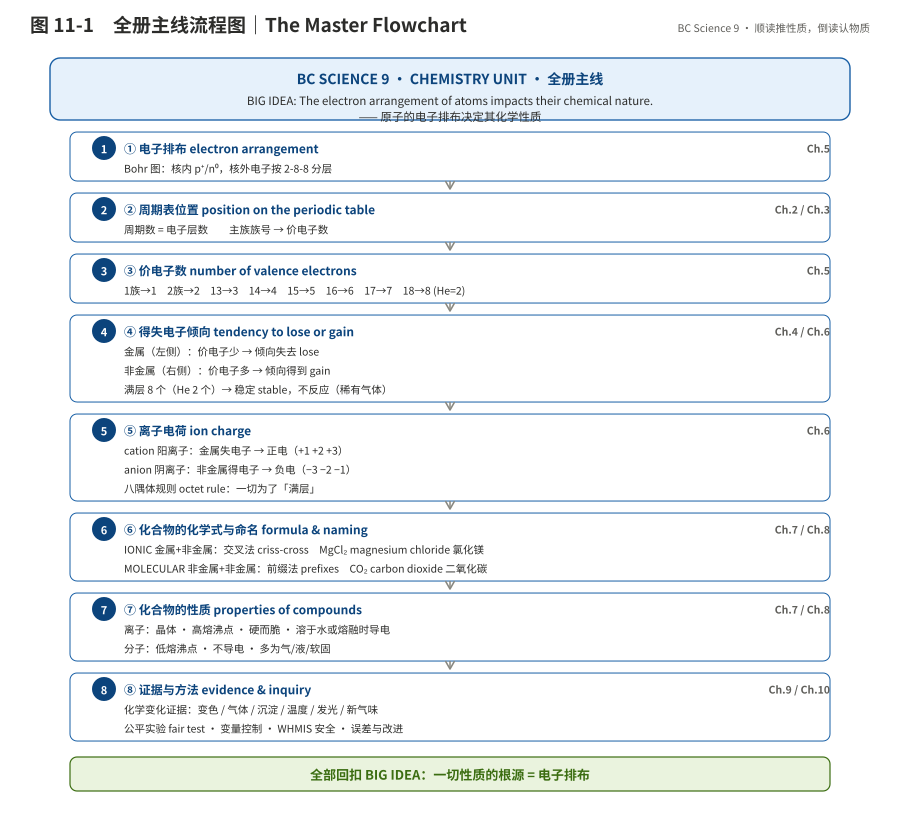
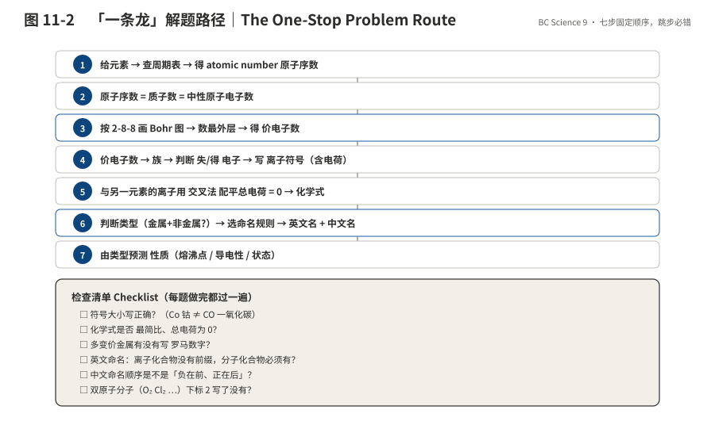
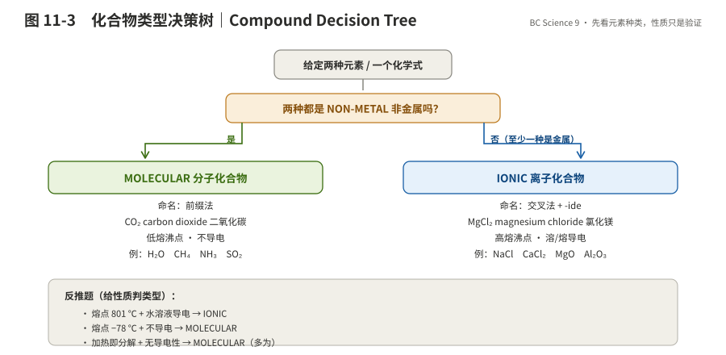
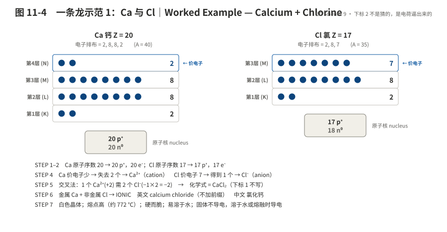
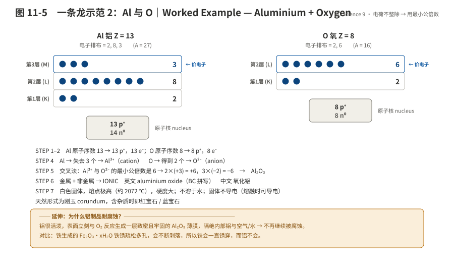
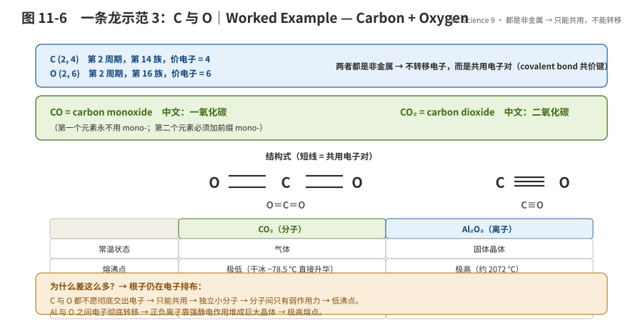

# Ch.11 — Unit Synthesis, Review and Assessment
## Chapter 11 · Unit Synthesis, Review and Assessment｜第 11 章　单元综合、复习与评估

> 🗂️ **Content Alignment｜大纲对应**：C1 *element properties as organized in the periodic table*（元素性质在周期表中的组织方式）＋ C2 *The arrangement of electrons determines the compounds formed by elements*（电子排布决定元素形成的化合物）＋ Big Idea synthesis（核心概念综合）
> ⏱️ **Periods｜课时**：2　|　**Prerequisite｜前置**：Ch.1 – Ch.10　|　**Follow-up｜后继**：BC Science 10
> 🗂️ **Generated｜文件生成时间**：2026-09-18 00:53

This is the closing chapter of the unit, and it has to do three jobs at the same time. First, it stitches Chapters 1 to 10 back together into a single story. Second, it clears away the concepts that students most often confuse with one another. Third, it hands you a complete practice summative so that you can locate your own weak spots before the real test.

**中文**：这是本单元的收尾章，它要同时完成三件事。第一，把第 1 到第 10 章重新缝合成一条完整的故事线；第二，清除学生最容易互相混淆的概念；第三，交给你一套完整的单元模拟卷，让你在正式考试之前先定位自己的薄弱点。

Nothing in this chapter is new content — every idea here has already appeared somewhere in Chapters 1 to 10. If a topic in this chapter feels unfamiliar, that is a signal: go back to the chapter listed in Table 11-1 and re-read that section before you go any further.

**中文**：本章没有任何新内容——这里的每一个知识点都已经在第 1 至第 10 章出现过。如果本章某个话题让你感到陌生，这就是一个信号：请先回到 Table 11-1 中标注的对应章节，把那一节重新读一遍再继续往下走。

## 1. Content Alignment｜大纲对应

| Item｜项目 | Content｜内容 |
|---|---|
| BC Science 9 Content | **C1** *element properties as organized in the periodic table*（元素性质如何被周期表组织起来）— Chapters 2–4；**C2** *The arrangement of electrons determines the compounds formed by elements*（电子排布决定元素形成的化合物）— Chapters 5–8 |
| Big Idea | **The electron arrangement of atoms impacts their chemical nature.**（原子的电子排布决定其化学性质。） |
| Curricular Competencies | All six working together｜全部六条综合运用：Questioning & predicting（提问与预测）／Planning & conducting（计划与实施）／Processing & analyzing（处理与分析）／Evaluating（评估）／Applying & innovating（应用与创新）／Communicating（交流） |
| Tasks for this chapter｜本章任务 | ① Thread Chapters 1–10 into **one master chain**（把 Ch.1–Ch.10 串成**一条主线**）；② clear up **commonly confused concepts**（清除**易混概念**）；③ master the **"one-stop" integrated problem**（练会**一条龙综合题**）；④ complete the **summative assessment**（完成**总结性测评**） |
| Beyond Grade 9?｜是否超纲 | No｜否。The Ch.9 Extension material appears only as a **small bonus** on the assessment — see the note in §9.（Ch.9 的 Extension 部分在测评中**只占少量加分**，见第 9 节说明。） |

## 2. Learning Objectives｜学习目标

**By the end of this chapter, you should be able to:**

1. State the **Big Idea** and trace the entire chain from electron arrangement through to compound properties.
   - **中文**：陈述**核心概念**，并把"电子排布 → 化合物性质"这一整条链条完整串讲出来。
2. Distinguish at least eight pairs of commonly confused terms (atom/ion, element/compound, ionic/molecular, and so on).
   - **中文**：区分至少八组易混概念（原子/离子、元素/化合物、离子化合物/分子化合物等）。
3. Complete a full "one-stop" problem: from element → Bohr diagram → ion → formula → English and Chinese name → properties.
   - **中文**：完成"一条龙"综合题：由元素 → 画玻尔图 → 判断离子 → 写化学式 → 英文与中文命名 → 预测性质。
4. Connect unit content to real-world careers and societal issues (materials, metallurgy, semiconductors, the environment, pharmaceuticals).
   - **中文**：把本单元内容与现实职业和社会议题联系起来（材料、冶金、半导体、环境、制药）。
5. Complete a summative assessment that assesses both **Content** (knowledge) and **Curricular Competencies** (skills).
   - **中文**：完成覆盖**知识（Content）**与**能力（Curricular Competencies）**两条线的总结性测评。

## 3. Concept Explanations｜概念解析

### 3.1 The Master Chain｜全册主线（本章最重要）

The entire textbook has a skeleton that fits into a single sentence. Your goal is to be able to recite it from beginning to end without looking:

**中文**：整册书只有一句话的骨架，你的目标是能够不看任何提示、从头背到尾：

> **electron arrangement → position on the periodic table → number of valence electrons → tendency to lose or gain electrons → ion charge → formula and name of the compound → properties of the compound**
> **中文**：**电子排布 → 周期表位置 → 价电子数 → 得失电子倾向 → 离子电荷 → 化合物的化学式与命名 → 化合物的性质**

Any two links in this chain can be derived from each other. That bidirectionality is the point: this is the **only** thing in the whole unit that has to be memorised as a single connected whole rather than as separate facts (see Fig. 11-1).

**中文**：这条链上任意两个环节都能互相推导。双向可推正是关键所在：这是全册**唯一**需要作为"一个整体"来记忆的东西，而不是拆成一堆零散事实分别死记（见 Fig. 11-1 ）。

### 3.2 Three Master Keys｜三个「万能钥匙」

| Key｜钥匙 | Content｜内容 | Use｜用途 |
|---|---|---|
| **Key 1: position ↔ arrangement｜钥匙 1：位置 ↔ 排布** | Period number = **number of energy shells**（周期数 = **电子层数**）；main-group number → **number of valence electrons**（主族族号 → **价电子数**：group 1→1, 2→2, 13→3, 14→4, 15→5, 16→6, 17→7, 18→8；**He is the exception = 2**） | Draw a Bohr diagram from a position, or locate an element from a Bohr diagram｜由位置画玻尔图，或由玻尔图定位 |
| **Key 2: arrangement ↔ charge｜钥匙 2：排布 ↔ 电荷** | Valence electrons **≤ 3** (usually a metal) → **loses** electrons → positive ion, **cation**（价电子 **≤3**，多为金属 → **失去**电子 → 正离子 cation）；valence electrons **≥ 5** (usually a non-metal) → **gains** electrons → negative ion, **anion**（价电子 **≥5**，多为非金属 → **得到**电子 → 负离子 anion）；**8 (or 2 for He) → stable, unreactive**（**8 个，He 为 2 个 → 稳定不反应**） | Predict ion charge and reactivity｜判断离子电荷与反应倾向 |
| **Key 3: charge ↔ formula｜钥匙 3：电荷 ↔ 化学式** | **Total charge must be zero** → criss-cross method → reduce to the simplest ratio → **never write the subscript 1**（**总电荷必须为零** → 交叉法 → 约成最简比 → **1 不写**） | Write formulas and predict combining ratios｜写化学式与预测化合物比例 |

These three keys are the whole toolkit. Key 1 moves you between the periodic table and the atom; Key 2 moves you between the atom and the ion; Key 3 moves you between the ion and the compound. If you can use all three in both directions, no question in this unit is unreachable.

**中文**：这三把钥匙就是全部的工具箱。钥匙 1 让你在周期表与原子之间来回移动；钥匙 2 让你在原子与离子之间来回移动；钥匙 3 让你在离子与化合物之间来回移动。如果三个钥匙你都能双向使用，那么本单元没有任何一道题是你够不到的。

### 3.3 Three-Second Test for Compound Type｜化合物类型的「三秒判断法」

```
  Step 1 — Look at the elements present｜看组成元素：
    metal + non-metal      → IONIC ionic compound      → criss-cross naming, NO prefixes｜交叉法命名（不用前缀）
    non-metal + non-metal  → MOLECULAR molecular cmpd  → prefix naming, 2nd element ALWAYS needs a prefix｜前缀法命名（第二元素必加前缀）
    metal + metal          → ALLOY alloy               → a mixture, NO chemical formula｜合金（混合物，无化学式）
  Step 2 — Work backwards from properties｜看性质反推：
    high mp/bp + conducts when dissolved in water → IONIC｜高熔沸点 + 溶于水导电 → 离子化合物
    low mp/bp  + does not conduct                → MOLECULAR｜低熔沸点 + 不导电 → 分子化合物
```

Run Step 1 first, every time. The identity of the elements is a decision you can make from the periodic table alone, in about three seconds, and it is far more reliable than guessing from properties. Use Step 2 only to confirm what Step 1 already told you.

**中文**：每次都先跑第 1 步。元素种类这个判断只需要看周期表就能做出来，大约三秒钟，而且它比"靠性质猜"可靠得多。第 2 步只用来验证第 1 步已经给出的结论。

### 3.4 Naming Rules at a Glance｜命名规则总对照

| Type｜类型 | English rule｜英文规则 | Chinese rule｜中文规则 | Example｜例子 |
|---|---|---|---|
| Binary ionic (fixed charge)｜二元离子（固定价） | metal name + non-metal root **-ide** | **non-metal first + 化 + metal second**（**非金属在前 + "化" + 金属在后**） | MgCl₂ = magnesium chloride = **氯化镁** |
| Binary ionic (multivalent)｜二元离子（多变价） | metal name + **roman numeral** + -ide | low charge uses "**亚**"; high charge uses the plain name（低价称"**亚**某"，高价称"某"） | FeCl₃ = iron(III) chloride = **氯化铁**；FeCl₂ = iron(II) chloride = **氯化亚铁** |
| Contains a polyatomic ion｜含多原子离子 | metal name + **ion name** (ending unchanged)（金属名 + **离子名**，不改词尾） | ion name + metal（离子名 + 金属） | CaCO₃ = calcium carbonate = **碳酸钙**；NH₄NO₃ = ammonium nitrate = **硝酸铵** |
| Binary molecular｜二元分子 | **prefix** + element 1 + **prefix** + element 2 root **-ide**; **never use mono- on the first element**（**第一个元素永不用 mono-**） | [number of 2nd element] + 化 + [number of 1st element] + 1st element（[第二个元素数目] + 化 + [第一个元素数目] + 第一个元素） | CO₂ = carbon dioxide = **二氧化碳**；N₂O₄ = dinitrogen tetroxide = **四氧化二氮** |
| Common names｜常见俗名 | Must be memorised separately（必须单独背） | — | H₂O water 水；NH₃ ammonia 氨；CH₄ methane 甲烷；O₃ ozone 臭氧 |

> 📏 **The iron rule: English and Chinese run in opposite orders｜中英顺序相反的铁律**：English puts the **positive ion first** (sodium chloride); Chinese puts the **negative ion first** (氯化钠). Writing the Chinese order backwards is the single most common way to lose marks.
> **中文**：英文是**正离子在前**（sodium chloride），中文是**负离子在前**（氯化钠）。写中文时把顺序写反是最常见的失分点。

### 3.5 Careers & Society｜现实联系

| Field｜领域 | English | Link to this unit｜与本章知识的联系 | Elements / compounds involved｜涉及的元素/化合物 |
|---|---|---|---|
| Materials science｜材料科学 | materials science | Strength, conductivity and melting point are designed from **electron arrangement and bond type**: ionic compounds become heat-resistant ceramics, molecular compounds become plastics and fibres（依据**电子排布与键型**设计强度、导电性、熔点：离子化合物做耐高温陶瓷，分子化合物做塑料与纤维） | Al₂O₃ ceramics（陶瓷）、SiC silicon carbide（碳化硅）、carbon fibre（碳纤维） |
| Metallurgy｜冶金 | metallurgy | Extracting a metal from its ore is essentially **making the metal cation gain electrons** and become an atom again; the more reactive the metal (groups 1 and 2), the harder it is to extract（从矿石中还原出金属——本质是**让金属阳离子得到电子**变回原子；活性越强的金属（第 1、2 族）越难冶炼） | Fe (blast furnace 高炉)、Al (electrolysis 电解)、Cu、Ti |
| Semiconductors｜半导体 | semiconductor | **Si (silicon 硅)** and **Ge (germanium 锗)** sit on the zigzag line and are **metalloids (semi-metals 类金属)**, with conductivity between a metal and a non-metal — textbook proof that **position determines properties**（**Si 硅、Ge 锗**位于锯齿线上，是**类金属 metalloid**，导电性介于金属与非金属之间——**位置决定性质**的教科书级证据） | Si、Ge、GaAs gallium arsenide（砷化镓） |
| Environmental chemistry｜环境化学 | environmental chemistry | Acid rain (SO₂, NOₓ), eutrophication (NO₃⁻, PO₄³⁻), heavy-metal pollution (Pb²⁺, Hg²⁺) — all are social consequences of **ion and compound properties**（酸雨、水体富营养化、重金属污染——都是**离子与化合物性质**的社会后果） | CO₂、SO₂、NO₃⁻、Pb²⁺ |
| Pharmaceuticals｜制药 | pharmaceuticals | Drug molecules are mostly **molecular (covalent) compounds**; salt forms (hydrochlorides, for example) switch the drug into its ionised form to improve solubility and absorption — **the formula changes but the active core does not**（药物分子多为**分子（共价）化合物**；盐型药物如盐酸盐改用电离形态来提高溶解度与吸收——**改化学式不改药效核心**） | NaCl saline（生理盐水）、NaHCO₃ antacid（抗酸剂）、CaCO₃ calcium supplement（补钙剂） |

> 🗂️ **BC curricular competency｜BC 大纲能力点**：*Connect scientific explorations to careers in the field*（把科学探究与本领域职业联系起来）；*Consider the role of science in societal decisions*（思考科学在社会决策中的作用）。

### 3.6 How to Review｜复习策略建议

1. **Draw before you memorise｜先画图再背书**：Write out the master chain in Fig. 11-1 from memory. If you can reproduce it, you already have about 70% of the unit.
   - **中文**：把 Fig. 11-1 的主线流程默写一遍，能默出来就掌握了 70%。
2. **Clear the vocabulary hurdle｜过词汇关**：Self-test Appendix A using three columns — English → Chinese → one-sentence explanation — and concentrate on the ten confused pairs in Table 11-2.
   - **中文**：附录 A 的术语用"英文 → 中文 → 一句话解释"三栏自测，重点攻克 Table 11-2 的十组易混概念。
3. **Drill the "one-stop" problems｜刷「一条龙」**：If you can get Fig. 11-4, 11-5 and 11-6 right, your formulas and naming are basically solid.
   - **中文**： Fig. 11-4 、11-5、11-6 三道题能做对，命名与化学式基本过关。
4. **Memorise five small tables｜背熟 5 张小表**：the group-charge table (Ch.4), the prefix table (Ch.8), the polyatomic-ion table (Appendix B), the common-names table (Ch.8), and the WHMIS table (Ch.10).
   - **中文**：族电荷表（Ch.4）、前缀表（Ch.8）、多原子离子表（附录 B）、俗名表（Ch.8）、WHMIS 表（Ch.10）。
5. **Label your mistakes｜错题归因**：Tag every wrong answer as "concept unclear / naming rule / missing unit / over-extrapolation". You will almost always find that you only ever lose marks in one or two of those categories.
   - **中文**：把错的题标上"概念不清 / 命名规则 / 漏单位 / 过度外推"，你会发现自己只错在一两类上。

## 4. Comparison Tables｜表格比对

### Table 11-1　Chapter Map｜全册章节地图

| Chapter｜章 | English topic | 中文 | Link in the chain｜主线环节 | Content |
|---|---|---|---|---|
| Ch.1 | Matter, Atoms & Atomic Theory | 物质、原子与原子论 | Starting point: classifying matter（起点：物质分类） | Preparation｜预备 |
| Ch.2 | Elements, Symbols & Periodic Table | 元素、符号与周期表 | ② position on the periodic table | C1 |
| Ch.3 | Groups, Periods, Metals & Non-metals | 族、周期、金属与非金属 | ② position on the periodic table | C1 |
| Ch.4 | Chemical Families & Reactivity | 化学族与反应性 | ④ tendency to lose or gain electrons | C1 |
| Ch.5 | Atomic Structure & Bohr Diagrams | 原子结构与玻尔图 | ①③ electron arrangement and valence electrons | C1→C2 |
| Ch.6 | Ions & Lewis Dot Diagrams | 离子与路易斯点式 | ⑤ ion charge | C2 |
| Ch.7 | Ionic Compounds | 离子化合物 | ⑥⑦ formula and properties | C2 |
| Ch.8 | Molecular Compounds | 分子（共价）化合物 | ⑥⑦ formula and properties | C2 |
| Ch.9 | Chemical Change & Equations | 化学变化与方程式 | ⑧ evidence — 【🔭 Extension → Science 10】 | Sci 10 |
| Ch.10 | Inquiry, Lab Skills & Safety | 探究、技能与安全 | Methods strand, running through the whole book（方法线，贯穿全册） | Competencies |
| Ch.11 | Synthesis, Review & Assessment | 综合复习与测评 | Integration of the whole chain（全链整合） | C1+C2 |

### Table 11-2　Master Comparison of Confused Pairs｜易混概念总对比表（必背）

| # | Concept A｜概念 A | Concept B｜概念 B | Key difference｜关键区别 |
|---|---|---|---|
| 1 | **atom 原子** | **ion 离子** | An atom is **electrically neutral** (number of p⁺ = number of e⁻); an ion is **charged** (the electron count has changed, and **the proton number never changes**)｜原子**电中性**（p⁺ 数 = e⁻ 数）；离子**带电**（e⁻ 数变了，**质子数永不变**） |
| 2 | **element 元素** | **compound 化合物** | An element contains only **one kind of atom** and cannot be broken down chemically (Fe, O₂); a compound contains **two or more elements**, has a formula, and can be broken down (H₂O, NaCl)｜元素只有 **1 种原子**、不可化学分解（Fe、O₂）；化合物含 **2 种以上元素**、有化学式、可分解（H₂O、NaCl） |
| 3 | **metal 金属** | **non-metal 非金属** | Metals sit on the **left of the zigzag line**: shiny, malleable, conduct heat and electricity, tend to **lose** electrons; non-metals sit on the **right**: dull, brittle, poor conductors, tend to **gain** electrons｜金属在锯齿线**左侧**：有光泽、延展性、导电导热、倾向**失**电子；非金属在**右侧**：无光泽、脆、不良导体、倾向**得**电子 |
| 4 | **ionic compound 离子化合物** | **molecular compound 分子化合物** | Ionic = **metal + non-metal**, **electron transfer**, high mp/bp, conducts when dissolved or melted; molecular = **non-metal + non-metal**, **shared electron pairs**, low mp/bp, does not conduct｜离子 = **金属+非金属**，**电子转移**，高熔沸点，溶/熔时导电；分子 = **非金属+非金属**，**共用电子对**，低熔沸点，不导电 |
| 5 | **cation 阳离子** | **anion 阴离子** | A cation forms when a metal **loses** electrons → **positive** → **fewer** electrons → **0 dots** outside the Lewis diagram; an anion forms when a non-metal **gains** electrons → **negative** → **more** electrons → **8 dots** outside the diagram｜cation 由金属**失去**电子形成 → **正电** → 电子数**变少** → 路易斯图外 **0 个点**；anion 由非金属**得到**电子 → **负电** → 电子数**变多** → 图外 **8 个点** |
| 6 | **group / family 族** | **period 周期** | A group is a **vertical column** (same number of valence electrons → **similar chemical properties**); a period is a **horizontal row** (same number of energy shells = the period number)｜族是**纵列**（同族价电子数相同 → **化学性质相似**）；周期是**横行**（同周期电子层数相同 = 周期数） |
| 7 | **atomic number 原子序数** | **mass number 质量数** | Atomic number = **number of protons** (a whole number; it decides which element you have; it increases left to right); mass number = **protons + neutrons** (a whole number). Note that **relative atomic mass (atomic mass) is a decimal — an average over isotopes**｜原子序数 = **质子数**（整数，决定元素种类，横轴上递增）；质量数 = **质子数 + 中子数**（整数）；**相对原子质量 atomic mass 是小数（同位素平均值）** |
| 8 | **physical change 物理变化** | **chemical change 化学变化** | A physical change produces **no new substance** (the molecules stay intact); a chemical change **produces a new substance** (**atoms are rearranged**, but the kinds and numbers of atoms do not change)｜物理变化**无新物质**（分子本身完整）；化学变化**生成新物质**（**原子重新排列**，原子种类与数目不变） |
| 9 | **coefficient 系数** | **subscript 下标** | A coefficient sits **in front of** a formula, tells you how many particles, and **may be changed when balancing**; a subscript sits at the **lower right**, tells you how many atoms inside one particle, and **must never be changed**｜系数在化学式**前面**，表示粒子个数，**配平时可改**；下标在**右下角**，表示粒子内原子个数，**绝不能改** |
| 10 | **qualitative 定性** | **quantitative 定量** | Qualitative = a word description (colour change, bubbling); quantitative = a number **with a unit** (25.4 mL, 12.3 ℃)｜定性 = 文字描述（变色、冒泡）；定量 = 数字 + 单位（25.4 mL、12.3 ℃） |

> 📏 **How to self-check｜自检方法**：Cover the right-hand column, look at just the two words on the left, and if you can **state the difference within 3 seconds** you have passed.
> **中文**：遮住右列，只看左边两个词，能**在 3 秒内说出区别**才算过关。

### Table 11-3　Ionic vs Molecular Properties｜两类化合物性质总对比

| Property｜性质 | Ionic 离子化合物 | Molecular 分子化合物 | Reason (back to electron arrangement)｜原因（回扣电子排布） |
|---|---|---|---|
| Composition｜组成 | metal + non-metal（金属 + 非金属） | non-metal + non-metal（非金属 + 非金属） | The former **transfers** electrons; the latter **shares** them｜前者电子**转移**，后者电子**共用** |
| Melting / boiling point｜熔沸点 | **High**（NaCl 801 ℃；MgO 2852 ℃） | **Low**（CO₂ sublimes at −78.5 ℃；H₂O boils at 100 ℃） | Strong electrostatic attraction between ions; weak forces between molecules｜离子间静电作用强；分子间作用力弱 |
| State at room temperature｜常温状态 | Solid crystal（固体晶体） | Gas / liquid / soft solid（气/液/软固） | — |
| Hardness｜硬度 | Hard but **brittle**（硬而**脆**） | Relatively soft（较软） | If ionic layers slip, like charges face each other and the crystal shatters｜离子层错位即同电荷相斥而碎裂 |
| Conductivity｜导电性 | **Does not conduct** as a solid; **conducts when dissolved in water or melted**（固体**不导**，**溶于水或熔融时导电**） | **Generally does not conduct**（**一般不导电**） | Ions can move freely once dissolved or melted; a molecular solution contains no charged particles｜溶解/熔融后离子可自由移动；分子溶液中无带电粒子 |
| Solubility in water｜溶解性 | Most dissolve readily in water（多数易溶于水） | Varies widely; polar molecules dissolve well（差异大，极性分子易溶） | — |
| Examples｜例子 | NaCl、CaCl₂、MgO、Al₂O₃ | H₂O、CO₂、CH₄、NH₃ | — |

### Table 11-4　Four Key Families｜四个关键族速查

| Group｜族 | English | 中文 | Valence electrons｜价电子 | Ion charge｜离子电荷 | Reactivity and notes｜活性与备注 |
|---|---|---|---|---|---|
| 1 | Alkali metals | 碱金属 | 1 | **+1** | Extremely reactive; react violently with water; stored under oil; reactivity **increases** down the group｜极活泼，遇水剧烈反应，需保存在油中；向下活性**增强** |
| 2 | Alkaline earth metals | 碱土金属 | 2 | **+2** | Reactive, but less so than the alkali metals｜活泼，次于碱金属 |
| 17 | Halogens | 卤素 | 7 | **−1** | The most reactive non-metals; exist as **diatomic molecules** (F₂ Cl₂ Br₂ I₂); reactivity **decreases** down the group｜最活泼的非金属；以**双原子分子**存在；向下活性**减弱** |
| 18 | Noble gases | 稀有气体 | 8 (He: 2)｜8（He 为 2） | **0** | The valence shell is already full → **stable (inert)**, almost unreactive｜价电子层已满 → **稳定 inert**，几乎不反应 |

> 📌 The seven diatomic molecules｜七种双原子分子：**H₂、N₂、O₂、F₂、Cl₂、Br₂、I₂**（mnemonic 记法：*BrINClHOF* / "Have No Fear Of Ice Cold Beer"）。

### Table 11-5　Summative Assessment Structure｜单元测评结构与权重

| Module｜模块 | English | Weight｜权重 | Format｜形式 | Coverage｜覆盖 |
|---|---|---|---|---|---|
| ① Knowledge paper｜知识卷 | Written test (knowledge) | **60%** | Multiple choice + fill-in-the-blank + naming translation + short answer (60 minutes)｜选择 + 填空 + 命名互译 + 简答（60 分钟） | Mainly Ch.1–Ch.8, with a few basic Ch.9 questions｜Ch.1–Ch.8 为主，Ch.9 基础题少量 |
| ② Lab / inquiry task｜实验/探究任务 | Lab / inquiry task | **25%** | A full lab report, or a hands-on practical plus data processing｜完整实验报告或现场实操 + 数据处理 | Ch.10 competency strand + evidence from Ch.7/Ch.8｜Ch.10 能力线 + Ch.7/Ch.8 证据 |
| ③ Concept map / science writing｜概念图或科普写作 | Concept map / science writing | **15%** | An A3 concept-map poster, or a 400–600 word bilingual popular-science essay｜A3 概念图海报，或 400–600 字双语科普短文 | The whole-book master chain + a return to the Big Idea｜全册主线 + Big Idea 回扣 |

**Bilingual Policy｜双语政策**
- Terminology questions (definitions, concept discrimination) **may be answered in English, Chinese, or both**｜术语部分（名词解释、概念辨析）**允许中英双语作答**；
- **Chemical formulas, element symbols, English names and unit symbols must be written in English** — you must write `CaCl₂`, `calcium chloride`, `25.4 mL`, and you **may not** invent Chinese-style or made-up versions｜**化学式、元素符号、英文命名、单位符号必须使用英文**（如必须写 `CaCl₂`、`calcium chloride`、`25.4 mL`，**不能**写成中文或自造写法）；
- Chinese naming gets its own column and is **marked separately** from English naming｜中文命名单独设栏填写，与英文命名**分开计分**；
- You may bring Appendix D (the English–Chinese table for the first 20 elements) as a **non-marked aid**｜允许携带附录 D（前 20 号元素中英对照表）作为**非计分辅助**。

## 5. Diagrams & Worked Examples｜图例说明

### Fig. 11-1　The Master Flowchart｜全册主线流程图（本章门面图）



**How to read it｜看图要点**：Reading the chart **forwards** answers the question "why is NaCl NaCl?" — you start from electron arrangement and work through to properties. Reading it **backwards** answers "what is this unknown substance?" — you start from the properties and work back to the type and the composition. Exams test both directions, so practise explaining the chain both ways.

**中文**：**顺读**这张图可以回答"为什么 NaCl 是 NaCl"（由电子排布推到性质）；**倒读**可以回答"这个未知物是什么"（由性质反推类型与组成）。考试里两种方向都会考，请两个方向都能讲一遍。

### Fig. 11-2　The One-Stop Problem Route｜「一条龙」解题路径



**How to read it｜看图要点**：The seven steps come in a **fixed order**, and skipping a step always produces a wrong answer. The steps most often skipped are STEP 3 (guessing the charge instead of drawing the Bohr diagram first) and the Chinese word-order check inside STEP 6.

**中文**：七步是**固定顺序**，跳步必错。最容易跳的是 STEP 3（不画玻尔图直接猜电荷）和 STEP 6 的中文顺序检查。

### Fig. 11-3　Compound Decision Tree｜化合物类型决策树



**How to read it｜看图要点**：**Always look at which kinds of elements are present first** — that is their left/right position on the periodic table, and it is the fastest test. Properties are only **confirmation**. Hydrogen sits in group 1 but it is a **non-metal**, so both HCl and H₂O are molecular compounds: never call something ionic just because "H is on the metal side".

**中文**：**先看元素种类**（周期表上的左右位置），这是最快的判据；性质只是**验证**。氢 H 虽然在第 1 族，但它是**非金属**——所以 HCl、H₂O 都是分子化合物，不要因为"H 在金属那一边"就判成离子化合物。

### Fig. 11-4　Worked Example 1: Ca and Cl｜一条龙示范 1：Ca 与 Cl

**Problem｜题目**：Calcium (Ca) and chlorine (Cl) form a compound. Draw the Bohr diagrams, decide the ions, write the formula, give both the English and the Chinese name, and predict the properties.

**中文**：钙（Ca）与氯（Cl）形成化合物。请画玻尔图、判断离子、写化学式、给出英文与中文命名，并预测性质。



**📊 Fig. 11-4**　Worked Example 1 — Calcium + Chlorine｜一条龙示范 1：Ca 与 Cl

**How to read it｜看图要点**：Ca is in group 2, so it is **always** Ca²⁺; Cl is in group 17, so it is **always** Cl⁻. That means the subscript 2 in `CaCl₂` is **not a guess — it is forced by the charges**. This is exactly what "electron arrangement determines the formula" means in practice.

**中文**：Ca 是第 2 族 → 永远 Ca²⁺；Cl 是第 17 族 → 永远 Cl⁻。所以 `CaCl₂` 里的下标 2 **不是猜的，是电荷逼出来的**——这就是"电子排布决定化学式"的具体含义。

### Fig. 11-5　Worked Example 2: Al and O｜一条龙示范 2：Al 与 O

**Problem｜题目**：Aluminium (Al) and oxygen (O) form a compound. Carry out the full derivation, and explain why aluminium products resist corrosion.

**中文**：铝（Al）与氧（O）形成化合物。完成全套推导，并解释铝制品为何耐腐蚀。



**📊 Fig. 11-5**　Worked Example 2 — Aluminium + Oxygen｜一条龙示范 2：Al 与 O

**How to read it｜看图要点**：When the criss-cross method meets charges that do not divide evenly, the safe route is the **lowest common multiple** (Al³⁺ with O²⁻ → LCM 6 → subscripts 2 and 3). Do not rely on "just swap the numbers" as a memorised trick: that shortcut fails as soon as you meet ±4 or ±6 ions.

**中文**：交叉法遇到"电荷不整除"时，用**最小公倍数**才是稳妥做法（Al³⁺ 与 O²⁻ → 6 → 2 和 3）。不要靠"交换数字"死记，遇到 ±4/±6 就会出错。

### Fig. 11-6　Worked Example 3 (molecular contrast): C and O｜一条龙示范 3（分子化合物对照）：C 与 O

**Problem｜题目**：Carbon (C) and oxygen (O) form two common compounds, CO and CO₂. Decide the compound type, name them, and explain why their properties are so completely different from those of Al₂O₃.

**中文**：碳（C）与氧（O）形成两种常见化合物 CO 与 CO₂。判断类型、命名并解释为何与 Al₂O₃ 性质截然不同。



**📊 Fig. 11-6**　Worked Example 3 — Carbon + Oxygen｜一条龙示范 3：C 与 O

**How to read it｜看图要点**：**The very same element, oxygen**, gives substances with wildly different properties depending on whether it combines with a metal (Al₂O₃) or with a non-metal (CO₂) — because whether electrons are **transferred or shared** is decided entirely by the electron arrangements of both partners. This is the strongest single piece of evidence for the Big Idea.

**中文**：**同样的氧元素**，跟金属结合（Al₂O₃）和跟非金属结合（CO₂），得到的物质性质天差地别——因为**电子是"转"还是"共"**，完全由双方的电子排布决定。这就是 Big Idea 最有力的例证。

## 6. Key Vocabulary｜核心词汇（全册高频）

| English | 中文 | Chapter｜章 |
|---|---|---|
| matter / pure substance / mixture | 物质 / 纯净物 / 混合物 | Ch.1 |
| element / compound | 元素 / 化合物 | Ch.1 |
| proton / neutron / electron | 质子 / 中子 / 电子 | Ch.1 |
| atomic number / mass number | 原子序数 / 质量数 | Ch.2, Ch.5 |
| isotope / atomic mass | 同位素 / 相对原子质量 | Ch.2 |
| group / family / period | 族 / 族 / 周期 | Ch.3 |
| metal / non-metal / metalloid (semi-metal) | 金属 / 非金属 / 类金属 | Ch.3 |
| alkali metal / alkaline earth metal | 碱金属 / 碱土金属 | Ch.4 |
| halogen / noble gas / diatomic molecule | 卤素 / 稀有气体 / 双原子分子 | Ch.4 |
| Bohr diagram / energy shell | 玻尔图 / 电子层 | Ch.5 |
| valence electron / valence shell | 价电子 / 价电子层 | Ch.5 |
| ion / cation / anion / octet rule | 离子 / 阳离子 / 阴离子 / 八隅体规则 | Ch.6 |
| polyatomic ion / multivalent | 多原子离子 / 多变价 | Ch.6 |
| Lewis dot diagram | 路易斯点式 | Ch.6 |
| ionic compound / criss-cross method | 离子化合物 / 交叉法 | Ch.7 |
| subscript / -ide / roman numeral | 下标 / ……化物 / 罗马数字 | Ch.7 |
| molecular compound / covalent bond | 分子化合物 / 共价键 | Ch.8 |
| shared pair / prefix / common name | 共用电子对 / 前缀 / 俗名 | Ch.8 |
| chemical change / precipitate | 化学变化 / 沉淀 | Ch.9 |
| coefficient / law of conservation of mass | 系数 / 质量守恒定律 | Ch.9 |
| independent / dependent / controlled variable | 自变量 / 因变量 / 控制变量 | Ch.10 |
| fair test / qualitative / quantitative | 公平实验 / 定性 / 定量 | Ch.10 |
| error / uncertainty / WHMIS | 误差 / 不确定度 / 危险物质信息系统 | Ch.10 |
| interpolation / extrapolation | 内插 / 外推 | Ch.10 |
| materials science / metallurgy / semiconductor | 材料科学 / 冶金 / 半导体 | Ch.11 |

> 🔭 **Extension｜超纲**：The Ch.9 rows in this table (chemical change / precipitate / coefficient / law of conservation of mass) belong to **【🔭 Extension → Science 10】** in the BC Science 9 course; you only need to recognise them, not to use them to balance equations.
> **中文**：本表中 Ch.9 那几行（化学变化 / 沉淀 / 系数 / 质量守恒定律）在 BC Science 9 里属于**【🔭 Extension → Science 10】**内容；你只需要能认出来，不需要用它们去配平方程式。

## 7. Lab / Activity｜实验与活动

### Activity 11-1　Mystery White Powder｜神秘白色粉末鉴别

- **Type｜类型**：Integrative inquiry（综合探究）
  - **中文**：综合探究。
- **Materials｜材料**：Numbered unknown powders — one each of NaCl, sucrose, CaCO₃ and baking soda (小苏打)；distilled water（蒸馏水）；a battery + bulb or a multimeter（电池+灯泡或万用表）；an alcohol lamp or hot plate（酒精灯/加热板）；white vinegar（白醋）；safety goggles（护目镜）
  - **中文**：编号未知粉末（NaCl、蔗糖、CaCO₃、小苏打各一）、蒸馏水、电池+灯泡或万用表、酒精灯/加热板、白醋、护目镜。
- **Procedure｜步骤**：
  1. Observe the appearance — qualitative data.（观察外观，定性数据。）
     - **中文**：观察外观（定性数据）。
  2. Test solubility: take 1 g of each sample and add 10 mL of water.（测溶解性：各取 1 g 加 10 mL 水。）
     - **中文**：测溶解性：各取 1 g 加 10 mL 水。
  3. Test **conductivity**: for the samples that dissolve, measure the current (mA).（测**导电性**：对可溶者测电流 mA。）
     - **中文**：测**导电性**：对可溶者测电流 (mA)。
  4. Add white vinegar and watch for bubbling (CO₂).（加白醋看是否冒泡 CO₂。）
     - **中文**：加白醋看是否冒泡（CO₂）。
  5. Test stability on heating — use only a small amount, and point the **mouth of the test tube away from everyone**.（测加热稳定性，取少量，试管口**朝无人处**。）
     - **中文**：测加热稳定性（少量，试管口**朝无人处**）。
  6. Decide whether each powder is ionic or molecular, and write out the full evidence chain.（综合判定 ionic / molecular，并写出证据链。）
     - **中文**：综合判定 ionic / molecular，并写出证据链。
- **Competencies trained｜训练能力**：[Planning and conducting]；[Processing and analyzing]；[Evaluating]；[Communicating]
  - **中文**：[计划与实施]；[处理与分析]；[评估]；[交流]。
- **Safety｜安全**：⚠ Goggles and gloves at all times; **no tasting, ever**; point the test-tube mouth away from people while heating; smell gases only by **wafting**; dispose of waste liquid as your teacher directs
  - **中文**：⚠ 护目镜与手套；**禁止品尝**；加热时试管口朝无人方向；闻气体用 wafting 扇闻法；按教师指示处理废液。

### Activity 11-2　Unit Concept Map Poster｜单元概念图海报

- **Type｜类型**：Group project for four students — an A3 poster or a digital version（四人小组项目，A3 海报或数字版）
  - **中文**：四人小组项目（A3 海报或数字版）。
- **Task｜任务**：Draw the **master chain** from Fig. 11-1 as a concept map. Requirements: at least **20 nodes**, at least **8 chemical formulas as examples**, at least **one coloured node per chapter**, and a **one-sentence return to the Big Idea** along the bottom.
  - **中文**：把 Fig. 11-1 的**全册主线**画成概念图，要求：至少 20 个节点、含至少 8 个化学式例子、每章至少一个彩色节点、底部用一句话回扣 **Big Idea**。
- **Competencies trained｜训练能力**：[Communicating]；[Applying and innovating]
  - **中文**：[交流]；[应用与创新]。
- **Rubric｜评价量规**：Completeness of the chain 40%（主线完整性 40%）；accuracy of nodes 30%（节点准确性 30%）；clarity of layout and bilingual labelling 20%（图面清晰与双语标注 20%）；return to the Big Idea 10%（Big Idea 回扣 10%）
  - **中文**：主线完整性 40%、节点准确性 30%、图面清晰与双语标注 20%、Big Idea 回扣 10%。

### Activity 11-3　One-Stop Relay｜一条龙接龙赛

- **Type｜类型**：Classroom competition, 5 minutes per round（课堂竞赛，5 分钟一轮）
  - **中文**：课堂竞赛（5 分钟一轮）。
- **Rules｜规则**：The teacher gives a pair of elements (for example Mg and N, K and S, or Al and F). The group divides up the work and completes the seven steps from Fig. 11-2 in relay on the whiteboard. The last member has **30 seconds** to explain out loud why that is the correct formula.
  - **中文**：教师给一组元素（如 Mg 与 N、K 与 S、Al 与 F），小组分工在白板上接力完成七步（ Fig. 11-2 ），最后一组要用 **30 秒**口头讲清"为什么是这个化学式"。
- **Competencies trained｜训练能力**：[Communicating]；[Questioning and predicting]
  - **中文**：[交流]；[提问与预测]。
- **Safety｜安全**：None — answers are written with whiteboard markers（无，白板笔作答）
  - **中文**：无（白板笔作答）。

## 8. Common Misconceptions｜常见易错点（全册汇总）

| # | Misconception｜错误认识 | Correction｜正确理解 |
|---|---|---|
| 1 | Thinking an ion is "an atom whose protons changed"（认为离子是"质子变了"） | **The proton number never changes** — if it did, you would have a different element. An ion is simply an atom whose **electron count** has changed.（**质子数永远不变**，变了就是另一种元素；离子只是**电子数**变了。） |
| 2 | Treating a compound as a mixture（把化合物当混合物） | A compound has a **fixed ratio and a chemical formula**; a mixture has neither.（化合物有**固定配比与化学式**；混合物没有。） |
| 3 | Thinking "all metals are solids"（认为"所有金属都是固体"） | **Hg (mercury 汞)** is liquid at room temperature.（**Hg 汞**在室温下是液体。） |
| 4 | Thinking hydrogen is a metal because it sits in group 1（氢在第 1 族，所以是金属） | **H is a non-metal.** Position is decided by electron arrangement, not by whether something behaves like a metal.（**H 是非金属**；位置由电子排布决定，不由金属性决定。） |
| 5 | Remembering the third shell's capacity as 18（第 3 层容量记成 18） | Within the first 20 elements, treat the shells as **2-8-8**.（前 20 号元素范围内按 **2-8-8** 处理。） |
| 6 | Using atomic mass (a decimal) to calculate neutron number（用 atomic mass（小数）去算中子数） | Use the **rounded mass number** (a whole number) and subtract from it.（应取四舍五入后的**质量数**（整数）来减。） |
| 7 | Still drawing dots in a cation's Lewis diagram（阳离子路易斯图里还画点） | A cation has **0 dots** outside it; an anion has **8 dots + square brackets + the charge**.（阳离子**外面 0 个点**；阴离子**8 个点 + 方括号 + 电荷**。） |
| 8 | Forgetting to reduce the formula to its simplest ratio（忘记把化学式约到最简） | Mg₂O₂ → **MgO**；Ca₂Cl₄ → **CaCl₂**。 |
| 9 | Writing the Chinese name in the wrong order ("钠化氯")（中文命名顺序写反） | Chinese puts the **negative ion first and the positive ion second**: 氯化钠, 氧化镁, 硫化铝.（中文是**负在前、正在后**。） |
| 10 | Adding a prefix to an ionic compound (sodium monochloride)（离子化合物误加前缀） | **Ionic compounds never take prefixes**; prefixes are only for molecular compounds.（**离子化合物不用前缀**；前缀只用于分子化合物。） |
| 11 | Writing mono- on the first element of a molecular compound（分子化合物第一个元素也写 mono-） | CO = **carbon monoxide**, not monocarbon monoxide. |
| 12 | Omitting the roman numeral for a multivalent metal（多变价金属漏写罗马数字） | FeCl₃ = **iron(III) chloride**; FeCl₂ = iron(II) chloride（中文：氯化铁 / 氯化亚铁）。 |
| 13 | Changing subscripts when balancing — 【🔭 Extension → Science 10】（配平时改下标） | **Only coefficients may be changed**; changing a subscript changes the substance (H₂O → H₂O₂).（**只能改系数**；改下标就换了物质。） |
| 14 | Writing an element as single atoms (oxygen as O)（单质写成单原子，氧气写成 O） | The seven diatomic molecules are **H₂ N₂ O₂ F₂ Cl₂ Br₂ I₂**.（七种双原子分子。） |
| 15 | Thinking "a covalent bond is weak"（认为"共价键很弱"） | What is weak is the **intermolecular force**; the covalent bond itself is strong.（弱的是**分子间作用力**；共价键本身很强。） |
| 16 | Thinking solid ionic compounds conduct（认为离子化合物固体也导电） | Solids **do not conduct** (the ions cannot move); they conduct **only when dissolved in water or melted**.（固体**不导**，**溶于水或熔融**才导电。） |
| 17 | Classifying dissolving or melting as a chemical change（把"溶解""熔化"判为化学变化） | Both are **physical changes** (no new substance).（都是**物理变化**，无新物质。） |
| 18 | Thinking "bubbling always means a chemical change"（认为"冒泡就是化学变化"） | Boiling water bubbles too. Always ask "is the gas a **new substance**?"（水沸腾也冒泡；必须问"气泡是不是**新物质**"。） |
| 19 | Drawing a conclusion from a single trial（实验只做一次就下结论） | You must **repeat 3 times and take the average**.（必须**重复 3 次取平均**。） |
| 20 | Pushing a conclusion past the data（结论超出数据范围） | "Between 20 ℃ and 60 ℃…" ✅; "all substances…" ❌ — that is over-extrapolation.（"在 20–60 ℃ 范围内……"✅；"所有物质都……"❌，过度外推。） |
| 21 | Ignoring capitalisation in symbols（符号大小写不分） | **Co** = cobalt ≠ **CO** = carbon monoxide; **Na** = sodium ≠ **NA**.（**Co** 钴 ≠ **CO** 一氧化碳；**Na** 钠 ≠ **NA**。） |
| 22 | Thinking noble gases "can never form compounds"（认为稀有气体"完全不能形成化合物"） | He and Ne essentially do not; Xe and Kr can be forced to (for example XeF₄).（He、Ne 基本不形成；Xe、Kr 等可艰难形成，如 XeF₄。） |

## 9. Assessment｜答题评估

> Below is a **complete unit practice summative** (Unit Practice Summative) covering Chapters 1 to 10. Aim to finish Parts A and B in 60 minutes; Part C is extension work to be done after class.
> **中文**：以下为**一套完整的单元模拟卷**（Unit Practice Summative），覆盖 Ch.1 – Ch.10。建议 60 分钟完成 A、B 组，C 组作课后拓展。

Group A: Foundational｜A 组：基础题（每题 2 分，共 20 分）

**A1.** Classify each of the following as an element, a compound or a mixture: oxygen gas O₂, sea water, calcium carbonate CaCO₃, brass.
- **中文**：把下列物质分类为 element / compound / mixture：氧气 O₂、海水、碳酸钙 CaCO₃、黄铜。

**A2.** Complete the subatomic particle table: proton (charge / location); neutron (charge / location); electron (charge / location).
- **中文**：填写亚原子粒子表：proton（电荷 / 位置）；neutron（电荷 / 位置）；electron（电荷 / 位置）。

**A3.** Explain the difference between a group (family) and a period, one sentence each.
- **中文**：说明 group 族与 period 周期的区别，各用一句话。

**A4.** An element is in period 3, group 16. How many energy shells does it have? How many valence electrons?
- **中文**：某元素位于第 3 周期、第 16 族，它有几个电子层？几个价电子？

**A5.** Give the symbol and charge of each ion: the sodium ion; the magnesium ion; the chloride ion; the oxide ion.
- **中文**：写出下列离子的符号与电荷：钠离子；镁离子；氯离子；氧离子。

**A6.** Use the criss-cross method to write the formula of **magnesium chloride**.
- **中文**：用交叉法写出 **magnesium chloride** 的化学式。

**A7.** Give the English name and the Chinese name of each substance: CO₂; NH₃; CaCO₃.
- **中文**：写出下列物质的英文名与中文名：CO₂；NH₃；CaCO₃。

**A8.** Decide whether NaCl and CO₂ are ionic or molecular, and give one reason for each.
- **中文**：判断 NaCl 与 CO₂ 分别属于 ionic 还是 molecular，并各写一条理由。

**A9.** Write four pieces of evidence that a chemical change has occurred (English or Chinese is acceptable).
- **中文**：写出化学变化的四条证据（英文或中文均可）。

**A10.** In an experiment on "the effect of fertiliser amount on plant height", identify the independent variable and the dependent variable, and give one controlled variable.
- **中文**：在"肥料用量对植物高度的影响"实验中，指出自变量与因变量，并写出一条控制变量。

Group B: Applied｜B 组：应用题（每题 5 分，共 20 分）

**B1.** Element X is in period 4, group 1.
(a) Give its element name and symbol; (b) write its electron arrangement (2-8-8-…) and its number of valence electrons; (c) what ion does it form? Give the symbol; (d) give the formula of the compound it forms with chlorine (Cl); (e) give the **English and Chinese name** of that compound, and predict whether it **conducts electricity once dissolved in water**.
- **中文**：元素 X 位于第 4 周期、第 1 族。(a) 说出它的元素名与符号；(b) 写出它的电子排布（2-8-8-…）与价电子数；(c) 它形成什么离子？写出符号；(d) 它与氯（Cl）形成的化合物的化学式；(e) 写出该化合物的**英文名与中文名**，并预测它**溶于水后的导电性**。

**B2.** Complete the naming table below (English name + Chinese name):
- **中文**：完成下列命名互译表（英文命名 + 中文命名）：

| Formula｜化学式 | English name | 中文名 | Type｜类型（ionic / molecular） |
|---|---|---|---|
| Na₂O | | | |
| MgCl₂ | | | |
| FeCl₃ | | | |
| N₂O₄ | | | |
| H₂O | | | |

**B3.** The table below shows test data for two unknown solids A and B. Decide whether each is ionic or molecular, give your evidence, and predict one other property of each.
- **中文**：下表是两种未知固体 A、B 的测试数据。判断各属 ionic 还是 molecular，写出依据，并各预测一条其他性质。

| Sample｜样品 | Melting point｜熔点 | Solubility in water｜水溶性 | Conductivity of the solution｜水溶液导电性 |
|---|---|---|---|
| A | 801 ℃ | Dissolves readily｜易溶 | Conducts (bulb lights)｜导电（灯泡亮） |
| B | 68 ℃ | Slightly soluble｜微溶 | Does not conduct｜不导电 |

**B4.** (a) Balance the following equations: ① `Mg + O₂ → MgO`　② `CH₄ + O₂ → CO₂ + H₂O`　【🔭 Extension → Science 10】
(b) When a magnesium ribbon burns you observe a brilliant white light, heat is released, and a white powder forms. State which type of evidence of chemical change each observation corresponds to, and explain the fundamental reason for judging that "this is a chemical change".
- **中文**：(a) 配平下列方程式：① `Mg + O₂ → MgO`　② `CH₄ + O₂ → CO₂ + H₂O`　【🔭 Extension → Science 10】
  (b) 镁条燃烧时观察到耀眼白光、放热、生成白色粉末。指出这三条证据分别对应哪类化学变化证据，并说明判断"这是化学变化"的根本依据。

> 📏 **Note on B4(a)｜关于 B4(a) 的说明**：Balancing equations is **Science 10** content, so B4(a) is a **bonus item** in this paper. If your school tests strictly to Science 9, replace it with "state the type of change and explain your reasoning".
> **中文**：配平方程式属于 **Science 10** 内容，因此 B4(a) 在本卷中为**加分项**；若学校严格按 Science 9 施考，可将该题改为"指出变化类型并说明理由"。

Group C: Challenge｜C 组：综合题（每题 10 分，共 20 分）

**C1.** Element X is in **period 3, group 16**.
(a) Identify the name and symbol of X, and draw its Bohr diagram (show p⁺, n⁰ and the electrons in each shell);
(b) decide what ion it forms, give the symbol, and explain why using the **octet rule**;
(c) write the formulas of the compounds X forms with **Mg** and with **Al**;
(d) give the **English and Chinese names** of the two compounds in (c);
(e) predict **three properties** of these two compounds and justify them;
(f) explain why X and oxygen (O) have similar chemical properties — trace your explanation all the way back to the **Big Idea**.
- **中文**：元素 X 位于**第 3 周期、第 16 族**。(a) 确定 X 的元素名称与符号；画出它的玻尔图（标出 p⁺、n⁰ 与各层电子数）；(b) 判断它形成什么离子，写出符号，并用**八隅体规则**解释原因；(c) 写出 X 分别与 **Mg** 和 **Al** 形成的化合物的化学式；(d) 给出 (c) 中两个化合物的**英文名与中文名**；(e) 预测这两个化合物的**三条性质**并说明依据；(f) 说明为什么 X 与氧（O）化学性质相似——把你的解释一路回扣到 **Big Idea**。

**C2.** You are given a packet of an unknown white powder and must decide whether it is an **ionic compound** or a **molecular compound**.
(a) Write your research question and your hypothesis (If…then…because…, where the *because* part must refer to **electron arrangement and the charge on the particles**);
(b) design the experiment: give the independent variable, the dependent variable, at least 4 controlled variables (with specific values), the equipment, and the procedure (including the number of repeats);
(c) draw a data table (including units and qualitative columns);
(d) state the decision rule (what result means ionic, what result means molecular);
(e) identify three sources of error and how to reduce them;
(f) write the safety precautions (at least 3, and they must include **WHMIS**);
(g) if the result is ionic, design a further test to decide **whether it is NaCl** (tasting is not allowed).
- **中文**：你拿到一包未知白色粉末，需要判断它是 **ionic（离子）化合物**还是 **molecular（分子）化合物**。(a) 写出你的研究问题与假设（If…then…because…，because 部分必须涉及**电子排布与粒子的带电性**）；(b) 设计实验：写出自变量、因变量、至少 4 条控制变量（带具体数值）、器材、步骤（含重复次数）；(c) 画出数据记录表（含单位与定性栏）；(d) 写出判定标准（什么结果判 ionic，什么结果判 molecular）；(e) 指出三个误差来源与改进方法；(f) 写出安全注意事项（至少 3 条，须包含 **WHMIS** 相关）；(g) 若结果是 ionic，请进一步设计实验**鉴别它是不是 NaCl**（不得品尝）。

---

### Answer Key｜参考答案

**Part A｜A 组**
- **A1.** Oxygen gas O₂ = **element**（元素）；sea water = **mixture**（混合物）；calcium carbonate CaCO₃ = **compound**（化合物）；brass = **mixture**（混合物 — an alloy has no fixed ratio 合金无固定配比）。
  - **中文**：氧气 O₂ = **element** 元素；海水 = **mixture** 混合物；碳酸钙 CaCO₃ = **compound** 化合物；黄铜 = **mixture** 混合物（合金无固定配比）。
- **A2.** proton: **+1**, **inside the nucleus**（**原子核内**）；neutron: **0**, **inside the nucleus**（**原子核内**）；electron: **−1**, **in the energy shells outside the nucleus**（**核外电子层**）。
  - **中文**：proton：**+1**，**原子核内**；neutron：**0**，**原子核内**；electron：**−1**，**核外电子层**。
- **A3.** A **group (family)** is a **vertical column** of the periodic table: elements in the same group have the same number of valence electrons and therefore similar chemical properties. A **period** is a **horizontal row**: elements in the same period have the same number of energy shells (the period number equals the number of shells).
  - **中文**：Group 族是周期表的**纵列**，同族元素价电子数相同、化学性质相似；Period 周期是**横行**，同周期元素电子层数相同（周期数 = 电子层数）。
- **A4.** Period 3 → **3 energy shells**（3 个电子层）；group 16 → **6 valence electrons**（6 个价电子）。
  - **中文**：第 3 周期 → **3 个电子层**；第 16 族 → **6 个价电子**。
- **A5.** Na⁺ (+1); Mg²⁺ (+2); Cl⁻ (−1); O²⁻ (−2).
  - **中文**：Na⁺（+1）；Mg²⁺（+2）；Cl⁻（−1）；O²⁻（−2）。
- **A6.** Mg²⁺ with Cl⁻ → **MgCl₂**.
  - **中文**：Mg²⁺ 与 Cl⁻ → **MgCl₂**。
- **A7.** CO₂ = carbon dioxide = **二氧化碳**；NH₃ = ammonia (or nitrogen trihydride) = **氨**（氨气）；CaCO₃ = calcium carbonate = **碳酸钙**。
  - **中文**：CO₂ = carbon dioxide = **二氧化碳**；NH₃ = ammonia（或 nitrogen trihydride）= **氨**（氨气）；CaCO₃ = calcium carbonate = **碳酸钙**。
- **A8.** **NaCl = ionic** (metal Na + non-metal Cl, electron transfer)｜**金属 Na + 非金属 Cl，电子转移**；**CO₂ = molecular** (both C and O are non-metals, shared electron pairs)｜**C 与 O 都是非金属，共用电子对**。
  - **中文**：**NaCl = ionic**（金属 Na + 非金属 Cl，电子转移）；**CO₂ = molecular**（C 与 O 都是非金属，共用电子对）。
- **A9.** Any four of: colour change（变色）, gas produced（生成气体）, precipitate formed（生成沉淀）, temperature change（温度变化）, light produced（发光）, new odour（新气味）。
  - **中文**：任答四条：colour change 变色、gas produced 生成气体、precipitate formed 生成沉淀、temperature change 温度变化、light produced 发光、new odour 新气味。
- **A10.** Independent variable = **amount of fertiliser**（肥料用量）；dependent variable = **plant height**（植物高度）；controlled variable (any one) = the same plant species / 8 h of light per day / 50 mL of water per day / same pot size and soil.
  - **中文**：自变量 = **肥料用量**；因变量 = **植物高度**；控制变量（任一条）＝ 同一品种植物 / 每天光照 8 h / 每天浇水 50 mL / 同样大小的花盆与土壤。

**Part B (key points)｜B 组（要点）**
- **B1.**
  - (a) Period 4, group 1 = **potassium, K**（钾）。
    - **中文**：第 4 周期第 1 族 = **钾 potassium, K**。
  - (b) Electron arrangement **2, 8, 8, 1**；number of valence electrons = **1**。
    - **中文**：电子排布 **2, 8, 8, 1**；价电子数 = **1**。
  - (c) It loses 1 electron → **K⁺** (a cation 阳离子)。
    - **中文**：失去 1 个电子 → **K⁺**（cation 阳离子）。
  - (d) K⁺ + Cl⁻ → **KCl**。
    - **中文**：K⁺ + Cl⁻ → **KCl**。
  - (e) English name **potassium chloride**；Chinese name **氯化钾** (the negative ion 氯 comes first). Property prediction: as an **ionic compound** it is a white crystal with a fairly high melting point, dissolves readily in water, and **the solution conducts electricity** (the ions are free to move — it is an electrolyte).
    - **中文**：英文名 **potassium chloride**；中文名 **氯化钾**（负离子"氯"在前）。性质预测：**离子化合物** → 白色晶体、熔点较高、易溶于水、**溶于水后能导电**（离子可自由移动，属 electrolyte 电解质）。
- **B2.**

  | Formula｜化学式 | English name | 中文名 | Type｜类型 |
  |---|---|---|---|
  | Na₂O | sodium oxide | 氧化钠 | ionic |
  | MgCl₂ | magnesium chloride | 氯化镁 | ionic |
  | FeCl₃ | iron(III) chloride | 氯化铁 | ionic |
  | N₂O₄ | dinitrogen tetroxide | 四氧化二氮 | molecular |
  | H₂O | water (dihydrogen monoxide) | 水 | molecular |

- **B3.** **A = ionic**: a melting point as high as 801 ℃, readily soluble in water, and the solution conducts — all three match the ionic profile (these are in fact NaCl's data). One more predicted property: a hard, brittle **crystal**; it does not conduct as a solid. **B = molecular**: a low melting point (68 ℃), only slightly soluble, and the solution **does not conduct**. One more predicted property: usually a soft solid or a liquid at room temperature, and it **does not conduct even when melted**.
  - **中文**：**A = ionic**：熔点高达 801 ℃、易溶于水、水溶液导电 → 三条全部符合离子化合物特征（正是 NaCl 的数据）。另一条性质预测：硬而脆的**晶体**；固体时不导电。**B = molecular**：熔点低（68 ℃）、微溶、水溶液**不导电** → 分子化合物。另一条性质预测：常温下多为软固体或液体，**熔融态也不导电**。
  - ⚠ Note｜注意：The judgement must rest on a **combination of evidence plus a return to bond type** — never on the melting point alone.（判断依据是"**证据组合 + 回扣键型**"，不能只看熔点一条。）
- **B4.**

  - (a) ① `2Mg + O₂ → 2MgO` (Mg 2/2; O 2/2 ✔)　② `CH₄ + 2O₂ → CO₂ + 2H₂O` (C 1/1; H 4/4; O 4/4 ✔)　【🔭 Extension → Science 10】
    - **中文**：① `2Mg + O₂ → 2MgO`（Mg 2/2；O 2/2 ✔）　② `CH₄ + 2O₂ → CO₂ + 2H₂O`（C 1/1；H 4/4；O 4/4 ✔）【🔭 Extension → Science 10】
  - (b) Brilliant white light → **light produced**（发光）；heat released → **temperature change**（温度变化）；a white powder forms → **colour change / a new substance formed**（变色 / 新物质生成，MgO）。Fundamental reason: **a new substance, MgO, was produced** — the magnesium and oxygen atoms were rearranged, magnesium changed from a silvery metal into a white powder, and the formula is now MgO rather than Mg and O₂. **Whether a new substance has formed is the only fundamental criterion.**
    - **中文**：耀眼白光 → **light produced 发光**；放热 → **temperature change 温度变化**；生成白色粉末 → **colour change / 新物质生成**（MgO）。根本依据：**生成了新物质 MgO**（镁原子与氧原子重新排列，Mg 由银灰色金属变为白色粉末），化学式为 MgO 而非原来的 Mg 与 O₂——**有无新物质是唯一根本判据**。

**Part C (marking points)｜C 组（评分要点）**
- **C1.** Reference points｜参考要点：
  - (a) Period 3, group 16 = **sulfur, S**（硫），atomic number 16. Bohr diagram: **16 p⁺ + 16 n⁰** in the nucleus (mass number 32), with **2, 8, 6** electrons in the shells (three shells, 6 in the outermost).
    - **中文**：第 3 周期、第 16 族 = **硫 sulfur, S**，原子序数 16。玻尔图：核内 **16 p⁺ + 16 n⁰**（质量数 32），核外电子排布 **2, 8, 6**（三层，最外层 6 个）。
  - (b) With 6 valence electrons it tends towards 8, so it **gains 2 electrons** → **S²⁻** (an anion; named sulfide / 硫离子). By the octet rule, gaining 2 electrons brings the outer shell to 8, giving it the same stable arrangement as Ar.
    - **中文**：价电子 6 个，趋向 8 个 → **得到 2 个电子** → **S²⁻**（anion 阴离子，名称 sulfide / 硫离子）。依据八隅体规则：得 2 个电子后最外层成 8 个，达到与 Ar 相同的稳定结构。
  - (c) Mg²⁺ + S²⁻ → **MgS**；Al³⁺ with S²⁻ (lowest common multiple 6) → **Al₂S₃**。
    - **中文**：Mg²⁺ + S²⁻ → **MgS**；Al³⁺ 与 S²⁻（最小公倍数 6）→ **Al₂S₃**。
  - (d) MgS = **magnesium sulfide** = **硫化镁**；Al₂S₃ = **aluminium sulfide** = **硫化铝**。
    - **中文**：MgS = **magnesium sulfide** = **硫化镁**；Al₂S₃ = **aluminium sulfide** = **硫化铝**。
  - (e) Predicted properties: ① **high melting point**（高熔点，离子间静电作用强）；② a solid crystal that is **hard and brittle**（固体晶体、**硬而脆**）；③ **does not conduct as a solid, but conducts when dissolved in water or melted**（固体不导电，溶于水或熔融时导电）；④ usually a solid at room temperature.（依据：两者都是金属 + 非金属 → ionic 离子化合物。）
    - **中文**：性质预测：① **高熔点**（离子间静电作用强）；② 固体晶体、**硬而脆**；③ **固体不导电，溶于水或熔融时导电**；④ 多为固体。（依据：两者都是金属 + 非金属 → ionic 离子化合物。）
  - (f) S and O are both in **group 16** and both have **6 valence electrons**, so they share the same tendency to gain or lose electrons (both tend to gain 2 electrons to form a −2 anion) and form compounds in similar ratios (H₂O / H₂S; MgO / MgS). **This is the Big Idea stated directly: electron arrangement — especially the number of valence electrons — determines the chemical nature of an element.** Their position (same group) is only the outward expression of that electron arrangement.
    - **中文**：S 与 O **同属第 16 族**，价电子数都为 **6**，因此得失电子倾向相同（都倾向得 2 个电子形成 −2 价阴离子）、形成的化合物比例也相似（H₂O / H₂S；MgO / MgS）。**这正是 Big Idea 的直接体现：电子排布（尤其是价电子数）决定元素的化学性质。** 位置（同族）只是电子排布的外在表现。
- **C2.** Reference points｜参考要点：
  - (a) Question: *Is this white powder an ionic or a molecular compound?*（这包白色粉末是离子化合物还是分子化合物？）
    Hypothesis: *If the powder is an ionic compound, then its solution will conduct electricity, because ionic compounds are made of charged ions that separate and move freely in water, whereas molecular compounds dissolve as neutral molecules with no mobile charged particles.*
    - **中文**：问题：Is this white powder an ionic or a molecular compound?（这包白色粉末是离子化合物还是分子化合物？）假设：*如果它是离子化合物，那么它的水溶液会导电，因为离子化合物由带电离子构成，在水中会分离并自由移动；而分子化合物以中性分子溶解，没有可移动的带电粒子。*
  - (b) Independent variable = the type of powder (or "whether it dissolves")｜粉末种类（或"是否溶解"）；dependent variable = **the current (mA)** and the brightness of the bulb｜**电流 (mA)** 与灯泡亮度；controlled variables = **100 mL of water**（水的体积）、**2.0 g of powder**（粉末质量）、**water at 25 ℃**（水温）、**the same electrode set and battery / multimeter**（同一套电极与电池/万用表）、**fixed electrode depth and spacing**（电极插入深度与间距固定）、**the same beaker**（同一烧杯）。
    Equipment: beaker, distilled water, balance, measuring cylinder, glass rod, battery + bulb (or multimeter), thermometer.
    Procedure: ① measure 100 mL of distilled water (25 ℃); ② add 2.0 g of powder and stir for 1 min; ③ insert the electrodes, read the current and record the bulb brightness; ④ rinse the electrodes with distilled water and dry them; ⑤ **repeat 3 times and average**; ⑥ record qualitative observations at the same time (did it all dissolve, any bubbles, any colour change).
    - **中文**：自变量 = 粉末种类（或"是否溶解"）；因变量 = **电流 (mA)** 与灯泡亮度；控制变量 = **水的体积 100 mL**、**粉末质量 2.0 g**、**水温 25 ℃**、**同一套电极与电池/万用表**、**电极插入深度与间距固定**、**同一烧杯**。器材：烧杯、蒸馏水、天平、量筒、玻璃棒、电池+灯泡（或万用表）、温度计。步骤：① 取 100 mL 蒸馏水（25 ℃）；② 加 2.0 g 粉末搅拌 1 min；③ 插入电极读电流并记录灯泡亮度；④ 用蒸馏水冲洗电极擦干；⑤ **重复 3 次取平均**；⑥ 同时记录定性观察（是否全溶、有无气泡、颜色变化）。
  - (c) Data table columns: Trial, Current (mA), Bulb brightness (qualitative), Solubility (qualitative), Water temperature (℃), Mass of powder (g).
    - **中文**：数据表：列 = Trial、Current (mA)、Bulb brightness（定性）、Solubility（定性）、Water temperature (℃)、Mass of powder (g)。
  - (d) Decision rule: **a current clearly greater than 0 (bulb lights) → ionic**; **a current of about 0 (bulb stays dark, the same as the distilled-water control) → molecular**. Adding a melting-point test would make it more reliable (a high melting point supports ionic).
    - **中文**：判定标准：**电流明显 > 0（灯泡亮）→ ionic**；**电流 ≈ 0（灯泡不亮，与蒸馏水对照相同）→ molecular**。若能再加测熔点则更可靠（高熔点支持 ionic）。
  - (e) Errors: ① electrode contamination (systematic) → rinse with distilled water and dry between trials; ② changing electrode spacing or depth (a confounding variable) → use a fixed stand; ③ powder not fully dissolved, so the concentration is lower than intended (confounding) → fix 2.0 g per 100 mL and stir thoroughly; ④ poor multimeter contact (random) → clamp the leads firmly and repeat 3 times, then average.
    - **中文**：误差：① 电极残留污染（系统误差）→ 每次用蒸馏水冲洗擦干；② 电极间距/深度变化（干扰变量）→ 用固定支架；③ 粉末未完全溶解导致浓度偏低（干扰变量）→ 固定 2.0 g / 100 mL 并充分搅拌；④ 万用表接触不良（随机误差）→ 固定夹持、重复 3 次取平均。
  - (f) Safety: ⚠ wear **goggles** and gloves throughout; **do not taste anything** (an unknown powder may be toxic); check the **WHMIS** label on the container before use (if it carries the skull-and-crossbones toxic pictogram or the corrosive pictogram, report it to your teacher, work in a fume hood and read the SDS); smell odours only by **wafting**; pour waste liquid into the designated waste container and **never** down the sink; wash your hands after the lab.
    - **中文**：安全：⚠ 全程戴 **goggles 护目镜**与手套；**禁止品尝**（未知粉末可能有毒）；取用前先查看容器上的 **WHMIS** 标识（若贴有 skull & crossbones 有毒标识或 corrosive 腐蚀性标识，须报告老师并在通风柜操作、查阅 SDS）；闻气味只能用 **wafting 扇闻法**；废液倒入指定废液桶，**不得**直接倒入水槽；实验后洗手。
  - (g) To test whether it is NaCl: ① run a **flame test** — sodium ions give a **yellow flame**（**teacher demonstration only, with proper safety**）；② add **AgNO₃ (silver nitrate)** solution to the sample solution: a **white precipitate of AgCl** that does not dissolve in dilute nitric acid shows Cl⁻ is present; ③ measure its **melting point** (NaCl is about 801 ℃, far above sucrose and other molecular compounds); ④ evaporate the solution and see whether **cubic crystals** form. Any two of these is enough.（答"尝一尝"直接判零分——实验室**一律禁止品尝**。）
    - **中文**：鉴别是否为 NaCl：① 做**火焰测试**（flame test）——钠离子呈**黄色焰色**（**须教师演示，注意安全**）；② 向其溶液中滴加 **AgNO₃ 硝酸银**溶液，若生成**白色沉淀 AgCl** 且加稀硝酸不溶解 → 含 Cl⁻；③ 测其**熔点**（NaCl 约 801 ℃，远高于蔗糖等分子化合物）；④ 蒸发溶液看是否析出**立方晶体**。三选二即可。（若答"尝一尝"直接判零分——实验室**一律禁止品尝**。）

### Rubric｜评分量规（单元总结性测评）

| Dimension｜维度 | Excellent｜优秀 (A) | Meeting expectations｜达标 (B) | Needs work｜待改进 (C) |
|---|---|---|---|
| Integration of the master chain｜主线整合 | Can recite the whole chain from electron arrangement to properties, in both directions｜能完整串讲"电子排布 → 性质"全链，正向反向皆可 | Can state the chain but some links are missing｜能说出主线但环节有缺 | Only recalls isolated facts; cannot connect them｜只能零散回忆，无法串联 |
| Concept discrimination｜概念辨析 | All ten pairs in Table 11-2 are distinguished correctly｜Table 11-2 十组概念全部辨析清楚 | The main pairs are clear, with occasional confusion｜主要几组清楚，个别混淆 | Confuses atom/ion and ionic/molecular｜atom/ion、ionic/molecular 混淆 |
| Formulas and naming｜化学式与命名 | Formulas are in simplest form and neutral; English ↔ Chinese naming is correct in both directions and **in the right order**｜化学式最简、电荷为零；英中命名双向正确且**顺序正确** | Formulas correct, with occasional word-order or prefix errors｜化学式正确，命名偶有顺序或前缀错误 | Formulas not reduced; Chinese word order reversed｜化学式未约简；中文顺序颠倒 |
| Bohr diagrams and ions｜玻尔图与离子 | Diagrams follow 2-8-8, ion charges are correct, and charges are explained｜玻尔图符合 2-8-8，离子电荷正确，能用电荷解释 | Diagrams mostly correct, occasional charge errors｜图基本正确，电荷偶错 | Systematic errors in shells or charges｜层数或电荷系统性错误 |
| Evidence and argument｜证据与论证 | Conclusions cite data and return to bond type and electron arrangement｜结论引用数据，能回扣键型与电子排布 | Evidence present but the link back is weak｜有证据但回扣不足 | Answers from memory, no evidence｜凭记忆作答，无证据 |
| Inquiry design (competency strand)｜探究设计（能力线） | Variables complete and quantified, repeats, a control, classified errors, full safety section｜变量齐全带数值、重复、含对照、误差分类、安全完整 | Steps clear but variables or safety incomplete｜步骤清楚但变量/安全不全 | No variable control; safety not mentioned｜无变量控制，未提安全 |
| Bilingual conventions｜双语规范 | Formulas, English names and unit symbols all in English; Chinese names in a separate column｜化学式、英文命名、单位符号全用英文；中文命名另栏 | Occasional Chinese-style formulas｜偶有中文写化学式 | Many non-standard forms｜大量不规范写法 |

> 👩‍🏫 **Teacher note｜教师提示**：Part A works well as a 20-minute formative check in class; Part B corresponds to the applied section of the knowledge paper; Part C corresponds to the "science writing / concept map" and "inquiry task" marks.
> **中文**：A 组作课堂 20 分钟形成性检测；B 组对应知识卷的应用部分；C 组对应"科普写作/概念图"与"探究任务"分。
> 🌐 **Bilingual policy｜双语政策**：Terminology may be answered bilingually; **chemical formulas, element symbols, English names and unit symbols must be in English**.
> **中文**：术语允许中英双语；**化学式、元素符号、英文命名与单位符号必须用英文**。
> 📏 **Extension note｜Extension 说明**：The Ch.9 balancing question appears only in B4(a) of this paper and counts as a **bonus item**; if your school tests strictly to Science 9, replace it with "state the type of change and explain your reasoning".
> **中文**：Ch.9 的配平题在本卷中只出现在 B4(a)，属**加分项**；若学校严格按 Science 9 施考，可将该题改为"指出变化类型并说明理由"。

## 10. Connection to the Big Idea｜回扣核心概念

> 🎯 **Big Idea**：*The electron arrangement of atoms impacts their chemical nature.*
> **中文**：原子的电子排布决定其化学性质。

This chapter closes the whole book into a single loop. **Try explaining the passage below out loud to yourself — if you can say it, you genuinely understand it.**

**中文**：这一章把整册收成一个环。**请试着自己把下面这段话讲一遍，讲得出来就是真的懂了：**

1. **Why does sodium explode while neon does nothing?** Because Na has only **1** electron in its outer shell, and losing that one electron gives it a full shell — so it is desperate to lose it. Ne already has **8**, and has no reason to change at all. **The difference in reactivity comes from the number of valence electrons.**
   - **中文**：**为什么钠会爆炸、氖不反应？** 因为 Na 最外层只有 **1 个**电子，丢掉它就能达到满层，所以它"急不可耐"地丢电子；Ne 最外层已经 **8 个**，没有理由再动——**活性差别从价电子数来**。
2. **Why is it NaCl and not NaCl₂?** Because Na loses only 1 electron (Na⁺) and Cl gains only 1 (Cl⁻), so a one-to-one ratio brings the total charge to exactly zero. **The formula is forced by the charges.**
   - **中文**：**为什么 NaCl 是 NaCl 而不是 NaCl₂？** 因为 Na 只丢 1 个电子（Na⁺），Cl 只收 1 个（Cl⁻），一比一正好电荷归零——**化学式是电荷逼出来的**。
3. **Why is Al₂O₃ hard and heat-resistant while CO₂ is a gas?** Because aluminium **hands its electrons over completely** to oxygen, producing positive and negative ions that stack into a crystal held together by strong electrostatic forces. Carbon and oxygen, on the other hand, both refuse to hand electrons over, so they can only **share**, forming small independent molecules that attract one another only weakly. **The difference in melting and boiling point comes from "transfer versus sharing".**
   - **中文**：**为什么 Al₂O₃ 硬而耐高温、CO₂ 是气体？** 因为 Al 把电子**彻底交给** O，形成正负离子堆成强静电晶体；而 C 与 O 都不肯交，只能**共用**，形成彼此只有弱作用力的独立小分子——**熔沸点差别从"转移 vs 共用"来**。
4. **Why can we know all of this through experiments?** Because we controlled variables, repeated measurements, drew graphs with units on the axes, and read the WHMIS labels. **Method is what turns invisible electron arrangements into visible evidence.**
   - **中文**：**为什么我们能用实验知道这些？** 因为我们控制了变量、重复了测量、画了带单位的图、认了 WHMIS 标识——**方法让看不见的电子排布变成看得见的证据**。
5. So the answer to the whole book is one line: **electron arrangement → position → valence electrons → tendency to gain or lose → charge → formula and name → properties.**
   - **中文**：所以整册的答案只有一句：**电子排布 → 位置 → 价电子 → 得失倾向 → 电荷 → 化学式与命名 → 性质。**

> 💡 **One-sentence summary｜一句话总结**：Chemistry is not an endless pile of scattered facts to memorise; it is **one causal chain driven by electron arrangement**. Grip that one chain and you have gripped the entire book.
> **中文**：化学不是背不完的零散事实，而是**一条由电子排布驱动的因果链**——抓住这一条链，你就抓住了整册。

**Looking ahead to Science 10｜展望 Science 10**：Next year you will add two more links to this same chain — **how atoms rearrange during a reaction** (chemical equations and balancing), and **acids, bases and concentration** 【🔭 Extension → Science 10】. When you get there you will find that the new knowledge still hangs on the same hook: **electron arrangement, once again.**

**中文**：明年你会在这条链上加两节——**原子如何在反应中重新排列**（化学方程式与配平）、**酸碱与浓度**【🔭 Extension → Science 10】。到时候你会发现，新的知识依然挂在同一个钩子上：**还是电子排布。**

---

*This chapter corresponds to Ch.11 of the framework file `00_讲义章节框架_Course_Framework.md`. The handout ends here — good luck on your exam.*
*本章对应框架文件 `00_讲义章节框架_Course_Framework.md` Ch.11。本册讲义到此结束，祝考试顺利。*


